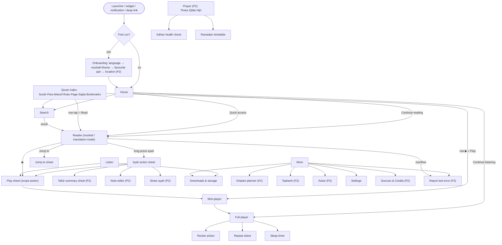
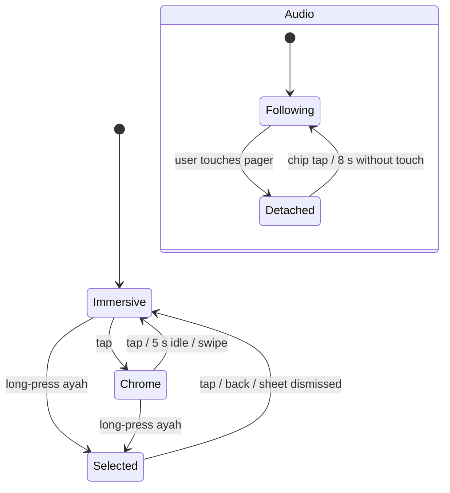

# 02 — UX / UI Specification

**Purpose.** This document defines the app the owner will hold in their hand: the information architecture, navigation and deep links, every screen (with ASCII wireframes, behaviour, states and acceptance criteria), the `:core:designsystem` tokens (colour, type, spacing, shape, elevation, motion), RTL/bidi and numeral rules, key bilingual copy, accessibility, large-screen behaviour, haptics, Material 3 component choices and the respectful-design rules. An engineer or AI agent should be able to build every screen from this doc plus the engine docs ([Mushaf rendering](05-mushaf-rendering-engine.md), [Audio engine](06-audio-engine.md), [Companion features](07-companion-engagement-features.md)) without redoing research.

**Status:** Draft v1 — 2026-10-19

**Key decisions in this doc**
- Typeset, ayah-aware mushaf as the hero surface. It is never covered by ads, banners, tooltips or coach marks (D-05, D-17).
- Bottom navigation: **Home · Quran · Listen · More** in P1. **Prayer** is added as the 4th tab in P2. On ≥ 600 dp a navigation rail replaces the bar (D-03, D-25).
- Page numbers in the UI are always the **printed labels 2–549**. Para, Manzil, Ruku and Sajda come from our Indo-Pak tables, never from Madani juz (D-04, D-07).
- Every index row has **Read** (row tap) and **Play** (trailing button) (F-IX-01…04, F-IX-06).
- Audio scopes in one Play sheet: Surah / Para / Manzil / Ruku / Page / Range / Ayah, with repeat, pause-between, speed and sleep timer (D-13).
- Themes Light / Sepia / Night / AMOLED, with separate mushaf paper/ink/highlight tokens. All text pairs are ≥ 7:1 on the page (D-05).
- English and Urdu UI from MVP. Urdu uses Noto Nastaliq Urdu. The mushaf is always RTL. Urdu UI uses Eastern (Urdu-style) digits by default (D-21).
- Rotation lock on phones only, page-turn lock everywhere (D-23). Haptics are off by default.
- No reciter photos (D-12). No tracking, no promo notifications, at most one review prompt (D-17, D-20).
- Never auto-start audio. Playback starts only from a user action (D-13). Notifications and deep links open a screen with a Play button.

---

## 1. Design principles

| # | Principle | What it means on screen |
|---|---|---|
| P1 | **The page is sacred and calm** | No overlays on Quran text except user-requested highlight or selection. Chrome is translucent and auto-hides. No confetti, no points, no sounds. |
| P2 | **One tap to what I do every day** | Home → Continue reading takes 1 tap. Any index row → Play takes 1 tap. Favourite qari is preset. App start to last page in under 1.5 s cold on a 2 GB phone (doc 10 sets the perf budget). |
| P3 | **Like my printed Quran** | 16-line Taj page furniture, printed page labels, Indo-Pak Para names (الم، سیقول …), Manzil footer, ruku «ع» triples in the outer margin (D-04, D-07; geometry in doc 05). |
| P4 | **Offline first, honest about the network** | Reading, search, translation and indexes work with zero network. Audio says clearly whether it is streaming or downloaded, and gives sizes before any download. |
| P5 | **Bilingual by construction** | Every screen is designed in English (LTR) and Urdu (RTL) at 100% and 200% font scale before it ships (screenshot matrix in doc 10). |
| P6 | **Respect and neutrality** | Arabic is always shown with any translation. Madhhab-specific items are labelled. No generated religious content. See §12. |

---

## 2. Information architecture & navigation

### 2.1 Top-level destinations

| Tab (EN / UR) | Phase | Root screen | Contains |
|---|---|---|---|
| Home / ہوم | P1 | `HomeKey` | Continue reading/listening, quick-access passages, next prayer (P2), ayah of the day (P2), khatam today (P2) |
| Quran / قرآن | P1 | `QuranIndexKey` | Index tabs Surah · Para · Manzil · Ruku · Page · Sajda · Bookmarks → Reader |
| Listen / سنیں | P1 | `ListenKey` | Favourite qari, continue listening, Surah/Para/Manzil/Popular/Downloaded lists, Downloads entry |
| Prayer / نماز | **P2** | `PrayerKey` | Times · Qibla · Hijri sub-tabs. Ramadan card in season. Adhan health check |
| More / مزید | P1 | `MoreKey` | Khatam planner, Tasbeeh, Azkar, Downloads & storage, Settings, Sources & Credits, Report text error, About |

**Why this bar.**
1. The owner's three must-haves (read, listen, index) each get a first-class home. Quran = read + index. Listen is the "media player tab" users ask for (r02 W3, Dawat-e-Islami reviews).
2. Home exists because the reference app's most-loved affordance is its one-tap "Resume" card (r01 §1.9), and because P2 adds daily cards.
3. Prayer is a daily-retention driver in Pakistan (r01 rec. 9). It is a tab only once it exists (P2), so P1 shows no empty tab.
4. Search is **not** a tab. It is a top-bar action on Home, Quran and Listen, and is reachable from the reader overflow. Five is the Material maximum, and search is used less often than prayer.
5. Bookmarks live in the Quran index (tab 7) and are linked from Home. They are not a top-level tab.

*Alternatives considered:*
- "Home · Quran · Listen · Search · More" was rejected because prayer outranks search for daily use in PK.
- A drawer-based navigation (the reference app's tiles) was rejected because it hides key features and is not a Material 3 pattern on phones.

### 2.2 Navigation map



### 2.3 Back-stack model (Navigation 3, NiA `NavigationState`/`Navigator` pattern)

- Each tab owns its own back stack (`NavBackStack`, `@Serializable`, so it survives process death). Re-selecting the active tab pops it to its root.
- The Reader lives in the **Quran** stack: `[QuranIndexKey, ReaderKey]`. Home → Continue switches to the Quran tab and sets its stack to `[QuranIndexKey(lastTab), ReaderKey(...)]`. Back from the reader then lands on the index, the natural "Juz Index" return the reference app has (r01 §2.4).
- Sheets that must respond to predictive back (Play sheet, full player, reciter picker) are Nav3 entries shown with a bottom-sheet `SceneStrategy`. Transient sheets that belong to one screen (ayah action sheet, jump-to sheet, repeat, speed, sleep) are local `ModalBottomSheet`s with `BackHandler`. Never override `onBackPressed` (predictive back is on at targetSdk 36, r07 §2.8).
- The bottom bar is hidden in the Reader (immersive surface) and while onboarding. The **mini-player** shows on every tab root and list screen, above the bar.

### 2.4 NavKeys (`:core:navigation`)

Doc 04 owns module placement. The names below are the contract the feature modules implement.

```kotlin
@Serializable sealed interface AppKey : NavKey

// Top level
@Serializable data object HomeKey : AppKey
@Serializable data class QuranIndexKey(val tab: IndexTab = IndexTab.SURAH) : AppKey
@Serializable data object ListenKey : AppKey
@Serializable data object PrayerKey : AppKey                     // P2
@Serializable data object MoreKey : AppKey

// Reading
@Serializable data class ReaderKey(
    val mushafId: MushafId = MushafId.INDOPAK_16_TAJ,
    val pageIndex: Int? = null,             // QUL index 1..548; UI shows label = index + 1 (D-04)
    val verseKey: String? = null,           // "2:255"; reader resolves page and flashes ayah
    val mode: ReaderMode = ReaderMode.MUSHAF,   // MUSHAF | TRANSLATION
) : AppKey
@Serializable data class SearchKey(val query: String = "") : AppKey
@Serializable data class CollectionKey(val collectionId: Long) : AppKey
@Serializable data class ReportErrorKey(val mushafId: MushafId, val pageIndex: Int, val verseKey: String?, val line: Int?) : AppKey

// Audio
@Serializable data class PlaySheetKey(val draft: PlayRequestDraft) : AppKey   // bottom-sheet scene
@Serializable data object PlayerKey : AppKey                                   // bottom-sheet scene, full height
@Serializable data class ReciterPickerKey(val purpose: ReciterPickPurpose) : AppKey
@Serializable data object DownloadsKey : AppKey

// Companion (P2)
@Serializable data class KhatamKey(val planId: Long? = null) : AppKey          // null = list
@Serializable data object KhatamCreateKey : AppKey
@Serializable data class QiblaKey(val sunMode: Boolean = false) : AppKey
@Serializable data object HijriKey : AppKey
@Serializable data object RamadanKey : AppKey
@Serializable data object AdhanHealthKey : AppKey
@Serializable data object TasbeehKey : AppKey
@Serializable data class AzkarKey(val category: String? = null) : AppKey

// Platform
@Serializable data class OnboardingKey(val step: Int = 0) : AppKey
@Serializable data class SettingsKey(val section: SettingsSection? = null) : AppKey
@Serializable data object CreditsKey : AppKey
```

`PlayRequestDraft` is the UI-side mirror of doc 06's `PlayRequest`: scope, from/to verse keys, reciter id, repeat and pause options. The Play sheet validates it and converts it to a `PlayRequest`.

### 2.5 Deep links

One parser (`DeepLinkParser` in `:core:navigation`, using the Nav3 1.2.0 `DeepLinkMatcher`) handles widgets, notifications, launcher shortcuts, adb and, after G3, public App Links. Internal scheme: `criterion://` (the codename; the package stays `com.chughtai.criterion`, D-19). Public `https://<brand-domain>/…` App Links come after gate G3, with `assetlinks.json` on the R2 custom domain (D-24). The paths are identical.

| URI | Opens | Synthetic back stack |
|---|---|---|
| `criterion://page/{label}` (2–549) | Reader at that printed page | Quran: `[Index, Reader]` |
| `criterion://ayah/{s}/{a}` | Reader at the ayah's page, ayah flashed 1.5 s | Quran |
| `criterion://surah/{s}` · `/para/{n}` · `/manzil/{n}` · `/ruku/{s}/{r}` | Reader at the start page | Quran |
| `criterion://read?mode=translation&ayah={s}:{a}` | Translation view | Quran |
| `criterion://listen?scope={surah\|para\|manzil\|ruku\|page\|range\|ayah}&from={s:a}&to={s:a}&n={k}&reciter={id}` | **Play sheet prefilled. Never autoplays** | Listen |
| `criterion://search?q={text}` | Search with query | current tab |
| `criterion://prayer` · `/qibla` · `/hijri` · `/ramadan` · `/adhan-health` | Companion screens (P2) | Prayer |
| `criterion://tasbeeh` · `/azkar/{category}` · `/khatam/{id}` | Companion screens (P2) | More |
| `criterion://settings/{section}` | Settings section | More |

Rules:
- Unknown or invalid params (for example page 1 or 550) open the nearest valid target and show a snackbar. They never crash.
- A deep link can never perform a destructive action (delete, reset) or start playback.
- Notification actions labelled "Play" (Kahf Friday, Mulk night) are explicit user taps. They call the media controller directly, which D-13 and the Android 17 rules allow. The URI only opens the screen.

**Launcher shortcuts (new: F-PL-10, P2).** Static shortcuts: "Continue reading", "Play favourite qari: continue", "Qibla", "Tasbeeh". Each fires the URIs above.

---

## 3. Global UI patterns

| Pattern | Spec |
|---|---|
| **IndexRow** (`:core:ui`) | 72 dp min height (88 dp in Urdu). Leading: `NumberBadge` (octagon outline, 40 dp, number in locale digits). Centre: title (titleMedium) + meta line (bodySmall, onSurfaceVariant). Trailing end: Arabic name (Noto Naskh Arabic 20 sp), then **Play** `IconButton` (48 dp, `play_circle`). Row tap = **Read**. Long-press = context menu (Play with options… · Download (Listen tab) · Bookmark start). |
| **Mini-player** | 64 dp `Surface` (tonal level 3), above the bottom bar, across tabs. Line 1: "Al-Baqarah · 255". Line 2: "Mishary Alafasy · Para 3". 2 dp progress line on top = position within the current plan. Buttons: play/pause, next ayah, ✕ (stop). Tap or swipe up → full player. Hidden in the immersive reader (see §4.4). |
| **Snackbar + Undo** | Every removal (bookmark, collection, download, khatam plan) is immediate with a 6 s Undo snackbar. No confirmation dialogs, except two irreversible cases: "delete all downloads of a reciter" and "reset tasbeeh". |
| **Download state icon** | `none ⤓` · `queued ◷` · `downloading ◔ 42%` (determinate ring) · `paused ‖` (waiting for Wi-Fi) · `error ⟳` · `done ✓`. Each state has a distinct shape, not only a distinct colour. |
| **Empty state** | 96 dp geometric line illustration (no figures) + title + one-line body + at most one action. |
| **Error state** | Inline card: what happened, what still works, one action (Try again / Report). Never a dead-end full-screen error for content that is bundled. |
| **Offline banner** | Thin `surfaceContainerHigh` strip under the top bar on network-dependent screens only (Listen, Play sheet, Downloads, Reciter picker, pack manager). Never shown in the reader. |
| **Permission rationale** | A full-width card in context (Prayer, Reminders), before the system dialog: icon · title · 2-line body · [Allow] [Not now]. After a permanent deny: [Open settings]. Never at app start. |
| **Bottom sheets** | `ModalBottomSheet` with a drag handle and `skipPartiallyExpanded` false for action sheets. The full player is full height. Sheets never cover the selected ayah (see §4.5). |
| **Loading** | Content is local, so show nothing for 150 ms, then a skeleton. Spinners are allowed only for network work. The reader page placeholder = paper colour + 16 faint ruled lines (no spinner). |

---

## 4. Screen specifications

Wireframes are drawn for the **English UI (LTR)**. In the Urdu UI, every screen except the mushaf page mirrors horizontally (§7). Sizes assume a 360 × 800 dp phone.

### 4.1 Onboarding (F-PL-01) — `OnboardingKey`

**Goal:** finish in ≤ 60 s. Every step except language can be skipped, and progress is saved per step in DataStore. Language changes recreate the activity (`AppCompatDelegate.setApplicationLocales`), and onboarding resumes at step 2. No splash hadith, no paywall, no account (contrast with r01 §2.4).

```
Step 1 Language            Step 2 Mushaf & theme         Step 3 Favourite qari          Step 4 Prayer (P2 builds)
┌────────────────────────┐ ┌──────────────────────────┐ ┌──────────────────────────┐ ┌──────────────────────────┐
│        بِسْمِ اللّٰهِ        │ │ Your mushaf          1/3 │ │ Favourite qari       2/3 │ │ Prayer times         3/3 │
│                        │ │ ┌──────────────────────┐ │ │ ○ Mishary Alafasy  ▶10s │ │ We use your approximate  │
│ ┌────────────────────┐ │ │ │ [rendered page 2     │ │ │ ○ Saad Al-Ghamdi   ▶    │ │ location once to find    │
│ │      English       │ │ │ │  preview, live theme]│ │ │ ○ Abdul Basit (Mujawwad)│ │ your city. It stays on   │
│ └────────────────────┘ │ │ └──────────────────────┘ │ │ ○ Abdur-Rahman As-Sudais│ │ this phone.              │
│ ┌────────────────────┐ │ │ 16-line Indo-Pak         │ │ ○ Abu Bakr Ash-Shatri   │ │ [Use approximate location]│
│ │       اردو         │ │ │ Taj Company layout ·     │ │ ○ Hani Ar-Rifai         │ │ [Choose city]            │
│ └────────────────────┘ │ │ printed page numbers     │ │ ○ Muhammad Ayyub        │ │ Asr time                 │
│                        │ │ Theme  (Light)(Sepia)    │ │ ○ Khalid Al-Muhanna     │ │ (●) Hanafi – later       │
│ No ads. No tracking.   │ │        (Night)(Black)    │ │ … more                  │ │ ( ) Standard – earlier   │
│ Free forever.          │ │                          │ │ Change any time in Listen│ │                          │
│                        │ │ [Skip]          [Next ›] │ │ [Skip]          [Next ›] │ │ [Not now]       [Done]   │
└────────────────────────┘ └──────────────────────────┘ └──────────────────────────┘ └──────────────────────────┘
```

- **Step 1.** Two equal 64 dp buttons. The device locale preselects focus (ur-* → اردو).
- **Step 2.** In v1 only the 16-line layout exists, so this step confirms the mushaf and picks the day theme. When 15- and 13-line layouts ship (F-RD-11, P3), it becomes a 3-card picker. The preview is our own rendered page (label 2) at the live theme.
- **Step 3.** The list is the public highlight shortlist from D-12, ordered as in the register. Alafasy is preselected. Each row has a 10 s sample, streamed with a user tap, and the sample is disabled offline with "Needs internet". Personal builds also list personal-only reciters, with a "Personal build" chip. No photos: each row has a monogram tile (§6.7).
- **Step 4 (P2+).** Location uses coarse location only (D-15). The Asr choice defaults to Hanafi for PK (D-16). Notification and exact-alarm permissions are **not** requested here. They are requested when the user turns on an adhan or reminder (§4.13).
- **Exit.** Go to Home. Home's Continue card shows "Start reading · Al-Fatiha · Page 2".

**AC:**
- (a) Fresh install → Home in ≤ 4 taps.
- (b) Choosing اردو flips the whole UI to RTL Urdu before step 2 renders.
- (c) Killing the app mid-onboarding resumes at the same step.
- (d) Zero network calls unless the user taps a sample or location.

### 4.2 Home (F-IX-09, F-IX-08, F-BM-01; cards F-CP-01/F-CP-08 data, F-BM-04 in P2) — `HomeKey`

```
┌──────────────────────────────────────┐
│ <Brand>                      🔍  ⚙   │  TopAppBar (small); brand = codename until G3
│ ┌──────────────────────────────────┐ │
│ │ CONTINUE READING                 │ │  Card (primaryContainer)
│ │ Al-Baqarah · Para 3 · Page 42    │ │
│ │ 2:270 · read 2 h ago             │ │
│ │ [ Continue ▸ ]        ▶ Listen   │ │  Listen = play from last-read ayah
│ └──────────────────────────────────┘ │
│ ┌──────────────────────────────────┐ │
│ │ ▶ Continue: Para 12 · Hud 11:58  │ │  Shown only if a resumable session exists
│ │   Mishary Alafasy           ▸    │ │
│ └──────────────────────────────────┘ │
│ Quick access                         │
│ [Ya-Sin ▶] [Ar-Rahman ▶] [Al-Waqi'ah▶]│  FlowRow of 8 AssistChips with trailing ▶
│ [Al-Mulk ▶] [Al-Kahf ▶] [Ayat al-Kursi▶]│
│ [Manzil dua ▶] [Last 2 of Al-Baqarah ▶]│
│ ┌──────────────── P2 ──────────────┐ │
│ │ Asr 3:48 PM · in 1 h 20 min      │ │  Next prayer card → Prayer tab
│ │ 7 Jumada al-Ula 1448 · Lahore    │ │
│ └──────────────────────────────────┘ │
│ ┌──────────────── P2 ──────────────┐ │
│ │ Today's khatam: Pages 42–60  ▸   │ │
│ └──────────────────────────────────┘ │
│ ┌──────────────── P2 ──────────────┐ │
│ │ Ayah of the day   (Arabic, DK)   │ │  curated 365-list (r08 §2.15); Share
│ │ translation… — Al-Baqarah 2:286  │ │
│ └──────────────────────────────────┘ │
│ Bookmarks (3 latest) ›               │
├──────────────────────────────────────┤
│ ▶ mini-player (when active)          │
│  Home    Quran    Listen    More     │  NavigationBar (P2: + Prayer)
└──────────────────────────────────────┘
```

Behaviour:
- **Continue reading** uses the auto last-read pointer F-BM-01. It is written when a page stays visible ≥ 3 s, and it is independent of bookmarks and khatam pointers (r08 §2.13).
- **Quick access chips.** Chip tap = Read at the passage start, with the passage range flashed. Trailing ▶ = Play that exact range (Ayat al-Kursi = 2:255; Last 2 of Al-Baqarah = 2:285–286; Manzil dua = the multi-range playlist from r08 §2.8).
- **Friday.** On Fridays (local date, until Maghrib), the Al-Kahf chip moves first and gets a small "Friday" label. There are no streak counters on Home.
- **Card order** is fixed: Continue reading → Continue listening → Quick access → Next prayer → Khatam → Ayah of the day → Bookmarks. Cards with no data are omitted, not shown empty.

**AC:**
- (a) Cold start → Continue tap → page rendered ≤ 1.5 s on the reference low-end device (doc 10).
- (b) Reading a bookmarked page never changes any bookmark.
- (c) Every card is reachable and announced by TalkBack in order.

### 4.3 Quran index (F-IX-01…06, F-IX-07 in P2, F-BM-02) — `QuranIndexKey(tab)`

```
┌──────────────────────────────────────┐
│ Quran          16-line Indo-Pak ▾ 🔍 │  mushaf chip (switch in P3)
│ Surah│Para│Manzil│Ruku│Page│Sajda│Bkm │  ScrollableTabRow; last tab remembered
├──────────────────────────────────────┤
│ SURAH tab                            │
│ ⬡1  Al-Fatiha            الفاتحة  ▶ │
│     Makki · 7 ayahs · Page 2         │
│ ⬡2  Al-Baqarah           البقرة   ▶ │
│     Madani · 286 ayahs · 40 rukus · p.3│
│ …                                    │
├──────────────────────────────────────┤
│ PARA tab                             │
│ ⬡1  الٓمّٓ  Alif Lam Meem        ◔ ▶ │  ◔ = read progress (pages visited / pages)
│     Starts 1:1 · Page 2              │
│ ⬡2  سَیَقُوْلُ  Sayaqool            ○ ▶ │
│     Starts 2:142 · Page 21           │
│ ⬡3  تِلْكَ الرُّسُلُ  Tilkar Rusul   ● ▶ │
│     Starts 2:253 · Page 39     ⌄     │  ⌄ expands quarters (P2, F-IX-07)
│      ├ ربع  2:273 · p.43        ▶  │
│      ├ نصف  3:18 · p.48         ▶  │
│      └ ثلثة 3:54 · p.52         ▶  │
│ ⬡4  لَنْ تَنَالُوا  Lan Tanaloo      ▶ │
│     Starts 3:92 · Page 57            │  Indo-Pak boundary (≠ Madani 3:93)
├──────────────────────────────────────┤
│ MANZIL tab                           │
│ ┌ Looking for the Manzil dua        ┐│  disambiguation card (r02 §2.11)
│ └ (protective verses)?  [Open ▸]    ┘│
│ ⬡1  Manzil 1 · Al-Fatiha – An-Nisa' ▶│
│     Page 2                           │
│ ⬡2  Manzil 2 · Al-Ma'idah – At-Tawbah▶│
│     Page 97                          │
│ … 3 p.188 · 4 p.255 · 5 p.331 · 6 p.402 · 7 p.467
└──────────────────────────────────────┘
```

| Tab | Row title | Meta line | Read target | Play scope |
|---|---|---|---|---|
| Surah (114) | number · transliterated name · Arabic name | Makki/Madani · ayahs · rukus · start page | surah start page | Surah |
| Para (30) | number · Arabic opening words (traditional name) · transliteration | "Starts s:a · Page L" + progress ring | Para start page (label 18n−15 for n ≤ 28; 509; 529) | Para (Indo-Pak range, D-07) |
| Manzil (7) | "Manzil N · first surah – last surah" | start page | start page | Manzil |
| Ruku (558) | grouped by surah (sticky header), toggle "By Para". Row "Ruku 1 · 2:1–7" | "Page 3 · ع 1 / 7 / 1" (spoken: "ruku 1 of the surah, 7 ayahs, ruku 1 of the para") | page of the ruku's first ayah | Ruku |
| Page | "Go to page" field (2–549) + "Go to ayah" (surah dropdown + ayah field) + grid of page labels in Para sections (18 per row-block) | — | page | Page (via long-press) |
| Sajda (14 + 1) | "1 · Al-A'raf 7:206" … "14 · Al-'Alaq 96:19". Plus a 22:77 row labelled «السجدة عند الامام الشافعی رح» with the English gloss "Sajda according to Imam Shafi'i" | "Page 160 · Para 9" | sajda ayah, flashed | Ayah |
| Bookmarks | embeds §4.10 | — | — | — |

- Names come from the curated surah-name CSV and the Para table (r05, D-07). Do not hardcode them in UI code.
- Para progress ring = distinct pages of that Para viewed in the active khatam plan if there is one, else in all-time reading. It is private and never shown as a score.
- **Play on any row** = immediate playback with the favourite qari and the last-used repeat and speed. A snackbar "Playing Para 3 · Alafasy" with [Options] opens the Play sheet. Long-press ▶ opens the Play sheet directly.
- Filter (Surah tab only): a search field under the tabs filters by number, transliteration, Arabic or Urdu name, and aliases (D-11 alias table).

**AC:**
- (a) Para 4 row shows "Starts 3:92 · Page 57", and Play plays 3:92 → end of Para 4 (P5 starts 4:24).
- (b) All 7 differing Para boundaries match D-07.
- (c) 22:77 is never counted as sajda #15.
- (d) Tab state and scroll survive rotation and process death.

### 4.4 Reader (F-RD-01, 02, 03, 05, 06, 07; F-RD-09/12 in P2) — `ReaderKey`

**Chrome visible (tap to toggle):**

```
┌──────────────────────────────────────┐
│ ‹   Para 3 · Page 42        🔖 🌙 🔒 │  translucent TopAppBar (surface @ 92%)
│     Al-Baqarah                       │  ≥ 400 dp: one line "Para 3 · Page 42 · Al-Baqarah"
├──────────────────────────────────────┤
│  تلک الرسل ۳        ۴۲        البقرة ۲  │  printed header (above frame)
│ ╔══════════════════════════════════╗ │
│ ║ ─────────────────────────────── ع║ │  16 typeset lines between rules
│ ║ ─────────────────────────────── ۳║ │  outer-margin markers alternate sides
│ ║ ▒▒▒▒▒▒ audio-highlighted ayah ▒▒▒║ │  (even label → right margin, odd → left)
│ ║ ─────────────────────────────── ║ │
│ ║   …                              ║ │
│ ╚══════════════════════════════════╝ │
│               منزل ۱                 │  footer
│     ( Follow recitation ⟲ )          │  AssistChip, only while detached
│ ┌──────────────────────────────────┐ │
│ │ ▶ Al-Baqarah · 270   Alafasy ‖ ✕ │ │  mini-player (if audio session)
│ └──────────────────────────────────┘ │
│ ◀──────●───────────────────────────  │  page scrubber, RTL: 2 at right edge
│  ☰ Jump to   ▶ Play   ت Translation ⋮│  bottom toolbar (FloatingToolbar when M3 1.5 is stable)
└──────────────────────────────────────┘
```

**Immersive (default after 5 s idle or a page swipe):** the system bars and all chrome are hidden. Only the page shows, plus an optional 3 dp "playing" line at the bottom edge (Setting: *Show playing indicator*, default on). The mini-player is hidden in immersive mode so that nothing covers the page frame.

| Element | Spec |
|---|---|
| Pager | `HorizontalPager` inside `LayoutDirection.Rtl`. Swipe right → next page (like a book). `beyondViewportPageCount = 1`. Page models are prefetched ±2 (doc 05). 548 pages, labels 2–549. |
| Title | "Para {n} · Page {label}" + surah. For a page holding several surahs: "Al-Falaq – An-Nas". Tapping the title opens Jump-to. |
| 🔖 | Toggles a **page bookmark** in the default collection. Filled icon + ribbon glyph in the page's top outer corner. Removal → Undo snackbar. Long-press 🔖 → choose collection. |
| 🌙 | Toggles day ↔ night theme for the whole app (§6.1, "Mode" override). |
| 🔒 | On phones: a menu with two checkable items, "Lock screen rotation" and "Lock page turning". On ≥ 600 dp, the rotation item is hidden and 🔒 toggles page-turn lock directly (D-23). The icon is filled when any lock is on, and a 2 s snackbar confirms the change. Page-turn lock blocks swipe, scrubber and auto page-turn. It does **not** block Jump-to (an explicit command). |
| Scrubber | `Slider` 2–549, RTL, with ticks at Para starts. While dragging, a bubble shows "Page 213 · Para 12 · Hud". The page commits on release. |
| ☰ Jump to | Full-height sheet with segmented Surah / Para / Manzil / Ruku / Page lists (shared `:core:ui` rows; no feature-to-feature dependency). Tap → page. |
| ▶ Play | Opens the Play sheet prefilled with **Page scope** of the current page. If an ayah is selected, it is prefilled with "From selected ayah". |
| ت Translation | Switches to translation mode (§4.6) at the first ayah of the page. The icon is the Arabic letter ت in EN and UR alike. |
| ⋮ overflow | Search · Go to page/ayah · Night brightness (night themes) · Page-turn animation (P2) · Auto-scroll mode (P2) · Share page as image (P2) · Report text error (P2) · Reader settings. |
| Keep screen on | On by default while the reader is visible. It releases after N minutes without touch or page turn (Setting: 5 / 15 / 30 / never, default 15). It stays on while audio is playing and the reader is visible. |
| System bars | Setting *Keep system bars visible* (default off; restores the toggle the reference removed, r01 §2.5). |
| Zoom (F-RD-06) | Pinch 1.0–2.5×. During the gesture: `graphicsLayer` scale. On release: re-layout at the new font px (crisp vector). While zoomed, a drag pans first and turns the page only at the edge. The zoom level persists across pages and per orientation (r02 rec. 2). Double-tap is **not** used, because it would delay tap-to-toggle. From 1.6× upward, a chip offers "Large text mode" (reflow, P3). |
| Landscape (phone) | One page fitted to width, scrolling vertically within the page. On ≥ 600 dp: see §10. |
| Auto-scroll (F-RD-09, P2) | Vertical `LazyColumn` of pages with a speed slider (1–10). Touch pauses it, and a ▶ chip resumes. |
| Page-turn animation (F-RD-12, P2) | Slide (default) · Curl. See §6.6. |

**Tap and gesture contract:**

| Gesture | No selection | Ayah selected |
|---|---|---|
| Single tap | Toggle chrome | Clear selection |
| Long-press on ayah | Select ayah + open action sheet | Move selection to the new ayah |
| Horizontal swipe | Turn page (unless locked or zoomed) | Turn page; selection is cleared |
| Pinch | Zoom | Zoom |
| Back | Exit reader (to index) | Clear selection |

**Follow-along (F-RD-05, D-13):**
- The current ayah gets the **audio highlight** fill (§6.1). The highlight crossfades in 120 ms. Gapped audio switches on item transition, gapless audio on PlayerMessage.
- **Auto page-turn** happens when the playing ayah's start is on another page. It animates (350 ms) unless reduce-motion is on.
- After the user touches the pager, auto-turn is **suspended for 8 s** and the "Follow recitation" chip appears. Tapping the chip re-attaches immediately. After 8 s with no touch, the reader re-attaches on the next ayah change.
- If the recitation has no timing for this surah (missing pack or kill-switch), no ayah highlight is drawn. The page turns only at surah boundaries, and the full player shows "No highlight for this surah".



**AC:**
- (a) Swiping right from label 2 shows label 3.
- (b) The title always equals the printed header label on the page.
- (c) A highlight update never re-records the text layer (doc 05 layer contract; verified by a recomposition-count test).
- (d) The rotation lock persists across restarts on phones and is invisible on ≥ 600 dp.
- (e) With TalkBack on, swiping pages announces "Page 42, Para 3, Al-Baqarah".

### 4.5 Ayah action sheet (F-RD-04) — local sheet in Reader

```
┌──────────────────────────────────────┐
│ Al-Baqarah 2:255 · Para 3            │  header; alias "Ayat al-Kursi" shown if any
│ ▶ Play from here    ⟳ Play range…   │
│ 🔖 Bookmark          ✎ Note (P2)     │
│ ⧉ Copy               ↗ Share         │  Share = text in P1, image in P2 (F-CP-10)
│ ت Translation        ✦ Tafsir summary│  tafsir summary (P2, F-RD-13)
│ ⚑ Report text error (P2)             │
│ ── Urdu (Junagarhi) ──────────────── │  inline translation preview (2 lines, expandable)
│ اللہ تعالیٰ ہی معبود برحق ہے…            │
└──────────────────────────────────────┘
```

- **Placement.** The sheet opens at 45% height. If the selected ayah's rects fall in the bottom 50% of the viewport, the page auto-scrolls/translates up by the overlap (zoomed) or the sheet opens in **compact mode**: 2 action rows, no preview, ≈ 168 dp.
- **Play from here** plays from this ayah to the end of the current surah with the favourite qari (scope `Ayah→SurahEnd`). **Play range…** opens the Play sheet with *From* = this ayah.
- **Copy / Share text format.** Doc 03 owns the exact attribution strings. Tanzil Uthmani text with PUA/control characters stripped (D-08):
  `{arabic}\n\n{translation} — {translator}\n\n{Surah name} {s}:{a} · Para {n}`.
- **Bookmark** toggles an ayah bookmark in the last-used collection. Long-press picks a collection.
- Selection visual: selection fill + 2 dp outline (§6.1). Multi-line ayahs show one rounded rect per line.

### 4.6 Translation view (F-RD-08; F-RD-13 tafsir sheet P2) — `ReaderKey(mode = TRANSLATION)`

```
┌──────────────────────────────────────┐
│ ‹  Al-Baqarah · Para 3       Aa  📖  │  Aa = text settings; 📖 = back to mushaf
├──────────────────────────────────────┤
│ ── Page 42 ───────────────────────── │  page divider (sticky label)
│                    ﴾ Arabic ayah text │  DK IndoPak, right-aligned, 26 sp default
│                      … ۝۲۷۰ ﴿          │
│ ۲۷۰  اردو ترجمہ نستعلیق میں …¹         │  Urdu Junagarhi, Nastaliq 18 sp, RTL
│ 270  English (Saheeh International)… │  LTR, 16 sp; optional
│            ▶   🔖   ⋯                │  row actions (48 dp)
│ ──────────────────────────────────── │
│ (next ayah card)                     │
└──────────────────────────────────────┘
```

- Arabic is always shown (D-09). Per-language toggles: Urdu (default on in Urdu UI), English (default on in English UI). Both can be on. A translation-only mode does not exist.
- **Aa sheet.** Arabic size 18–44 sp (default 26). Urdu 14–30 (default 18). English 12–28 (default 16). Line-height factors are in §6.2. Sizes multiply with system font scale.
- **Position sync.** Opening from mushaf page L scrolls to that page's first ayah. Returning to mushaf opens the page of the first fully visible ayah. The last-read pointer updates from either mode.
- **Audio follow.** The playing ayah card gets the audio-highlight fill and auto-scrolls into view, with the same 8 s detach rule.
- **Footnotes.** Superscript markers (¹) in Urdu Junagarhi open the tafsir-summary sheet (P2) showing Ahsan-ul-Bayan text with an attribution footer.
- `LazyColumn` keyed by verse key; 6,236 items, so paging isn't needed (content DB query by page range, windowed ±3 pages).

### 4.7 Audio (F-AU-01…09)

#### 4.7.1 Play sheet / scope picker — `PlaySheetKey`

```
┌──────────────────────────────────────┐
│ Play                               ✕ │
│ [Surah] [Para] [Manzil] [Ruku]       │  FilterChips, single-select
│ [Page] [Range] [Ayah]                │
│ ──────────────────────────────────── │
│ Para 3 · تلک الرسل                     │  scope summary
│ From  Al-Baqarah 2:253          ▾    │  pickers (surah dropdown + ayah stepper)
│ To    Āl-ʿImrān 3:91            ▾    │  disabled unless Range
│ Reciter ★ Mishary Alafasy    Change ›│  → ReciterPickerKey
│ Repeat  Off ›          Speed 1.0× ›  │
│ ⓘ Streaming · ~70 MB · Highlight ✓   │  or "Downloaded ✓" / "Not downloaded – offline"
│ ⓘ Uses parts of 2 surah recordings   │  gapless Para/Manzil/Ruku notice (r06 §2.8.7)
│ [ ⤓ Download ]        [ ▶  Play   ]  │
└──────────────────────────────────────┘
```

- Scope semantics and boundaries come from doc 06's `PlanExpander`. The sheet only displays and validates them. Range validation: *To* ≥ *From* in mushaf order. Ranges across surahs are allowed.
- **Size line.** Sizes come from our catalogue's measured bytes, never from provider APIs (r06 §2.8.7). On mobile data with *Stream on mobile data = Ask* (default), the first stream of the session shows the `audio_mobile_data` dialog.
- **Offline and not downloaded:** Play is disabled. The info line reads "Not downloaded — connect to the internet or download on Wi-Fi."
- **Gapped verse-by-verse reciters** (F-AU-04) show only in builds where the catalogue's licence flags allow them (personal builds until G2).

#### 4.7.2 Full player — `PlayerKey`

```
┌──────────────────────────────────────┐
│ ⌄                       Open in mushaf│
│ ┌──────────────────────────────────┐ │
│ │  [geometric tile, monogram "MA"] │ │  no reciter photo (D-12)
│ └──────────────────────────────────┘ │
│ Al-Baqarah · 255                     │  headlineSmall
│ Para 3 · Page {L} · Mishary Alafasy ▾│  ▾ = reciter picker
│ ●━━━━━━━━━━━━○──────────── 12:05/42:50│  seek bar of current surah item; ayah ticks
│ Ayah 255 of 286 · Repeat 2/3         │
│    ⏮ ayah     ⏯     ayah ⏭           │  56 dp centre button
│  ⟳ Repeat   1.0×   ☾ Sleep   ⤓   ☰  │  ☰ = plan outline ("Up next")
│ ⓘ No highlight for this surah        │  only when timing is unavailable
└──────────────────────────────────────┘
```

- Previous and next go to the previous/next **distinct ayah** (Setting: *Skip buttons: ayah | surah*, default ayah). Seek on gapless snaps to the containing ayah for highlight. Seek on gapped is per ayah item.
- The plan outline lists items (surahs, or ayahs when the list is short) with the current one marked. Tapping one jumps to it.
- **Open in mushaf** opens the reader at the playing page with follow on.
- The notification and lock screen are Media3 defaults with custom buttons: repeat-ayah toggle, previous/next ayah, play/pause, sleep (doc 06). Title "Al-Baqarah · 255", artist = reciter.

#### 4.7.3 Reciter picker (F-AU-01) — `ReciterPickerKey`

```
┌──────────────────────────────────────┐
│ ‹ Reciters                       🔍  │
│ [Murattal] [Mujawwad] [Highlight ✓]  │  FilterChips (multi)
│ [Downloaded]                         │
│ FAVOURITES                           │
│ [MA] Mishary Alafasy  مشاري العفاسي  ★│  row: monogram · name EN/AR · chips
│      Murattal · Highlight ✓ · 1.7 GB ✓│
│ ALL RECITERS                         │
│ [SG] Saad Al-Ghamdi   سعد الغامدي    ☆│
│      Murattal · Highlight ✓        ▶ │  ▶ = 10 s sample
│ …                                    │
└──────────────────────────────────────┘
```

- ★ toggles favourite (several allowed). The **favourite qari** used for one-tap Play is the first favourite, and long-press "Set as default" reorders.
- Rows for reciters with highlight off in some surahs show "Highlight: most surahs". Tapping that opens the list of surahs without highlight.
- The catalogue (`catalogue.json`) drives everything. A recitation that is kill-switched disappears, and its downloaded files are kept but marked "Unavailable".

#### 4.7.4 Repeat, speed, sleep sheets (F-AU-05, F-AU-06)

```
Repeat                                 Speed                       Sleep timer
┌───────────────────────────────┐     ┌───────────────────────┐   ┌──────────────────────────┐
│ Repeat each ayah              │     │ 0.5× ──●────── 2.0×   │   │ ( ) 5  ( ) 10  ( ) 15 min │
│ (1)(2)(3)(5)(7)(10)(∞)        │     │ [0.75][1.0][1.25][1.5]│   │ ( ) 30 ( ) 45 ( ) 60 ( ) 90│
│ Repeat the whole selection    │     │ Pitch is preserved    │   │ ( ) End of ayah           │
│ (1)(2)(3)(5)(∞)               │     └───────────────────────┘   │ ( ) End of surah          │
│ Pause after each ayah         │                                 │ ( ) End of para           │
│ (Off)(Fixed: 2–10 s)(×1)(×1.5)(×2)│                             │ Fade out over 10 s  [✓]   │
│  × = pause equals ayah length │                                 │ [Cancel timer]            │
│ [Reset]                [Done] │                                 └──────────────────────────┘
└───────────────────────────────┘
```

- Speed steps are 0.05. The value is shown in a chip on the player and persisted per user, not per reciter.
- The sleep timer lives in the service (doc 06). The player shows the remaining time "☾ 12:30". The "End of …" options show the boundary ("Ends after 2:286").
- Repeat counters show in the full player ("Repeat 2/3") and in the notification subtitle.

#### 4.7.5 Listen tab — `ListenKey`

```
┌──────────────────────────────────────┐
│ Listen                    🔍  ⤓ Downloads│
│ ★ Mishary Alafasy            Change ›│
│ ┌ ▶ Continue: Para 12 · Hud 11:58 ──┐│
│ └────────────────────────────────────┘│
│ [Surahs][Paras][Manzils][Popular][Downloaded] │  SegmentedButton row (scrollable)
│ ⬡1  Al-Fatiha                 ✓   ▶  │  download state icon + Play
│ ⬡2  Al-Baqarah     116 MB     ⤓   ▶  │
│ ⬡3  Āl-ʿImrān                 ◔42% ▶ │
│ …                                    │
└──────────────────────────────────────┘
```

- The lists are for the **selected reciter**. Changing the reciter here changes the favourite (with Undo).
- The **Popular** list matches the Media3 browse-tree "Popular" node (doc 06): Ya-Sin, Ar-Rahman, Al-Mulk, Al-Kahf, Al-Waqi'ah, Al-Fatiha, Ayat al-Kursi, Manzil dua.
- Download icon tap → confirm dialog with size (`dl_confirm`). A Para row in gapless layout uses the `dl_para_needs_surah` copy.

### 4.8 Downloads & storage manager (F-AU-08, F-AU-09, F-PL-06) — `DownloadsKey`

```
┌──────────────────────────────────────┐
│ ‹ Downloads & storage                │
│ ▓▓▓▓▓▓▓▓▓░░░░░░░░░  2.1 GB used      │  stacked bar: Audio · Packs · Cache
│ Audio 1.9 GB · Packs 32 MB · Cache 180 MB · Free 9.4 GB │
│ [✓] Download on Wi-Fi only           │  default on (D-14)
│ Storage location   Phone ▾ (SD card) │  getExternalFilesDirs
│ Stream cache       256 MB ▾          │  256 MB – 2 GB
│ ACTIVE (2)                    ‖ all  │
│ Al-Baqarah · Alafasy   ◔ 42%  ‖  ✕   │
│ Para 30 · Ghamdi       ◷ Waiting for Wi-Fi│
│ RECITERS                             │
│ Mishary Alafasy   1.7 GB · 114/114 ⌄ │  expand → grid: Surahs | Paras
│   [Download all · 1.71 GB] [Delete]  │
│ Saad Al-Ghamdi    120 MB · 9/114   ⌄ │
│ [Delete all except favourites]       │
│ [Clean up unfinished downloads]      │
│ CONTENT PACKS                        │
│ Urdu – Junagarhi (bundled)    ✓      │  licence chip "QuranEnc"
│ Tafsir summary – Ahsan-ul-Bayan 4.4 MB ⤓│ (P2)
│ Timing packs   12 reciters  ✓ auto   │
└──────────────────────────────────────┘
```

- Expanded reciter grid: 114 surah cells, or 30 Para cells (segmented). Each cell has a state icon. Long-press a cell → delete.
- "Download all" and "Delete …" show the size first. "Delete reciter" is the only confirm dialog here.
- The active queue reflects the UIDT job (API 34+) or the WorkManager worker (≤ 33) (D-14). The system notification mirrors it.
- Errors per item: ⟳ with a reason ("Server unavailable", "Checksum mismatch — will retry", "Storage full").

### 4.9 Search (F-SR-01, F-SR-02, F-SR-03) — `SearchKey`

```
┌──────────────────────────────────────┐
│ ‹ [ ayatul kursi                  ✕ ]│  SearchBar (docked)
│ GO TO                                │
│  Ayat al-Kursi · Al-Baqarah 2:255  ▸ │  alias / verse-key / page parse
│ SURAHS (1)                           │
│  ⬡2 Al-Baqarah                     ▸ │
│ QURAN TEXT (12)            See all › │
│  2:255  اَللّٰهُ لَآ اِلٰهَ اِلَّا هُوَ…        │  DK IndoPak snippet; match bold+underline
│ TRANSLATION · URDU (3)     See all › │
│  2:255  اللہ تعالیٰ ہی معبود برحق ہے…    │
│ TRANSLATION · ENGLISH (2)  See all › │
│  2:255  Allah – there is no deity…   │
└──────────────────────────────────────┘
```

- **Query parsing**, before full-text search: `\d{1,3}` → "Page N" (if 2–549) and "Surah N" (if 1–114). `s:a` with Latin or Eastern digits (`۲:۲۵۵`) → ayah. "para 3" / "پارہ ۳" / "juz 3" → Para. Aliases come from the D-11 table.
- **Groups** in this order: Go to · Surahs · Quran text · Translation (one group per installed language). Each group shows 3 results and "See all". Results are in mushaf order inside a group.
- **Highlight** of matched terms: bold + underline in the `searchHit` colour. Both a weight cue and a line cue are used, so the highlight is not colour-only.
- Tapping a result opens the reader at that ayah with a 1.5 s flash. Translation results open translation mode.
- **Empty query** shows recent searches (local, max 20, "Clear") plus suggestion chips (Ya-Sin, Ayat al-Kursi, Manzil dua).
- **No results** shows `search_no_results` + "Search tips: try without harakat; try Urdu or English".
- Latency target: ≤ 150 ms for whole-word queries on the low-end device (FTS5, D-11).

### 4.10 Bookmarks & collections (F-BM-02; notes F-BM-03 P2; F-BM-01 pointer) — Index tab 7 + `CollectionKey`

```
┌──────────────────────────────────────┐
│ Bookmarks                 ⇅  + New   │  sort: recent | mushaf order
│ ┌ LAST READ  Page 42 · Al-Baqarah  ▸┐│  pointer card, not deletable (F-BM-01)
│ └────────────────────────────────────┘│
│ ● Bookmarks (default)       12      ›│  collections, colour dot + name
│ ● Hifz revision              5      ›│
│ ● Duas                       8      ›│
│ RECENT                               │
│ 🔖 Page 57 · Para 4 · Āl-ʿImrān · 3d  │  page bookmark
│ ◆ 2:255 Ayat al-Kursi · Duas · 1w   │  ayah bookmark; first words in DK
│   ✎ "Read after every salah" (P2)    │  note preview
└──────────────────────────────────────┘
```

- Collections have a name and one of 6 colour-blind-safe colours (§6.1). The name is always shown, so colour is never the only cue.
- Rename, recolour and delete a collection (deleting moves its items to the default, with Undo). Long-press items → multi-select → move or delete.
- Bookmark keys: `(mushafId, pageIndex)` for pages, verse key for ayahs (D-10). Ayah bookmarks therefore survive a future layout switch, and page bookmarks are shown "on 16-line".
- **Empty state:** `empty_bookmarks`.

### 4.11 Khatam planner (F-BM-04; F-BM-05 streaks/stats; F-CP-11 sheet) — P2 — `KhatamKey`, `KhatamCreateKey`

```
Plan list / today                       Create plan
┌──────────────────────────────────┐   ┌──────────────────────────────────┐
│ ‹ Khatam              + New plan │   │ ‹ New khatam                     │
│ ┌ Ramadan khatam ───────────────┐│   │ Preset ( 30 days )( Ramadan 29 ) │
│ │ Today: Pages 42–60 · Para 3   ││   │        ( 27 nights )( 7 days )   │
│ │ ◔ 38% · finish by 9 Mar       ││   │        ( 60 days )( Custom )     │
│ │ [Read ▸]   [Mark as read]     ││   │ Start   Page 2 · Al-Fatiha     ▾ │
│ └───────────────────────────────┘│   │ Finish by  9 Mar 2027          ▾ │
│ Para checklist                   │   │ Unit (Pages)(Paras)(Rukus)       │
│ [1✓][2✓][3◔][4 ][5 ][6 ]…[30 ]   │   │ [✓] End each day at a ruku «ع»   │
│ This week: 126 pages · 4 paras   │   │ Rest days  M T W T F S S         │
│ (private, no comparison)         │   │ Dedication (optional)            │
│ Group khatam sheet ›             │   │ [ e.g. Esal-e-sawab for …      ] │
└──────────────────────────────────┘   │ Reminder  9:00 PM  [✓]           │
                                       │ ≈ 19 pages a day        [Create] │
                                       └──────────────────────────────────┘
```

- The algorithm is from r08 §2.13: daily goal = ceil(remaining / active days), snapped to a ruku end if chosen. Missed days are redistributed silently, and the copy is `khatam_replanned`, never "You missed …".
- Each plan has its own pointer, separate from Last read (F-BM-01). "Read ▸" opens the plan's pointer, and reading auto-suggests "Mark as read" after the portion's last page has been visible ≥ 20 s.
- On completion: the dua-e-khatam screen with Arabic + translation and sourced text (content per doc 07), and copy `khatam_complete`. No animation, no badge.
- **Streaks & stats (F-BM-05)** are private by default, with 2 freeze days per month (r08). They appear only inside the planner as plain text ("4 days in a row"). They never appear on Home, in notifications or on Quran pages.
- **Group khatam sheet (F-CP-11, P2)** builds WhatsApp text "1. الم — Ahmed ✓ / 2. سیقول — ____ …". "Paste updated list" parses claims back. The realtime version is P3 (doc 07).

### 4.12 Share ayah (F-CP-10, P2)

- Text share is in P1 (§4.5). Image share: an offscreen Compose card at 1080×1350 (post) and 1080×1920 (status). Content: Arabic (DK IndoPak), translation with translator attribution, reference "Al-Baqarah 2:255 · Para 3", and a small app mark.
- Backgrounds are 6 plain or geometric presets in the theme palette. No imagery of living beings, no photos of the Haram (r08 §2.15).
- The image goes out through `FileProvider` + `ACTION_SEND`. A preview screen has [Post] [Status] toggles and [Share].

### 4.13 Prayer times (F-CP-01, F-CP-02; Ramadan F-CP-07) — P2 — `PrayerKey`

```
┌──────────────────────────────────────┐
│ Prayer        [Times] [Qibla] [Hijri]│  PrimaryTabRow
│ 📍 Lahore · approximate        Change│
│ ‹  Mon 19 Oct 2026                ›  │
│    7 Jumada al-Ula 1448              │
│ ┌──────────────────────────────────┐ │
│ │ Asr in 1 h 20 min                │ │  next-prayer card; minute precision
│ └──────────────────────────────────┘ │
│ Fajr       4:47 AM          🔔 Adhan │  row: name · time · alert mode (tap to cycle/menu)
│ Sunrise    6:08 AM          🔕       │
│ Dhuhr     11:48 AM          🔔 Short │
│ Asr        3:48 PM  ◀ next  🔔 Adhan │
│ Maghrib    5:26 PM          🔔 Adhan │
│ Isha       6:48 PM          🔔 Notif │
│ Karachi method · Hanafi Asr · ⚙      │  footer → prayer settings
│ ⚠ Adhan may be late. Allow on-time › │  only if exact alarms denied
│ Adhan health check ›                 │
└──────────────────────────────────────┘
```

(The example times are the r08 §2.2.3 golden vector for Lahore, 2026-10-19. The Hijri date assumes the PK feed (UQ − 1).)

- **Alert modes per prayer:** Off · Notification (silent) · Short adhan (channel sound) · Full adhan (FGS, USAGE_ALARM) (D-16).
- Choosing a sounding mode the first time runs the permission flow in context:
  1. POST_NOTIFICATIONS rationale (`perm_notif_*`) → system dialog.
  2. If audible mode needs exact alarms and `canScheduleExactAlarms()` is false: the `perm_exact_*` explainer → `ACTION_REQUEST_SCHEDULE_EXACT_ALARM`.

  Declining keeps the mode but shows the ⚠ row (inexact).
- **Full adhan screen** while sounding: none. The notification has [Stop]. No full-screen intent in v1 (D-16). Silent/DND states are respected by the app (doc 07).
- **Prayer settings** (`SettingsKey(PRAYER)`): method, Asr madhab, per-prayer offsets ±30 min, high-latitude rule, region preset, adhan voice per mode, location/city.
- **Ramadan (F-CP-07)** `RamadanKey`, in season (Hijri Ramadan ± 3 days or a manual toggle):
  - countdown card ("Iftar in 42 min")
  - 30-day Sehri/Iftar table with safety margins (Sehri −0…−10, Iftar +0…+3 min)
  - [Share timetable image]
  - Taraweeh khatam preset
  - sourced duas only

### 4.14 Adhan health check (F-CP-02) — P2 — `AdhanHealthKey`

```
┌──────────────────────────────────────┐
│ ‹ Adhan health check                 │
│ ✓ Notifications allowed              │
│ ✗ On-time alarms not allowed   [Fix] │  → exact-alarm settings
│ ✗ Battery: restricted          [Fix] │  → app battery settings
│ ! Infinix: enable Auto-start   [How] │  vendor steps (DontKillMyApp, CC BY)
│ ✓ Alarm volume 70%                   │
│ ⓘ Phone on silent: adhan stays silent│  explains our silent/DND policy
│ LAST 10 ALARMS                       │
│ Isha  18 Oct  on time                │
│ Fajr  18 Oct  +7 min late  ⚠         │
│ [ Test adhan in 1 minute ]           │
│ [ Copy diagnostic report ]           │  plain text to clipboard/share; no upload
│ Guidance adapted from dontkillmyapp.com (CC BY 4.0) │
└──────────────────────────────────────┘
```

- The vendor is detected via `Build.MANUFACTURER`. The table covers Transsion (Infinix/Tecno/itel), Vivo, Xiaomi, Oppo/realme and Samsung (r08 §2.3.5). [Fix] deep-links to the vendor's intent where known, and falls back to app details.
- Lateness = actual fire − scheduled time, from the local alarm log (doc 07).

### 4.15 Qibla (F-CP-03) — P2 — `QiblaKey`

```
┌──────────────────────────────────────┐
│ Prayer        [Times] [Qibla] [Hijri]│
│            ▲ (phone heading)         │
│        ╭──────────╮                  │
│      ╱   N    🕋→   ╲                 │  dial rotates; Kaaba marker at bearing
│     │  W    ●     E │                │
│      ╲      S     ╱                  │
│        ╰──────────╯                  │
│   Qibla 260° from true north         │
│   Turn 12° right                     │  → "You are facing the Qibla" within ±3°
│   Accuracy: ●●○ medium   [Calibrate] │
│   📍 Lahore (approximate)            │
│   No compass? Use the Sun ›          │  Sun mode (P3 per r08 rec. 7)
└──────────────────────────────────────┘
```

- **Calibration overlay** (figure-8 line animation, no character) when accuracy is UNRELIABLE or LOW. **Interference banner** when the field strength is out of range (copy `qibla_interference`).
- **No-magnetometer devices** show an empty state "This phone has no compass" + the bearing in degrees + "Use the Sun" (when Sun mode ships).
- Keep-screen-on while visible. Alignment haptic tick (functional, see §11). The heading needle updates at ≥ 30 fps with circular smoothing.

### 4.16 Hijri calendar (F-CP-04) — P2 — `HijriKey`

```
┌──────────────────────────────────────┐
│ Prayer        [Times] [Qibla] [Hijri]│
│ ‹  Jumada al-Ula 1448   ›   Oct–Nov 2026│
│  Sun Mon Tue Wed Thu Fri Sat         │
│           1   2   3   4   5          │  Hijri numerals big,
│          13  14  15  16  17          │  Gregorian small below
│   6 [7]  8   9  10  11  12           │  [7] = today (Mon 19 Oct; PK = UQ − 1)
│  18  19  20  21  22  23  24          │
│ ⓘ Pakistan: Ruet-e-Hilal · updated 13 Oct 2026 │ feed status
│ Adjust  (−2)(−1)(0)(+1)(+2)          │  user offset (D-15)
│ EVENTS (toggle each)                 │
│ 12 Rabi-ul-Awwal …            [✓]    │  neutral labels; toggles (r08 §2.7)
└──────────────────────────────────────┘
```

- After local Maghrib, the header shows "8 Jumada al-Ula (from Maghrib)". Today's cell keeps the civil date mapping.
- **Feed missing or stale > 40 days:** an info line "Using Umm al-Qura with your adjustment".

### 4.17 Tasbeeh (F-CP-05) — P2 — `TasbeehKey`

```
┌──────────────────────────────────────┐
│ ‹ Tasbeeh     SubhanAllah ▾    ⋮     │  preset picker; ⋮ history, settings
│                                      │
│              ╭─────╮                 │
│             │  27  │  / 33           │  displayLarge count, ring = target
│              ╰─────╯                 │
│         (tap anywhere to count)      │  full-screen tap target
│                                      │
│  Today 233 · Volume keys count [✓]   │
│  [ Reset ]                           │  long-press or confirm
└──────────────────────────────────────┘
```

- **Presets:** Tasbih-e-Fatimah 33/33/34 (auto-advance), Istighfar 100, Durood, Kalima, custom (name + target).
- Keep-screen-on. Haptic tick per count, with a stronger tick at the target (functional, §11). Daily totals stay local.
- Reset uses the confirm dialog `tasbeeh_reset_confirm`. There is no "lifetime hasanat" figure anywhere (§12).

### 4.18 Azkar (F-CP-06) — P2 — `AzkarKey`

```
Categories                            Session (card per dhikr)
┌────────────────────────────────┐   ┌────────────────────────────────┐
│ ‹ Azkar                        │   │ ‹ Morning azkar        3 / 31  │
│ ☀ Morning azkar     31     ›   │   │ ┌────────────────────────────┐ │
│ ☾ Evening azkar     30     ›   │   │ │ Arabic (Naskh / DK if Quran)│ │
│ ◎ After salah        8     ›   │   │ │ Urdu translation           │ │
│ ☾ Before sleep      13     ›   │   │ │ English · transliteration  │ │
│ 🛡 Manzil (protective verses) › │   │ │ [Muslim 2723]  reference   │ │
│ ✦ Core duas                 ›  │   │ └────────────────────────────┘ │
└────────────────────────────────┘   │        ( 1 / 3 )  tap to count │
                                     │ [‹ Prev]   ▶ audio   [Next ›] │
                                     └────────────────────────────────┘
```

- The language toggles reuse the translation view settings. Every card has a reference chip (no unsourced items, doc 07). Quranic items (the Manzil dua) use the Quran text, the DK font and our reciter audio.
- The counter reaches its count → auto-advance after 600 ms (respects reduce motion). A session progress ring sits in the top bar. No completion fanfare.

### 4.19 Settings (F-PL-02) — `SettingsKey`

List-detail on ≥ 600 dp. Defaults are authoritative for the `UserSettings` DataStore (doc 04 owns the schema).

| Section | Setting | Default |
|---|---|---|
| Language & region | App language (English / اردو) · Numerals in Urdu UI (Eastern ۱۲۳ / Western 123) | device-based · Eastern |
| Appearance | Mode (Follow system / Day / Night) · Day theme (Light / Sepia) · Night theme (Night / Pure black) · Night text brightness 70–100% | Follow system · Light · Night · 100% |
| Accessibility | Read translation with TalkBack · Reduce motion (Follow system / On) · Volume keys turn pages (P2) | on · Follow system · off |
| Reading | Open app to (Home / Last page) · Keep screen on (5/15/30 min/never) · Keep system bars visible · Page-turn animation (Slide / Curl, P2) · Vibration on page turn · Show playing indicator · Auto page-turn during recitation | Home · 15 min · off · Slide · **off** · on · on |
| Translation | Show Urdu · Show English · Translator per language (P2, F-TR-03) · Arabic / Urdu / English sizes | per UI language · Junagarhi / Saheeh · 26/18/16 sp |
| Audio | Favourite qari · Skip buttons (ayah/surah) · Stream on mobile data (Ask / Allow / Never) · Streaming quality (Auto / Data saver / High) · When other audio plays (Pause / Lower volume) | Alafasy · ayah · Ask · Auto · Pause |
| Downloads | Wi-Fi only · Storage location · Stream cache size | on · Phone · 256 MB |
| Prayer (P2) | Location/city · Method · Asr · Offsets · High-latitude · Adhan voices · Adhan health check | Karachi · Hanafi (PK) |
| Reminders (P2) | Kahf Friday · Mulk night · Daily ayah · Azkar · Khatam · Ayat al-Kursi after salah · Quiet hours · Max 3/day | per r08 §2.15 |
| Backup | Android backup status (F-BM-06) · Export / Import JSON (P2) | — |
| Privacy | Plain statement: "No ads. No tracking. Nothing leaves your phone except audio and pack downloads." Crash reports opt-in (P3, F-PL-09) | off |
| About | Sources & Credits · Open-source licences · Report text error · Version · Contact | — |

### 4.20 Sources & Credits (F-PL-04) — P2 — `CreditsKey`

```
┌──────────────────────────────────────┐
│ ‹ Sources & credits                  │
│ MUSHAF                               │
│ 16-line Indo-Pak, Taj Company layout │
│ Layout data: QUL / Tarteel (used with permission) │
│ Font: DigitalKhatt IndoPak © 2024 Amine Anane / Tarteel — SIL OFL 1.1 │
│ Proofread by: <name, qualification, date> (G5) │
│ QURAN TEXT (search, copy)            │
│ Tanzil Quran Text (Uthmani, Simple-Clean) — CC BY 3.0, unmodified │
│ TRANSLATIONS                         │
│ Urdu – Muhammad Junagarhi · QuranEnc.com · v1.1.3 │
│ English – Saheeh International · Noor International Center · QuranEnc.com │
│ AUDIO                                │
│ Mishary Alafasy — mp3quran.net … ›   │  per recitation: host, statement, date
│ DATA & GUIDANCE                      │
│ GeoNames cities (CC BY 4.0) · DontKillMyApp (CC BY 4.0) · adhan2 (MIT) │
│ Open-source licences ›               │  AboutLibraries screen
└──────────────────────────────────────┘
```

- The screen is generated from `content_meta.sources_json` plus the pack manifests (attribution strings owned by doc 03). It is not hand-coded, and CI fails if any pack lacks an attribution entry.

### 4.21 Report text error (F-PL-05) — P2 — `ReportErrorKey`

```
┌──────────────────────────────────────┐
│ ‹ Report a text error                │
│ Where:  16-line · Page 42 · Line 7   │  auto-filled from context
│         Al-Baqarah 2:270 (word 4)    │
│ ┌ page snapshot, tapped word circled┐│  local render; user can remove
│ └────────────────────────────────────┘│
│ What's wrong?                        │
│ ( ) Spelling / harakat               │
│ ( ) Missing or extra word            │
│ ( ) Ayah number or marker            │
│ ( ) Page layout / line break         │
│ ( ) Translation                      │
│ ( ) Other                            │
│ [ Details (optional)               ] │
│ [✓] Attach page snapshot             │
│ [ Send by email ]  [ Copy report ]   │  no backend in v1 (D-24)
│ We review every report quickly. Your report contains only what is shown above. │
└──────────────────────────────────────┘
```

- The report is sent with `ACTION_SENDTO mailto:` plus a structured subject `[TEXT-ERR] indopak16 p42 l7 2:270 w4 v{contentVersion}` and the body. The SLA and kill-switch process are in doc 11.

### 4.22 Widgets (F-CP-08) and notifications (F-CP-09) — P2

| Widget (Glance 1.2.0) | Size | Content | Tap |
|---|---|---|---|
| Continue reading | 2×2 | Surah · Para · Page · today's khatam goal | `criterion://page/{label}` |
| Next prayer | 2×1 | name, time, Hijri date (no seconds) | `criterion://prayer` |
| All prayers | 4×2 | 6 rows | `criterion://prayer` |
| Ayah of the day | 4×2 | Arabic as a **bitmap** rendered with DK IndoPak (Glance cannot load custom fonts), translation + reference as text | `criterion://ayah/{s}/{a}` |

Notification channels and copy rules:
- Channels: **Adhan** · **Prayer notifications** · **Quran reminders** · **Downloads** · **Playback**.
- Quran reminders show a reference and an action, never a truncated ayah. Example: "Friday — Surah Al-Kahf" / "Read or listen to Surah Al-Kahf." [Read] [Play].
- No emoji, no promo copy, max 3 non-prayer notifications per day, quiet hours (r08 §2.15).

---

## 5. State matrix (every screen)

L = loading, E = empty, Er = error, Off = offline, PD = permission denied. "—" = state cannot occur.

| Screen | L | E | Er | Off | PD |
|---|---|---|---|---|---|
| Onboarding | — | — | Locale apply fails → stay on step 1 + retry | Qari samples disabled "Needs internet" | Location deny → city picker |
| Home | skeleton cards > 150 ms | First run: "Start reading · Al-Fatiha" | Card hidden if its source fails | No change (all local); continue-listening card shows "Downloaded only" if not cached | Prayer card shows "Set your city" |
| Quran index | skeleton rows | Bookmarks tab → `empty_bookmarks` | Content DB integrity failure → full-screen "Reinstall needed" + Report (should never ship; CI-gated) | — | — |
| Reader | ruled placeholder page | — | Page model missing → `error_page_render` card on paper + Report; neighbours still swipeable | — (audio errors surface in mini-player) | — |
| Translation view | skeleton cards | Translation pack missing → "Install translation" card (Arabic still shown) | Pack corrupt → re-download prompt | Pack install disabled + banner | — |
| Play sheet | size line "Calculating…" | — | Catalogue unavailable → bundled fallback catalogue | Non-downloaded scopes: Play disabled + reason | — |
| Full player / mini | buffering ring on ⏯ | — | `audio_play_error` + Retry (after mirror failover) | Streaming item → pause + `audio_not_downloaded` (never silently skips ayahs) | Notification permission denied (13+): playback works; media notification may be hidden → one-time hint |
| Reciter picker | skeleton | Filters match none → "No reciters match" + Clear | Catalogue fetch failed → last cached + banner | banner; samples disabled | — |
| Listen | skeleton | Downloaded segment → `empty_downloads` | as above | banner; rows not downloaded greyed (still tappable → explains) | — |
| Downloads | — | `empty_downloads` | Per-item ⟳ with reason; storage full banner | Queue paused "Waiting for internet/Wi-Fi" | Notifications denied → in-app progress only + hint |
| Search | ≤ 150 ms none; then linear bar | Recents + suggestions | FTS unavailable → fallback LIKE search + "Limited search" note | — | — |
| Bookmarks/collections | — | `empty_bookmarks` | DB error → "Couldn't load bookmarks" + Retry | — | — |
| Khatam | — | "Plan your khatam" + presets | — | — | Reminder needs notifications → rationale card |
| Prayer times | computed < 50 ms, no loader | No location → city picker card | City DB missing → manual lat/long entry | No change (offline calc) | Location denied → `perm_location_denied`; exact alarm denied → ⚠ row; notifications denied → modes disabled with Fix |
| Adhan health | — | No alarms yet → "No adhan has played yet" | — | — | Each ✗ row has [Fix] |
| Qibla | sensor warm-up "Hold phone flat" | No location → city picker | No compass → empty state + degrees | No change | Location denied → city picker |
| Hijri | — | — | Feed signature invalid → ignored silently, UQ+offset used, info line | Cached feed used | — |
| Tasbeeh | — | First use → presets | — | — | — |
| Azkar | — | — | Missing audio → audio button hidden | Audio for hadith items needs download | — |
| Settings | — | — | Write fails → snackbar "Couldn't save" | Pack/catalogue actions disabled | — |
| Credits | — | — | Missing attribution → CI failure (never at runtime) | — | — |
| Report error | snapshot rendering ring | — | No email app → fall back to Copy | Email can be queued by the mail app | — |
| Widgets | Glance placeholder "Loading…" | No last read → "Start reading" | — | — | Location denied → "Set city in app" |

---

## 6. Design tokens (`:core:designsystem`)

### 6.1 Colour

**UI colour roles.** These are Material 3 `ColorScheme` roles. Unlisted roles derive from these by Material's tonal rules. Contrast is computed per WCAG 2.x against `surface`.

| Role | Light | Sepia | Night | AMOLED |
|---|---|---|---|---|
| surface / background | `#FBFAF6` | `#F5ECD7` | `#121212` | `#000000` |
| surfaceContainer | `#F0EFEA` | `#EDE2C8` | `#1E1F1E` | `#0D0D0D` |
| onSurface | `#1B1C1A` (16.4:1) | `#3B2F2F` (10.9:1) | `#E6E6E6` (15.0:1) | `#CFCFCF` (13.5:1) |
| onSurfaceVariant | `#45483F` (8.9:1) | `#5C4B3B` (7.1:1) | `#C2C8C1` (11.0:1) | `#AEB4AD` (9.9:1) |
| outline (≥ 3:1 graphics) | `#74786F` (4.3:1) | `#857160` (3.9:1) | `#8C928B` (5.9:1) | `#6F756F` (4.4:1) |
| primary (deep mushaf green) | `#1F6A55` (6.2:1) | `#285C47` (6.6:1) | `#8DD5B8` (11.0:1) | `#7CC7A9` (10.6:1) |
| onPrimary | `#FFFFFF` (6.5:1 on primary) | `#FFFFFF` (7.7:1) | `#00382A` (7.7:1) | `#00281C` (8.0:1) |
| primaryContainer / on | `#B4EFD6` / `#002117` (13.2:1) | `#E3D3B0` / `#2A1F12` (10.9:1) | `#1D5040` / `#B4EFD6` (7.2:1) | `#123D30` / `#B4EFD6` (9.4:1) |
| secondary (ornament gold) | `#7A5C1E` (6.0:1) | `#7A5521` (5.7:1) | `#E2C27E` (10.9:1) | `#D9B66C` (10.9:1) |
| error | `#B3261E` (6.3:1) | `#A1261B` (6.4:1) | `#F2B8B5` (11.0:1) | `#F2B8B5` (12.3:1) |

Rules:
- Dynamic colour (Material You) is **off**. The mushaf palette must stay controlled, and dynamic colour would differ across OEM skins.
- "Mode = Follow system" maps to Day theme (Light/Sepia) or Night theme (Night/AMOLED). The reader's 🌙 sets an explicit override.

**Mushaf tokens** (`MushafColors`, passed via `LocalMushafTheme` to the doc 05 renderer). Highlight fills are given as colour @ alpha. The "blended" value is the effective colour over paper, used for the contrast check.

| Token | Light | Sepia | Night | AMOLED |
|---|---|---|---|---|
| paper | `#FFFDF7` | `#F5ECD7` | `#121212` | `#000000` |
| ink (Quran text, ayah circles) | `#1A1A1A` — 17.1:1 | `#3B2F2F` — 10.9:1 | `#E6E6E6` — 15.0:1 (slider 70% → `#A6A6A6` 7.7:1, floor) | `#CFCFCF` — 13.5:1 |
| ornament (frame, rules, cartouche) | `#2E6B57` — 6.2:1 | `#6B4E2E` — 6.5:1 | `#6FA58F` — 6.7:1 | `#4F8A74` — 5.2:1 |
| marginText (ع triples, ربع, سجدہ, header/footer) | `#3A3A3A` — 11.2:1 | `#4A3B32` — 9.1:1 | `#C8C8C8` — 11.2:1 | `#B0B0B0` — 9.7:1 |
| audioHighlight fill | `#F2C14E` @ 40% → `#FAE5B3`; ink on it 14.0:1 | `#E0A526` @ 40% → `#EDD090`; 8.6:1 | `#F2C14E` @ 28% → `#514323`; 7.7:1 | `#F2C14E` @ 24% → `#3A2E13`; 8.5:1 |
| audioHighlight edge (1.5 dp underline) | `#A86F00` (4.2:1 vs paper) | `#8A5A00` (5.0:1) | `#F2C14E` (11.2:1) | `#F2C14E` (12.5:1) |
| selection fill | `#3D7BD9` @ 20% → `#D8E3F1`; ink 13.4:1 | `#3D7BD9` @ 20% → `#D0D5D7`; 8.7:1 | `#6FA8FF` @ 26% → `#2A3950`; 9.4:1 | `#6FA8FF` @ 24% → `#1B283D`; 9.5:1 |
| selection stroke (2 dp) | `#2F6BC4` (5.1:1) | `#2F5FA8` (5.4:1) | `#8AB8FF` (9.3:1) | `#7FB0FF` (9.6:1) |
| searchHit (underline + bold in lists) | `#B35C00` (4.6:1) | `#9A4A00` (5.3:1) | `#FFB74D` (10.8:1) | `#FFB74D` (12.1:1) |

**Colour-blind safety:**
- Audio highlight (amber, filled + underline edge) and selection (blue, filled + 2 dp outline) differ along the blue–yellow axis, which deuteranopia and protanopia preserve. They also differ in **shape** (underline vs full outline), which covers tritanopia. Search hits use weight + underline. Bookmarks use a ribbon glyph.
- No state is ever signalled by red vs green.
- Ink-on-highlight is ≥ 7:1 in every theme.
- **Collection colours** (Okabe–Ito subset, always drawn with a 1 dp `outline` ring and shown with the collection name): `#E69F00` orange, `#56B4E9` sky, `#009E73` green, `#0072B2` blue, `#D55E00` vermillion, `#CC79A7` purple.

### 6.2 Typography

| Family | Font (licence) | Used for | Notes |
|---|---|---|---|
| `QuranFont` | **DigitalKhatt IndoPak** glyf-TTF, pinned 4213fab (OFL 1.1) — `assets/fonts/dk_indopak-<ver>.ttf` | Mushaf page (size from geometry, doc 05), translation-view ayahs, search snippets, share images, widget bitmap | Never apply letter-spacing. No font scaling on the mushaf page itself |
| `ArabicUi` | **Noto Naskh Arabic** (OFL) | Surah/Para Arabic names in lists, non-Quranic Arabic in azkar | Weights 400/600 |
| `UrduUi` | **Noto Nastaliq Urdu** (OFL) | All Urdu UI text + Urdu translation | Weights 400/700; tall glyphs → line heights below; never below 12 sp |
| `LatinUi` | **Noto Sans** (OFL), static 400/500/600, subset Latin + Latin-Ext-A + punctuation | English UI + English translation | Same Noto family keeps metrics harmonious; no GMS downloadable fonts (D-15) |

Type scale (`sp`, size/line-height). Urdu values replace Latin values when the UI locale is `ur`. The theme switches `Typography` by locale.

| M3 role | Latin (Noto Sans) | Urdu (Nastaliq) | Typical use |
|---|---|---|---|
| displayLarge | 57/64 · 400 | 48/88 · 400 | Tasbeeh count |
| headlineMedium | 28/36 · 400 | 26/52 · 700 | Onboarding titles |
| headlineSmall | 24/32 · 400 | 22/44 · 700 | Player ayah title |
| titleLarge | 22/28 · 400 | 21/40 · 700 | Top app bar |
| titleMedium | 16/24 · 500 | 17/32 · 700 | Row titles, reader title |
| titleSmall | 14/20 · 500 | 15/28 · 700 | Section headers |
| bodyLarge | 16/24 · 400 | 17/34 · 400 | Body text, dialogs |
| bodyMedium | 14/20 · 400 | 15/30 · 400 | Meta text |
| bodySmall | 12/16 · 400 | 13/26 · 400 | Row meta line |
| labelLarge | 14/20 · 500 | 15/28 · 700 | Buttons |
| labelMedium | 12/16 · 500 | 13/24 · 700 | Nav labels, chips |
| labelSmall | 11/16 · 500 | 12/22 · 400 | Badges (min size) |

Content styles (user-adjustable):

| Style | Default | Range | Line height |
|---|---|---|---|
| Arabic ayah (`QuranFont`) | 26 sp | 18–44 | 2.0 × size |
| Urdu translation | 18 sp | 14–30 | 1.9 × size |
| English translation | 16 sp | 12–28 | 1.5 × size |

Implementation notes:
- Use `LineHeightStyle(Alignment.Center, Trim.None)` for Nastaliq and DK so marks above and below are not clipped.
- Rows that hold Urdu text use `heightIn(min = 72.dp)` and wrap, never `maxLines = 1` with clipping. Titles may ellipsize at the end, but meta lines wrap.

### 6.3 Spacing & layout

| Token | dp | Token | dp |
|---|---|---|---|
| `space1` | 2 | `space6` | 20 |
| `space2` | 4 | `space7` | 24 |
| `space3` | 8 | `space8` | 32 |
| `space4` | 12 | `space9` | 48 |
| `space5` | 16 | `space10` | 64 |

- Gutters: 16 dp compact, 24 dp medium (600–839), 32 dp expanded (≥ 840).
- Touch target ≥ 48 dp. List rows ≥ 56 / 72 / 88 dp for one / two / three lines.
- Reading max width outside the mushaf (translation view): 720 dp, centred.

### 6.4 Shape

| Token | Radius | Use |
|---|---|---|
| extraSmall | 4 dp | chips' inner badges, download ring track |
| small | 8 dp | text fields, snackbars |
| medium | 12 dp | cards, list item containers |
| large | 16 dp | sheets (top corners), dialogs |
| extraLarge | 28 dp | full player artwork tile, FAB |
| `ayahHighlight` | 6 dp | highlight/selection rects (r04 §2.8) |
| `numberBadge` | octagon path | index NumberBadge (outline 1.5 dp, `primary`) |

### 6.5 Elevation (tonal, M3)

| Level | dp | Use |
|---|---|---|
| 0 | 0 | Mushaf page, lists |
| 1 | 1 | Cards, bottom sheets (+ scrim 32%) |
| 2 | 3 | Mini-player, reader chrome, nav bar |
| 3 | 6 | Menus, snackbars |
| 4 | 8 | Dialogs |

No drop shadows on the mushaf page or frame. The page is flat paper.

### 6.6 Motion

| Token | Duration / easing | Use |
|---|---|---|
| `motionShort` | 100–150 ms · standard | Icon toggles, highlight crossfade (120 ms) |
| `motionMedium` | 250–300 ms · emphasized decelerate | Chrome show/hide (200 ms fade + 8 dp slide), sheets |
| `pageSwipe` | Pager fling spring (default `PagerDefaults.flingBehavior`) | User page turns |
| `autoPageTurn` | 350 ms · FastOutSlowIn `animateScrollToPage` | Follow-along turns |
| `pageCurl` (P2, F-RD-12) | ~450 ms, gesture-driven | `io.github.oleksandrbalan:pagecurl` 1.5.1 (Apache-2.0), only after a 1-day spike proves RTL direction and ≥ 55 fps on the low-end device. Otherwise ship our own `graphicsLayer { rotationY; cameraDistance }` "book fold" |

- **Reduce motion.** When `ANIMATOR_DURATION_SCALE == 0` or the in-app setting is on: page turns snap (`scrollToPage`), there is no curl, highlight changes are instant, and azkar auto-advance has no slide.
- No parallax, no bouncing, no celebratory animation anywhere (§12).

### 6.7 Iconography & imagery

- About 30 **Material Symbols Rounded** are imported as vector drawables (r07 §2.3, no `material-icons-extended`). Key icons: `menu_book`, `headphones`, `mosque` (Prayer tab), `more_horiz`, `bookmark`, `dark_mode`, `screen_lock_rotation`, `lock`, `play_circle`, `download`, `repeat_one`, `speed`, `bedtime`, `search`, `explore` (Qibla), `calendar_month`, `touch_app` (Tasbeeh).
- **Reciter monogram tile:** 2-letter initials in titleLarge on a geometric pattern tile tinted from `primaryContainer`. The pattern is chosen deterministically by hashing the reciter id. No photos (D-12).
- Ornaments (frame, cartouche, margin badges) are commissioned original vectors (D-05) and are tinted with `ornament` / `marginText`.

---

## 7. RTL, bidi and numerals

| Rule | Spec |
|---|---|
| UI direction | Follows the app locale: `en` → LTR, `ur` → RTL (`supportsRtl=true`, per-app language via AppCompat, D-21). Icons that imply navigation direction (back, chevrons, forward) mirror with `autoMirrored`. Media transport icons (⏮ ⏯ ⏭, seek bar) are **not** mirrored, per Material RTL guidance, in either UI. The mushaf scrubber is the one RTL slider (it represents the book, not time). |
| Mushaf | Always RTL regardless of locale: pager in `LayoutDirection.Rtl`, page 2 at the start (right) of the scrubber (r07 §2.3). |
| Translation view | Arabic and Urdu paragraphs: `TextDirection.Rtl`, start-aligned (right). English paragraphs: `TextDirection.Ltr`, left-aligned, **even in Urdu UI**. Card layout direction follows the UI. |
| Mixed strings | Never concatenate. Use placeholders (`%1$s`) and `BidiFormatter.unicodeWrap()` (FSI…PDI) for every interpolated value of unknown direction: reciter names, surah transliterations in Urdu UI, user collection names, search queries. |
| Verse keys | Rendered `s:a` wrapped in LRI…PDI (U+2066/U+2069), so they read "2:255" (surah first, left) in both UIs. Spoken form: "Surah Al-Baqarah, ayah 255" / «سورۃ البقرہ، آیت ۲۵۵». |
| Digits — Urdu UI | **Eastern Urdu-style digits ۰۱۲۳۴۵۶۷۸۹ (U+06F0–06F9)** via `android.icu.text.NumberFormat.getInstance(ULocale("ur_PK@numbers=arabext"))` (API 24). CLDR's default for `ur` is Latin digits, so the explicit keyword is required. Applies to pages, paras, ayah numbers, counts, sizes and times. Setting *Numerals: Western* switches to 0–9. |
| Digits — English UI | Western 0–9 everywhere except the mushaf page and Arabic-script labels. |
| Digits — mushaf page & Arabic labels | Always Urdu-style Eastern digits, as printed (header page number, «منزل ۱», ruku triples, ayah circles drawn by the font). |
| Times | Urdu UI: 12-hour clock with «صبح / شام» markers, or 24-hour per system setting, using the chosen digits. English: system 12/24 h. |
| Dates | Gregorian via `java.time` formatter with locale. Hijri month names from our strings (`hijri_month_1…12`), never from `HijrahChronology` display names (inconsistent spelling). |
| Search input | Accept Latin and Eastern digits (both U+0660 and U+06F0 ranges) and normalise them before parsing (§4.9). |

---

## 8. Key UI copy (English + Urdu)

All strings live in `:core:designsystem` / feature `strings.xml` with `values-ur`. Placeholders use positional args, and digits are formatted per §7. Doc 11 reviews the Urdu with a native speaker before P2.

| Key | English | Urdu |
|---|---|---|
| nav_home | Home | ہوم |
| nav_quran | Quran | قرآن |
| nav_listen | Listen | سنیں |
| nav_prayer | Prayer | نماز |
| nav_more | More | مزید |
| action_read | Read | پڑھیں |
| action_play | Play | چلائیں |
| action_pause | Pause | روکیں |
| action_continue_reading | Continue reading | پڑھنا جاری رکھیں |
| action_continue_listening | Continue listening | سننا جاری رکھیں |
| action_play_from_here | Play from here | یہاں سے سنیں |
| action_play_range | Play a range… | آیات کا حصہ سنیں… |
| action_bookmark | Bookmark | بُک مارک کریں |
| action_remove_bookmark | Remove bookmark | بُک مارک ہٹائیں |
| action_copy | Copy | کاپی کریں |
| action_share | Share | شیئر کریں |
| action_translation | Translation | ترجمہ |
| action_tafsir_summary | Tafsir summary | مختصر تفسیر |
| action_add_note | Add note | نوٹ لکھیں |
| action_jump_to | Jump to | یہاں جائیں |
| action_go_to_page | Go to page | صفحہ نمبر پر جائیں |
| action_download | Download | ڈاؤن لوڈ کریں |
| action_delete | Delete | حذف کریں |
| action_undo | Undo | واپس لیں |
| action_retry | Try again | دوبارہ کوشش کریں |
| action_skip | Skip | چھوڑیں |
| action_next | Next | آگے |
| action_done | Done | مکمل |
| action_not_now | Not now | ابھی نہیں |
| action_open_settings | Open settings | سیٹنگز کھولیں |
| action_choose_city | Choose city | شہر منتخب کریں |
| action_use_location | Use approximate location | تخمینی مقام استعمال کریں |
| action_follow_recitation | Follow recitation | تلاوت کے ساتھ چلیں |
| action_mark_read | Mark as read | پڑھ لیا |
| action_report_error | Report a text error | متن میں غلطی کی اطلاع دیں |
| reader_title | Para %1$s · Page %2$s | پارہ %1$s · صفحہ %2$s |
| reader_lock_rotation | Lock screen rotation | اسکرین کی گردش روکیں |
| reader_lock_paging | Lock page turning | صفحہ پلٹنا روکیں |
| reader_night_mode | Night mode | نائٹ موڈ |
| reader_page_announce | Page %1$s, Para %2$s, %3$s | صفحہ %1$s، پارہ %2$s، %3$s |
| index_tab_surah | Surah | سورت |
| index_tab_para | Para | پارہ |
| index_tab_manzil | Manzil | منزل |
| index_tab_ruku | Ruku | رکوع |
| index_tab_page | Page | صفحہ |
| index_tab_sajda | Sajda | سجدہ |
| index_tab_bookmarks | Bookmarks | بُک مارکس |
| surah_meta | %1$s · %2$s ayahs · %3$s rukus | %1$s · %2$s آیات · %3$s رکوع |
| makki / madani | Makki / Madani | مکی / مدنی |
| para_starts | Starts %1$s · Page %2$s | آغاز %1$s · صفحہ %2$s |
| sajda_shafii | Sajda according to Imam Shafi'i | امام شافعیؒ کے نزدیک سجدہ |
| manzil_dua_hint | Looking for the Manzil dua (protective verses)? | کیا آپ منزل (حفاظتی آیات) تلاش کر رہے ہیں؟ |
| quick_access | Quick access | فوری رسائی |
| ayatul_kursi | Ayat al-Kursi | آیت الکرسی |
| last_two_baqarah | Last two ayahs of Al-Baqarah | سورۃ البقرہ کی آخری دو آیات |
| audio_reciter | Reciter | قاری |
| audio_favourite_qari | Favourite qari | پسندیدہ قاری |
| audio_repeat_each | Repeat each ayah | ہر آیت دہرائیں |
| audio_repeat_range | Repeat the whole selection | پورا حصہ دہرائیں |
| audio_times | %1$s× | %1$s بار |
| audio_infinite | Until I stop | جب تک میں نہ روکوں |
| audio_pause_after | Pause after each ayah | ہر آیت کے بعد وقفہ |
| audio_speed | Speed | رفتار |
| audio_sleep_timer | Sleep timer | سلیپ ٹائمر |
| audio_sleep_end_ayah | End of ayah | آیت کے اختتام پر |
| audio_sleep_end_surah | End of surah | سورت کے اختتام پر |
| audio_sleep_end_para | End of para | پارے کے اختتام پر |
| audio_no_highlight | Ayah highlighting isn't available for this surah with this reciter. | اس قاری کی اس سورت میں آیات کی نشاندہی دستیاب نہیں۔ |
| audio_play_error | Couldn't play. Check your connection or download this surah. | تلاوت نہیں چل سکی۔ انٹرنیٹ چیک کریں یا یہ سورت ڈاؤن لوڈ کر لیں۔ |
| audio_mobile_data | You're on mobile data (about %1$s MB per hour). Stream anyway? | آپ موبائل ڈیٹا پر ہیں (تقریباً %1$s MB فی گھنٹہ)۔ پھر بھی سنیں؟ |
| audio_not_downloaded | Not downloaded — connect to the internet or download on Wi-Fi. | ڈاؤن لوڈ نہیں ہوا — انٹرنیٹ سے جڑیں یا وائی فائی پر ڈاؤن لوڈ کریں۔ |
| dl_wifi_only | Download on Wi-Fi only | صرف وائی فائی پر ڈاؤن لوڈ کریں |
| dl_waiting_wifi | Waiting for Wi-Fi | وائی فائی کا انتظار ہے |
| dl_downloading | Downloading · %1$s | ڈاؤن لوڈ ہو رہا ہے · %1$s |
| dl_downloaded | Downloaded | ڈاؤن لوڈ شدہ |
| dl_confirm | Download %1$s? It will use %2$s. | %1$s ڈاؤن لوڈ کریں؟ اس میں %2$s جگہ لگے گی۔ |
| dl_no_space | Not enough space: needs %1$s, %2$s free. | جگہ کم ہے: %1$s درکار، %2$s دستیاب۔ |
| dl_para_needs_surah | Para %1$s uses the full %2$s recording (%3$s). | پارہ %1$s کے لیے %2$s کی مکمل ریکارڈنگ درکار ہے (%3$s)۔ |
| search_hint | Search surah, ayah, word or translation | سورت، آیت، لفظ یا ترجمہ تلاش کریں |
| search_no_results | No results for “%1$s” | “%1$s” کے لیے کوئی نتیجہ نہیں ملا |
| search_group_quran | Quran text | قرآنی متن |
| empty_bookmarks | No bookmarks yet. Long-press an ayah, or tap the bookmark icon to save a page. | ابھی کوئی بُک مارک نہیں۔ کسی آیت کو دبائے رکھیں، یا صفحہ محفوظ کرنے کے لیے بُک مارک کا نشان دبائیں۔ |
| bookmark_saved | Bookmark saved | بُک مارک محفوظ ہو گیا |
| bookmark_removed | Bookmark removed | بُک مارک ہٹا دیا گیا |
| empty_downloads | Nothing downloaded yet. Downloaded recitations play without internet. | ابھی کچھ ڈاؤن لوڈ نہیں ہوا۔ ڈاؤن لوڈ شدہ تلاوت انٹرنیٹ کے بغیر چلتی ہے۔ |
| offline_banner | You're offline. Reading and downloaded audio still work. | آپ آف لائن ہیں۔ قرآن پڑھنا اور ڈاؤن لوڈ شدہ تلاوت بدستور کام کرتے ہیں۔ |
| error_page_render | This page couldn't be shown. Please report it so we can fix it. | یہ صفحہ نہیں دکھایا جا سکا۔ براہِ کرم اطلاع دیں تاکہ ہم اسے درست کر سکیں۔ |
| perm_notif_title | Allow notifications | اطلاعات کی اجازت دیں |
| perm_notif_body | For adhan and the reminders you choose. We never send promotions. | اذان اور آپ کی منتخب کردہ یاد دہانیوں کے لیے۔ ہم کبھی تشہیری پیغامات نہیں بھیجتے۔ |
| perm_exact_title | Allow on-time adhan | اذان بروقت چلانے کی اجازت دیں |
| perm_exact_body | Android needs the “Alarms & reminders” permission to play adhan exactly on time. Without it, adhan can be up to an hour late. | اذان بالکل وقت پر چلانے کے لیے اینڈرائیڈ کو “الارم اور یاد دہانیاں” کی اجازت درکار ہے۔ اس کے بغیر اذان ایک گھنٹے تک دیر سے چل سکتی ہے۔ |
| perm_exact_denied | Adhan may be late. Tap to allow on-time adhan. | اذان دیر سے چل سکتی ہے۔ بروقت اذان کی اجازت کے لیے دبائیں۔ |
| perm_location_title | Prayer times for your area | آپ کے علاقے کے اوقاتِ نماز |
| perm_location_body | We use your approximate location once to find your city. It stays on this phone. You can choose your city instead. | آپ کا شہر معلوم کرنے کے لیے ہم ایک بار آپ کا تخمینی مقام استعمال کرتے ہیں۔ یہ اسی فون پر رہتا ہے۔ آپ چاہیں تو خود شہر منتخب کر سکتے ہیں۔ |
| perm_location_denied | Location is off. Choose your city to see prayer times. | مقام بند ہے۔ اوقاتِ نماز دیکھنے کے لیے اپنا شہر منتخب کریں۔ |
| prayer_next | %1$s in %2$s | %1$s، %2$s میں |
| prayer_fajr … isha | Fajr · Sunrise · Dhuhr · Asr · Maghrib · Isha | فجر · طلوعِ آفتاب · ظہر · عصر · مغرب · عشاء |
| prayer_sehri_ends / iftar | Sehri ends · Iftar | سحری کا اختتام · افطار |
| asr_hanafi | Hanafi (later Asr) | حنفی (عصر بعد میں) |
| asr_standard | Standard — Shafi'i, Maliki, Hanbali (earlier Asr) | عام — شافعی، مالکی، حنبلی (عصر پہلے) |
| qibla_calibrate | Move your phone in a figure-8 to calibrate the compass. | کمپاس درست کرنے کے لیے فون کو ہوا میں ۸ کی شکل میں گھمائیں۔ |
| qibla_interference | Magnetic interference. Move away from metal, speakers or magnetic covers. | مقناطیسی مداخلت۔ دھات، اسپیکر یا مقناطیسی کور سے دور ہو جائیں۔ |
| qibla_facing | You are facing the Qibla | آپ کا رخ قبلہ کی طرف ہے |
| hijri_from_maghrib | (from Maghrib) | (مغرب سے) |
| tasbeeh_reset_confirm | Reset the count to zero? | گنتی صفر سے شروع کریں؟ |
| khatam_today | Today's portion | آج کا حصہ |
| khatam_replanned | Plan updated: %1$s pages a day to finish by %2$s. | منصوبہ تازہ کر دیا گیا: %2$s تک مکمل کرنے کے لیے روزانہ %1$s صفحات۔ |
| khatam_complete | Khatam complete. May Allah accept it. | ختمِ قرآن مکمل۔ اللہ قبول فرمائے۔ |
| health_title | Adhan health check | اذان کی جانچ |
| health_test_adhan | Test adhan in 1 minute | ایک منٹ بعد آزمائشی اذان |
| credits_title | Sources & credits | ماخذ اور اعتراف |
| report_sent | Thank you. We review every report. | شکریہ۔ ہم ہر اطلاع کا جائزہ لیتے ہیں۔ |
| onb_language_title | Choose your language | اپنی زبان منتخب کریں |
| onb_mushaf_title | Your mushaf | آپ کا مصحف |
| onb_mushaf_body | 16-line Indo-Pak, Taj Company layout, with the same page numbers as the print. | ۱۶ سطری انڈو پاک، تاج کمپنی ترتیب، چھپے ہوئے نسخے جیسے صفحہ نمبروں کے ساتھ۔ |
| onb_qari_title | Choose your favourite qari | اپنے پسندیدہ قاری منتخب کریں |
| privacy_promise | No ads. No tracking. Free forever. | نہ اشتہار، نہ ٹریکنگ۔ ہمیشہ مفت۔ |
| theme_light / sepia / night / amoled | Light · Sepia · Night · Pure black | روشن · سیپیا · رات · مکمل سیاہ |
| settings_keep_screen_on | Keep screen on while reading | پڑھتے وقت اسکرین روشن رکھیں |
| settings_page_haptics | Vibrate on page turn | صفحہ پلٹنے پر وائبریشن |
| notif_kahf_title | Friday — Surah Al-Kahf | جمعہ — سورۃ الکہف |
| notif_kahf_body | Read or listen to Surah Al-Kahf. | سورۃ الکہف پڑھیں یا سنیں۔ |

(≈ 110 strings, counting each grouped row by its parts.)

---

## 9. Accessibility (F-PL-07, P1 baseline)

| Area | Requirement | Test |
|---|---|---|
| Mushaf semantics | One semantics node per ayah fragment on the page. Bounds = union of its line rects. `contentDescription` = "Surah Al-Baqarah, ayah 255" (+ "continues on next page" / "continued" for split ayahs). If *Read translation with TalkBack* is on (default on), the active translation follows. Traversal is in ayah order. The page header node is announced first. | Compose UI test reads semantics tree on 5 golden pages |
| Custom actions | Per ayah: Play from here · Bookmark · Show translation · Copy · Share. Per page: Next page · Previous page · Bookmark page | a11y test asserts action labels |
| No Arabic TTS | Quran Arabic is **never** voiced by TTS (r08 §2.16). The custom action "Play recitation" uses the qari audio instead. Arabic-only nodes carry the reference, not the Arabic string. | lint rule: no Arabic content in `contentDescription` for Quran nodes |
| Page change | Polite live region: `reader_page_announce` | manual TalkBack pass |
| Touch targets | ≥ 48 dp everywhere, including reader chrome and chips (`minimumInteractiveComponentSize`) | Android lint + Roborazzi a11y checks |
| Font scaling | Every non-mushaf screen works at **200%** (nonlinear scaling, Android 14+): no clipped Nastaliq, no truncated actions, sheets scroll. The mushaf page does not scale with font size (it is a page). Users get pinch zoom (P1) and Large-text reflow (P3). | Screenshot matrix at 100/130/200% × EN/UR |
| Contrast | Text ≥ 4.5:1 (UI). Quran ink ≥ 7:1 on paper and on every highlight (§6.1). Graphics ≥ 3:1. Night brightness slider floor 70% keeps 7.7:1. | token unit test computes ratios from the token table |
| Colour independence | Highlight, selection, search hit, download states and bookmark collections each have a non-colour cue (§6.1, §3) | review with colour-blind simulation on screenshots |
| Motion | Reduce-motion respected (§6.6) | — |
| Keyboard / D-pad | Reader: ←/→ and PageUp/PageDown turn pages (RTL-aware: ← = next). Space = play/pause when audio is active. All controls focusable with a visible focus ring (2 dp `primary`). | instrumentation test with key events |
| Switch / volume keys | Optional "Volume keys turn pages" (P2, default off; it conflicts with media volume) | — |

---

## 10. Large screens & foldables

| Window | Navigation | Reader | Lists |
|---|---|---|---|
| Compact (< 600 dp) | `NavigationBar` | Single page, portrait fit; landscape fit-width + vertical scroll | Single pane |
| Medium (600–839) | `NavigationRail` (via `NavigationSuiteScaffold`) | P1–P2: single page fitted to height, centred on paper colour, side margins in `surfaceContainer`. P3: **two-page spread in landscape** (F-RD-10) | Settings & Bookmarks list-detail (Nav3 adaptive scene) |
| Expanded (≥ 840) | Rail | P2: optional **translation supporting pane** next to the page (ayah-synced, F-RD-08). P3: spread | Index list-detail: list + reader preview pane (P3) |
| Book posture (vertical hinge, HALF_OPENED) | Rail | P3: spread with the hinge as gutter; never draw text across the hinge | — |
| Tabletop (horizontal hinge) | — | P3: page on top half; player controls on bottom half when audio is active | — |

- **Spread rule (P3):** spread *k* = page indexes (2k+1 on the right, 2k+2 on the left). Index 1 (label 2, Al-Fatiha) is therefore a right-hand page, as in print (r04 §2.8). Scrubber and Jump-to move by spread. Highlight and follow work on both pages.
- The orientation lock is hidden on ≥ 600 dp and the page-turn lock remains (D-23). Every layout must survive the forced resizability Android 16 applies on ≥ sw600dp (r07 §2.8).

---

## 11. Haptics policy

| Haptic | Default | Rationale |
|---|---|---|
| Page turn tick | **Off** (toggle in Reading settings) | The reference app's always-on vibration drew complaints (r01 §2.5) |
| Reader, index, player buttons | Off (no haptics) | Calm reading |
| Long-press ayah selection | System default `LongPress` only if the user has enabled page-turn haptics | Consistency |
| Tasbeeh count tick (stronger at target) | On, with a screen-local toggle shown on first use | Functional: eyes-free counting is the tool's purpose |
| Qibla alignment tick (±3°) | On, with a screen-local toggle | Functional: tells the user they are aligned without looking |
| Adhan / reminders | Channel vibration per Android settings | User controls in system |

All haptics go through `LocalHapticFeedback` / `HapticFeedbackConstants` behind one `Haptics` facade that checks the setting. There are no raw `Vibrator` calls.

---

## 12. Respectful-design rules (non-negotiable; enforced in code review)

1. **Nothing over Quran text** except user-requested highlight or selection. No ads, banners, toasts, coach marks, tooltips or promo cards on the mushaf or translation views. The first-run hints ("Tap to show controls", "Long-press an ayah") appear **once** as a snackbar-style hint over the chrome area, never over text.
2. **No gamification.** No confetti, badges, points, levels, leaderboards, trophies or sound effects anywhere. No "hasanat" counters or reward estimates. Completion screens show a dua and a plain message.
3. **No streak shaming.** Streaks are private, optional, and live inside the khatam planner only. There is no "You broke your streak" copy and no streak notifications. Missed days are redistributed silently (§4.11).
4. **No guilt notifications.** Max 3 non-prayer notifications per day, quiet hours, every one opt-in or with a visible off switch. No "We miss you" or "You haven't read today".
5. **Never auto-play.** Recitation starts only from an explicit user tap (D-13). Alarm-triggered reminders post a notification with [Play].
6. **Arabic always with translation.** There is no translation-only mode (D-09, D-22). Translator and publisher are named wherever a translation appears (share, copy, credits).
7. **Neutral and labelled.** Madhhab-specific items are labelled: Asr choice; sajda 22:77 «عند الامام الشافعی رح»; observances in the Hijri calendar are toggles with neutral names (r08 §2.7). Shia options are labelled and opt-in (D-22).
8. **No generated religious content.** Search and suggestions are retrieval-only with citations (r08 §2.14).
9. **Imagery.** Geometric and plain only. No living beings, no reciter photos (D-12), no photos of the Haram or Masjid an-Nabawi (avoids rights issues and keeps calm). Age-neutral visuals (D-22, Families policy).
10. **Honesty.** No dark patterns, no fake urgency. The privacy promise in onboarding and settings is literal (D-20). A review prompt (play flavor, In-App Review API) is shown at most once, after a completed surah listen or khatam, and **never** while reading or listening.
11. **Dignified copy.** Use "Quran" and "the Quran" with respect. Use honorifics in Urdu where customary (ﷺ via text, not image). Never truncate an ayah mid-word in a notification or widget. Show the reference instead.

---

## 13. Material 3 component choices (Material3 1.4.0; Expressive 1.5 when stable, D-02)

| UI | Component | Notes |
|---|---|---|
| App frame | `NavigationSuiteScaffold` | Bar ↔ rail by window size |
| Top bars | `TopAppBar` (small), `CenterAlignedTopAppBar` for onboarding | Reader: custom translucent `TopAppBar` in designsystem `ReaderTopBar` |
| Reader bottom controls | `ReaderToolbar` wrapper: a `Surface`+`Row` in 1.4, swapped to `HorizontalFloatingToolbar` when M3 1.5 is stable (r07 §2.3) | Wrapped so the swap is one file |
| Index tabs | `ScrollableTabRow` → `PrimaryScrollableTabRow` | 7 tabs |
| Prayer sub-tabs | `PrimaryTabRow` | 3 tabs |
| Lists | `LazyColumn` + `ListItem` inside `IndexRow` | Sticky headers for Ruku/Page |
| Action sheets, Play sheet, player | `ModalBottomSheet` (+ Nav3 bottom-sheet scene for keyed sheets) | Drag handle on |
| Scope, filters | `FilterChip` (single/multi-select) | — |
| Quick access | `AssistChip` with trailing icon | Trailing ▶ is a separate 48 dp target |
| Listen segments, theme picker, alert modes | `SingleChoiceSegmentedButtonRow` | — |
| Speed, scrubber, brightness | `Slider` | Scrubber with tick marks and RTL |
| Confirmations | `AlertDialog` | Only the 2 cases in §3 + permissions |
| Undo | `SnackbarHost` with action | 6 s |
| Dates and times | `DatePicker`, `TimePicker` dialogs | Khatam target, reminder time |
| Search | `SearchBar` (docked, stable) | Avoid `AppBarWithSearch` (experimental again, r07) |
| Progress | `LinearProgressIndicator`, `CircularProgressIndicator` (determinate for downloads) | Avoid `LoadingIndicator` (not stable) |
| Toggles | `Switch`, `RadioButton`, `Checkbox` | — |
| Main actions | `Button`, `FilledTonalButton`, `OutlinedButton`, `TextButton` | One filled button per screen |
| Follow chip | `AssistChip` / `SuggestionChip` | — |

---

## 14. Build estimates & test hooks

Estimates are for a solo developer with AI agents (D-25) and cover UI only, with the engines built per docs 05–07. Doc 09 schedules them.

| Screen / item | Phase | Estimate (dev-days) | Must-have screenshot tests (Roborazzi) |
|---|---|---|---|
| Designsystem tokens, typography, themes, IndexRow, NumberBadge, mini-player shell | P1 | 4 | Token sheet × 4 themes × EN/UR |
| Navigation shell, NavKeys, deep-link parser | P1 | 3 | — (unit tests for parser) |
| Onboarding (steps 1–3) | P1 | 2 | 3 steps × EN/UR |
| Home (P1 cards) | P1 | 2 | Home × 4 themes × 200% |
| Quran index (6 tabs + Bookmarks tab) | P1 | 5 | Each tab × EN/UR |
| Reader chrome, gestures, locks, scrubber, jump-to, zoom | P1 | 6 | 5 golden pages × 4 themes (with doc 05) |
| Ayah action sheet + copy/share text | P1 | 2 | Sheet normal/compact |
| Translation view | P1 | 3 | 3 pages × EN/UR × 200% |
| Play sheet, full player, reciter picker, repeat/speed/sleep | P1 | 6 | Each sheet × EN/UR |
| Listen tab | P1 | 2 | — |
| Downloads & storage | P1 | 3 | Empty / active / full |
| Search | P1 | 3 | Grouped results EN/UR |
| Bookmarks & collections | P1 | 2 | Empty / populated |
| Settings (P1 sections) | P1 | 2 | — |
| Prayer, health check, Ramadan | P2 | 5 | Times × EN/UR; health check |
| Qibla | P2 | 3 | Calibrate / aligned / no-compass |
| Hijri | P2 | 2 | Month grid EN/UR |
| Tasbeeh + Azkar | P2 | 4 | — |
| Khatam planner + group sheet | P2 | 4 | Plan list, create |
| Credits, Report error, Share image, widgets, shortcuts | P2 | 5 | Share card × backgrounds |
| a11y pass (TalkBack, 200%, keyboard) | P1 + P2 | 3 + 2 | — |
| **Total** | | **P1 ≈ 48, P2 ≈ 25** | |

Global acceptance for every screen:
- (1) EN and UR at 100% and 200% render without clipping.
- (2) All five states from §5 are reachable in a preview or test fixture.
- (3) TalkBack reads it in logical order.
- (4) There are no hard-coded colours or sizes outside `:core:designsystem` (lint: detekt/compose-rules forbids `Color(0x…)` in features).

---

## 15. Cross-doc contracts (other docs must match)

- **Doc 04:** NavKeys and the `UserSettings` defaults in §2.4 / §4.19. `MushafId.INDOPAK_16_TAJ`. `PageLabel = pageIndex + 1` conversions in one place (`:core:model`).
- **Doc 05:** the renderer exposes `MushafColors` tokens exactly as in §6.1, a separate highlight layer and selection layer, per-ayah semantics nodes with the custom actions in §9, `hit(offset) → AyahKey`, and "rects for key" used by the action-sheet placement rule (§4.5). Zoom re-layout on release. Page placeholder = ruled lines.
- **Doc 06:** `PlaybackStateHub` provides `NowPlaying(sura, ayah, scope, repeatIndex, repeatCount, sleepRemaining, highlightAvailable)`. The mini-player, full player and follow-along consume it. The PlanExpander validates the Play sheet's draft. A catalogue flag hides non-public reciters.
- **Doc 07:** the alarm log provides lateness for the health check. Ramadan, azkar and khatam content and copy are owned there. Group khatam text format.
- **Doc 03:** attribution strings for copy/share/credits. Curated surah names in EN/UR/AR and transliteration spellings used in this doc's wireframes.
- **Doc 10:** screenshot matrix (themes × locales × font scales) and the low-end performance budget referenced in §4.2.

---

## 16. Open issues

1. **Urdu copy review.** All Urdu strings need a native-speaker and scholar pass (religious phrasing such as «اللہ قبول فرمائے» and «امام شافعیؒ»). Owner: doc 11, before the P2 closed test.
2. **Brand name and icon (G3).** All wireframes say `<Brand>`. The App Links domain also waits on G3.
3. **Font sizes on device.** Noto Nastaliq Urdu and Noto Sans subset sizes are unmeasured. Measure in P0 and keep the APK budget (doc 10).
4. **Page-curl library** (`pagecurl` 1.5.1, last release Feb 2024): RTL support and low-end fps are unverified. A 1-day spike in P2 decides it, with the fallback specified in §6.6.
5. **Eastern digits default in Urdu UI.** Many Pakistani apps use Western digits for times. Validate with 5 users during the P1 daily-use period, and keep the setting either way.
6. **Ayah-of-the-day list** (365 curated, scholar-reviewed) and dua-e-khatam text are content dependencies owned by doc 07 and doc 03.
7. **Glance custom fonts:** the widget renders Arabic as a bitmap. Verify memory and size limits on API 24–26 launchers during P2.
8. **"Open app to: Home" default** (vs straight to the last page, r02 rec. 2): revisit after the owner's 2 weeks of daily use from 2026-12-21.
