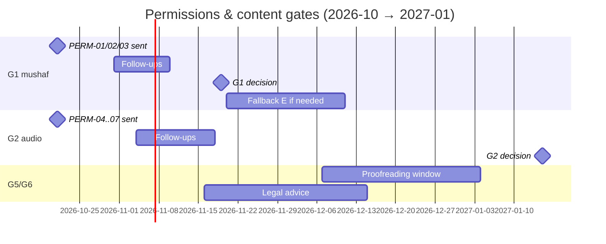

# 03 — Content, Data Sources & Licensing

**Purpose.** This document is the single source of truth for *what content the app ships, where each item comes from, under which terms, in which build it may appear, and who we must ask before it goes public*. It defines the dataset catalogue (DS-xx), the licence matrix by build type, the permission tracker (PERM-xx) with ready-to-send emails, the curated Indo-Pak metadata tables (Para, Manzil, Ruku, Sajda, quarters, numbering, headers) as data, the content-governance policy (selection, labelling, proofreading, error SLA, kill-switch, provenance), the exact credit strings for the Sources & Credits screen (F-PL-04), the Pakistan legal actions (G6) and the retention rules for user content. The pipeline that builds these artefacts is in [Offline Data Pipelines](08-data-pipelines.md); the runtime that stores them is in [Architecture](04-architecture.md); the renderer that draws them is in [Mushaf Rendering Engine](05-mushaf-rendering-engine.md); audio runtime in [Audio Engine](06-audio-engine.md).

**Status: Draft v1 — 2026-10-19**

> Not legal advice. Licence quotes are carried verbatim from the research reports (r05, r09, g01–g03), which fetched them on 2026-10-19 unless tagged otherwise. Items tagged **[unverified]** must be confirmed by the task named next to them.

**Key decisions in this doc**
- Every shipped artefact carries a machine-readable licence record and a derived **build-eligibility** (personal / beta / public-free / monetized); CI refuses any build that includes an ineligible artefact (D-10, D-17).
- Mushaf = DigitalKhatt MIT token text + QUL resource 11 layout, public only after **G1**; QA oracles (Waqar144, QuranApp, QUL previews, QF API) never ship (D-05, D-06).
- Arabic for search/copy/share = **Tanzil Uthmani + Simple-Clean, verbatim** (D-08). Never bundle QF/quran.com content (D-09).
- Bundled translations: **Urdu Junagarhi (+Ahsan-ul-Bayan notes)** and **English Saheeh International**, both QuranEnc; Tanzil-sourced packs are **non-commercial** (D-09, D-17).
- Indexing metadata is **our own curated, print-verified** data: Indo-Pak Para table, 7 Manzils, 558 rukus with the print's triple rule, 14 + 1 sajdas, 90 Para quarters (D-07). Page labels = index + 1 (D-04).
- Public audio = mp3quran gapless + our validated timing packs; gapped per-ayah = `PENDING` (personal/beta); three items personal-only; Alafasy refusal ⇒ default switches to Ghamdi (D-12).
- Content governance: recognized scholars, sect-balanced Urdu set, Shia opt-in and labelled, no Ahmadi content, Arabic always shown, hafiz certificate per layout (G5), 24 h advisory / 48 h fix SLA, signed kill-switch (D-22).
- User content never leaves the device except by user action (backup, export, error-report email) (D-20).

---

## 1. Definitions and hard rules

### 1.1 Build classes (what "eligibility" means)

| Build class | Who gets it | Distribution | May contain |
|---|---|---|---|
| **personal** | Owner's own devices | Sideload / Play internal track, owner only | Anything with a lawful personal-use basis, incl. `PERSONAL_ONLY` and `PENDING` items |
| **beta** | Closed testers (incl. the 12 × 14-day closed test, D-22) | Play closed track | `PERMITTED` + `PENDING`; **no** `PERSONAL_ONLY` |
| **public-free** | Everyone | Play production (and `foss` flavour if G4 allows) | `PERMITTED` only; app is free, no ads, no IAP |
| **monetized** | Everyone, any build with Play Billing IAP/subscription (v1.5+, `play` flavour) | Play production | `PERMITTED` **and** `commercialOk = true` |

`foss` flavour inherits public-free eligibility (no Billing); F-Droid anti-feature assessment is part of G4.

### 1.2 Licence record vocabulary

- `licenceStatus` (runtime enum, shared with [Audio engine](06-audio-engine.md) catalogue): `PERMITTED` | `PENDING` | `PERSONAL_ONLY`.
- `basis` (why): `open_licence` (CC/MIT/OFL/…), `public_domain`, `host_grant` (host's written blanket statement), `producer_grant` (producer's published free-use statement), `written_permission` (PERM-xx reply on file), `own_work`, `commissioned` (work-for-hire with assignment), `none`.
- `commercialOk`: terms do not exclude IAP/subscriptions. `noModification`, `mustKeepUpdated`, `linkBackRequired`: obligations the pipeline/UI must honour.

**Derivation (CI computes; manifests must agree):**
```
eligible.personal   = true                                        (lawful personal basis exists)
eligible.beta       = licenceStatus in {PERMITTED, PENDING}
eligible.publicFree = licenceStatus == PERMITTED && gatesCleared(item.requiredGates)
eligible.monetized  = eligible.publicFree && commercialOk && monetizedScopeConfirmed(item)
```

### 1.3 Never-list (CI-enforced where possible)

1. Never ship or fetch-at-build QF / quran.com / qurancdn content into any bundled DB or pack (QF terms: ≤ 1-week storage, "does not itself authorize distributing a prepackaged database", no client secret in app — r05 §2.6). CI lint: pipeline `sources.lock.json` hosts ∉ {`*.quran.com`, `*.quran.foundation`, `*.qurancdn.com`}.
2. Never ship Waqar144, QuranApp (GPL) or scraped QUL-preview data — QA oracles only, stored outside the repo (g01 §2.7).
3. Never ship mushaf scans or images derived from them; the archive.org Taj scan is used to *check facts* only, never in repo, assets or CI artefacts (g02 Rec. 12).
4. Never alter displayed Tanzil text; normalized search columns are never displayed (Tanzil "verbatim… CHANGING IT IS NOT ALLOWED").
5. Never modify QuranEnc translation text (condition 1); render as delivered.
6. Never show a translation without its Arabic text (Punjab Act 2011 s.5(6)); no translation-only mode.
7. No reciter photos, no "Official" wording, no Saudi/KFGQPC logos (r09 §2.1).
8. Never pair timing data and audio from different hosts; never use mp3quran reads 74 or 53 for timing (g03 §2.5).
9. Never use QuranWBW "AlQuran IndoPak" font, PDMS Saleem, Al Qalam, KFGQPC fonts in v1 (licence or "no modification" conflicts — r04, r09).
10. No AI-generated translation, tafsir or dua text; no machine transliteration that has not been human-verified (e.g., fawazahmed0 Roman-Urdu Junagarhi is off by one verse in al-Fatiha — r05 §2.5).

---

## 2. Dataset catalogue

Columns: **Elig.** = personal / beta / public-free / monetized (✅ yes, ⏳ after named gate/permission, ❌ no). **Ship** = Bundled (APK) / Download (R2 pack) / Stream / Build-input (used by the pipeline, not shipped as such) / Oracle (never shipped). **Attr.** = credit string ID in §9.

### 2.1 Quran text and mushaf

| ID | Dataset | Source & pin | Format · size | Licence (decisive terms) | Elig. P/B/F/M | Ship | Attr. |
|---|---|---|---|---|---|---|---|
| DS-01 | Tanzil **Uthmani** v1.1 (Feb 2021) | `https://tanzil.net/pub/download/index.php?quranType=uthmani&outType=xml&marks=true&sajdah=true&rub=false&tatweel=true&agree=true`; pin SHA-256 in `sources.lock.json` | XML 1.54 MB (0.29 MB gz); 70 code points | "Tanzil Quran Text Copyright (C) 2007-2021 Tanzil Project / License: Creative Commons Attribution 3.0 … Permission is granted to copy and distribute verbatim copies of this text, but CHANGING IT IS NOT ALLOWED … provided that its source (Tanzil Project) is clearly indicated, and a link is made to tanzil.net" | ✅ ✅ ✅ ✅ | Bundled (content DB): copy/share/search, optional "Usmani" text | ATTR-01 |
| DS-02 | Tanzil **Simple-Clean** v1.1 | same endpoint, `quranType=simple-clean` | XML 0.94 MB; 46 code points | as DS-01 | ✅ ✅ ✅ ✅ | Bundled: search column source only | ATTR-01 |
| DS-03 | Tanzil metadata `quran-data.js/.xml` v1.0 | `https://tanzil.net/res/text/metadata/quran-data.js` | JS/XML 25 KB | `copyright="(C) 2008-2009 Tanzil.info" license="cc-by"` | ✅ ✅ ✅ ✅ | Build-input: surah/ayah counts, Madani juz/hizb (Madani mode only) | ATTR-02 |
| DS-04 | **DigitalKhatt Indo-Pak token text** `ClientApp/src/app/services/quran_text_indopak_15.ts` | `github.com/DigitalKhatt/digitalkhatt.org` @ **4213fab** (MIT since `abbb69c`, 2024-01-31; file added `ad9f3d7`, no AGPL header) | TS → 83,669 tokens (77,433 words + 6,236 ends); 84 code points | "MIT License, Copyright (c) 2024 DigitalKhatt". Upstream: QUL res. 59 / QuranWBW text whose README says "DO NOT SELL, MANIPULATE, DISTRIBUTE WITHOUT CREDITS OR TAMPER…" (g01 §2.1) | ✅ ✅ ⏳G1 ⏳G1+PERM-03 | Bundled (canonical word table) | ATTR-03 |
| DS-05 | **QUL resource 11** — Indo-Pak 16-line Taj layout (548 pp) | `https://qul.tarteel.ai/resources/mushaf-layout/11` (SQLite; owner's free login); store at `~/criterion-data/qul/<date>/` + SHA-256 | SQLite `pages(page_number,line_number,line_type,is_centered,first_word_id,last_word_id,surah_number)` + `info`; ~0.3 MB | Resource page: "We don't have copyright information for this resource." FAQ: "Yes, you can use QUL data in commercial projects. However, please review the licensing terms for each resource." Tarteel ToS: "You shall not (a) copy the Services or any part…" | ✅ ✅ ⏳G1 ⏳G1 (commercial scope) | Bundled (line table) after G1 | ATTR-05 |
| DS-06 | QUL **script 565** (DK Indo-Pak WBW) or **59** (Indopak Nastaleeq WBW) | `https://qul.tarteel.ai/resources/quran-script/565` (or `/59`), login | SQLite `words(word_index, word_key, …)` | as DS-05 | ✅ ✅ ⏳G1 ⏳G1 | Build-input: `word_index → word_key` join for DS-05 only (g01 §2.8 step 5) | ATTR-05 |
| DS-07 | QUL res. 313 — 13-line Taj (847 pp) [P3, F-RD-11] | `/resources/mushaf-layout/313` | SQLite ~0.3 MB | as DS-05 | ✅ ✅ ⏳G1+G5 ⏳ | Download (layout pack) | ATTR-05 |
| DS-08 | 15-line Hafizi (610 pp) [P3]: DK 15-line breaks (MIT, = QUL layout 6 on 369/370 lines) and/or QUL res. 12 | DK @4213fab (same file); `/resources/mushaf-layout/12` | ~0.3 MB | DK MIT; QUL as DS-05 | ✅ ✅ ⏳G1+G5 ⏳ | Download (layout pack) | ATTR-03/05 |
| DS-09 | Madani 604 layout + DK New Madina font [P4] | QUL layout 10; DK New Madina (OFL 1.1) | ~0.3 MB + 2.4 MB otf | QUL as DS-05; font OFL | ✅ ✅ ⏳ ⏳ | Download | ATTR-04/05 |
| DS-10 | **QA oracles**: Waqar144 @b6470fb (MIT label, QUL-derived), QuranApp @c496013 (GPL-3.0), QUL preview HTML (548 pp, 76 MB), QF API v4 per-verse metadata, archive.org Taj scan | local only: `~/criterion-data/oracles/` | — | Waqar: "the text is taken from Quranic Universal Library" (commit `4b0e4bf`); QuranApp GPL; scraping conflicts with Tarteel ToS; scan © Taj Company ("جملہ قانونی حقوق … بحق تاج کمپنی لمیٹڈ محفوظ ہیں") | Oracle only | **Never shipped**; delete scraped HTML once DS-05 arrives | — |

### 2.2 Curated metadata (our own work, print-verified)

All curated tables live as CSV in the pipeline's `curated/` directory (path per [doc 08](08-data-pipelines.md)), are reviewed by the content reviewer, and are compiled into `quran_content.db`. Specification and full data in §7. Licence: `own_work` (facts + our compilation); commercial OK.

| ID | Dataset | Derivation | Rows | Verified against | Elig. | Ship | Attr. |
|---|---|---|---|---|---|---|---|
| DS-11 | Indo-Pak **Para** table | Hand-curated (§7.2) | 30 | QUL layout 11 page grid; Taj scan headers (g02 §2.2); GTAF | ✅✅✅✅ | Bundled | ATTR-06 |
| DS-12 | **Manzil** table | Hand-curated (§7.3) | 7 | Tanzil + QF boundaries; scan footers/margins (g02 §2.7) | ✅✅✅✅ | Bundled | ATTR-06 |
| DS-13 | **Ruku** table (558) | Derived from DS-04 U+08D6 ruku-end marks (558) + print rule; triples computed against DS-11 | 558 | 29 print-sampled triples (g02 §2.3); surah-header counts | ✅✅✅✅ | Bundled | ATTR-06 |
| DS-14 | **Sajda** table | Derived from DS-04 U+08DB (15) + print table leaf 553 | 15 | g02 §2.6 (all 15) | ✅✅✅✅ | Bundled | ATTR-06 |
| DS-15 | **Para quarters** (ربع/نصف/ثلٰثة) | Seeded from Waqar list (fact positions) with 3 print corrections; every row hand-verified before public | 90 | 37 verified (g02 App. A); 53 to verify | ✅✅⏳⏳ (53 rows to verify) | Bundled | ATTR-06 |
| DS-16 | **ayah_marker** (Kufan ends + «۵» disputed ends) | Pipeline from DS-04 (g01 §2.6), Taj Fatiha override | 6,354 | Tanzil per-surah counts; scan p.2 | ✅✅✅✅ | Bundled | ATTR-03 |
| DS-17 | **Surah** table (names ar/ur/roman/en, meanings, revelation, counts, Indo-Pak header strings) | Hand-curated; cross-checked with Tanzil counts; header strings proofed vs scan | 114 | ~75 headers verified (g02); 39 to proof | ✅✅⏳⏳ (39 headers to proof, G5) | Bundled | ATTR-06 |
| DS-18 | **Page furniture** (`page_meta`: template, header Para/surahs, footer manzil, outer margin side) | Pipeline rules (§7.8) | 548 | g02 §2.8 | ✅✅✅✅ | Bundled | ATTR-06 |
| DS-19 | **Aliases & popular passages** (incl. Manzil-dua playlist) | Hand-curated (§7.9) | ~120 | Content reviewer | ✅✅✅✅ | Bundled | — |

### 2.3 Translations and tafsir

QuranEnc republish terms (r05 §2.1, verified): *"Contents of the translations can be downloaded and re-published, with the following terms: 1. No modification, addition, or deletion… 2. Clearly referring to the publisher and the source (QuranEnc.com). 3. Mentioning the version number… 4. Keeping the transcript information… 5. Notifying the source… of any note… 6. Updating the translation according to the latest version… 7. Inappropriate advertisements must not be included…"* → `commercialOk = true`, `noModification`, `mustKeepUpdated`.
Tanzil translation terms (verified): *"The translations provided at this page are for non-commercial purposes only. If used otherwise, you need to obtain necessary permission from the translator or the publisher. If you are using more than three … we require you to put a link back to this page"* → `commercialOk = false` for the file regardless of the work's PD status.

| ID | Dataset | Source & pin | Format · size | Licence basis | Elig. P/B/F/M | Ship | Attr. |
|---|---|---|---|---|---|---|---|
| DS-20 | **Urdu – Muhammad Junagarhi + Ahsan-ul-Bayan notes** ("tafsir summary", F-RD-13) [P1] | `https://quranenc.com/downloads/sqlite/urdu_junagarhi.zip` **v1.1.3** | SQLite (id, sura, aya, translation, footnotes); 6.2 MB raw / 2.1 MB zip (footnotes 4.35 MB) | QuranEnc terms; translation PD (Junagarhi 1890–1941); notes © covered by QuranEnc permission | ✅✅✅✅ | **Bundled** | ATTR-08 |
| DS-21 | **English – Saheeh International** (credited "Noor International Center") [P1] | `https://quranenc.com/downloads/sqlite/english_saheeh.zip` **v1.1.2** | SQLite 1.25 MB / 0.52 MB zip; ayah numbers prefixed in text "(2) …" | QuranEnc terms | ✅✅✅✅ | **Bundled** (render prefix as-is unless PERM-10 approves stripping) | ATTR-09 |
| DS-22 | Urdu – Fateh Muhammad Jalandhari [P2] | `https://tanzil.net/trans/?transID=ur.jalandhry&type=txt-2` | TXT `s\|a\|text` 1.45 MB (gz 0.35 MB) | Tanzil NC file; work very likely PD (b. 1864, publ. 1900; death year [unverified]) | ✅✅✅❌ | Download pack | ATTR-10 |
| DS-23 | Urdu – Kanz-ul-Iman (Ahmed Raza Khan, 1911) [P2] | Tanzil `ur.kanzuliman` | TXT ~1.5 MB | Work PD (d. 1921); Tanzil NC file | ✅✅✅❌ | Download pack | ATTR-10 |
| DS-24 | English – Pickthall (1930) [P2] | Tanzil `en.pickthall` | TXT ~0.9 MB | Work PD (d. 1936 [unverified]); Tanzil NC file | ✅✅✅❌ | Download pack | ATTR-10 |
| DS-25 | English – Hilali-Khan [P2] | QuranEnc `english_hilali_khan` (version pinned at build) | SQLite ~0.5 MB zip | QuranEnc terms | ✅✅✅✅ | Download pack | ATTR-08 pattern |
| DS-26 | Hindi – Omari [P2] | QuranEnc `hindi_omari` v1.1.5 | SQLite 0.4–0.8 MB zip | QuranEnc terms | ✅✅✅✅ | Download pack | ATTR-08 pattern |
| DS-27 | Bangla [P2] | QuranEnc if listed at build time (r05 found **none** on 2026-10-19); interim Tanzil `bn.bengali` (Muhiuddin Khan) | TXT ~1–1.5 MB | QuranEnc terms / Tanzil NC | ✅✅✅ (✅/❌ by source) | Download pack | ATTR-08/10 |
| DS-28 | Indonesian [P2] | QuranEnc `indonesian_affairs` (default), `indonesian_sabiq`, `indonesian_complex` | SQLite | QuranEnc terms | ✅✅✅✅ | Download pack | ATTR-08 pattern |
| DS-29 | Turkish [P2] | QuranEnc `turkish_rwwad` (default), `turkish_shaban`, `turkish_shahin` | SQLite | QuranEnc terms | ✅✅✅✅ | Download pack | ATTR-08 pattern |
| DS-30 | Tafsir As-Sa'di (Urdu) [P3, F-TR-05] | `https://quranenc.com/api/v1/tafsir/sura/urdu_saadi/{n}` v1.0.0 | JSON blocks (sura, from_aya, to_aya, type, text); ~13–15 MB raw / 3.5–4 MB zip | QuranEnc terms | ✅✅✅✅ | Download pack | ATTR-08 pattern |
| DS-31 | Permission-gated works: Maududi *Tafheem* (© to 31-Dec-2029 in PK), Taqi Usmani *Aasan Tarjuma* (UR/EN), Tahir-ul-Qadri *Irfan-ul-Quran*, Israr Ahmad *Bayan-ul-Quran*, *The Clear Quran* (Khattab), Ibn Kathir (UR/EN), *Ma'ariful Qur'an* | Rights holders (PERM-12…17) | — | © — none until written permission | ❌❌⏳⏳ | Download pack after permission | per grant |
| DS-32 | Word-by-word Urdu/English (QuranWBW; Urdu reportedly Dr Farhat Hashmi) [P4, F-RD-14] | QUL 93/92 via QuranWBW.com | ~2–3 MB each | QuranWBW: "copying them is not allowed" | ✅(personal dev only)❌⏳⏳ | Download after PERM-03/18 | per grant |
| DS-33 | Transliteration EN (ayah) [P3, F-TR-04]; Roman-Urdu | Tanzil `en.transliteration` (1.04 MB); Roman Urdu: Maududi-la (©) only with permission | TXT | Tanzil NC; © | ✅✅✅❌ / ❌ | Download pack | ATTR-10 |

Candidate later packs (P3): QuranEnc `pashto_rwwad`, `punjabi_arif`, `english_rwwad`; Mahmud-ul-Hasan + Shabbir Usmani notes (PD; requires our own proof-read transcription — the QF copy is QF-restricted).

### 2.4 Fonts and artwork

| ID | Dataset | Source & pin | Size | Licence | Elig. | Ship | Attr. |
|---|---|---|---|---|---|---|---|
| DS-34 | **DigitalKhatt IndoPak** font, CFF2 → TrueType glyf conversion (cu2qu), internal name "Criterion IndoPak", keeps `cv01…cv18` | `ClientApp/src/assets/fonts/hb/indopak.otf` @ 4213fab | 2.57 MB otf → glyf TTF 1.63 MB (0.34 MB deflated) | "This Font Software is licensed under the SIL Open Font License, Version 1.1"; "© 2024 Amine Anane, © 2024 Tarteel Inc."; no Reserved Font Name. Conversion allowed; ship OFL.txt; never sell the font alone | ✅✅✅✅ | Bundled (`assets/fonts/`) | ATTR-04 |
| DS-35 | **Noto Nastaliq Urdu** (UI + Urdu translation text, D-21) | Google Fonts / notofonts release — pin version + SHA-256 in P0 | measure in P0 | OFL 1.1 [r03: unverified — read the `name` table in P0] | ✅✅✅✅ | Bundled | ATTR-04b |
| DS-36 | **Ornaments**: page frame, vine band, header/footer bands, surah cartouche (3 variants: three-part line, two-line, sar-lauh panel), ع / quarter / sajda / manzil / juz margin markers, ayah circle | Commissioned (PERM-23), work-for-hire with copyright assignment; delivered as SVG → `ImageVector` | < 200 KB | `commissioned` | ✅✅✅✅ | Bundled | ATTR-18 |
| DS-37 | App icon, store art, screenshots | Commissioned after G3 | — | `commissioned`; never reuse the reference app's assets (D-19) | ✅✅✅✅ | Bundled / store | — |

### 2.5 Audio and timing

Host statements (g03 §2.1, verified): **mp3quran.net** — *"Copyrights: All rights are available to everyone, and we allow any visitor or developer to copy any material or use any link on the websites"*, and the contact page asks developers to *"share the following URL for Apple, google or any social website to a prove the copyrights is for all: https://mp3quran.net/eng/privacy"*. **islamic.network** — *"You may stream, embed and download them for personal and educational use. You may bundle them into a commercial product, but please note that copyrights lie with the reciters and they may ask you to remove the con[t]ent"*; maintainer: *"Our terms and conditions are not evidence of any explicit authorization"*. **everyayah** — no site licence. **King Fahd Complex** — free general use "in computer apps, broadcasting channels, internet websites… inside and outside Saudi Arabia" [search-excerpt]. **Alafasy Berhad** ToS §6 — *"…audio… are owned by Alafasy Berhad or licensed partners. Unauthorized use is strictly prohibited."*

| ID | Dataset | Source | Licence basis → status | Elig. P/B/F/M | Ship | Attr. |
|---|---|---|---|---|---|---|
| DS-38 | **Gapless per-surah MP3 (public shortlist)** with highlight: Alafasy (read 123, default, 128 kbps, 1.72 GB), Saad Al-Ghamdi (30, 96 kbps/22.05 kHz, 1.07 GB), Abdul Basit Mujawwad (51, surah-9 relabel, 3.49 GB), Sudais (54, clamp), Abu Bakr Ash-Shatri (4, 1.50 GB), Hani Ar-Rifai (89), Muhammad Ayyub (109, 1.40 GB), Khalid Al-Muhanna (159, 48 kbps, 0.64 GB); highlight off in faulty surahs: Husary (118: s1, s21), Minshawi (112: s52, s53; s9 relabel), Shuraim (31: s12, s40, s65, s80, s83, s91; s9 relabel), Yasser Ad-Dosari (92: s4) | `https://cdn.mp3quran.net/audio/{folder}/rN/{sss}.mp3` (folder from `https://www.mp3quran.net/api/v3/ayat_timing/reads` `folder_url`; e.g. `mishary-alafasy/r1/001.mp3`) | `host_grant` → `PERMITTED` (rights-holder unconfirmed; PERM-04 for Alafasy) | ✅✅✅✅(v1.5 audit) | Stream + user download; never in APK | ATTR-11a |
| DS-39 | **Our timing packs** (normalized mp3quran `ayat_timing`, guard = Content-Length + ETag + duration; per-surah DISABLE) | Built from `https://www.mp3quran.net/api/v3/ayat_timing?surah=N&read=R` by pipeline (g03 §2.6); hosted on R2 | `host_grant` (derived) → `PERMITTED` | ✅✅✅✅ | Download (R2) | ATTR-11b |
| DS-40 | **Gapped per-ayah** (verse-by-verse/hifz, F-AU-04) for shortlist reciters + Abdul Basit Murattal, Maher Al-Muaiqly, Ahmed Al-Ajmy, Huthaify | `https://everyayah.com/data/{folder}/{sss}{aaa}.mp3` (+ `000_checksum.md5`); mirror `https://cdn.islamic.network/quran/audio/{kbps}/{edition}/{n}.mp3` | `none` / host terms → **`PENDING`** until PERM-05 (+PERM-04 for Alafasy) | ✅✅⏳G2⏳ | Stream + download | ATTR-11c |
| DS-41 | **King Fahd Complex** recordings (Hafs): Ali Al-Huthaify, Maher Al-Muaiqly, Muhammad Ayyub, Khalid Al-Muhanna, Ibrahim Al-Akhdar (per-ayah 724 MB–1.18 GB each; per-surah similar) | qurancomplex.gov.sa (geo-blocked from our egress; owner downloads from Pakistan) → self-host R2 | `producer_grant` → `PERMITTED` once the official page is archived and PERM-06 sent with no refusal in 30 days; monetized scope asked in PERM-06 | ✅✅⏳G2⏳ | Download/stream from R2 | ATTR-11d |
| DS-42 | **Personal-only audio**: Urdu translation voice Shamshad Ali Khan ("(C) 1998 Hi-Tech Music Ltd. (P) 1998 Hi-Tech Music Ltd"; everyayah `urdu_shamshad_ali_khan_46kbps`, i.n. `ur.khan`) for F-AU-10; Husary Muallim (everyayah only); Qari Sadaqat Ali (i.n. `ar.sadaqatali` surah-level) | as listed | `PERSONAL_ONLY` until PERM-08/05/09 | ✅❌❌❌ | Personal catalogue only | ATTR-11a pattern |
| DS-43 | **Adhan audio** (F-CP-02): commissioned Pakistani muezzin — standard adhan, Fajr adhan, ≤ 30 s takbeer (channel sound), post-adhan dua; fallbacks Commons `File:Adhan.ogg` (Aishatu98, **CC0**, 42 s) and `File:Beautiful adhan.ogg` (Adam-synagda, **CC0**, 154 s) | PERM-22 (work-for-hire); Wikimedia Commons | `commissioned`; `open_licence` (CC0) | ✅✅✅✅ | Bundled (format per [doc 07](07-companion-engagement-features.md)) | ATTR-15 |

Never used: QuranicAudio ("you may not use these files for commercial purposes"; personal use only), QUL/Tarteel audio (130/130 "no copyright information"; Tarteel ToS bars copying) until PERM-01 covers it, QF/QDC audio offline (QF terms).

### 2.6 Companion data

| ID | Dataset | Source & pin | Size | Licence | Elig. | Ship | Attr. |
|---|---|---|---|---|---|---|---|
| DS-44 | **GeoNames cities15000** (34,173 cities; PK 372; Urdu alternate names) | `https://download.geonames.org/export/dump/cities15000.zip` (3.36 MB), retrieved date + SHA-256 | 3.14 MB SQLite / 1.49 MB zip (cols: id, name, ascii, Arabic-script alt names, lat, lon, cc, admin1, tz, population) | "licensed under a Creative Commons Attribution 4.0 License" | ✅✅✅✅ | Bundled [P2] | ATTR-12 |
| DS-45 | **Azkar Arabic corpus** | `github.com/osamayy/azkar-db` (2024-09-19), 345 rows / 135 categories | small | README: «هذه الملفات بدون رخصة استخدام، يحق لك فعل ما تريد بها مجانا…» (public-domain dedication) | ✅✅✅✅ | Bundled [P2] (curated subset + hadith refs) | ATTR-14 |
| DS-46 | Azkar English | `github.com/fitrahive/dua-dhikr` (MIT, 2025-11-29) | small | MIT | ✅✅✅✅ | Bundled [P2] | ATTR-14 |
| DS-47 | Azkar **Urdu** (~150 core duas) | Commissioned translation + scholar review (PERM-24); alternative HadeethEnc with permission (PERM-19) | small | `commissioned` / `written_permission` | ✅✅⏳⏳ | Bundled [P2] | ATTR-14 |
| DS-48 | **PK month-start feed** (Hijri override, D-15) | Ours; owner updates after each Central Ruet-e-Hilal Committee announcement; Ed25519-signed JSON on R2 | < 2 KB | `own_work` (public facts) | ✅✅✅✅ | Remote feed (daily fetch, cached) | ATTR-16 |
| DS-49 | Hijri events table (neutral labels, toggles) | Ours (r08 §2.7 list) | < 5 KB | `own_work` | ✅✅✅✅ | Bundled [P2] | — |
| DS-50 | OEM battery guidance (Adhan health check) | `https://dontkillmyapp.com/api/v2/{vendor}.json` | small | "licenced under CC-BY … free to be shared, adapted, even commercially" with attribution | ✅✅✅✅ | Bundled snapshot [P2] | ATTR-13 |
| DS-51 | Excluded: hisnmuslim.com API (no licence), Seen-Arabic English (MIT label over hisnmuslim/sunnah.com text — use only its structure and `source` refs), Darussalam Urdu Hisn-ul-Muslim (©) | — | — | — | ❌ | — | — |

### 2.7 Code and libraries (summary; detail in [doc 04](04-architecture.md))

- AboutLibraries 15.3.0 generates the library list (Apache-2.0 NOTICE texts, MIT notices).
- Apache-2.0 ports with headers kept: quran-ios `QuranKit`, `LinePageGeometryEngine` (no NOTICE file upstream). MIT: adhan2 ("Copyright (c) 2016 Batoul Apps"), FSRS-Kotlin.
- GPL code (quran_android, QuranApp) is read for ideas only; never copied (D-18).

---

## 3. Licence matrix by build type

| Content | personal | beta | public-free (v1.0) | monetized (v1.5+) | Gate / condition |
|---|---|---|---|---|---|
| Tanzil Uthmani / Simple-Clean / metadata (DS-01–03) | ✅ | ✅ | ✅ | ✅ | Verbatim; ATTR-01/02 |
| DK token text (DS-04) | ✅ | ✅ | ✅ after G1 | ⏳ G1 grant must cover commercial use of 565/DK text, or PERM-03 consent | MIT + upstream notice |
| QUL 16-line layout (DS-05/06) | ✅ (owner's download) | ✅ | ✅ after **G1** + **G5** | ⏳ only if G1 grant covers commercial | else fallback clean-room (§5.3) |
| 13/15-line layouts (DS-07/08) [P3] | ✅ | ✅ | after G1 + own G5 | as DS-05 | each layout its own certificate |
| Curated metadata (DS-11–19) | ✅ | ✅ | ✅ (DS-15 all 90 verified; DS-17 all 114 proofed) | ✅ | G5 covers metadata |
| QuranEnc translations/tafsir (DS-20, 21, 25–30) | ✅ | ✅ | ✅ | ✅ (no ads ever) | keep-updated job; no modification |
| Tanzil-sourced packs (DS-22–24, 27-interim, 33) | ✅ | ✅ | ✅ | ❌ | PERM-11 or own PD transcription before IAP |
| Permission-gated works (DS-31/32) | dev only | ❌ | after permission | per grant | PERM-12…18 |
| DK IndoPak / Noto Nastaliq fonts (DS-34/35) | ✅ | ✅ | ✅ | ✅ | OFL text shipped |
| Commissioned art / adhan / Urdu duas (DS-36/37/43/47) | ✅ | ✅ | ✅ (signed assignment on file) | ✅ | PERM-22/23/24 |
| mp3quran gapless + our timing (DS-38/39) | ✅ | ✅ | ✅ | ⚠️ ✅ by host grant; re-check in v1.5 audit | **G2**: evidence archived (PERM-07); no refusal from PERM-04 |
| Gapped everyayah / i.n. (DS-40) | ✅ | ✅ | ⏳ after PERM-05 (+PERM-04) | ⏳ | `PENDING` |
| King Fahd Complex self-hosted (DS-41) | ✅ | ✅ | ⏳ (§5.2 rule) | ⏳ scope in PERM-06 | **G2** |
| Personal-only audio (DS-42) | ✅ | ❌ | ❌ | ❌ | PERM-05/08/09 |
| GeoNames, DontKillMyApp, azkar-db, fitrahive, CC0 adhan (DS-44–46, 50) | ✅ | ✅ | ✅ | ✅ | attribution |
| QF / quran.com content | ❌ bundled | ❌ | ❌ | ❌ | User-API sync (F-BM-07, P3) carries no content |

**What monetization removes** (v1.5 commercial-content audit, owned by [doc 11](11-release-compliance-business.md)): DS-22/23/24/33 Tanzil files (replace or get PERM-11), any `PENDING` audio, DS-04/05 unless the G1 grant covers commercial use, and anything whose `monetizedScopeConfirmed` is false. Reading, listening, indexes and downloads remain free in every build (D-17).

### 3.1 CI enforcement

```
for variant in releaseVariants:                       # flavour × buildClass (Gradle property criterion.buildClass)
  cls = variant.buildClass                            # personal | beta | public | monetized
  for item in bundledArtefacts(variant) + catalogueEntries(channel(cls)) + packIndexEntries(channel(cls)):
    rec = item.licence
    require(rec.licenceName and rec.attributionEn and rec.sourceUrl and rec.sha256Source, item)
    require(derivedEligibility(rec)[cls] == rec.eligible[cls], item)        # manifest must match derivation
    require(rec.eligible[cls], item)
    for g in rec.requiredGates: require(permissions.yml.gates[g].cleared or cls in {personal, beta}, item)
  require(no host in sources.lock.json matches QF_HOSTS)
  require(no image asset larger than 200 KB under assets/mushaf/)      # scans can't sneak in
  require(attributionsComplete(variant))                               # every shipped DS has an ATTR row
```
- The remote catalogue and pack index are **channel-split** (`public`, `beta`, `personal` files, D-24 hosting); the app also filters by `BuildConfig.CONTENT_CLASS` at runtime (defence in depth). CI fails if a `public` file lists an item with `eligible.publicFree = false`.
- Release builds (`public`, `monetized`) also fail unless `permissions.yml` shows G1 cleared when DS-05 is bundled, and a G5 certificate exists for the bundled layout + `content_version`.

---

## 4. Licence & provenance records (contract for docs 04/06/08)

### 4.1 Licence object (embedded in pack `index.json`, `catalogue.json` and the content-DB `source` table)

```kotlin
@Serializable enum class LicenceStatus { PERMITTED, PENDING, PERSONAL_ONLY }
@Serializable enum class LicenceBasis { open_licence, public_domain, host_grant, producer_grant,
                                         written_permission, own_work, commissioned, none }
@Serializable data class Eligibility(val personal: Boolean, val beta: Boolean,
                                     val publicFree: Boolean, val monetized: Boolean)
@Serializable data class LicenceInfo(
    val datasetId: String,              // "DS-20"
    val licenceName: String,            // "QuranEnc republish terms (7 conditions)"
    val licenceUrl: String,             // "https://quranenc.com/en/home/api/"
    val basis: LicenceBasis,
    val licenceStatus: LicenceStatus,
    val commercialOk: Boolean,
    val noModification: Boolean,
    val mustKeepUpdated: Boolean,
    val linkBackRequired: Boolean,
    val sourceUrl: String,
    val sourceVersion: String,          // "urdu_junagarhi v1.1.3" | "git 4213fab"
    val sha256Source: String,
    val retrievedAt: String,            // ISO date
    val permissionRef: String? = null,  // "PERM-01"
    val requiredGates: List<String> = emptyList(),   // ["G1","G5"]
    val attributionId: String,          // "ATTR-08"
    val attributionEn: String,
    val attributionUr: String? = null,
    val eligible: Eligibility,
    val killed: Boolean = false,        // remote kill-switch (§8.8)
    val killReason: String? = null,
)
```

### 4.2 Content-DB tables (logical; final Room entities in [doc 04](04-architecture.md))

```sql
CREATE TABLE source(            -- one row per DS-xx shipped inside quran_content.db
  dataset_id TEXT PRIMARY KEY, licence_json TEXT NOT NULL);           -- LicenceInfo JSON
CREATE TABLE attribution(       -- drives F-PL-04
  id TEXT PRIMARY KEY,          -- 'ATTR-01'
  sort INT NOT NULL, section TEXT NOT NULL CHECK(section IN
    ('quran_text','mushaf','metadata','translation','tafsir','audio','fonts_art','companion','proofreading','disclaimer','code')),
  title_en TEXT NOT NULL, title_ur TEXT NOT NULL,
  body_en TEXT NOT NULL, body_ur TEXT,             -- licence names/notices stay English
  url TEXT, licence_text_asset TEXT);              -- e.g. 'licenses/OFL-1.1.txt'
```
Packs carry the same `LicenceInfo` in their own `pack_info` table; reciters in `catalogue.json`. `content_version` is in `content_meta` (spike schema).

### 4.3 Provenance files (repo + private store)

| File | Where | Content |
|---|---|---|
| `sources.lock.json` | pipeline (doc 08) | per input: `dataset_id, url, version/commit, retrieved_at, sha256, size`; build fails on hash change without `--accept-update` |
| `legal/permissions.yml` | repo | PERM-xx status machine (below); CI reads gate status |
| `docs/legal/data-permissions.md` | repo | human log: dated summary of every send / reply / decision |
| `docs/legal/provenance-log.md` | repo | dataset ledger: DS-xx, version, transformation applied, reviewer, decision, date; error reports (§8.7) |
| Evidence store | private (`~/criterion-data/legal/evidence/`, backed up; **not** in repo, because it holds personal emails) | PDF snapshots of terms pages (Tanzil, QuranEnc, QUL copyright pages, mp3quran `/eng/privacy` + `/eng/contact-us`, Complex free-use page, alafasy.co ToS, alquran.cloud terms, GeoNames readme), each with date + SHA-256; raw email threads; signed contracts |

```yaml
# legal/permissions.yml
schema: 1
gates:
  G1: { cleared: false, by: [PERM-01], also: [PERM-02], decision_deadline: 2026-11-19 }
  G2: { cleared: false, by: [PERM-07], blocking_refusals: [PERM-04, PERM-06], decision_deadline: 2027-01-15 }
permissions:
  - id: PERM-01
    party: "Tarteel / QUL"
    datasets: [DS-04, DS-05, DS-06, DS-07, DS-08]
    status: not-sent   # not-sent|sent|follow-up-1|follow-up-2|granted|granted-partial|refused|closed-no-reply
    scope: { free: null, monetized: null, attribution: null }
    sent: null
    follow_ups: [2026-10-31, 2026-11-10]
    evidence: []       # "evidence/perm-01/2026-11-03-reply.eml#sha256=…"
```

---

## 5. Permission tracker

All rows **status = not-sent** on 2026-10-19. Emails go from the owner's address with the working title "Criterion" (public brand pending G3; say so). Record every send/reply in `legal/permissions.yml` and `docs/legal/data-permissions.md` the same day.

### 5.1 Requests (emails)

| ID | Party | What we ask | Contact (verification) | Gate | Datasets | Send by | Follow-up 1 | Follow-up 2 / decision | If refused / no reply |
|---|---|---|---|---|---|---|---|---|---|
| PERM-01 | **Tarteel / QUL** | Bundle res. 11 (+313, 12) and script 565/59 offline; free + supporter-IAP scope; attribution; upstream holders | `support@tarteel.ai` cc `naveed.ahmad@tarteel.ai` [verified g01] + public GitHub issue on `TarteelAI/quranic-universal-library` | **G1** | DS-04–08 | 2026-10-21 | 2026-10-31 | 2026-11-10 (+ QUL Discord); **decide 2026-11-19** | Start clean-room Taj-16 (fallback E) 2026-11-20 |
| PERM-02 | **DigitalKhatt — Dr Amine Anane** | Confirm MIT covers text + 15-line breaks; was QUL relicensing agreed; 16-line plans; U+202E at 1:7:4 | `ananeamine@gmail.com` [verified: git author] ; GitHub @DigitalKhatt | **G1** | DS-04, DS-08, DS-34 | 2026-10-21 | 2026-10-31 | 2026-11-10 | G1 clears on PERM-01 alone if its grant names 565/DK text; log no-reply |
| PERM-03 | **QuranWBW — Ayman Siddiqui** | Consent + credit wording for the DK-transformed Indo-Pak script; WBW Urdu/English licence (P4) | quranwbw.com contact / GitHub `marwan/quranwbw` [address unverified — find in P0] | G1 (courtesy); monetized | DS-04, DS-32 | 2026-10-21 | 2026-11-04 | 2026-11-18 | Credit anyway; DS-04 `monetized=false`; no WBW |
| PERM-04 | **Alafasy Berhad** | Stream + in-app offline save of Alafasy (mp3quran gapless; everyayah per-ayah); credit wording; R2 mirror | `ai@alafasy.co`, +603 8682 3105 [verified g03] | **G2** | DS-38/40 (Alafasy) | 2026-10-21 | 2026-11-04 | 2026-11-18; G2 decision 2027-01-15 | **Refusal ⇒ remove Alafasy; default reciter = Saad Al-Ghamdi (read 30).** No reply ⇒ ship (host grant), 48 h removal promise |
| PERM-05 | **Quran Foundation** (runs everyayah support, quranicaudio, QDC) | everyayah per-ayah sets (all DS-40 rows, Husary Muallim, Yasser 128) for stream + offline; does the 1-week storage cap apply to audio files; heads-up on future Connected App (F-BM-07) | `developers@quran.com` [verified]; `info@quran.foundation`; desk `https://quran.zendesk.com/hc/en-us` | **G2** (gapped layer) | DS-40, DS-42 | 2026-10-21 | 2026-11-04 | 2026-11-18 | Gapped stays `PENDING` (personal/beta); Muallim personal |
| PERM-06 | **King Fahd Glorious Qur'an Printing Complex** | Confirm free-use statement in writing; official ZIP links; R2 mirror; attribution; whether scope includes an app with optional IAP | `info@qurancomplex.gov.sa` [unverified]; owner opens site from Pakistan, saves licence page as PDF and downloads ZIPs on send day | **G2** | DS-41 | 2026-10-21 (EN + AR) | 2026-11-04 | 2026-11-18 | If archived page states free app use and no refusal by 2026-11-20 ⇒ ship self-hosted with ATTR-11d; else Ayyub/Muhanna stay on mp3quran |
| PERM-07 | **mp3quran.net** (courtesy) | Notify use; archive `/eng/privacy` and `/eng/contact-us` as PDF + SHA-256 + date (evidence for Play review) | form `https://www.mp3quran.net/eng/contact-us` (no email) | **G2** (evidence) | DS-38/39 | 2026-10-21 | — | — | n/a (grant already public) |
| PERM-08 | **Hi-Tech Music Ltd** (℗ 1998 Urdu album) | Public use of Shamshad Ali Khan Urdu translation audio (F-AU-10), per ayah; licence terms/fee | `info@hi-techmusic.com` (UK), `h.azmat@hi-techmusic.com` (PK) [verified: label profile; possibly stale] | G2 (only if public) | DS-42 | 2026-12-01 | 2026-12-15 | 2027-01-05 | Personal only; public alternative: Complex Urdu meanings audio (Fatiha + Juz 'Amma only) |
| PERM-09 | **Qari Syed Sadaqat Ali** | Public use of his recitation; permission to create ayah timings | `qarisadaqat@hotmail.com` [unverified: search excerpt] | G2 (only if public) | DS-42 | 2026-12-01 | 2026-12-15 | 2027-01-05 | Personal only |
| PERM-10 | **QuranEnc** | Notify republication (DS-20/21/25–30); may we strip "(n)" prefixes in Saheeh; notes shown in a separate sheet OK; update cadence | QuranEnc site contact [address: find in P0] | — (conditions 2, 5, 6) | DS-20–30 | 2026-10-28 | 2026-11-11 | — | Render prefixes as-is |
| PERM-11 | **Tanzil Project** | Commercial use (IAP build) of `ur.jalandhry`, `ur.kanzuliman`, `en.pickthall`, `en.transliteration` files | tanzil.net contact [address: find in P0] | v1.5 audit | DS-22–24, 33 | 2026-10-28 | 2026-11-25 | — | Packs stay `monetized=false`; commission PD transcriptions before IAP |
| PERM-12 | **Idara Tarjuman-ul-Quran / Islamic Publications** (Maududi) | Urdu *Tafheem-ul-Quran* translation (notes later) as optional pack | find in P0 | — | DS-31 | 2026-11-02 | 2026-12-01 | — | Not offered |
| PERM-13 | **Maktaba Ma'ariful Quran** (Taqi Usmani; *Ma'ariful Qur'an*) | *Aasan Tarjuma* Urdu + English; *Ma'ariful Qur'an* tafsir | find in P0 | — | DS-31 | 2026-11-02 | 2026-12-01 | — | Not offered |
| PERM-14 | **Minhaj-ul-Quran International** (Tahir-ul-Qadri) | *Irfan-ul-Quran* Urdu | find in P0 | — | DS-31 | 2026-11-02 | 2026-12-01 | — | Not offered |
| PERM-15 | **Markazi Anjuman Khuddam-ul-Quran** (Israr Ahmad) | *Bayan-ul-Quran* translation/tafsir | find in P0 | — | DS-31 | 2026-11-02 | 2026-12-01 | — | Not offered |
| PERM-16 | **Furqaan Institute / Book of Signs Foundation** (The Clear Quran) | English translation pack ("reproducing … requires prior written consent" [unverified]) | find in P0 | — | DS-31 | 2026-11-02 | 2026-12-01 | — | Not offered |
| PERM-17 | **Ibn Kathir publishers** (Darussalam abridged EN; Urdu edition — identify translator first) | Tafsir packs (F-TR-05, P3) | find in P0 | — | DS-31 | 2026-11-16 | 2026-12-14 | — | As-Sa'di only |
| PERM-18 | **Al-Huda International** (Dr Farhat Hashmi) | Urdu WBW text and Urdu WBW audio (everyayah 32 kbps) | find in P0 | — | DS-32 | 2026-11-02 | 2026-12-01 | — | No WBW (D-09) |
| PERM-19 | **HadeethEnc.com** | Bundle Urdu azkar/duas texts (categories «صبح شام کے اذکار», «نماز کے اذکار», «ماثور دعائیں») | HadeethEnc site contact [find in P0] | — (P2) | DS-47 | 2026-10-28 | 2026-11-25 | 2026-12-09 | Commission Urdu translation (PERM-24) |

Not emailed: **Islamic Network** (declines individual confirmations — d/291, d/307), **everyayah** (support is QF → PERM-05).

### 5.2 Engagements and commissions (contracts, not permission emails)

| ID | Engagement | Deliverable | Owner action / deadline | Gate |
|---|---|---|---|---|
| PERM-20 | **Hafiz/Qari proofreader** (Moulvi Fazil or qualified Qari who is also a Hafiz — Punjab Act s.5(3) wording) | Full proof of 548 pages + metadata; signed certificate (§8.6); 15–20 h | Identify by 2026-11-30; review window 2026-12-07 → 2027-01-04 | **G5** |
| PERM-21 | **Pakistani IP / media lawyer** | Written advice on §10 questions | Engage by 2026-11-16; advice by 2026-12-15 | **G6** |
| PERM-22 | **Muezzin** (Pakistani) | 4 adhan clips; written copyright assignment + consent to credit name | Contract by 2026-12-01; recordings by 2026-12-31 | — |
| PERM-23 | **Ornament/vector artist** | DS-36 art set; assignment of copyright; originality warranty (no traced scans, no third-party or unlicensed assets; AI-tool use disclosed) | Brief by 2026-11-02; interim self-drawn frame for P1; final by 2026-12-14 | — |
| PERM-24 | **Urdu dua translator + scholar reviewer** | ~150 core duas (Urdu, optional Roman Urdu) with hadith references; assignment | Contract by 2026-11-23; delivery by 2027-01-04 | — |
| PERM-25 | **Content reviewer** (Sunni Alim from a recognized institution; optional second reviewer from a different maslak) | Approves translation list, labels, azkar, event wording (§8) | Appoint by 2026-11-16 | — |
| PERM-26 | **Auqaf Punjab / Punjab Quran Board** inquiry | Whether app review/registration is required; fees/timeline | Only after PERM-21 advice (decide 2026-12-15) | **G6** |

### 5.3 Gate clearance rules (content side)

| Gate | Cleared when | Fallback |
|---|---|---|
| **G1** | PERM-01 written grant covering res. 11 (and 565 or the DK-derived text) for a free app is on file; PERM-02 answered **or** PERM-01's grant names the DK/565 text. Scope "monetized" recorded separately. | No grant by **2026-11-19**: clean-room Taj-16 from two purchased Taj prints (g01 §2.8 E: ~6 h anchors + 40–60 h corrections + 15–20 h hafiz QA; operators never open QUL/Waqar/QuranApp 16-line data). Personal/beta builds keep using the owner's QUL download meanwhile. |
| **G2** | PERM-07 evidence archived; PERM-04/05/06 sent ≥ 30 days; no refusal for any reciter in the public catalogue; every public reciter row has `attribution` + `licenceStatus = PERMITTED`. Gapped layer goes public only on PERM-05 grant. | Drop refused reciters; Ghamdi becomes default if Alafasy refuses. |
| **G5** | Signed certificate per layout + `content_version` (§8.6). | No public release of that layout. |
| **G6** | PERM-21 written advice received and its actions logged as done. | Ship to closed testers only (D-25). |



---

## 6. Ready-to-send email templates

Placeholders: `[Name]`, `[email]`, `[Play developer name]`, `[website]`. Send plain text. Sign every email with the same identity; attach nothing; link to the store page once public.

### T1 — Tarteel / QUL (PERM-01) — reuses g01 §2.9

**To:** support@tarteel.ai · **Cc:** naveed.ahmad@tarteel.ai
**Subject:** Permission to bundle QUL Indo-Pak 16-line layout (resource 11) and DK Indo-Pak script in a free Android Quran app

> Assalamu alaikum,
>
> I am building "Criterion" (working title; the public name may change), a free, ad-free Android Quran reader with no tracking, for daily use in Pakistan. It renders the Indo-Pak mushaf page by page with the DigitalKhatt IndoPak font (OFL). We would like to bundle the following QUL data **offline inside the app** (a SQLite file in the APK). We would not redistribute it as a standalone dataset:
> - Mushaf layout **11** (Indopak 16 lines, Taj Company, 548 pp). Later also **313** (13-line Taj) and **12** (15-line Qudratullah).
> - Quran script **565** (Digital Khatt Indo-Pak word-by-word), or permission to rely on the MIT-licensed DK text in github.com/DigitalKhatt/digitalkhatt.org, which appears to be derived from resource 59.
>
> The resource pages say "We don't have copyright information for this resource", so we would like written confirmation before release:
> 1. May we ship these in a free app?
> 2. Does the permission extend to a version that may later offer an optional "support the developer" in-app purchase (no Quran content or feature would be paywalled)?
> 3. What attribution text do you want? We propose: "16-line page layout: Quranic Universal Library (Tarteel)".
> 4. Is there an upstream rights holder we should also contact (e.g. whoever digitised the Taj layout, or Ayman Siddiqui for the script)?
>
> We will credit QUL and DigitalKhatt in the app and on the store page. As thanks, two data issues we found in layout 11:
> - On **p.529 the basmala line comes before the Surah 79 header**.
> - At **59:13:1** the Indo-Pak script has لَاَانْتُمْ, while DK has لَاَنْتُمْ.
>
> JazakAllahu khairan, [Name], [email], [Play developer name]

**GitHub issue (public, same day):** *Title:* "Licence/permission for bundling mushaf layout 11 (Indopak 16-line Taj) in a free Android app". *Body:* paragraphs 1–2 and questions 1–3 above, plus the two data issues; no personal contact details beyond the GitHub account.

### T2 — DigitalKhatt author (PERM-02) — reuses g01 §2.9

**To:** ananeamine@gmail.com · **Subject:** DigitalKhatt IndoPak text (MIT): confirming scope, and a 16-line question

> Assalamu alaikum Dr. Anane,
>
> Thank you for DigitalKhatt. We plan to ship the IndoPak font (OFL, converted to TrueType glyf and renamed, as OFL allows) with words from `quran_text_indopak_15.ts` (MIT, commit 4213fab) in a free, ad-free Android Quran app. Three quick questions:
> 1. Does the MIT licence cover the text **and** its 15-line page breaks? Was the relicensing of the underlying QUL data (Indopak Nastaleeq script / Qudratullah 15-line layout) agreed with Tarteel/QUL?
> 2. Do you have, or plan, a **16-line Taj Company** IndoPak layout under the same terms?
> 3. The 1:7:4 token uses U+202E + ٦ + U+08E2. Is the RLO required for correct shaping, or can a renderer drop it? (We follow the Taj print, which shows the «۵» sign there without a digit.)
>
> We will credit DigitalKhatt prominently. JazakAllahu khairan, [Name]

### T3 — QuranWBW / Ayman Siddiqui (PERM-03)

**Subject:** Credit and consent for the Indo-Pak Nastaleeq script (via DigitalKhatt/QUL) in a free Quran app

> Assalamu alaikum,
>
> Your Indo-Pak Nastaleeq script (QUL resource 59) is, as far as we can tell, the basis of the DigitalKhatt IndoPak text (MIT) that our free, ad-free Android Quran app "Criterion" (working title) will display. Your README asks that the text is not distributed "without credits", so we want to (1) ask your consent, (2) use the credit line you prefer — we propose "Indo-Pak script by Ayman Siddiqui / QuranWBW" — and (3) ask whether QuranWBW would license its Urdu and English word-by-word data for a later version, and on what terms. We will not sell or alter the text beyond the DigitalKhatt encoding, and we will apply any correction you send.
>
> JazakAllahu khairan, [Name], [email]

### T4 — Alafasy Berhad (PERM-04) — g03 template, specialised

**To:** ai@alafasy.co · **Subject:** Permission request: Sheikh Mishary Alafasy recitation in a free, ad-free Quran app (Android)

> Assalamu alaikum. We are building **Criterion** (working title), a free Quran app for Android with no ads, no in-app purchases and no accounts, aimed mainly at Pakistan. We would like to let users **stream and save for offline listening** the recitation of **Sheikh Mishary Rashid Alafasy** (sources: the surah files at cdn.mp3quran.net/audio/mishary-alafasy/r1/ and the per-ayah files at everyayah.com/data/Alafasy_128kbps/), with ayah highlighting. The audio files will not be altered, sold or offered as a separate download. The reciter and source are credited on every playback screen and in an Audio Credits page, and we will remove the recitation within 48 hours on request. No reciter photos are used.
> Could you confirm in writing that this use is permitted, and tell us the attribution wording you prefer? If you can, please also confirm whether we may mirror the files on our own CDN to reduce load on the original hosts, and whether your answer would change if we later add an optional "support the developer" purchase that does not gate any recitation.
> JazakAllahu khairan. [Name, email, Play developer name, website]

### T5 — Quran Foundation (PERM-05)

**To:** developers@quran.com · **Cc:** info@quran.foundation · **Subject:** everyayah.com per-ayah audio in a free, ad-free Android Quran app — permission and offline-storage question

> Assalamu alaikum. everyayah.com's "Contact Us" points to your support desk, so we are writing to you. **Criterion** (working title) is a free Android Quran app (no ads, no IAP, no accounts, no tracking) for Pakistani users. We would like to:
> 1. stream and let users save offline, inside the app only, the per-ayah recitations at `https://everyayah.com/data/{folder}/` for: [exact folder names from https://everyayah.com/data/recitations.js for the DS-40 reciters, Husary Muallim and Yasser Ad-Dosari 128 kbps — e.g. Alafasy_128kbps], unmodified, credited "Source: EveryAyah.com" with the reciter's name;
> 2. understand whether the Developer Terms' one-week storage limit applies to audio files a user downloads for offline listening (we do not use QF APIs for audio today);
> 3. later apply as a Connected App for bookmark/reading-progress sync via the User APIs (PKCE public client; no content redistribution).
> We will remove any recitation within 48 hours on request. Could you confirm (1), advise on (2), and tell us the credit wording you prefer? JazakAllahu khairan. [Name, email, Play developer name]

### T6 — King Fahd Complex (PERM-06) — English, then Arabic (send both in one email)

**To:** info@qurancomplex.gov.sa · **Subject:** Permission request: Complex recordings in a free Quran app (Android) / طلب إذن باستخدام تسجيلات المجمع في تطبيق قرآن مجاني

> Assalamu alaikum. **Criterion** (working title) is a free Android Quran app with no ads, no in-app purchases and no accounts, aimed mainly at Pakistan. We read that the Complex makes its digital audio recordings available for free general use, including in apps. We kindly ask you to confirm in writing: (1) that we may let users stream and save for offline listening the recordings of Sheikh Ali Al-Huthaify, Sheikh Maher Al-Muaiqly, Sheikh Muhammad Ayyub, Sheikh Khalid Al-Muhanna and Sheikh Ibrahim Al-Akhdar (Hafs), unmodified; (2) that we may host identical copies on our own servers; (3) your preferred credit line — we propose "Recording: King Fahd Glorious Qur'an Printing Complex"; (4) the official download links (per ayah and per surah); (5) whether the permission covers a version that may later offer an optional "support the developer" purchase that does not gate any recitation. We will remove any recording within 48 hours on request. JazakAllahu khairan. [Name, email, Play developer name, website]

> السلام عليكم ورحمة الله وبركاته،
> نعمل على تطوير تطبيق «Criterion» (اسم مؤقت) لقراءة القرآن الكريم والاستماع إليه على نظام أندرويد، وهو تطبيق مجاني بالكامل، بلا إعلانات ولا مشتريات داخلية ولا حسابات، وموجّه أساساً للمسلمين في باكستان.
> اطلعنا على ما أعلنه المجمع من إتاحة النسخ الرقمية من التسجيلات الصوتية للاستخدام العام مجاناً، ونرجو تأكيدكم كتابياً على ما يلي:
> ١. جواز إتاحة تسجيلات المشايخ: علي الحذيفي، ماهر المعيقلي، محمد أيوب، خالد المهنا، إبراهيم الأخضر (برواية حفص) داخل التطبيق للاستماع المباشر والحفظ للاستماع دون اتصال، دون أي تعديل.
> ٢. جواز استضافة نسخة مطابقة من الملفات على خوادمنا.
> ٣. صيغة الإشارة إلى المصدر التي تفضلونها، ونقترح: «التسجيل: مجمع الملك فهد لطباعة المصحف الشريف».
> ٤. روابط التنزيل الرسمية للملفات (آية آية، وسورة سورة).
> ٥. هل يشمل الإذن إصداراً قد يقدّم مستقبلاً خيار دعمٍ مدفوعاً اختيارياً لا يقيّد الوصول إلى أي تلاوة؟
> نلتزم بعدم تعديل التسجيلات أو بيعها أو إتاحتها للتنزيل المنفصل خارج التطبيق، وبإزالة أي تسجيل خلال ٤٨ ساعة عند الطلب.
> وجزاكم الله خيراً. [الاسم]، [البريد الإلكتروني]، [اسم المطوّر على Google Play]، [الموقع]

### T7 — mp3quran.net courtesy notice (PERM-07; contact form, EN + AR)

> Assalamu alaikum. Thank you for making your recitations and ayah timings freely available ("All rights are available to everyone…", mp3quran.net/eng/privacy). Our free, ad-free Android Quran app "Criterion" (working title) streams surah files from cdn.mp3quran.net, credits mp3quran.net and the reciter on every playback screen, and uses your ayat_timing data (validated offline) for verse highlighting. We will cache files only on users' devices and keep your link. Please tell us if you want any change. JazakAllahu khairan. [Name, email]
>
> السلام عليكم. جزاكم الله خيراً على إتاحة التلاوات وتوقيتات الآيات للجميع. تطبيقنا المجاني الخالي من الإعلانات «Criterion» يشغّل ملفات السور من خوادمكم مع ذكر اسم الموقع والقارئ في كل شاشة تشغيل، ويستخدم بيانات توقيت الآيات لتظليل الآية أثناء التلاوة. نرجو إبلاغنا بأي ملاحظة. [الاسم، البريد]

**Same day:** save `/eng/privacy` and `/eng/contact-us` as PDF, record SHA-256 + date in the evidence store.

### T8 — Hi-Tech Music Ltd (PERM-08)

**To:** info@hi-techmusic.com; h.azmat@hi-techmusic.com · **Subject:** Licence enquiry: "The Holy Quran (Complete with Urdu Translation)" (℗ 1998) in a free Quran app

> Assalamu alaikum. Our free, ad-free Android Quran app "Criterion" (working title) would like to offer the Urdu translation recitation by Shamshad Ali Khan from your 1998 album "The Holy Quran (Complete with Urdu Translation)" (Qari Waheed Zafar Qasmi; translation Maulana Fateh Muhammad Jalandhari), played ayah by ayah after the Arabic recitation, with the Arabic text always on screen. Copies of these recordings circulate online; we would only use them with your permission. Could you tell us whether you would license streaming and in-app offline listening, on what terms (including any fee), and the credit line you require ("Urdu translation audio: Shamshad Ali Khan, ℗ 1998 Hi-Tech Music Ltd")? JazakAllahu khairan. [Name, email, phone]

### T9 — Qari Syed Sadaqat Ali (PERM-09; EN, Urdu below)

> Assalamu alaikum Qari Sahib. We are building a free, ad-free Quran app for Pakistan ("Criterion", working title). Many users love your recitation. May we let users stream and save it for offline listening inside the app, credited to you on every playback screen, and may we prepare ayah-by-ayah timings for highlighting? We will not alter or sell the audio and will remove it on request within 48 hours. Please also tell us which recording source you prefer us to use. JazakAllahu khairan. [Name, phone, email]
>
> السلام علیکم قاری صاحب۔ ہم پاکستان کے لیے ایک مفت، اشتہارات سے پاک قرآن ایپ («Criterion»، عارضی نام) بنا رہے ہیں۔ کیا ہمیں اجازت ہے کہ صارفین ایپ کے اندر آپ کی تلاوت سن سکیں اور آف لائن سننے کے لیے محفوظ کر سکیں، ہر اسکرین پر آپ کے نام کے ساتھ؟ کیا ہم آیات کو نمایاں کرنے کے لیے آیت وار اوقات (ٹائمنگ) تیار کر سکتے ہیں؟ ہم آڈیو میں کوئی تبدیلی نہیں کریں گے، اسے فروخت نہیں کریں گے، اور درخواست پر ۴۸ گھنٹوں میں ہٹا دیں گے۔ جزاکم اللہ خیراً۔

### T10 — QuranEnc (PERM-10)

**Subject:** Notification of republication: urdu_junagarhi v1.1.3, english_saheeh v1.1.2 (and other QuranEnc translations) in a free Android app

> Assalamu alaikum. Following your republishing terms, we notify you that our free, ad-free Android Quran app "Criterion" (working title) includes `urdu_junagarhi` v1.1.3 (with its footnotes) and `english_saheeh` v1.1.2, unmodified, credited to the publisher and QuranEnc.com with version numbers, and always shown next to the Arabic text. We check your translations list weekly and update to the latest version. Two questions: (1) Saheeh International's text begins each ayah with its number, e.g. "(2)"; since we already show the ayah number, may we hide this prefix in display, or should we keep it? (2) We show the Junagarhi footnotes in a separate "notes" panel under the ayah — is that acceptable? Notes our users send about a translation will be forwarded to you. JazakAllahu khairan. [Name, email]

### T11 — Translation/tafsir rights holders (PERM-12…18; English + Urdu)

**Subject:** Permission request: [work] in a free, ad-free Quran app (Android)

> Assalamu alaikum. We are building **Criterion** (working title), a free, ad-free Quran reader for Android for South-Asian Muslims, with no tracking. We request permission to (a) display **[work, translator/author]** verbatim alongside the Arabic text (it is never shown without the Arabic), (b) let users download it for offline use within the app, (c) credit you as: "[credit line]". We will not modify, sell or separately redistribute it, and will apply your corrections. The app may later offer an optional "support the developer" purchase that never gates Quran content; please indicate whether your permission extends to that. Please also tell us which digital edition (file) we should use. JazakAllahu khairan. [Name, email, phone]

> السلام علیکم۔ ہم «Criterion» (عارضی نام) کے نام سے اینڈرائیڈ کے لیے ایک مفت، اشتہارات سے پاک قرآن ایپ بنا رہے ہیں۔ ہم درخواست کرتے ہیں کہ ہمیں اجازت دی جائے: (الف) **[کتاب/مترجم]** کو بغیر کسی تبدیلی کے ہمیشہ عربی متن کے ساتھ دکھانے کی؛ (ب) صارفین کو ایپ کے اندر آف لائن استعمال کے لیے ڈاؤن لوڈ کی سہولت دینے کی؛ (ج) آپ کا حوالہ اس طرح دینے کی: "[حوالہ]"۔ ہم اس میں کوئی تبدیلی نہیں کریں گے، اسے فروخت یا الگ سے تقسیم نہیں کریں گے، اور آپ کی بھیجی ہوئی تصحیحات شامل کریں گے۔ ایپ میں آئندہ ایک اختیاری "ڈویلپر کی معاونت" خریداری ہو سکتی ہے جو کسی قرآنی مواد کو مقفل نہیں کرے گی؛ براہِ کرم بتائیں کہ کیا آپ کی اجازت اس پر بھی لاگو ہوگی، اور ہمیں کون سا ڈیجیٹل نسخہ استعمال کرنا چاہیے۔ جزاکم اللہ خیراً۔

### T12 — Tanzil (PERM-11)

> Assalamu alaikum. Thank you for Tanzil. Our free, ad-free Android Quran app uses the Tanzil Quran text verbatim (credited with a link to tanzil.net) and offers the translation files `ur.jalandhry`, `ur.kanzuliman`, `en.pickthall` and `en.transliteration` as optional downloads, with a link back to tanzil.net/trans. We may later add an optional "support the developer" in-app purchase that does not gate any content. Your translations page says they are for non-commercial purposes only: would such a purchase make our use commercial in your view, and if so, could you grant permission for these files, or tell us whom to ask? JazakAllahu khairan. [Name, email]

### T13 — HadeethEnc (PERM-19)

> Assalamu alaikum. We would like to include, unmodified and with full source references, the Urdu texts of HadeethEnc's morning/evening adhkar, prayer adhkar and ma'thur duas in our free, ad-free Android Quran app "Criterion" (working title), credited "Source: HadeethEnc.com". May we bundle them for offline use, and what credit wording do you prefer? JazakAllahu khairan. [Name, email]

---

## 7. Curated metadata specification

### 7.1 Keys, numbering and page labels

- **Verse key = Kufan** `surah:ayah` (6,236 verses; `ayah_id` 1…6236 in mushaf order). Every bookmark, note, audio item, translation row, search hit and khatam record keys on it. **1:1 is the basmala** (Kufan count).
- **Word table** = DK token stream: 83,669 tokens (77,433 words + 6,236 ayah-end tokens). Mapping to QUL word keys is identity except **72:16** (QUL position 1 = DK tokens 1–2; DK p ≥ 3 → QUL p − 1). Skeleton-diff whitelist {4:112:3, 18:19:34, 59:13:1}; 59:13:1 and 27:21 spellings are decided by the G5 proofreader against the Taj print.
- **Pages** (Taj-16): `page_index` 1…548 (QUL index, stored); `page_label = page_index + 1` (2…549) shown and accepted everywhere a user sees or types a page number (toolbar, Go-to-page, bookmarks, indexes, share text). Rule proven on 114 surah-index entries + 15 sajda entries + ~25 headers (g02 §2.2). Printed p.1 is the title page (no QUL equivalent). Per-mushaf `page_label_offset` (Taj-16 = 1); other layouts' offsets are verified before they ship.
- **ayah_marker** (6,354 rows = 6,236 Kufan ends + 118 «۵» disputed ends):

```sql
CREATE TABLE ayah_marker(
  script_id INT NOT NULL,          -- 1 = DK IndoPak
  word_index INT NOT NULL,         -- end token, or the word carrying U+08E2
  surah INT NOT NULL, verse_ayah INT NOT NULL,   -- Kufan verse containing the token
  display_number INT,              -- Kufan ayah number for ends; NULL for disputed marks
  is_kufan_end INT NOT NULL,       -- exactly 6,236 rows
  disputed_end INT NOT NULL,       -- exactly 118 rows; glyph only, never a boundary
  PRIMARY KEY(script_id, word_index)) WITHOUT ROWID;
CREATE TABLE ayah_display_override(mushaf_id INT, ayah_id INT, show_number INT,
  PRIMARY KEY(mushaf_id, ayah_id)) WITHOUT ROWID;   -- taj16: 1:1..1:7 show_number = 0
```
  Invariants: `is_kufan_end XOR disputed_end`; `display_number = verse_ayah` for every end row (this replaces DK's shifted Fatiha digits); disputed rows have `display_number IS NULL`.
- **Fatiha (Taj-faithful default)**: seven **empty** ayah circles including the basmala's; the «۵» sign with «لا» above after «اَنْعَمْتَ عَلَيْهِمْ» (1:7:4) — rendered from the token with DK's `U+202E ٦` removed (keep U+08E2; device test per g01); «ع» over the final circle; header «سورة الفاتحة مكية وهي سبع آيات». Optional setting "Number Fatiha ayahs" uses Kufan numbers (basmala = ۱ … ۷), never DK style (الحمد = ۱).
- **Disputed «۵» marks** (118; DK U+08E2 / QUL U+06EC; full list g01 §2.6): rendered as a sign; tapping selects the containing verse; never an audio, highlight or count boundary. One is a quarter anchor (6:73, §7.6).
- **Basmala** for surahs 2–114 except 9 is not a verse and not in the word table; 27:30 is verse text. Rendering types in §7.7.
- **Digits** in mushaf furniture use Extended Arabic-Indic (Urdu) digits U+06F0–06F9 (۰–۹), as printed.

### 7.2 Indo-Pak Para table (DS-11) — 30 rows

Start page: `page_index` → `page_label`. For n = 2…28 the start is 18n − 16 (label 18n − 15), always at the top of the page; Para 1 starts at index 1 (Fatiha; the formula's index 2 is Baqarah 2:1, the page carrying the Para's name word); Paras 29 and 30 start at 508 and 528. **Rukus** = rukus *ending* in the Para, Fatiha excluded (print rule; total 557 + Fatiha = 558). Ayahs counted with Indo-Pak boundaries (r05, measured; sum 6,236). Header form ✓ = seen on the scan (g02 §2.2/§2.8); others proofed under G5. Roman names 1–9 confirmed in the reference app; 10–30 [unverified common spellings].

| # | Arabic name (display) | Header form (as printed) | Roman (PK) | English translit. | Indo-Pak start | Madani start | Start index → label | Ayahs | Rukus |
|---|---|---|---|---|---|---|---|---|---|
| 1 | الٓمّٓ | سورة (p.2) / الٓمّٓ (p.3 on) ✓ | Alif Lam Meem | Alif Lam Mim | 1:1 | 1:1 | 1 → 2 | 148 | 16 |
| 2 | سَیَقُوْلُ | سیقول ✓ | Sayaqool | Sayaqul | 2:142 | 2:142 | 20 → 21 | 111 | 16 |
| 3 | تِلْكَ الرُّسُلُ | تلك الرسل ✓ | Tilkar Rusul | Tilka-r-Rusul | 2:253 | 2:253 | 38 → 39 | 125 | 17 |
| 4 | لَنْ تَنَالُوْا | لن تنالوا ✓ | Lan Tanaloo | Lan Tanalu | **3:92** | 3:93 | 56 → 57 | 132 | 14 |
| 5 | وَالْمُحْصَنٰتُ | والمحصنٰت | Wal Mohsanat | Wal-Muhsanat | 4:24 | 4:24 | 74 → 75 | 124 | 17 |
| 6 | لَا یُحِبُّ اللّٰهُ | لا یحب اللہ | La Yuhibbullah | La Yuhibbullah | 4:148 | 4:148 | 92 → 93 | 111 | 14 |
| 7 | وَاِذَا سَمِعُوْا | واذا سمعوا | Wa Iza Samiu | Wa Idha Sami'u | **5:83** | 5:82 | 110 → 111 | 148 | 19 |
| 8 | وَلَوْ اَنَّنَا | ولو اننا | Wa Lau Annana | Wa Law Annana | 6:111 | 6:111 | 128 → 129 | 142 | 17 |
| 9 | قَالَ الْمَلَاُ | قال الملا | Qalal Malao | Qalal-Mala'u | 7:88 | 7:88 | 146 → 147 | 159 | 18 |
| 10 | وَاعْلَمُوْا | واعلموا | Wa A'lamu | Wa'lamu | 8:41 | 8:41 | 164 → 165 | 128 | 17 |
| 11 | یَعْتَذِرُوْنَ | یعتذرون ✓ | Yatazeroon | Ya'tadhirun | **9:94** | 9:93 | 182 → 183 | 150 | 16 |
| 12 | وَمَا مِنْ دَآبَّةٍ | ومامن دآبۃ | Wa Mamin Da'abba | Wa Ma Min Dabbah | 11:6 | 11:6 | 200 → 201 | 170 | 16 |
| 13 | وَمَاۤ اُبَرِّئُ | وما ابرئ | Wa Ma Ubarri'u | Wa Ma Ubarri'u | 12:53 | 12:53 | 218 → 219 | 155 | 19 |
| 14 | رُبَمَا | ربما | Rubama | Rubama | **15:2** | 15:1 | 236 → 237 | 226 | 22 |
| 15 | سُبْحٰنَ الَّذِیْۤ | سبحٰن الذی ✓ | Subhanallazi | Subhanalladhi | 17:1 | 17:1 | 254 → 255 | 185 | 21 |
| 16 | قَالَ اَلَمْ | قال الم | Qal Alam | Qala Alam | 18:75 | 18:75 | 272 → 273 | 269 | 17 |
| 17 | اِقْتَرَبَ لِلنَّاسِ | اقترب للناس | Iqtaraba | Iqtaraba li-n-Nas | 21:1 | 21:1 | 290 → 291 | 190 | 17 |
| 18 | قَدْ اَفْلَحَ | قد افلح | Qad Aflaha | Qad Aflaha | 23:1 | 23:1 | 308 → 309 | 202 | 17 |
| 19 | وَقَالَ الَّذِیْنَ | وقال الذین | Wa Qalallazina | Wa Qalalladhina | 25:21 | 25:21 | 326 → 327 | 343 | 19 |
| 20 | اَمَّنْ خَلَقَ | امّن خلق ✓ | Amman Khalaq | Amman Khalaqa | **27:60** | 27:56 | 344 → 345 | 166 | 16 |
| 21 | اُتْلُ مَاۤ اُوْحِیَ | اتل ما اوحی | Utlu Ma Oohi | Utlu Ma Uhiya | **29:45** | 29:46 | 362 → 363 | 179 | 19 |
| 22 | وَمَنْ یَّقْنُتْ | ومن یقنت | Wa Manyaqnut | Wa Man Yaqnut | 33:31 | 33:31 | 380 → 381 | 163 | 18 |
| 23 | وَمَا لِیَ | ومالی ✓ | Wa Mali | Wa Ma Liya | **36:22** | 36:28 | 398 → 399 | 363 | 17 |
| 24 | فَمَنْ اَظْلَمُ | فمن اظلم | Faman Azlam | Fa-man Azlamu | 39:32 | 39:32 | 416 → 417 | 175 | 19 |
| 25 | اِلَیْهِ یُرَدُّ | الیہ یرد | Elahe Yuraddu | Ilayhi Yuraddu | 41:47 | 41:47 | 434 → 435 | 246 | 20 |
| 26 | حٰمٓ | حٰمٓ | Ha Meem | Ha Mim | 46:1 | 46:1 | 452 → 453 | 195 | 18 |
| 27 | قَالَ فَمَا خَطْبُكُمْ | قال فما خطبکم ✓ | Qala Fama Khatbukum | Qala Fa-ma Khatbukum | 51:31 | 51:31 | 470 → 471 | 399 | 20 |
| 28 | قَدْ سَمِعَ اللّٰهُ | قد سمع اللہ ✓ | Qad Sami Allah | Qad Sami'allah | 58:1 | 58:1 | 488 → 489 | 137 | 20 |
| 29 | تَبٰرَكَ الَّذِیْ | تبٰرك الذی ✓ | Tabarakallazi | Tabarakalladhi | 67:1 | 67:1 | 508 → 509 | 431 | 22 |
| 30 | عَمَّ | عمّ ✓ | Amma | 'Amma | 78:1 | 78:1 | 528 → 529 | 564 | 39 |

Bold = the 7 Indo-Pak boundaries that differ from Madani juz (D-07). The Para table is the single source for the index (F-IX-02), page headers, khatam progress (F-BM-04) and "Play Para" ranges (F-AU-02); `juz_madani` is used only in Madani mode (P4). Para page spans: Para 1 = 1–19, Para 28 = 488–507, Para 29 = 508–527, Para 30 = 528–548. Margin label at each Para start (n ≥ 2): «الجزء» + ordinal — الثاني، الثالث، الرابع، الخامس، السادس، السابع، الثامن، التاسع، العاشر، الحادي عشر، الثاني عشر، الثالث عشر، الرابع عشر، الخامس عشر، السادس عشر، السابع عشر، الثامن عشر، التاسع عشر، العشرون، الحادي والعشرون، الثاني والعشرون، الثالث والعشرون، الرابع والعشرون، الخامس والعشرون، السادس والعشرون، السابع والعشرون، الثامن والعشرون، التاسع والعشرون، الثلاثون (✓ seen: الثاني, الثالث والعشرون, التاسع والعشرون; others proofed under G5).

CSV: `para.csv(para_id,name_ar,name_header,name_roman,name_en,start_key,madani_start_key,start_page_index,ayah_count,ruku_count,margin_label_ar)`.

### 7.3 Manzil table (DS-12)

| Manzil | Start | End | Start index (line) → label | Footer change (labels) | Margin label (label, lines, side) | Mnemonic «فمی بشوق» [unverified tradition] |
|---|---|---|---|---|---|---|
| 1 | 1:1 Al-Fatiha | 4:176 | 1 (sar-lauh) → 2 | 2: «منزل ۱» | — | ف |
| 2 | 5:1 Al-Ma'idah | 9:129 | 96 (L3) → 97 | 96 = ۱ → 97 = ۲ | «المنزل الثاني» 97 L2–3, left | م |
| 3 | 10:1 Yunus | 16:128 | 187 (L4) → 188 | 187 = ۲ → 188 = ۳ | «المنزل الثالث» 188 L3–4, right | ی |
| 4 | 17:1 Bani Isra'il | 25:77 | 254 (L2) → 255 | 254 = ۳ → 255 = ۴ | «المنزل الرابع» 255 L1, left | ب |
| 5 | 26:1 Ash-Shu'ara | 36:83 | 330 (L5) → 331 | 330 = ۴ → 331 = ۵ | «المنزل الخامس» 331 header line, left | ش |
| 6 | 37:1 As-Saffat | 49:18 | 401 (L14) → 402 | 401 = ۵ → 402 = ۶ | «المنزل السادس» 402 L14–15, right | و |
| 7 | 50:1 Qaf | 114:6 | 466 (L7) → 467 | 466 = ۶ → 467 = ۷ (to 549) | «المنزل السابع» 467 L6–7, left | ق |

Rule: `footer_manzil(page) = manzil of the page's last line` (verified on every listed page). The index (F-IX-03) lists the 7 Manzils with Read + Play and must be visually distinct from the **"Manzil dua"** passage (§7.9), which is what most Pakistani "Manzil" searches mean (r08).

### 7.4 Ruku (DS-13) — 558, print rules

- **Source**: the 558 U+08D6 ruku-end marks on DK end tokens (MIT); equals QF/QUL 558. Print-confirmed against Tanzil's 556 at all four disputes: ends at **26:51** and **26:68** (not 26:52/26:69), separate rukus ending **28:82** and **31:30**; header counts Shu'ara 11, Qasas 9, Luqman 4; first ruku of al-Waqi'a ends **56:38** (Waqar's 56:40 is wrong — we do not seed from Waqar).
- **Marginal triple** printed beside the line of the ruku's last ayah-end, outer margin: **top = ruku in surah (n1) / inside ع = ayahs in the whole ruku (n2) / bottom = ruku in Para (n3)**; small «ع» above that ayah's circle.
- **n3 rule**: ordinal within the **Para containing the ruku's last ayah**; a ruku straddling a Para start is numbered in the Para where it ends and n2 counts the whole ruku (8 cases verified, e.g. 2:249–253 → ۳۳/۵/۱; 15:1–15 → ۱/۱۵/۱); **Fatiha excluded** from Para-1 numbering (its mark is ۱/۷ with no n3; 2:1–7 is Para-ruku ۱).
- **Per-Para counts** must equal: 16,16,17,14,17,14,19,17,18,17,16,16,19,22,21,17,17,17,19,16,19,18,17,19,20,18,20,20,22,39.

```sql
CREATE TABLE ruku(id INTEGER PRIMARY KEY,          -- 1..558 mushaf order
  surah INT NOT NULL, surah_ruku INT NOT NULL,      -- n1
  first_ayah_id INT NOT NULL, last_ayah_id INT NOT NULL,
  ayah_count INT NOT NULL,                          -- n2 (whole ruku)
  para_id INT NOT NULL,                             -- Para containing last_ayah_id
  para_ruku INT);                                   -- n3; NULL for Fatiha
```
Test fixture `ruku_print_samples.csv` = the 29 triples of g02 §2.3 (CI asserts equality). Ruku navigation (F-IX-04) and "Play ruku" use `first_ayah_id..last_ayah_id`.

### 7.5 Sajda (DS-14) — 14 numbered + 22:77

| print_no | Ayah | Para | Surah (as printed) | Label (label → index) | Margin label |
|---|---|---|---|---|---|
| 1 | 7:206 | 9 | الاعراف | 160 → 159 | السجدة (+ الثلثة) |
| 2 | 13:15 | 13 | الرعد | 227 → 226 | السجدة |
| 3 | 16:50 | 14 | النحل | 246 → 245 | السجدة |
| 4 | 17:109 | 15 | بنی اسرآءیل | 265 → 264 | السجدة |
| 5 | 19:58 | 16 | مريم | 279 → 278 | السجدة |
| 6 | 22:18 | 17 | الحج | 302 → 301 | السجدة |
| — | **22:77** | 17 | الحج | 308 → 307 | **«السجدة عند الامام الشافعی رح»** |
| 7 | 25:60 | 19 | الفرقان | 329 → 328 | السجدة |
| 8 | 27:26 | 19 | النمل | 342 → 341 | السجدة |
| 9 | 32:15 | 21 | السجدة | 376 → 375 | السجدة |
| 10 | 38:24 | 23 | ص | 410 → 409 | السجدة (plain) |
| 11 | 41:38 | 24 | حٰمٓ السجدة | 433 → 432 | السجدة |
| 12 | 53:62 | 27 | النجم | 476 → 475 | السجدة |
| 13 | 84:21 | 30 | الانشقاق | 536 → 535 | السجدة |
| 14 | 96:19 | 30 | العلق | 543 → 542 | السجدة |

```sql
CREATE TABLE sajda(ayah_id INTEGER PRIMARY KEY, print_no INT,   -- NULL for 22:77
  kind TEXT NOT NULL CHECK(kind IN ('hanafi','shafii_only')), label_ar TEXT NOT NULL);
```
Never show Tanzil's "obligatory/recommended" types. The Sajda list (F-IX-06) shows print_no, surah, ayah, page label; 22:77 appears last-in-sequence with its print label and a neutral Urdu note «امام شافعیؒ کے نزدیک سجدہ».

### 7.6 Para quarters (DS-15) — 90 rows (ربع ¼ · نصف ½ · ثلٰثة ¾)

Mark sits after the ayah-end of the listed ayah (or after `word_pos`). Cell = ayah (printed page·line where the mark is). ✓ = verified on the Taj scan; **✗→** = print correction applied; ○ = seed, **must be verified before public release** (53 rows; ≈ 45–60 min with the crop scripts; g02 expects ~4 errors). ᴿ = also a ruku end. Positions are **not** Madani rub-el-hizb (only 28/90 coincide). Seed values are factual positions from Waqar's list (`salasa_nisf_ruba_data.dart`), re-verified by us; Waqar's file itself is never shipped.

| Para | ربع | نصف | ثلٰثة |
|---|---|---|---|
| 1 | 2:46ᴿ (8·5) ✓ | 2:78 (12·5) ✓ | 2:109 (16·14) ✓ |
| 2 | 2:176ᴿ (25·9) ✓ | 2:201 (30·1) ✓ | 2:231ᴿ (35·2) ✓ |
| 3 | 2:273ᴿ (43·5) ✓ | 3:18 (48·5) ✓ | 3:54ᴿ (52·10) ✓ |
| 4 | 3:125 (61·3) ✓ | 3:164 (66·1) ✓ | **✗→ 3:198** (70·7) |
| 5 | 4:56 (79·15) ○ | 4:86 (84·3) ○ | 4:113 (88·10) ○ |
| 6 | 5:2 (97·11) ○ | 5:27 (102·9) ○ | 5:53 (106·16) ○ |
| 7 | **✗→ 5:113** (115·9) | 6:35 (120·3) ✓ | **✗→ 6:73 word 10 «فَيَكُوْنُ ۵»** (124·9) |
| 8 | 6:140ᴿ (132·16) ○ | 6:165ᴿ (136·16) ○ | 7:43 (141·13) ○ |
| 9 | 7:137 (151·8) ○ | 7:163 (155·13) ○ | 7:206ᴿ (160·9) ✓ |
| 10 | 8:75ᴿ (169·11) ○ | 9:33 (174·6) ○ | 9:62 (178·8) ○ |
| 11 | 9:123 (187·7) ✓ | 10:30ᴿ (192·5) ✓ | 10:70ᴿ (196·5) ✓ |
| 12 | 11:44 (205·7) ○ | 11:83ᴿ (209·5) ○ | 12:17 (214·10) ○ |
| 13 | 12:93ᴿ (223·3) ○ | 13:18ᴿ (227·16) ○ | 14:9 (232·6) ○ |
| 14 | 15:93 (241·8) ✓ | 16:44 (245·16) ✓ | 16:86 (250·10) ✓ |
| 15 | 17:48 (259·12) ○ | 17:97 (264·7) ○ | 18:28 (268·14) ○ |
| 16 | 19:20 (277·4) ○ | 19:98ᴿ (282·5) ○ | 20:73 (286·5) ○ |
| 17 | 21:50ᴿ (295·6) ○ | 21:112ᴿ (299·16) ○ | 22:38ᴿ (304·10) ○ |
| 18 | 23:73 (313·10) ○ | 24:20ᴿ (318·6) ○ | 24:50ᴿ (322·10) ○ |
| 19 | 25:77ᴿ (331·3) ○ | 26:117 (336·4) ○ | 27:6 (340·13) ○ |
| 20 | 28:13ᴿ (349·7) ✓ | 28:52 (354·3) ✓ | 28:88ᴿ (358·5) ✓ |
| 21 | 30:27ᴿ (367·16) ✓ | 31:14 (372·10) ✓ | 32:28 (377·4) ✓ |
| 22 | 33:62 (385·9) ○ | 34:30ᴿ (389·16) ○ | 35:14ᴿ (394·8) ○ |
| 23 | 37:23 (403·11) ✓ | 37:144 (407·14) ✓ | 38:53 (412·6) ✓ |
| 24 | 39:75ᴿ (421·12) ○ | 40:41 (425·16) ○ | 41:5 (430·10) ○ |
| 25 | 42:29ᴿ (439·6) ○ | 43:25ᴿ (443·7) ○ | 44:22 (448·7) ○ |
| 26 | 46:35ᴿ (457·6) ✓ | 48:17ᴿ (463·1) ✓ | 49:10ᴿ (466·1) ✓ |
| 27 | 53:30 (475·12) ○ | 55:25ᴿ (480·2) ○ | 56:74ᴿ (484·6) ○ |
| 28 | 59:10ᴿ (494·7) ○ | 60:13ᴿ (498·11) ○ | 64:10ᴿ (504·8) ○ |
| 29 | 68:52ᴿ (513·11) ○ | 71:28ᴿ (519·4) ○ | 74:56ᴿ (524·7) ○ |
| 30 | 82:19ᴿ (534·8) ✓ | 88:26ᴿ (539·6) ✓ | 97:5ᴿ (544·4) ✓ |

Counts: 37 verified (incl. 3 corrections), 53 open. Page·line are **printed labels** (index + 1) predicted from layout 11; 6:73's `word_pos = 10` is [inferred] and must be confirmed against the word keys (if the word split differs, the mark goes after the word carrying the «۵» sign). Audio/"jump to quarter" for 6:73 starts at the ayah start with a note (F-IX-07, P2).

```sql
CREATE TABLE para_quarter(para_id INT NOT NULL, quarter INT NOT NULL CHECK(quarter IN (1,2,3)),
  ayah_id INT NOT NULL, word_pos INT,                 -- NULL = after ayah end
  label_ar TEXT NOT NULL,                             -- 'الربع' | 'النصف' | 'الثلثة'
  verified_source TEXT,                               -- e.g. 'taj16-scan p.70 L7'; NULL = unverified
  PRIMARY KEY(para_id, quarter));
```
Release CI: `count(verified_source IS NULL) == 0` for public/monetized builds. Owner photographs 5 checkpoint pages of his own copy (labels 2, 39, 70, 115, 483) before data freeze, to catch edition variance (g02 §4).

### 7.7 Surah table and header text rules (DS-17)

**Columns**: `surah_id, name_ar_print` (as printed in the Taj index/headers), `name_ur` (Urdu UI), `name_roman` (Pakistani spelling), `name_en` (standard transliteration), `meaning_ur`, `meaning_en`, `revelation_print ∈ {makki, madani}` (as printed in the header), `ayah_count` (Tanzil), `ruku_count` (558 set), `header_type`, `header_text_ar`, `verified_source`. Names and meanings are our own curated strings (do not copy QF payloads). Indo-Pak print names are primary in the Urdu UI, with the Madani-standard name as an alias for search: verified examples **17 = بنی اسرآءیل**, **41 = حٰمٓ السجدة**; others (e.g., 40, 76, 111) proofed against printed index leaves 555–556 under G5.

**Header types** (follow QUL line types; g02 §2.8):

| `header_type` | Surahs | Render |
|---|---|---|
| `sarlauh` | 1, 2 | Ornamental panel (title cartouche inside) over slots 1–10, framed basmala box at slot 11 (Fatiha: basmala is verse 1:1, normal text line), 5 text lines in slots 12–16. **QUL index 1 is top-aligned and must be remapped** (QUL lines 1 / 2 / 3–7 → slots 10 / 11 / 12–16). |
| `three_part` | 80 surahs (QUL `surah_name` directly followed by an ayah line) | One line: title (+ makki/madani) · basmala · counts |
| `two_line` | 31 surahs (QUL `surah_name` + `basmallah`), incl. **79 after fixing QUL p.529** (basmala listed before the header) | Centred title line, then basmala line |
| `title_only` | 9 | Title only, no basmala |

Check: 2 + 80 + 31 + 1 = 114.

**Header text**: «سورة {name} {مكية|مدنية} وهي {ayah count in Arabic words} {آية|آيات} و{ruku count in words} {ركوعا|ركوعات}», with Arabic number–noun agreement (3–10 → plural genitive آيات/ركوعات; 11–99 and compounds ending in tens → singular accusative آية/ركوعا), **2 rukus → «وفيها ركوعان»**, **1 ruku → omit the ruku clause**. Verified exemplars: «سورة الفاتحة مكية وهي سبع آيات»; «سورة البقرة مدنية وهي مائتان وست وثمانون آية واربعون ركوعا»; Shu'ara «…واحد عشر ركوعا»; Qasas «…وتسع ركوعات»; Luqman «…واربع ركوعات». The pipeline generates a draft from the rule; the **114 strings are then hand-curated and every one proofed against the scan** (~75 verified, 39 open) — stored, not computed at runtime.

### 7.8 Page furniture (DS-18)

```sql
CREATE TABLE page_meta(mushaf_id INT NOT NULL, page_index INT NOT NULL,
  template TEXT NOT NULL CHECK(template IN ('sarlauh','regular')),   -- index 1–2 = sarlauh
  header_para_id INT NOT NULL,        -- Para of the page's last line
  header_surah_ids TEXT NOT NULL,     -- all surahs with a header or ayah line on the page, e.g. '102,103,104'
  footer_manzil INT NOT NULL,         -- manzil of the page's last line
  outer_margin TEXT NOT NULL CHECK(outer_margin IN ('R','L')),        -- R iff page_label even
  PRIMARY KEY(mushaf_id, page_index)) WITHOUT ROWID;
```
- **Header** (above the frame, identical on odd and even pages): right = Para header form + Para number (e.g., «سیقول ۲»); centre = page label; left = surah name(s) + number(s). On label 2 the right slot reads «سورة».
- **Footer**: «منزل N», centred under the frame, every page.
- **Outer margin** (right on even labels, left on odd) holds ruku triples, quarter labels, «السجدة», «المنزل …», «الجزء …». Printed margin **waqf notes** («وقف لازم», «وقف غفران», «وقف النبي صلی اللہ علیہ وسلم», «وقف منزل») are **not captured in v1** (inline waqf signs come from the text); capture is a P3 task.
- 16 ruled lines per page inside a double-rule frame with a vine band (DS-36 art).
- Checkpoint for G5: label 509 (index 508) — confirm whether lines 1–2 hold the end of surah 66 (g01) or the Mulk header (g02), and set `header_surah_ids` accordingly.

### 7.9 Aliases and popular passages (DS-19; F-IX-08, F-SR-03)

```sql
CREATE TABLE alias(alias_norm TEXT NOT NULL, lang TEXT NOT NULL,     -- 'roman'|'ur'|'ar'|'en'
  target_type TEXT NOT NULL CHECK(target_type IN ('surah','range','playlist')),
  target TEXT NOT NULL,                                               -- '36' | '2:255' | 'manzil_dua'
  PRIMARY KEY(alias_norm, lang, target));
```
Roman folding before lookup: lowercase, `aa→a`, `ee→i`, `oo→u`, drop `'`, `-`, spaces (r05 §2.7.5). Seed (≥ 120 rows incl. spelling variants): yasin/yaseen/ya-sin/یس → 36; rahman/rehman → 55; mulk/tabarak → 67; waqia/waqiah → 56; kahf → 18; muzammil → 73; ayatul kursi/ayat al kursi/آیت الکرسی → 2:255; "last two ayat of baqarah"/amanar rasool → 2:285–286; manzil dua/منزل دعا → playlist `manzil_dua`; plus every surah's Roman, Urdu and Madani names.

**Quick-access list (F-IX-08)**: Yaseen (36), Ar-Rahman (55), Al-Mulk (67), Al-Waqi'ah (56), Al-Kahf (18), Ayatul Kursi (2:255), Manzil dua, last two ayat of Al-Baqarah (2:285–286).

**Manzil dua playlist** (Kufan; compiled by Shaykh Zakariyya Kandhlawi per r08 [verified via search]; content-reviewer sign-off required): 1:1–7; 2:1–5; 2:163; 2:255–257; 2:284–286; 3:18; 3:26–27; 7:54–56; 17:110–111; 23:115–118; 37:1–11; 55:33–40; 59:21–24; 72:1–4; 109; 112; 113; 114.

### 7.10 Validation invariants (pipeline CI; doc 08 implements, doc 10 runs)

114 surahs; 6,236 ayahs; per-surah counts = Tanzil; 83,669 DK tokens / 77,433 words / 6,236 ends / 118 U+08E2 / 558 U+08D6 / 15 U+08DB; 6,354 `ayah_marker` rows; 548 pages × 16 slots; every word exactly once and in order; Para starts at index 18n−16 (n = 2…28), 508, 528, all at page top; Para table monotonic and covering; ayahs-per-Para sum 6,236 and equal to §7.2; rukus 558 contiguous with per-Para counts = §7.4 and the 29 print samples; manzil start pages {1, 96, 187, 254, 330, 401, 466} and footers per §7.3; sajda 14 + 1 at the §7.5 pages; 90 quarters, strictly increasing within each Para, 0 unverified for release; 114 header strings present and `verified_source` non-null for release; DK ↔ Uthmani normalized-word agreement ≥ 97 % with the frozen whitelist (r05 §2.2.2); zero `.notdef` after shaping.

---

## 8. Content governance policy

This policy is published on the website and summarised in-app (Settings → About → Content policy). The owner is accountable; the **content reviewer** (PERM-25) and **proofreader** (PERM-20) are named in Credits.

### 8.1 Selection criteria (translations, tafsir, azkar, audio)

A work is eligible only if **all** hold: (1) by a recognized Muslim scholar or institution, from a mainstream Sunni school, or a clearly labelled Shia work (§8.3); (2) the digital file has a clean rights path (§2, §3) recorded in the provenance log; (3) a human-verified digital edition exists (no OCR without proofreading, no machine translation, no AI text); (4) 6,236 aligned, non-empty rows pass the pipeline, plus a 50-ayah spot alignment check by an Urdu/English reader (catches off-by-one sources); (5) the content reviewer approves the label text. Audio additionally needs a known reciter identity and validated timing (or gapped files).

### 8.2 Defaults and sect balance

| Language | Default (bundled) | Downloadable (P2) | Later with permission |
|---|---|---|---|
| Urdu | Junagarhi (+ Ahsan-ul-Bayan notes) | Jalandhari (general), Kanz-ul-Iman (Barelvi tradition) | Mahmud-ul-Hasan/Usmani (Deobandi; PD, needs transcription), Taqi Usmani, Maududi, Tahir-ul-Qadri, Israr Ahmad |
| English | Saheeh International | Pickthall, Hilali-Khan | The Clear Quran, Taqi Usmani |

From P2 (F-TR-03), the Urdu translation chooser is shown in onboarding/settings so users pick their own; the list order is alphabetical by translator, not by maslak. **Rationale**: Junagarhi is the only Urdu translation that is both bundle-safe and commercial-OK today; offering Jalandhari and Kanz-ul-Iman one tap away covers the main Pakistani audiences without permission requests (r05, r09).

### 8.3 Labelling rules

- Every translation shows: translator, work title, year (if known), source and version — e.g., «مولانا محمد جوناگڑھی · QuranEnc v1.1.3». Sunni works carry **no maslak label**.
- Shia translations (e.g., Tanzil `ur.jawadi`, `ur.najafi`; P3 at earliest) are **opt-in**: hidden until "Show translations from other schools of thought" is enabled, and labelled «شیعہ (جعفری) ترجمہ» / "Shia (Ja'fari) translation". Never default.
- Notes/tafsir are labelled as human commentary: «تفسیری حواشی (احسن البیان) — یہ قرآن کا متن نہیں» / "Explanatory notes (Ahsan-ul-Bayan) — not the text of the Quran".
- Audio rows show reciter, style (Murattal/Mujawwad/Muallim), source host; no photos.
- Azkar show their hadith reference and grade source; items without a stated source are not shown. The popular Sehri "niyyah" formula appears only with scholar sign-off (r08).
- Islamic events use neutral names and are individual toggles (r08 §2.7).

### 8.4 Excluded content

- Translations, tafsir or commentary published by or attributed to the Ahmadiyya movement (both groups) — the reviewer maintains `governance/excluded-sources.yml` and the pipeline refuses listed translators/publishers (examples to confirm: Maulvi Sher Ali, Malik Ghulam Farid, Maulana Muhammad Ali [reviewer to confirm]).
- Any non-Muslim interpretation presented as tafsir (Punjab Act s.7).
- Machine/AI translations or transliterations; AI output presented as religious authority (r09 §2.7 ethics).
- Scans, reciter photos, music/instrumental content, "hasanat counters" or numerical-reward claims, shaming streaks, manipulative countdowns around worship.
- Ads of any kind (D-17).

### 8.5 Arabic-first rules

Arabic is always on screen with any translation (no translation-only mode, Punjab Act s.5(6)); translation-audio interleave (F-AU-10) always plays/shows the Arabic first. Copy/share of an ayah uses Tanzil Uthmani verbatim plus attribution: `{arabic}\n{translation}\n— {surah name} {s}:{a} · Text: Tanzil.net · Translation: {translator} (QuranEnc.com)` (F-CP-10 implements). Private-use and control characters are stripped from any DK-derived string before copy, share, search or TTS (D-08).

### 8.6 Proofreading process and certificate (G5)

**Process per layout** (budget 15–20 h reviewer + ~4 h dev fix loop):
1. Pipeline renders every page deterministically to a PDF (`proof_<layout>_<content_version>.pdf`, SHA-256 recorded) plus a metadata sheet (Para/Manzil/ruku triples/sajda/quarters per page).
2. Standard copy: Taj Company 16-line print (two purchased copies; record printing and the registration «11818-Copr.» if present).
3. Pass 1 (proofreader): page-by-page, word-by-word comparison; errata sheet rows = `page_label, line, word, found, expected, category`. Mandatory focus list: Fatiha page, sar-lauh pages (labels 2–3), 59:13:1, 27:21, 72:16, p.529/530 (79 header/basmala), label 509 checkpoint, all 15 sajda pages, all 90 quarter marks, all 558 ruku triples (sampled ≥ 60 + all straddling cases), 114 header strings, 7 manzil footers.
4. Dev fixes in the pipeline only (never hand-edit the DB); re-render changed pages; the proofreader re-checks every changed page.
5. Second reviewer (optional but recommended) checks a 10 % page sample; > 1 % disagreement ⇒ re-review that Para.
6. Certificate signed; scanned copy in the evidence store; `permissions.yml` gets `G5.<layout>: {content_version, sha256, date}`; Credits shows ATTR-07.
7. Any later change touching Arabic text or metadata on a page ⇒ that page is re-proofed and a dated addendum issued before release.

**Certificate template (Urdu + English, one page):**

> **تصدیق نامہ برائے تصحیحِ متنِ قرآنِ مجید** — Certificate of Proofreading of the Text of the Holy Quran
> میں، **{نام}**، ولد **{نام}**، **{اسناد: حافظِ قرآن / قاری / مولوی فاضل / عالم}**، **{ادارہ}**، تصدیق کرتا ہوں کہ میں نے ایپ «{برانڈ}» کے مصحف «{تاج کمپنی ۱۶ سطری، ۵۴۸ صفحات}» (مواد ورژن {content_version}، فائل SHA-256: {hash}) کے تمام صفحات کا معیاری نسخہ «{تاج کمپنی لمیٹڈ، ۱۶ سطری، طباعت/رجسٹریشن}» سے حرف بہ حرف موازنہ کیا ہے۔ میری بہترین معلومات کے مطابق اس کے متن اور حوالہ جات (آیات کے نشانات، پارہ، رکوع، منزل، سجدہ اور ربع/نصف/ثلث کے نشانات اور سورتوں کے عنوانات) میں کوئی غلطی موجود نہیں۔ دورانِ جانچ پائی گئی {n} اغلاط درست کر کے دوبارہ جانچی گئیں (فہرست منسلک)۔
> I, **{name}**, **{qualifications}**, of **{institution}**, certify that I have compared every page of the mushaf "{layout}" in the app "{Brand}" (content version {content_version}, file SHA-256 {hash}) word by word with the standard copy "{edition}", and that to the best of my knowledge **the text and references do not contain any error**. {n} errors found during review were corrected and re-checked (list attached).
> Certificate no. {n} · Date {yyyy-mm-dd} · Signature · Witness (name, signature).
> *(Private, not shown in app: CNIC number and contact details.)*

### 8.7 Text-error reporting and SLA (F-PL-05, P2)

- **Entry points**: ayah action sheet → "Report an error"; Settings → About → "Report a text error". The form pre-fills `content_version`, mushaf, page label/line, verse key, active translation pack + version, reciter + surah (for highlight issues), app version; user picks a category and may add a note.
- **Transport (v1, no backend — D-24)**: an `ACTION_SENDTO` email to the errata address on our domain (set at G3), so nothing is sent without the user's explicit action; GitHub issue link as an alternative if the repo is public (G4).
- **Severity and SLA** (clock starts at report receipt):

| Sev | Example | Acknowledge | Mitigation live | Fix shipped |
|---|---|---|---|---|
| S1 | Wrong/missing Arabic letter, mark or word in mushaf, search or copy text | 24 h | Signed advisory (banner on affected page/ayah) ≤ 24 h after confirmation | Corrected content DB in an expedited release submitted ≤ 48 h after confirmation; hafiz re-proof of affected pages; 100 % rollout |
| S2 | Translation text error or misalignment | 48 h | Advisory or pack kill ≤ 24 h if misaligned | Our ingestion bug: pack re-published ≤ 7 days. Source error: forwarded to QuranEnc/Tanzil within 48 h (QuranEnc condition 5); we never patch text ourselves |
| S3 | Metadata (ruku number, quarter, Para start, header string) | 48 h | — | Next release ≤ 14 days |
| S4 | Audio/highlight mismatch | 48 h | Per-surah highlight disable ≤ 24 h | Timing pack rebuilt ≤ 7 days |

- Every report and its resolution is logged in `docs/legal/provenance-log.md` (no personal data — see §11).

### 8.8 Kill-switch and advisory procedure

Signed remote files (Ed25519; public key pinned in the app; private key offline with the owner, backup on a hardware token/paper): pack `index.json` (`killed`, `killReason`, `replacedBy`), `catalogue.json` (recitation `enabled`, `highlightDisabledSurahs`, host `mirrors`), and an `advisories` array:

```json
{ "id": "ADV-2027-001", "severity": "S1", "scope": { "mushafId": 1, "pages": [86], "verseKeys": ["4:12"] },
  "action": "banner", "message_en": "A correction for this page is being published.",
  "message_ur": "اس صفحے کی تصحیح جاری کی جا رہی ہے۔", "since": "2027-01-20T10:00:00Z", "until": null }
```
`action ∈ {banner, hide_highlight, disable_pack, disable_recitation, disable_layout}`. **Procedure**: (1) confirm the report against the print/source (owner + proofreader for S1); (2) write the advisory or kill entry, bump the file version, sign, upload to R2; (3) verify on a test device that the app picks it up within its fetch interval (doc 04 sets it; target ≤ 24 h, plus on app start); (4) log in the provenance log; (5) fix and release; (6) remove the advisory once ≥ 95 % of active installs are on the fixed content version (Play Console). Takedown requests from rights holders: `disable_recitation`/`disable_pack` within **48 h** of the request (promised in PERM emails), then remove from catalogues.

### 8.9 Provenance log (format)

`docs/legal/provenance-log.md`, one entry per event:
`date | DS-xx / PERM-xx / ADV-xx | event (ingest, update, permission, correction, kill, takedown) | source version + sha256 | transformation (e.g., "72:16 merge rule", "Fatiha digits suppressed", "p.529 swap") | reviewer | decision | evidence ref`.
Required events: first ingest of every dataset; every upstream version change (QuranEnc weekly poll, QUL update emails, mp3quran ETag changes); every proofreading certificate; every advisory/kill.

### 8.10 Keeping content current

- QuranEnc: weekly CI poll of `https://quranenc.com/api/v1/translations/list` `last_update`; new version ⇒ rebuild pack, spot-check, publish within **30 days** (condition 6).
- QUL: owner keeps QUL update emails on; every new export is diffed against the pinned one before adoption (QUL changed 15-line pp.443/472 on 2026-09-30).
- mp3quran: weekly timing re-validation and ETag/size diff (~1,400 requests per read; g03 Rec. 10); changed guard ⇒ highlight disabled for that surah until the pack is rebuilt.
- Tanzil text: pinned SHA-256; any upstream change requires re-proofing of affected ayahs before adoption.

---

## 9. Sources & Credits screen (F-PL-04, P2; required before any public build)

**Placement**: Settings → About → "Sources & Credits" («ماخذ اور اعتراف»); also an ⓘ link from every translation picker, reciter row and the player info sheet. Sections in this order: Quran text · Mushaf · Indexing data · Proofreading · Translations & tafsir · Recitations · Fonts & artwork · Companion data · Disclaimers · Open-source licences (AboutLibraries) · Content policy. Built from the content-DB `attribution` table + installed packs' `pack_info` + `catalogue.json` reciters. Licence names and notices are shown in English in both UI languages; section titles and disclaimers are localized. Each item links to its source URL and, where required, the full licence text bundled under `assets/licenses/` (CC-BY-3.0.txt, CC-BY-4.0.txt, OFL-1.1.txt, MIT-DigitalKhatt.txt, Apache-2.0.txt).

| ID | Exact string (EN) | Urdu section title / notes |
|---|---|---|
| ATTR-01 | "Quran text (Uthmani and Simple-Clean): Tanzil Quran Text, Copyright (C) 2007-2021 Tanzil Project. License: Creative Commons Attribution 3.0. Used verbatim, unmodified. https://tanzil.net" | «قرآنی متن» — the Tanzil notice is also kept inside `quran_content.db` (`source` table) |
| ATTR-02 | "Quran metadata: Copyright (C) 2008-2009 Tanzil.info. License: CC BY 3.0. https://tanzil.net" | «قرآنی معلومات» |
| ATTR-03 | "Indo-Pak text: DigitalKhatt (MIT License, Copyright (c) 2024 DigitalKhatt), based on the Indo-Pak Nastaleeq script by Ayman Siddiqui / QuranWBW, via the Quranic Universal Library." | «مصحف کا متن» — wording updated per PERM-02/03 replies |
| ATTR-04 | "Mushaf font: DigitalKhatt IndoPak, Copyright (c) 2024 Amine Anane, Copyright (c) 2024 Tarteel Inc. Licensed under the SIL Open Font License, Version 1.1. Converted to TrueType for Android." + OFL text | «خط» |
| ATTR-04b | "Urdu font: Noto Nastaliq Urdu, Copyright {from name table}. Licensed under the SIL Open Font License, Version 1.1." + OFL text | — |
| ATTR-05 | "16-line page layout (Taj Company edition, 548 pages): Quranic Universal Library (Tarteel). Used with permission." — final wording = Tarteel's reply (PERM-01) | «صفحات کی ترتیب» |
| ATTR-06 | "Para, Manzil, Ruku, Sajda and quarter indexes: compiled by the {Brand} team and verified against the Taj Company 16-line mushaf. Ruku positions follow the 558-ruku Indo-Pak convention." | «فہرستیں (پارہ، منزل، رکوع)» |
| ATTR-07 | "Arabic text and indexes proof-read against the Taj Company 16-line print by {name}, {qualifications}, {institution}, on {date}. Certificate no. {n}, content version {content_version}." | «تصحیح» — «عربی متن کی تصحیح: {نام}، {اسناد}، بتاریخ {تاریخ}» |
| ATTR-08 | "{translation title} — {translator}{, notes: {notes author}}. Publisher: {publisher}. Source: QuranEnc.com — The Noble Qur'an Encyclopedia, {edition key} v{version}." — fields filled by the pipeline from the QuranEnc record (Junagarhi notes author expected "Hafiz Salahuddin Yusuf" [unverified — take from the record]) | «تراجم و تفاسیر» |
| ATTR-09 | "English translation: Saheeh International (Noor International Center). Source: QuranEnc.com — The Noble Qur'an Encyclopedia, english_saheeh v1.1.2." | — |
| ATTR-10 | "{translator} — {work}. Translation text from the Tanzil Project (tanzil.net/trans), for non-commercial use." + link https://tanzil.net/trans (link-back shown whenever any Tanzil translation is installed) | — |
| ATTR-11a | Per reciter: "Recitation: {Qari name} ({style}) · Source: mp3quran.net" (or EveryAyah.com / Islamic Network) | «تلاوت» — also on the player info sheet; no photos |
| ATTR-11b | "Ayah timings: prepared by the {Brand} team from mp3quran.net timing data." | — |
| ATTR-11c | "Verse-by-verse audio: {Qari name} · Source: EveryAyah.com (mirror: Islamic Network, alquran.cloud)" | — |
| ATTR-11d | "Recording: King Fahd Glorious Qur'an Printing Complex" / «التسجيل: مجمع الملك فهد لطباعة المصحف الشريف» (or the wording PERM-06 specifies) | — |
| ATTR-12 | "City data: GeoNames (geonames.org), licensed under CC BY 4.0." | «شہروں کا ڈیٹا» |
| ATTR-13 | "Battery-optimisation guidance adapted from Don't Kill My App! (dontkillmyapp.com), CC BY." | — |
| ATTR-14 | "Adhkar (Arabic): compiled from azkar-db by osamayy (public-domain dedication), with hadith references reviewed by {reviewer}. English: dua-dhikr by fitrahive (MIT). Urdu translation: {translator}, reviewed by {scholar}." | «اذکار و دعائیں» |
| ATTR-15 | "Adhan recited by {muezzin}, recorded for {Brand}." · "'Adhan.ogg' by Aishatu98, Wikimedia Commons, CC0." · "'Beautiful adhan.ogg' by Adam-synagda, Wikimedia Commons, CC0." | «اذان» |
| ATTR-16 | "Hijri dates: Umm al-Qura calendar, adjusted for Pakistan from Central Ruet-e-Hilal Committee announcements; you can adjust ±2 days." | «ہجری تاریخ» |
| ATTR-17 | "Prayer-time calculation: Adhan library, Copyright (c) 2016 Batoul Apps, MIT License." (also in AboutLibraries) | «نماز کے اوقات» |
| ATTR-18 | "Page ornaments and frames: original artwork by {artist} for {Brand}." | «نقش و نگار» |
| ATTR-19 | Disclaimers (below) | «اعلانات» |
| ATTR-20 | (P3, only if QF content is surfaced) "Quran data provided by Quran.Foundation" | — |
| ATTR-21 | "Portions adapted from QuranEngine (quran-ios) by Quran.com, Apache License 2.0." (AboutLibraries custom entry) | — |

**ATTR-19 disclaimers (EN / UR):**
- Translation: "A translation is a human understanding of the meanings of the Quran; it is not the Quran itself. Translations are always shown with the Arabic text." / «ترجمہ قرآنِ کریم کے معانی کی انسانی تفہیم ہے، بذاتِ خود قرآن نہیں۔ ترجمہ ہمیشہ عربی متن کے ساتھ دکھایا جاتا ہے۔»
- Prayer times: "Prayer times are calculated (method: {method}, Asr: {madhab}). Please confirm with your local masjid." / «نماز کے اوقات حساب سے نکالے گئے ہیں (طریقہ: {method}، عصر: {madhab})۔ براہِ کرم اپنی مقامی مسجد سے تصدیق کر لیں۔»
- Qibla: "Qibla direction depends on your phone's sensors; calibrate and keep away from metal." / «قبلہ کی سمت آپ کے فون کے سینسر پر منحصر ہے؛ کیلیبریٹ کریں اور دھات سے دور رکھیں۔»
- Hijri: "The Hijri date may differ by a day; in Pakistan the Ruet-e-Hilal Committee's announcement is followed." / «ہجری تاریخ میں ایک دن کا فرق ممکن ہے؛ پاکستان میں رؤیتِ ہلال کمیٹی کے اعلان کی پیروی کی جاتی ہے۔»
- Errors: "Found an error? Report it from any ayah's menu; we correct Arabic-text errors within 48 hours of confirmation." / «کوئی غلطی نظر آئے تو کسی بھی آیت کے مینو سے اطلاع دیں؛ عربی متن کی تصدیق شدہ غلطی ۴۸ گھنٹوں میں درست کی جاتی ہے۔»

**Acceptance**: every DS shipped in the variant has ≥ 1 ATTR row (CI); every installed pack and enabled reciter appears; links open; OFL/CC/MIT/Apache texts are reachable offline; screen passes the accessibility baseline (F-PL-07); store listing repeats the short credits (doc 11).

---

## 10. Pakistan legal compliance actions (G6)

| # | Action | Basis | Owner / when |
|---|---|---|---|
| L1 | Hafiz/Qari proofreading certificate per layout, shown in Credits (ATTR-07) | Punjab Holy Quran (Printing and Recording) Act 2011 s.5(3): comparison "by a qualified person… Moulvi Fazil or a qualified Qari who is also a Hafiz", certificate "that the text and references do not contain any error" | PERM-20; before public (G5) |
| L2 | No translation-only mode anywhere (reader, share, widgets, audio-only translation) | s.5(6): "No translation of the Holy Quran shall be published or recorded without its Arabic text." | Design rule (§8.5) |
| L3 | Text-integrity controls: pinned hashes, CI invariants, error SLA, kill-switch | s.6 literal distortion; s.9 penalties up to 3 years / fine ≥ Rs 20,000 | §7.10, §8.7–8.8 |
| L4 | Content governance excluding non-Muslim interpretation contrary to Muslim belief; no Ahmadi content | s.7 (applies "whether or not registered"); PTA Dec-2020 removal precedent (Removal and Blocking of Unlawful Online Content Rules 2020, PECA 2016) | §8.4 |
| L5 | Audio is in scope ("record of the Holy Quran" = recited and recorded by any modern means, s.2(h)): proofreading/QA of recitation sources (known reciters only; validated timings) | s.2(h) | §2.5 |
| L6 | Lawyer questions (PERM-21): (a) does the Act (and Punjab Quran Board approval reportedly required by a 2019 LHC order for "uploading onto the internet" [unverified]) apply to a Play-distributed app, and is registration needed; (b) typographical-arrangement risk of reproducing Taj Company pagination/line breaks (title page asserts rights over «عکس وطباعت»; Govt. registration 11818-Copr.); (c) PD status in PK (life + 50, s.18) vs global distribution for Jalandhari, Kanz-ul-Iman, Junagarhi, Pickthall; sound recordings 50 years from publication (s.20(2)); (d) sufficiency of mp3quran's host grant and the takedown posture; (e) Play IAP/donation and USD payout tax treatment; (f) entity choice (sole proprietorship vs SMC) for D-U-N-S/Organization account | r09 §2.4, g01 Rec. 10, g02 Rec. 12 | Engage 2026-11-16; advice 2026-12-15 |
| L7 | If advised: voluntary review/registration with Punjab Quran Board / Auqaf Punjab (PERM-26) | Board mandate includes "electronic digital devices" | After L6 |
| L8 | Keep a design-provenance log (own sketches, data sources, no reference-app assets) as evidence against impersonation/IP complaints | Play Impersonation/IP policies; r09 §4 risk 10 | §4.3 |
| L9 | Takedown readiness: 48 h removal promise honoured via kill-switch; contact address in store listing | Play IP policy; host caveats | §8.8 |

---

## 11. User content: retention and privacy

**Inventory** (all in app-private storage; `user.db` keyed by Kufan verse keys and `mushafId + page_index`; settings in DataStore):

| Data | Feature | Leaves device? | Retention |
|---|---|---|---|
| Last-read pointer, recents | F-BM-01, F-IX-09 | No | Until user clears / uninstall |
| Bookmarks, collections | F-BM-02 | Only via backup/export | Until deleted (undo window per doc 02) |
| Notes | F-BM-03 | Only via backup/export | Until deleted |
| Khatam plans, streaks, stats | F-BM-04/05 | Only via backup/export | Until deleted; stats never shared or compared socially |
| Tasbeeh counts | F-CP-05 | Only via backup/export | Until reset |
| Location | F-CP-01/03 | **Never** | Stored as selected GeoNames city ID or coordinate rounded to 2 decimals (~1 km); raw fix discarded after computing |
| Downloads (audio/packs) | F-AU-08, F-PL-06 | No (excluded from backup) | Until user deletes |
| Settings/preferences | F-PL-02 | Only via backup | — |

**Rules**
1. **No telemetry, no analytics, no advertising ID** (strip `AD_ID` permission); reading history and religious-practice data are special-category data and never leave the device except as below (D-20).
2. **Android Auto Backup** includes only `user.db` + settings; excludes audio, packs, content DB and caches (`dataExtractionRules` / `fullBackupContent`, doc 04). Disclosed in the privacy policy.
3. **JSON export/import** (F-BM-06, P2) via the Storage Access Framework only; the file goes where the user puts it; import validates schema and content version.
4. **Error reports** (§8.7) are sent only by the user's email app; we receive their email address and what they typed. Retain the email up to **12 months after resolution**, then delete; the provenance log keeps only verse/page/version and resolution, no personal data.
5. **Crash reports** (F-PL-09, ACRA opt-in, v1.1): per-report consent dialog; stack trace, device model, app/content version only — **no verse keys, bookmarks, notes or location**; retained **90 days**.
6. **Cloud sync** (F-BM-07, P3): opt-in with explicit consent for religious-practice data; in-app account unlink + data deletion path; Data safety updated before release (doc 11).
7. **Network exposure**: content/audio CDNs (R2, mp3quran, everyayah, islamic.network) see the user's IP and the file requested; listed in the privacy policy with links to their policies.
8. **Delete my data**: Settings → "Delete all my data" wipes `user.db`, DataStore and (optional checkbox) downloads; confirmation dialog; irreversible.
9. Correspondence with rights holders (PERM-xx) is kept indefinitely as legal evidence in the private evidence store.

---

## 12. Work items and estimates (feed for [Roadmap](09-roadmap-backlog.md))

| Item | Phase / due | Effort (h) | Owner |
|---|---|---|---|
| Send PERM-01…07 (+GitHub issue), archive mp3quran/terms pages, set up `permissions.yml` + evidence store | P0, 2026-10-21 | 3 | Owner |
| QUL account, download res. 11 + 565/59, pin SHA-256 | P0, 2026-10-21 | 1 | Owner |
| Owner downloads Complex ZIPs + saves licence page (from PK) | P0, 2026-10-23 | 2 (+download time) | Owner |
| Send PERM-10, 11, 19 (2026-10-28) and PERM-12…18 (2026-11-02…16) | P0–P1 | 3 | Owner |
| Curated CSVs: Para, Manzil, Sajda, margin ordinals | P0 | 3 | Dev |
| Ruku derivation + print-sample fixtures | P0–P1 | 3 | Dev |
| Quarter hand-check of 53 rows + entry | P1, by 2026-11-30 | 2 | Owner/Dev |
| Surah table (114 rows, names/meanings) + header strings + proof vs scan | P1, by 2026-12-07 | 8 | Dev + reviewer |
| Alias table + Manzil-dua playlist | P1 | 2 | Dev |
| Licence records, CI eligibility check, channel-split catalogues | P1 | 6 | Dev (with doc 08/10) |
| Credits screen strings (EN/UR) + licence text assets | P2 | 3 | Dev |
| Content policy page (web + in-app) | P2, by 2027-01-04 | 3 | Owner + reviewer |
| Appoint content reviewer; engage proofreader; proofreading loop | P1–P2 | 4 dev + 15–20 reviewer | Owner |
| Lawyer engagement + L6 questions | P1 | 2 + lawyer | Owner |
| Commission ornaments, muezzin, Urdu duas (contracts with assignment) | P1–P2 | 3 + vendors | Owner |
| Fallback E clean-room layout (only if G1 fails) | from 2026-11-20 | ~6 + 40–60 + 15–20 hafiz | Owner + Dev |

---

## 13. Open issues (for [Decision log & risks](12-decisions-risks.md))

1. **Register vs evidence — Bangla source.** D-09 lists Bangla among QuranEnc packs, but r05 found no Bangla translation in the QuranEnc API on 2026-10-19. This doc uses QuranEnc if present at build time, else Tanzil `bn.bengali` (non-commercial). Confirm or drop Bangla from the P2 pack list.
2. **Para 1 start vs D-07 formula.** D-07 says Para n (1–28) starts at index 18n−16; for n = 1 that is index 2 (Baqarah), but Para 1 begins at index 1 / label 2 (Fatiha), matching the reference app's Juz index. This doc applies the formula to n = 2…28 and states Para 1 explicitly. No behaviour change, wording only.
3. **Fatiha display numbering.** g01's `ayah_marker` proposal used DK-style display numbers (1:2 → ١); g02 shows the Taj print has no digits and Kufan counting. This doc sets `display_number = Kufan` and suppresses digits for 1:1–1:7 in Taj mode (consistent with D-06). Doc 05 must render the 1:7:4 «۵» sign without DK's `U+202E ٦` (needs the API 24/30/35 device test).
4. **Monetized eligibility of the mushaf text/layout** depends on PERM-01's scope and the QuranWBW "DO NOT SELL…" notice; if Tarteel grants free-only, v1.5 IAP needs either a commercial grant or the clean-room layout + legal advice (L6b). Flag for the v1.5 audit.
5. **King Fahd Complex licence text** is search-excerpt only; the ship rule in §5.1 (archived page + no refusal in 30 days) is a judgement call — confirm with the lawyer (L6d).
6. **Alafasy exposure**: Alafasy Berhad asserts rights over audio; D-12 keeps Alafasy as default on the strength of mp3quran's host grant. A refusal triggers the Ghamdi switch; consider making Ghamdi the default for the public build until PERM-04 replies (owner decision).
7. **Label 509 first lines** (end of 66 vs Mulk header) conflict between g01 and g02 — resolve in G5 proofing; affects `header_surah_ids` only.
8. **53 unverified quarter marks and 39 unproofed header strings** block public release (CI); budget is small but must happen before the closed test (≤ 2027-01-11).
9. **Unverified contacts**: QuranWBW, QuranEnc, Tanzil, HadeethEnc, translation publishers, King Fahd Complex (`info@` from search), Qari Sadaqat Ali — owner to confirm addresses in P0 before sending.
10. **Noto Nastaliq Urdu licence/version** not yet read from the font's `name` table (r03 tagged it unverified) — P0 pipeline task.
