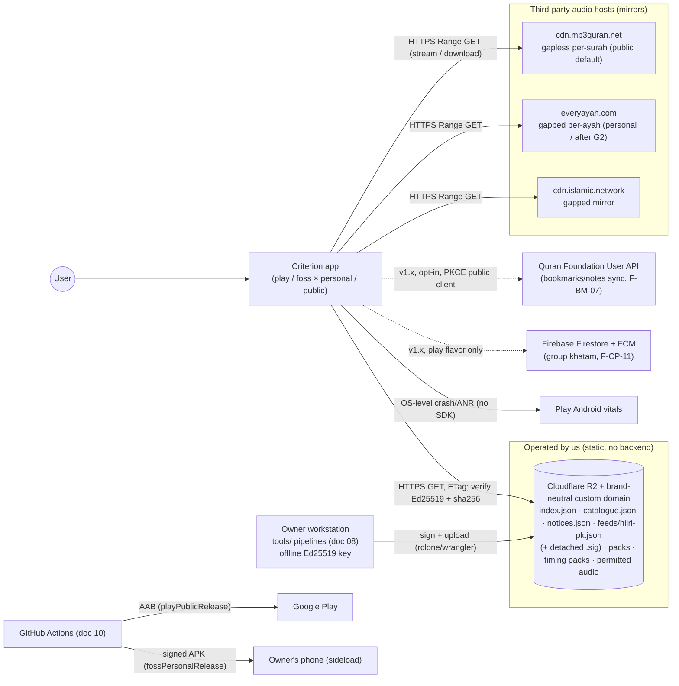
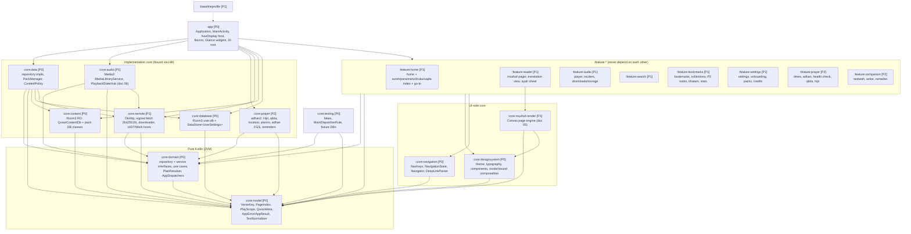

# 04 — System & App Architecture

**Purpose.** This document is the technical blueprint for the Criterion Android app (codename; public brand at gate G3). It covers the system context, module graph, layering and UDF conventions, the pure-Kotlin domain model, the repository and service interfaces, every on-device data store (with full DDL for `quran_content.db` and `user.db`), the signed pack manifest, navigation, DI, background work, the manifest permission set, build variants and content-eligibility enforcement, security, performance, update flows, diagnostics and the version catalogue. An engineer or AI agent should be able to create the P0 skeleton from this doc and the spike (`spikes/toolchain-spike/`) without redoing research. Doc 04 is the **owner** of module names, interface names, the content-DB schema and the user-DB schema. The mushaf-pack schema belongs to [05](05-mushaf-rendering-engine.md), and the audio catalogue and timing schema to [06](06-audio-engine.md). This doc only states the contracts it relies on.

**Status: Draft v1 — 2026-10-19**

**Key decisions in this doc**
- **D-01**: native Android, with pure-Kotlin `:core:model` and `:core:domain` ("KMP-ready, Android-only").
- **D-02**: toolchain as verified in the spike, plus the version catalogue (§16). No Ktor and no Coil in v1.
- **D-03**: a lean module graph of 9 modules in P0, 19 at P1 and 22 at v1.0. Repository interfaces live in `:core:domain`, and features never depend on features.
- **D-04/D-06/D-07**: `MushafId` and `PageIndex` are kept separate from `PageLabel` (label = index + 1 for Taj-16). We keep our own Indo-Pak Para/Manzil/Ruku/Sajda/quarter tables. The canonical word table is the DK token stream keyed to Kufan verse keys.
- **D-08/D-09/D-11**: Tanzil text is used for copy and search. Two translation packs ship bundled. Search uses FTS5 unicode61 + trigram over normalized columns.
- **D-10**: storage has three tiers: a read-only `quran_content.db` re-copied on version bump, a migrated `user.db`, and Ed25519-signed packs.
- **D-12/D-13/D-14**: `PlayScope`/`PlayRequest` live in the domain; `PlaybackController` is backed by Media3; downloads run as UIDT jobs on API 34+ and as WorkManager dataSync workers on API ≤ 33.
- **D-15/D-16**: no GMS in core. Location is coarse only. Alarms use `SCHEDULE_EXACT_ALARM` and `setAlarmClock()`. The manifest has an explicit never-request list.
- **D-17/D-20/D-22**: `distribution` {play, foss} × `tier` {personal, public}. CI blocks ineligible content. There are no SDKs and no secrets. Kill-switches are delivered through a signed `notices.json`.
- **D-21/D-23/D-24**: AppCompat per-app locales. Rotation lock on phones only. Static hosting on R2, with no app backend in v1.

---

## 1. System context



| External endpoint | Used for | Phase | Failure behaviour |
|---|---|---|---|
| `${CDN_BASE_URL}/v1/index.json` (+`.sig`) | Pack index (translation, tafsir, mushaf layout, timing, fonts, azkar, cities) | P1 | Keep the last verified copy, and the bundled copy below that. Never block reading |
| `${CDN_BASE_URL}/v1/catalogue.json` (+`.sig`) | Audio catalogue override (schema in [06](06-audio-engine.md)) | P1 | Fall back to the bundled `assets/catalogue/catalogue.json` |
| `${CDN_BASE_URL}/v1/notices.json` (+`.sig`) | Kill-switches and text-error notices (§14.3) | P1 | Keep the last value. Each notice expires at its own `until` |
| `${CDN_BASE_URL}/v1/feeds/hijri-pk.json` (+`.sig`) | PK month-start override (D-15, format in r08 §2.7) | P2 | Fall back to Umm al-Qura plus the user offset |
| mp3quran / everyayah / islamic.network | Audio bytes (D-12) | P1 | Mirror failover inside `ResolvingDataSource` ([06](06-audio-engine.md)) |
| QF User API, Firebase | Sync and group khatam | P3 | Feature hidden when unavailable |

`CDN_BASE_URL` is a **brand-neutral domain the owner registers in P0**, so G3 (brand) never forces a URL change. It is a `BuildConfig` field, and the placeholder until then is `https://cdn.example.invalid`. Never hotlink quran.com, quran.app or quranicaudio from a published build (r03 §1.10).

---

## 2. Architectural principles (non-negotiable)

1. **Offline-first.** Reading, indexes, search, bookmarks, translations (bundled and installed packs) and prayer times never need the network. The network serves only packs, audio and signed feeds.
2. **Stable keys.** User data references content only by a Kufan `VerseKey` (`surah`, `ayah`) or by (`mushafId`, `pageIndex`), never by a content-DB rowid (D-10).
3. **The device draws and the pipeline computes.** Justification, word positions, markers and normalized search text are all precomputed offline ([05](05-mushaf-rendering-engine.md), [08](08-data-pipelines.md)).
4. **Every content item carries its licence and eligibility.** Nothing is bundled or offered unless its `eligibility` matches the build's tier and monetization (§11).
5. **Zero third-party SDKs in v1** (D-20). The only libraries are AndroidX, Kotlin, Dagger, OkHttp, adhan2 and AboutLibraries. No analytics, ads, or crash SDKs.
6. **Pure core.** `:core:model` and `:core:domain` are Kotlin/JVM modules with no Android, Room or DI annotations. This keeps them testable in milliseconds and KMP-convertible.
7. **Clean-room** (D-18). GPL apps are read for ideas only. Apache-2.0 ports (quran-ios QuranKit, `LinePageGeometryEngine`) and MIT ports keep their headers (§5.6).

---

## 3. Module graph

### 3.1 Graph (v1.0 target; phase in brackets)



**Why the interfaces live in `:core:domain`, not `:core:data`.** Features compile only against `:core:domain` (interfaces and use cases) and `:core:model`. A change inside a repository implementation, Room or OkHttp therefore never recompiles a feature. `:core:testing` fakes implement the same interfaces, and `:app` pulls in the implementations through Hilt. This deliberately deviates from Now in Android (NiA), where interfaces sit in `core:data`.

### 3.2 Module table

| Module | Plugin(s) | Responsibility | Public API (exported) | May depend on | Phase |
|---|---|---|---|---|---|
| `:core:model` | `criterion.jvm.library` + serialization | Value types, the static Quran structure (`QuranMeta`, ported from QuranKit), the error model, the text normalizer | Everything in §5 and §4.3 | kotlinx-serialization, kotlinx-datetime | P0 |
| `:core:domain` | `criterion.jvm.library` | Repository and service interfaces (§6); use cases (`ResolvePlayScope`, `ComputeKhatamPlan`, `ResolveGoTo`, `NextPrayer`); `AppDispatchers`, `AppScope` | Interfaces, use-case classes (plain constructors) | model, coroutines-core | P0 |
| `:core:content` | `criterion.android.library` + `criterion.room3` | `QuranContentDb` (asset copy), pack DB classes (`TranslationPackDb`, `TafsirPackDb`, `MushafPackDb`, `TimingPackDb`, `AzkarPackDb`, `CitiesDb`), DAOs | **Internal.** Exposes only the `ContentDataSource` façade and `PackDbOpener` to `:core:data` | model | P0 (content), P1 (packs) |
| `:core:database` | android.library + room3 + serialization | `UserDb` (user.db), DAOs, migrations, exported schemas; typed `DataStore<UserSettings>` | Internal. Exposes the `UserDataSource` and `SettingsDataSource` façades | model | P0 |
| `:core:remote` | android.library + hilt + serialization | Shared `OkHttpClient`; `SignedFileFetcher` (ETag, Ed25519, sha256); `Ed25519Verifier`; `HttpDownloader` (Range, `.part`, atomic rename, ZIP); `DownloadManagerImpl` with UIDT `AudioDownloadJobService` (API 34+) and `DownloadWorker` (API ≤ 33); `RemoteRefreshWorker` | `OkHttpClient` binding; download and fetch façades | domain, model | P1 |
| `:core:data` | android.library + hilt | All repository implementations except audio and prayer; `PackManagerImpl`; `ContentPolicy` (tier/eligibility filter); `BackupSerializer` (JSON); `DailyMaintenanceWorker` | Hilt `@Binds` only | domain, model, content, database, remote | P0 |
| `:core:audio` | android.library + hilt | `PlaybackService : MediaLibraryService`, `PlanExpander` (scope to MediaItems), `ResolvingDataSource` chain, `PlaybackStateHub`, `PlaybackControllerImpl` (MediaController wrapper), sleep timer | `PlaybackController` binding | domain, model, remote | P1 |
| `:core:prayer` | android.library + hilt | adhan2 wrapper, `HijriCalendarImpl` (java.time `HijrahDate` + offset + Maghrib rollover + PK feed), Qibla sensor fusion, `LocationProviderImpl` (LocationManagerCompat + cities DB via `CitiesRepository`), `AlarmSchedulerImpl`, `AdhanAlarmReceiver`, `SystemEventsReceiver`, `AdhanPlaybackService`, `ReminderScheduler`, notification channels | Bindings for `PrayerTimesRepository`, `LocationProvider`, `HijriCalendar`, `QiblaSensor`, `AlarmScheduler`, `ReminderScheduler` | domain, model | P2 |
| `:core:designsystem` | `criterion.android.library.compose` | Theme (light/sepia/night/AMOLED, F-RD-03), typography (Noto Nastaliq Urdu UI, D-21), icons (vector drawables, no `material-icons-extended`), components, model-bound rows (`SurahRow`, `ParaRow`, `DownloadButton`), `AppError` → string mapping | Composables, `CriterionTheme` | model | P0 |
| `:core:navigation` | android.library.compose + serialization | Every `@Serializable` NavKey (§8), `NavigationState`, `Navigator`, `DeepLinkParser` | Keys and navigator | model | P0 |
| `:core:mushaf-render` | android.library.compose | Canvas renderer, hit-testing, highlight layer ([05](05-mushaf-rendering-engine.md)) | `MushafPage(...)` composable, `HitTester` | model, designsystem | P1 |
| `:core:testing` | android.library | Fakes for every §6 interface, `MainDispatcherRule`, a fixture content DB (Fatiha + Baqarah 1–20 + p.1–3 layout), `TestDispatchers` | Test helpers | domain, model | P0 |
| `:feature:*` | `criterion.android.feature` | Screens, ViewModels, `EntryProviderScope.<feature>Entries(navigator)` | One entry-provider extension per feature | domain, model, designsystem, navigation (+ reader → mushaf-render) | P1/P2 |
| `:app` | `criterion.android.application(.compose)` + `.flavors` + hilt + aboutlibraries | Wiring, `CriterionApp` (`Configuration.Provider`), `MainActivity : AppCompatActivity`, Glance widgets (P2), flavor modules | — | everything | P0 |
| `:baselineprofile` | `criterion.android.test` + baselineprofile | Profile generator and macrobenchmarks (§13) | — | app | P1 |

**Counts.** 9 modules in P0 (`app`, `model`, `domain`, `content`, `database`, `data`, `designsystem`, `navigation`, `testing`). 19 at P1 (adds `remote`, `mushaf-render`, `audio`, six features and `baselineprofile`). 22 at v1.0 (adds `prayer`, `feature:prayer`, `feature:companion`). That matches D-03's 15–22 target.

**Split triggers** (do not split earlier):
- `:core:remote` becomes `:core:network` + `:core:download` when it exceeds about 4k LOC.
- `:core:prayer` becomes `:core:location` + `:core:notifications` when reminders grow beyond prayer.
- `:feature:bookmarks` loses `:feature:khatam` when the planner exceeds 3 screens.

**P3 additions:** `:feature:hifz` (F-CP-12), `:core:sync` (QF PKCE, F-BM-07), `:core:groupkhatam` (play flavor Firestore, F-CP-11). P4 adds `:core:asr`.

### 3.3 Feature → module map

| Feature IDs | Module(s) |
|---|---|
| F-RD-01..08, F-RD-12, F-RD-13 | `:feature:reader`, `:core:mushaf-render`, `:core:data` (Mushaf/Content/Translation repos) |
| F-IX-01..09 | `:feature:home` (index tabs, go-to, popular, continue reading) |
| F-BM-01 | `:core:data` `ReadingProgressRepository` (written by reader) |
| F-BM-02..05 | `:feature:bookmarks` |
| F-BM-06 | `:core:data` `BackupSerializer` + `:feature:settings` (SAF UI, P2) |
| F-AU-01..10 | `:core:audio`, `:core:remote` (downloads), `:feature:audio` |
| F-TR-01..03 | `:core:data` `TranslationRepository`, `PackManager`; `:feature:settings` (pack manager UI) |
| F-SR-01..03 | `:feature:search`, `:core:data` `SearchRepository` |
| F-CP-01..04, F-CP-07 (times) | `:core:prayer`, `:feature:prayer` |
| F-CP-05, F-CP-06, F-CP-07 (duas, plan) | `:feature:companion` (khatam plan logic in `:core:domain`) |
| F-CP-08 | `:app` (Glance) |
| F-CP-09 | `:core:prayer` `ReminderScheduler` |
| F-CP-10 | `:feature:reader` (share sheet) + `:core:data` (`shareText`) |
| F-PL-01..07 | `:feature:settings` (onboarding, settings, credits, report error, packs/storage), `:core:designsystem` (a11y) |

### 3.4 Dependency rules (enforced by the `criterion.root` check task in CI)

1. A `:feature:*` module must not depend on another `:feature:*`, on `:core:data`, `:core:content`, `:core:database`, `:core:remote`, `:core:audio` or `:core:prayer`, or on Room, OkHttp or Media3 artifacts. Exception: `:feature:audio` may use `media3-ui-compose-material3`, which only needs a `Player` handed out by `PlaybackController.playerForUi()`.
2. `:core:model` and `:core:domain` may not apply any Android plugin and may not depend on `javax.inject`, Dagger or Room.
3. Implementation classes are `internal`. Each implementation module exposes only Hilt modules and the façades listed above. This fixes g04 error #2: Room types never leak through `api(...)`.
4. Cycles are a build failure (Gradle enforces this). The `criterion.root` task also prints a dependency-graph diff in PRs.

---

## 4. Layering, UDF and threading

### 4.1 Layers

```
Compose screen (stateless)  ←  Route (collects state, owns callbacks)  ←  ViewModel (StateFlow<UiState>)
        ↓ onAction(UiAction)                                                  ↓
                                         use case (:core:domain, optional, pure)
                                                     ↓
                               repository interface (:core:domain)  ⇐ impl in :core:data / :core:audio / :core:prayer
                                                     ↓
                         data sources: Room (content, packs, user) · DataStore · files · OkHttp · Media3 controller · AlarmManager
```

### 4.2 Screen contract (every screen)

- Each screen has **one immutable `XxxUiState`**, either a data class or a sealed `Loading | Ready | Error`. Lists inside it are `kotlinx.collections.immutable.ImmutableList`.
- **`XxxAction`** is a sealed interface of user intents. Its single entry point is `fun onAction(action: XxxAction)`. "UiEvent" in older docs means the same thing; we name it `Action`.
- **One-off effects.** A message is a state field such as `userMessage: UserMessage?`, cleared by `onAction(MessageShown)`. Navigation is never held by the ViewModel: the Route receives lambdas (`onOpenReader: (ReaderKey) -> Unit`) from the feature's `entryProvider` and calls them. Never use `SharedFlow` or `Channel` for effects.
- **State production.** Use `combine(...)…stateIn(viewModelScope, SharingStarted.WhileSubscribed(5_000), initial)`. Expensive one-shot loads go through `flow { emit(repo.x()) }` inside the same `combine`, so they cancel with the subscriber.
- **Saved state.** NavKeys carry the arguments. `SavedStateHandle` is used only for transient UI input (a search query being typed).

```kotlin
@HiltViewModel(assistedFactory = SurahIndexViewModel.Factory::class)
class SurahIndexViewModel @AssistedInject constructor(
    @Assisted private val key: IndexKey,
    index: IndexRepository,
    progress: ReadingProgressRepository,
    private val playback: PlaybackController,
) : ViewModel() {
    private val tab = MutableStateFlow(key.tab)
    private val message = MutableStateFlow<UserMessage?>(null)

    private val lists = combine(index.surahs(), index.paras(), index.manzils()) { s, p, m -> Triple(s, p, m) }

    val uiState: StateFlow<IndexUiState> =
        combine(tab, lists, progress.lastRead(), message) { t, (s, p, m), last, msg ->
            IndexUiState.Ready(t, s.toImmutableList(), p.toImmutableList(), m.toImmutableList(), last, msg) as IndexUiState
        }
        .catch { emit(IndexUiState.Error(it.toAppError())) }
        .stateIn(viewModelScope, SharingStarted.WhileSubscribed(5_000), IndexUiState.Loading)

    fun onAction(a: IndexAction) {
        when (a) {
            is IndexAction.SelectTab -> tab.value = a.tab
            is IndexAction.Play -> viewModelScope.launch {
                (playback.play(PlayRequest(a.scope)) as? AppResult.Err)?.let { message.value = UserMessage.Error(it.error) }
            }
            IndexAction.MessageShown -> message.value = null
        }
    }
    @AssistedFactory interface Factory { fun create(key: IndexKey): SurahIndexViewModel }
}
```

The Route is a stateless screen plus a `@Preview`/Roborazzi target:

```kotlin
@Composable
fun IndexRoute(key: IndexKey, onOpenReader: (ReaderKey) -> Unit,
               vm: SurahIndexViewModel = hiltViewModel<SurahIndexViewModel, SurahIndexViewModel.Factory> { it.create(key) }) {
    val state by vm.uiState.collectAsStateWithLifecycle()
    IndexScreen(state, vm::onAction, onOpenReader)
}
```

If assisted injection with `hiltViewModel(creationCallback)` fails on Nav3 in P0, fall back to `SavedStateHandle.toRoute`-style key passing via `navArgs` decorator; this is P0 spike item S-3 (§17).

### 4.3 Error model and result type (in `:core:model`)

```kotlin
sealed interface AppError {
    data object Offline : AppError
    data class Network(val httpCode: Int?, val host: String?) : AppError
    data class NoSpace(val neededBytes: Long, val availableBytes: Long) : AppError
    data class Integrity(val what: String) : AppError                  // sha256/signature/schema mismatch
    data class NotFound(val what: String) : AppError
    data class PermissionDenied(val permission: String) : AppError
    data class Unavailable(val reason: UnavailableReason) : AppError     // kill-switch, not eligible, not installed
    data class Unknown(val cause: Throwable) : AppError
}
enum class UnavailableReason { KILL_SWITCHED, NOT_ELIGIBLE_FOR_BUILD, NOT_INSTALLED, NEEDS_APP_UPDATE, LICENCE_PENDING }

sealed interface AppResult<out T> {
    data class Ok<out T>(val value: T) : AppResult<T>
    data class Err(val error: AppError) : AppResult<Nothing>
}
inline fun <T, R> AppResult<T>.map(f: (T) -> R): AppResult<R> = when (this) { is AppResult.Ok -> AppResult.Ok(f(value)); is AppResult.Err -> this }
suspend inline fun <T> appCatching(crossinline block: suspend () -> T): AppResult<T> =
    try { AppResult.Ok(block()) }
    catch (c: kotlinx.coroutines.CancellationException) { throw c }          // never swallow cancellation
    catch (t: Throwable) { AppResult.Err(t.toAppError()) }
fun Throwable.toAppError(): AppError                                         // maps UnknownHost/SocketTimeout→Offline, IOException(ENOSPC)→NoSpace, …
```

**Rules**
- One-shot repository calls that can fail for **environmental** reasons (network, disk, permission, licence) return `AppResult<T>`.
- Reads of bundled content return plain values. A failure there is a bug, and it throws.
- Observable data is a `Flow<T>`. Errors inside a Flow reach the UI through `.catch { }` and become `UiState.Error`.
- `:core:designsystem` maps every `AppError` to a localized en/ur message and a recovery action (Retry, Free space, Open settings).

### 4.4 Coroutines, dispatchers and threading

```kotlin
// :core:domain — injected as a type, so no qualifier annotations are needed in pure modules
data class AppDispatchers(val io: CoroutineDispatcher, val default: CoroutineDispatcher, val main: CoroutineDispatcher)
class AppScope(val scope: CoroutineScope)   // SupervisorJob() + dispatchers.default; process lifetime
```

| Work | Dispatcher / thread | Rule |
|---|---|---|
| Room (content, packs, user) | `setQueryCoroutineContext(dispatchers.io)` | DAOs are `suspend` or `Flow` only (Room 3) |
| DataStore | its own scope on `io` | One `DataStore<UserSettings>` instance per process |
| Page layout assembly (pack rows plus words into `PageLayout`) | `default` | Off the main thread, cached (§13) |
| Canvas drawing | main/RenderThread | No allocation and no DB access in `draw` |
| Media3 `MediaController`, session, player | **application main looper** | Media3 1.11 rule: getters throw off the main looper (r07 §2.6) |
| FTS search | `io`, debounced 250 ms, `flatMapLatest` | Cancel on new input. `LIMIT 200` per page |
| Downloads | `io.limitedParallelism(3)` overall, 2 per host | Inside a UIDT job or worker only |
| Signature and sha256 checks | `default` | Streaming hash. Never on main |
| Sensors (Qibla) | sensor callback looper, then `conflate()` | Low-pass filter in `default` |
| Alarm receivers | `goAsync()` + `AppScope` | Finish in under 5 s; `rescheduleAll` is idempotent |

StrictMode is set in debug `Application.onCreate` (thread and VM policies, `penaltyLog`, plus `penaltyDeath` on CI instrumented runs). Tests use `MainDispatcherRule` with `runTest`, never `runBlocking` around `viewModelScope` (g04 §2.3 #5).

---

## 5. Domain model (`:core:model`)

### 5.1 Identifiers and keys

```kotlin
@Serializable @JvmInline value class SurahId(val value: Int) { init { require(value in 1..114) } }
@Serializable @JvmInline value class ParaId(val value: Int) { init { require(value in 1..30) } }    // Indo-Pak Para (D-07)
@Serializable @JvmInline value class ManzilId(val value: Int) { init { require(value in 1..7) } }
@Serializable @JvmInline value class RukuId(val value: Int) { init { require(value in 1..558) } }  // global ruku number
@Serializable @JvmInline value class AyahId(val value: Int) { init { require(value in 1..6236) } } // Kufan global index; 1 = 1:1
@Serializable @JvmInline value class WordIndex(val value: Int) { init { require(value in 1..83_669) } } // DK token id (D-06)

/** Kufan verse key. Canonical key for user data, audio, translations, search, sync ("2:255"). */
@Serializable
data class VerseKey(val surah: Int, val ayah: Int) : Comparable<VerseKey> {
    init { require(surah in 1..114 && ayah in 1..QuranMeta.ayahCount(surah)) { "bad key $surah:$ayah" } }
    val ayahId: AyahId get() = AyahId(QuranMeta.surahFirstAyahId(surah) + ayah - 1)
    override fun compareTo(other: VerseKey) = compareValuesBy(this, other, VerseKey::surah, VerseKey::ayah)
    override fun toString() = "$surah:$ayah"
    companion object {
        fun parse(s: String): VerseKey? = s.split(':').takeIf { it.size == 2 }
            ?.let { (a, b) -> runCatching { VerseKey(a.trim().toInt(), b.trim().toInt()) }.getOrNull() }
        fun of(id: AyahId): VerseKey = QuranMeta.verseKeyOf(id)
    }
}

@Serializable
data class AyahRange(val from: VerseKey, val to: VerseKey) {
    init { require(from <= to) }
    operator fun contains(k: VerseKey) = k in from..to
    val ayahCount: Int get() = to.ayahId.value - from.ayahId.value + 1
    fun surahsTouched(): IntRange = from.surah..to.surah
}
```

### 5.2 Mushaf identity and pages

```kotlin
@Serializable @JvmInline value class MushafId(val code: String) {
    companion object {
        val INDOPAK_16_TAJ = MushafId("indopak16_taj")       // default, 548 pages (D-04)
        val INDOPAK_15_HAFIZI = MushafId("indopak15_hafizi") // P3, 610 pages
        val INDOPAK_13_TAJ = MushafId("indopak13_taj")       // P3, 847 pages
        val MADANI_15 = MushafId("madani15")                 // P4, 604 pages
    }
}
/** 1-based storage index of a page in a layout (QUL index for Taj-16: 1..548). Never shown in UI. */
@Serializable @JvmInline value class PageIndex(val value: Int)
/** Printed page number shown everywhere in UI (Taj-16: index + 1 → 2..549). Never stored. */
@JvmInline value class PageLabel(val value: Int)

data class MushafSpec(
    val id: MushafId, val pageCount: Int, val linesPerPage: Int,
    val pageLabelOffset: Int,                 // Taj-16 = 1
    val packVersion: Int, val displayName: LocalizedText,
) {
    fun labelOf(p: PageIndex) = PageLabel(p.value + pageLabelOffset)
    fun indexOf(l: PageLabel): PageIndex? = PageIndex(l.value - pageLabelOffset).takeIf { it.value in 1..pageCount }
}
data class ReadingPosition(val mushaf: MushafId, val page: PageIndex, val anchor: VerseKey, val mode: ReaderMode, val at: Instant)
enum class ReaderMode { MUSHAF, TRANSLATION }
```

`PageLayout`, `PageLine`, `PlacedWord`, `PageFurniture` and `MarginMarker` are defined in `:core:model` with the fields from [05](05-mushaf-rendering-engine.md). Doc 05 owns that field list. This doc only requires `PageLayout(mushaf, page, verseRange: AyahRange, para: ParaId, manzil: ManzilId, lines: List<PageLine>, furniture: PageFurniture)`.

### 5.3 Structure types

```kotlin
data class Surah(val id: SurahId, val nameAr: String, val nameUr: String, val nameRoman: String, val nameEn: String,
                 val meaningUr: String, val meaningEn: String, val revelation: Revelation, val revelationOrder: Int,
                 val ayahCount: Int, val rukuCount: Int, val basmala: BasmalaKind)
enum class Revelation { MAKKI, MADANI }
enum class BasmalaKind { IS_VERSE_1 /*1:1*/, NONE /*surah 9*/, HEADER /*all others: not a verse*/ }
data class Para(val id: ParaId, val nameAr: String, val nameRoman: String, val range: AyahRange, val madaniStart: VerseKey)
data class Manzil(val id: ManzilId, val range: AyahRange)
data class Ruku(val id: RukuId, val surah: SurahId, val rukuInSurah: Int, val para: ParaId, val rukuInPara: Int?, // null = Fatiha (D-07)
                val range: AyahRange)
data class Sajda(val key: VerseKey, val number: Int?, val kind: SajdaKind)   // 14 numbered HANAFI + 22:77 SHAFII_ONLY
enum class SajdaKind { HANAFI, SHAFII_ONLY }
data class ParaQuarter(val para: ParaId, val quarter: Quarter, val at: VerseKey, val afterWordPos: Int?)
enum class Quarter { RUB /*¼ ربع*/, NISF /*½ نصف*/, THULUTH /*¾ ثلٰثة*/ }
data class Passage(val code: String, val title: LocalizedText, val ranges: List<AyahRange>)  // Yaseen, Manzil dua, …
data class LocalizedText(val en: String, val ur: String, val ar: String? = null) { fun pick(lang: UiLanguage) = if (lang == UiLanguage.UR) ur else en }
```

### 5.4 Audio-facing domain types (field details in [06](06-audio-engine.md))

```kotlin
@Serializable @JvmInline value class RecitationId(val value: String)   // e.g. "alafasy.murattal.gapless.mp3quran"
@Serializable
sealed interface PlayScope {
    @Serializable data class Surah(val surah: SurahId) : PlayScope
    @Serializable data class Para(val para: ParaId) : PlayScope            // Indo-Pak boundaries (D-07, D-13)
    @Serializable data class Manzil(val manzil: ManzilId) : PlayScope
    @Serializable data class Ruku(val ruku: RukuId) : PlayScope
    @Serializable data class Page(val mushaf: MushafId, val page: PageIndex) : PlayScope
    @Serializable data class Range(val range: AyahRange) : PlayScope
    @Serializable data class Ayah(val key: VerseKey) : PlayScope
    @Serializable data class FromHere(val start: VerseKey, val until: Until) : PlayScope
    enum class Until { END_OF_SURAH, END_OF_PARA, END_OF_QURAN }
}
@Serializable
data class RepeatSpec(val ayahTimes: Int = 1, val rangeTimes: Int = 1 /*0 = ∞*/,
                      val pauseAfterAyah: PauseRule = PauseRule.None, val cumulative: Boolean = false)
@Serializable sealed interface PauseRule {
    @Serializable data object None : PauseRule
    @Serializable data class Fixed(val ms: Long) : PauseRule
    @Serializable data class Proportional(val factor: Float) : PauseRule
}
@Serializable
data class PlayRequest(val scope: PlayScope, val recitation: RecitationId? = null /*null = favourite*/,
                       val repeat: RepeatSpec = RepeatSpec(), val speed: Float = 1f,
                       val translationVoice: RecitationId? = null)
```

`:core:domain` contains `ResolvePlayScope(index, mushaf): suspend (PlayScope) -> AyahRange`. It is pure and unit-tested (for example, "Para 4 = 3:92–4:23"). `:core:audio`'s `PlanExpander` turns that range into Media3 items ([06](06-audio-engine.md)).

### 5.5 `QuranMeta` (static structure, pure Kotlin)

`QuranMeta` holds compile-time tables so that keys, ranges and Para/Manzil lookups work without a database. Every function is O(log n) or O(1).
- `ayahCounts: IntArray(114)` and the derived `surahFirstAyahId`.
- `paraStarts: Array<VerseKey>(30)`: the **Indo-Pak** table from D-07 (P4 = 3:92, P7 = 5:83, P11 = 9:94, P14 = 15:2, P20 = 27:60, P21 = 29:45, P23 = 36:22).
- `manzilStartSurahs = intArrayOf(1, 5, 10, 17, 26, 37, 50)`.
- Functions: `paraOf(key)`, `manzilOf(key)`, `verseKeyOf(AyahId)`, `next(key)`, `prev(key)`, `lastAyah(surah)`.

A JVM test asserts that `QuranMeta` equals the content DB's `surah`, `para` and `manzil` tables exactly. This guards against drift between the two copies. Ruku, sajda, quarter and page data stay in the DB only.

### 5.6 Ported code headers (D-18)

QuranKit-derived files (`QuranMeta`, `AyahRange` helpers, line-page geometry in `:core:mushaf-render`) start with this header:

```kotlin
/*
 * Portions ported from quran/quran-ios (QuranEngine) — https://github.com/quran/quran-ios
 * Copyright (c) Quran.com contributors. Licensed under the Apache License, Version 2.0.
 * Modifications (c) 2026 Criterion authors: rewritten in Kotlin; Indo-Pak Para/Manzil/Ruku added.
 */
```

The Apache-2.0 text is listed in the Credits/licences screen (F-PL-04) through AboutLibraries custom entries.

### 5.7 Text normalizer

`TextNormalizer.arabic(s)`, `.urdu(s)`, `.english(s)` and `.stripForCopy(s)` implement the r05 §2.7.5 spec:
- strip PUA and control characters (`stripForCopy`, D-08);
- strip harakat and Quranic marks;
- fold letter forms; Urdu keeps ے and ھ distinct;
- English is ASCII-folded and lowercased.

A Kotlin test consumes `normalization_vectors.json` generated by the Python pipeline ([08](08-data-pipelines.md)), so the two implementations cannot diverge. This replaces the spike's minimal `ArabicNormalizer`.

---

## 6. Key interfaces (`:core:domain`)

All interfaces are main-safe: implementations switch dispatchers internally. Flows are cold and re-emit when the underlying table changes.

```kotlin
interface ContentRepository {
    fun surahs(): Flow<List<Surah>>
    suspend fun surah(id: SurahId): Surah
    suspend fun ayah(key: VerseKey): AyahText                         // uthmani + imlaei (Tanzil, verbatim)
    suspend fun ayahs(range: AyahRange): List<AyahText>
    suspend fun words(range: IntRange /*WordIndex values*/): List<Word>
    suspend fun ayahMarkers(range: IntRange): List<AyahMarker>        // DK display numbers incl. 118 disputed marks
    suspend fun resolveDisplayNumber(surah: SurahId, displayNumber: Int): VerseKey? // "Fatiha 6" → 1:7
    suspend fun shareText(range: AyahRange, format: ShareFormat): String // sanitized, with attribution line (F-CP-10)
    suspend fun contentInfo(): ContentInfo                            // content_version, built_at, sources hash
    fun attributions(): Flow<List<Attribution>>                       // content + installed packs (F-PL-04)
}

interface MushafRepository {
    fun available(): Flow<List<MushafSpec>>                           // installed layout packs, eligibility-filtered
    suspend fun spec(id: MushafId): MushafSpec
    suspend fun page(id: MushafId, page: PageIndex): PageLayout       // cached LRU; errata overlay applied
    suspend fun pageOf(id: MushafId, key: VerseKey): PageIndex
    suspend fun verseRange(id: MushafId, page: PageIndex): AyahRange
    suspend fun startPage(id: MushafId, target: IndexTarget): PageIndex  // surah/para/manzil/ruku → page
    fun prefetch(id: MushafId, center: PageIndex, radius: Int = 3)
}

interface IndexRepository {
    fun surahs(): Flow<List<SurahSummary>>                            // + start page in current mushaf + progress
    fun paras(): Flow<List<ParaSummary>>                              // names, start page, khatam/read progress
    fun manzils(): Flow<List<ManzilSummary>>
    suspend fun rukus(surah: SurahId? = null, para: ParaId? = null): List<Ruku>
    suspend fun sajdas(): List<Sajda>
    suspend fun paraQuarters(para: ParaId? = null): List<ParaQuarter>
    suspend fun passages(): List<Passage>                             // quick access (F-IX-08)
    suspend fun paraOf(key: VerseKey): Para
    suspend fun rukuOf(key: VerseKey): Ruku
    suspend fun resolveGoTo(input: String, mushaf: MushafId): GoToTarget?  // "50", "2:255", "yaseen", "para 23"
}

interface TranslationRepository {
    fun installed(): Flow<List<TranslationInfo>>                      // bundled + downloaded, eligibility-filtered
    fun selected(): Flow<List<TranslationId>>                         // from settings (1 per language, F-TR-03)
    fun translations(range: AyahRange, ids: List<TranslationId>): Flow<Map<VerseKey, List<TranslationText>>>
    suspend fun footnotes(id: TranslationId, key: VerseKey): List<Footnote>
    suspend fun tafsirSummary(key: VerseKey): TafsirText?             // Ahsan-ul-Bayan = Junagarhi footnotes (F-RD-13)
}

interface SearchRepository {
    fun search(query: SearchQuery): Flow<SearchPage>                  // Arabic + selected translations + aliases
    suspend fun aliases(prefix: String, limit: Int = 8): List<AliasHit>
    fun history(): Flow<List<String>>; suspend fun clearHistory()
}
data class SearchQuery(val text: String, val scopes: Set<SearchScope>, val mode: MatchMode = MatchMode.WORDS, val page: Int = 0)
enum class SearchScope { ARABIC, TRANSLATION_UR, TRANSLATION_EN, SURAH_NAMES }
enum class MatchMode { WORDS /*unicode61, prefix on last token*/, PARTIAL /*trigram*/ }

interface BookmarkRepository {
    fun bookmarks(collection: Long? = null): Flow<List<Bookmark>>
    fun collections(): Flow<List<BookmarkCollection>>
    fun bookmarkedKeys(range: AyahRange): Flow<Set<VerseKey>>         // reader overlay
    suspend fun add(b: NewBookmark): Long
    suspend fun remove(id: Long): UndoToken                           // soft delete
    suspend fun undo(token: UndoToken)
    suspend fun update(id: Long, label: String?, color: Int?, collection: Long?)
    suspend fun upsertCollection(c: BookmarkCollection): Long; suspend fun deleteCollection(id: Long)
}
interface NoteRepository {                                            // P2 (F-BM-03)
    fun notes(): Flow<List<Note>>; fun notesFor(range: AyahRange): Flow<List<Note>>
    suspend fun save(note: Note): Long; suspend fun delete(id: Long): UndoToken
}

interface ReadingProgressRepository {
    fun lastRead(mushaf: MushafId? = null): Flow<ReadingPosition?>    // null = current mushaf (F-BM-01)
    suspend fun setLastRead(pos: ReadingPosition)                     // callers debounce 1 s
    fun recents(limit: Int = 10): Flow<List<RecentItem>>              // F-IX-09
    suspend fun recordOpen(item: RecentItem)
    suspend fun recordDwell(mushaf: MushafId, page: PageIndex, seconds: Int) // stats + khatam auto-suggest
    fun readingDays(from: LocalDate, to: LocalDate): Flow<List<ReadingDay>>  // F-BM-05 (P2)
}

interface KhatamRepository {                                          // P2 (F-BM-04, F-CP-07 plan)
    fun plans(): Flow<List<KhatamPlan>>; fun plan(id: Long): Flow<KhatamPlanWithProgress?>
    suspend fun create(plan: NewKhatamPlan): Long
    suspend fun markDone(planId: Long, unitIndex: Int, done: Boolean)
    suspend fun archive(planId: Long)
}
interface TasbeehRepository {                                         // P2 (F-CP-05)
    fun counters(): Flow<List<TasbeehCounter>>
    suspend fun increment(id: Long, by: Int = 1); suspend fun reset(id: Long); suspend fun upsert(c: TasbeehCounter): Long
}

interface AudioCatalogRepository {                                    // schema: doc 06
    fun recitations(): Flow<List<Recitation>>                         // eligibility + kill-switch filtered
    suspend fun recitation(id: RecitationId): Recitation?
    fun favourite(): Flow<RecitationId>
    suspend fun timing(id: RecitationId, surah: SurahId): AyahTimings?  // null ⇒ no highlight for that surah
    suspend fun highlightEnabled(id: RecitationId, surah: SurahId): Boolean
}

interface PlaybackController {                                        // impl :core:audio (MediaController wrapper)
    val state: StateFlow<PlaybackState>                               // = PlaybackStateHub
    suspend fun play(request: PlayRequest): AppResult<Unit>           // user-initiated only (Android 17)
    fun pause(); fun resume(); fun stop()
    fun seekTo(key: VerseKey); fun nextAyah(); fun previousAyah()
    fun setSpeed(speed: Float); fun setRepeat(spec: RepeatSpec)
    fun setSleepTimer(timer: SleepTimer?)                             // minutes or end of ayah/surah/para
    fun playerForUi(): Flow<Any?>                                     // androidx.media3.common.Player, typed Any in domain
}
data class PlaybackState(val status: Status, val request: PlayRequest?, val current: VerseKey?, val word: Int?,
                         val recitation: RecitationId?, val positionMs: Long, val durationMs: Long,
                         val highlightAvailable: Boolean, val sleepTimer: SleepTimer?, val error: AppError?) {
    enum class Status { IDLE, BUFFERING, PLAYING, PAUSED, ENDED, ERROR }
}

interface DownloadManager {                                           // impl :core:remote; NOT android.app.DownloadManager
    suspend fun enqueue(request: DownloadRequest): AppResult<DownloadId>  // must be called while UI visible (UIDT rule)
    suspend fun cancel(id: DownloadId); suspend fun pauseAll(); suspend fun resumeAll()
    fun tasks(): Flow<List<DownloadTask>>
    fun audioStorage(): Flow<List<RecitationStorage>>                 // per-recitation bytes (F-AU-08 storage manager)
    suspend fun deleteAudio(id: RecitationId, surahs: Set<SurahId>? = null /*null = all*/)
    suspend fun cleanPartials(): Long
    fun storageVolumes(): List<StorageVolume>                         // getExternalFilesDirs choices
}
sealed interface DownloadRequest {
    data class Audio(val recitation: RecitationId, val unit: AudioUnit, val wifiOnly: Boolean) : DownloadRequest
    data class Pack(val packId: String, val version: Int, val wifiOnly: Boolean) : DownloadRequest
}
sealed interface AudioUnit { data class Surahs(val s: Set<SurahId>) : AudioUnit; data class Para(val p: ParaId) : AudioUnit
                             data class Manzil(val m: ManzilId) : AudioUnit; data object Full : AudioUnit }

interface PackManager {                                               // impl :core:data
    fun index(): Flow<PackIndexState>                                 // verified index (remote ∪ bundled), filtered
    suspend fun refreshIndex(force: Boolean = false): AppResult<Unit>
    fun installed(): Flow<List<InstalledPack>>
    suspend fun install(packId: String): AppResult<DownloadId>        // via DownloadManager
    suspend fun uninstall(packId: String): AppResult<Unit>            // bundled packs: only "disable"
    suspend fun ensureBundledInstalled()                              // first run / content bump (§14)
    fun notices(): Flow<List<Notice>>                                 // kill-switches & text-error notices
}

interface SettingsRepository {
    val settings: Flow<UserSettings>
    suspend fun update(transform: (UserSettings) -> UserSettings)
}

interface PrayerTimesRepository {                                     // P2, impl :core:prayer (adhan2)
    fun today(): Flow<PrayerDay>                                      // ticks at midnight / location change
    suspend fun day(date: LocalDate): PrayerDay
    fun next(): Flow<NextPrayer>                                      // countdown source for widget/home
    suspend fun month(year: Int, month: Int): List<PrayerDay>         // Ramadan timetable (F-CP-07)
}
interface LocationProvider {                                          // P2; coarse only
    suspend fun currentCoarse(timeoutMs: Long = 10_000): AppResult<GeoPoint>  // LocationManagerCompat.getCurrentLocation
    suspend fun searchCities(query: String, limit: Int = 20): List<City>      // offline GeoNames cities15000
    suspend fun nearestCity(p: GeoPoint): City?
}
interface HijriCalendar { fun today(): Flow<HijriDate>; suspend fun convert(date: LocalDate, afterMaghrib: Boolean): HijriDate }
interface QiblaSensor { fun readings(): Flow<QiblaReading> /* bearing, heading, accuracy */ }
interface AlarmScheduler { suspend fun rescheduleAll(reason: RescheduleReason); fun exactAlarmsAllowed(): Boolean; fun health(): Flow<AdhanHealth> }
interface ReminderScheduler { suspend fun rescheduleReminders() }    // ≤3/day; tap-to-play (F-CP-09)
interface BackupManager { suspend fun export(out: OutputStreamProvider): AppResult<Int>; suspend fun import(input: InputStreamProvider, mode: MergeMode): AppResult<ImportReport> }
interface DiagnosticsLog { fun log(tag: String, msg: String); suspend fun bundle(): AppResult<FileRef> }
```

`Clock` comes from `kotlinx.datetime` / `kotlin.time`. It is injected so that schedulers and the Hijri rollover can be tested.

---

## 7. Data stores

### 7.1 Overview

| Store | Location | Written by | Lifecycle | Backup |
|---|---|---|---|---|
| `quran_content.db` | `databases/quran_content.db` (copied from `assets/content/quran_content.db`) | Pipeline only (read-only in the app) | Room `createFromAsset` + `fallbackToDestructiveMigration(dropAllTables = true)`; re-copied when `@Database(version)` is bumped | Excluded |
| Bundled packs | `assets/packs/<type>/<id>@<ver>.db` → `files/packs/<type>/<id>/<ver>/pack.db` | Pipeline | Copied by `PackManager.ensureBundledInstalled()` | Excluded |
| Downloaded packs | `files/packs/<type>/<id>/<ver>/pack.db` | `PackManager` (verified) | Atomic install and uninstall | Excluded |
| `user.db` | `databases/user.db` | The app | Room migrations; **never destructive** in release | **Included** |
| Settings | `files/datastore/settings.json` | `SettingsRepository` | Typed DataStore, versioned JSON | **Included** |
| Remote cache | `files/remote/{index,catalogue,notices,hijri-pk}.json` (+`.sig`, `.etag`) | `SignedFileFetcher` | Replaced only after verification | Excluded |
| Audio | `<getExternalFilesDirs()[i]>/audio/<recitationId>/…` + `.nomedia` | `DownloadManager` | User-managed | Excluded |
| Stream cache | `cache/media3/` (SimpleCache LRU 256 MB, user-settable) | Media3 | OS may clear it | Excluded |
| Logs | `files/logs/app-{0,1}.log` (256 KB ring) | `DiagnosticsLog` | Rolling | Excluded |

### 7.2 `quran_content.db` (schema owned here, populated by [08](08-data-pipelines.md))

**Contract**
- Each table below is a Room 3 `@Entity`, or an `@Fts5` entity, in `:core:content`. The pipeline creates the file by executing Room's exported `createSql`, index SQL, `contentSyncTriggers` and `setupQueries` verbatim (g04 §2.10).
- The pipeline then sets `PRAGMA user_version = @Database.version` and runs `VACUUM`.
- **CHECK constraints are not expressible in Room.** The pipeline's validators enforce them instead (invariants in §7.2.1), and they appear below as comments.
- `content_meta` and `attribution` are entities too, so DAOs can read them.
- The SQL shows the logical schema. Room emits back-quoted identifiers and `NOT NULL` exactly as the entity declares.

```sql
-- ===== Structure =====
CREATE TABLE surah (
  id               INTEGER NOT NULL PRIMARY KEY,         -- 1..114
  name_ar          TEXT    NOT NULL,                     -- with Indo-Pak diacritics (curated)
  name_ur          TEXT    NOT NULL,
  name_roman       TEXT    NOT NULL,                     -- Pakistani spelling (Yaseen, Rehman …)
  name_en          TEXT    NOT NULL,                     -- standard transliteration
  meaning_ur       TEXT    NOT NULL,
  meaning_en       TEXT    NOT NULL,
  revelation       TEXT    NOT NULL,                     -- 'makki' | 'madani'
  revelation_order INTEGER NOT NULL,
  ayah_count       INTEGER NOT NULL,
  ruku_count       INTEGER NOT NULL,
  first_ayah_id    INTEGER NOT NULL,
  basmala_kind     TEXT    NOT NULL                      -- 'verse' (1) | 'none' (9) | 'header'
);

CREATE TABLE ayah (
  id               INTEGER NOT NULL PRIMARY KEY,         -- AyahId 1..6236 (Kufan)
  surah_id         INTEGER NOT NULL,
  ayah_no          INTEGER NOT NULL,
  text_uthmani     TEXT    NOT NULL,                     -- Tanzil Uthmani verbatim (copy/share, D-08)
  text_imlaei      TEXT    NOT NULL,                     -- Tanzil Simple-Clean verbatim
  para_id          INTEGER NOT NULL,                     -- Indo-Pak Para (D-07)
  manzil_id        INTEGER NOT NULL,
  ruku_id          INTEGER NOT NULL,
  juz_madani       INTEGER NOT NULL,                     -- Madani mode only (P4)
  rub_madani       INTEGER NOT NULL,                     -- 1..240, Madani mode only
  first_word_index INTEGER NOT NULL,                     -- DK token range of this ayah (incl. end token)
  last_word_index  INTEGER NOT NULL
);
CREATE UNIQUE INDEX ix_ayah_key   ON ayah(surah_id, ayah_no);
CREATE INDEX        ix_ayah_para  ON ayah(para_id);
CREATE INDEX        ix_ayah_ruku  ON ayah(ruku_id);

CREATE TABLE para (
  id                  INTEGER NOT NULL PRIMARY KEY,      -- 1..30
  name_ar             TEXT    NOT NULL,                  -- الٓمّٓ، سَیَقُوْلُ، تِلْكَ الرُّسُلُ … (curated)
  name_roman          TEXT    NOT NULL,                  -- Alif Lam Meem, Sayaqool …
  start_ayah_id       INTEGER NOT NULL,                  -- P4=3:92, P7=5:83, P11=9:94, P14=15:2, P20=27:60, P21=29:45, P23=36:22
  end_ayah_id         INTEGER NOT NULL,
  madani_start_ayah_id INTEGER NOT NULL                  -- informational ("Madani juz starts 3:93")
);
CREATE TABLE manzil (
  id            INTEGER NOT NULL PRIMARY KEY,            -- 1..7; starts at surahs 1,5,10,17,26,37,50
  start_ayah_id INTEGER NOT NULL,
  end_ayah_id   INTEGER NOT NULL
);
CREATE TABLE ruku (
  id            INTEGER NOT NULL PRIMARY KEY,            -- 1..558 (QF/QUL set, print-verified)
  surah_id      INTEGER NOT NULL,
  ruku_in_surah INTEGER NOT NULL,
  para_id       INTEGER NOT NULL,                        -- Para where the ruku ENDS (D-07)
  ruku_in_para  INTEGER,                                 -- NULL for Al-Fatiha (excluded from Para-1 numbering)
  start_ayah_id INTEGER NOT NULL,
  end_ayah_id   INTEGER NOT NULL,
  ayah_count    INTEGER NOT NULL                         -- middle number of the ع triple
);
CREATE INDEX ix_ruku_surah ON ruku(surah_id);
CREATE INDEX ix_ruku_para  ON ruku(para_id);
CREATE TABLE sajda (
  ayah_id  INTEGER NOT NULL PRIMARY KEY,
  number   INTEGER,                                      -- 1..14 Hanafi (incl. 38:24); NULL for 22:77
  kind     TEXT    NOT NULL,                             -- 'hanafi' | 'shafii_only'
  label_ar TEXT                                          -- 22:77: «السجدة عند الامام الشافعی رح»
);
CREATE TABLE para_quarter (
  para_id   INTEGER NOT NULL,
  quarter   INTEGER NOT NULL,                            -- 1=ربع 2=نصف 3=ثلٰثة
  ayah_id   INTEGER NOT NULL,                            -- e.g. P4 ¾ = 3:198; P7 ¼ = 5:113
  after_word_pos INTEGER,                                -- mid-ayah marks, e.g. P7 ¾ = 6:73 after word 10
  PRIMARY KEY (para_id, quarter)
);

-- ===== Script-level text (DK IndoPak token stream, D-06) =====
CREATE TABLE word (
  word_index INTEGER NOT NULL PRIMARY KEY,               -- 1..83,669 (77,433 words + 6,236 end tokens)
  ayah_id    INTEGER NOT NULL,
  position   INTEGER NOT NULL,                           -- 1..n within ayah (DK positions)
  qul_position INTEGER NOT NULL,                         -- QUL word position (differs only in 72:16: DK 1–2 → QUL 1)
  is_end     INTEGER NOT NULL,                           -- 1 = ayah-end token
  text       TEXT    NOT NULL                            -- DK IndoPak glyph text (render only; never copy/share)
);
CREATE INDEX ix_word_ayah ON word(ayah_id, position);

CREATE TABLE ayah_marker (                               -- property of the script, not of the layout (g01 §2.6)
  script_id      INTEGER NOT NULL,                       -- 1 = DK IndoPak
  word_index     INTEGER NOT NULL,                       -- end token, or the word carrying U+08E2
  surah          INTEGER NOT NULL,
  verse_ayah     INTEGER NOT NULL,                       -- Kufan ayah CONTAINING the token
  display_number INTEGER,                                -- printed number; NULL = bare marker (1:1)
  is_kufan_end   INTEGER NOT NULL,                       -- exactly 6,236 rows = 1
  disputed_end   INTEGER NOT NULL,                       -- exactly 118 rows = 1 (glyph only; never a boundary)
  PRIMARY KEY (script_id, word_index)
);
CREATE INDEX ix_marker_display ON ayah_marker(script_id, surah, display_number);

-- ===== Search (D-11) =====
CREATE TABLE ayah_search (                               -- FTS external content
  ayah_id      INTEGER NOT NULL PRIMARY KEY,
  norm_imlaei  TEXT    NOT NULL,                         -- TextNormalizer.arabic(simple-clean)
  norm_uthmani TEXT    NOT NULL,                         -- TextNormalizer.arabic(uthmani)
  norm_indopak TEXT    NOT NULL                          -- TextNormalizer.arabic(DK ayah text)
);
CREATE VIRTUAL TABLE ayah_fts     USING FTS5(norm_imlaei, norm_uthmani, norm_indopak,
                                   tokenize=`unicode61`, content=`ayah_search`, content_rowid=`ayah_id`);
CREATE VIRTUAL TABLE ayah_fts_tri USING FTS5(norm_imlaei, norm_uthmani, norm_indopak,
                                   tokenize=`trigram`,   content=`ayah_search`, content_rowid=`ayah_id`);

CREATE TABLE alias (                                     -- F-SR-03
  id          INTEGER NOT NULL PRIMARY KEY,
  term_norm   TEXT    NOT NULL,                          -- folded: yasin, yaseen→yasin, ayatulkursi, یس, آیت الکرسی
  lang        TEXT    NOT NULL,                          -- 'roman' | 'ur' | 'ar' | 'en'
  target_type TEXT    NOT NULL,                          -- 'surah' | 'ayah' | 'passage' | 'para' | 'manzil'
  target_id   INTEGER NOT NULL,                          -- surah id | ayah id | passage id | para id | manzil id
  weight      INTEGER NOT NULL DEFAULT 0
);
CREATE INDEX ix_alias_term ON alias(term_norm);
CREATE TABLE passage (                                   -- F-IX-08 quick access + playlists (Manzil dua)
  id INTEGER NOT NULL PRIMARY KEY, code TEXT NOT NULL, title_en TEXT NOT NULL, title_ur TEXT NOT NULL,
  title_ar TEXT, sort_order INTEGER NOT NULL, is_quick_access INTEGER NOT NULL
);
CREATE UNIQUE INDEX ix_passage_code ON passage(code);
CREATE TABLE passage_range (
  passage_id INTEGER NOT NULL, seq INTEGER NOT NULL, from_ayah_id INTEGER NOT NULL, to_ayah_id INTEGER NOT NULL,
  PRIMARY KEY (passage_id, seq)
);

-- ===== Provenance =====
CREATE TABLE content_meta (key TEXT NOT NULL PRIMARY KEY, value TEXT NOT NULL);
-- keys: content_version, built_at, pipeline_git_sha, sources_lock_sha256, normalizer_version, dk_font_sha256
CREATE TABLE attribution (
  dataset_id TEXT NOT NULL PRIMARY KEY,                  -- 'tanzil-uthmani', 'dk-indopak-text', 'qul-ruku', 'geonames' …
  title TEXT NOT NULL, source_url TEXT NOT NULL, licence TEXT NOT NULL, version TEXT NOT NULL,
  notice_en TEXT NOT NULL, notice_ur TEXT
);
```

Entity examples (Room 3, matching the spike's verified FTS5 pattern):

```kotlin
@Entity(tableName = "ayah_search")
internal data class AyahSearchEntity(
    @PrimaryKey @ColumnInfo(name = "ayah_id") val ayahId: Int,
    @ColumnInfo(name = "norm_imlaei") val imlaei: String,
    @ColumnInfo(name = "norm_uthmani") val uthmani: String,
    @ColumnInfo(name = "norm_indopak") val indopak: String,
)
@Fts5(contentEntity = AyahSearchEntity::class, contentRowId = "ayah_id", tokenizer = FtsOptions.TOKENIZER_UNICODE61)
@Entity(tableName = "ayah_fts")
internal data class AyahFts(@ColumnInfo(name = "norm_imlaei") val imlaei: String,
                            @ColumnInfo(name = "norm_uthmani") val uthmani: String,
                            @ColumnInfo(name = "norm_indopak") val indopak: String)
// AyahFtsTri identical with FtsOptions.TOKENIZER_TRIGRAM and tableName "ayah_fts_tri"

@Database(entities = [SurahEntity::class, AyahEntity::class, ParaEntity::class, ManzilEntity::class, RukuEntity::class,
    SajdaEntity::class, ParaQuarterEntity::class, WordEntity::class, AyahMarkerEntity::class, AyahSearchEntity::class,
    AyahFts::class, AyahFtsTri::class, AliasEntity::class, PassageEntity::class, PassageRangeEntity::class,
    ContentMetaEntity::class, AttributionEntity::class], version = CONTENT_DB_VERSION, exportSchema = true)
internal abstract class QuranContentDb : RoomDatabase() {
    companion object {
        const val ASSET = "content/quran_content.db"
        fun build(ctx: Context, io: CoroutineContext) = Room.databaseBuilder<QuranContentDb>(ctx, "quran_content.db")
            .createFromAsset(ASSET)
            .fallbackToDestructiveMigration(dropAllTables = true)      // copy-destructive re-copy on version bump (r07 §2.5)
            .setDriver(BundledSQLiteDriver())
            .setQueryCoroutineContext(io)
            .build()
    }
}
```

**Search query construction** (`SearchRepositoryImpl`):
1. `q = TextNormalizer.arabic(text)` and tokenize on whitespace.
2. **WORDS mode:** build `"t1" "t2" … "tn"*`. Each token is quoted, quotes are escaped, and only the last token gets a prefix `*`. Match with `ayah_fts MATCH ?` ordered by `bm25(ayah_fts)`.
3. **PARTIAL mode:** requires every token to be at least 3 characters (trigram). Match with `ayah_fts_tri MATCH ?`.
4. The UI offers "partial matches" automatically when WORDS returns 0 hits.
5. Translation scopes query each installed pack's FTS in parallel (`async` per pack) and merge results by `AyahId` order.
6. Surah-name and alias hits always appear first.
7. Snippets are highlighted in Kotlin over the display text.

#### 7.2.1 Content invariants (CI, JVM test over the shipped asset; complete list in [08](08-data-pipelines.md), [10](10-quality-testing-ci.md))
- `surah` has 114 rows and `ayah` has 6,236. Per-surah counts equal Tanzil.
- `para` has 30 rows. They are contiguous and cover everything, and their starts equal `QuranMeta.paraStarts`.
- `manzil` has 7 rows, starting at surahs {1, 5, 10, 17, 26, 37, 50}.
- `ruku` has 558 rows, contiguous. The by-end counts per Para are exactly 16, 16, 17, 14, 17, 14, 19, 17, 18, 17, 16, 16, 19, 22, 21, 17, 17, 17, 19, 16, 19, 18, 17, 19, 20, 18, 20, 20, 22, 39. Fatiha's `ruku_in_para` is NULL.
- `sajda` has 15 rows: 14 numbered `hanafi` plus 22:77 as `shafii_only`.
- `para_quarter` has 90 rows.
- `word` has 83,669 rows, and every ayah's `[first_word_index, last_word_index]` is contiguous and ends on an `is_end` token.
- `ayah_marker` has 6,354 rows (`is_kufan_end` XOR `disputed_end`).
- Opening the DB **without** `room_master_table` passes `onValidateSchema`. This exercises the full validation path that a hash-only open skips (g04 §1.5).

### 7.3 Pack databases (read-only, one Room `@Database` class per pack type in `:core:content`)

Every pack is a single SQLite file built from **that pack type's exported Room schema**, with the same contract as §7.2. Every pack contains `pack_info(key TEXT PRIMARY KEY, value TEXT NOT NULL)`, which holds id, type, version, schema_version, lang, dir, title, licence, attribution, source_url, source_sha256, min_content_version and built_at.

Packs are opened with `Room.databaseBuilder<T>(ctx, absolutePath)`. A name that is an absolute path "is used as is" (verified in Room 3 `Room.android.kt` docs). The builder uses `BundledSQLiteDriver()` and has **no** migration fallback: a `schema_version` other than the app's supported version means the pack is never opened (`NEEDS_APP_UPDATE`). `PackDbOpener` keeps a reference-counted LRU of open pack DBs (max 6) and closes them on uninstall.

| Pack type | `type` | Tables (owner) | Bundled in APK |
|---|---|---|---|
| Translation | `translation` | `pack_info`; `translation(ayah_id INTEGER PK, text TEXT NOT NULL, footnotes TEXT)`; `translation_search(ayah_id PK, text_norm TEXT NOT NULL)`; `translation_fts` FTS5 unicode61 + `translation_fts_tri` FTS5 trigram, both external content over `translation_search` (**doc 04**) | `ur.junagarhi.qe` (with Ahsan-ul-Bayan footnotes), `en.saheeh.qe` (D-09) |
| Tafsir | `tafsir` | `pack_info`; `tafsir(id INTEGER PK, from_ayah_id INTEGER NOT NULL, to_ayah_id INTEGER NOT NULL, text TEXT NOT NULL)` + index `(from_ayah_id, to_ayah_id)` (**doc 04**) | none (P3) |
| Mushaf layout | `mushaf_layout` | `pack_info` + page/line/word-placement/furniture/margin-marker/`ayah_page`/`word_override` (errata overlay) tables (**doc 05 owns the DDL**). References `word.word_index` and `ayah_marker` from the content DB | `indopak16_taj` (the eligible source per tier, §11) |
| Timing | `timing` | `pack_info`; `ayah_timing`, `audio_file`, `properties` (**doc 06 owns the DDL**; one pack per gapless recitation) | none (downloaded with the first audio use, about 100 KB each) |
| Font | `font` | `pack_info` + font file beside it (`font.ttf`) | DK IndoPak glyf TTF ships in `assets/fonts/` (not a pack) |
| Azkar | `azkar` | **doc 07 owns** (Arabic, ur, en, source reference, audio reference) | `azkar.core` (P2) |
| Cities | `cities` | `city(id PK, name, name_ur, ascii, country, admin1, lat, lon, tz, population)` + FTS5 unicode61 on names (**doc 04**, GeoNames cities15000, CC BY 4.0) | yes (P2, about 1.5 MB zipped) |

Normalization for translation search: `TextNormalizer.urdu()` for `ur` and `TextNormalizer.english()` for `en` and Latin-script packs. There is no stemmer in v1 (FTS tokenizer settings are part of Room's schema validation, so one translation entity class serves every language).

### 7.4 `user.db` (schema owned here)

**Schema v1** is frozen on the day the P1 daily-use build ships (2026-12-21). It **already contains the P2 tables** (notes, khatam, tasbeeh, reminders, adhan log), so the Ramadan release needs no migration. P3 tables (hifz, sync state, group khatam cache) arrive through migrations.

`user.db` opens with `setJournalMode(JournalMode.TRUNCATE)` (the API exists in Room 3 `RoomDatabase.Builder`) so the file is self-contained for Auto Backup. It is a small, write-light DB, so the cost is negligible.

```sql
CREATE TABLE bookmark_collection (
  id INTEGER PRIMARY KEY AUTOINCREMENT NOT NULL,
  uuid TEXT NOT NULL, name TEXT NOT NULL, color INTEGER NOT NULL, icon TEXT,
  sort_order INTEGER NOT NULL DEFAULT 0, is_default INTEGER NOT NULL DEFAULT 0,
  created_at INTEGER NOT NULL, updated_at INTEGER NOT NULL, deleted_at INTEGER
);
CREATE UNIQUE INDEX ix_coll_uuid ON bookmark_collection(uuid);

CREATE TABLE bookmark (
  id INTEGER PRIMARY KEY AUTOINCREMENT NOT NULL,
  uuid TEXT NOT NULL,                       -- stable id for JSON export / QF sync
  kind TEXT NOT NULL,                       -- 'AYAH' | 'PAGE' | 'RANGE'
  surah INTEGER NOT NULL, ayah INTEGER NOT NULL,          -- anchor (PAGE: first ayah on page → remappable)
  end_surah INTEGER, end_ayah INTEGER,                    -- RANGE only
  mushaf_id TEXT, page_index INTEGER,                     -- PAGE only (layout-scoped)
  collection_id INTEGER REFERENCES bookmark_collection(id) ON DELETE SET NULL,
  label TEXT, color INTEGER,
  created_at INTEGER NOT NULL, updated_at INTEGER NOT NULL,
  deleted_at INTEGER                        -- soft delete: undo + sync tombstone; purged after 30 days
);
CREATE UNIQUE INDEX ix_bm_uuid ON bookmark(uuid);
CREATE INDEX ix_bm_key  ON bookmark(surah, ayah);
CREATE INDEX ix_bm_page ON bookmark(mushaf_id, page_index);
CREATE INDEX ix_bm_coll ON bookmark(collection_id);

CREATE TABLE last_read (                    -- F-BM-01: one pointer per mushaf; never touched by bookmarks
  mushaf_id TEXT PRIMARY KEY NOT NULL, page_index INTEGER NOT NULL,
  surah INTEGER NOT NULL, ayah INTEGER NOT NULL, mode TEXT NOT NULL, updated_at INTEGER NOT NULL
);
CREATE TABLE listening_position (           -- resume card + onPlaybackResumption
  id INTEGER PRIMARY KEY NOT NULL,          -- always 1
  request_json TEXT NOT NULL,               -- kotlinx-serialized PlayRequest
  item_index INTEGER NOT NULL, position_ms INTEGER NOT NULL, current_surah INTEGER, current_ayah INTEGER,
  updated_at INTEGER NOT NULL
);
CREATE TABLE recent_item (                  -- F-IX-09
  kind TEXT NOT NULL,                       -- 'SURAH' | 'PARA' | 'MANZIL' | 'PAGE' | 'PASSAGE'
  ref TEXT NOT NULL,                        -- "36", "23", "indopak16_taj/50", "manzil-dua"
  opened_at INTEGER NOT NULL, PRIMARY KEY (kind, ref)
);
CREATE TABLE page_dwell (                   -- khatam auto-suggest + stats; local only (D-20)
  mushaf_id TEXT NOT NULL, page_index INTEGER NOT NULL,
  total_seconds INTEGER NOT NULL, last_at INTEGER NOT NULL, PRIMARY KEY (mushaf_id, page_index)
);
CREATE TABLE reading_day (                  -- F-BM-05 streaks/stats (P2 UI)
  day INTEGER PRIMARY KEY NOT NULL,         -- local epochDay
  read_seconds INTEGER NOT NULL, pages INTEGER NOT NULL, listen_seconds INTEGER NOT NULL, ayahs_listened INTEGER NOT NULL
);

CREATE TABLE note (                         -- F-BM-03 (P2)
  id INTEGER PRIMARY KEY AUTOINCREMENT NOT NULL, uuid TEXT NOT NULL,
  surah INTEGER NOT NULL, ayah INTEGER NOT NULL, end_surah INTEGER, end_ayah INTEGER,
  body TEXT NOT NULL, created_at INTEGER NOT NULL, updated_at INTEGER NOT NULL, deleted_at INTEGER
);
CREATE UNIQUE INDEX ix_note_uuid ON note(uuid);
CREATE INDEX ix_note_key ON note(surah, ayah);

CREATE TABLE khatam_plan (                  -- F-BM-04, F-CP-07 Taraweeh plan (P2)
  id INTEGER PRIMARY KEY AUTOINCREMENT NOT NULL, uuid TEXT NOT NULL,
  title TEXT NOT NULL, kind TEXT NOT NULL,  -- 'PERSONAL' | 'RAMADAN' | 'GROUP_SHEET'
  mushaf_id TEXT NOT NULL, unit TEXT NOT NULL,            -- 'PAGE' | 'PARA' | 'RUKU' | 'MANZIL'
  start_surah INTEGER NOT NULL, start_ayah INTEGER NOT NULL, end_surah INTEGER NOT NULL, end_ayah INTEGER NOT NULL,
  start_day INTEGER NOT NULL, target_day INTEGER NOT NULL, rest_days_mask INTEGER NOT NULL DEFAULT 0,
  stop_at_ruku INTEGER NOT NULL DEFAULT 1, reminder_minute INTEGER,  -- minute of day, NULL = none
  dedication TEXT, group_ref TEXT,          -- WhatsApp sheet id / P3 Firestore id
  created_at INTEGER NOT NULL, completed_at INTEGER, archived_at INTEGER
);
CREATE TABLE khatam_progress (
  plan_id INTEGER NOT NULL REFERENCES khatam_plan(id) ON DELETE CASCADE,
  unit_index INTEGER NOT NULL,              -- 1..30 paras / 1..548 pages / …
  done_at INTEGER NOT NULL, claimed_by TEXT, -- group sheet name (text only)
  PRIMARY KEY (plan_id, unit_index)
);

CREATE TABLE tasbeeh_counter (              -- F-CP-05 (P2)
  id INTEGER PRIMARY KEY AUTOINCREMENT NOT NULL, uuid TEXT NOT NULL,
  title TEXT NOT NULL, phrase_ar TEXT, target INTEGER NOT NULL DEFAULT 33,
  count INTEGER NOT NULL DEFAULT 0, rounds INTEGER NOT NULL DEFAULT 0, sort_order INTEGER NOT NULL DEFAULT 0,
  updated_at INTEGER NOT NULL
);
CREATE TABLE tasbeeh_day (counter_id INTEGER NOT NULL REFERENCES tasbeeh_counter(id) ON DELETE CASCADE,
  day INTEGER NOT NULL, count INTEGER NOT NULL, PRIMARY KEY (counter_id, day));

CREATE TABLE reminder (                     -- F-CP-09 (P2); prayer alarms are derived, not stored
  id INTEGER PRIMARY KEY AUTOINCREMENT NOT NULL,
  kind TEXT NOT NULL,                       -- 'KAHF_FRIDAY' | 'MULK_NIGHT' | 'DAILY_AYAH' | 'KHATAM' | 'CUSTOM'
  enabled INTEGER NOT NULL, minute_of_day INTEGER NOT NULL, days_mask INTEGER NOT NULL,
  payload_json TEXT, next_at INTEGER
);
CREATE TABLE adhan_log (                    -- adhan health check diagnostics; keep newest 200
  id INTEGER PRIMARY KEY AUTOINCREMENT NOT NULL, prayer TEXT NOT NULL, day INTEGER NOT NULL,
  scheduled_at INTEGER NOT NULL, fired_at INTEGER, mode TEXT NOT NULL, outcome TEXT NOT NULL  -- 'PLAYED'|'SILENCED_DND'|'LATE'|'MISSED'
);

CREATE TABLE installed_pack (
  pack_id TEXT PRIMARY KEY NOT NULL, type TEXT NOT NULL, version INTEGER NOT NULL, schema_version INTEGER NOT NULL,
  path TEXT NOT NULL, bytes INTEGER NOT NULL, sha256 TEXT NOT NULL, source TEXT NOT NULL,  -- 'BUNDLED' | 'DOWNLOADED'
  state TEXT NOT NULL,                      -- 'ACTIVE' | 'DISABLED' | 'UPDATE_AVAILABLE' | 'BLOCKED'
  licence_json TEXT NOT NULL, attribution_json TEXT NOT NULL, eligibility_json TEXT NOT NULL,
  installed_at INTEGER NOT NULL
);
CREATE TABLE download_task (
  id INTEGER PRIMARY KEY AUTOINCREMENT NOT NULL, kind TEXT NOT NULL,   -- 'AUDIO' | 'PACK'
  ref TEXT NOT NULL,                        -- recitation id | pack id
  unit TEXT NOT NULL,                       -- "surahs:2,3" | "para:4" | "full" | "pack:3"
  state TEXT NOT NULL,                      -- 'QUEUED'|'RUNNING'|'PAUSED'|'DONE'|'FAILED'|'CANCELLED'
  bytes_total INTEGER, bytes_done INTEGER NOT NULL DEFAULT 0, wifi_only INTEGER NOT NULL,
  error TEXT, created_at INTEGER NOT NULL, updated_at INTEGER NOT NULL
);
CREATE TABLE audio_file (                   -- index of verified local files (semantics: doc 06)
  recitation_id TEXT NOT NULL, surah INTEGER NOT NULL, ayah INTEGER NOT NULL,   -- ayah 0 = whole-surah gapless file
  volume_index INTEGER NOT NULL, rel_path TEXT NOT NULL, bytes INTEGER NOT NULL,
  checksum TEXT NOT NULL, verified_at INTEGER NOT NULL, PRIMARY KEY (recitation_id, surah, ayah)
);
CREATE TABLE search_history (query TEXT PRIMARY KEY NOT NULL, used_at INTEGER NOT NULL);  -- max 20, user-clearable
CREATE TABLE pref_kv (                      -- "settings not in DataStore": per-entity or unbounded prefs
  namespace TEXT NOT NULL,                  -- 'mushaf_view' (zoom per mushaf), 'reciter_override' (per-surah reciter)
  key TEXT NOT NULL, value TEXT NOT NULL, updated_at INTEGER NOT NULL, PRIMARY KEY (namespace, key)
);
```

**Migration policy**
1. **Before 2026-12-21** (no real users): `fallbackToDestructiveMigration` is allowed in **debug only**. Schema JSON is exported from day 1.
2. **From v1** (2026-12-21):
   - Every schema change bumps the version and ships an `@AutoMigration` (with `AutoMigrationSpec` for renames and deletes) or a hand-written `Migration`.
   - Each migration has a `room3-testing` `MigrationTestHelper` test that runs from **every** earlier exported version, plus a data-preservation test with a seeded fixture.
   - Release builds never set a destructive fallback. A missing migration fails CI (the `criterion.room3` plugin checks that `schemas/` contains N-1 → N).
3. **Downgrade** (from a backup restored onto an older app) is refused with a clear error, and the user is offered JSON import instead.
4. **JSON export** (`BackupSerializer`) carries `exportVersion` independently of the DB version. Importers accept every older `exportVersion`.
5. Columns are never repurposed. Tables are deleted only after two releases of non-use.

### 7.5 Typed settings (`DataStore<UserSettings>` in `:core:database`)

```kotlin
@Serializable
data class UserSettings(
    val schema: Int = 1,
    val onboardingDone: Boolean = false,
    val ui: Ui = Ui(), val reader: Reader = Reader(), val translation: Translation = Translation(),
    val audio: Audio = Audio(), val downloads: Downloads = Downloads(), val prayer: Prayer = Prayer(),
    val hijri: Hijri = Hijri(), val reminders: Reminders = Reminders(), val privacy: Privacy = Privacy(),
) {
    @Serializable data class Ui(val language: UiLanguage = UiLanguage.SYSTEM, val theme: Theme = Theme.SYSTEM,
                                val fontScaleUrdu: Float = 1f)
    @Serializable data class Reader(
        val mushaf: MushafId = MushafId.INDOPAK_16_TAJ, val keepScreenOn: Boolean = true,
        val immersive: Boolean = true, val rotationLock: RotationLock = RotationLock.OFF, // phones only (D-23)
        val pageTurnLock: Boolean = false, val pageCurl: Boolean = false,                 // F-RD-12 (P2)
        val numbering: Numbering = Numbering.INDOPAK,                                     // Fatiha display vs Kufan
        val followAlong: Boolean = true, val autoPageTurn: Boolean = true,
        val nightInk: NightInk = NightInk.WARM, val autoScrollSpeed: Int = 3,             // F-RD-09 (P2)
    )
    @Serializable data class Translation(val urdu: String? = "ur.junagarhi.qe", val english: String? = "en.saheeh.qe",
                                         val showUnderAyah: Boolean = true, val showFootnotes: Boolean = true)
    // NB: there is deliberately no "translation only" flag — Arabic is always shown (D-09, D-22).
    @Serializable data class Audio(val recitationId: String = "alafasy.murattal.gapless.mp3quran", // doc 06 id
                                   val speed: Float = 1f, val defaultRepeat: RepeatSpec = RepeatSpec(),
                                   val duckInsteadOfPause: Boolean = false, val nextPrevUnit: NextPrevUnit = NextPrevUnit.AYAH,
                                   val streamQuality: StreamQuality = StreamQuality.AUTO, val cacheMb: Int = 256)
    @Serializable data class Downloads(val wifiOnly: Boolean = true, val volumeIndex: Int = 0)
    @Serializable data class Prayer(
        val location: LocationChoice? = null,               // City(id) | Coordinates(lat, lon, tz, label)
        val method: CalcMethod = CalcMethod.KARACHI, val madhab: AsrMadhab = AsrMadhab.HANAFI,
        val highLatitudeRule: HighLatRule = HighLatRule.RECOMMENDED,
        val offsetsMin: Map<PrayerName, Int> = emptyMap(),
        val adhanMode: Map<PrayerName, AdhanMode> = emptyMap(),        // OFF | SILENT | SHORT | FULL
        val adhanSoundId: String = "adhan.pk.default", val playInSilent: Boolean = false,
        val useAlarmClock: Boolean = true, val preReminderMin: Int? = null, val ayatulKursiAfterFard: Boolean = false,
    )
    @Serializable data class Hijri(val offsetDays: Int = 0 /*-2..+2*/, val maghribRollover: Boolean = true,
                                   val usePkFeed: Boolean = true)
    @Serializable data class Reminders(val kahfFriday: Boolean = false, val mulkNight: Boolean = false,
                                       val dailyAyah: Boolean = false, val maxPerDay: Int = 3)
    @Serializable data class Privacy(val crashReportsOptIn: Boolean = false /*P3*/, val keepSearchHistory: Boolean = true)
}
enum class UiLanguage { SYSTEM, EN, UR }
enum class Theme { SYSTEM, LIGHT, SEPIA, NIGHT, AMOLED }
```

- The serializer is `Json { ignoreUnknownKeys = true; encodeDefaults = false }`, and `defaultValue = UserSettings()`.
- On `SerializationException`, the serializer backs the file up to `settings.corrupt.json` and returns defaults (`CorruptionHandler`).
- Settings schema bumps run a pure `migrate(old: JsonObject): JsonObject` chain.
- The UI language is **mirrored** into `AppCompatDelegate.setApplicationLocales` (the source of truth for the platform). DataStore keeps the choice so it survives backup.

### 7.6 Pack index (`index.json`) and signature verification

**Transport.** Every signed file `X.json` has a sibling `X.json.sig` whose content is the base64 encoding of the 64-byte Ed25519 signature over the **exact bytes** of `X.json`. There is no JSON canonicalization. The app pins **two** public keys, active and standby, in `BuildConfig.TRUSTED_KEYS` (hex), and a file verifies if either key accepts it. The private keys stay offline with the owner ([08](08-data-pipelines.md)).

JSON Schema (2020-12, abridged to the normative fields):

```json
{
  "$id": "https://criterion.invalid/schema/pack-index-1.json",
  "type": "object",
  "required": ["schema", "sequence", "generatedAt", "expiresAt", "packs"],
  "properties": {
    "schema":      { "const": 1 },
    "sequence":    { "type": "integer", "minimum": 1, "description": "monotonic; app rejects < last accepted (anti-rollback)" },
    "generatedAt": { "type": "string", "format": "date-time" },
    "expiresAt":   { "type": "string", "format": "date-time", "description": "after expiry: no new installs offered; installed packs keep working" },
    "minAppVersionCode": { "type": "integer" },
    "packs": { "type": "array", "items": { "$ref": "#/$defs/pack" } }
  },
  "$defs": {
    "pack": {
      "type": "object",
      "required": ["id", "type", "version", "schemaVersion", "title", "url", "bytes", "sha256", "licence", "attribution", "eligibility"],
      "properties": {
        "id":            { "type": "string", "pattern": "^[a-z0-9]+([._-][a-z0-9]+)*$" },
        "type":          { "enum": ["translation", "tafsir", "mushaf_layout", "timing", "font", "azkar", "cities"] },
        "version":       { "type": "integer", "minimum": 1 },
        "schemaVersion": { "type": "integer", "minimum": 1 },
        "lang":          { "type": "string" }, "dir": { "enum": ["rtl", "ltr"] },
        "title":         { "type": "object", "required": ["en"], "properties": { "en": {"type":"string"}, "ur": {"type":"string"}, "ar": {"type":"string"} } },
        "translator":    { "type": "string" },
        "url":           { "type": "string", "format": "uri" },
        "mirrors":       { "type": "array", "items": { "type": "string", "format": "uri" } },
        "compression":   { "enum": ["zip", "none"] },
        "bytes":         { "type": "integer" }, "unpackedBytes": { "type": "integer" },
        "sha256":        { "type": "string", "pattern": "^[0-9a-f]{64}$", "description": "of the downloaded (compressed) file" },
        "unpackedSha256":{ "type": "string", "pattern": "^[0-9a-f]{64}$" },
        "minContentVersion": { "type": "integer" }, "maxContentVersion": { "type": "integer" },
        "licence": { "type": "object", "required": ["name", "commercialUse", "redistribution"],
          "properties": { "name": {"type":"string"}, "spdx": {"type":"string"}, "url": {"type":"string"},
                          "commercialUse": {"type":"boolean"}, "redistribution": {"type":"boolean"},
                          "conditions": {"type":"array", "items": {"type":"string"}} } },
        "attribution": { "type": "object", "required": ["en"], "properties": { "en": {"type":"string"}, "ur": {"type":"string"} } },
        "eligibility": { "type": "object", "required": ["personal", "public", "monetized"],
          "properties": { "personal": {"type":"boolean"}, "public": {"type":"boolean"}, "monetized": {"type":"boolean"} } },
        "autoUpdate": { "type": "boolean", "description": "QuranEnc 'keep updated' condition → true" },
        "disabled":   { "type": "boolean", "description": "kill-switch: hide + block opening" },
        "disabledReason": { "type": "object" }
      }
    }
  }
}
```

Example entry:

```json
{ "id": "ur.jalandhari.tanzil", "type": "translation", "version": 1, "schemaVersion": 1, "lang": "ur", "dir": "rtl",
  "title": { "en": "Fateh Muhammad Jalandhari", "ur": "فتح محمد جالندھری" },
  "url": "https://cdn.example.invalid/v1/packs/translation/ur.jalandhari.tanzil/1/ur.jalandhari.tanzil-1.zip",
  "compression": "zip", "bytes": 731004, "sha256": "…", "unpackedBytes": 2201088, "unpackedSha256": "…",
  "minContentVersion": 1,
  "licence": { "name": "Tanzil translation terms (non-commercial)", "commercialUse": false, "redistribution": true },
  "attribution": { "en": "Translation by Fateh Muhammad Jalandhari, via Tanzil.net", "ur": "…" },
  "eligibility": { "personal": true, "public": true, "monetized": false }, "autoUpdate": false }
```

**Verification and acceptance algorithm** (`SignedFileFetcher`, used for index, catalogue, notices and feeds):

```
fetch(name):
  resp = GET name with If-None-Match: cachedEtag          // OkHttp, 15 s connect / 30 s read
  if resp == 304: touch cache; return cached
  body = resp.bytes (cap 2 MB); sig = GET name + ".sig" (cap 1 KB) → base64 decode (must be 64 bytes)
  if not any(Ed25519.verify(pubKey, body, sig) for pubKey in TRUSTED_KEYS): log; return AppError.Integrity("sig")
  doc = Json.decode(body); require doc.schema == SUPPORTED
  if doc.sequence < lastAcceptedSequence[name]: return AppError.Integrity("rollback")
  write body+sig to files/remote/<name>.tmp → fsync → atomic rename; store etag + sequence
  return doc
```

**Pack install** (`PackManagerImpl.install`):
1. Check eligibility (§11) and `minContentVersion ≤ CONTENT_DB_VERSION ≤ maxContentVersion`, and check free space ≥ 2 × `unpackedBytes`.
2. `DownloadManager.enqueue(Pack)`. This downloads to `.part`, then streaming sha256 must equal `sha256`.
3. Unzip into `files/packs/.staging/<id>-<ver>/`. Zip-slip guard: reject entries with `..` or absolute paths, cap the uncompressed size at `unpackedBytes` + 1 %, and allow at most 4 entries.
4. sha256 of `pack.db` must equal `unpackedSha256`.
5. Open read-only once and check `pack_info.id`, `version`, `schema_version` and `type`. The row count must match the pack type (translation = 6,236). Run `PRAGMA quick_check`.
6. Atomically rename to `files/packs/<type>/<id>/<ver>/`, upsert `installed_pack`, and emit the invalidation.
7. Delete the previous version once `PackDbOpener` has released its refcount.

**Ed25519 implementation.** We vendor a verify-only Kotlin port of the public-domain TweetNaCl `crypto_sign_open` in `:core:remote/crypto/Ed25519.kt` (about 250 LOC), tested against the RFC 8032 §7.1 vectors and the Wycheproof `ed25519_test.json` set. This works identically on API 24–37, where platform Ed25519 availability varies. *Alternative considered:* BouncyCastle `bcprov-jdk18on` (version unverified; pin only if the port fails its vectors), which costs dex weight. Tink was rejected because it pulls in protobuf.

### 7.7 File-system layout and backup rules

```
/data/data/com.chughtai.criterion[.personal][.debug]/
  databases/quran_content.db            RO, re-copied on content bump      (backup: exclude)
  databases/user.db                     RW, TRUNCATE journal               (backup: INCLUDE)
  files/datastore/settings.json         typed DataStore                    (backup: INCLUDE)
  files/packs/<type>/<id>/<ver>/pack.db (+ font.ttf for font packs)        (exclude)
  files/packs/.staging/                 install scratch, wiped on start    (exclude)
  files/remote/*.json|*.sig|*.etag      verified signed docs               (exclude)
  files/adhan/<soundId>.mp3             adhan sounds (P2, bundled→copied)  (exclude)
  files/logs/app-0.log, app-1.log       256 KB ring                        (exclude)
  cache/media3/                         SimpleCache LRU                    (exclude, OS-clearable)
  cache/share/                          ayah images, diagnostics zip (FileProvider)
<getExternalFilesDirs(null)[volumeIndex]>/audio/<recitationId>/  (+ .nomedia)  layout: doc 06
assets/ content/quran_content.db · packs/<type>/<id>@<ver>.db · fonts/*.ttf · catalogue/catalogue.json
        · remote-seed/index.json(+.sig) · content/bundled.json (eligibility manifest, §11)
```

`res/xml/data_extraction_rules.xml` (API 31+). The same includes go in `backup_rules.xml` for API ≤ 30:

```xml
<data-extraction-rules>
  <cloud-backup>
    <include domain="database" path="user.db"/>
    <include domain="file" path="datastore/settings.json"/>
  </cloud-backup>
  <device-transfer>
    <include domain="database" path="user.db"/>
    <include domain="file" path="datastore/settings.json"/>
  </device-transfer>
</data-extraction-rules>
```

Including only these paths implicitly excludes everything else: content DB, packs, audio and caches. After a restore, `PackManager.ensureBundledInstalled()` runs and downloaded packs are re-offered from `installed_pack` rows whose files are missing (state `UPDATE_AVAILABLE`). Total backup size is well under the 25 MB Auto Backup cap (r08 §2.17).

---

## 8. Navigation 3

### 8.1 Structure

- **Navigation 3 1.2.0.** NiA's `NavigationState` + `Navigator` pattern gives one sub-stack per top-level destination. `NavDisplay` uses `rememberSaveableStateHolderNavEntryDecorator()` + `rememberViewModelStoreNavEntryDecorator()` (both verified in the spike).
- **Tablets.** `adaptive-navigation3` list-detail scenes for Index → Reader and Bookmarks (P3 two-page spread is a Reader concern, [05](05-mushaf-rendering-engine.md)).
- **Sheets and dialogs** (ayah action sheet, reciter quick-pick, repeat dialog, sleep timer) are **screen-local state, not NavKeys**. They use `BackHandler`, so predictive back works.
- **Top level.** The set, labels and order are owned by [02](02-ux-ui-spec.md). The architecture supports any subset of `{HomeKey, IndexKey, ListenKey, PrayerKey (P2), MoreKey}`.

### 8.2 NavKey list (`:core:navigation`, all `@Serializable`, so they survive process death)

```kotlin
// Top-level
@Serializable data object HomeKey : NavKey                                         // F-IX-08/09
@Serializable data class IndexKey(val tab: IndexTab = IndexTab.SURAH) : NavKey     // F-IX-01..06 (SURAH|PARA|MANZIL|RUKU|SAJDA)
@Serializable data object ListenKey : NavKey                                       // reciter-first browse (F-AU-01/02)
@Serializable data object MoreKey : NavKey
// Reading
@Serializable data class ReaderKey(
    val mushaf: MushafId? = null,           // null = settings.reader.mushaf
    val page: PageIndex? = null,            // null = resolve from focus or last read
    val focus: VerseKey? = null,            // highlight/scroll target
    val mode: ReaderMode = ReaderMode.MUSHAF,
    val autoplay: Boolean = false,          // honoured only for in-app/own-PendingIntent origins
) : NavKey                                                                         // F-RD-01..09
@Serializable data class GoToKey(val initial: String = "") : NavKey                // F-IX-05
@Serializable data class SearchKey(val query: String = "") : NavKey                // F-SR-01..03
// Audio
@Serializable data object PlayerKey : NavKey                                       // full player
@Serializable data class ReciterPickerKey(val forScope: PlayScope? = null) : NavKey
@Serializable data object DownloadsKey : NavKey                                    // F-AU-08 storage manager
// Library
@Serializable data object BookmarksKey : NavKey                                    // F-BM-02
@Serializable data class CollectionKey(val id: Long) : NavKey
@Serializable data object NotesKey : NavKey                                        // P2 F-BM-03
@Serializable data object KhatamListKey : NavKey                                   // P2 F-BM-04
@Serializable data class KhatamKey(val id: Long) : NavKey
@Serializable data object StatsKey : NavKey                                        // P2 F-BM-05
// Platform
@Serializable data object OnboardingKey : NavKey                                   // F-PL-01
@Serializable data class SettingsKey(val section: SettingsSection? = null) : NavKey // F-PL-02
@Serializable data object PacksKey : NavKey                                        // F-PL-06 content packs
@Serializable data object CreditsKey : NavKey                                      // P2 F-PL-04 (incl. AboutLibraries)
@Serializable data class ReportErrorKey(val key: VerseKey?, val mushaf: MushafId?, val page: PageIndex?) : NavKey // P2 F-PL-05
@Serializable data object DiagnosticsKey : NavKey
// Companion (P2)
@Serializable data object PrayerKey : NavKey                                       // F-CP-01
@Serializable data object AdhanSettingsKey : NavKey
@Serializable data object AdhanHealthKey : NavKey                                  // F-CP-02
@Serializable data object CityPickerKey : NavKey
@Serializable data object QiblaKey : NavKey                                        // F-CP-03
@Serializable data object HijriKey : NavKey                                        // F-CP-04
@Serializable data object TasbeehKey : NavKey                                      // F-CP-05
@Serializable data class AzkarKey(val category: String? = null) : NavKey           // F-CP-06
@Serializable data object RamadanKey : NavKey                                      // F-CP-07
// P3 placeholders (not compiled until needed): HifzKey, GroupKhatamKey(id), SyncAccountKey
```

Each feature exposes `fun EntryProviderScope<NavKey>.readerEntries(navigator: Navigator)` (and so on). `:app` concatenates them in one `entryProvider { }`.

### 8.3 Deep links

`DeepLinkParser` (pure, unit-tested) maps a `Uri` to a back stack (`List<NavKey>`) with `HomeKey` at the root. Before G3 the scheme is the brand-neutral `criterion://`. HTTPS App Links on the CDN domain (`/l/...`, same paths) follow in v1.x, together with `assetlinks.json` hosted on R2.

| URI | Back stack | Used by |
|---|---|---|
| `criterion://page/{mushafCode}/{label}` | Home → Reader(mushaf, indexOf(label)) | share "page 50", widgets |
| `criterion://ayah/{surah}/{ayah}` | Home → Reader(focus) | share text footer, notes |
| `criterion://surah/{n}` · `/para/{n}` · `/manzil/{n}` · `/ruku/{id}` | Home → Index(tab) → Reader(start page) | reminders, widgets |
| `criterion://play?scope=surah:18` (`para:23`, `manzil:7`, `range:2:285-2:286`, `passage:manzil-dua`)`&rec={id}` | Home → Reader(focus, autoplay) | Kahf/Mulk reminder "Play" action (F-CP-09) |
| `criterion://khatam/{id}` | Home → KhatamList → Khatam(id) | khatam reminder |
| `criterion://prayer` · `/qibla` · `/tasbeeh` · `/hijri` | Home → X | widgets, adhan notification |

**Autoplay safety (Android 17, D-13).** `autoplay=true` is honoured only when the intent is our own explicit `PendingIntent.getActivity(... FLAG_IMMUTABLE)`, marked with an internal extra. External `VIEW` intents open the reader **paused**, with the Play button focused. Notification "Play" actions open the activity, so playback starts from a visible activity. We never use broadcast trampolines.

---

## 9. Dependency injection (Hilt 2.60.1 + androidx.hilt 1.4.0, KSP)

| Component | Module (where) | Provides |
|---|---|---|
| `SingletonComponent` | `DispatchersModule` (`:core:data`) | `AppDispatchers(Dispatchers.IO, Dispatchers.Default, Dispatchers.Main.immediate)`, `AppScope`, `Clock` |
| | `ContentModule` (`:core:content`, internal) | `QuranContentDb`, DAOs, `PackDbOpener`, `ContentDataSource` |
| | `DatabaseModule` (`:core:database`) | `UserDb` (TRUNCATE journal, migrations), DAOs, `DataStore<UserSettings>` |
| | `RemoteModule` (`:core:remote`) | the one `OkHttpClient` (shared by Media3 and downloads; UA `Criterion/<versionName>`; `Cache(cacheDir/http, 10 MB)` for JSON), `Json`, `SignedFileFetcher`, `Ed25519Verifier`, `DownloadManager` |
| | `DataModule` (`:core:data`, `@Binds`) | `ContentRepository`, `MushafRepository`, `IndexRepository`, `TranslationRepository`, `SearchRepository`, `BookmarkRepository`, `NoteRepository`, `ReadingProgressRepository`, `KhatamRepository`, `TasbeehRepository`, `PackManager`, `SettingsRepository`, `BackupManager`, `AudioCatalogRepository`, `ContentPolicy`, `DiagnosticsLog` |
| | `AudioModule` (`:core:audio`) | `SimpleCache` (singleton; `LeastRecentlyUsedCacheEvictor(cacheMb)`), `PlaybackStateHub`, `PlaybackController` |
| | `PrayerModule` (`:core:prayer`, P2) | `PrayerTimesRepository`, `LocationProvider`, `HijriCalendar`, `QiblaSensor`, `AlarmScheduler`, `ReminderScheduler`, `NotificationChannels` |
| | `FlavorModule` (`:app/src/{play,foss}`) | `InAppReview` (play: Play review API, v1.x; foss: no-op), `SupportPurchases` (v1.5 play only; foss: absent) |
| | `BuildInfoModule` (`:app`) | `BuildInfo(distribution, tier, monetized, versionCode, cdnBaseUrl, trustedKeys)` from `BuildConfig` |
| `ViewModelComponent` | `@HiltViewModel` (assisted with the NavKey) | — |
| `ServiceComponent` | `@AndroidEntryPoint PlaybackService`, `AdhanPlaybackService`, `AudioDownloadJobService` | field injection |
| Receivers | `@AndroidEntryPoint AdhanAlarmReceiver`, `SystemEventsReceiver`, `ReminderReceiver` | — |
| Workers | `@HiltWorker` + `HiltWorkerFactory` via `CriterionApp : Configuration.Provider`. The default `WorkManagerInitializer` is removed (spike-verified) | `DownloadWorker`, `RemoteRefreshWorker`, `DailyMaintenanceWorker` |
| Glance (P2) | `EntryPointAccessors.fromApplication(ctx, WidgetEntryPoint::class.java)` | repositories for widgets |

**Tests.** `@TestInstallIn(components = [SingletonComponent::class], replaces = [DataModule::class])` binds the `:core:testing` fakes. Robolectric Hilt tests follow the spike pattern.

---

## 10. Background work, services and the manifest

### 10.1 Background work map

| Job | Mechanism | Trigger | Constraints / FGS type | Phase |
|---|---|---|---|---|
| Recitation playback | `PlaybackService : MediaLibraryService` (Media3) | User action only | FGS `mediaPlayback` | P1 |
| Audio and pack downloads, API 34+ | `AudioDownloadJobService` (UIDT: `setUserInitiated(true)`, `setEstimatedNetworkBytes`, `setNotification`), scheduled **while the UI is visible** | User taps Download | `NETWORK_TYPE_UNMETERED` if Wi-Fi-only, else ANY; no FGS | P1 |
| Audio and pack downloads, API ≤ 33 | `DownloadWorker` (WorkManager long-running, `setForeground(ForegroundInfo(…, FOREGROUND_SERVICE_TYPE_DATA_SYNC))`), unique work `dl-<taskId>` | User taps Download | Network constraint as above; FGS `dataSync` (6 h/24 h cap is irrelevant on ≤ 33) | P1 |
| Signed-file refresh (index, catalogue, notices, hijri-pk) | `RemoteRefreshWorker` periodic 24 h (flex 6 h), plus on app foreground if older than 24 h | Periodic, plus `ProcessLifecycleOwner` ON_START | `CONNECTED`, battery not low; ETag makes it about 1 KB when nothing changed | P1 (hijri feed P2) |
| Auto-update of packs (`autoUpdate`) and timing packs | `RemoteRefreshWorker` enqueues `DownloadRequest.Pack` | After the index changes | Wi-Fi only. On API 34+ it waits for the next app-visible moment, because UIDT must be scheduled while visible; on ≤ 33 it runs immediately | P1 |
| Daily maintenance (reschedule alarms safety net, refresh ayah-of-the-day widget, purge soft-deleted rows > 30 d, trim `adhan_log` to 200, wipe `.staging` and `.part` older than 7 d) | `DailyMaintenanceWorker`, periodic 24 h near 00:30 local | Periodic | none | P1 (alarm part P2) |
| Adhan and prayer notifications | `AlarmManager.setAlarmClock()` (audible) / `setExactAndAllowWhileIdle()` (silent, pre-reminders), with inexact `setAndAllowWhileIdle()` fallback when exact is denied → `AdhanAlarmReceiver` | Computed schedule (today + tomorrow) | — | P2 |
| Full adhan audio | `AdhanPlaybackService`, started from the exact-alarm receiver; `AudioAttributes.USAGE_ALARM`; checks ringer mode and interruption filter itself (D-16) | Alarm | FGS `mediaPlayback` | P2 |
| Short adhan | Notification channel sound `adhan_short_<soundId>` | Alarm | — | P2 |
| Quran reminders (Kahf Friday, Mulk night, daily ayah, khatam) | `AlarmManager.setWindow()` inexact → `ReminderReceiver` posts a notification with an Open/Play `PendingIntent.getActivity` (never autoplay) | `ReminderScheduler` | at most 3 per day (F-CP-09) | P2 |
| Re-arm after system events | `SystemEventsReceiver`: `BOOT_COMPLETED`, `MY_PACKAGE_REPLACED`, `TIME_SET`, `TIMEZONE_CHANGED`, `AlarmManager.ACTION_SCHEDULE_EXACT_ALARM_PERMISSION_STATE_CHANGED` → `AlarmScheduler.rescheduleAll(reason)` + `ReminderScheduler` | Broadcast | Enabled only while any alarm or reminder is configured (`setComponentEnabledSetting`); never starts an FGS from boot | P2 |
| Widgets | Glance `updateAll()` on data change (last read, prayer roll-over via the alarm receiver) and from the daily worker | Event | — | P2 |

**Notification channels**
- Media3 default channel for playback;
- `downloads` (LOW);
- `adhan_full` (HIGH, no sound);
- `adhan_short_<soundId>` (HIGH, sound; recreated when the sound changes);
- `prayer_silent` (DEFAULT);
- `pre_prayer` (DEFAULT);
- `quran_reminders` (DEFAULT);
- `sehri_alarm` (HIGH, `setAlarmClock()`, **no full-screen intent in v1**, D-16).

### 10.2 AndroidManifest permissions (merged result for `:app`)

```xml
<manifest xmlns:android="http://schemas.android.com/apk/res/android" xmlns:tools="http://schemas.android.com/tools">
  <!-- Network: streaming, downloads, signed manifests -->
  <uses-permission android:name="android.permission.INTERNET"/>
  <uses-permission android:name="android.permission.ACCESS_NETWORK_STATE"/>         <!-- Wi-Fi-only constraint, offline UX (also merged by WorkManager) -->
  <!-- Notifications: downloads, adhan, reminders (runtime on 33+, asked in context) -->
  <uses-permission android:name="android.permission.POST_NOTIFICATIONS"/>
  <!-- Foreground services -->
  <uses-permission android:name="android.permission.FOREGROUND_SERVICE"/>
  <uses-permission android:name="android.permission.FOREGROUND_SERVICE_MEDIA_PLAYBACK"/> <!-- recitation + full adhan -->
  <uses-permission android:name="android.permission.FOREGROUND_SERVICE_DATA_SYNC"/>      <!-- API ≤33 download worker only -->
  <uses-permission android:name="android.permission.RUN_USER_INITIATED_JOBS"/>           <!-- UIDT downloads, API 34+ -->
  <!-- Alarms (P2) -->
  <uses-permission android:name="android.permission.SCHEDULE_EXACT_ALARM"/>              <!-- user-granted; explainer + inexact fallback -->
  <uses-permission android:name="android.permission.RECEIVE_BOOT_COMPLETED"/>            <!-- re-arm alarms; receiver disabled when unused -->
  <uses-permission android:name="android.permission.WAKE_LOCK"/>                         <!-- Media3 wake mode, WorkManager (merged) -->
  <uses-permission android:name="android.permission.VIBRATE"/>                           <!-- tasbeeh target pattern, silent-adhan vibration -->
  <!-- Location (P2): one-shot, coarse only -->
  <uses-permission android:name="android.permission.ACCESS_COARSE_LOCATION"/>
  <!-- Defensive removals (never request; strip if a dependency merges them) -->
  <uses-permission android:name="com.google.android.gms.permission.AD_ID" tools:node="remove"/>
  <uses-permission android:name="android.permission.ACCESS_FINE_LOCATION" tools:node="remove"/>
  <uses-permission android:name="android.permission.ACCESS_BACKGROUND_LOCATION" tools:node="remove"/>
  <uses-permission android:name="android.permission.USE_FULL_SCREEN_INTENT" tools:node="remove"/>
  <uses-permission android:name="android.permission.USE_EXACT_ALARM" tools:node="remove"/>
  <uses-permission android:name="android.permission.REQUEST_IGNORE_BATTERY_OPTIMIZATIONS" tools:node="remove"/>
  <uses-permission android:name="android.permission.ACCESS_NOTIFICATION_POLICY" tools:node="remove"/>
  <uses-permission android:name="android.permission.READ_EXTERNAL_STORAGE" tools:node="remove"/>
  <uses-permission android:name="android.permission.WRITE_EXTERNAL_STORAGE" tools:node="remove"/>
  <uses-permission android:name="android.permission.QUERY_ALL_PACKAGES" tools:node="remove"/>

  <application android:name=".CriterionApp" android:supportsRtl="true" android:allowBackup="true"
      android:dataExtractionRules="@xml/data_extraction_rules" android:fullBackupContent="@xml/backup_rules"
      android:networkSecurityConfig="@xml/network_security_config" android:usesCleartextTraffic="false"
      android:theme="@style/Theme.Criterion.Splash" android:icon="@mipmap/ic_launcher" android:label="@string/app_name">
    <activity android:name=".MainActivity" android:exported="true" android:launchMode="singleTask"
        android:windowSoftInputMode="adjustResize">
      <intent-filter><action android:name="android.intent.action.MAIN"/><category android:name="android.intent.category.LAUNCHER"/></intent-filter>
      <intent-filter><action android:name="android.intent.action.VIEW"/><category android:name="android.intent.category.DEFAULT"/>
        <category android:name="android.intent.category.BROWSABLE"/><data android:scheme="criterion"/></intent-filter>
    </activity>
    <!-- :core:audio --> 
    <service android:name="com.chughtai.criterion.core.audio.PlaybackService" android:exported="true"
        android:foregroundServiceType="mediaPlayback">
      <intent-filter><action android:name="androidx.media3.session.MediaLibraryService"/>
                     <action android:name="android.media.browse.MediaBrowserService"/></intent-filter>
    </service>
    <!-- :core:remote -->
    <service android:name="com.chughtai.criterion.core.remote.AudioDownloadJobService" android:exported="false"
        android:permission="android.permission.BIND_JOB_SERVICE"/>
    <service android:name="androidx.work.impl.foreground.SystemForegroundService"
        android:foregroundServiceType="dataSync" tools:node="merge"/>
    <provider android:name="androidx.startup.InitializationProvider" android:authorities="${applicationId}.androidx-startup"
        android:exported="false" tools:node="merge">
      <meta-data android:name="androidx.work.WorkManagerInitializer" android:value="androidx.startup" tools:node="remove"/>
    </provider>
    <!-- :core:prayer (P2) -->
    <service android:name="com.chughtai.criterion.core.prayer.AdhanPlaybackService" android:exported="false"
        android:foregroundServiceType="mediaPlayback"/>
    <receiver android:name="com.chughtai.criterion.core.prayer.AdhanAlarmReceiver" android:exported="false"/>
    <receiver android:name="com.chughtai.criterion.core.prayer.ReminderReceiver" android:exported="false"/>
    <receiver android:name="com.chughtai.criterion.core.prayer.SystemEventsReceiver" android:exported="true" android:enabled="false">
      <intent-filter>
        <action android:name="android.intent.action.BOOT_COMPLETED"/>
        <action android:name="android.intent.action.MY_PACKAGE_REPLACED"/>
        <action android:name="android.intent.action.TIME_SET"/>
        <action android:name="android.intent.action.TIMEZONE_CHANGED"/>
        <action android:name="android.app.action.SCHEDULE_EXACT_ALARM_PERMISSION_STATE_CHANGED"/>
      </intent-filter>
    </receiver>
    <!-- per-app language on API ≤ 32 (AppCompat) -->
    <service android:name="androidx.appcompat.app.AppLocalesMetadataHolderService" android:enabled="false" android:exported="false">
      <meta-data android:name="autoStoreLocales" android:value="true"/>
    </service>
    <!-- sharing ayah images / diagnostics zip -->
    <provider android:name="androidx.core.content.FileProvider" android:authorities="${applicationId}.files"
        android:exported="false" android:grantUriPermissions="true">
      <meta-data android:name="android.support.FILE_PROVIDER_PATHS" android:resource="@xml/file_paths"/>
    </provider>
    <!-- Glance receivers (P2): ContinueReadingWidgetReceiver, NextPrayerWidgetReceiver, AyahOfDayWidgetReceiver (exported=true, APPWIDGET_UPDATE) -->
  </application>
</manifest>
```

`SystemEventsReceiver` is exported because system broadcasts must reach it. Its handler only calls the idempotent `rescheduleAll`, so a spoofed broadcast is harmless.

**Permissions added later, behind their features:**

| Permission | When | Notes |
|---|---|---|
| `com.android.vending.BILLING` | v1.5, play flavor only (F-PL-08) | — |
| `RECORD_AUDIO` | P3 hifz "record yourself" (F-CP-12), P4 AI recitation | Runtime permission, requested on first use |
| (none) | Android Auto (F-AU-11) | Needs `automotive_app_desc.xml` meta-data only |

**Never requested** (each with its reason):

| Permission | Reason |
|---|---|
| `USE_EXACT_ALARM` | Play restricts it to alarm and calendar apps (D-16) |
| `ACCESS_NOTIFICATION_POLICY` | We never flip DND or the ringer (D-16; the reference app's top complaint) |
| `REQUEST_IGNORE_BATTERY_OPTIMIZATIONS` | Play policy. We deep-link to settings instead (D-16) |
| `USE_FULL_SCREEN_INTENT` | Not in v1 (D-16) |
| `ACCESS_FINE_LOCATION`, `ACCESS_BACKGROUND_LOCATION` | Coarse only (D-15) |
| Storage and `READ_MEDIA_*` | App-specific dirs plus SAF |
| `AD_ID` | No tracking (D-20) |
| `QUERY_ALL_PACKAGES` and any `<queries>` block | OEM settings intents use try/catch |
| `READ_PHONE_STATE`, `CAMERA`, contacts, `SYSTEM_ALERT_WINDOW` | Never needed |
| `FOREGROUND_SERVICE_SPECIAL_USE`, `_SYSTEM_EXEMPTED`, `_LOCATION` | Never needed |

**Play Console declarations** ([11](11-release-compliance-business.md)): FGS `mediaPlayback` (recitation and adhan) and `dataSync` (API ≤ 33 downloads) with videos; exact alarm (user-granted); Data safety "No data collected" (location is processed on-device only).

---

## 11. Build variants and content eligibility

### 11.1 Variants

```kotlin
// build-logic: criterion.android.application.flavors
android {
    flavorDimensions += listOf("distribution", "tier")
    productFlavors {
        create("play")     { dimension = "distribution"; buildConfigField("String", "DISTRIBUTION", "\"play\"") }
        create("foss")     { dimension = "distribution"; buildConfigField("String", "DISTRIBUTION", "\"foss\"") }
        create("public")   { dimension = "tier"; buildConfigField("String", "CONTENT_TIER", "\"public\"") }
        create("personal") { dimension = "tier"; applicationIdSuffix = ".personal"; versionNameSuffix = "-personal"
                             resValue("string", "app_name_suffix", " (personal)")
                             buildConfigField("String", "CONTENT_TIER", "\"personal\"") }
    }
    buildTypes {
        debug { applicationIdSuffix = ".debug" }
        release { optimization { enable = true } }        // AGP 9.3+ DSL; R8 full mode
    }
    defaultConfig {
        buildConfigField("boolean", "MONETIZED", "false")  // true only for playPublic from v1.5 (F-PL-08)
        buildConfigField("String", "CDN_BASE_URL", "\"${providers.gradleProperty("criterion.cdn").getOrElse("https://cdn.example.invalid")}\"")
        buildConfigField("String", "TRUSTED_KEYS", "\"${providers.gradleProperty("criterion.trustedKeys").get()}\"") // 2 hex keys, comma-sep
    }
    androidResources { generateLocaleConfig = true }      // + res/resources.properties unqualifiedResLocale=en-US
    bundle { language { enableSplit = false } }           // in-app language switch (D-21)
    packaging { resources { excludes += "DebugProbesKt.bin" } }
}
```

| Variant | Goes to | Content allowed |
|---|---|---|
| `playPublicRelease` | Play (internal → closed → production) | `eligibility.public == true`; and `monetized == true` when `MONETIZED` |
| `fossPublicRelease` | Optional APK / F-Droid later (G4) | `public == true` (never monetized) |
| `fossPersonalRelease` | Owner's phone (sideload, CI artifact) | `personal == true`, a superset that includes `PENDING`/`PERSONAL_ONLY` (Shamshad Ali Khan voice, Husary Muallim, Qari Sadaqat Ali, gapped everyayah, D-12) |
| `playPersonal*` | Disabled via `androidComponents.beforeVariants { enable = false }` | — |
| `*Debug` | Developer devices | Same as the tier |

### 11.2 Where eligibility lives

1. **Pipeline outputs** carry flags on every item: packs (`eligibility`), catalogue recitations (`buildEligibility`, schema in [06](06-audio-engine.md)) and the default layout pack (G1-dependent).
2. **Bundled content** is split by source set:
   - `src/main/assets/`: the content DB and fonts, which are eligible everywhere.
   - `src/public/assets/` and `src/personal/assets/`: `packs/`, `catalogue/catalogue.json` and `content/bundled.json`. `bundled.json` lists every bundled item as `{id, type, sha256, eligibility, licenceStatus}`.
3. **Remote.** The public `index.json` and `catalogue.json` list **only public-eligible items**. Personal-only items are **never uploaded to R2**: they are either bundled into personal APKs or fetched from their original host URLs listed in `src/personal/assets/catalogue/personal-overlay.json`.
4. **Runtime.** `ContentPolicy.allows(eligibility, licenceStatus)` is the single filter that every repository applies, and it tests `BuildInfo.tier` and `BuildInfo.monetized`. Kill-switches (`disabled`, plus notices) override everything.

### 11.3 CI enforcement

- **`verifyContentEligibility<Variant>`** comes from the `criterion.content.eligibility` plugin and is wired before `merge<Variant>Assets`. It parses the variant's merged `bundled.json` and `catalogue.json`, recomputes the sha256 of each bundled file, and **fails** if:
  - any item's flag for the tier is false;
  - `MONETIZED && !commercialUse`;
  - a file exists in `assets/packs` that is not listed;
  - a hash mismatches.
- **`release.yml`** builds `playPublicRelease` only after this task passes. It also runs `apkanalyzer`/`aapt2 dump` to assert that no `src/personal` asset path is present in the public AAB.
- **The pipeline's `publish.py`** refuses to upload any pack with `eligibility.public == false` to R2 ([08](08-data-pipelines.md)).
- **G1 linkage.** Until G1 is granted, `src/public/assets/packs/mushaf_layout/` must contain either the clean-room layout pack (D-06 fallback) or nothing. A public release with no eligible layout pack fails the build. This is how "go public only if gates cleared" (D-25) becomes mechanical.

---

## 12. Security

| Threat | Control |
|---|---|
| Tampered manifests or packs (CDN compromise, MITM) | Ed25519 detached signature on every JSON doc (two pinned keys); sha256 of every pack and timing file before install; anti-rollback `sequence`; `expiresAt`; schema-version gate; `PRAGMA quick_check` |
| Malicious ZIP | Zip-slip guard, entry-count and size caps, staging dir, atomic rename |
| Secrets in the APK | **None exist.** All endpoints are public and read-only. R2 write tokens live only in GitHub Actions secrets / the owner's machine; signing keys are offline. The QF client (P3) is a PKCE public client with no secret (D-20). `google-services.json` (P3, play flavor) is not secret |
| Transport | HTTPS only (`usesCleartextTraffic=false` plus a network-security-config `cleartextTrafficPermitted="false"`); system trust store. **No certificate pinning.** Content integrity comes from signatures, and pinning third-party CDNs would break on rotation |
| Exported components | `MainActivity` (launcher + `criterion://`), `PlaybackService` (Media3 validates controllers; `onConnect` allows only own UI, system UI, and in v1.x Auto/Wear), Glance receivers, and the idempotent `SystemEventsReceiver`. Everything else is `exported=false`. Every PendingIntent uses `FLAG_IMMUTABLE` |
| Deep-link abuse | Pure parser with range validation; never autoplay from external intents; no file or URL loading from links |
| Privacy leakage | No SDKs; no device IDs in UA or requests; location rounded to 0.01° and stored only in settings; logs contain no ayah-level reading history; diagnostics are shared only through a user-initiated share sheet showing the zip contents (D-20) |
| Supply chain | Version catalogue pins; Gradle dependency verification (`gradle/verification-metadata.xml`, sha256) enabled in P1; the `dependency-analysis` plugin |

---

## 13. Performance architecture

**Budgets.** These are CI or nightly macrobenchmark targets. Mushaf render budgets are owned by [05](05-mushaf-rendering-engine.md).

| Metric | Target | Measured by |
|---|---|---|
| Cold start TTID (Pixel 6a class) | < 500 ms (r07 §2.7) | `StartupBenchmark` (`CompilationMode.Partial(BaselineProfile)`) |
| Cold start TTID (low-end Android 11, 2–3 GB RAM) | < 1,200 ms (our target) | Manual on the device lab (doc 10) |
| Page-turn frame time p90 | < 16 ms | `PageTurnBenchmark` `FrameTimingMetric` |
| Search, first results page (unicode61, 3 columns) | < 150 ms on mid-range | JVM benchmark + trace |
| First-run asset copy (content DB + bundled packs) | < 2 s total, during onboarding | Trace section `content.copy` |
| AAB download size (playPublic) | ≤ 25 MB; CI fails at budget + 10 % | `bundletool get-size total` |
| Java heap steady state in the reader | < 120 MB on 2 GB devices | LeakCanary (debug) + Memory profiler |

**Startup path.**
1. `CriterionApp.onCreate`: Hilt injection only. StrictMode is debug-only. No eager DB, network or WorkManager work: WorkManager initializes on demand through `Configuration.Provider`.
2. `MainActivity`: `installSplashScreen()` with `setKeepOnScreenCondition { !startupState.ready }`, capped at 800 ms. Then `enableEdgeToEdge()`.
3. `StartupViewModel` reads `UserSettings` (DataStore, about 1 KB) and `last_read`, and decides the route: onboarding, or home with the continue-reading card.
4. After the first frame, `ContentWarmup` runs in `AppScope` on `io`:
   - open `QuranContentDb` (which triggers the asset copy on first run or after a content bump);
   - `PackManager.ensureBundledInstalled()`;
   - load the DK Typeface;
   - `MushafRepository.prefetch(lastRead ± 1)`;
   - schedule periodic workers if they are not already enqueued.
5. The `RemoteRefreshWorker` check runs on ON_START only if the last refresh is older than 24 h.

**Baseline profile journeys** (`:baselineprofile`): cold start → home → open last page → swipe 10 pages → open Para index → open Para 23 → play ayah → open search with «رحمن» → open translation view. Profiles are regenerated nightly. `profileinstaller` ships in the app.

**Prefetch and caches**
- `PageLayout` LRU of ±3 pages per mushaf, sized by `ActivityManager.memoryClass` (min 7, max 15 entries).
- Typefaces and `Paint` objects are singletons.
- Translation rows are paged per screen through `ayahs(range)`.
- Reciter catalogue and timings are cached per surah in memory (about 300 entries for Baqarah).
- FTS queries use `LIMIT 200` per page with `OFFSET`.

**Database discipline.** Every query uses a primary key, a range or one of the listed indexes. No query runs on the main thread (StrictMode catches it in debug).

**APK hygiene**
- R8 full mode.
- Vector-drawable icons only; no `material-icons-extended`.
- Exclude `DebugProbesKt.bin`.
- Ship an AAB with per-ABI natives (`libsqliteJni.so` is about 1.28 MB on arm64).
- The CI checks `zipalign -c -P 16` (16 KB pages, required from 2027-02-01).

---

## 14. Content-version and update flows

### 14.1 App update with a new content DB

```mermaid
sequenceDiagram
  participant App as App (new versionCode, CONTENT_DB_VERSION=N+1)
  participant Room as Room (content)
  participant PM as PackManager
  participant U as user.db
  App->>Room: first query
  Room->>Room: user_version N ≠ N+1, no migration → delete file, re-copy asset (copy-destructive)
  App->>PM: ensureBundledInstalled()
  PM->>PM: copy bundled packs whose (id,version) not installed; verify sha256 from bundled.json
  PM->>U: upsert installed_pack (source=BUNDLED)
  PM->>PM: for each DOWNLOADED pack: minContentVersion ≤ N+1 ≤ maxContentVersion ? keep : state=UPDATE_AVAILABLE (blocked from opening)
  PM-->>App: emit installed(); UI shows "Update 1 translation" (auto on Wi-Fi if autoUpdate)
  Note over U: user.db untouched — keys are VerseKey / (mushafId,pageIndex)
```

### 14.2 Pack update (also the fast path for mushaf errata)

The flow is `RemoteRefreshWorker` → verified `index.json` → for each installed pack with a higher `version`, either enqueue it (when `autoUpdate`, or for the default `mushaf_layout` pack) or mark `UPDATE_AVAILABLE` → install as in §7.6 → `MushafRepository` invalidates its LRU on `installed()` change.

The mushaf pack's `word_override` table ([05](05-mushaf-rendering-engine.md)) lets a **word-level text erratum** reach users within hours with no app release. It still needs hafiz sign-off (D-22, [11](11-release-compliance-business.md)). Content-DB errata (Tanzil text or structure) ship through an app release.

### 14.3 Kill-switches and notices (`notices.json`, signed)

```json
{ "schema": 1, "sequence": 12, "generatedAt": "2026-12-20T10:00:00Z",
  "notices": [
    { "id": "n-2026-12-20-01", "target": { "type": "page", "mushaf": "indopak16_taj", "page": 412 },
      "action": "warn", "message": { "en": "A possible text issue on this page is under review.", "ur": "…" },
      "until": "2027-01-31T00:00:00Z" },
    { "id": "n-…", "target": { "type": "surahHighlight", "recitation": "husary.murattal.gapless.mp3quran", "surah": 2 },
      "action": "disable" },
    { "id": "n-…", "target": { "type": "pack", "id": "ur.example" }, "action": "disable" },
    { "id": "n-…", "target": { "type": "recitation", "id": "…" }, "action": "disable" },
    { "id": "n-…", "target": { "type": "feature", "id": "autoPageTurn" }, "action": "disable" } ] }
```

`PackManager.notices()` feeds the following:
- `MushafRepository` adds a page banner.
- `AudioCatalogRepository.highlightEnabled` and `recitations()` drop disabled targets.
- `TranslationRepository.installed()` hides disabled packs.
- Feature flags are read by the ViewModels.

### 14.4 Layout switch and remap

Page bookmarks and `last_read` are stored per `mushaf_id`, with an anchor `VerseKey`. When the user changes the mushaf (P3), the reader opens at `MushafRepository.pageOf(newMushaf, anchor)`. Page bookmarks show under their own layout, with a "show in current layout" action that uses the anchor.

---

## 15. Logging and diagnostics (no SDKs)

- **`DiagnosticsLog`** is an in-memory ring of 500 lines plus two rolling files of 256 KB in `files/logs/`.
  - Levels: `d`, `i`, `w`, `e`. `d` is stripped from release builds by R8 `-assumenosideeffects`.
  - **What gets logged:** timestamps, component tags, error classes, HTTP status and host, download and pack lifecycle, alarm scheduling and lateness, and content and pack versions.
  - **Never logged:** queries, ayahs opened, bookmarks, or exact location.
- **Settings → About → "Share diagnostics"** (`DiagnosticsKey`) builds `cache/share/diagnostics-<ts>.zip` containing:
  - the logs;
  - `build.json` with variant, versionCode, content version and installed packs;
  - `device.json` with model, API level, ABI, locale, memoryClass and the exact-alarm/notification/battery-optimization states;
  - the last 50 rows of `adhan_log`.

  The screen lists the contents first. Sharing then goes through the system share sheet via FileProvider, sent by the user's own choice of email or WhatsApp.
- **Crashes and ANRs** come from Play Android vitals in v1. Opt-in ACRA (dialog, then email or a self-hosted endpoint) follows later as F-PL-09 (P3; D-20 targets v1.1). `Thread.setDefaultUncaughtExceptionHandler` chains to the default after writing the stack trace to the ring file, so a crash is included in the next diagnostics share.
- **Adhan health check** (F-CP-02) reads `AlarmScheduler.health()`: exact-alarm permission, notification permission, channel importance, battery-optimization state (read-only), OEM guidance key and recent lateness from `adhan_log`.
- **Tracing.** `androidx.tracing` sections (`content.copy`, `reader.layout`, `search.query`, `pack.install`) appear in macrobenchmark traces.

---

## 16. Build configuration

### 16.1 Proposed `gradle/libs.versions.toml`

This starts from the spike's verified catalogue (g04 §2.8) and adds r07 §2.12 entries. **Removed versus the spike:** Ktor (D-02) and Coil (no reciter photos, D-12). The Room 2.8.5 fallback stays commented. Every version was verified in r07 or g04 unless it is marked `# UNVERIFIED`.

```toml
[versions]
# Toolchain (D-02, spike-verified)
agp = "9.4.1"
kotlin = "2.4.21"                 # fallback 2.3.21; never 2.2.10 with adhan2 0.0.7
ksp = "2.3.12"
# AndroidX
androidxActivity = "1.13.0"
androidxAppCompat = "1.8.0"
androidxCore = "1.19.1"
androidxCoreSplashscreen = "1.2.0"
androidxComposeBom = "2026.09.00" # Compose 1.12.1, material3 1.4.0, adaptive 1.3.0
androidxLifecycle = "2.11.0"
androidxNavigation3 = "1.2.0"
androidxHilt = "1.4.0"
androidxRoom3 = "3.0.3"
androidxRoom = "2.8.5"            # fallback only (FTS4)
androidxSqlite = "2.7.1"
androidxDataStore = "1.2.1"
androidxMedia3 = "1.11.1"
androidxWork = "2.12.0"
androidxGlance = "1.2.0"
androidxStartup = "1.2.0"
androidxWindow = "1.5.1"
androidxProfileInstaller = "1.4.1"
androidxBenchmark = "1.5.0"       # also androidx.baselineprofile plugin
androidxTest = "1.7.0"
androidxTestExtJunit = "1.3.0"
androidxEspresso = "3.7.0"
androidxUiAutomator = "2.4.0"
# DI
hilt = "2.60.1"
# Kotlin libs
kotlinxCoroutines = "1.11.0"
kotlinxSerialization = "1.11.0"
kotlinxDatetime = "0.8.0"
kotlinxCollectionsImmutable = "0.5.2"
# Network
okhttp = "5.5.0"                  # everywhere incl. Media3 datasource (g04 §2.5)
# Other
desugarJdkLibs = "2.1.5"
adhan2 = "0.0.7"                  # MIT (g04 §2.6)
aboutLibraries = "15.3.0"
playReview = "2.0.2"              # play flavor only, v1.x
# Test
junit4 = "4.13.2"
truth = "1.4.5"
turbine = "1.2.1"
robolectric = "4.17"
roborazzi = "1.76.0"
mockk = "1.14.11"                 # use sparingly; fakes first
leakcanary = "2.14"
# Quality plugins
spotless = "8.10.4"
ktlint = "1.8.0"
composeRules = "0.6.8"
slackComposeLint = "1.6.1"
kover = "0.9.11"
dependencyAnalysis = "3.19.2"
foojay = "1.0.0"
# Later phases (pin when the feature starts)
# playBilling = "…"               # UNVERIFIED — v1.5 play flavor (F-PL-08)
# acra = "…"                      # UNVERIFIED — opt-in crash reports (F-PL-09)
# appAuth = "…"                   # UNVERIFIED — QF PKCE sync (F-BM-07)
# firebaseBom = "…"               # UNVERIFIED — play flavor group khatam (F-CP-11)

[libraries]
# build-logic (compileOnly in build-logic/convention)
android-gradlePlugin = { group = "com.android.tools.build", name = "gradle", version.ref = "agp" }
kotlin-gradlePlugin = { group = "org.jetbrains.kotlin", name = "kotlin-gradle-plugin", version.ref = "kotlin" }
compose-gradlePlugin = { group = "org.jetbrains.kotlin", name = "compose-compiler-gradle-plugin", version.ref = "kotlin" }
ksp-gradlePlugin = { group = "com.google.devtools.ksp", name = "symbol-processing-gradle-plugin", version.ref = "ksp" }
room3-gradlePlugin = { group = "androidx.room3", name = "room3-gradle-plugin", version.ref = "androidxRoom3" }
android-desugarJdkLibs = { group = "com.android.tools", name = "desugar_jdk_libs", version.ref = "desugarJdkLibs" }
# AndroidX core/UI
androidx-core-ktx = { group = "androidx.core", name = "core-ktx", version.ref = "androidxCore" }
androidx-core-splashscreen = { group = "androidx.core", name = "core-splashscreen", version.ref = "androidxCoreSplashscreen" }
androidx-appcompat = { group = "androidx.appcompat", name = "appcompat", version.ref = "androidxAppCompat" }
androidx-activity-compose = { group = "androidx.activity", name = "activity-compose", version.ref = "androidxActivity" }
androidx-compose-bom = { group = "androidx.compose", name = "compose-bom", version.ref = "androidxComposeBom" }
androidx-compose-ui = { group = "androidx.compose.ui", name = "ui" }
androidx-compose-ui-graphics = { group = "androidx.compose.ui", name = "ui-graphics" }
androidx-compose-ui-tooling = { group = "androidx.compose.ui", name = "ui-tooling" }
androidx-compose-ui-tooling-preview = { group = "androidx.compose.ui", name = "ui-tooling-preview" }
androidx-compose-ui-test-junit4 = { group = "androidx.compose.ui", name = "ui-test-junit4" }
androidx-compose-ui-test-manifest = { group = "androidx.compose.ui", name = "ui-test-manifest" }
androidx-compose-foundation = { group = "androidx.compose.foundation", name = "foundation" }
androidx-compose-material3 = { group = "androidx.compose.material3", name = "material3" }
androidx-compose-material3-adaptive = { group = "androidx.compose.material3.adaptive", name = "adaptive" }
androidx-compose-material3-adaptive-layout = { group = "androidx.compose.material3.adaptive", name = "adaptive-layout" }
androidx-compose-material3-adaptive-navigation3 = { group = "androidx.compose.material3.adaptive", name = "adaptive-navigation3" }
androidx-compose-material3-navigationSuite = { group = "androidx.compose.material3", name = "material3-adaptive-navigation-suite" }
androidx-window = { group = "androidx.window", name = "window", version.ref = "androidxWindow" }
androidx-lifecycle-runtime-compose = { group = "androidx.lifecycle", name = "lifecycle-runtime-compose", version.ref = "androidxLifecycle" }
androidx-lifecycle-viewmodel-compose = { group = "androidx.lifecycle", name = "lifecycle-viewmodel-compose", version.ref = "androidxLifecycle" }
androidx-lifecycle-viewmodel-navigation3 = { group = "androidx.lifecycle", name = "lifecycle-viewmodel-navigation3", version.ref = "androidxLifecycle" }
androidx-lifecycle-service = { group = "androidx.lifecycle", name = "lifecycle-service", version.ref = "androidxLifecycle" }
androidx-lifecycle-process = { group = "androidx.lifecycle", name = "lifecycle-process", version.ref = "androidxLifecycle" }
androidx-navigation3-runtime = { group = "androidx.navigation3", name = "navigation3-runtime", version.ref = "androidxNavigation3" }
androidx-navigation3-ui = { group = "androidx.navigation3", name = "navigation3-ui", version.ref = "androidxNavigation3" }
# DI
hilt-android = { group = "com.google.dagger", name = "hilt-android", version.ref = "hilt" }
hilt-compiler = { group = "com.google.dagger", name = "hilt-compiler", version.ref = "hilt" }
hilt-android-testing = { group = "com.google.dagger", name = "hilt-android-testing", version.ref = "hilt" }
androidx-hilt-lifecycle-viewmodel-compose = { group = "androidx.hilt", name = "hilt-lifecycle-viewmodel-compose", version.ref = "androidxHilt" }
androidx-hilt-work = { group = "androidx.hilt", name = "hilt-work", version.ref = "androidxHilt" }
androidx-hilt-compiler = { group = "androidx.hilt", name = "hilt-compiler", version.ref = "androidxHilt" }
# Data
androidx-room3-runtime = { group = "androidx.room3", name = "room3-runtime", version.ref = "androidxRoom3" }
androidx-room3-compiler = { group = "androidx.room3", name = "room3-compiler", version.ref = "androidxRoom3" }
androidx-room3-testing = { group = "androidx.room3", name = "room3-testing", version.ref = "androidxRoom3" }
androidx-sqlite-bundled = { group = "androidx.sqlite", name = "sqlite-bundled", version.ref = "androidxSqlite" }
androidx-sqlite-bundled-jvm = { group = "androidx.sqlite", name = "sqlite-bundled-jvm", version.ref = "androidxSqlite" }
androidx-datastore = { group = "androidx.datastore", name = "datastore", version.ref = "androidxDataStore" }
# androidx-room-runtime / -compiler (2.8.5) — fallback only, add if Room 3 is abandoned
# Media & background
androidx-media3-exoplayer = { group = "androidx.media3", name = "media3-exoplayer", version.ref = "androidxMedia3" }
androidx-media3-session = { group = "androidx.media3", name = "media3-session", version.ref = "androidxMedia3" }
androidx-media3-datasource-okhttp = { group = "androidx.media3", name = "media3-datasource-okhttp", version.ref = "androidxMedia3" }
androidx-media3-ui-compose-material3 = { group = "androidx.media3", name = "media3-ui-compose-material3", version.ref = "androidxMedia3" }
androidx-media3-test-utils = { group = "androidx.media3", name = "media3-test-utils", version.ref = "androidxMedia3" }
androidx-media3-test-utils-robolectric = { group = "androidx.media3", name = "media3-test-utils-robolectric", version.ref = "androidxMedia3" }
androidx-work-runtime-ktx = { group = "androidx.work", name = "work-runtime-ktx", version.ref = "androidxWork" }
androidx-work-testing = { group = "androidx.work", name = "work-testing", version.ref = "androidxWork" }
androidx-glance-appwidget = { group = "androidx.glance", name = "glance-appwidget", version.ref = "androidxGlance" }
androidx-startup-runtime = { group = "androidx.startup", name = "startup-runtime", version.ref = "androidxStartup" }
androidx-profileinstaller = { group = "androidx.profileinstaller", name = "profileinstaller", version.ref = "androidxProfileInstaller" }
androidx-benchmark-macro = { group = "androidx.benchmark", name = "benchmark-macro-junit4", version.ref = "androidxBenchmark" }
# Kotlin
kotlinx-coroutines-core = { group = "org.jetbrains.kotlinx", name = "kotlinx-coroutines-core", version.ref = "kotlinxCoroutines" }
kotlinx-coroutines-android = { group = "org.jetbrains.kotlinx", name = "kotlinx-coroutines-android", version.ref = "kotlinxCoroutines" }
kotlinx-coroutines-test = { group = "org.jetbrains.kotlinx", name = "kotlinx-coroutines-test", version.ref = "kotlinxCoroutines" }
kotlinx-serialization-json = { group = "org.jetbrains.kotlinx", name = "kotlinx-serialization-json", version.ref = "kotlinxSerialization" }
kotlinx-datetime = { group = "org.jetbrains.kotlinx", name = "kotlinx-datetime", version.ref = "kotlinxDatetime" }
kotlinx-collections-immutable = { group = "org.jetbrains.kotlinx", name = "kotlinx-collections-immutable", version.ref = "kotlinxCollectionsImmutable" }
# Network
okhttp = { group = "com.squareup.okhttp3", name = "okhttp", version.ref = "okhttp" }
okhttp-mockwebserver3 = { group = "com.squareup.okhttp3", name = "mockwebserver3", version.ref = "okhttp" }
# Other
adhan2 = { group = "com.batoulapps.adhan", name = "adhan2", version.ref = "adhan2" }
aboutlibraries-compose-m3 = { group = "com.mikepenz", name = "aboutlibraries-compose-m3", version.ref = "aboutLibraries" }
play-review-ktx = { group = "com.google.android.play", name = "review-ktx", version.ref = "playReview" }
# Test
junit4 = { group = "junit", name = "junit", version.ref = "junit4" }
truth = { group = "com.google.truth", name = "truth", version.ref = "truth" }
turbine = { group = "app.cash.turbine", name = "turbine", version.ref = "turbine" }
robolectric = { group = "org.robolectric", name = "robolectric", version.ref = "robolectric" }
roborazzi = { group = "io.github.takahirom.roborazzi", name = "roborazzi", version.ref = "roborazzi" }
roborazzi-compose = { group = "io.github.takahirom.roborazzi", name = "roborazzi-compose", version.ref = "roborazzi" }
mockk = { group = "io.mockk", name = "mockk", version.ref = "mockk" }
leakcanary-android = { group = "com.squareup.leakcanary", name = "leakcanary-android", version.ref = "leakcanary" }
androidx-test-core = { group = "androidx.test", name = "core", version.ref = "androidxTest" }
androidx-test-runner = { group = "androidx.test", name = "runner", version.ref = "androidxTest" }
androidx-test-rules = { group = "androidx.test", name = "rules", version.ref = "androidxTest" }
androidx-test-ext-junit = { group = "androidx.test.ext", name = "junit", version.ref = "androidxTestExtJunit" }
androidx-test-espresso-core = { group = "androidx.test.espresso", name = "espresso-core", version.ref = "androidxEspresso" }
androidx-test-uiautomator = { group = "androidx.test.uiautomator", name = "uiautomator", version.ref = "androidxUiAutomator" }
slack-compose-lint = { group = "com.slack.lint.compose", name = "compose-lint-checks", version.ref = "slackComposeLint" }

[plugins]
android-application = { id = "com.android.application", version.ref = "agp" }
android-library = { id = "com.android.library", version.ref = "agp" }
android-test = { id = "com.android.test", version.ref = "agp" }
android-lint = { id = "com.android.lint", version.ref = "agp" }
kotlin-jvm = { id = "org.jetbrains.kotlin.jvm", version.ref = "kotlin" }   # root apply-false: lifts AGP's bundled KGP 2.2.10 → 2.4.21
kotlin-compose = { id = "org.jetbrains.kotlin.plugin.compose", version.ref = "kotlin" }
kotlin-serialization = { id = "org.jetbrains.kotlin.plugin.serialization", version.ref = "kotlin" }
ksp = { id = "com.google.devtools.ksp", version.ref = "ksp" }
hilt = { id = "com.google.dagger.hilt.android", version.ref = "hilt" }
room3 = { id = "androidx.room3", version.ref = "androidxRoom3" }
baselineprofile = { id = "androidx.baselineprofile", version.ref = "androidxBenchmark" }
roborazzi = { id = "io.github.takahirom.roborazzi", version.ref = "roborazzi" }
spotless = { id = "com.diffplug.spotless", version.ref = "spotless" }
kover = { id = "org.jetbrains.kotlinx.kover", version.ref = "kover" }
dependency-analysis = { id = "com.autonomousapps.dependency-analysis", version.ref = "dependencyAnalysis" }
aboutlibraries-android = { id = "com.mikepenz.aboutlibraries.plugin.android", version.ref = "aboutLibraries" }
# convention plugins (no version)
criterion-android-application = { id = "criterion.android.application" }
criterion-android-application-compose = { id = "criterion.android.application.compose" }
criterion-android-application-flavors = { id = "criterion.android.application.flavors" }
criterion-android-library = { id = "criterion.android.library" }
criterion-android-library-compose = { id = "criterion.android.library.compose" }
criterion-android-feature = { id = "criterion.android.feature" }
criterion-jvm-library = { id = "criterion.jvm.library" }
criterion-hilt = { id = "criterion.hilt" }
criterion-room3 = { id = "criterion.room3" }
criterion-android-robolectric = { id = "criterion.android.robolectric" }
criterion-android-lint = { id = "criterion.android.lint" }
criterion-spotless = { id = "criterion.spotless" }
criterion-content-eligibility = { id = "criterion.content.eligibility" }
criterion-android-test = { id = "criterion.android.test" }
criterion-root = { id = "criterion.root" }
```

The root `build.gradle.kts` applies every plugin alias with `apply false`, including `kotlin.jvm`. That is the mandatory KGP lift (g04 §1.2). It also applies `dependency-analysis` and `criterion.root`. `settings.gradle.kts` uses `pluginManagement { includeBuild("build-logic") }`, foojay 1.0.0 and `FAIL_ON_PROJECT_REPOS` (as in the spike). `gradle.properties` keeps the spike's settings: configuration cache, build cache, parallel, `-Xmx4g`.

### 16.2 Convention plugins (`build-logic/convention`)

| Plugin | Applies / configures |
|---|---|
| `criterion.android.application` | AGP app; compileSdk `release(37)`, targetSdk 36, minSdk 24; Java 17; `isCoreLibraryDesugaringEnabled` + `coreLibraryDesugaring(desugar_jdk_libs)`; R8 `optimization { enable = true }` for release; packaging excludes; lint wiring |
| `criterion.android.application.compose` | Compose compiler plugin, BOM, `stabilityConfigurationFiles` (`:core:model` types), `-PcomposeReports` metrics |
| `criterion.android.application.flavors` | §11.1 dimensions and BuildConfig fields; disables `playPersonal*`; applies `criterion.content.eligibility` |
| `criterion.android.library` / `.compose` | Same SDK/Java/desugaring for libraries; `resourcePrefix` per module; Compose as above |
| `criterion.android.feature` | library.compose + hilt + serialization; adds `:core:domain`, `:core:model`, `:core:designsystem`, `:core:navigation`, lifecycle-runtime-compose, lifecycle-viewmodel-navigation3, hilt-lifecycle-viewmodel-compose, navigation3-runtime, collections-immutable; testImplementation `:core:testing`, Turbine, Roborazzi |
| `criterion.jvm.library` | `org.jetbrains.kotlin.jvm`, JVM 17 toolchain/target; JUnit4 + Truth + coroutines-test |
| `criterion.hilt` | KSP + Hilt plugin; `ksp(hilt-compiler)`; for Android modules also `androidx.hilt` compiler if workers are present |
| `criterion.room3` | KSP + `androidx.room3`; `room3 { schemaDirectory("$projectDir/schemas") }`; room3-runtime + sqlite-bundled + `ksp(room3-compiler)`; room3-testing; a **migration-completeness check** for `user.db` |
| `criterion.android.robolectric` | g04 rec. 8: `--add-exports java.base/jdk.internal.access` + `--add-opens java.base/java.io`; host `libsqliteJni` extraction from `sqlite-bundled-jvm` (linux_x64/linux_arm64/osx_arm64/windows_x64); `isIncludeAndroidResources`; `-ProboSdks=N` path for NATIVE-graphics kashida goldens, one SDK per JVM; never a test-resource folder named `fonts/` |
| `criterion.android.lint` | `warningsAsErrors` on CI, `abortOnError`, baseline, Slack compose-lint checks |
| `criterion.spotless` | Spotless + ktlint 1.8.0 + compose-rules 0.6.8; licence-header check (Apache headers on ported files) |
| `criterion.content.eligibility` | `verifyContentEligibility<Variant>` (§11.3) |
| `criterion.android.test` | `com.android.test` + baselineprofile for `:baselineprofile` |
| `criterion.root` | Task `checkModuleBoundaries` (rules in §3.4); task `verifyKotlinGradlePlugin` (asserts `buildEnvironment` resolves `kotlin-gradle-plugin` to 2.4.21, g04 rec. 1); aggregate `kover` |

---

## 17. Implementation sequence, spikes and acceptance criteria

| # | Task (owner doc for detail) | Phase | Estimate | Acceptance criteria |
|---|---|---|---|---|
| A1 | Promote spike toolchain into the root project; `build-logic` with the §16.2 plugins; wrapper 9.8.1 | P0 | 1.5 d | `./gradlew buildEnvironment` shows KGP 2.4.21; `assembleFossPersonalDebug` and `assemblePlayPublicRelease` succeed; `checkModuleBoundaries` passes |
| A2 | Module skeleton: the 9 P0 modules with packages `com.chughtai.criterion.core.*` / `.feature.*` | P0 | 0.5 d | Empty Hilt graph builds; `:core:model` and `:core:domain` have no Android plugin |
| A3 | `:core:model` types (§5) + `QuranMeta` port with Apache headers + `TextNormalizer` with vectors | P0 | 1.5 d | 100 % unit coverage on key math; normalizer vectors pass |
| A4 | `QuranContentDb` entities (§7.2) + exported schema; pipeline v0 creates the DB ([08](08-data-pipelines.md)) | P0 | 1.5 d | §7.2.1 invariants green; no-master open passes; FTS returns 45 hits for الرحمن (g04 baseline) |
| A5 | `UserDb` v0 + DAOs + `DataStore<UserSettings>` + repository impls for bookmarks/last-read/settings | P0–P1 | 2 d | Turbine tests for Flows; DataStore corruption test |
| A6 | Navigation shell (`NavigationState`, keys, `DeepLinkParser`) + `MainActivity : AppCompatActivity` + per-app locale switch | P0 | 1 d | Process-death test restores the back stack; Urdu switch works on API 24 and 33 |
| A7 | `:core:remote`: OkHttp, `SignedFileFetcher`, `Ed25519` port, `HttpDownloader`, UIDT + Work hosts | P1 | 4 d | RFC 8032 + Wycheproof vectors pass; MockWebServer resume and 304 tests; rollback rejected |
| A8 | `PackManager` + bundled-pack install + `installed_pack` + notices | P1 | 2.5 d | Bundled packs install in < 2 s; tampered pack rejected; kill-switch hides pack |
| A9 | Eligibility plugin + `bundled.json` + CI release gate | P1 | 1 d | A test fixture with `public=false` fails `verifyContentEligibilityPlayPublicRelease` |
| A10 | Remaining P1 modules per docs 05/06; P2 `:core:prayer` per doc 07 | P1/P2 | (in those docs) | — |
| A11 | `:baselineprofile` journeys + startup/page-turn benchmarks | P1 (late) | 1.5 d | Budgets in §13 reported nightly |

**P0 verification spikes** (each one hour or less; run on the owner's API 24/26 devices together with the g04 rec. 10 device smoke test):
- **S-1.** Room 3 opens an **absolute-path** pack DB built from an exported schema (`TranslationPackDb`), and two pack instances coexist.
- **S-2.** `setJournalMode(TRUNCATE)` produces a single `user.db` file. Auto Backup restore via `adb shell bmgr` restores bookmarks.
- **S-3.** `hiltViewModel` with an assisted NavKey factory inside a Nav3 entry. Fallback: pass the key through `SavedStateHandle`.
- **S-4.** A FTS5 trigram index over 3 Arabic columns is built and its size measured. If it adds more than 3 MB to the compressed AAB, restrict the trigram index to `norm_imlaei` (logged as an open issue, not a register change).
- **S-5.** The UIDT job scheduled from a visible activity on API 34 shows its notification and survives app swipe-away.

---

## 18. Risks and open issues (architecture-level; the register is owned by [12](12-decisions-risks.md))

1. **Room 3 youth** (stable since 2026-07-01). Both DBs depend on it. Mitigation: thin DAOs, a proven Room 2.8.5 + FTS4 fallback (g04 §2.4). Switching costs about 2 days of imports and query syntax.
2. **Pack-per-file Room instances.** S-1 must pass. Fallback: open packs through a raw `BundledSQLiteDriver().open(path)` connection with hand-written readers. This is small: 3 query shapes per pack type.
3. **Trigram index size** over 3 columns is unmeasured (S-4). The register (D-11) says 3 columns, and any narrowing goes to doc 12 as a proposal.
4. **UIDT scheduling rule** (it must be scheduled while visible). Auto-updates on API 34+ are deferred to the next foreground. This is acceptable.
5. **Assisted ViewModel injection on Nav3** (S-3). It affects ergonomics only.
6. **Ed25519 vendored port** is a security-sensitive component. Mitigation: test vectors in CI, verify-only scope, and BouncyCastle as fallback. A public-domain origin keeps both G4 licensing options open.
7. **`SystemEventsReceiver` exported.** Accepted, because the handler is idempotent. Re-check when targeting API 37.
8. **No backend in v1** means the kill-switch latency is the refresh interval (≤ 24 h, plus on foreground). This is acceptable under D-22's fast-fix SLA ([11](11-release-compliance-business.md)).
9. **Hijri implementation choice.** r07 recommends ICU `IslamicCalendar`, but the register mandates `java.time.HijrahDate` via desugaring (D-15). We follow the register. Both sit behind `HijriCalendar`.
