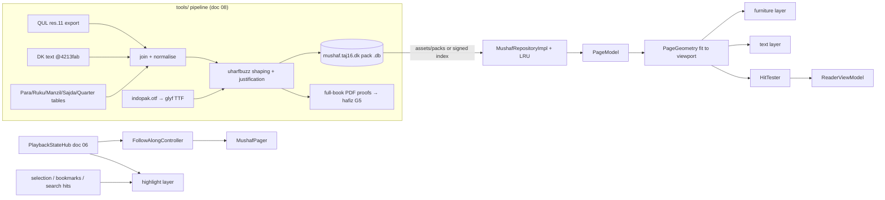

# 05 · Mushaf Rendering Engine

**Purpose.** This doc specifies how Criterion draws the Quran page by page like the printed **Taj Company 16-line Indo-Pak mushaf**: typeset, ayah-aware, theme-able, and fast on low-end phones. It defines the mushaf pack data model, the contract with the offline pipeline that precomputes every position, the on-device rendering algorithm, page templates and furniture, the ornament brief for the designer, interaction (tap, long-press, selection, audio follow-along), themes, zoom, the pager, accessibility, performance budgets, the test strategy, and the fallback paths with objective switch triggers. An engineer or AI agent should be able to build the renderer from this doc without redoing research.

**Status:** Draft v1 — 2026-10-19
**Owner:** Mushaf rendering. **Reads with:** [Architecture](04-architecture.md), [Data pipelines](08-data-pipelines.md), [Audio engine](06-audio-engine.md), [UX/UI spec](02-ux-ui-spec.md), [Content & licensing](03-content-data-licensing.md), [Quality & CI](10-quality-testing-ci.md).

### Key decisions in this doc

| # | Decision | Register |
|---|---|---|
| K1 | **Typeset, never scans.** Pinned DigitalKhatt IndoPak font (OFL) shipped as glyf TTF, drawn per word with `Canvas.drawTextRun` on our own Compose canvas. | D-05 |
| K2 | **The device never lays out or measures Quran text.** The pipeline precomputes every word's x-fractions, `cv01` kashida value and ink box. It also precomputes every furniture text run and ornament box. It emits two placement variants: *kashida* (default) and *plain* inter-word. | D-05 |
| K3 | **Mushaf pack = one self-contained SQLite file per (layout, script, font).** The schema is defined by the Room `MushafPackDb`. The default `mushaf.taj16.dk` pack ships pre-installed in APK assets. A newer signed version from the pack index supersedes it, which gives the error fast-fix path. | D-06, D-10, D-22 |
| K4 | Taj print rules: `page_label = page_index + 1`; sar-lauh template on indices 1–2 (index 1 remapped); header Para right · page centre · surah(s) left; footer «منزل N»; margin notes in the **outer** margin (right when the label is even); Taj-faithful Fatiha. | D-04, D-06, D-07 |
| K5 | Four draw layers: paper → furniture/ornaments (cached) → highlight/selection (dynamic) → text (cached). Audio ticks redraw only the highlight layer. No page bitmaps in the default path. | D-05 |
| K6 | Gestures: tap toggles the chrome, long-press selects an ayah and opens the action sheet, drag-after-long-press extends the range, pinch zooms. The page-turn lock disables user swipes only. | D-23, F-RD-04/06/07 |
| K7 | Follow-along: `PlaybackStateHub` → highlight + auto page-turn, suspended for 8 s after any user pager touch. An ayah that spans two pages turns proportionally by word count. | D-13 |
| K8 | Fallback 1 (runtime inter-word fitting) and Fallback 2 (self-generated text-mask images + the same word boxes) have objective triggers (§15). | D-05 |
| K9 | Ornaments are original, commissioned vector art, tinted per colour role. Placeholders drawn in code ship in P1. | D-05, D-18 |

---

## 1. Goals, fidelity criteria and non-goals

### 1.1 Goals

1. **Print-faithful 16-line Indo-Pak pages.** Every page has the same words on the same lines as the Taj print. Paging, labels, header, footer and margin notes follow the print's rules (g02 §2.8).
2. **Ayah-aware.** Exact tap hit-testing, selection, audio highlight, auto page-turn and screen-reader nodes per ayah. Word boxes are kept for v1.x word highlight and hifz masking.
3. **Crisp at any size, in any theme.** Everything is vector. Night and AMOLED swap colours and never invert bitmaps.
4. **Fast and small.** ≤ 8 ms to record a page on a mid-range phone, < 300 ms to the first page, about 1 MB of APK download for layout + text + placements (r04 §2.9).
5. **Deterministic.** The same pack + font always gives the same pixels on the device and in the pipeline proofs. Goldens and proofs are therefore meaningful.

### 1.2 Fidelity criteria against the Taj 16-line print (acceptance)

| ID | Criterion | Measure / source | Gate |
|---|---|---|---|
| FC-1 | 548 pages × 16 slots. Each ayah line has the same first and last word as the print. | Pipeline: 8,598 ayah lines map to contiguous DK ranges, 8,597 also match first/last skeleton (the exception, 59:13, goes to the hafiz) (g01 §2.4) | CI + G5 |
| FC-2 | Page labels = index + 1 (2–549) everywhere users see numbers | g02 §2.2 (114 + 15 + ~25 print checkpoints) | CI |
| FC-3 | Line types and slots: 80 three-part headers (title · basmala · counts), 31 title + separate basmala line, surah 9 title only, surahs 1–2 in the sar-lauh panel. p.529 header/basmala order fixed. Index 1 remapped to slots 10–16. | g01 §2.4/§2.8 step 6, g02 §2.8 | CI |
| FC-4 | Fatiha: 7 empty circles (basmala = 1:1 included). «۵» with «لا» after «عَلَيْهِمْ» (1:7:4) and no circle there. «ع» over the last circle. Header «سورة الفاتحة مكية وهي سبع آيات». | g02 §2.4 | G5 |
| FC-5 | Margin notes on the outer side by label parity: 558 ruku triples (n1/n2/n3; n3 empty for Fatiha), 14 «السجدة» + 22:77 «السجدة عند الامام الشافعی رح», 6 manzil-start labels, 29 Para-start labels «الجزء …», 90 quarter labels (P2) | g02 §2.3/2.5–2.8, D-07 | CI + G5 |
| FC-6 | Justified lines run edge to edge (centred lines centred). Inter-word gap ∈ [0.18, 0.31] em on ≥ 95% of justified lines (r04 §2.5 measured 0.18–0.31 with kashida). No line overflows. Zero `.notdef`. No ink collision between adjacent slots at `pitch_min`. | Pipeline report | CI |
| FC-7 | Furniture text exactly matches the curated strings that the hafiz proofed (header, footer, surah headers, margin labels) | Pack ↔ proof PDF identity | G5 |
| FC-8 | Device rendering matches the pipeline proof per page within perceptual-diff tolerance (§14.4) | Device full-book capture | Release |

### 1.3 Non-goals

- **Not a facsimile.** Glyphs are DigitalKhatt IndoPak, not Taj calligraphy, and the ornaments are our own. Users who know the scan will see glyph differences (r04 §4). We never ship third-party scans (D-05).
- No waqf margin notes («وقف لازم» …) in v1. There is no dataset for them; they are a reserved marker kind.
- No tajweed colouring (F-RD-15, P4) and no word-by-word (F-RD-14, P4). The engine leaves hooks for both (§16.8).

---

## 2. Architecture overview

Module names are proposed here. [Architecture](04-architecture.md) is authoritative for the module graph (D-03).

| Module | Kind | Contents |
|---|---|---|
| `:core:model` | pure Kotlin | `AyahId` (Kufan 1..6236), `VerseKey`, `MushafCode` (shared with every feature) |
| `:core:mushaf` | **pure Kotlin (JVM), KMP-ready** | Pack-agnostic models (`PageModel`, `LineModel`, `WordRun`, `MarginMarker`, …), `PageGeometry`, `HitTester`, highlight-rect builder, `FollowAlongPolicy`, `MushafRepository` interface |
| `:core:content` | Android library | Room `MushafPackDb` (internal), `MushafRepositoryImpl`, pack open/verify/supersede, LRU |
| `:core:mushaf-ui` | Android + Compose | `MushafPage`, `MushafPager`, `PageRenderer`, `PaintCache`, `MushafTypefaces`, ornament painters, `MushafTheme` tokens, semantics overlay |
| `:feature:reader` | feature | `ReaderScreen`, `ReaderViewModel`, chrome, action-sheet wiring (UI in [UX spec](02-ux-ui-spec.md)) |



---

## 3. Mushaf pack data model

### 3.1 Files and identity

| Item | Value |
|---|---|
| Pack id / file | `mushaf.taj16.dk` → `mushaf-taj16-dk-v{N}.db` (SQLite, read-only after install) |
| Stable mushaf ids (shared with `user.db`, D-10b) | `1 taj16` (548 pp), `2 hafizi15` (610), `3 taj13` (847), `4 madani15` (604) |
| Bundled location | `app/src/main/assets/packs/mushaf-taj16-dk-v1.db`. On first launch it is copied by `createFromAsset` into `databases/` during onboarding, outside the first-page budget. |
| Font | `app/src/main/assets/fonts/criterion_indopak.ttf`: glyf conversion of digitalkhatt.org `ClientApp/src/assets/fonts/hb/indopak.otf` @ `4213fab` (2,569,560 B CFF2, 3,999 glyphs, cv01–cv18) → about 1.63 MB TTF with identical advances (g04 §2.7). `pack_info.font_sha256` must equal the asset's SHA-256 (CI check). |
| Superseding | A downloaded pack with the same `pack_id` and a higher `pack_version`, listed in the Ed25519-signed `index.json` (D-10c), replaces the bundled one at the next reader open. The index can also revoke a version (kill-switch, D-22). |
| Build eligibility | `pack_info.build_eligibility ∈ {personal, public}`. A pack built from QUL res. 11 is `personal` until **G1** clears. CI fails a public release that bundles a `personal` pack or lacks a `proof_certificate_id` (**G5**). |
| Size (estimate) | About 3–3.5 MB raw: ~84k word rows with text and integer placements, 8,768 line rows, furniture. About 1 MB deflated in the APK (r04 §2.9: text + layout 2.64 MB raw / 0.93 MB deflated, plus metrics ~0.35 MB). |

**Why one self-contained pack.** The same schema serves the default Taj-16 layout, the clean-room fallback if G1 fails (D-06), the 15/13-line packs (P3) and the Madani pack (P4). Each pack carries its own permission and proof certificate (D-04), so a pack can be revoked or replaced without bumping `quran_content.db`. Word ids are the canonical DK token ids, so they join to the content DB's `word` table and to timing packs without a cross-DB join at render time.

### 3.2 Coordinate conventions (used by every table)

- **tw (text width).** The text block width is 1.0 tw. All horizontal page geometry is in tw.
- **x fractions.** `x0`, `x1` are integers in `frac_unit = 100 000` per tw. They are **LTR within the text block**: 0 = left edge, 100 000 = right edge. A justified line's first word in reading order has `x1 = 100000`.
- **Slots.** Slots are 1..`lines_per_page` after the remap. Body y positions are given in **slot units** (for example 5.5 = centre of slot 5, measured from the top of the text block), so they scale with the runtime line pitch. Header and footer y positions are band fractions (0 = top of band, 1 = bottom).
- **em.** The page em is `em_ratio × text width`. Ink extents and furniture sizes are in milli-em, relative to the baseline (negative = above).

### 3.3 Logical DDL (pack schema v1)

> The **authoritative DDL is Room's exported schema JSON** for `MushafPackDb`. The pipeline executes it verbatim, as it does for the content DB (D-10a, g04 Rec. 4). Room emits no `CHECK` or `WITHOUT ROWID`, so the invariants in the comments are enforced by pipeline validation (§4.6) and by the app's pack test (§14.2).

```sql
CREATE TABLE pack_info (key TEXT NOT NULL PRIMARY KEY, value TEXT NOT NULL);
-- keys: pack_id='mushaf.taj16.dk', pack_version, schema_version=1, min_content_version,
--       mushaf_id=1, script='dk-indopak', font_file, font_sha256, font_source='digitalkhatt.org@4213fab',
--       pipeline_git_sha, sources_lock_sha256, uharfbuzz_version, built_at,
--       build_eligibility ('personal'|'public'), proof_certificate_id (NULL until G5),
--       licence_json, attribution_json, fatiha_style='taj_unnumbered'

CREATE TABLE mushaf (
  id                 INTEGER NOT NULL PRIMARY KEY,  -- 1 = taj16
  code               TEXT    NOT NULL,              -- 'taj16'
  name_ur            TEXT    NOT NULL,              -- '۱۶ سطری تاج کمپنی'
  name_en            TEXT    NOT NULL,              -- 'Indo-Pak 16-line (Taj)'
  lines_per_page     INTEGER NOT NULL,              -- 16
  page_count         INTEGER NOT NULL,              -- 548
  page_label_offset  INTEGER NOT NULL,              -- 1 → labels 2..549
  frac_unit          INTEGER NOT NULL,              -- 100000
  kashida_tag        TEXT    NOT NULL,              -- 'cv01'
  upem               INTEGER NOT NULL,              -- 1000
  pitch_nominal      REAL    NOT NULL,              -- line pitch / tw (initial 0.110, §6.2)
  pitch_min          REAL    NOT NULL,              -- from max ink height × 1.05 (pipeline)
  pitch_max          REAL    NOT NULL,              -- 0.135
  baseline_offset_em REAL    NOT NULL,              -- baseline below slot centre, in em
  frame_inset        REAL    NOT NULL,              -- tw, frame band thickness incl. rules
  margin_outer       REAL    NOT NULL,              -- tw, outer margin strip (markers)
  margin_inner       REAL    NOT NULL,              -- tw
  header_band        REAL    NOT NULL,              -- tw, above frame
  footer_band        REAL    NOT NULL               -- tw, below frame
);

CREATE TABLE page (
  page_index     INTEGER NOT NULL PRIMARY KEY,  -- 1..548 (QUL index)
  page_label     INTEGER NOT NULL,              -- = page_index + page_label_offset
  template       INTEGER NOT NULL,              -- 0 REGULAR, 1 SARLAUH (indices 1-2)
  em_ratio       REAL    NOT NULL,              -- font px = em_ratio × text width px
  outer_side     INTEGER NOT NULL,              -- 0 RIGHT (label even), 1 LEFT (label odd)
  para_id        INTEGER NOT NULL,              -- Indo-Pak Para of the page's last line (header)
  manzil_id      INTEGER NOT NULL,              -- manzil of the page's last ayah (footer)
  surah_ids      TEXT    NOT NULL,              -- header-left order, e.g. '102,103,104'
  first_ayah_id  INTEGER NOT NULL,
  last_ayah_id   INTEGER NOT NULL,
  first_word_id  INTEGER NOT NULL,
  last_word_id   INTEGER NOT NULL
);

CREATE TABLE line (
  page_index     INTEGER NOT NULL,
  slot           INTEGER NOT NULL,              -- 1..16 after remap
  type           INTEGER NOT NULL,              -- 0 AYAH 1 SURAH_HEADER 2 BASMALA 3 OPENING_PANEL 4 EMPTY
  header_variant INTEGER NOT NULL,              -- 0 NONE 1 THREE_PART 2 TITLE 3 SARLAUH_TITLE
  centered       INTEGER NOT NULL,              -- QUL is_centered (and all header/basmala lines)
  surah_id       INTEGER,                       -- header/basmala lines
  first_word_id  INTEGER,                       -- AYAH lines only
  last_word_id   INTEGER,
  scale          REAL    NOT NULL,              -- 1.0, or <1 for rare overflow lines (§4.3)
  gap_em         REAL,                          -- diagnostic: final inter-word gap (kashida variant)
  PRIMARY KEY (page_index, slot)
);

CREATE TABLE word (
  id          INTEGER NOT NULL PRIMARY KEY,     -- canonical DK token id 1..83669 (= quran_content.db word.id)
  ayah_id     INTEGER NOT NULL,                 -- Kufan 1..6236 (1:1 = Fatiha basmala)
  pos         INTEGER NOT NULL,                 -- 1-based DK position in ayah (end token = last)
  is_end      INTEGER NOT NULL,                 -- 1 = ayah-end marker token
  text        TEXT    NOT NULL,                 -- display glyph string AFTER Taj overrides (§4.2)
  page_index  INTEGER NOT NULL,
  slot        INTEGER NOT NULL,
  x0          INTEGER NOT NULL,                 -- kashida variant (frac_unit, LTR)
  x1          INTEGER NOT NULL,
  kashida     INTEGER NOT NULL,                 -- 0..3 → "'cv01' N"; 0 = no feature string
  x0_plain    INTEGER NOT NULL,                 -- plain inter-word variant (no kashida)
  x1_plain    INTEGER NOT NULL,
  ink_top     INTEGER NOT NULL,                 -- milli-em rel. baseline (negative = above)
  ink_bottom  INTEGER NOT NULL
);
CREATE INDEX index_word_page_index_slot ON word(page_index, slot);
CREATE INDEX index_word_ayah_id ON word(ayah_id);

CREATE TABLE ayah_marker (                      -- D-06: 6,236 Kufan ends + 118 disputed «۵» = 6,354 rows
  word_id        INTEGER NOT NULL PRIMARY KEY,  -- end token, or the word carrying U+08E2
  ayah_id        INTEGER NOT NULL,              -- containing Kufan verse
  display_number INTEGER,                       -- number printed in the circle; NULL = empty circle / «۵»
  is_kufan_end   INTEGER NOT NULL,              -- 1 ⇔ terminates ayah_id
  disputed_end   INTEGER NOT NULL               -- 1 ⇔ U+08E2 non-Kufan end (never a boundary)
);

CREATE TABLE ayah_page (                        -- 6,236 rows; navigation + follow-along
  ayah_id     INTEGER NOT NULL PRIMARY KEY,
  page_start  INTEGER NOT NULL, slot_start INTEGER NOT NULL,
  page_end    INTEGER NOT NULL, slot_end   INTEGER NOT NULL,
  word_first  INTEGER NOT NULL, word_last  INTEGER NOT NULL,
  words_on_start_page INTEGER NOT NULL          -- for proportional page turn (§8.6)
);

CREATE TABLE surah_header (                     -- 114 curated strings, proofed against the print
  surah_id    INTEGER NOT NULL PRIMARY KEY,
  variant     INTEGER NOT NULL,                 -- 1 THREE_PART, 2 TITLE, 3 SARLAUH_TITLE
  title_text  TEXT    NOT NULL,                 -- «سورة البقرة مدنية وهي مائتان وست وثمانون آية واربعون ركوعا»
  right_text  TEXT,                             -- THREE_PART split (exact split proofed, §5.3)
  left_text   TEXT
);

CREATE TABLE margin_marker (                    -- semantic rows (a11y, index, tooltips)
  id             INTEGER NOT NULL PRIMARY KEY,
  page_index     INTEGER NOT NULL,
  kind           INTEGER NOT NULL,              -- 0 RUKU 1 PARA_START 2 MANZIL_START 3 QUARTER 4 SAJDA 5 SAJDA_SHAFII 6 WAQF_NOTE(reserved)
  anchor_slot    INTEGER NOT NULL,
  y_center_slot  REAL    NOT NULL,              -- collision-resolved position (§4.4)
  anchor_word_id INTEGER,                       -- ayah-end token, or word 10 of 6:73 for P7 ثلثة
  ayah_id        INTEGER,
  n1 INTEGER, n2 INTEGER, n3 INTEGER,           -- RUKU: surah_ruku / ayah_count / para_ruku (NULL for Fatiha)
  ref_id         INTEGER                        -- para_id / manzil_id / quarter 1..3 / sajda print_no
);
CREATE INDEX index_margin_marker_page_index ON margin_marker(page_index);

CREATE TABLE furniture_run (                    -- every non-Quran text item, pre-positioned
  page_index  INTEGER NOT NULL,
  seq         INTEGER NOT NULL,
  role        INTEGER NOT NULL,                 -- 0 HDR_RIGHT 1 HDR_CENTER 2 HDR_LEFT 3 FOOTER 4 SURAH_TITLE
                                                -- 5 SURAH_RIGHT 6 SURAH_LEFT 7 BASMALA 8 MARGIN_LABEL
                                                -- 9 RUKU_N1 10 RUKU_N2 11 RUKU_N3
  band        INTEGER NOT NULL,                 -- 0 HEADER 1 FOOTER 2 BODY 3 MARGIN
  x0 INTEGER NOT NULL, x1 INTEGER NOT NULL,     -- frac_unit of tw; MARGIN: relative to margin strip
  y           REAL    NOT NULL,                 -- BODY/MARGIN: slot units; HEADER/FOOTER: band fraction
  size        INTEGER NOT NULL,                 -- milli-em of page em
  rotation    INTEGER NOT NULL,                 -- 0 or ±90 (margin labels)
  kashida     INTEGER NOT NULL,                 -- 0 normally; >0 for stretched header/basmala text
  text        TEXT    NOT NULL,
  PRIMARY KEY (page_index, seq)
);

CREATE TABLE ornament_item (                    -- vector ornaments placed by data (frame + rules are procedural)
  page_index    INTEGER NOT NULL,
  seq           INTEGER NOT NULL,
  ornament_key  TEXT    NOT NULL,               -- 'cartouche.three_part' | 'cartouche.title' | 'basmala_box'
                                                -- | 'sarlauh.panel' | 'ruku_badge' | 'margin_bracket' | 'end_flourish'
  band          INTEGER NOT NULL,
  x0 INTEGER NOT NULL, x1 INTEGER NOT NULL,
  y0 REAL NOT NULL,    y1 REAL NOT NULL,        -- slot units (BODY/MARGIN) or band fraction
  PRIMARY KEY (page_index, seq)
);

CREATE TABLE calibration (                      -- device drift check (§15.2)
  id INTEGER NOT NULL PRIMARY KEY, text TEXT NOT NULL, kashida INTEGER NOT NULL,
  advance_units INTEGER NOT NULL                -- HarfBuzz advance at upem 1000
);
-- seed rows include الْكِتٰبُ 2060/2847/3615/4384 (cv01 0..3) and بِسْمِ 1216/1405/1594/1783 (g04 §2.7)
```

**Layout-independent metadata stays in `quran_content.db`** ([Content & licensing](03-content-data-licensing.md), [Data pipelines](08-data-pipelines.md)): `surah`, `ayah`, `para` (Indo-Pak, D-07), `ruku` (558), `manzil`, `sajda`, `para_quarter`, `word(id, ayah_id, pos, kind)`. The pack denormalises only what drawing and hit-testing need. The pipeline asserts that both agree.

### 3.4 Kotlin model (`:core:mushaf`, pure Kotlin)

```kotlin
@JvmInline value class AyahId(val value: Int)        // :core:model, Kufan 1..6236
@JvmInline value class WordId(val value: Int)        // DK token id 1..83_669
@JvmInline value class PageIndex(val value: Int)     // 1..pageCount (QUL index)

enum class PageTemplate { REGULAR, SARLAUH }
enum class LineType { AYAH, SURAH_HEADER, BASMALA, OPENING_PANEL, EMPTY }
enum class HeaderVariant { NONE, THREE_PART, TITLE, SARLAUH_TITLE }
enum class Side { RIGHT, LEFT }
enum class MarkerKind { RUKU, PARA_START, MANZIL_START, QUARTER, SAJDA, SAJDA_SHAFII, WAQF_NOTE }
enum class PlacementVariant { KASHIDA, PLAIN }

data class MushafSpec(
    val id: Int, val code: String, val linesPerPage: Int, val pageCount: Int, val pageLabelOffset: Int,
    val pitchNominal: Float, val pitchMin: Float, val pitchMax: Float, val baselineOffsetEm: Float,
    val frameInset: Float, val marginOuter: Float, val marginInner: Float,
    val headerBand: Float, val footerBand: Float, val kashidaTag: String,
) { fun label(index: PageIndex) = index.value + pageLabelOffset
    fun indexOfLabel(label: Int) = PageIndex((label - pageLabelOffset).coerceIn(1, pageCount)) }

data class WordRun(
    val id: WordId, val ayah: AyahId, val text: String, val isAyahEnd: Boolean,
    val x0: Float, val x1: Float, val kashida: Int,      // tw fractions (0..1), LTR
    val x0Plain: Float, val x1Plain: Float,
    val inkTopEm: Float, val inkBottomEm: Float,
) { fun x0(v: PlacementVariant) = if (v == PlacementVariant.KASHIDA) x0 else x0Plain
    fun x1(v: PlacementVariant) = if (v == PlacementVariant.KASHIDA) x1 else x1Plain
    fun cv(v: PlacementVariant) = if (v == PlacementVariant.KASHIDA) kashida else 0 }

data class LineModel(
    val slot: Int, val type: LineType, val header: HeaderVariant, val centered: Boolean,
    val surah: Int?, val scale: Float,
    val words: List<WordRun>,                   // sorted by x0 ascending (= reverse reading order)
)

data class FurnitureRun(val role: Int, val band: Int, val x0: Float, val x1: Float, val y: Float,
                        val sizeEm: Float, val rotation: Int, val kashida: Int, val text: String)
data class OrnamentItem(val key: String, val band: Int, val x0: Float, val x1: Float, val y0: Float, val y1: Float)
data class MarginMarker(val kind: MarkerKind, val anchorSlot: Int, val yCenterSlot: Float,
                        val ayah: AyahId?, val n1: Int?, val n2: Int?, val n3: Int?, val refId: Int?)

data class PageModel(
    val spec: MushafSpec, val index: PageIndex, val label: Int, val template: PageTemplate,
    val emRatio: Float, val outerSide: Side, val paraId: Int, val manzilId: Int, val surahIds: List<Int>,
    val lines: List<LineModel>,                 // exactly linesPerPage, slot order
    val furniture: List<FurnitureRun>, val ornaments: List<OrnamentItem>, val markers: List<MarginMarker>,
    val ayahs: List<AyahId>,                    // reading order, incl. partial first/last
) {
    /** Built once at load (pure): per-ayah line spans in tw, used by highlight + semantics. */
    val ayahSpans: Map<AyahId, List<SlotSpan>> by lazy { buildAyahSpans(this) }
}
data class SlotSpan(val slot: Int, val x0: Float, val x1: Float)

interface MushafRepository {
    suspend fun spec(mushafId: Int): MushafSpec
    suspend fun page(mushafId: Int, index: PageIndex): PageModel          // LRU-backed
    suspend fun ayahSpan(mushafId: Int, ayah: AyahId): AyahPageSpan       // from ayah_page
    suspend fun pageOf(mushafId: Int, ayah: AyahId): PageIndex
    fun prefetch(mushafId: Int, around: PageIndex, radius: Int = 2)
    val activePack: kotlinx.coroutines.flow.StateFlow<PackInfo>           // version, eligibility, revoked
}
data class AyahPageSpan(val ayah: AyahId, val pageStart: PageIndex, val pageEnd: PageIndex,
                        val wordsOnStartPage: Int, val wordCount: Int)
```

---

## 4. Offline precompute contract (implemented in doc 08)

The pipeline lives in `tools/mushaf-pipeline/` (Python 3.12, `python3 -I`, inputs pinned by SHA-256; see [Data pipelines](08-data-pipelines.md)). This section is the **contract**: what the renderer relies on. Seed scripts: `spikes/toolchain-spike/scripts/cff2_to_glyf.py`, `hb_widths.py`, `font_features.py`.

### 4.1 Inputs

| Input | Pin |
|---|---|
| QUL resource 11 SQLite (16-line Taj layout), owner's account (D-06) | SHA-256 in `sources.lock.json`. **personal** until G1. |
| DK text `ClientApp/src/app/services/quran_text_indopak_15.ts` @ `4213fab` (MIT) | SHA-256 |
| Font `ClientApp/src/assets/fonts/hb/indopak.otf` @ `4213fab` (OFL 1.1) → `cff2_to_glyf.py` (fontTools `Cu2QuPen`, `max_err=1.0`, `reverse_direction=True`) → `criterion_indopak.ttf` | Both SHA-256s. The pipeline **shapes with the converted TTF that the app ships**. Never use the QUL CDN `DigitalKhattIndoPak.otf`: it has no cv features (g04 §1.11). |
| uharfbuzz 0.56.3 / HarfBuzz 14.6.0, fontTools 4.67 (versions measured in g04) | `requirements.lock` |
| Curated tables: Indo-Pak Para (D-07), 558 rukus, 15 sajda rows, 7 manzils, 90 quarters (P2), 114 surah-header strings, furniture string templates | Repo `tools/mushaf-pipeline/data/*.csv` with `verified_source` columns |
| `ornaments/manifest.json` (anchor boxes of the badge, cartouche and basmala box; §7) | Generated from the designer's SVGs |

### 4.2 Text normalisation and Taj overrides

1. Tokenise DK and assert 83,669 tokens (77,433 words + 6,236 ends), 118 × U+08E2, 558 × U+08D6, 15 × U+08DB (g01 §2.8 step 3).
2. Map to QUL word keys: identity, except **72:16**, where DK tokens 1–2 map to QUL position 1 and DK position p ≥ 3 maps to p − 1. Skeleton whitelist {4:112:3, 18:19:34, 59:13:1}. The 59:13 spelling goes to the hafiz (D-06).
3. **Fatiha (Taj-faithful, FC-4)**:
   - rewrite the end tokens of 1:1–1:7 to a bare `۝` (U+06DD, no digits);
   - in 1:7:4, strip `U+202E ٦` so that only `U+08E2 ۙ` («۵» with «لا») remains;
   - keep U+08D6 «ع» on 1:7's end token.
   - Set `ayah_marker.display_number = NULL` for every surah-1 row.
   - This also removes the only U+202E in the text, which closes the g01 RLO shaping risk.
4. All other ends: `display_number` = Kufan ayah number. The 117 other U+08E2 marks are `disputed_end = 1` with `display_number = NULL`.
5. Basmala for non-Fatiha headers: the DK basmala words, with no end circle unless the print check says otherwise (open issue O-6).

### 4.3 Justification algorithm (per page, per line)

Constants (pipeline config, values from r04 §2.5/§2.10 and g01 §2.5): `G_MIN = 0.18 em`, `G_MAX = 0.30 em`, `G_NAT = 0.25 em` (centred lines), `KMAX_STEP = 3` (D-05: ≤ 3 cv01 steps), `KMAX_WORDS = 2` per line, `SCALE_FLOOR = 0.90`, `PAGE_EM_BAND = 0.94`.

```text
adv(w, k) = Σ x_advance(hb.shape(font, w.text, {cv01: k})) / upem        # em, k ∈ 0..3
inkbox(w)  = union of glyph extents (hb) → ink_top/ink_bottom (milli-em)

# 1. page em: one size per page (r04 prototype), clamped to limit page-to-page variation
for each page p:
    W_nat(line) = Σ adv(w,0) + (n−1)·G_MIN                  # natural width in em, justified AYAH lines
    em_fit(p)   = 1 / max(W_nat over justified lines)       # largest em at which all lines fit
E_ref = 20th percentile of em_fit over all pages            # ≥ 80% of pages share one text size
em(p) = clamp(em_fit(p), PAGE_EM_BAND·E_ref, E_ref)

# 2. lines
for each AYAH line at page em E (L = 1/E em available):
    if line.centered:
        gaps = G_NAT; total = Σadv + (n−1)·G_NAT; place centred; kashida = 0 (both variants identical)
        continue
    scale = min(1, L / W_nat)                                # < 1 only when em was clamped up
    assert scale ≥ SCALE_FLOOR else FAIL (manual review)
    # plain variant
    g_plain = (L/scale − Σadv(w,0)) / (n−1)
    # kashida variant
    k = {w: 0}; g = g_plain
    cands = words sorted by adv(w,0) desc, excluding: is_end tokens, tokens that are only a U+08E2 sign,
            words where adv(w,1) == adv(w,0) (no kashida opportunity), neighbours of an already-stretched word
    while g > G_MAX and stretched < KMAX_WORDS and cands:
        w = cands.pop()
        k[w] = smallest j in 1..3 with gap after stretching ≤ G_MAX, else 3
        g = (L/scale − Σ adv(v, k[v])) / (n−1)
    # emit, RTL: reading-order word 1 is right-aligned
    x = 1.0
    for w in reading order:
        width_tw = adv(w, k[w]) · E · scale
        w.x1 = x;  w.x0 = x − width_tw;  x = w.x0 − g·E·scale
    assert |x + g·E·scale| < 1e-4  (left edge reached exactly)
    line.scale = scale; line.gap_em = g
# 3. vertical metrics (mushaf-wide)
pitch_min = 1.05 × max over lines of (max ink_bottom − min ink_top) × E_line / 1000     # no slot collisions
baseline_offset_em = −(median ink_top + median ink_bottom) / 2 / 1000                   # ink centred in slot
```

Pipeline report (CI artefact): the distribution of `gap_em` per variant, the count of `scale < 1` lines (target ≤ 1% of lines), the stretched-word count, the em spread, and any FAIL rows. **Acceptance: FC-6.** The values of `G_MAX`, `KMAX_WORDS` and `PAGE_EM_BAND` may be retuned once in P1 from the hafiz's visual review. They are recorded in `pack_info`.

### 4.4 Furniture, headers and margin layout (also precomputed)

- **Header band.** Three `furniture_run`s:
  - `HDR_RIGHT`: Para opening words + Para number, e.g. «سیقول ۲». Index 1 reads «سورة» (g02 §2.8).
  - `HDR_CENTER`: the page label.
  - `HDR_LEFT`: surah name(s) + number(s), e.g. «التكاثر ۱۰۲ العصر ۱۰۳ الهمزة ۱۰۴».

  Each is centred in its third of the text width. The layout is the same on odd and even pages (non-mirrored).
- **Footer band.** One `FOOTER` run, «منزل N», centred.
- **Surah header lines.**
  - `THREE_PART`: three body runs in one slot plus the `cartouche.three_part` ornament. `SURAH_RIGHT` and `SURAH_LEFT` text sit in the cartouche wings at a furniture size of about 0.55 em. The `BASMALA` run sits in the middle at about 0.85 em.
  - `TITLE`: `SURAH_TITLE` centred inside `cartouche.title`.
  - `SARLAUH_TITLE`: the title inside the panel's title cartouche at slot 10.
- **Basmala lines.** A `BASMALA` run centred at its natural width at page em, inside `basmala_box`.
- **Margin markers.** For each page, collect the markers on the outer side and sort them by `anchor_slot`.
  - Heights: ruku badge = 1.6 slots; rotated label = its rotated length in slots at `pitch_min`.
  - Place each marker centred on its anchor. If it overlaps the previous one, push it down. If it overflows slot 16, push the stack up.
  - Store `y_center_slot`. Resolving at `pitch_min` guarantees no overlap at any runtime pitch ≥ `pitch_min`.
  - Ruku digits become `RUKU_N1/N2/N3` runs positioned in the badge's digit boxes from `ornaments/manifest.json`. `n3` is omitted for Fatiha.
- **Digits.** Use Extended Arabic-Indic (U+06F0–06F9, Urdu style, as in the print) if the shipped font covers them. Otherwise use U+0660–0669, which DK uses for ayah numbers. The pipeline records the choice in `pack_info.furniture_digits`.
- **Furniture font.** DK IndoPak, under the same zero-`.notdef` gate as the Quran text. If any curated string fails coverage, CI fails. The fallback is a bundled Noto Naskh Arabic (OFL) subset for furniture only (open issue O-4).

### 4.5 Remaps and quirks (CI-asserted)

| Case | Rule |
|---|---|
| Index 1 (Fatiha) | QUL L1 title → slot 10 `SURAH_HEADER/SARLAUH_TITLE`; L2 (ayah 1:1, centred) → slot 11, drawn in `basmala_box`; L3–7 → slots 12–16 (centred); slots 1–9 `OPENING_PANEL` (g02 Rec. 9) |
| Index 2 (Baqarah) | Slots 1–9 `OPENING_PANEL`, 10 `SARLAUH_TITLE`, 11 `BASMALA`, 12–16 ayah lines (matches QUL) |
| Index 529 | Swap the basmala and the Surah 79 header (QUL misorder, D-06). Report it upstream. |
| Exporter renumbering | Restore the 16-slot grid; empty lines become `EMPTY` (index 548 slots 11–16; g01 §2.4) |
| 80 headers with embedded basmala | `header_variant = THREE_PART` |

### 4.6 Validation gates (fail the build)

- 548 pages; 548 × 16 `line` rows; every `word.id` 1..83,669 exactly once, in reading order across pages/slots/x.
- 6,354 `ayah_marker` rows with `is_kufan_end XOR disputed_end`. Surah 1: `display_number` is NULL.
- Para header ids: Para *n* starts at index 18n−16 (n = 2..28), P29 at 508, P30 at 528 (D-07). Manzil footer changes at indices 96, 187, 254, 330, 401, 466 (g02 §2.7).
- `outer_side == (label % 2 == 0 ? RIGHT : LEFT)` on every page. Ruku triples equal the 558 table, including the straddling-para rule (D-07).
- Zero `.notdef` (Quran text and furniture). No line overflow. No marker overlap at `pitch_min`. FC-6 thresholds met.
- Render the **full-book vector PDF proof** from the pack (identical placements, the TTF, ornaments from the same SVGs) for the hafiz (G5), plus a per-page PNG set at 1080 px width for the device comparison (§14.4).

---

## 5. Page templates and furniture

### 5.1 Page anatomy (REGULAR, label even → outer margin on the right)

```
 ┌───────────────────────────────────────────────────────────────┐
 │  الهمزة ۱۰۴ العصر ۱۰۳        ۵۴۴         عمّ ۳۰               │  ← header band (above frame)
 │ ╔═══════════════════════════════════════════════════════╗     │
 │ ║ ───────────────────────────────────────────────────── ║  ع  │  slot 1     ← outer margin strip
 │ ║ ───────────────────────────────────────────────────── ║ ۱/۵ │  slot 2       (ruku badge, labels)
 │ ║  [cartouche: سورة …  ◦ بِسْمِ اللّٰهِ … ◦  وهي …]     ║ ۲۲  │  slot 3 (THREE_PART header)
 │ ║ ───────────────────────────────────────────────────── ║     │  …
 │ ║ ───────────────────────────────────────────────────── ║  ا  │  slot 15    rotated «الربع»
 │ ║ ───────────────────────────────────────────────────── ║     │  slot 16
 │ ╚═══════════════════════════════════════════════════════╝     │
 │                          منزل ۷                                │  ← footer band
 └───────────────────────────────────────────────────────────────┘
   inner margin                                     outer margin (RIGHT because label 544 is even)
```

(The strings are illustrative. The header is **not mirrored**: Para on the right, page label in the centre, surah(s) on the left, on every page.)

### 5.2 Templates

| Template | Pages | Slots |
|---|---|---|
| `SARLAUH` | indices 1, 2 (labels 2, 3) | 1–9 `sarlauh.panel` ornament (one ornament spanning the slots); 10 title cartouche; 11 basmala box (index 1: ayah 1:1, tappable; index 2: `BASMALA`); 12–16 text (index 1 centred) |
| `REGULAR` | 3–548 | 16 slots: `AYAH` / `SURAH_HEADER` / `BASMALA` / `EMPTY` |

### 5.3 Line types and surah-header variants

| Type / variant | Count (Taj-16) | Drawn as |
|---|---|---|
| `AYAH`, justified | about 8,490 | Words at `x0/x1`, baseline per slot |
| `AYAH`, centred | 108 (Fatiha + surah-final short lines; g01 §2.4) | Same; pipeline-centred |
| `SURAH_HEADER/THREE_PART` | 80 | `cartouche.three_part` + right / basmala / left runs |
| `SURAH_HEADER/TITLE` | 31 (each followed by a `BASMALA` line) + surah 9 (no basmala) | `cartouche.title` + centred title |
| `SURAH_HEADER/SARLAUH_TITLE` | surahs 1, 2 | In-panel title cartouche |
| `BASMALA` | 32 (31 + the one on index 2) | `basmala_box` + centred basmala run. Not a verse (except Fatiha 1:1) |
| `OPENING_PANEL` | 18 (indices 1–2, slots 1–9) | Covered by `sarlauh.panel` |
| `EMPTY` | index 548 slots 11–16 (+ restored blanks) | Rules only; optional `end_flourish` (v1.x) |

**Header strings** come from curated data (g02 Rec. 10): «سورة {name} {مكية|مدنية} وهي {N in words} آية و{M in words} ركوعات». Single-ruku surahs omit the ruku count. Two rukus use «وفيها ركوعان». How each string splits across the right and left wings of `THREE_PART` is curated per surah and proofed against the print. g02 verified about 75 of 114; the rest are part of the G5 proof.

### 5.4 Margin markers

| Kind | Count | Anchor | Content |
|---|---|---|---|
| `RUKU` | 558 | Slot of the ruku's last ayah end | `ruku_badge` (vector ع) with n1 top = ruku in surah, n2 inside = ayahs in the whole ruku, n3 bottom = ruku in the **Para where it ends** (Fatiha excluded → n3 omitted). The in-text small «ع» over the circle comes from the font (U+08D6). |
| `PARA_START` | 29 (Paras 2–30) | First line of the Para (or its header line) | Rotated «الجزء الثاني … الثلاثون» |
| `MANZIL_START` | 6 (manzils 2–7) | Header line of the starting surah | Rotated «المنزل الثاني … السابع» |
| `QUARTER` | 90 (data in **P2**, F-IX-07) | Slot of the anchor ayah end; P7 ثلثة at 6:73 word 10 (mid-ayah) | Rotated «الربع / النصف / الثلثة» |
| `SAJDA` / `SAJDA_SHAFII` | 14 / 1 (22:77) | Slot of the sajda ayah end | «السجدة» / «السجدة عند الامام الشافعی رح». The in-text sajda sign comes from the font (U+08DB). |
| `WAQF_NOTE` | 0 (reserved) | — | — |

**Side rule:** `outer_side = RIGHT if page_label is even, else LEFT` (g02 §2.8). The reader setting **Margin notes: Print (default) / Hidden** exists. *Hidden* sets the margins to `margin_inner` on both sides with the text block centred. The in-text «ع» and sajda signs stay, so no ruku information is lost.

---

## 6. Runtime rendering

### 6.1 Page units → pixels (fit algorithm)

```text
pageW_tw = 1 + 2·frame_inset + margin_outer + margin_inner        # margins hidden → 1 + 2·frame_inset + 2·margin_inner
fixedH_tw = header_band + footer_band + 2·frame_inset
L = lines_per_page
viewport (Wv, Hv) = safe drawing area (immersive: full screen minus display cutout)

mode = when {
   spread (≥600dp, landscape, P3)            → each page gets (Wv/2, Hv)
   phone landscape (sw < 600dp, Wv > Hv)     → FIT_WIDTH_SCROLL
   else                                      → AUTO }

s_w = Wv / pageW_tw                                   # px per tw if width-limited
pitch_w = (Hv / s_w − fixedH_tw) / L
if mode == FIT_WIDTH_SCROLL: s = s_w; pitch = pitch_nominal            # page taller than viewport, vertical scroll
elif pitch_w ≥ pitch_min:   s = s_w; pitch = min(pitch_w, pitch_max)   # phones portrait: stretch rows to fill
else:                       pitch = pitch_nominal; s = Hv / (fixedH_tw + L·pitch)   # height-limited: centre horizontally
s *= zoom                                                              # committed zoom (§10)
center leftover space; textLeft = pageLeft + s·(frame_inset + (outer_side==LEFT ? margin_outer : margin_inner))
textTop = pageTop + s·(header_band + frame_inset)
fontPx(line) = em_ratio · s · line.scale
baselineY(slot, scale) = textTop + (slot − 0.5)·pitch·s + baseline_offset_em · em_ratio · s · scale
wordX(x0) = textLeft + x0 · s
```

Worked example (1080 × 2400 px phone, immersive, initial tokens from §6.2): `pageW_tw = 1.19` gives `s_w ≈ 907.6 px`. Then `pitch_w ≈ 0.152 tw`, clamped to 0.135. The page height is ≈ 2,146 px, and the remaining ~254 px are split above and below. The text width is 907 px; at `em_ratio ≈ 1/20` the font is ≈ 45 px.

### 6.2 Initial geometry tokens (tuned once in P1 against the print, then frozen in the pack)

| Token | Initial | Basis |
|---|---|---|
| `pitch_nominal` | 0.110 tw | quran-ios Indo-Pak line metrics: 148/1342 (r03 §2.4) |
| `pitch_min` | pipeline-computed | Max ink height × 1.05 (no collisions) |
| `pitch_max` | 0.135 tw | Stops phone pages looking airy |
| `frame_inset` | 0.035 tw | Designer brief §7 |
| `margin_outer` / `margin_inner` | 0.10 / 0.02 tw | Room for the ruku badge and rotated labels |
| `header_band` / `footer_band` | 0.075 / 0.060 tw | — |

### 6.3 Drawing (per page)

1. **Paper.** Fill with `theme.paper` (`Modifier.background`).
2. **Furniture layer (cached `GraphicsLayer`).**
   - The frame (procedural double rule + band) and the 17 line rules (setting "Line rules", default on).
   - The `ornament_item`s via `OrnamentPainter` (per-role `ImageVector`s, §7).
   - The `furniture_run`s and margin markers: `drawTextRun` at the run's `x0`. Rotated runs are drawn inside `canvas.withRotation(rotation, cx, cy)`.
3. **Highlight layer (draw-phase only, never cached).** Read `highlights()` (a State) inside `onDrawBehind`, then draw rounded rects or underlines (§8.5). An audio tick therefore re-runs only this lambda. Nothing is recomposed or re-recorded.
4. **Text layer (cached `GraphicsLayer`).** For every `AYAH` slot:

```kotlin
for (line in model.lines) if (line.type == LineType.AYAH) {
    val y = geo.baseline(line.slot, line.scale)
    for (w in line.words) {
        val p = paints.get(sizePx = geo.fontPx * line.scale, cv = w.cv(variant))   // ≤ 4 cv × few sizes
        canvas.drawTextRun(w.text, 0, w.text.length, 0, w.text.length, geo.x(w.x0(variant)), y, /*isRtl=*/true, p)
    }
}
```

**Paint rules.**
- `Paint(ANTI_ALIAS_FLAG or SUBPIXEL_TEXT_FLAG)`, `textAlign = LEFT` (x is the left edge of the run), `typeface = MushafTypefaces.indopak`, `color = theme.ink` (with the night brightness alpha).
- `fontFeatureSettings = null` when cv = 0, otherwise `"'cv01' N"`. Only stretched words get a feature string, because Minikin bypasses its layout cache for any paint with features (g04 §1.10).
- **Never** `letterSpacing` (above 0.03 em Minikin disables `liga`/`clig`), and never `StaticLayout` or `TextAlign.Justify` for mushaf lines (D-05, r04 §2.6).
- **Verify in the P0 device smoke test:** `drawTextRun` with `Align.LEFT` + `isRtl = true` puts the run's left edge at x. The golden of page index 4 also asserts this.

**No layer colour filters or alpha.** A `GraphicsLayer` with `colorFilter`/`alpha` forces an offscreen buffer, which costs about 8–10 MB per page at 1080 px. Theme changes therefore re-record the cached layers (≤ 8 ms each). Leave `CompositingStrategy` at `Auto`.

### 6.4 Caching and prefetch

| Cache | Key | Size | Invalidated by |
|---|---|---|---|
| `MushafTypefaces` (singleton) | font file | 1 typeface (~1.6 MB, loaded once) | Never. Preloaded from `Application.onCreate` on `Dispatchers.IO`. |
| Repository `LruCache<PageIndex, PageModel>` | (mushafId, index) | 16 pages (~30 KB each, < 0.5 MB) | Pack supersede, `onTrimMemory(≥ RUNNING_LOW)` → trim to 4 |
| `PaintCache` | (sizePx rounded to 0.25, cv) | ≤ 32 paints | Typeface, ink colour |
| Furniture / text `GraphicsLayer`s | per composed page | display lists only (≈100–300 KB) | Size, zoom commit, theme, variant, margin-notes setting |
| Composed neighbours | `beyondViewportPageCount = 1` | ≤ 3 pages (or 3 spreads) | Pager |
| Prefetch | ±2 page models on `settledPage` change | — | — |

### 6.5 Memory budget (2 GB, API 24–27 low-end reference)

The default path holds no page bitmaps (r04 §2.8).

| Item | Budget |
|---|---|
| Java heap added by the reader | ≤ 4 MB (models, paints, rect maps) |
| Native/graphics added by the reader (display lists + glyph atlas share) | ≤ 20 MB PSS |
| Typeface | ~1.6 MB |
| Fallback 2 (image masks) | ALPHA_8, ≤ 5 decoded pages ≈ 1.9 MB each at 1080 × 1750 (r04 §2.8) → ≤ 10 MB |

---

## 7. Ornaments: designer brief

**Rights.** All artwork is **original**, commissioned under a written assignment of copyright to the owner. That keeps both G4 options (GPL or proprietary) open. The designer may study the general Indo-Pak style but **must not trace or copy** Taj Company or KFGQPC frames, cartouches or badges (D-05, r04 §4). The designer warrants originality in the contract.

**Artboard grid.** Text block width = 1000 units. Nominal line slot = 110 units (it may compress to `pitch_min` and stretch to 135). The frame band is 35 units outside the text block; the outer margin strip is 100 units.

**Deliverables.**
- SVG 1.1, filled paths only: strokes converted to outlines; no gradients, raster images, text, masks or filters.
- **One SVG per colour role per element**, e.g. `cartouche_three_part.primary.svg` and `cartouche_three_part.accent.svg`, with identical viewBoxes.
- We convert them to Android VectorDrawable XML and load them as `ImageVector.vectorResource`. Each role layer is drawn with its own tint.

| Key | Element | Size (units) | Scaling | Notes |
|---|---|---|---|---|
| `frame.corner` | Frame corner piece | 120 × 120 | Fixed aspect, 4× mirrored | Double rule + vine band joins |
| `frame.edge_h`, `frame.edge_v` | Band tiles | 120 × 35, 35 × 120 | Repeated along the edges; the last tile is stretched ≤ 15% | Must tile seamlessly |
| `sarlauh.panel` | Opening panel over slots 1–9 + title cartouche window at slot 10 | 1000 × (10 × 110) | Vertical stretch zones marked (`data-stretch="y"` group) for pitch changes | Same art on indices 1 and 2 |
| `cartouche.three_part` | Header band: centre basmala window + two wing panels | 1000 × 110 | 9-slice: wings fixed, centre stretches | Provide text windows (the boxes go into `manifest.json`) |
| `cartouche.title` | Single title cartouche | 1000 × 110 | 9-slice | Used by 31 two-line surahs + surah 9 |
| `basmala_box` | Framed box for separate basmala lines | 700 × 110 | 9-slice | — |
| `ruku_badge` | Original drawn «ع» mark with three digit boxes (top, inner counter, bottom) | 90 × 176 (1.6 slots) | Uniform | Digit boxes in `manifest.json`; the pipeline places the numerals |
| `margin_bracket` | Small bracket behind rotated margin labels | 40 × 160 | Vertical stretch | Optional |
| `end_flourish` | Closing ornament for index 548's empty slots | 1000 × 300 | Uniform | v1.x, optional |
| Line rules, frame rules | — | — | Procedural (code) | Hairline 1.0 dp × zoom, colour role `rule` |

**Colour roles** (each theme defines them; §9): `ornPrimary` (rules, outlines), `ornSecondary` (band/vine fill), `ornAccent` (cartouche fill), `ornOnAccent` (text inside cartouches = `ink` unless the accent is dark), `rule` (line rules), `markerInk` (margin text and badge).

**Placeholders (P1).** `OrnamentPainter` has a `Placeholder` implementation: double rule frame, rounded-rect cartouche, plain «ع» glyph badge, all drawn in code. P1 is never blocked on art. The final art lands in P2, before the closed test. Designer effort is estimated at about 25–35 h, including two revision rounds.

---

## 8. Interaction

### 8.1 Gesture map

| Gesture | Where | Result |
|---|---|---|
| Single tap | Anywhere | Toggle the immersive chrome (F-RD-02). If a selection exists, clear it instead. |
| Long-press (≥ `viewConfiguration.longPressTimeoutMillis`) | Ayah word | Haptic `LONG_PRESS`; select the ayah; open the **action sheet** on release (F-RD-04: play from here, bookmark, copy/share, translation, tafsir summary, note) |
| Long-press then drag | Across ayahs on the page | Extend the selection from the anchor ayah to the ayah under the finger (Kufan order). The sheet then offers range actions (play range with repeat F-AU-05, copy/share range). |
| Long-press | Surah header / basmala | Surah actions (Play surah, Surah info). The basmala's "Play basmala" follows the basmala strategy in [Audio engine](06-audio-engine.md). |
| Tap | Margin marker | Tooltip, e.g. "Ruku 5 of Al-Baqarah · 7 ayahs · ruku 5 of Para 1" |
| Pinch | Page | Zoom (§10) |
| Horizontal swipe | Page | Page turn, unless page-turn lock is on (F-RD-07) or the page is zoomed with pan room left |

There is no double-tap gesture in v1: a double-tap detector would delay every single tap.

### 8.2 Gesture detector rule

A single `pointerInput` with `awaitEachGesture` works as follows:
1. Wait for the first down with `requireUnconsumed = false`.
2. Wait for up or cancellation, with a timeout of `longPressTimeoutMillis`.
3. An up before the timeout is a **tap**.
4. If the pager consumes the move (the swipe passes touch slop), the gesture is abandoned, so the pager always wins swipes.
5. If the timeout passes, it is a **long-press**: consume the subsequent moves for selection until up.

Pinch is handled by a separate detector that only consumes events when ≥ 2 pointers are down.

### 8.3 Hit-testing (`HitTester`, pure Kotlin)

- Convert the touch to page coordinates: `u = (x − panX − textLeft)/s` (tw) and `v = (y − panY − textTop)/(pitch·s)` (slots). Then `slot = floor(v) + 1`.
- If the slot is outside 1..L: test the margin marker boxes (`margin_strip × y_center_slot ± h/2`), else `None`.
- `AYAH` line: words are sorted by `x0`. The **hit edges are the midpoints of the gaps** between neighbours, precomputed per line at model build (`FloatArray`). Binary search for u. The leftmost and rightmost words extend 0.03 tw past the block, which also covers centred lines → `Hit.Ayah(ayahId, wordId)`. A tap on a «۵» disputed sign selects its containing verse (g01 §2.6).
- `SURAH_HEADER` → `Hit.Header(surah)`. `BASMALA` → `Hit.Basmala(surah)`. On index 1, slot 11 is an `AYAH` line (1:1), so a tap there is an ayah hit.
- Cost: O(log n) per tap, ≤ 20 µs.

### 8.4 Selection model

`Selection(anchor: AyahId, focus: AyahId)` is normalised to `[min, max]`. It lives in `ReaderViewModel` (saved in `SavedStateHandle`) and is cleared by a tap, a page change of more than one page, or back.

Ranges that leave the page are extended from the sheet's "Select until…" ayah picker, not by dragging across pages.

Copy and share use the **Tanzil text** of the range, never the DK glyph strings (D-08). Private-use and control characters are stripped.

### 8.5 Highlight rendering and styles

- `PageModel.ayahSpans[ayah]` holds one `SlotSpan(slot, x0, x1)` per slot the ayah touches. The span's x0/x1 is the union of the ayah's word boxes, padded by half the neighbouring gap (capped at 0.12 em).
- Spans of consecutive selected ayahs on the same slot are **merged**, so there are no seams.
- The rect is `x ∈ [x0, x1]`, `y ∈ slot ± 0.42·pitch`, with corner radius `0.12·pitch`.

| Highlight | Style | Token |
|---|---|---|
| Audio (current ayah) | Fill (default) or Underline (setting "Highlight style") | `hlAudio` |
| Selection (ayah/range) | Fill + 1 dp outline | `hlSelect`, `hlSelectStroke` |
| Search hit (after navigation) | Fill, fades out over 3 s | `hlSearch` |
| Bookmarked ayahs (setting, default off) | 2 dp underline in the collection colour | collection colour |
| Word (v1.x, F-AU-12) | Fill of the word box `[x0, x1] × slot band`, over a lighter ayah fill | `hlWord` |
| Hifz mask (P3, F-CP-12) | Words drawn as rounded bars in `rule` colour; reveal on tap | — |

The underline sits at `slot bottom − 0.12·pitch` and is `0.04·pitch` thick. The text layer is always drawn **on top of** highlights, so ink contrast is preserved.

### 8.6 Follow-along and auto page-turn (D-13)

Input: `PlaybackStateHub.state: StateFlow<PlaybackUiState>` from [Audio engine](06-audio-engine.md), with `ayah`, `ayahStartMs`, `ayahEndMs`, `positionMs`, `speed`, `isPlaying`, `wordId?` (v1.x).

```text
on state change (ayah A or play/pause):
  cancel pendingTurn
  highlight ← A (if on a composed page)
  if !isPlaying or !settings.followAudio: return
  span = repo.ayahSpan(A)
  if span.pageStart ∉ visiblePages and canAutoTurn(): turn(span.pageStart)
  if span.pageEnd ≠ span.pageStart:                       # ayah spans two pages
      turnAt = ayahStartMs + (span.wordsOnStartPage / span.wordCount) · (ayahEndMs − ayahStartMs)
      # v1.x: use the word timing of the first word on pageEnd when available
      pendingTurn = schedule((turnAt − positionMs) / speed) { if canAutoTurn(): turn(span.pageEnd) }
canAutoTurn() = now − lastUserPagerTouch ≥ 8 000 ms
turn(p): animateScrollToPage if |Δ| ≤ 2 else scrollToPage; spreads: target spread = (p−1)/2
```

- **Any user pager touch** (drag start, zoom, Go-to) sets `lastUserPagerTouch`. **"Play from here" and play from an index** reset it to 0, so follow-along starts immediately.
- While playing and the current ayah is off-screen, a **"Return to current ayah"** chip is shown (UI in [UX spec](02-ux-ui-spec.md)).
- **Page-turn lock** (F-RD-07) disables only *user* swipes: `userScrollEnabled = false`. Audio auto-turn still works; the user turns it off with the **Follow audio** toggle.
- Gapped mode (per-ayah items) behaves the same; `ayahEndMs` is the item's duration.

### 8.7 Rotation lock and keep-screen-on

- **Rotation lock** (F-RD-07, D-23): `requestedOrientation = SCREEN_ORIENTATION_LOCKED`, offered only when `smallestScreenWidthDp < 600`. Android 16 ignores orientation locks on large screens at targetSdk 36 (r04 §2.8), so the toggle is hidden there.
- **Keep-screen-on**: `LocalView.current.keepScreenOn` inside a `DisposableEffect` while the reader is visible (user setting).

---

## 9. Themes (F-RD-03)

Mushaf tokens live in `MushafTheme` (`:core:mushaf-ui`). The app-chrome themes belong to the [UX spec](02-ux-ui-spec.md). The base paper/ink values come from r04 §2.8. Highlights are drawn at the given alpha over paper.

| Token | Light | Sepia | Night | AMOLED |
|---|---|---|---|---|
| `paper` | #FFFDF7 | #F5ECD7 | #121212 | #000000 |
| `ink` | #1A1A1A | #3B2F2F | #E6E6E6 × brightness | #CFCFCF × brightness |
| `rule` | ink @ 16% | ink @ 18% | ink @ 20% | ink @ 18% |
| `ornPrimary` | #7A5A24 | #6E4F22 | #9C8A62 | #7D6F50 |
| `ornSecondary` | #B8954F @ 55% | #A98747 @ 55% | #6B5D3F @ 60% | #4A412D @ 70% |
| `ornAccent` | #EFE3C4 | #E6D3A8 | #2A2418 | #15120C |
| `markerInk` | #5A4A2A | #4E3D22 | #C9B98F | #B3A57F |
| `hlAudio` | #1B8A5A @ 22% | #1B7A50 @ 24% | #4CAF50 @ 28% | #43A047 @ 32% |
| `hlSelect` / stroke | #1565C0 @ 20% / @ 70% | #1F5FA8 @ 22% / @ 70% | #64B5F6 @ 26% / @ 80% | #64B5F6 @ 30% / @ 80% |
| `hlSearch` | #F9A825 @ 30% | #E09A1E @ 30% | #FFD54F @ 26% | #FFD54F @ 30% |

**Rules.**
- Night and AMOLED never invert bitmaps; every element is a vector or text drawn in its role colour.
- The **text-brightness slider** (Night and AMOLED only) scales the ink alpha between 0.55 and 1.0, default 1.0. 0.55 still gives ≥ 4.5:1 on #121212.
- Ink over every highlight must stay ≥ 4.5:1, and furniture text ≥ 4.5:1. A JVM test (`ThemeContrastTest`) computes WCAG contrast for every token pair.
- The ornament hex values are initial values. The designer may change them within those contrast rules.

---

## 10. Zoom (F-RD-06) and "Large text" reflow (P3)

- **Pinch:**
  - During the gesture, apply `graphicsLayer { scaleX = scaleY = z; transformOrigin = centroid }` (a transform only, no offscreen buffer).
  - On release, **commit**: set `zoom.scale = clamp(z·old, 1.0, 2.5)`, recompute `PageGeometry` at the new `s`, and re-record both cached layers. The result is crisp because everything is vector.
- **Pan:** `panX/panY` are clamped to the page bounds. When zoomed with horizontal pan room left, the pager's `userScrollEnabled = false`. A drag past the edge by more than 48 dp triggers `animateScrollToPage(±1)`; the new page starts at the matching edge with `panY = 0`.
- **Persistence:** zoom is stored per mushaf in DataStore (`reader.zoom.taj16`) and applied to every page. Pan resets per page.
- **Large glyphs:** hwui draws very large text as paths, which is slower (r04 §2.8; threshold unverified). The `ZoomBenchmark` (§13) checks 2.5× on the low-end reference device. If frames exceed the budget, cap zoom at 2.0 on that device class.
- **"Large text" reflow (P3).**
  - Offered by a chip when zoom > 1.6.
  - Ayah-flow layout of the same DK glyph strings at a user font size (24–56 sp, following the system font scale).
  - Our greedy line breaker uses `Paint.getRunAdvance`. Lines are justified inter-word only, without kashida; the last line of each block is right-aligned.
  - Rendered in a `LazyColumn` of ayah blocks with the same `drawTextRun` path and the same highlight and hit logic, run on runtime boxes.
  - Page furniture is replaced by inline surah headers.

---

## 11. Pager

### 11.1 Single-page pager (F-RD-01)

```kotlin
CompositionLocalProvider(LocalLayoutDirection provides LayoutDirection.Rtl) {      // page 1 on the right
    HorizontalPager(
        state = pagerState,                            // rememberPagerState(initialPage = start.value - 1) { spec.pageCount }
        beyondViewportPageCount = 1,
        key = { it },                                  // page index is stable
        userScrollEnabled = !pageLocked && !zoom.hasHorizontalPanRoom,
        flingBehavior = PagerDefaults.flingBehavior(pagerState, snapPositionalThreshold = 0.35f),
    ) { i ->
        CompositionLocalProvider(LocalLayoutDirection provides LayoutDirection.Ltr) { PageSlot(PageIndex(i + 1)) }
    }
}
```

- **Navigation entry:** `ReaderKey(mushafId, target: ReaderTarget)` with `ReaderTarget = Resume | Page(label) | Ayah(AyahId) | Para(n) | Manzil(n) | Ruku(id)`. NavKeys live in `:core:navigation` (D-03). Go-to-page accepts **labels 2–549**; label 1 is clamped to 2 with a hint (D-04).
- **State restoration:** `ReaderViewModel` keeps `currentIndex` in `SavedStateHandle` and restores it after process death.
- **On `settledPage`:**
  - update the toolbar ("Para N · Page L · Surah", F-RD-02) from `PageModel`;
  - emit a `PageSettled(mushafId, index, firstAyah)` event, which drives the last-read pointer (F-BM-01) after a 2 s dwell (owned by [Architecture](04-architecture.md));
  - prefetch ±2 pages.
- **Jumps:** `animateScrollToPage` for |Δ| ≤ 2, `scrollToPage` for longer jumps.
- **Placeholder:** while a `PageModel` is loading, draw only the paper + frame (no spinner). This should only happen on cold-start jumps.

### 11.2 Page transition styles (F-RD-12, P2)

The setting is **Slide** (default) / **Book** / **Curl**. Book and Curl apply a `graphicsLayer` transform per page from `pagerState.getOffsetDistanceInPages(page)`.
- **Book:** `rotationY` (0 → ±90°) around the spine edge, `cameraDistance = 12·density`, plus a shadow gradient overlay.
- **Curl:** a fold-style curl. The turning page is drawn from its cached layers, clipped by the fold line. The back face is filled with paper colour, with gradient shadows along the fold. There is no mesh deformation.

The third-party `pagecurl` 1.5.1 library (Apache-2.0, last release Feb 2024; r04 §2.8) is **not adopted**: it is unmaintained and replaces the pager. An AGSL mesh curl on API 33+ can be evaluated in P3.

### 11.3 Vertical auto-scroll mode (F-RD-09, P2)

- A `LazyColumn` of `MushafPage`s, each fitted to width at `pitch_nominal` (no stretch).
- Auto-scroll uses `withFrameNanos` + `scrollBy(speed·dt)`; speed runs 5–60 dp/s in 12 steps.
- A tap pauses; a long-press keeps the ayah sheet.
- Follow-along scrolls the current ayah's span into the upper third of the screen.

### 11.4 Two-page spread (F-RD-10, P3)

- Shown when `maxWidth ≥ 600.dp && maxWidth > maxHeight`. Each pager item is spread *k* (0..273): **right = index 2k+1, left = index 2k+2**. Index 1 (label 2, Fatiha) is on the right and index 2 (label 3, Baqarah) on the left, as in the print, and the outer margins fall on the outside edges (r04 §2.8).
- Each half has its own `PageGeometry` and `HitTester`. A thin spine shadow is drawn between the halves.
- `beyondViewportPageCount = 1` spread.

---

## 12. Accessibility (F-PL-07)

- **Per-ayah semantics nodes.** `AyahSemanticsOverlay` is a `Layout` that places one zero-content `Box` per ayah on the page, at the bounding box of its `ayahSpans` (about 11 per page on average: 6,236 / 548). Each box has:
  - `contentDescription`: "{surah name in UI language}, ayah {n}". With the setting **Read translation with ayah** on, the bundled translation text for the UI language is appended (Urdu Junagarhi / English Saheeh, D-09).
  - **Arabic Quran text is never sent to TTS**: system Arabic TTS is unreliable for Quranic text.
  - `customActions`: Play from here · Bookmark · Copy · Show translation · Tafsir summary (P2) · Select range.
  - `onClick` = open the action sheet.
  - Traversal follows reading order (`isTraversalGroup` on the overlay, `traversalIndex` = order on the page).
- **Page node.** "Page {label} of 549, Para {n}, {surah}". The pager exposes scroll actions, so TalkBack can turn pages with a two-finger swipe.
- **Fatiha numbering in a11y labels.** Labels use Kufan numbers (1:1 = basmala), matching audio and translation.
- **Touch targets.** Ayah boxes are ≥ 48 dp tall at default zoom on phones (pitch ≈ 0.135 tw ≈ 122 px at 1080 px).
- **Font scale.** The fixed mushaf page doesn't follow the system font scale; zoom does, and "Large text" reflow (P3) follows it.
- **Contrast.** §9 rules, enforced by `ThemeContrastTest`.
- **Tests.** Compose semantics tests (every ayah of index 4 has a node with the right label and 6 custom actions), plus a manual Accessibility Scanner and TalkBack pass per release ([Quality & CI](10-quality-testing-ci.md)).

---

## 13. Performance budgets and benchmarks

**Reference devices:**
- **Mid-range:** 4 GB RAM, Snapdragon 680 / Helio G85-class, API 33–35.
- **Low-end:** 2 GB RAM, API 24–27, a 2016–17 Pakistani-market phone such as a Samsung J-series or QMobile (g04 open q. 4). The owner supplies a physical one in P0.

| Metric | Mid-range | Low-end | How measured |
|---|---|---|---|
| Record the text + furniture layers for one page (≈170 `drawTextRun`) | **≤ 8 ms** | ≤ 16 ms | `Trace` sections `Mushaf.recordText` / `recordFurniture` → Macrobenchmark `TraceSectionMetric` |
| Highlight redraw on an ayah change | ≤ 1 ms | ≤ 2 ms | `Mushaf.drawHighlight` |
| `PageModel` load (5 queries + build) off main | ≤ 15 ms | ≤ 40 ms | Microbenchmark `PageLoadBenchmark` |
| `PageGeometry.fit` + `HitTester.hit` | ≤ 0.5 ms / ≤ 20 µs | ×3 | Microbenchmark |
| **First page drawn after reader open, cold process** | **< 300 ms** | < 700 ms | `ReportDrawnWhen { firstPageRecorded }`; Macrobenchmark `ReaderColdStart` (`StartupTimingMetric`, start destination = Resume). Excludes the one-time asset copy during onboarding. |
| Cold app start → resumed page fully drawn | ≤ 1.2 s | ≤ 2.5 s | Same benchmark |
| Swipe 30 pages | P50 frame CPU ≤ 6 ms, P95 ≤ 12 ms, 0 frozen | P95 ≤ 20 ms | `FrameTimingMetric` in `PageSwipeBenchmark` |
| Pinch to 2.5×, pan | P95 ≤ 16 ms | P95 ≤ 24 ms, else cap 2.0× | `ZoomBenchmark` |
| Reader memory delta | ≤ 25 MB PSS | ≤ 25 MB PSS | `dumpsys meminfo` in `MemoryBenchmark` |

**Optimisations (in order).**
1. A **Baseline Profile** covering the reader path ([Quality & CI](10-quality-testing-ci.md)).
2. Typeface preload in `Application`.
3. Neighbour pages recorded before they become visible.
4. If text recording misses budget on API 31+: pre-shape every word into `PositionedGlyphs` with `TextRunShaper.shapeTextRun` on `Dispatchers.Default` at page load, then draw with `Canvas.drawGlyphs` (r04 §2.6).
5. On API < 31, cache per-page text display lists in a 5-page LRU of `GraphicsLayer`s.

---

## 14. Testing

### 14.1 Pure-Kotlin unit tests (`:core:mushaf`, JVM)

- `PageGeometryTest`: fit modes, the worked example in §6.1, the parity → margin side mapping, zoom and pan clamps.
- `HitTesterTest`, a property test over all words of 30 fixture pages:
  - the centre of every word maps to that word's ayah;
  - the midpoint edges are monotonic;
  - margin and header hits are correct.
- `AyahSpansTest`: merge and no-seam rules, a 3-line ayah, a page-crossing ayah.
- `FollowAlongPolicyTest`: the 8 s suspension, proportional turn time with speed 0.5/2×, reset on play-from-here, locked pager.
- `LabelTest`: label = index + 1; Go-to label 1 → index 1 (label 2) plus a hint.

### 14.2 Pack tests (Robolectric, `:core:content`)

- Open the bundled pack through Room. Assert the identity hash, then also open a no-`room_master_table` copy to force `onValidateSchema` (g04 Rec. 4).
- Assert the pipeline invariants (§4.6) again, from the app side.
- `font_sha256` equals the asset.

### 14.3 Screenshot goldens (Roborazzi on Robolectric NATIVE graphics)

**Constraints (g04 §1.12):**
- SDK ≥ 26;
- one SDK per JVM;
- never name a test-resource folder `fonts/`;
- the native runtime is a single HarfBuzz 2.6.4 build, so goldens catch **our** regressions, not OEM shaping differences.

| # | Page (index → label) | Covers |
|---|---|---|
| 1 | 1 → 2 | Sar-lauh, index-1 remap, Fatiha empty circles, «۵»+لا, ruku badge ۱/۷ (right) |
| 2 | 2 → 3 | Sar-lauh Baqarah, `BASMALA` box |
| 3 | 4 → 5 | Regular page, ruku ۲/۱۳/۲ on slot 6 (left), drawTextRun left-edge assertion |
| 4 | 7 → 8 | Ruku + «الربع» collision on slot 5 (right) |
| 5 | 20 → 21 | Para 2 start, «الجزء الثاني», header «سیقول ۲» |
| 6 | 38 → 39 | Para 3; straddling ruku ۳۳/۵/۱; «۵» at 2:255 |
| 7 | 56 → 57 | Para 4 at 3:92 (Indo-Pak boundary) |
| 8 | 159 → 160 | Ruku + «الثلثة» + «السجدة» stacked |
| 9 | 187 → 188 | Manzil 3 label + surah header |
| 10 | 307 → 308 | «السجدة عند الامام الشافعی رح» |
| 11 | 330 → 331 | Manzil 5 beside the Shu'ara header |
| 12 | 482 → 483 | Waqi'a ruku ۱/۳۸/۱۴ |
| 13 | 492 → 493 | The 59:13 line (hafiz-decided spelling) |
| 14 | 508 → 509 | Para 29 starting mid-page (slot 3) |
| 15 | 529 → 530 | Fixed header → basmala order (Surah 79) |
| 16 | 548 → 549 | Multi-surah header «الفلق ۱۱۳ الناس ۱۱۴», `EMPTY` slots |
| 17–20 | From the pack: surah 9 start; Yaseen start (TITLE + BASMALA); Aal-Imran start (THREE_PART); the page containing 72:16 | Header variants, merged token |
| 21 | First page with `scale < 1` (pipeline report) | Overflow handling |
| 22–23 | 69 → 70, 123 → 124 (P2, when quarter data lands) | 3:198 ثلثة; mid-ayah 6:73 w10 |

**Matrix.**
- All pages in Light at 411 × 914 dp.
- Pages 1, 3, 8, 14, 16 also in Sepia, Night and AMOLED.
- Pages 3 and 16 at 360 × 800, 600 × 960 and phone-landscape fit-width.
- Pages 3 and 8 at zoom 2.0.
- Pages 3 and 6 with highlight states: audio fill, a 3-line selection, underline style.
- Plain-variant goldens for pages 1, 3, 8.
- Spread goldens added in P3.

### 14.4 Device tests (instrumented)

| Test | Devices | Pass condition |
|---|---|---|
| `KashidaDeviceTest` (P0, before the reader sprint) | Physical API 24/25 + emulators API 26, 30, 35 (KVM CI runner) | `getRunAdvance` at `textSize = 1000` with the shipped TTF: الْكِتٰبُ = 2060 / 2847 / 3615 / 4384 (cv01 0..3) and بِسْمِ = 1216 / 1405 / 1594 / 1783, within ±0.5% (g04 §2.7) |
| `DrawTextRunOriginTest` | Same | The ink of a run drawn at x with `Align.LEFT`, RTL starts ≥ x and ends ≤ x + advance |
| `FullBookCaptureTest` (debug build, nightly + release) | API 30 emulator + the physical low-end device | Renders all 548 pages offscreen at 1080 px width. Perceptual diff (SSIM ≥ 0.98) against the pipeline's PNG proofs. Pages below the threshold are listed for human review. This closes the gap between the proof the hafiz signs and what users see (FC-8). |
| `ReaderSmokeTest` | API 24, 30, 35 | Open → swipe 10 → long-press → sheet → play from here → auto page-turn within 1 s of the ayah boundary |

### 14.5 Pipeline-level proofs ([Data pipelines](08-data-pipelines.md))

- A **full-book vector PDF** per pack build: 548 pages with margins, furniture and ornaments, page labels, and a pipeline-version footer.
- The **hafiz proofreading certificate** per layout (G5, D-22) references `pack_version` + `font_sha256`. A pack is `public` only with a certificate id.
- A diff-proof (changed pages only, red overlay) for every pack revision after certification, so re-review covers only what changed.

---

## 15. Fallback paths and switch triggers (D-05)

### 15.1 Ladder

| Level | Path | What changes | Cost |
|---|---|---|---|
| L0 (target) | Precomputed **kashida** variant | — | — |
| L0′ | Precomputed **plain** variant (inter-word only, r04 approach C1) | `PlacementVariant.PLAIN` per device class. No new data: the pack already has both variants. | 0 |
| L1 = **Fallback 1** | **Runtime inter-word fitting** | Per line, measure each word with `Paint.getRunAdvance` (the same Paint and Minikin path that draws) and recompute the gaps and x positions, keeping the slot assignment. D-05 names `TextMeasurer`; we use the drawing Paint to avoid a second shaping stack (open issue O-1). Results are cached per page. | ≈ +3–6 ms per page load (estimate; benchmark) |
| L2 = **Fallback 2** | **Self-generated text-mask images** + the same word boxes | Optional download pack per layout (about 65–75 MB, r04 §2.9). The pipeline renders the text layer only, as 8-bit alpha WebP/PNG at 1260 px (800 px for low-end). It is decoded ALPHA_8 and tinted with `ink`. Furniture, ornaments, highlights and hit-testing stay vector and data-driven, because positions come from the same pack. | Pipeline + delivery work ~5 dev-days; storage |

### 15.2 Objective triggers

| Trigger | Measured by | Action |
|---|---|---|
| T1: `KashidaDeviceTest` fails on an API level (cv01 no-op or > 0.5% advance mismatch) | P0 device test | Ship **L0′ (plain)** on that API range (`Build.VERSION.SDK_INT` gate). Re-test each release. |
| T2: Runtime calibration drift. At first reader open per app version, measure the 24 `calibration` rows. Any mismatch > 0.5%, or cv01 not changing the advance. | `CalibrationCheck` (≈ 2 ms), result in DataStore | Mismatch only on cv rows → L0′. Mismatch on cv0 rows → **L1** for this device. The result is shown in the local diagnostics screen (no telemetry, D-20). |
| T3: Glyph or mark defects found in the hafiz proof that the font can't fix | G5 review | Patch the font in the pipeline (OFL allows modified versions) and rebuild. If it can't be fixed within 2 weeks: alternate font pack (KFGQPC Nastaleeq, **unmodified**, plain variant only, its own script and pack; r04 §2.4) as a v1.x option |
| T4: `FullBookCaptureTest` shows pages below SSIM 0.98 on a device class *and* a human confirms they are wrong | Nightly device run | Fix the cause (pipeline/renderer). If it is device-specific and unfixable → L1 on that class. |
| T5: Performance budget missed on the low-end reference after the §13 optimisations (record > 16 ms P90 or swipe P95 > 20 ms) | Benchmarks | Offer **L2** as an opt-in download on that device class |
| T6: Field reports of broken rendering (≥ 3 independent "Report text error" reports naming the same device model + page with a non-text cause) | F-PL-05 inbox | Investigate; L1 or L2 for the model via a signed config flag in `index.json` |

**G1 is not a rendering trigger.** If Tarteel/QUL refuses (G1, 2026-11-19), the clean-room Taj-16 layout (D-06) is produced in the **same pack schema**, so the engine is unaffected. Alternatively the 15-line DK layout (MIT) can ship first (g01 §4).

---

## 16. Kotlin skeletons

### 16.1 `PageGeometry` (`:core:mushaf`)

```kotlin
enum class FitMode { AUTO, FIT_WIDTH_SCROLL }

class PageGeometry private constructor(
    val model: PageModel, val s: Float, val pitchTw: Float,
    val pageLeft: Float, val pageTop: Float, val pageW: Float, val pageH: Float,
    val textLeft: Float, val textTop: Float, val marginsShown: Boolean,
) {
    val textWidthPx get() = s
    val pitchPx get() = pitchTw * s
    val fontPx get() = model.emRatio * s
    fun x(frac: Float) = textLeft + frac * s
    fun slotTop(slot: Int) = textTop + (slot - 1) * pitchPx
    fun slotCenter(slotUnits: Float) = textTop + (slotUnits - 0.5f) * pitchPx
    fun baseline(slot: Int, scale: Float) =
        slotTop(slot) + pitchPx / 2f + model.spec.baselineOffsetEm * fontPx * scale
    fun spanRect(span: SlotSpan, inset: Float = 0.08f) = Box(
        x(span.x0), slotTop(span.slot) + inset * pitchPx, x(span.x1), slotTop(span.slot + 1) - inset * pitchPx)

    companion object {
        fun fit(m: PageModel, vw: Float, vh: Float, zoom: Float = 1f,
                mode: FitMode = FitMode.AUTO, marginsShown: Boolean = true): PageGeometry {
            val sp = m.spec; val L = sp.linesPerPage
            val mOut = if (marginsShown) sp.marginOuter else sp.marginInner
            val pageWTw = 1f + 2 * sp.frameInset + mOut + sp.marginInner
            val fixedH = sp.headerBand + sp.footerBand + 2 * sp.frameInset
            val sW = vw / pageWTw
            val pitchW = (vh / sW - fixedH) / L
            var (s, pitch) = when {
                mode == FitMode.FIT_WIDTH_SCROLL -> sW to sp.pitchNominal
                pitchW >= sp.pitchMin -> sW to minOf(pitchW, sp.pitchMax)
                else -> (vh / (fixedH + L * sp.pitchNominal)) to sp.pitchNominal
            }
            s *= zoom
            val pw = pageWTw * s; val ph = (fixedH + L * pitch) * s
            val left = if (zoom > 1f) 0f else (vw - pw) / 2f
            val top = if (zoom > 1f || mode == FitMode.FIT_WIDTH_SCROLL) 0f else (vh - ph) / 2f
            val leftMarginTw = if (m.outerSide == Side.LEFT) mOut else sp.marginInner
            return PageGeometry(m, s, pitch, left, top, pw, ph,
                textLeft = left + (leftMarginTw + sp.frameInset) * s,
                textTop = top + (sp.headerBand + sp.frameInset) * s, marginsShown = marginsShown)
        }
    }
}
data class Box(val l: Float, val t: Float, val r: Float, val b: Float)
```

### 16.2 `HitTester` (`:core:mushaf`)

```kotlin
class HitTester(private val geo: PageGeometry) {
    sealed interface Hit {
        data class Ayah(val ayah: AyahId, val word: WordId) : Hit
        data class Header(val surah: Int) : Hit
        data class Basmala(val surah: Int) : Hit
        data class Marker(val marker: MarginMarker) : Hit
        data object None : Hit
    }
    /** Per slot: words sorted by x0 and the midpoints between neighbours (tw). Built once. */
    private val edges: Array<FloatArray> = Array(geo.model.lines.size) { i ->
        val w = geo.model.lines[i].words
        FloatArray(maxOf(0, w.size - 1)) { j -> (w[j].x1 + w[j + 1].x0) / 2f }
    }

    fun hit(xPx: Float, yPx: Float, panX: Float = 0f, panY: Float = 0f): Hit {
        val u = (xPx - panX - geo.textLeft) / geo.s
        val v = (yPx - panY - geo.textTop) / geo.pitchPx
        val slot = kotlin.math.floor(v).toInt() + 1
        if (slot !in 1..geo.model.spec.linesPerPage || u < -0.03f || u > 1.03f) return markerAt(u, v)
        val line = geo.model.lines[slot - 1]
        return when (line.type) {
            LineType.AYAH -> {
                val words = line.words
                if (words.isEmpty()) return Hit.None
                if (u < words.first().x0 - 0.03f || u > words.last().x1 + 0.03f) return Hit.None
                val idx = lowerBound(edges[slot - 1], u)          // first edge > u
                val w = words[idx]
                Hit.Ayah(w.ayah, w.id)
            }
            LineType.SURAH_HEADER -> line.surah?.let { Hit.Header(it) } ?: Hit.None
            LineType.BASMALA -> line.surah?.let { Hit.Basmala(it) } ?: Hit.None
            else -> Hit.None
        }
    }
    private fun markerAt(u: Float, v: Float): Hit = geo.model.markers.firstOrNull { m ->
        isInOuterMargin(u) && kotlin.math.abs(v + 0.5f - m.yCenterSlot) < markerHalfHeight(m.kind)
    }?.let { Hit.Marker(it) } ?: Hit.None
    private fun isInOuterMargin(u: Float) = if (geo.model.outerSide == Side.RIGHT) u > 1f else u < 0f
    private fun markerHalfHeight(k: MarkerKind) = if (k == MarkerKind.RUKU) 0.8f else 0.7f
    private fun lowerBound(a: FloatArray, x: Float): Int { var lo = 0; var hi = a.size
        while (lo < hi) { val mid = (lo + hi) ushr 1; if (a[mid] <= x) lo = mid + 1 else hi = mid }; return lo }
}
```

### 16.3 `PaintCache` and `MushafTypefaces` (`:core:mushaf-ui`)

```kotlin
@Singleton class MushafTypefaces @Inject constructor(@ApplicationContext ctx: Context, @IoDispatcher io: CoroutineDispatcher) {
    private val indopak = CoroutineScope(io).async { Typeface.createFromAsset(ctx.assets, "fonts/criterion_indopak.ttf") }
    suspend fun indopak(): Typeface = indopak.await()            // started at app launch via injection in Application
}

class PaintCache(private val typeface: Typeface, @ColorInt private val ink: Int, private val kashidaTag: String) {
    private val cache = HashMap<Long, Paint>(32)
    fun get(sizePx: Float, cv: Int): Paint {
        val q = (sizePx * 4f).roundToInt()
        val key = (q.toLong() shl 3) or cv.toLong()
        return cache.getOrPut(key) {
            Paint(Paint.ANTI_ALIAS_FLAG or Paint.SUBPIXEL_TEXT_FLAG).apply {
                this.typeface = this@PaintCache.typeface; textSize = q / 4f; color = ink
                textAlign = Paint.Align.LEFT
                fontFeatureSettings = if (cv == 0) null else "'$kashidaTag' $cv"   // never letterSpacing
            }
        }
    }
}
```

### 16.4 `PageRenderer` (`:core:mushaf-ui`)

```kotlin
class PageRenderer @Inject constructor(private val ornaments: OrnamentPainters) {

    /** Layer 1: frame, rules, ornaments, furniture text, margin markers. Cached by the caller. */
    fun DrawScope.drawFurniture(geo: PageGeometry, theme: MushafTheme, paints: PaintCache, rules: Boolean) {
        ornaments.frame(this, geo, theme)
        if (rules) for (k in 0..geo.model.spec.linesPerPage) {
            val y = geo.slotTop(k + 1)
            drawLine(theme.rule, Offset(geo.x(0f), y), Offset(geo.x(1f), y), strokeWidth = 1.dp.toPx())
        }
        geo.model.ornaments.forEach { ornaments.draw(this, it, geo, theme) }
        drawIntoCanvas { c ->
            val nc = c.nativeCanvas
            for (r in geo.model.furniture) {
                if (!geo.marginsShown && r.band == BAND_MARGIN) continue
                val p = paints.get(geo.fontPx * r.sizeEm, r.kashida)
                val (x, y) = geo.furnitureOrigin(r, p)            // band → px; baseline from y centre
                if (r.rotation == 0) nc.drawTextRun(r.text, 0, r.text.length, 0, r.text.length, x, y, true, p)
                else nc.withRotation(r.rotation.toFloat(), geo.furnitureCenterX(r), geo.furnitureCenterY(r)) {
                    drawTextRun(r.text, 0, r.text.length, 0, r.text.length, x, y, true, p) }
            }
        }
    }

    /** Layer 2: dynamic. Called from onDrawBehind so State reads only trigger redraw. */
    fun DrawScope.drawHighlights(geo: PageGeometry, hl: PageHighlights, theme: MushafTheme, style: HighlightStyle) {
        val r = 0.12f * geo.pitchPx
        fun spans(ayahs: Collection<AyahId>) = mergeSpans(ayahs.flatMap { geo.model.ayahSpans[it].orEmpty() })
        spans(hl.search).forEach { fill(geo.spanRect(it), theme.hlSearch.copy(alpha = theme.hlSearch.alpha * hl.searchFade), r) }
        hl.audio?.let { a -> spans(listOf(a)).forEach { box ->
            if (style == HighlightStyle.FILL) fill(geo.spanRect(box), theme.hlAudio, r) else underline(geo, box, theme.hlAudio) } }
        hl.word?.let { w -> geo.model.wordBox(w)?.let { fill(geo.spanRect(it, 0.12f), theme.hlWord, r) } }   // v1.x
        if (hl.selection.isNotEmpty()) spans(hl.selection).forEach { box ->
            val rect = geo.spanRect(box); fill(rect, theme.hlSelect, r); stroke(rect, theme.hlSelectStroke, r) }
    }

    /** Layer 3: Quran text. Cached by the caller. */
    fun drawText(canvas: android.graphics.Canvas, geo: PageGeometry, paints: PaintCache, variant: PlacementVariant) {
        Trace.beginSection("Mushaf.recordText")
        for (line in geo.model.lines) if (line.type == LineType.AYAH) {
            val y = geo.baseline(line.slot, line.scale)
            val size = geo.fontPx * line.scale
            for (w in line.words) canvas.drawTextRun(
                w.text, 0, w.text.length, 0, w.text.length, geo.x(w.x0(variant)), y, true, paints.get(size, w.cv(variant)))
        }
        Trace.endSection()
    }
}

data class PageHighlights(
    val audio: AyahId? = null, val word: WordId? = null, val selection: Set<AyahId> = emptySet(),
    val search: Set<AyahId> = emptySet(), val searchFade: Float = 1f, val bookmarks: Map<AyahId, Color> = emptyMap())
enum class HighlightStyle { FILL, UNDERLINE }
```

### 16.5 `MushafPage` composable (`:core:mushaf-ui`)

```kotlin
@Composable
fun MushafPage(
    model: PageModel,
    highlights: () -> PageHighlights,          // lambda: read in draw phase only
    theme: MushafTheme,
    zoom: ZoomState,                           // committed scale + per-page pan; persisted scale
    variant: PlacementVariant,
    settings: ReaderRenderSettings,            // rules, margins shown, highlight style
    onTap: (HitTester.Hit) -> Unit,
    onSelect: (SelectionGesture) -> Unit,      // Start(ayah) / Extend(ayah) / End
    onFirstDrawn: () -> Unit = {},
    modifier: Modifier = Modifier,
) {
    val renderer = LocalPageRenderer.current
    val typeface = LocalMushafTypeface.current
    BoxWithConstraints(modifier.fillMaxSize().background(theme.paper)) {
        val vw = constraints.maxWidth.toFloat(); val vh = constraints.maxHeight.toFloat()
        val geo = remember(model, vw, vh, zoom.scale, settings.marginsShown) {
            PageGeometry.fit(model, vw, vh, zoom.scale, settings.fitMode, settings.marginsShown) }
        val paints = remember(typeface, theme.ink) { PaintCache(typeface, theme.ink.toArgb(), model.spec.kashidaTag) }
        val hit = remember(geo) { HitTester(geo) }
        Box(
            Modifier.matchParentSize()
                .graphicsLayer { translationX = zoom.panX; translationY = zoom.panY;   // transform only
                                 scaleX = zoom.pinch; scaleY = zoom.pinch; transformOrigin = zoom.origin }
                .drawWithCache {
                    val furniture = obtainGraphicsLayer().apply {
                        record { with(renderer) { drawFurniture(geo, theme, paints, settings.rules) } } }
                    val text = obtainGraphicsLayer().apply {
                        record { drawIntoCanvas { renderer.drawText(it.nativeCanvas, geo, paints, variant) } } }
                    onDrawBehind {
                        drawLayer(furniture)
                        with(renderer) { drawHighlights(geo, highlights(), theme, settings.highlightStyle) }
                        drawLayer(text)
                        onFirstDrawn()
                    }
                }
                .mushafGestures(hit, zoom, onTap, onSelect)   // §8.2; pinch handled in zoom.detector
        )
        AyahSemanticsOverlay(model, geo, zoom)                 // §12: one node per ayah + custom actions
    }
}
```

### 16.6 `FollowAlongController` (`:feature:reader`, policy in `:core:mushaf`)

```kotlin
class FollowAlongController(
    private val scope: CoroutineScope, private val hub: StateFlow<PlaybackUiState>,
    private val repo: MushafRepository, private val mushafId: Int,
    private val visiblePages: () -> Set<PageIndex>, private val followEnabled: () -> Boolean,
    private val now: () -> Long = SystemClock::elapsedRealtime,
) {
    private val _turns = MutableSharedFlow<PageIndex>(extraBufferCapacity = 1)
    val turns: SharedFlow<PageIndex> = _turns
    @Volatile private var lastUserTouch = 0L
    private var pending: Job? = null

    fun onUserPagerInteraction() { lastUserTouch = now() }
    fun arm() { lastUserTouch = 0L }                           // play-from-here / play from index
    private fun canAutoTurn() = now() - lastUserTouch >= 8_000

    fun start() = scope.launch {
        hub.distinctUntilChanged { a, b -> a.ayah == b.ayah && a.isPlaying == b.isPlaying }.collect { st ->
            pending?.cancel()
            val ayah = st.ayah ?: return@collect
            if (!st.isPlaying || !followEnabled()) return@collect
            val span = repo.ayahSpan(mushafId, ayah)
            if (span.pageStart !in visiblePages() && canAutoTurn()) _turns.tryEmit(span.pageStart)
            if (span.pageEnd != span.pageStart) {
                val frac = span.wordsOnStartPage.toFloat() / span.wordCount
                val turnAt = st.ayahStartMs + frac * (st.ayahEndMs - st.ayahStartMs)
                val delayMs = ((turnAt - st.positionMs) / st.speed).toLong().coerceAtLeast(0)
                pending = launch { delay(delayMs); if (canAutoTurn()) _turns.tryEmit(span.pageEnd) }
            }
        }
    }
}
```

### 16.7 `MushafRepositoryImpl` sketch (`:core:content`)

```kotlin
internal class MushafRepositoryImpl @Inject constructor(
    private val packs: MushafPackRegistry,                    // resolves active pack per mushafId (bundled vs superseding)
    @IoDispatcher private val io: CoroutineDispatcher,
) : MushafRepository {
    private val lru = object : LruCache<Long, PageModel>(16) {}
    override suspend fun page(mushafId: Int, index: PageIndex): PageModel {
        val key = (mushafId.toLong() shl 32) or index.value.toLong()
        lru.get(key)?.let { return it }
        return withContext(io) {
            val db = packs.db(mushafId)
            db.withReadTransaction {                           // 5 queries: page, line, word, furniture+ornament, marker
                PageModelBuilder.build(db.spec(), db.page(index.value), db.lines(index.value),
                    db.words(index.value), db.furniture(index.value), db.ornaments(index.value), db.markers(index.value))
            }
        }.also { lru.put(key, it) }
    }
    // ayahSpan/pageOf: single-row queries on ayah_page; prefetch: launch page() for ±radius
}
```

### 16.8 Engine hooks for later phases

| Hook | Used by |
|---|---|
| `PageHighlights.word` + `wordBox()` | Word highlight (F-AU-12, P3). Timing packs keyed by our word ids via the 72:16 rule ([Audio engine](06-audio-engine.md)). |
| `WordVisibility` provider (draw a bar instead of text per word) | Hifz hide/reveal (F-CP-12, P3; [Companion features](07-companion-engagement-features.md)) |
| `PageRenderer.renderAyahBitmap(ayahRange, widthPx, theme)` (offscreen `Picture` → `Bitmap`) | Share-as-image (F-CP-10, P2), ayah-of-the-day widget bitmap (F-CP-08, P2) |
| Per-word colour runs | Tajweed (F-RD-15, P4). Needs a split-run shaping study, because colouring sub-ranges breaks a single `drawTextRun`. |
| New packs (`hafizi15`, `taj13`, `madani15`) | F-RD-11. Same schema; each needs its label offset verified (unverified for 15/13-line, g02 Rec. 1), its furniture rules, permission and G5. |

---

## 17. Implementation plan and estimates

Estimates are dev-days for a solo developer with AI agents (D-25). The epic numbers belong to [Roadmap](09-roadmap-backlog.md).

| Phase | Work | Est. |
|---|---|---|
| **P0** (→ 2026-11-02) | `KashidaDeviceTest` + `DrawTextRunOriginTest` on physical API 24/25 + emulators 26/30/35 (g04 Rec. 10) | 0.5 |
| P0 | Pack schema v1 (`MushafPackDb` entities) exported, so that the pipeline can build `mushaf-taj16-dk-v0` (personal) | 1 |
| **P1** (11-03 → 12-21) | `:core:mushaf` models, `PageGeometry`, `HitTester`, `AyahSpans` + JVM tests | 2 |
| P1 | Repository + LRU + pack registry (bundled; supersede stub) | 1 |
| P1 | `PageRenderer` text + placeholder furniture/ornaments + margin markers (ruku, para, manzil, sajda) | 2.5 |
| P1 | `MushafPager` (RTL, restore, Go-to labels, page lock, rotation lock, keep-screen-on) | 1.5 |
| P1 | Gestures, selection, highlights, follow-along (with [Audio engine](06-audio-engine.md)) | 2 |
| P1 | Themes + contrast test; pinch zoom + persistence | 1.5 |
| P1 | Semantics overlay | 1 |
| P1 | Roborazzi goldens (pages 1–21), benchmarks, perf pass, calibration check | 2 |
| **P1 total** | | **≈ 13.5** |
| **P2** (→ ~2027-02-01) | Final ornaments integration (art from the designer), quarter markers (data verified), Book/Curl transitions, vertical auto-scroll, `FullBookCaptureTest`, low-end perf tuning, share-bitmap hook, range "Select until…" | ≈ 8 |
| **P3** | Word highlight, Large-text reflow, two-page spread, 15/13-line packs, hifz masking hook, TextRunShaper fast path if needed | ≈ 12 |

---

## 18. Risks

Numbering of R-xx belongs to [Decisions & risks](12-decisions-risks.md). The list below is proposed input.

| Risk | Likelihood / impact | Mitigation |
|---|---|---|
| G1 refused or no reply, so the QUL layout can't ship publicly | Medium / High | Same pack schema for the clean-room layout (D-06). Engine unaffected. A 15-line DK (MIT) pack can ship first. |
| DK IndoPak v0.1 glyph or mark bugs in rare words (r04 §4) | Medium / Medium | Full-book proof (G5), font patching in the pipeline (OFL), alternate font pack (T3) |
| cv01 behaves differently on real API 24–27 devices (source-verified only; g04 §2.7) | Low / Medium | P0 device test; the precomputed plain variant switches with no new data (T1) |
| Width drift between offline HarfBuzz and the device's Minikin (hinting, rounding) | Low / Medium | Calibration check (T2) → plain or runtime fitting; nightly full-book capture |
| Furniture glyph coverage (Urdu digits, ی) in DK | Medium / Low | Pipeline zero-`.notdef` gate; Noto Naskh Arabic furniture fallback (O-4) |
| Phone width loses ~10% to the outer margin; users may prefer bigger text | Medium / Low | "Margin notes: Hidden" setting (in-text ع and sajda signs remain) |
| Large-glyph path rendering janks at high zoom on low-end | Medium / Low | Zoom benchmark; cap at 2.0× per device class; Large-text reflow in P3 |
| Users expect the exact scan look of the reference app | Medium / Medium | Messaging: "typeset, searchable, night-mode-perfect". Ask quranwbw.com about the AlQuran IndoPak font as a future style option (r04 Rec. 3). |
| Ornament artwork resembles Taj or KFGQPC art | Low / High | Originality warranty + review against the print before acceptance; no tracing |
| A single Robolectric HarfBuzz build hides OEM differences (g04 §4) | High / Low | Device capture tests on real low-end hardware |

---

## 19. Open issues and cross-doc assumptions

### 19.1 Open issues

- **O-1.** D-05 names `TextMeasurer` for Fallback 1. This doc implements Fallback 1 with `Paint.getRunAdvance` on the drawing Paint, which keeps a single shaping path. Doc 12 should record the refinement.
- **O-2.** Header-string split for the 80 `THREE_PART` headers (which words go in the right and left wings) and the remaining ~39 unverified surah headers. Part of the G5 proof (g02 Rec. 10).
- **O-3.** Header-left surah list rule for a surah that continues onto a page by only 1–2 lines. The rule "all surahs with an ayah line on the page" must be checked against the print in P1 (~25 headers verified so far).
- **O-4.** Furniture font coverage: does DK IndoPak include U+06F0–06F9 (Urdu digit forms)? This decides the digit style and whether the Noto Naskh Arabic furniture fallback (OFL) is needed. The P0 pipeline report answers it.
- **O-5.** Rotation direction of margin labels (reading up or down, and whether it depends on the side). To verify on the print in P1.
- **O-6.** Does the Taj print end non-Fatiha basmalas with a circle? (g01 §2.8 notes DK's bare ۝ on skipped basmala lines.) Print check in P1.
- **O-7.** Font family rename ("Criterion IndoPak") and the Reserved-Font-Name status of DK IndoPak need confirmation from the DK author (g04 open q. 3). The rename follows the G3 brand.
- **O-8.** The owner's own 16-line copy may be a different printing. Ask him to photograph checkpoint pages 2, 39, 70, 115 and 483 before the data is frozen (g02 §4).
- **O-9.** Two-page-spread pitch: should spreads use `pitch_nominal` or stretch? Decide in P3 from tablet goldens.

### 19.2 Assumptions other docs must match

1. **Mushaf ids:** `1 taj16, 2 hafizi15, 3 taj13, 4 madani15`, used in `user.db` keys (D-10b) and in `ReaderKey`.
2. **Pack format:** `mushaf.<code>.<script>` packs are self-contained SQLite files defined by Room `MushafPackDb`, built from its exported schema (doc 08). The bundled default is `assets/packs/mushaf-taj16-dk-v1.db`. The signed `index.json` can supersede or revoke it (docs 03, 08, 11).
3. **Word ids:** `word.id` = canonical DK token id 1..83,669, equal to `quran_content.db` `word.id`. Word timing packs (doc 06) and hifz data (doc 07) key on it, with QUL keys mapped by the 72:16 rule.
4. **`PlaybackStateHub` (doc 06)** exposes `ayah`, `ayahStartMs`, `ayahEndMs`, `positionMs`, `speed`, `isPlaying` and (v1.x) `wordId`. The reader owns auto page-turn with the 8 s rule.
5. **Navigation:** `ReaderKey(mushafId, ReaderTarget)` with Resume / Page(label) / Ayah / Para / Manzil / Ruku (doc 04). Every page number the user sees is a **label** (index + 1).
6. **`PageSettled` events** drive the last-read pointer (F-BM-01) in docs 04 and 07. The reader does not write `user.db` directly.
7. **Copy/share/TTS** use the Tanzil text (D-08), never the pack's glyph strings.
8. **Pipeline (doc 08)** shapes with the shipped glyf TTF and emits both placement variants, furniture runs, ornament items, `calibration` rows, the full-book PDF and per-page 1080 px PNGs.
9. **Quality (doc 10):** owns the Roborazzi convention plugin (NATIVE graphics, SDK ≥ 26, no `fonts/` resource folder), the KVM emulator runner, and the Macrobenchmark/Baseline Profile modules named in §13–§14.
10. **UX (doc 02):** owns the chrome, the action sheet, the "Return to current ayah" chip and the settings screens. This doc defines the reader settings keys: `followAudio`, `highlightStyle`, `marginNotes`, `lineRules`, `nightTextBrightness`, `pageTransition`, `reader.zoom.<code>`.
