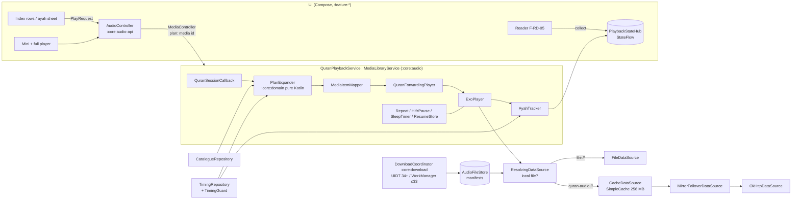
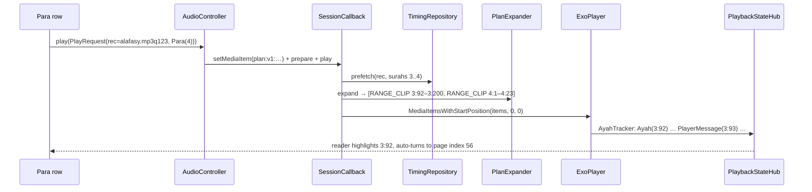

# 06 · Audio Engine: Playback, Catalogue, Timings, Downloads

**Purpose.** This doc specifies the whole recitation stack: the remote-swappable reciter **catalogue**, the offline-validated **timing packs**, the **PlanExpander** that turns "play Para 4 with Alafasy, repeat each ayah 3×" into a Media3 playlist, the **Media3 playback service** (session, notification, data sources, failover, cache), **follow-along** state for the reader, timers, resume, error handling, and the **download engine** (UIDT / WorkManager hosts, Range resume, checksums, storage manager). It is written so an engineer or AI agent can implement it without redoing research. Evidence comes from r06 (audio sources and playback) and g03 (audio rights and gapless timing), plus r01, r03, r05, r07 and g04.

Status: Draft v1 — 2026-10-19

**Key decisions in this doc**
- **D-12**: Default public layout = gapless per-surah MP3 from mp3quran.net plus our offline-validated timing packs, with a highlight kill-switch per surah. Gapped per-ayah (everyayah / islamic.network) is the verse-by-verse layer, `PENDING` (personal and beta builds only) until G2. The v1 public shortlist is fixed in §4.
- **D-13**: Media3 1.11.1 `MediaLibraryService` + ExoPlayer, and a pure-Kotlin `PlanExpander`.
  - Gapless uses `ClippingConfiguration`. Gapped uses one item per ayah.
  - Follow-along uses `PlayerMessage`s plus a binary search, published to a process-wide `PlaybackStateHub`.
  - CBR seeking flag; `USAGE_MEDIA` + `CONTENT_TYPE_SPEECH`; playback starts only from a user action.
- **D-14**: Our own OkHttp downloader (Range resume, `.part` + atomic rename, MD5/SHA-256), hosted in UIDT on API 34+ and WorkManager `dataSync` on API ≤ 33. Wi-Fi only by default. Files go under `getExternalFilesDirs` + `.nomedia`. `SimpleCache` (256 MB LRU) is for streaming only.
- **D-02 / D-03**: OkHttp 5.5.0 everywhere. Media3's okhttp datasource is verified on 5.5.0 (g04 §2.5). No Ktor. Pure-Kotlin domain modules.
- **D-07**: Every Para boundary comes from the **Indo-Pak Para table**, never from Madani juz.
- **D-10 / D-24**: The catalogue and timing packs are signed static files on Cloudflare R2. A bundled copy ships in the APK.
- **D-17 / D-20**: Free and ad-free, with no tracking SDKs. Recitations carry licence and build-eligibility flags that the app enforces at runtime and CI enforces at build time.

---

## 1. Requirements recap (F-AU-*)

| ID | Requirement | Phase | Acceptance criteria (testable) |
|---|---|---|---|
| F-AU-01 | Reciter catalogue + favourite qari, chosen in onboarding (F-PL-01) | P1 | The picker lists only recitations eligible for this build channel (§3.4). Alafasy 123 is preselected. The choice persists across restarts. There are no reciter photos (D-12). Remote kill-switch takes effect ≤ 24 h after the catalogue is published. |
| F-AU-02 | Play scopes: Surah, Para, Manzil, Ruku, Page, ayah range, single ayah, play-from-here | P1 | Every scope builds a correct plan (§7). Para uses the Indo-Pak table: Para 4 starts at **3:92**, P7 5:83, P11 9:94, P14 15:2, P20 27:60, P21 29:45, P23 36:22. A Play button exists on every Surah, Para and Manzil index row (F-IX-01..03), on ruku navigation (F-IX-04), and in the ayah sheet (F-RD-04). |
| F-AU-03 | Gapless playback + timing-driven highlight | P1 | The highlight changes within ±150 ms of the timing-table start (media time) in 95 % of transitions. Highlighting is off (playback still works) for surahs in `highlightDisabledSurahs`, for invalid packs, and when the ETag/length guard fails. |
| F-AU-04 | Gapped verse-by-verse mode | P1 personal; public after G2 | Per-ayah items with item-exact highlight and the basmala rules (§7.4). Hidden in PUBLIC builds while `licenceStatus = PENDING`. |
| F-AU-05 | Repeat ayah ×N, range ×M / ∞, pause after ayah (fixed or proportional) | P1 | The repeat counter shows "2/3". Pauses are accurate to ±100 ms and don't drop the FGS. Changing the repeat mid-playback keeps the current ayah. |
| F-AU-06 | Speed 0.5–2.0× + sleep timer | P1 | Speed preserves pitch and persists. The sleep timer offers 5–90 min and end of ayah / surah / Para / plan; minute timers fade out over 10 s. |
| F-AU-07 | Background play, media notification, lock screen, headset / BT | P1 | Playback survives app swipe-away while playing. Next/prev moves by ayah (setting: surah). Headset hook works. Audio pauses on becoming noisy. The system resume card works (`onPlaybackResumption`). |
| F-AU-08 | Downloads (surah / Para / Manzil / full / popular pack), storage manager, Wi-Fi only | P1 | Kill the process mid-download and it resumes with an HTTP Range request. Corrupt files are rejected. Location can be internal or SD. Sizes shown come from catalogue-measured bytes, and the shown size matches the real size within ±1 %. |
| F-AU-09 | Streaming cache | P1 | SimpleCache LRU at 256 MB by default (128 MB–2 GB). Downloaded files bypass the cache. A replayed surah plays in airplane mode while it is still in the cache. |
| F-AU-10 | Arabic + Urdu translation-audio interleave | P1 personal; public P3 if permitted | Each Arabic ayah (×N) is followed by the Shamshad Ali Khan Urdu ayah. PERSONAL builds only (D-12). |
| F-AU-11 | Android Auto | P3 | Full browse tree + `automotive_app_desc.xml` (§8.9). P1 ships only a minimal root. |
| F-AU-12 | Word-level highlight | P3 | Word segments in the `words` BLOB (§5.1), mapped to DigitalKhatt word tokens (D-06). |

Related features: F-RD-05 (reader highlight and auto page-turn) consumes §9. F-IX-09 shows "Continue listening". F-CP-09 reminders are tap-to-play (§12). F-CP-12 Hifz (P3) reuses the RepeatSpec cumulative chain. F-PL-04 credits list each recitation's `attribution`. F-PL-06 storage manager (§13.9).

**Non-goals (v1):** QF/QDC audio or timings (QF terms cap storage at one week; r06 §2.1); Warsh/Qaloon; quranicaudio-only sets in PUBLIC builds; auto-starting recitation from alarms or boot; word highlight; Android Auto quality review.

---

## 2. Architecture overview



**Module placement** (D-03; doc 04 owns the final graph):

| Module | Contents (this doc) |
|---|---|
| `:core:model` (pure Kotlin) | `AyahKey`, `AudioLayout`, `RecitationStyle`, `BasmalaStrategy`, `LicenceStatus`, `BuildChannel`, `QualityTier`, `Reciter`, `Recitation`, `PlayScope`, `RepeatSpec`, `PauseRule`, `StopAt`, `PlayRequest` |
| `:core:domain` (pure Kotlin) | `QuranStructure` and `TimingIndex` interfaces, `PlanExpander`, `PlayItem`, `ExpandedPlan`, `PlanError`. JVM-unit-tested |
| `:core:audio-api` | `AudioController`, `PlaybackStateHub`, `NowPlaying`, `HighlightTarget`, `AudioError` (depends on model only) |
| `:core:audio` | Service, player factory, `QuranForwardingPlayer`, `MediaItemMapper`, data sources, `AyahTracker`, repeat/pause/sleep controllers, `ResumeStore`, `TimingRepository`, `TimingGuard`, `CatalogueRepository` |
| `:core:download` | `DownloadCoordinator`, `DownloadEngine`, `HttpRangeDownloader`, `ZipInstaller`, `ChecksumVerifier`, `AudioFileStore`, `StorageLocationManager`, `AudioDownloadJobService` (API 34+), `AudioDownloadWorker` (≤ 33), `downloads.db` |
| `:feature:audio` | Mini player, full player sheet, reciter picker, downloads/storage-manager screens (UI per doc 02) |

**Threading rule.** Media3 1.11 requires session and player calls on the application (main) looper; getters throw otherwise (r07 §2.6). Timing and catalogue I/O run on `@IoDispatcher`. The service prefetches timings before it calls the synchronous `PlanExpander`.

---

## 3. Catalogue model (`catalogue.json`)

### 3.1 Files, hosting, signing, refresh

- **Bundled copy.** `assets/audio/catalogue.json` + `catalogue.json.sig`. This is the source on first launch and offline. CI regenerates it from the same source as the R2 copy.
- **Remote copy.** `https://cdn.<domain>/audio/v1/catalogue.json` + `.sig` on Cloudflare R2 (D-24). The domain is fixed at G3; `BuildConfig.CDN_BASE`. The signature is Ed25519 over the exact bytes, verified by the same verifier as the pack `index.json` (D-10; doc 04/08 own the key and envelope).
- **Refresh.** A daily periodic WorkManager job (network connected) plus an on-demand fetch when the reciter picker opens and the copy is > 24 h old. It uses a conditional GET (`If-None-Match`).
- **Acceptance.** A remote copy is accepted only if the signature is valid, `schema` is supported, and `catalogueVersion` > current. It then **replaces** the active catalogue wholesale; fields are never merged. It is persisted to `files/audio/catalogue.json`.
- **Forward compatibility.** Parse with `ignoreUnknownKeys = true`. A recitation with an unknown enum value (style, layout, basmala, tier) is **skipped**; it never crashes the parse. `minAppVersionCode` hides entries that need a newer app.

### 3.2 Schema (JSON) with two real entries

```json
{
  "schema": 1,
  "catalogueVersion": 1,
  "generatedAt": "2026-10-19T00:00:00Z",
  "hosts": {
    "mp3q": "https://cdn.mp3quran.net/audio",
    "ea":   "https://everyayah.com/data",
    "in":   "https://cdn.islamic.network/quran",
    "r2":   "https://cdn.<domain>/audio"
  },
  "defaults": { "PUBLIC": "alafasy.murattal.mp3q123", "BETA": "alafasy.murattal.mp3q123", "PERSONAL": "alafasy.murattal.mp3q123" },
  "reciters": [
    { "id": "alafasy", "names": { "en": "Mishary Rashid Alafasy", "ar": "مشاري راشد العفاسي", "ur": "مشاری راشد العفاسی" }, "country": "KW", "sortKey": 10 }
  ],
  "recitations": [
    {
      "id": "alafasy.murattal.mp3q123",
      "reciterId": "alafasy", "style": "MURATTAL", "riwayah": "hafs", "language": "ar",
      "layout": "GAPLESS_SURAH",
      "label": { "en": "Continuous", "ur": "مسلسل" },
      "qualities": [ {
        "tier": "STANDARD", "bitrateKbps": 128, "sampleRateHz": 44100, "isVbr": false,
        "mirrors": [ { "id": "mp3quran", "template": "{host:mp3q}/mishary-alafasy/r1/{sss}.mp3", "role": "PRIMARY", "byteIdentical": true } ],
        "surahBytes": [ "…114 measured ints…" ], "surahDurationMs": [ "…114 ints…" ], "totalBytes": 1720000000
      } ],
      "basmala": "EMBEDDED_INTRO",
      "timing": { "packId": "timing.alafasy.mp3q123", "minVersion": 1, "source": "mp3quran ayat_timing read=123" },
      "highlightDisabledSurahs": [],
      "fallbackRecitationId": "alafasy.murattal.ea",
      "licenceStatus": "HOST_GRANT", "buildEligibility": ["PERSONAL", "BETA", "PUBLIC"], "commercialUse": "UNKNOWN",
      "attribution": { "en": "Recitation: Mishary Rashid Alafasy · Audio: mp3quran.net", "ur": "…" },
      "sourceUrl": "https://www.mp3quran.net/eng/privacy",
      "licenceEvidence": "evidence/mp3quran-privacy-2026-10-19.pdf#sha256=…",
      "enabled": true, "killAction": "DISABLE", "minAppVersionCode": 0, "sortKey": 10, "tags": ["default", "popular-pk"]
    },
    {
      "id": "alafasy.murattal.ea",
      "reciterId": "alafasy", "style": "MURATTAL", "layout": "GAPPED_AYAH",
      "label": { "en": "Verse by verse", "ur": "آیت بہ آیت" },
      "qualities": [
        { "tier": "LOW", "bitrateKbps": 64, "sampleRateHz": 22050,
          "mirrors": [ { "id": "in", "template": "{host:in}/audio/64/ar.alafasy/{g}.mp3", "role": "PRIMARY" },
                       { "id": "ea", "template": "{host:ea}/Alafasy_64kbps/{sss}{aaa}.mp3", "role": "MIRROR" } ],
          "surahZip": [ { "id": "ea", "template": "{host:ea}/Alafasy_64kbps/zips/{sss}.zip", "role": "PRIMARY" } ],
          "checksums": { "type": "MD5_MANIFEST", "url": "{host:ea}/Alafasy_64kbps/000_checksum.md5", "format": "md5sum" },
          "surahBytes": [ "…" ], "totalBytes": 860000000 },
        { "tier": "STANDARD", "bitrateKbps": 128, "sampleRateHz": 44100,
          "mirrors": [ { "id": "in", "template": "{host:in}/audio/128/ar.alafasy/{g}.mp3", "role": "PRIMARY" },
                       { "id": "ea", "template": "{host:ea}/Alafasy_128kbps/{sss}{aaa}.mp3", "role": "MIRROR" } ],
          "surahZip": [ { "id": "ea", "template": "{host:ea}/Alafasy_128kbps/zips/{sss}.zip", "role": "PRIMARY" } ],
          "checksums": { "type": "MD5_MANIFEST", "url": "{host:ea}/Alafasy_128kbps/000_checksum.md5", "format": "md5sum" },
          "surahBytes": [ "…" ], "totalBytes": 1710000000 }
      ],
      "basmala": "SEPARATE_FILE", "basmalaPath": "bismillah.mp3",
      "licenceStatus": "PENDING", "buildEligibility": ["PERSONAL", "BETA"],
      "attribution": { "en": "Recitation: Mishary Rashid Alafasy · Audio: everyayah.com / Islamic Network CDN" },
      "sourceUrl": "https://alquran.cloud/terms-and-conditions", "enabled": true
    }
  ]
}
```

**URL template tokens.**

| Token | Meaning |
|---|---|
| `{host:alias}` | Value from `hosts`. Lets one entry swap a dead host. |
| `{sss}` / `{aaa}` | Surah / ayah, zero-padded to 3 digits. |
| `{s}` / `{a}` | Unpadded. |
| `{g}` | Global Kufan ayah number 1..6236 (islamic.network). |

The **basmala file** resolves as follows:
- **everyayah:** `basmalaPath` is relative to the template's folder (`…/Alafasy_128kbps/bismillah.mp3`).
- **islamic.network:** the basmala is `{g}=1` (the reciter's 1:1).
- **Fallback:** on a 404, use the reciter's `001001` (`USE_FATIHA_1_1`).

Never depend on `SSS000.mp3` intros; they are inconsistent across reciters (r06 §2.6).

### 3.3 Kotlin model (`:core:model`, kotlinx.serialization)

```kotlin
enum class AudioLayout { GAPLESS_SURAH, GAPPED_AYAH }
enum class RecitationStyle { MURATTAL, MUJAWWAD, MUALLIM, TRANSLATION }   // KIDS_REPEAT reserved (v1.x); unknown → entry skipped
enum class BasmalaStrategy { EMBEDDED_INTRO, SEPARATE_FILE, USE_FATIHA_1_1, NONE }
enum class LicenceStatus { PERMITTED, HOST_GRANT, PENDING, PERSONAL_ONLY }
enum class BuildChannel { PERSONAL, BETA, PUBLIC }        // BuildConfig.CONTENT_CHANNEL (doc 04/11)
enum class CommercialUse { ALLOWED, NOT_ALLOWED, UNKNOWN } // D-17: monetized builds require ALLOWED
enum class QualityTier { LOW, STANDARD, HIGH }
enum class MirrorRole { PRIMARY, MIRROR, SELF_HOSTED }
enum class KillAction { DISABLE, DISABLE_AND_PURGE }

@Serializable data class LocalizedText(val en: String, val ur: String? = null, val ar: String? = null)

@Serializable data class AudioCatalogue(
    val schema: Int, val catalogueVersion: Int, val generatedAt: String,
    val minAppVersionCode: Int = 0,
    val hosts: Map<String, String>,
    val defaults: Map<BuildChannel, String>,
    val reciters: List<Reciter>,
    val recitations: List<Recitation>,
)

@Serializable data class Reciter(val id: String, val names: LocalizedText, val country: String? = null,
                                 val sortKey: Int = 1000)          // no photo field, by design (D-12)

@Serializable data class Recitation(
    val id: String,                         // immutable once published: user.db + download paths reference it
    val reciterId: String,
    val style: RecitationStyle,
    val riwayah: String = "hafs",
    val language: String = "ar",            // "ur" for translation voices
    val layout: AudioLayout,
    val label: LocalizedText? = null,
    val qualities: List<AudioQuality>,
    val basmala: BasmalaStrategy,
    val basmalaPath: String? = null,
    val timing: TimingRef? = null,          // GAPLESS only; null = untimed (surah-level only)
    val highlightDisabledSurahs: Set<Int> = emptySet(),   // pipeline output (§5.3)
    val fallbackRecitationId: String? = null, // same reciter, GAPPED, used for verse-level slices of untimed surahs
    val licenceStatus: LicenceStatus,
    val buildEligibility: Set<BuildChannel>,
    val commercialUse: CommercialUse = CommercialUse.UNKNOWN,
    val attribution: LocalizedText,
    val sourceUrl: String,
    val licenceEvidence: String? = null,
    val enabled: Boolean = true,            // remote kill-switch
    val killAction: KillAction = KillAction.DISABLE,
    val killMessage: LocalizedText? = null,
    val minAppVersionCode: Int = 0,
    val sortKey: Int = 1000,
    val tags: Set<String> = emptySet(),
)

@Serializable data class AudioQuality(
    val tier: QualityTier,
    val bitrateKbps: Int,                   // MEASURED by pipeline, never the folder label (r06 §2.5)
    val sampleRateHz: Int,
    val isVbr: Boolean = false,             // true → index seeking for downloaded files (§8.2)
    val mirrors: List<Mirror>,              // ordered; failover in this order
    val surahZip: List<Mirror>? = null,     // GAPPED bulk download
    val checksums: ChecksumSpec? = null,
    val surahBytes: List<Long>,             // 114 measured sizes (UI estimates, space checks)
    val surahDurationMs: List<Long>? = null,
    val totalBytes: Long,
)
@Serializable data class Mirror(val id: String, val template: String, val role: MirrorRole, val byteIdentical: Boolean = true)
@Serializable data class ChecksumSpec(val type: ChecksumType, val url: String, val format: String)
enum class ChecksumType { MD5_MANIFEST, SHA256_MANIFEST }
@Serializable data class TimingRef(val packId: String, val minVersion: Int, val source: String)
```

### 3.4 Runtime rules

1. **Visibility.** A recitation is visible iff all of these hold:
   - `enabled`;
   - `CONTENT_CHANNEL ∈ buildEligibility`;
   - `appVersionCode ≥ minAppVersionCode`;
   - for a monetized build (v1.5 supporter IAP, D-17), `commercialUse == ALLOWED`. Until audited this is effectively "never", so CI keeps the IAP build's eligibility rules separate (doc 10/11).
2. **Eligibility invariants** (CI-enforced, doc 10):
   - `PUBLIC` requires `licenceStatus ∈ {PERMITTED, HOST_GRANT}`.
   - `PENDING` → at most `{PERSONAL, BETA}`.
   - `PERSONAL_ONLY` → `{PERSONAL}` only.
3. **Never pair timing and audio from different edits** (g03 §2.5.4). A `GAPLESS_SURAH` with `timing != null` may list only mirrors with `byteIdentical = true` (CI check). If runtime failover lands on a non-identical mirror, that surah is untimed for the session.
4. **Kill-switch.** When a recitation becomes `enabled = false`:
   - current playback stops at the end of the current item, with a notice (`killMessage`);
   - the favourite reverts to `defaults[channel]`;
   - downloads become unplayable at once;
   - with `DISABLE_AND_PURGE` (takedown requests; 48-hour removal promise per g03 template), the files are deleted on the next app open after a one-line notice.
5. **Default reciter.** `defaults[channel]` = Alafasy 123. If Alafasy Berhad (ai@alafasy.co) refuses, flip `enabled` and set the default to `ghamdi.murattal.mp3q30` with one catalogue publish; no app update is needed.
6. **Credits.** Every visible recitation's `attribution` + `sourceUrl` appears in Sources & Credits (F-PL-04) and as a one-line source caption in the full player.

---

## 4. v1 catalogue (per D-12)

Sizes and hours are measured (g03 §2.5.1 for mp3quran; r06 §2.3 / §2.8.8 for everyayah). `~` means derived. Folder URLs are verified (`api/v3/ayat_timing/reads`). Average Para size = full / 30.

### 4.1 PUBLIC: gapless mp3quran, with highlighting (licence `HOST_GRANT`, eligibility PERSONAL+BETA+PUBLIC)

| # | Recitation id | Reciter / style | mp3quran read · template (`{host:mp3q}/…`) | Measured kbps / kHz | Full size / hours | Highlight | Pipeline fixes / notes (g03) |
|---|---|---|---|---|---|---|---|
| 1 | `alafasy.murattal.mp3q123` | Mishary Alafasy · Murattal (**default**) | 123 · `mishary-alafasy/r1/{sss}.mp3` | 128 / 44.1 CBR | 1.72 GB / 29.8 h | all 114 | PASS (audio-validated); no ayah 0 (implicit intro gap) |
| 2 | `ghamdi.murattal.mp3q30` | Saad Al-Ghamdi · Murattal | 30 · `saad-ghamdi/r1/{sss}.mp3` | **96 / 22.05** CBR | 1.07 GB / 24.8 h | all | PASS (audio-validated). Same recording as QUL 13, which is not used |
| 3 | `abdulbasit.mujawwad.mp3q51` | Abdul Basit · Mujawwad | 51 · `abdulbasit-abdulsamad/r1/{sss}.mp3` | 128 / 44.1 | 3.49 GB / 60.6 h | all, after fix | **s9 relabel +1** (ayah 0 → 9:1); ayah 0 = intro in all surahs; onset snap recommended (speech starts +2.1–3.4 s) |
| 4 | `sudais.murattal.mp3q54` | Abdur-Rahman As-Sudais | 54 · `abdulrahman-sudais/r1/{sss}.mp3` | 128 (s109: 320) | 1.22 GB / 21.2 h | all | Clamp end overshoot s94 (+341 ms), s111 (+330 ms) |
| 5 | `shatri.murattal.mp3q4` | Abu Bakr Ash-Shatri | 4 · `abubakr-shatri/r1/{sss}.mp3` | 128 | 1.50 GB / 26.1 h | all | Structural PASS; decode check + listening pass before release |
| 6 | `rifai.murattal.mp3q89` | Hani Ar-Rifai | 89 · `hani-rifai/r1/{sss}.mp3` | 128 | 1.48 GB / 25.7 h | all | Structural PASS; same pre-release check |
| 7 | `ayyub.murattal.mp3q109` | Muhammad Ayyub | 109 · `muhammad-ayyub/r1/{sss}.mp3` | 96 / 22.05 | 1.40 GB / 32.5 h | all | Structural PASS; King Fahd Complex reciter |
| 8 | `muhanna.murattal.mp3q159` | Khalid Al-Muhanna | 159 · `khalid-mohanna/r1/{sss}.mp3` | 48 / 22.05 | 0.64 GB / 29.8 h | all | Structural PASS; ayah 0 in 112 surahs (correct); low bitrate, labelled "Data saver" |

### 4.2 PUBLIC: gapless mp3quran, highlight off in faulty surahs

| # | Recitation id | Reciter | Read · template | kbps | Full / hours | `highlightDisabledSurahs` (expected; the pipeline's output is authoritative) | Notes |
|---|---|---|---|---|---|---|---|
| 9 | `husary.murattal.mp3q118` | Mahmoud Khalil Al-Husary | 118 · `mahmoud-husary/r1/{sss}.mp3` | 128 (s21: 48 kHz) | 2.47 GB / 42.8 h | 1, 21 | s1: ayah 0 swallows the basmala, 1:7 missing. s21: file swapped (+23.8 s) |
| 10 | `minshawi.murattal.mp3q112` | Muhammad Siddiq Al-Minshawi | 112 · `muhammad-minshawi/r1/{sss}.mp3` | 128 (s53: 192) | 1.67 GB / 28.9 h | 52, 53 (+ **9**, see open issue 1) | s9 relabel +1, but s9 also overshoots by +8,155 ms (> 1 s rule) |
| 11 | `shuraim.murattal.mp3q31` | Saud Ash-Shuraim | 31 · `saud-shuraim/r1/{sss}.mp3` | 128 | 1.05 GB / 18.3 h | 12, 40, 65, 80, 83, 91 | s9 relabel +1; 65:12 missing; s91 label shift |
| 12 | `dosari.murattal.mp3q92` | Yasser Ad-Dosari | 92 · `yasser-dosari/r1/{sss}.mp3` | 128 (mixed 44.1/48 kHz, some 192) | 1.44 GB / 25.9 h | 4 | s4 replaced (24 kbps VBR); clamp ≤ +424 ms in 5 short surahs |

**Never used for timing:** read 74 (Huthaify; drops the last ayah in 112 surahs) and read 53 (Abdul Basit Murattal, 32 kbps / 11 kHz). Ajmy read 5 is held until an audio check (s4 and s42 anomalies). Akhdar read 1 and Minshawi-with-children (mp3quran r3) are v1.x.

### 4.3 Verse-by-verse layer: gapped (licence `PENDING`, eligibility PERSONAL+BETA until G2)

Primary is islamic.network where the edition exists (written host terms; per-user full downloads explicitly OK, g03 §2.1). Mirror is everyayah (byte-identical, r06 §1.4). Bulk download uses the everyayah per-surah ZIPs, checked against `000_checksum.md5`.

| # | Recitation id | Reciter | Tiers (everyayah folder · i.n. edition) | Full size LOW / HIGH | Notes |
|---|---|---|---|---|---|
| 13 | `alafasy.murattal.ea` | Alafasy | 64 `Alafasy_64kbps` · `ar.alafasy`; 128 `Alafasy_128kbps` · `ar.alafasy` | 0.86 / 1.71 GB | Folder labels are nominal (001001 is 192 kbps); sizes come from the manifest |
| 14 | `abdulbasit.murattal.ea` | Abdul Basit · Murattal | 64 / 192 `Abdul_Basit_Murattal_*` · `ar.abdulbasitmurattal` | 0.91 / 2.70 GB | The only Abdul Basit Murattal row (read 53 rejected) |
| 15 | `minshawi.murattal.ea` | Minshawi | 32 `Menshawi_32kbps`; 128 `Minshawy_Murattal_128kbps` · `ar.minshawi` | 0.41 / 1.67 GB | |
| 16 | `husary.murattal.ea` | Husary | 64 / 128 `Husary_*` · `ar.husary` | 1.23 / 2.47 GB | Fallback for s1, s21 of row 9 |
| 17 | `sudais.murattal.ea` | Sudais | 64 / 192 `Abdurrahmaan_As-Sudais_*` · `ar.abdurrahmaansudais` | 0.61 / 1.83 GB | |
| 18 | `shuraim.murattal.ea` | Shuraim | 64 / 128 `Saood_ash-Shuraym_*` · `ar.saoodshuraym` (64 only) | ~0.53 / 1.06 GB | Fallback for row 11's 6 surahs |
| 19 | `muaiqly.murattal.ea` | Maher Al-Muaiqly | 64 `Maher_AlMuaiqly_64kbps`; 128 `MaherAlMuaiqly128kbps` · `ar.mahermuaiqly` | 0.61 / 1.21 GB | Switches to the KFGQPC copy (row 26) once obtained |
| 20 | `shatri.murattal.ea` | Shatri | 64 / 128 `Abu_Bakr_Ash-Shaatree_*` · `ar.shaatree` | ~0.7 / 1.43 GB | |
| 21 | `rifai.murattal.ea` | Hani Ar-Rifai | 64 / 192 `Hani_Rifai_*` · `ar.hanirifai` | ~0.7 / 2.15 GB | |
| 22 | `dosari.murattal.ea` | Yasser Ad-Dosari | 128 `Yasser_Ad-Dussary_128kbps` (no i.n. per-ayah) | — / 1.50 GB | Fallback for row 12 s4 |
| 23 | `huthaify.murattal.ea` | Ali Al-Huthaify | 64 / 128 `Hudhaify_*` · `ar.hudhaify` | measured by pipeline | Replaced by row 25 when the KFGQPC files arrive |
| 24 | `ajmy.murattal.ea` | Ahmed Al-Ajmy | 128 `ahmed_ibn_ali_al_ajamy_128kbps` · `ar.ahmedajamy` | — / 1.51 GB | |

### 4.4 King Fahd Complex, self-hosted on R2 (gapped; `PENDING` → `PERMITTED`)

**Activation requires two things:**
1. The owner downloads the per-ayah ZIPs from Pakistan (the site is geo-blocked from our egress).
2. The permission email to info@qurancomplex.gov.sa goes out, and the licence page is archived as PDF + SHA-256.

**Template:** `{host:r2}/kfgqpc/<reciter>/{sss}{aaa}.mp3`, role `SELF_HOSTED`, with SHA-256 manifests from our pipeline. Credit: "Recording: King Fahd Glorious Qur'an Printing Complex".

| # | Recitation id | Reciter | Per-ayah set size [search-excerpt, g03 §2.3] |
|---|---|---|---|
| 25 | `huthaify.murattal.kfgqpc` | Ali Al-Huthaify | 803.55 MB |
| 26 | `muaiqly.murattal.kfgqpc` | Maher Al-Muaiqly | 724.25 MB |
| 27 | `ayyub.murattal.kfgqpc` | Muhammad Ayyub | 916.75 MB |
| 28 | `muhanna.murattal.kfgqpc` | Khalid Al-Muhanna | 1.04 GB |
| 29 | `akhdar.murattal.kfgqpc` | Ibrahim Al-Akhdar | 1.18 GB |

The pipeline measures bitrate and sample rate on receipt. Each row can go PUBLIC only once a written confirmation is on file. If the Complex statement is confirmed but no reply arrives, raise it with doc 12 as a G2 decision.

### 4.5 PERSONAL builds only (`PERSONAL_ONLY`)

| # | Recitation id | Content | Layout · source | Size | Why personal-only |
|---|---|---|---|---|---|
| P1 | `shamshad.translation_ur.ea` | Urdu translation voice, Shamshad Ali Khan (F-AU-10 interleave) | Gapped · everyayah `translations/urdu_shamshad_ali_khan_46kbps` · mirror i.n. `ur.khan` (64) | 0.51 GB | ℗ 1998 Hi-Tech Music Ltd (g03 §2.1) |
| P2 | `husary.muallim.ea` | Husary Muallim (teaching) | Gapped · everyayah `Husary_Muallim_128kbps` | 2.75 GB | everyayah-only; QF permission pending |
| P3 | `sadaqatali.murattal.in` | Qari Syed Sadaqat Ali (Pakistan) | Gapless, **untimed** · i.n. `{host:in}/audio-surah/128/ar.sadaqatali/{s}.mp3` | ~1.75–1.8 GB | Living reciter, not yet asked; no timing anywhere → surah-level only (§7.6) |

---

## 5. Timing packs

### 5.1 Format (one SQLite file per gapless recitation; built by doc 08's pipeline)

```sql
-- timing.<recitation>.v<N>.db   (distributed gzip-compressed as .db.gz; listed in the signed pack index.json, type "timing")
CREATE TABLE pack_info (key TEXT PRIMARY KEY, value TEXT NOT NULL) WITHOUT ROWID;
-- required keys: schema=1, pack_id, recitation_id, version, source ("mp3quran ayat_timing read=123"),
--   source_fetched_at, built_at, pipeline_git_sha, attribution, onset_snapped (0|1), words (0|1)

CREATE TABLE audio_file (                     -- guard against silent CDN re-encodes (g03 §2.2: all files of 123/30/51 re-uploaded 2026-09-27)
  recitation_id  TEXT    NOT NULL,
  surah          INTEGER NOT NULL CHECK (surah BETWEEN 1 AND 114),
  url            TEXT    NOT NULL,            -- primary URL the timings were validated against
  content_length INTEGER NOT NULL,
  etag           TEXT,                        -- as served (quoted string)
  last_modified  TEXT,
  duration_ms    INTEGER NOT NULL,            -- CBR: (CL − ID3v2 − ID3v1) × 8 / kbps (exact per g03 §2.5.2)
  bitrate_kbps   INTEGER NOT NULL,
  sample_rate_hz INTEGER NOT NULL,
  cbr            INTEGER NOT NULL,            -- 1 if all sampled frames share one bitrate
  highlight_ok   INTEGER NOT NULL,            -- 0 → surah is in highlightDisabledSurahs
  disabled_reason TEXT,                       -- e.g. "fatiha_basmala_swallowed", "end_overshoot_8155ms", "missing:65:12"
  fixes          TEXT,                        -- e.g. "relabel+1,clamp_end,onset_snap"
  PRIMARY KEY (recitation_id, surah)
) WITHOUT ROWID;

CREATE TABLE ayah_timing (
  recitation_id TEXT    NOT NULL,
  surah         INTEGER NOT NULL,
  ayah          INTEGER NOT NULL,             -- 0 = intro (ta'awwudh / basmala lead-in) when present; 1..N Kufan
  start_ms      INTEGER NOT NULL,
  end_ms        INTEGER NOT NULL,
  words         BLOB,                         -- v1.x (F-AU-12): packed little-endian records [u16 token_ordinal, i32 start_ms, i32 end_ms]
  PRIMARY KEY (recitation_id, surah, ayah),
  CHECK (end_ms > start_ms)
) WITHOUT ROWID;
-- Rows exist only for surahs with highlight_ok = 1.
```

**Conventions** (g03 §2.5.1, §2.6):
- Kufan numbering throughout, so **1:1 is the basmala**. This matches the Taj-faithful Fatiha in D-06.
- An intro is always stored as `ayah = 0`. A read with an "implicit gap" (123, 30, 54, 4, 92, 89, 109) gets **no** ayah-0 row; the lead-in is `[0, start(1))`.
- `end(a) ≤ start(a+1)`, and gaps are allowed (Sudais has 20 ms gaps).
- mp3quran marks each start at the **beginning of the pause** before the ayah. With `onset_snapped = 1`, the pipeline moved starts to `onset − 150 ms` (max shift 1.5 s).
- Size estimate: ~6,300 rows ≈ 0.3 MB raw, much less gzipped. The `recitation_id` column is constant per file, kept so packs can be merged later.

**Bundling.** The 12 PUBLIC timing packs (§4.1–4.2) ship in `assets/audio/timing/`, about 1–4 MB. Highlighting therefore works offline from first launch. Updates arrive through the pack index (D-10).

**Why not Room for packs.** These are fixed read-only files with three queries. Reading them directly through `androidx.sqlite` (`BundledSQLiteDriver`, already in the stack) avoids coupling packs to Room identity hashes. Doc 04 may still choose Room for translation packs.

### 5.2 Runtime loading and validation

```kotlin
class TimingRepository @Inject constructor(packs: PackStore, private val guard: TimingGuard, private val q: QuranStructure) {
    /** Loads and validates one surah (≤ 287 rows). LRU of 8 surahs per recitation. */
    suspend fun surah(recId: String, surah: Int): SurahTiming?   // null → untimed for this surah
}
data class SurahTiming(val recId: String, val surah: Int, val introEndMs: Long?,       // start(1) when > 0
                       val starts: LongArray, val ends: LongArray,                    // index 0 = ayah 1
                       val durationMs: Long, val cbr: Boolean)
```

**Validation on load.** Any failure → `null`, a local diagnostic is logged, and the surah is treated as untimed.
1. **Pack level, once at install** (doc 04 pack installer):
   - SHA-256 equals the index entry;
   - `pack_info.schema == 1`;
   - `pack_info.recitation_id == recitation.id`;
   - `version ≥ timing.minVersion`.
2. **Surah level:**
   - `audio_file.highlight_ok == 1` and the surah is ∉ `highlightDisabledSurahs`;
   - the row count of ayahs 1..N equals `q.ayahCount(surah)`;
   - starts strictly increase;
   - `end > start` for each row;
   - `end(a) ≤ start(a+1) + 5 ms`;
   - the intro row (if any) has `end ≤ start(1) + 5 ms`;
   - `ends.last() ≤ duration_ms + 100 ms`.
3. **Guard** (`TimingGuard.state(recId, surah)`), checked against the actual bytes:
   - **Downloaded file:** `file.length() == content_length`, and (when known) the ETag recorded at download equals `etag`.
   - **Streaming:** `MirrorFailoverDataSource` reports each upstream response's `Content-Length` (200) or the `Content-Range` total (206), plus the `ETag`.
   - **Cache-only reads:** reuse the last persisted result (`timing_guard` table, §13.3). If none exists, run a background `HEAD` through OkHttp.
   - **Policy:** highlight is optimistic while the check is pending. On a mismatch, highlighting turns off for that surah and verse-level slicing is refused for it until a new pack arrives (§7.6).
4. **CI re-validation** runs weekly over all 114 surahs per read (g03 rec. 10; doc 08/10). An ETag diff → pack rebuilt → new `version` in the index.

### 5.3 Who decides `highlightDisabledSurahs`

The pipeline's `normalise()` (g03 §2.6) emits `highlight_ok = 0` with a reason. Doc 08's catalogue generator copies those surahs into `highlightDisabledSurahs` so the UI can say so **before** playback. The runtime check (§5.2) is a second line of defence, never the primary filter.

---

## 6. Request model

```kotlin
@Serializable data class AyahKey(val surah: Int, val ayah: Int) : Comparable<AyahKey>  // doc 04 owns; id() = Kufan 1..6236

@Serializable sealed interface PlayScope {
    @Serializable data class Surah(val surah: Int) : PlayScope
    @Serializable data class Para(val para: Int) : PlayScope                       // 1..30, Indo-Pak table (D-07)
    @Serializable data class Manzil(val manzil: Int) : PlayScope                   // 1..7
    @Serializable data class Ruku(val rukuId: Int) : PlayScope                     // 1..558 (QF/QUL set)
    @Serializable data class Page(val mushafId: Int, val pageIndex: Int) : PlayScope  // QUL page_index (not label)
    @Serializable data class AyahRange(val from: AyahKey, val to: AyahKey) : PlayScope
    @Serializable data class Ayah(val key: AyahKey) : PlayScope
    @Serializable data class FromHere(val start: AyahKey, val stopAt: StopAt) : PlayScope
    @Serializable data object Quran : PlayScope                                    // 1:1..114:6, windowed
}
enum class StopAt { END_OF_SURAH, END_OF_PARA, CONTINUOUS }        // setting; default CONTINUOUS

@Serializable sealed interface PauseRule {
    @Serializable data object None : PauseRule
    @Serializable data class Fixed(val ms: Long) : PauseRule               // 1_000..20_000
    @Serializable data class Proportional(val factor: Float) : PauseRule   // 0.5..2.0 × ayah duration
}
@Serializable data class RepeatSpec(
    val ayahTimes: Int = 1,             // 1..20
    val rangeTimes: Int = 1,            // 1..20; 0 = infinite
    val pauseAfterAyah: PauseRule = PauseRule.None,
    val cumulative: Boolean = false,    // hifz chain 1, 1–2, 1–3 … (F-CP-12, P3)
)
@Serializable data class PlayRequest(
    val recitationId: String,
    val scope: PlayScope,
    val repeat: RepeatSpec = RepeatSpec(),
    val translationVoiceId: String? = null,   // F-AU-10 (PERSONAL builds)
    val tier: QualityTier? = null,            // null → policy (§8.4)
    val startAt: AyahKey? = null,             // resume / "start at this ayah inside the scope"
)
```

Where requests come from:

| Entry point | Request |
|---|---|
| Surah row Play (F-IX-01) | `Surah(s)` |
| Para row (F-IX-02) | `Para(n)` |
| Manzil row (F-IX-03) | `Manzil(m)` |
| Ruku nav (F-IX-04) | `Ruku(id)` |
| Reader toolbar "Play page" | `Page(mushaf, idx)` |
| Ayah sheet (F-RD-04) | "Play from here" → `FromHere(key, settings.stopAt)`; "Play this ayah" → `Ayah(key)`; "Play range…" → `AyahRange` |
| Quick-access (F-IX-08) | Ayatul Kursi = `Ayah(2:255)`; last two ayat of Baqarah = `AyahRange(2:285, 2:286)`; Manzil dua = the alias table's range |

---

## 7. PlanExpander

`PlanExpander` lives in `:core:domain`. It is pure and deterministic: the same catalogue, timing versions and request always give the same items. It takes synchronous lookups only. The service first calls `timingRepository.prefetch(recId, surahsOf(range))`, then expands.

```kotlin
interface QuranStructure {                          // implemented in :core:data from quran_content.db, loaded once into memory
    fun ayahCount(surah: Int): Int
    fun paraStart(para: Int): AyahKey                // Indo-Pak table: P4 = 3:92 …
    fun manzilStart(manzil: Int): AyahKey            // 1:1, 5:1, 10:1, 17:1, 26:1, 37:1, 50:1
    fun ruku(id: Int): ClosedRange<AyahKey>
    fun pageRange(mushafId: Int, pageIndex: Int): ClosedRange<AyahKey>   // ayah of first word .. ayah of last word
    fun paraOf(key: AyahKey): Int
    fun prev(key: AyahKey): AyahKey?; fun next(key: AyahKey): AyahKey?
    val last: AyahKey                                // 114:6
}
interface TimingIndex { fun surah(recId: String, surah: Int): SurahTiming? }     // prefetched, guard-aware

enum class ItemKind { INTRO, BASMALA, AYAH, TRANSLATION, SURAH_CLIP, RANGE_CLIP }
data class PlayItem(
    val seq: Int, val recitationId: String, val tier: QualityTier, val kind: ItemKind,
    val surah: Int, val firstAyah: Int, val lastAyah: Int,   // AYAH/TRANSLATION: first == last; INTRO/BASMALA: 0
    val clipStartMs: Long = 0, val clipEndMs: Long? = null,  // null = end of source; gapped items unclipped
    val rep: Int = 1, val repOf: Int = 1, val pass: Int = 1,
    val timed: Boolean,                                      // follow-along available for this item
)
data class ExpandedPlan(val request: PlayRequest, val items: List<PlayItem>, val repeatMode: Int /*Player.REPEAT_MODE_*/,
                        val pauseRule: PauseRule, val window: SurahWindow?, val warnings: List<PlanWarning>,
                        val title: PlanTitle, val estDurationMs: Long?)
sealed interface PlanError { data class UnknownRecitation(val id: String); data class NotEligible(val id: String)
    data class VerseLevelUnavailable(val surah: Int, val alternatives: List<String>); data class InvalidScope(val why: String) }
sealed interface PlanWarning { data class HighlightOff(val surah: Int); data class UsedVerseByVerse(val surah: Int, val recId: String) }
```

### 7.1 Top-level algorithm

```kotlin
fun expand(req: PlayRequest, window: SurahWindow? = null): Outcome<ExpandedPlan> {
    val rec = catalogue[req.recitationId] ?: return Err(UnknownRecitation(req.recitationId))
    if (!catalogue.isVisible(rec)) return Err(NotEligible(rec.id))
    val voice = req.translationVoiceId?.let { catalogue[it]?.takeIf(catalogue::isVisible) }
    val range = resolve(req.scope) ?: return Err(InvalidScope(...))            // §7.2
    val tier = req.tier ?: policy.tierFor(rec)                                  // §8.4
    val slices = sliceBySurah(range)                                            // [(s, a0, a1)]
    val win = window ?: if (estimateItems(rec, slices, req) > 1_200) SurahWindow(firstIdx = 0, count = 2) else null
    val items = mutableListOf<PlayItem>(); val warnings = mutableListOf<PlanWarning>()
    for (slice in win?.let { slices.subList(it.firstIdx, min(it.firstIdx + it.count, slices.size)) } ?: slices) {
        when (val strategy = chooseStrategy(rec, slice, req)) {                 // §7.6
            is Strategy.Error -> return Err(strategy.error)
            else -> items += emit(strategy, rec, voice, slice, req.repeat, tier, warnings)   // §7.3–7.5
        }
    }
    val (finalItems, repeatMode) = applyRangeRepeat(items, req.repeat.rangeTimes, windowed = win != null)
    return Ok(ExpandedPlan(req, finalItems.renumbered(), repeatMode, req.repeat.pauseAfterAyah, win, warnings, title(req), estimate(finalItems)))
}

fun sliceBySurah(r: ClosedRange<AyahKey>) = (r.start.surah..r.endInclusive.surah).map { s ->
    Slice(s, a0 = if (s == r.start.surah) r.start.ayah else 1,
             a1 = if (s == r.endInclusive.surah) r.endInclusive.ayah else q.ayahCount(s))
}
```

### 7.2 Scope resolution (pseudocode per scope)

```kotlin
fun resolve(scope: PlayScope): ClosedRange<AyahKey>? = when (scope) {
    is Surah     -> AyahKey(scope.surah, 1)..AyahKey(scope.surah, q.ayahCount(scope.surah))
    is Para      -> {                                                    // crosses surah boundaries
        val start = q.paraStart(scope.para)                              // P4 → 3:92 (NOT Madani 3:93)
        val end = if (scope.para == 30) q.last else q.prev(q.paraStart(scope.para + 1))!!   // P4 → 4:23
        start..end
    }
    is Manzil    -> q.manzilStart(scope.manzil)..(if (scope.manzil == 7) q.last else q.prev(q.manzilStart(scope.manzil + 1))!!)
    is Ruku      -> q.ruku(scope.rukuId)
    is Page      -> q.pageRange(scope.mushafId, scope.pageIndex)         // from the mushaf layout pack's verse range;
                                                                         // includes the ayah continuing from the previous page
    is AyahRange -> if (scope.from <= scope.to) scope.from..scope.to else null
    is Ayah      -> scope.key..scope.key
    is FromHere  -> scope.start..when (scope.stopAt) {
        StopAt.END_OF_SURAH -> AyahKey(scope.start.surah, q.ayahCount(scope.start.surah))
        StopAt.END_OF_PARA  -> resolve(Para(q.paraOf(scope.start)))!!.endInclusive
        StopAt.CONTINUOUS   -> q.last                                    // windowed (estimate > 1,200 items or > 2 surahs gapless)
    }
    Quran        -> AyahKey(1, 1)..q.last
}
```

Worked boundaries (test fixtures, §16.1):

| Scope | Range |
|---|---|
| Para 1 | 1:1–2:141 |
| Para 4 | **3:92–4:23** (132 ayahs) |
| Para 7 | 5:83–6:110 |
| Para 10 | 8:41–9:93 (128 ayahs) |
| Para 11 | 9:94–11:5 (150 ayahs) |
| Para 14 | 15:2–16:128 |
| Para 23 | 36:22–39:31 |
| Para 30 | 78:1–114:6 (564 ayahs) |
| Manzil 2 | 5:1–9:129 |

### 7.3 Gapless emission (`GAPLESS_SURAH`)

```kotlin
// WHOLE / RANGE clip: one item per surah slice (no hifz features active)
fun emitClip(rec, s, a0, a1, t: SurahTiming?) = PlayItem(
    kind = if (a0 == 1 && a1 == q.ayahCount(s)) SURAH_CLIP else RANGE_CLIP,
    surah = s, firstAyah = a0, lastAyah = a1,
    clipStartMs = if (a0 == 1) 0 else t!!.starts[a0 - 1],       // a0 == 1 → keep the intro (ta'awwudh/basmala)
    clipEndMs   = if (a1 == q.ayahCount(s)) null else t!!.ends[a1 - 1],
    timed = t != null)

// PER-AYAH clips: used whenever hifz features are on (ayahTimes > 1, pause ≠ None, cumulative, or translation interleave)
fun emitPerAyah(rec, s, a0, a1, t: SurahTiming, voice, repeat) = buildList {
    if (a0 == 1 && (t.introEndMs ?: 0) > 300) add(intro(s, 0, t.introEndMs))     // played once, never repeated or paused after
    val order = if (repeat.cumulative) cumulativeChain(a0, a1) else (a0..a1).map { listOf(it) }
    for (group in order) for (a in group) {
        repeat(repeat.ayahTimes) { r -> add(ayahClip(s, a, start = t.starts[a - 1], end = t.ends[a - 1], rep = r + 1, repOf = repeat.ayahTimes)) }
        voice?.let { add(translationItem(it, s, a)) }                          // gapped voice file, once per ayah
    }
}
```

**Gapless and hifz.** While any hifz feature is on, a gapless slice is re-expanded into per-ayah clips of the **same file**. The clips use the same URI and cache key, CBR-seeked, so streaming re-reads come from the cache. Al-Baqarah becomes 286 clips. If the slice's surah is untimed, see §7.6.

### 7.4 Gapped emission (`GAPPED_AYAH`) and basmala strategies

```kotlin
fun emitGapped(rec, s, a0, a1, voice, repeat) = buildList {
    if (a0 == 1 && s != 1 && s != 9) when (rec.basmala) {
        SEPARATE_FILE, USE_FATIHA_1_1 -> add(basmalaItem(rec, s))   // uri quran-audio://rec/tier/basmala → bismillah.mp3, else 001001
        else -> Unit                                                 // NONE (translation voices); EMBEDDED_INTRO is gapless-only
    }
    val order = if (repeat.cumulative) cumulativeChain(a0, a1) else (a0..a1).map { listOf(it) }
    for (group in order) for (a in group) {
        repeat(repeat.ayahTimes) { r -> add(ayahItem(rec, s, a, rep = r + 1, repOf = repeat.ayahTimes)) }
        voice?.let { add(translationItem(it, s, a)) }
    }
}
```

| Strategy | Used by | Rule |
|---|---|---|
| `EMBEDDED_INTRO` | All mp3quran gapless rows | The intro is inside the surah file before ayah 1. A slice starting at ayah 1 clips from 0 ms; a mid-surah start clips at `start(a0)` with no basmala. |
| `SEPARATE_FILE` | everyayah / i.n. gapped | Insert a basmala item before ayah 1 for surahs ≠ 1, 9. The file is `bismillah.mp3`; on 404 use `001001`. |
| `USE_FATIHA_1_1` | Future trimmed gapless files (QUL-style, g03 §2.5.4) | The basmala is the 1:1 file (gapped) or the clip `[start(1:1), end(1:1)]` of surah 1 (gapless). |
| `NONE` | Translation voices | No basmala item; the Arabic recitation supplies it. |

Two fixed rules apply in every strategy. **Surah 9 never gets a basmala.** **In Surah 1, ayah 1 is the basmala**, so it is played as an AYAH item and highlighted as 1:1.

Item counts (test fixtures):

| Plan | Items | Breakdown |
|---|---|---|
| Para 30 gapped | **601** | 564 ayahs + 37 basmalas |
| Para 10 gapped | 128 | no basmala (surah 9) |
| Para 11 gapped | 152 | 150 + basmalas of 10 and 11 |
| Para 4 gapped | 133 | 109 + basmala(4) + 23 |
| Para 30 gapless | 37 | `SURAH_CLIP`s |
| Para 4 gapless | 2 | `RANGE_CLIP` 3:92–3:200, then 4:1–4:23 |

### 7.5 Repeat, pause and windowing

| Feature | Gapped | Gapless |
|---|---|---|
| **Ayah ×N** | N duplicated items (`rep/repOf`); the notification shows "2/3" | Per-ayah clips duplicated N× (§7.3) |
| **Range ×M** | If `items × M ≤ 2,000`: duplicate the whole list with `pass = 1..M`. Else, or when windowed: `REPEAT_MODE_ALL` + `RepeatController` counts wraps in `onMediaItemTransition(reason = REPEAT)` and stops after M passes | Same, on clip items |
| **Range ∞** | `rangeTimes = 0` → `REPEAT_MODE_ALL` (`REPEAT_MODE_ONE` when the plan has one item) | Same |
| **Pause after ayah** | `exo.setPauseAtEndOfMediaItems(true)`. `HifzPauseController` sees `onPlayWhenReadyChanged(false, PLAY_WHEN_READY_CHANGE_REASON_END_OF_MEDIA_ITEM)`, then `postDelayed(play, d)` | Same (forces per-ayah clips) |
| **Cumulative chain** (P3) | `cumulativeChain(a0,a1)` = [[a0],[a0,a0+1],…] | Same |
| **Interleave** (F-AU-10) | Arabic ×N, then the Urdu voice ×1 | Same (forces per-ayah clips) |

**Pause duration.**
- `Fixed(ms)` waits ms.
- `Proportional(f)` waits `f × itemDurationMs / speed`, where `itemDurationMs` is the clip length (gapless) or `player.duration` at item end (gapped).
- There is no pause after INTRO or BASMALA items. With interleave, the pause comes after the TRANSLATION item, not between the Arabic and the Urdu.
- The FGS survives pauses: Media3 keeps the session in the foreground for 600 s after pause (r06 §2.7).

**Windowing** applies to `FromHere(CONTINUOUS)`, `Quran`, and any plan estimated at > 1,200 items (a full gapped Quran is 6,348 items).
- The window materialises the current surah slice plus the next one.
- On `onMediaItemTransition` into the last window surah, the service calls `expand(req, window.advance())` and `player.addMediaItems(...)`. Appends never change existing indices, so scheduled `PlayerMessage`s stay valid.
- A range ×M on a windowed plan uses the counter path: the plan restarts from window 0.

**Mid-playback changes.**
- Repeat or interleave changes re-expand the plan, find the item for the current ayah (rep 1), and call `setMediaItems(items, idx, offsetIntoAyah)`.
- Speed changes only call `setPlaybackSpeed`.

### 7.6 Strategy choice and fallbacks (untimed surahs)

```kotlin
fun chooseStrategy(rec, slice, req): Strategy {
    if (rec.layout == GAPPED_AYAH) return Strategy.Gapped(rec)
    val whole = slice.a0 == 1 && slice.a1 == q.ayahCount(slice.surah)
    val needsPerAyah = req.repeat.ayahTimes > 1 || req.repeat.pauseAfterAyah != PauseRule.None ||
                       req.repeat.cumulative || req.translationVoiceId != null
    val t = timings.surah(rec.id, slice.surah)          // null if no pack, disabled, invalid, or guard failed
    return when {
        t != null && needsPerAyah -> Strategy.PerAyahClips(t)
        t != null                 -> Strategy.Clip(t)
        whole && !needsPerAyah    -> Strategy.Clip(null).also { warn(HighlightOff(slice.surah)) }   // surah-level, no highlight
        else -> catalogue.fallbackFor(rec)?.let { Strategy.Gapped(it).also { warn(UsedVerseByVerse(slice.surah, it.id)) } }
             ?: Strategy.Error(VerseLevelUnavailable(slice.surah, catalogue.alternativesWithAyahGranularity(rec.reciterId)))
    }
}
```

**UX rule.** A verse-level scope in an untimed surah never silently plays the whole surah. Two cases arise:
- **A visible gapped fallback exists** (PERSONAL/BETA): it is used for that slice, and the player shows "Verse-by-verse audio used for An-Nisa".
- **No fallback exists:** the request fails with a sheet: "Verse-level playback isn't available for An-Nisa with Yasser Ad-Dosari", plus buttons for alternative qaris.

Qari Sadaqat Ali (untimed) therefore supports Surah scopes and any Para or Manzil whose boundaries are whole surahs (e.g. Para 30, Manzil 7).

---

## 8. Media3 playback service

### 8.1 Service and session

```kotlin
@AndroidEntryPoint
class QuranPlaybackService : MediaLibraryService() {
    @Inject lateinit var playerFactory: QuranPlayerFactory
    @Inject lateinit var callback: QuranSessionCallback
    @Inject lateinit var tracker: AyahTracker
    @Inject lateinit var controllers: PlaybackControllers      // repeat, hifz pause, sleep, resume, error policy
    private lateinit var exo: ExoPlayer
    private var session: MediaLibrarySession? = null

    @OptIn(UnstableApi::class)
    override fun onCreate() {
        super.onCreate()
        exo = playerFactory.create(this)
        val player = QuranForwardingPlayer(exo, tracker, settings)
        controllers.attach(exo, player)
        session = MediaLibrarySession.Builder(this, player, callback)
            .setSessionActivity(openPlayerPendingIntent())              // PendingIntent.getActivity(..., FLAG_IMMUTABLE)
            .setMediaButtonPreferences(callback.defaultButtons())
            .build()
        setMediaNotificationProvider(DefaultMediaNotificationProvider.Builder(this)
            .setChannelId("playback").setChannelName(R.string.channel_playback).build()
            .also { it.setSmallIcon(R.drawable.ic_stat_recitation) })
    }
    override fun onGetSession(controllerInfo: MediaSession.ControllerInfo) = session
    override fun onTaskRemoved(rootIntent: Intent?) {             // keep playing if playing; else stop
        if (!exo.playWhenReady || exo.mediaItemCount == 0) stopSelf()
    }
    override fun onDestroy() { controllers.resume.saveNow(); session?.release(); exo.release(); session = null; super.onDestroy() }
}
```

**Plan media IDs.** The UI never sends expanded items. It sends one `MediaItem` whose `mediaId = "plan:v1:" + base64url(Json.encodeToString(PlayRequest))`. The browse tree and resumption use the same format. A short form `plan:para/4` (using the favourite recitation) also exists for Auto and Assistant.

`QuranSessionCallback` handles these callbacks:

| Callback | Behaviour |
|---|---|
| `onConnect` | **App package:** default session and player commands plus the custom commands. **External controllers** (SystemUI, BT, Auto): default commands plus `TOGGLE_REPEAT_AYAH` and `SLEEP_TIMER` buttons. |
| `onSetMediaItems(…, items, startIndex, startPositionMs)` | If `items.single().mediaId` starts with `plan:`: decode, prefetch timings, `PlanExpander.expand`, `MediaItemMapper.map`, then return `MediaItemsWithStartPosition(items, idx(startAt), offset)`. Bridge coroutine to `ListenableFuture` with `serviceScope.future {}` (kotlinx-coroutines-guava 1.11.0). On a `PlanError`: fail the future with `SessionError` and post the error to the hub. |
| `onAddMediaItems` | Same resolution, for Auto search in P3. |
| `onPlaybackResumption(session, controller, isForPlayback)` | Load `PlaybackResume`, re-expand, start at `(verseKey, offsetMs)` (§10.3). |
| `onCustomCommand` | `criterion.TOGGLE_REPEAT_AYAH` (×1 ↔ ×3, the last-used N); `criterion.SET_REPEAT` (args `repeat` = RepeatSpec JSON); `criterion.SET_SLEEP_TIMER` (args `spec` JSON) / `criterion.CANCEL_SLEEP`; `criterion.SET_DUCKING` (bool); `criterion.SET_SKIP_MODE` (AYAH/SURAH) |
| `onGetLibraryRoot` / `onGetChildren` / `onGetItem` | §8.9 |

### 8.2 ExoPlayer configuration

```kotlin
@OptIn(UnstableApi::class)
class QuranPlayerFactory @Inject constructor(private val dataSources: QuranDataSourceFactoryProvider,
                                             private val fileStore: AudioFileStore, private val catalogue: CatalogueRepository) {
    fun create(ctx: Context): ExoPlayer {
        val cbr = DefaultExtractorsFactory()
            .setConstantBitrateSeekingEnabled(true)
            .setMp3ExtractorFlags(Mp3Extractor.FLAG_ENABLE_CONSTANT_BITRATE_SEEKING)       // r06 §2.5 decision
        val indexed = DefaultExtractorsFactory()
            .setMp3ExtractorFlags(Mp3Extractor.FLAG_ENABLE_INDEX_SEEKING)                  // only downloaded VBR files
        val ds = dataSources.get()
        val msf = QuranMediaSourceFactory(                    // delegates; DefaultMediaSourceFactory applies ClippingConfiguration
            cbr = DefaultMediaSourceFactory(ds, cbr), indexed = DefaultMediaSourceFactory(ds, indexed),
            useIndexed = { item -> ItemId.parse(item.mediaId).let { fileStore.isLocal(it) && catalogue.isVbr(it) } })
            .setLoadErrorHandlingPolicy(QuranLoadErrorPolicy())   // 3 retries w/ backoff for IO/5xx; 404/410 not retried (failover handles)
        return ExoPlayer.Builder(ctx)
            .setMediaSourceFactory(msf)
            .setAudioAttributes(AudioAttributes.Builder().setUsage(C.USAGE_MEDIA)
                .setContentType(C.AUDIO_CONTENT_TYPE_SPEECH).build(), /* handleAudioFocus = */ true)
            .setHandleAudioBecomingNoisy(true)
            .setWakeMode(C.WAKE_MODE_NETWORK)
            .setLoadControl(DefaultLoadControl.Builder().setBufferDurationsMs(60_000, 300_000, 2_500, 5_000).build())
            .setSeekBackIncrementMs(5_000).setSeekForwardIncrementMs(10_000)        // reviewers ask for 5/10 s skip (r01 §2.6)
            .build()
            .apply { skipSilenceEnabled = false }                                   // would cut natural waqf pauses
    }
}
```

**Audio focus.** With `CONTENT_TYPE_SPEECH`, ExoPlayer **pauses instead of ducking** on `LOSS_TRANSIENT_CAN_DUCK` (r06 §2.7). It resumes after a transient loss and pauses on a permanent loss or a call. The opt-in setting "Lower volume instead of pausing" (for drivers) calls `player.setAudioAttributes(... CONTENT_TYPE_MUSIC ..., true)`, which makes ExoPlayer duck.

### 8.3 Data-source chain (local file → cache → CDN → mirror)

```kotlin
// Logical URIs (cache keys; tier-specific):  quran-audio://{recId}/{tier}/{sss}            (gapless surah)
//                                             quran-audio://{recId}/{tier}/{sss}/{aaa}      (gapped ayah)
//                                             quran-audio://{recId}/{tier}/basmala
val okHttpFactory = OkHttpDataSource.Factory(sharedOkHttp).setUserAgent("Criterion/${BuildConfig.VERSION_NAME} (Android)")
val failover = MirrorFailoverDataSource.Factory(okHttpFactory, urlResolver, mirrorHealth, networkMonitor, timingGuard)
val cached = CacheDataSource.Factory()
    .setCache(streamCache)                                  // SimpleCache singleton (§8.4)
    .setUpstreamDataSourceFactory(failover)
    .setCacheKeyFactory { spec -> spec.key ?: spec.uri.toString() }
    .setFlags(CacheDataSource.FLAG_IGNORE_CACHE_ON_ERROR)
val routed = DefaultDataSource.Factory(context, cached)     // file:// → FileDataSource; other schemes → cached
val quranDataSourceFactory = ResolvingDataSource.Factory(routed) { spec ->
    fileStore.localFile(spec.uri)?.let { spec.withUri(Uri.fromFile(it)) }   // any downloaded tier wins; bypasses the cache
        ?: spec.buildUpon().setKey(spec.uri.toString()).build()             // stays logical → cache → failover
}
```

`MirrorFailoverDataSource` works like this:
- **`open(spec)`.** Map the logical URI to `urlResolver.urls(rec, tier, s, a)`: the mirrors in catalogue order, skipping any marked unhealthy within the last 10 min. Try each URL by `delegate.open(spec.withUri(url))`.
  - On `InvalidResponseCodeException` 404/410/5xx, or an `HttpDataSourceException` while the network is up: mark the mirror unhealthy and try the next.
  - When the network is down (`NetworkMonitor.isOnline == false`): rethrow immediately, so the error is "offline", not "missing".
- **After a successful open,** pass `Content-Length` / `Content-Range` + `ETag` to `TimingGuard.report(rec, s, …)` (gapless only).
- **`read()`** delegates. On an `IOException` it marks the current mirror unhealthy and rethrows; ExoPlayer's retry re-opens the source, which picks the next mirror.
- **`getUri()`** returns the real URL, for diagnostics.

**Gapless failover rule.** It only fails over to mirrors with `byteIdentical = true`; otherwise the surah is marked untimed (§3.4 rule 3).

### 8.4 Stream cache and quality policy

- **Cache.** `SimpleCache(File(cacheDir, "media3"), LeastRecentlyUsedCacheEvictor(settings.streamCacheBytes), StandaloneDatabaseProvider(ctx))`, a Hilt `@Singleton`; one instance per directory is mandatory.
  - Default 256 MB; user range 128 MB–2 GB (F-AU-09).
  - A size change applies on the next service creation, because the evictor is fixed at construction.
  - "Clear stream cache" runs only while the player is idle.
- **Tier policy** (`QualityPolicy.tierFor(rec)`):
  - On Wi-Fi: `STANDARD`, else the highest tier that exists.
  - On a metered network: `LOW` when it exists ("Data saver" on by default for cellular). mp3quran rows have a single tier.
  - `settings.streamOnCellular ∈ {ALLOW (default), ASK, NEVER}`. ASK shows a one-time sheet with the estimated MB.
- **Data cost shown** = kbps × 0.45 MB/h: 128 kbps ≈ 58 MB/h, 96 ≈ 43, 64 ≈ 29, 48 ≈ 22 (r06 §2.6 rule of thumb).

### 8.5 `MediaItemMapper`

```kotlin
fun map(item: PlayItem, plan: ExpandedPlan): MediaItem = MediaItem.Builder()
    .setMediaId(ItemId.of(item, plan.id).encode())   // "k|recId|tier|s|a0-a1|rep/repOf|pass|seq"
    .setUri(AudioUri.of(item))                       // quran-audio://…
    .setMimeType(MimeTypes.AUDIO_MPEG)
    .setClippingConfiguration(MediaItem.ClippingConfiguration.Builder()
        .setStartPositionMs(item.clipStartMs)
        .setEndPositionMs(item.clipEndMs ?: C.TIME_END_OF_SOURCE).build())
    .setMediaMetadata(MediaMetadata.Builder()
        .setTitle(titles.item(item))                 // "Al-Baqarah · 255", "Bismillah", "Al-Kahf"
        .setArtist(reciterName(item.recitationId))
        .setAlbumTitle(plan.title.localized())       // "Para 4 · لن تنالوا"
        .setIsPlayable(true).setIsBrowsable(false).build())
    .build()
```

Artwork is a generic app or surah-calligraphy bitmap, never a reciter photo (D-12).

### 8.6 `QuranForwardingPlayer`

It extends Media3's `ForwardingSimpleBasePlayer`, the state-consistent forwarding variant. Spike SP-A1 confirms it; the fallback is `ForwardingPlayer` + `replaceMediaItem` for titles, as verified in r06 §2.7.

- **`getState()`:**
  - Always exposes `COMMAND_SEEK_TO_NEXT` / `_PREVIOUS` when a next or previous **ayah** exists, even in a single-item gapless plan. This keeps the notification buttons.
  - Overrides the current item's `mediaMetadata.title` with the tracker's ayah ("Al-Baqarah · 255"), so the lock screen, BT and Wear show the ayah. It calls `invalidateState()` when the tracker emits.
- **`handleSeek(index, pos, seekCommand)`** for `SEEK_TO_NEXT` / `SEEK_TO_PREVIOUS`:
  - **Gapped / per-ayah items:** go to the next item whose `(surah, ayah)` differs from the current one, skipping repetitions and TRANSLATION items.
  - **Gapless clip:** take the next ayah from `SurahTiming`. If it is inside the current clip, `seekTo(idx, start(next) − clipStart)`; else go to the next item.
  - **Previous:** if more than 3 s into the current ayah, restart it; else go to the previous ayah.
  - **Untimed:** move by item (surah).
  - **`settings.skipBy == SURAH`:** go to the first item of the next or previous surah.
- **Everything else** delegates unchanged.

### 8.7 Notification and media buttons

- **Buttons.** Media3 `DefaultMediaNotificationProvider` is used with `setMediaButtonPreferences`:
  - `SLOT_BACK`: previous ayah;
  - play/pause;
  - `SLOT_FORWARD`: next ayah;
  - `SLOT_OVERFLOW`: Repeat-ayah toggle (icon shows ×N) and Sleep timer (opens the app's sleep sheet via session activity, or cycles 15/30/60/off when the app isn't visible).
- **Channel.** `playback`, `IMPORTANCE_LOW`, localized name. On API 33+ the media notification is exempt from `POST_NOTIFICATIONS`. Download notifications are not (§13.7).
- **Headset and Bluetooth.** These go through the session: play/pause, next and previous all route through `handleSeek`, so they move by ayah. Media3's double-tap on `KEYCODE_HEADSETHOOK` means next.
- **Resumption.** `androidx.media3.session.MediaButtonReceiver` is in the manifest, so a BT play press after process death calls `onPlaybackResumption`.

### 8.8 Compose UI (`:feature:audio`, visuals per doc 02)

- **Controller connection.** `AudioControllerImpl` (in `:core:audio`) builds `MediaController.Builder(ctx, SessionToken(ctx, ComponentName(ctx, QuranPlaybackService::class.java))).buildAsync()`. It connects on `ProcessLifecycleOwner` ON_START and releases on ON_STOP (it never holds the service alive). The resulting `MediaController` is the `Player` passed to the composables.
- **Components.** Use `media3-ui-compose-material3` 1.11.1: `MiniController`, `ProgressSlider`, `PlaybackSpeedToggleButton` and `PlaybackSpeedControl` (r06 §2.7). Wrap them in `:core:designsystem` styling. If `MiniController`'s slots can't carry the ayah line and repeat badge, build the bar from the `media3-ui-compose` button state holders instead.
- **Positions.** The UI reads `player.currentPosition` on a 250 ms tick only while visible. Positions never pass through the hub.

```
Mini player (above bottom nav / in reader chrome)
┌────────────────────────────────────────────────────────────┐
│ ▶︎  Al-Baqarah · 255            Alafasy      ⟲×3   ⏮  ⏯  ⏭ │
│ ━━━━━━━━━━━━━━━━━━━━━━━━━━━━━●──────────────────────────── │
└────────────────────────────────────────────────────────────┘
Full player sheet
┌────────────────────────────────────────────────────────────┐
│  Para 4 · لن تنالوا        (scope title)                    │
│  Āl ʿImrān · 3:96          (current ayah, Arabic + number)  │
│  [Reciter: Alafasy · Continuous ▾]   Source: mp3quran.net   │
│  ━━━━━━━━━━━━━━━━━━━━●━━━━━━━━━━━━━  12:40 / 1:02:11         │
│  ayah ticks on the slider (timed gapless)                   │
│      ⏪5s   ⏮ ayah   ⏯   ayah ⏭   10s⏩                       │
│  Repeat ayah [×1 ×2 ×3 ×5 ×N]  Range [×1 ×2 ∞]  Pause [off]  │
│  Speed [1.0×]   Sleep [off ▾]   ⬇ Download Para (57 MB)     │
│  ⚠ Highlighting off for this surah (timing unavailable)     │
└────────────────────────────────────────────────────────────┘
```

### 8.9 Browse tree (Android Auto: F-AU-11, P3)

- **P1 minimal root,** for BT/AVRCP, Wear and lock-screen browse sanity: `root → [Continue listening, Surahs (114), Paras (30)]`.
- **P3 full tree:** `root → Continue · Favourites · Surahs · Paras (Indo-Pak names) · Manzils (7) · Popular (Yaseen, Rahman, Mulk, Kahf, Waqiah, Fatiha, Ayatul Kursi) · Downloads`.
  - Browsable nodes are `browse:<node>`; playable leaves are `plan:` IDs.
  - P3 adds `res/xml/automotive_app_desc.xml` (`<uses name="media"/>`, [unverified] in r06) and `onSearch`. Auto quality review happens in P3.

---

## 9. Follow-along (F-AU-03, F-RD-05)

### 9.1 `AyahTracker` (service side)

| Item kind | Current-ayah source |
|---|---|
| AYAH / TRANSLATION (gapped or per-ayah clip) | Parse `mediaId` on `onMediaItemTransition`. This is exact and free. |
| BASMALA / INTRO | `Segment.Basmala(s)` / `Segment.Intro(s)` |
| SURAH_CLIP / RANGE_CLIP with `timed` | **PlayerMessages.** On every timeline set, schedule one message per ayah start inside the clip (sketch below). Al-Baqarah = 286 messages; Para gapless ≤ 564. |
| Clip without timing | `Segment.SurahOnly(s)`, highlight off |

```kotlin
exo.createMessage { _, payload -> hub.onAyah(payload as AyahKey) }
    .setLooper(Looper.getMainLooper())
    .setPosition(itemIndex, max(0, start(a) - clipStart))
    .setPayload(AyahKey(s, a))
    .setDeleteAfterDelivery(false)
    .send()
```

- **Message lifecycle.** Messages are kept in a list and `cancel()`ed whenever the playlist is replaced. They are scheduled for appended window items at append time.
- **Delivery.** They fire in media time, so speed doesn't matter, and `deleteAfterDelivery(false)` makes them re-fire after a backward seek.
- **After a seek or transition** (`onPositionDiscontinuity` with `DISCONTINUITY_REASON_SEEK` / `AUTO_TRANSITION`, or `onMediaItemTransition`), compute `binarySearch(starts, currentPosition + clipStart)`. It yields the ayah whose `start ≤ pos`, or the intro when `pos < start(first)`, and is published immediately.
- **Initial segment at clip start:** `Intro(s)` if `a0 == 1` and `introEndMs > 300`, else `Ayah(s, a0)`.
- **Highlight span.** Ayah *a* stays highlighted from `start(a)` until `start(a+1)`, including the trailing pause.

**Alternatives considered.** Polling `currentPosition` every 100 ms (quran_android's approach) costs main-thread wakeups and up to 100 ms of jitter. PlayerMessages are exact and idle-free.

### 9.2 `PlaybackStateHub` contract (`:core:audio-api`)

```kotlin
interface PlaybackStateHub { val nowPlaying: StateFlow<NowPlaying>; val events: SharedFlow<PlaybackEvent> }

data class NowPlaying(
    val status: Status,                       // IDLE, PREPARING, BUFFERING, PLAYING, PAUSED, ENDED, ERROR
    val planId: Long?,                        // changes on every new plan
    val request: PlayRequest?,
    val recitationId: String?,
    val segment: Segment?,                    // Intro(s) | Basmala(s) | Ayah(key, rep, repOf) | Translation(key) | SurahOnly(s)
    val highlight: HighlightTarget?,          // what the reader should paint; null = nothing
    val highlightAvailable: Boolean,          // false → reader shows "highlighting off for this surah"
    val rangePass: Int, val rangeOf: Int,     // 0 = infinite
    val speed: Float,
    val sleep: SleepTimerState?,
    val error: AudioError?,
    val seq: Long,                            // increments on every emission (animation keys)
)
sealed interface HighlightTarget {
    data class Ayah(val key: AyahKey) : HighlightTarget            // also used while its TRANSLATION item plays
    data class BasmalaLine(val surah: Int) : HighlightTarget       // BASMALA item, or INTRO of surahs ≠ 1, 9
    // v1.x: data class Word(val key: AyahKey, val tokenOrdinal: Int)
}
sealed interface PlaybackEvent { data class AyahCompleted(val key: AyahKey, val recId: String, val atEpochMs: Long) : PlaybackEvent }
```

**Contract.**
1. It is updated only on the main thread.
2. It emits on segment, status, plan, sleep or error changes; **never on position ticks** (≤ a few emissions per second).
3. The highlight is **kept while paused**; it is cleared on IDLE / ENDED / stop.
4. It is a Hilt `@Singleton` in the app process. The reader reads it directly, without IPC. When the service isn't running, the state is `IDLE`.
5. `AyahCompleted` fires when an ayah's last repetition ends. Doc 07 may use it for stats, which stay on-device (D-20).

### 9.3 Reader rules (implemented by doc 05; specified here)

- **Painting.** The reader maps `HighlightTarget.Ayah(key)` to its glyph boxes through `MushafLayoutRepository` in the current mushaf, via Kufan keys (g03 risk: Indo-Pak display numbering ≠ keys).
- **Auto page-turn.** It happens when `pageOfAyahStart(key) != currentPage` **and** the user hasn't touched the pager in the last **8 s** **and** follow mode is on. Otherwise a "Follow recitation" chip appears; tapping it re-attaches and jumps.
- **An ayah spanning two pages** is painted on both. The turn happens at the next ayah's start, because v1 has no word timing.
- **No highlight.** When `highlightAvailable == false`, the reader shows a dismissible inline notice once per surah and doesn't auto-turn.

---

## 10. Timers, speed, resume, queue persistence

### 10.1 Sleep timer (service-owned; survives the UI)

| Option | Mechanism |
|---|---|
| 5, 10, 15, 30, 45, 60, 90 min | `Handler.postDelayed` in elapsed-realtime. In the last 10 s, ramp `exo.volume` 1→0 in 20 steps, then `pause()` and restore the volume. |
| End of ayah / surah / Para / plan | Compute the boundary key K: the current ayah; its surah's last ayah; the end of the **Indo-Pak** Para of the current ayah; or the end of the plan. Stop **after K's last repetition** (and its translation item, if any). |

- **Detecting the boundary.** Gapped uses the `onMediaItemTransition` away from K. Gapless uses a `PlayerMessage` at `end(K) − clipStart`, or the clip end.
- **Fade.** When the boundary time is known ahead, fade over 3 s before it; otherwise pause immediately.
- **State.** `SleepTimerState(kind, endsAtElapsed | boundaryKey)` is in the hub. The timer is cancelled by the user or by plan completion, and is kept across plan changes.

### 10.2 Speed

- `exo.setPlaybackSpeed(x)` keeps pitch (PlaybackParameters pitch = 1).
- Presets are 0.5, 0.75, 1.0, 1.25, 1.5, 1.75, 2.0, with a fine slider in 0.05 steps.
- `settings.audio.speed` persists globally.

### 10.3 Resume position and queue persistence

- **What is persisted.** The **plan, not the expanded items**: `PlaybackResume(request, planVersionInfo, verseKey, offsetIntoAyahMs, itemSeqHint, savedAt)`. It lives in its own `DataStore<PlaybackResume>` (`files/datastore/playback_resume.json`, excluded from Auto Backup).
- **When it is written:** on pause, on every item transition, every 15 s while playing, and in `onDestroy`.
- **Restoring.** Re-expand and seek by **(verseKey, offset)**. The item index is only a hint, so restore survives a new catalogue or timing version and is deterministic.
- **Where it is used:** `onPlaybackResumption` (the system resume card / BT play), and the home "Continue listening: Para 12 · Hud 11:58 · Alafasy" card (F-IX-09), which issues the same request with `startAt`.
- **Repeat and sleep state.** RepeatSpec is persisted inside the request. The sleep timer is never persisted.

---

## 11. Error handling

| Condition | Detection | Behaviour | User sees |
|---|---|---|---|
| Offline, item not downloaded | **Pre-flight:** `AvailabilityChecker.check(plan)` when offline. **Runtime:** `ERROR_CODE_IO_NETWORK_CONNECTION_FAILED` / `_TIMEOUT` | Pre-flight: if no item is local, don't start; if some are, ask. Runtime: pause at the failing item. On reconnect, auto-retry `prepare(); play()` **only if an activity is visible** and the error is < 5 min old (Android 17 rule, §12). | "You're offline. This part isn't downloaded." [Download when online] [Retry] |
| Cellular with `streamOnCellular = ASK / NEVER` | Pre-flight | Ask once per plan, or refuse | Sheet with MB estimate |
| HTTP 404/410 on one mirror | `MirrorFailoverDataSource` | Next mirror; mirror marked unhealthy for 10 min | Nothing |
| All mirrors fail | `ERROR_CODE_IO_BAD_HTTP_STATUS` | **Gapped:** skip that ayah item after one retry and continue (log `missing(rec, s, a)`). **Gapless:** stop with an error card. | Toast "Audio for 2:255 unavailable"; or a card with [Try another qari] |
| 5xx / timeout | LoadErrorHandlingPolicy | 3 retries with backoff, then failover | Buffering spinner |
| Corrupted local file | `ERROR_CODE_PARSING_CONTAINER_MALFORMED` / `DECODING_FAILED` on a `file://` item | Quarantine (rename `*.bad`), remove from the manifest, retry the same item via stream (if allowed), enqueue a repair download (non-UIDT background job, §13.6) | "Re-downloading a damaged file" |
| SD card removed / file missing | `FileNotFoundException` → `ERROR_CODE_IO_FILE_NOT_FOUND` | Invalidate `AudioFileStore` for that volume; retry via stream | Banner "SD card not available" |
| Timing pack missing or invalid, or guard mismatch | §5.2 | Surah untimed: highlight off. Verse-level scopes fall back or error (§7.6). | Inline notice |
| Recitation kill-switched | Catalogue refresh | Stop after the current item; switch the favourite; purge if `DISABLE_AND_PURGE` | `killMessage` |
| Audio focus loss / call / noisy | ExoPlayer | Pause; resume after a transient loss | — |
| Plan error (`VerseLevelUnavailable`, `NotEligible`) | `onSetMediaItems` future fails | Hub `error` set; nothing plays | Alternatives sheet |
| Catalogue signature invalid | Verifier | Keep the previous catalogue; local diagnostic | — |

`AudioError` maps onto `AppError { Network, NoSpace, Integrity, NotFound, PermissionDenied, Unknown }` (r07 §2.11). Localised strings live in `:core:ui`.

---

## 12. Android 14–17 constraints and manifest

| API | Constraint | Our handling |
|---|---|---|
| 26+ | Notification channels | `playback` (LOW), `downloads` (LOW), `downloads_done` (DEFAULT) |
| 31–33 | FGS background-start limits | The Media3 session FGS starts from UI, notification or media button (allowed). A WorkManager `setForeground` from the background may throw `ForegroundServiceStartNotAllowedException`: catch it, continue as a normal worker, rely on resumable units (§13.6). |
| 33+ | `POST_NOTIFICATIONS` | The media notification is exempt. Ask contextually at the **first download**; if denied, in-app progress is the surface (SP-A3 verifies UIDT behaviour). |
| 34+ | FGS types mandatory + type permissions; UIDT available | `mediaPlayback` service type; `FOREGROUND_SERVICE_MEDIA_PLAYBACK`, `FOREGROUND_SERVICE_DATA_SYNC` (≤ 33 path), `RUN_USER_INITIATED_JOBS`. Play Console FGS declaration form (doc 11). |
| 35 | `dataSync` capped at 6 h per 24 h; no `mediaPlayback` / `dataSync` FGS from `BOOT_COMPLETED` | Downloads use UIDT on 34+, so the cap is irrelevant. **Never start audio or downloads on boot.** |
| 36 | Long-running WorkManager workers consume job quota; UIDT recommended | UIDT on 34+ (D-14) |
| 37 (Android 17) | Background audio silenced without a visible activity or a non-`shortService` FGS; target 37 additionally needs a while-in-use FGS | Playback **only from user actions**. Reminders (F-CP-09) and widgets (F-CP-08) use `PendingIntent.getActivity` deep links (`criterion://play?plan=…`), and the visible activity starts playback. **No auto-resume from background** after errors. Test with `adb shell cmd audio set-enable-hardening enable` (r06 §4). |

```xml
<uses-permission android:name="android.permission.INTERNET"/>
<uses-permission android:name="android.permission.ACCESS_NETWORK_STATE"/>
<uses-permission android:name="android.permission.FOREGROUND_SERVICE"/>
<uses-permission android:name="android.permission.FOREGROUND_SERVICE_MEDIA_PLAYBACK"/>
<uses-permission android:name="android.permission.FOREGROUND_SERVICE_DATA_SYNC"/>
<uses-permission android:name="android.permission.RUN_USER_INITIATED_JOBS"/>
<uses-permission android:name="android.permission.POST_NOTIFICATIONS"/>
<uses-permission android:name="android.permission.WAKE_LOCK"/>

<service android:name=".audio.QuranPlaybackService" android:exported="true"
         android:foregroundServiceType="mediaPlayback">
  <intent-filter>
    <action android:name="androidx.media3.session.MediaLibraryService"/>
    <action android:name="android.media.browse.MediaBrowserService"/>
  </intent-filter>
</service>
<receiver android:name="androidx.media3.session.MediaButtonReceiver" android:exported="true">
  <intent-filter><action android:name="android.intent.action.MEDIA_BUTTON"/></intent-filter>
</receiver>
<service android:name=".download.AudioDownloadJobService" android:exported="false"
         android:permission="android.permission.BIND_JOB_SERVICE"/>
<service android:name="androidx.work.impl.foreground.SystemForegroundService"
         android:foregroundServiceType="dataSync" tools:node="merge"/>
```

The adhan player (doc 07, D-16) is a **separate** service with `USAGE_ALARM`. It must not use this `MediaLibrarySession`, so it never clobbers the recitation queue. Recitation pauses through normal audio focus when the adhan takes focus.

---

## 13. Download engine (F-AU-08)

### 13.1 Units and requests

| User action | Units created |
|---|---|
| Download surah s | 1 unit `(rec, tier, s)` |
| Download Para / Manzil | **Gapless:** every surah the range **touches**, whole. The UI says so ("Para 2 needs the whole of Al-Baqarah"). **Gapped:** per-surah units with ayah sub-ranges (`ayah_from..ayah_to`) for the partial edge surahs. |
| Ayah range (gapped only) | Per-ayah files of that range |
| Full recitation | 114 units, priority BULK |
| Popular pack | Kahf, Yaseen, Rahman, Waqiah, Mulk — 79.7 MB Alafasy 128 gapped (r06 §2.6) |

**Method per unit:**
- `FILE`: a gapless `SSS.mp3`.
- `ZIP`: a gapped whole surah, when `surahZip` exists.
- `AYAH_FILES`: gapped partial ranges, or no ZIP. Up to 4 concurrent requests in a unit, multiplexed over HTTP/2.

**Concurrency** is at most 2 units at a time.

### 13.2 On-disk layout (source of truth = files + manifest)

```
<volume>/audio/.nomedia
<volume>/audio/<recitationId>/manifest.json                    // written atomically (tmp + rename) after verification
<volume>/audio/<recitationId>/<sss>.mp3                        // gapless
<volume>/audio/<recitationId>/<sss>/<sssaaa>.mp3               // gapped (local names always SSSAAA, whatever the host's naming)
<volume>/audio/<recitationId>/basmala.mp3                      // gapped
<volume>/audio/<recitationId>/<sss>.mp3.part | <sss>.zip.part | <sss>.tmp/   // in-flight only
```

- `<volume>` = an entry of `ContextCompat.getExternalFilesDirs(ctx, null)`. No storage permission is needed (D-14).
- `manifest.json` = `{recitationId, entries: {"002": {tier, bytes, etag, sha256|md5, method, ayahs:"1-286", verifiedAt}}}`. `AudioFileStore` loads all manifests at startup into an in-memory index, which `ResolvingDataSource` consults.
- r07 §2.5 sketched `audio/<reciter>/<gapped|gapless>/`. This doc uses `audio/<recitationId>/`, because the id already encodes the layout.

### 13.3 Queue database (`downloads.db`, Room, owned by `:core:download`)

`downloads.db` is device-local and **excluded from Auto Backup**. Restoring queue rows without the files would lie.

```sql
CREATE TABLE download_request (
  id INTEGER PRIMARY KEY AUTOINCREMENT,
  recitation_id TEXT NOT NULL, tier TEXT NOT NULL,
  scope_json TEXT NOT NULL,                 -- PlayScope JSON (Surah/Para/Manzil/AyahRange/Quran/Popular)
  title TEXT NOT NULL,                      -- "Para 30 · Alafasy"
  priority INTEGER NOT NULL,                -- 0 NOW, 1 USER, 2 BULK
  wifi_only INTEGER NOT NULL, charging_only INTEGER NOT NULL,
  state TEXT NOT NULL,                      -- QUEUED|RUNNING|PAUSED|DONE|FAILED|CANCELLED
  created_at INTEGER NOT NULL, updated_at INTEGER NOT NULL);
CREATE TABLE download_unit (
  recitation_id TEXT NOT NULL, tier TEXT NOT NULL, surah INTEGER NOT NULL,
  ayah_from INTEGER NOT NULL DEFAULT 0, ayah_to INTEGER NOT NULL DEFAULT 0,   -- 0/0 = whole surah
  method TEXT NOT NULL,                     -- FILE|ZIP|AYAH_FILES
  state TEXT NOT NULL,                      -- QUEUED|RUNNING|VERIFYING|DONE|FAILED|PAUSED
  priority INTEGER NOT NULL,                -- min over referencing requests
  bytes_total INTEGER, bytes_done INTEGER NOT NULL DEFAULT 0,
  etag TEXT, mirror_id TEXT, attempts INTEGER NOT NULL DEFAULT 0, last_error TEXT,
  volume_uuid TEXT,                         -- StorageVolume uuid; NULL = primary
  updated_at INTEGER NOT NULL,
  PRIMARY KEY (recitation_id, tier, surah, ayah_from, ayah_to));
CREATE TABLE request_unit (request_id INTEGER NOT NULL REFERENCES download_request(id) ON DELETE CASCADE,
  recitation_id TEXT NOT NULL, tier TEXT NOT NULL, surah INTEGER NOT NULL, ayah_from INTEGER NOT NULL, ayah_to INTEGER NOT NULL,
  PRIMARY KEY (request_id, recitation_id, tier, surah, ayah_from, ayah_to));
CREATE TABLE timing_guard (recitation_id TEXT NOT NULL, surah INTEGER NOT NULL, ok INTEGER NOT NULL,
  content_length INTEGER, etag TEXT, checked_at INTEGER NOT NULL, PRIMARY KEY (recitation_id, surah));
```

Units are de-duplicated, so Para 1 and Para 2 share one Al-Baqarah unit. A request's progress = sum over its units.

### 13.4 Engine algorithm

```kotlin
suspend fun drain(progress: (Progress) -> Unit): DrainResult = coroutineScope {
    val sem = Semaphore(2)
    while (true) {
        val unit = dao.nextRunnable(constraintsNow()) ?: break          // ORDER BY priority, created_at
        if (!space.hasRoom(unit.volume, unit.remainingBytes + 50.MB)) { dao.pauseAll(NoSpace); notify.noSpace(); return@coroutineScope NO_SPACE }
        sem.withPermit { launch { runUnit(unit, progress) } }
    }
    DONE
}

suspend fun downloadFile(urls: List<String>, dest: File, expect: Expect): Result {
    val part = File(dest.path + ".part")
    for (url in urls.filterHealthy()) {
        var have = part.length()
        val req = Request.Builder().url(url).header("User-Agent", UA).apply {
            if (have > 0) { header("Range", "bytes=$have-"); unit.etag?.let { header("If-Range", it) } }
        }.build()
        okHttp.newCall(req).executeAsync().use { resp ->               // OkHttp 5; cancellable from coroutine
            when (resp.code) {
                206 -> require(resp.contentRangeStart() == have)        // append
                200 -> { part.truncate(); have = 0; unit.etag = resp.header("ETag") }   // server ignored Range or file changed
                416 -> if (have == expect.size) return verifyAndCommit(part, dest, expect) else { part.delete(); return@use RETRY }
                404, 410 -> { mirrorHealth.markBad(url); return@use NEXT }
                in 500..599 -> { backoff(attempt); return@use RETRY }
            }
            part.appendingSink().buffer().use { sink ->                 // 64 KiB chunks
                resp.body.source().readAll(sink) { n -> dao.addBytes(unit, n); progress.throttled(1.s) ; ensureActive() }
            }
            part.fsync()
        }
        return verifyAndCommit(part, dest, expect)                      // delete + attempts++ + NEXT on failure
    }
    return FAILED
}

fun verifyAndCommit(part: File, dest: File, e: Expect): Result {
    if (e.size != null && part.length() != e.size) return INTEGRITY
    if (e.md5 != null && md5(part) != e.md5) return INTEGRITY            // everyayah 000_checksum.md5
    if (e.sha256 != null && sha256(part) != e.sha256) return INTEGRITY   // our R2 manifests
    if (!Mp3Sanity.firstFrameOk(part, e.bitrateKbps)) return INTEGRITY  // skip ID3v2, sync 0xFFE, bitrate as catalogue (CBR)
    if (!part.renameTo(dest)) return IO                                 // same dir ⇒ atomic
    return OK
}
```

**ZIP units.**
1. Download `SSS.zip.part` → `SSS.zip` (size checked).
2. Stream `ZipInputStream` into `SSS.tmp/`. Accept only entries matching `^(\d{3})(\d{3})\.mp3$` whose surah equals SSS and whose ayah is in 1..N. Ignore `SSS000`. **Reject** `..`, absolute paths and duplicates (zip-slip).
3. Verify each entry's MD5 against the folder manifest.
4. Fetch any missing ayahs individually (`AYAH_FILES`).
5. `rename(SSS.tmp → SSS)`; delete the zip; write the manifest entry.

**Integrity sources:**

| Source | Checks |
|---|---|
| everyayah / i.n. gapped | `000_checksum.md5` (cached 30 days per folder; parse `md5  name` and `md5 *name`). Byte-identical mirrors share it. |
| mp3quran gapless | `Content-Length` == catalogue `surahBytes[s]` == timing `audio_file.content_length`; ETag recorded; MP3 sanity |
| R2 self-hosted | SHA-256 manifest |

An ETag that differs from the timing pack still yields a **valid download**, but the surah's timing guard fails (highlight off) until the pack is rebuilt.

### 13.5 Hosts: UIDT on API 34+, WorkManager on ≤ 33

```kotlin
class DownloadCoordinator @Inject constructor(...) {
    suspend fun enqueue(req: DownloadRequestSpec): Long {             // called from a visible UI action
        val id = dao.insertRequestWithUnits(req, planUnits(req)); kick(fromForeground = true); return id
    }
    fun kick(fromForeground: Boolean) =
        if (Build.VERSION.SDK_INT >= 34 && fromForeground) scheduleUidt() else enqueueWorker()
    @RequiresApi(34) private fun scheduleUidt() = jobScheduler.schedule(
        JobInfo.Builder(JOB_ID_AUDIO_DOWNLOADS /*4201*/, ComponentName(ctx, AudioDownloadJobService::class.java))
            .setUserInitiated(true)
            .setRequiredNetworkType(if (anyWifiOnly()) JobInfo.NETWORK_TYPE_UNMETERED else JobInfo.NETWORK_TYPE_ANY)
            .setRequiresCharging(anyChargingOnly())                         // SP-A3: confirm UIDT accepts it; else hide option on 34+
            .setEstimatedNetworkBytes(dao.remainingBytes(), 0)
            .build())
    private fun enqueueWorker() = workManager.enqueueUniqueWork("audio-downloads", ExistingWorkPolicy.APPEND_OR_REPLACE,
        OneTimeWorkRequestBuilder<AudioDownloadWorker>().setConstraints(Constraints(
            requiredNetworkType = if (anyWifiOnly()) NetworkType.UNMETERED else NetworkType.CONNECTED,
            requiresCharging = anyChargingOnly(), requiresStorageNotLow = true)).build())
}

@RequiresApi(34)
class AudioDownloadJobService : JobService() {
    override fun onStartJob(p: JobParameters): Boolean {
        setNotification(p, NOTIF_DOWNLOADS, notifications.progress(Progress.Starting), JOB_END_NOTIFICATION_POLICY_REMOVE)
        job = scope.launch {
            val r = engine.drain { pr -> notifications.update(pr); updateTransferredNetworkBytes(p, pr.bytesDone, 0) }
            notifications.finished(r); jobFinished(p, r == DrainResult.NEEDS_RESCHEDULE)
        }
        return true
    }
    override fun onStopJob(p: JobParameters): Boolean { job?.cancel(); return p.stopReason != JobParameters.STOP_REASON_USER }
}

@HiltWorker class AudioDownloadWorker @AssistedInject constructor(@Assisted c: Context, @Assisted p: WorkerParameters,
        private val engine: DownloadEngine, private val n: DownloadNotifications) : CoroutineWorker(c, p) {
    override suspend fun doWork(): Result {
        runCatching { setForeground(ForegroundInfo(NOTIF_DOWNLOADS, n.progress(Progress.Starting), ServiceInfo.FOREGROUND_SERVICE_TYPE_DATA_SYNC)) }
            .onFailure { /* API 31–33 background start refused: continue non-foreground; units are resumable */ }
        return when (engine.drain { setProgress(it.toData()); n.update(it) }) { DONE -> Result.success(); else -> Result.retry() }
    }
}
```

**Rules:**
- UIDT must be scheduled while the app is visible (r06 §2.7). Background-originated work (repairs, resumption after reboot) uses the WorkManager path on all API levels.
- Job ID 4201 is reserved for this job.
- A user stop from the Task Manager (`STOP_REASON_USER`) pauses the queue. It is not rescheduled.
- Catalogue, timing and pack refreshes use plain periodic WorkManager, not this host.

### 13.6 Constraints, queue and priorities

- **Wi-Fi only** is ON by default (Pakistani mobile data is metered). On cellular with Wi-Fi only, a tap on Download shows: "Wait for Wi-Fi" (default) or "Download now using mobile data (59 MB)". The second sets `wifi_only = 0` for that request only.
- **Charging only** is OFF by default (setting).
- **Priority:**
  - `NOW` (0): "download this" from the player for the playing plan; those units also jump to the front.
  - `USER` (1): an explicit tap.
  - `BULK` (2): full recitation.
  - FIFO within a priority.
- **Pause / resume / cancel** work per request and globally. Cancel deletes the `.part` files of units that no other request references.
- **Retry:** a unit gets 5 attempts with exponential backoff (30 s → 15 min), then `FAILED` with a Retry action.
- **Auto-repair** (setting, ON): corrupt-file events (§11) enqueue a `NOW` unit through the WorkManager path.

### 13.7 Notifications

| Moment | Channel | Content |
|---|---|---|
| In progress | `downloads` (LOW, ongoing) | "Downloading · Alafasy · Para 30 — 12/37 surahs · 18 of 59 MB", plus [Pause] [Cancel]. Throttled to 1/s. |
| Done | `downloads_done` (DEFAULT) | "Para 30 downloaded (59 MB)"; tap opens Downloads |
| Waiting | `downloads` | "Waiting for Wi-Fi" or "Waiting for charging" |
| No space | `downloads_done` | "Not enough space — free 120 MB or choose SD card"; tap opens the storage manager |
| Failed | `downloads_done` | "3 surahs failed to download", plus [Retry] |

`POST_NOTIFICATIONS` is requested at the first download (API 33+). If it is denied, the downloads screen shows progress in-app.

### 13.8 Storage location (internal / SD card)

- **Listing volumes.** `StorageLocationManager.volumes()` maps each non-null `getExternalFilesDirs(null)` entry to `{uuid (StorageManager.getStorageVolume(dir).uuid; null = primary), label "Phone storage" / "SD card", removable = Environment.isExternalStorageRemovable(dir), freeBytes = StatFs.availableBytes}`.
- **The choice** is persisted as `settings.audio.downloadVolumeUuid`. New units go to the chosen volume. Playback resolves files on **any** mounted volume.
- **Changing location** offers "Move existing downloads (3.4 GB)". This is a background move job (same host rules): copy, verify size and hash, write the manifest, delete the source.
- **Unmounted volume:** its manifests are dropped from the index, playback streams instead, and the storage manager shows "SD card not available".
- **Uninstall** deletes app-specific directories. This is stated in the storage manager footer.

### 13.9 Storage manager (F-AU-08 / F-PL-06; UI per doc 02)

```
Storage
 Download location   Phone storage · 12.3 GB free        [Change ▸]
 Wi-Fi only  [on]     Only while charging  [off]
 ─ Audio downloads ─────────────────────────── 3.4 GB
   Mishary Alafasy · Continuous     1.72 GB  114/114 surahs   ▸ [Delete]
   Saad Al-Ghamdi · Continuous      240 MB   Para 30, Yaseen  ▸ [Delete]
 Partial downloads                  12 MB    [Clean]
 Streaming cache                    188 / 256 MB  [Clear]  [Size: 256 MB ▾]
 [Delete all except favourite qari]
 Content packs (translations, timing, layouts) → doc 04 pack manager
```

The detail page (▸) shows a per-surah list with sizes and checkmarks; you can delete a surah or a Para, or download the missing ones.

### 13.10 Cleanup (on app start, off the main thread, ≤ once per 24 h)

1. Delete `.part`, `.tmp/` and `.zip` older than 7 days with no active unit.
2. Delete `*.bad` quarantine files.
3. Purge recitations killed with `DISABLE_AND_PURGE`.
4. A recitation directory unknown to the catalogue for > 30 days gets an "Unused downloads" row in the storage manager. It is never auto-deleted, since the catalogue may drop entries temporarily.
5. Reconcile manifests against the filesystem: entries whose files are missing are removed.

---

## 14. Storage estimates

Rule of thumb: **MB ≈ kbps × hours × 0.45** (r06 §2.6). A gapless Para download includes whole touched surahs (Al-Baqarah alone ≈ 2 h ≈ 115 MB at 128 kbps).

| Recitation (layout) | Full Quran | Avg Para (full/30) | Streaming MB/hour | Source |
|---|---|---|---|---|
| Alafasy 123 (gapless 128) | 1.72 GB | ~57 MB | ~58 | g03 |
| Ghamdi 30 (gapless 96) | 1.07 GB | ~36 MB | ~43 | g03 |
| Abdul Basit Mujawwad 51 (gapless 128) | 3.49 GB | ~116 MB | ~58 | g03 |
| Sudais 54 | 1.22 GB | ~41 MB | ~58 | g03 |
| Shatri 4 | 1.50 GB | ~50 MB | ~58 | g03 |
| Hani Ar-Rifai 89 | 1.48 GB | ~49 MB | ~58 | g03 |
| Muhammad Ayyub 109 (96) | 1.40 GB | ~47 MB | ~43 | g03 |
| Khalid Al-Muhanna 159 (48) | 0.64 GB | ~21 MB | ~22 | g03 |
| Husary 118 | 2.47 GB | ~82 MB | ~58 | g03 |
| Minshawi 112 | 1.67 GB | ~56 MB | ~58 | g03 |
| Shuraim 31 | 1.05 GB | ~35 MB | ~58 | g03 |
| Yasser Ad-Dosari 92 | 1.44 GB | ~48 MB | ~58 | g03 |
| Alafasy gapped 64 / 128 | 0.86 / 1.71 GB | ~29 / ~57 MB | ~29 / ~58 | r06 |
| Juz 'Amma, Alafasy gapped 64 / 128 | 28.8 / 59.2 MB | — | — | r06 (measured) |
| Popular pack, Alafasy gapped 64 / 128 | ~40 / 79.7 MB | — | — | r06 |
| Timing pack | ~0.3 MB raw each (est.) | — | — | §5.1 |

**Totals.** The 12 PUBLIC gapless recitations sum to ≈ **19.2 GB**. Self-hosting them on R2 costs ≈ $0.29/month at $0.015/GB-month with free egress (r06 §1.12), once permitted (D-24).

**UX defaults** for 32–64 GB devices: no auto-download; Wi-Fi only; sizes are always shown before downloading; the onboarding tip suggests "Juz 'Amma + Yaseen + Mulk" first.

---

## 15. Kotlin interfaces (consolidated)

```kotlin
// :core:audio-api
interface AudioController {
    val state: StateFlow<NowPlaying>                     // = PlaybackStateHub.nowPlaying
    suspend fun play(request: PlayRequest): Outcome<Unit>
    fun pause(); fun resume(); fun stop()
    fun next(); fun previous()                           // ayah or surah per settings
    fun seekToAyah(key: AyahKey)                         // within current plan, else re-plans FromHere(key)
    fun setRepeat(spec: RepeatSpec); fun setSpeed(speed: Float)
    fun setSleepTimer(spec: SleepTimerSpec?)             // Minutes(n) | EndOf(AYAH|SURAH|PARA|PLAN) | null = cancel
    fun setTranslationVoice(recId: String?)
}
interface PlaybackStateHub { val nowPlaying: StateFlow<NowPlaying>; val events: SharedFlow<PlaybackEvent> }

// :core:domain
class PlanExpander(q: QuranStructure, catalogue: CatalogueSnapshot, timings: TimingIndex, policy: QualityPolicy) {
    fun expand(req: PlayRequest, window: SurahWindow? = null): Outcome<ExpandedPlan>
}

// :core:audio
interface CatalogueRepository {
    val catalogue: StateFlow<CatalogueSnapshot>          // filtered by channel; bundled until a valid remote arrives
    suspend fun refresh(force: Boolean = false): Outcome<Boolean>
    fun recitation(id: String): Recitation?
    fun visibleRecitations(): List<Recitation>
    fun fallbackFor(rec: Recitation): Recitation?
}
interface TimingGuard { fun state(recId: String, surah: Int): GuardState; fun report(recId: String, surah: Int, totalLength: Long?, etag: String?) }
class AyahTracker; class QuranForwardingPlayer; class MediaItemMapper; class MirrorFailoverDataSource
class HifzPauseController; class RepeatController; class SleepTimer; class ResumeStore; class AvailabilityChecker

// :core:download
interface DownloadRepository {
    fun requests(): Flow<List<DownloadRequestUi>>
    fun recitationStatus(recId: String): Flow<RecitationDownloadStatus>   // per-surah: NONE/PARTIAL/QUEUED/RUNNING(p)/DONE
    suspend fun enqueue(spec: DownloadRequestSpec): Long
    suspend fun pause(requestId: Long?); suspend fun resume(requestId: Long?); suspend fun cancel(requestId: Long)
    suspend fun delete(recId: String, scope: PlayScope? = null)           // null = whole recitation
    suspend fun deleteAllExcept(recIds: Set<String>)
    suspend fun cleanPartials(): Long
    fun estimate(spec: DownloadRequestSpec): SizeEstimate               // from catalogue surahBytes minus already-downloaded
}
interface AudioFileStore { fun localFile(logical: Uri): File?; fun isLocal(id: ItemId): Boolean; fun usage(): Flow<StorageUsage> }
interface StorageLocationManager { fun volumes(): List<VolumeInfo>; suspend fun select(uuid: String?, moveExisting: Boolean) }

// Settings slice (doc 04 owns UserSettings)
@Serializable data class AudioSettings(
    val favouriteRecitationId: String? = null, val preferredLayoutByReciter: Map<String, AudioLayout> = emptyMap(),
    val speed: Float = 1f, val skipBy: SkipBy = SkipBy.AYAH, val playFromHereStopAt: StopAt = StopAt.CONTINUOUS,
    val surahAutoContinue: Boolean = false, val duckInsteadOfPause: Boolean = false,
    val streamOnCellular: CellularPolicy = CellularPolicy.ALLOW, val dataSaverOnCellular: Boolean = true,
    val wifiOnlyDownloads: Boolean = true, val chargingOnlyDownloads: Boolean = false,
    val downloadVolumeUuid: String? = null, val streamCacheMb: Int = 256, val autoRepair: Boolean = true,
    val followRecitation: Boolean = true, val translationVoiceId: String? = null, val lastRepeat: RepeatSpec = RepeatSpec(),
)
```

**Flow: "Play Para 4" from the index.**



---

## 16. Testing (doc 10 integrates these into CI)

### 16.1 PlanExpander unit tests (JVM, `:core:domain`)

Fixtures:
- `QuranStructure` built from the test content DB (`:core:testing`);
- **plus** an independent hand-coded golden table of the 30 Indo-Pak Para starts and 7 Manzil starts (D-07), so a pipeline regression can't hide;
- a fake catalogue with one gapless timed, one gapless untimed and one gapped recitation;
- synthetic `SurahTiming` for all 114 surahs.

| Test | Expectation |
|---|---|
| **`para4StartsAt3_92`** | `Para(4)` → range 3:92..4:23. Gapless → 2 items, first `clipStart = start(3:92)`, second ends at `end(4:23)`. Gapped → first item AYAH 3:92 (no basmala), basmala before 4:1, total 133. |
| `allSevenIndoPakBoundaries` | P7 5:83, P11 9:94, P14 15:2, P20 27:60, P21 29:45, P23 36:22 match; P4/P7/P11/P14/P20/P21/P23 ≠ Madani starts |
| `paraAyahCountsMatchTable` | Per-Para ayah totals equal r05 §2.3.2 (148, 111, 125, 132 … 431, 564); the sum is 6,236 |
| `para30GappedItemCount` | 601 items (564 + 37 basmalas) |
| `noBasmalaForSurah9` | Para 10 gapped = 128 items; `Surah(9)` has no BASMALA item |
| `fatihaAyah1IsBasmala` | `Surah(1)` gapped → first item AYAH 1:1; no BASMALA item |
| `manzilBoundaries` | M2 = 5:1..9:129 with basmalas for 5, 6, 7, 8 only |
| `pageScopeIncludesContinuingAyah` | A page whose first word is mid-ayah starts at that ayah |
| `rukuScope`, `ayahScope`, `rangeAcrossSurahs` | Ranges and slice clipping correct |
| `gaplessHifzReexpands` | `ayahTimes = 3` on gapless → per-ayah clips ×3, intro once, contiguous clip boundaries |
| `rangeRepeatDuplicatesUnder2000` / `rangeRepeatUsesRepeatModeAbove2000` | Duplication vs `REPEAT_MODE_ALL` + counter |
| `interleaveOrder` | Arabic×N then Urdu×1; no Urdu for the basmala |
| `untimedPartialSliceFallsBackOrErrors` | With a fallback → `UsedVerseByVerse`; without → `VerseLevelUnavailable` |
| `windowedContinuous` | `FromHere(2:1, CONTINUOUS)` gapped → first window = surahs 2–3; `advance()` appends 4 |
| `deterministic` | Same inputs → identical media IDs |
| `ineligibleRecitationRejected` | A `PERSONAL_ONLY` recitation in a PUBLIC channel → `NotEligible` |

### 16.2 Timing and catalogue invariants (JVM, run in CI on every published and bundled pack)

**Per pack and surah with `highlight_ok = 1`:**
- complete 1..N rows (N = Kufan count);
- strictly increasing starts;
- `end > start`;
- `end(a) ≤ start(a+1) + 5`;
- intro end ≤ start(1);
- last end ≤ `duration_ms + 100`;
- `pack_info.recitation_id` matches;
- an `audio_file` row exists for all 114 surahs.

**Catalogue:**
- the §3.4 eligibility rules hold;
- ids are unique and immutable (diffed against the previous release);
- 114 `surahBytes` per tier;
- timed gapless rows only have byte-identical mirrors;
- `highlightDisabledSurahs` equals the pack's `highlight_ok = 0` set;
- every `timing.packId` exists in the pack index;
- the default exists and is PUBLIC.

**Runtime validator tests** use corrupted packs: a missing ayah, an overlap, an overshoot, a wrong recitation id. Each must yield `null` for the surah.

### 16.3 Player-level tests (Robolectric + `media3-test-utils(-robolectric)` 1.11.1)

- **Fake player.** A `SimpleBasePlayer`-based `FakeQuranPlayer` tests `QuranForwardingPlayer` next/prev semantics (skip reps, skip translation, restart-if-> 3 s, surah mode) and the available-commands override.
- **AyahTracker.** Use `TestExoPlayerBuilder` + `FakeClock` + `TestPlayerRunHelper` with small generated CBR MP3 assets (e.g. 60 s, 64 kbps, built by a test script). Assertions:
  - PlayerMessages fire at the expected media times inside clipped items;
  - after `seekTo` the hub shows the binary-search result;
  - after a backward seek, messages re-fire;
  - appending a window doesn't lose messages.
- **HifzPauseController.** Pause-at-end + delayed resume with `FakeClock`; no pause after BASMALA.
- **SleepTimer.** End-of-ayah after the last repetition; the minutes fade ramps volume.
- **ResumeStore.** Resume by (verseKey, offset) after the timing version changes.

### 16.4 Network and download tests (`mockwebserver3` 5.5.0)

| Test | Setup → expectation |
|---|---|
| `resumesWithRangeAndIfRange` | Serve 1 MB; `SocketEffect` disconnect at 400 KB; second request carries `Range: bytes=409600-` + `If-Range`; server answers 206; the final file is byte-identical |
| `restartsWhenServerIgnoresRange` | Server answers 200 to a Range request → part truncated, full re-download, correct file |
| `restartsWhenEtagChanged` | `If-Range` mismatch → 200 → restart |
| `handles416` | Part complete → verify + commit; part bogus → delete + retry |
| `md5MismatchRejected` / `sha256MismatchRejected` / `mp3SanityRejectsHtml` | `INTEGRITY`; `.part` deleted; `attempts++` |
| `atomicRename` | Kill mid-verify (cancel coroutine) → never a partial `dest` file |
| `zipSlipRejected`, `zipMissingEntriesFetchedIndividually`, `zip000Ignored` | ZIP installer safety and completeness |
| `mirrorFailover404` | Primary 404, mirror 200 → playback data from the mirror; same cache key; primary marked unhealthy |
| `offlineIsNotMissing` | Network down → no mirror marked bad; error = Network |
| `guardMismatchDisablesHighlight` | 200 with a different `Content-Length` → `TimingGuard` fails → expander treats the surah as untimed |
| `noSpacePausesQueue` | StatFs fake → `NO_SPACE`, notification |
| `dedupedUnits` | Para 1 + Para 2 gapless → one Al-Baqarah unit |

### 16.5 Service tests (Robolectric; the pattern was proven in the g04 spike)

- `@AndroidEntryPoint` `QuranPlaybackService` built via `Robolectric.buildService`, with `MediaSession.ControllerInfo.createTestOnlyControllerInfo` (g04 build log 09 pattern).
- `onSetMediaItems(plan:v1:…)` returns the expanded items.
- `onCustomCommand(SET_REPEAT)` re-expands and keeps the current ayah.
- `onPlaybackResumption` rebuilds from `ResumeStore`.
- An external controller can't call app-only commands.
- Robolectric gotchas from g04 apply: the `--add-exports/--add-opens` JVM args, and pumping the main looper instead of `runBlocking`.

### 16.6 Device test matrix (manual / instrumented, before each release)

**Devices:** API 24, 26, 30, 33, 34, 35, 36, plus the Android 17 hardening flag. At least one cheap Pakistani-market device with 2–3 GB RAM. One device with an SD card.

**Scenarios:**
- Background play with the screen off for 60 min.
- Swipe-away while playing.
- BT headset next/prev.
- A nav app taking transient focus: pause, then resume.
- A phone call.
- Airplane mode mid-stream with cached vs uncached content.
- UIDT download of a full recitation with Wi-Fi toggled off and on.
- `dataSync` worker download on API 26/33.
- Reboot mid-download.
- SD card removal.
- Seek accuracy on Al-Baqarah streamed (≤ 50 ms vs the timing table).
- Android 17: `adb shell cmd audio set-enable-hardening enable` + a reminder tap-to-play.
- `device_config` FGS timeout test (r06 §4).

---

## 17. Spikes, work breakdown, estimates

**Doc-local spikes:**

| Spike | Question | Exit criterion | When |
|---|---|---|---|
| SP-A1 | Does `ForwardingSimpleBasePlayer` give per-ayah titles and always-on next/prev without re-buffering or breaking PlayerMessages? | Notification shows "Al-Baqarah · 255" changing per ayah; messages intact. Else fall back to `ForwardingPlayer` + `replaceMediaItem`. | P1 week 1 |
| SP-A2 | Gapless clip accuracy: per-ayah clips of a streamed 2 h CBR file (mp3quran 002) | Clip boundaries ≤ 50 ms vs timing; audible gap between consecutive clips ≤ 100 ms | P1 week 1 |
| SP-A3 | UIDT on API 34–36: `setRequiresCharging` accepted? Behaviour with `POST_NOTIFICATIONS` denied? | Documented. If charging is rejected, hide the option on 34+. | P1 week 2 |
| SP-A4 | Android 17 hardening: notification/widget tap-to-play via activity deep link plays; nothing auto-starts | Passes with hardening enabled | P2 |
| SP-A5 | `MiniController` slot fit vs a custom bar | Decision recorded | P1 week 3 |

**Work breakdown (hours, solo dev with AI agents; doc 09 schedules):**

| # | Package | h | Phase |
|---|---|---|---|
| 1 | Model types, catalogue parser, visibility rules, bundled catalogue + signature hook | 10 | P1 |
| 2 | CatalogueRepository (remote refresh, ETag, kill-switch, purge) | 8 | P1 |
| 3 | Timing pack reader, runtime validation, TimingGuard | 10 | P1 |
| 4 | QuranStructure + PlanExpander (all scopes, basmala, repeat, interleave, windowing, fallbacks) + §16.1 tests | 20 | P1 |
| 5 | Player factory, data-source chain, failover, SimpleCache, quality policy | 14 | P1 |
| 6 | Session callback, plan IDs, ForwardingPlayer, notification buttons, MediaButtonReceiver | 12 | P1 |
| 7 | AyahTracker, PlaybackStateHub, reader integration hooks (with doc 05) | 10 | P1 |
| 8 | Hifz pause, repeat counter, sleep timer, speed, ResumeStore, resumption | 12 | P1 |
| 9 | Compose mini/full player, reciter picker, onboarding qari step | 16 | P1 |
| 10 | Download engine (Range, ZIP, checksums, atomic) + §16.4 tests | 18 | P1 |
| 11 | UIDT + WorkManager hosts, notifications, permission flow | 12 | P1 |
| 12 | Storage manager, volume choice, move job, cleanup/reconciler | 12 | P1 (move job P2) |
| 13 | Error policy, pre-flight availability, network monitor wiring | 6 | P1 |
| 14 | Robolectric service tests + device matrix | 12 | P1–P2 |
| | **Total** | **≈ 172 h** (P1 ≈ 150 h) | |
| P3 | Android Auto tree + review (F-AU-11), word highlight (F-AU-12), cumulative hifz UI (F-CP-12) | ≈ 40 h | P3 |

**P1 scope-cut order if late** (doc 09 owns the ladder), first cut first:
1. SD-card move job
2. Charging constraint
3. Browse root
4. Interleave (F-AU-10)
5. Gapped layer (F-AU-04)

The P1 floor is gapless playback with all scopes, highlight, repeat/pause, speed/sleep, notification, surah/Para downloads with Wi-Fi only, and the basic storage manager.

---

## 18. Cross-doc dependencies and assumptions

| Doc | Must match |
|---|---|
| 02 UX | Player, reciter picker, download and storage-manager screens per §8.8 / §13.9. The ayah sheet "Play from here" uses `StopAt` (default CONTINUOUS). "Highlighting off" and "verse-level unavailable" sheets. No reciter photos. |
| 03 Content & licensing | Licence statuses and eligibility in §4. mp3quran statement archived (PDF + SHA-256 + date) as `licenceEvidence`. Permission emails: Alafasy Berhad, QF developers@quran.com, King Fahd Complex; Hi-Tech and Sadaqat Ali only if going public. Credits strings per recitation. |
| 04 Architecture | Modules `:core:audio`, `:core:audio-api`, `:core:download`, `:feature:audio`. `PlanExpander` and `QuranStructure` in `:core:domain`. `AyahKey` in `:core:model`. `BuildConfig.CONTENT_CHANNEL` ∈ {PERSONAL, BETA, PUBLIC} and `BuildConfig.CDN_BASE`. `downloads.db` and `playback_resume.json` **excluded** from Auto Backup. Shared `OkHttpClient`, `NetworkMonitor`, Ed25519 verifier. Add `kotlinx-coroutines-guava` 1.11.0. Add **`RUN_USER_INITIATED_JOBS`** to the permission set (r07's list lacks it). Audio paths `<vol>/audio/<recitationId>/…`. |
| 05 Reader | Consumes `PlaybackStateHub.nowPlaying.highlight` (Kufan keys). Provides `MushafLayoutRepository.pageOfAyahStart()` and the page → ayah range used by `PlayScope.Page`. Auto-turn rule with the 8 s suspension and "Follow recitation" chip. Basmala-line highlight optional. |
| 07 Companion | Reminders and widgets are tap-to-play through an activity deep link (`criterion://play?plan=…`). The adhan uses its own service (`USAGE_ALARM`), never this session. Hifz (P3) uses `RepeatSpec.cumulative` and `PlaybackEvent.AyahCompleted`. |
| 08 Pipelines | Emit timing packs in the exact §5.1 DDL (gzip). Run `normalise()` per g03 §2.6 (relabel, clamp, disable, optional onset snap). Generate `catalogue.json` with measured bitrate, sample rate, `surahBytes`, `surahDurationMs` and `highlightDisabledSurahs`. SHA-256 manifests for R2 sets. Weekly ETag re-validation. Signing. |
| 09 Roadmap | Estimates (§17) and the scope-cut order. |
| 10 QA/CI | §16 suites; catalogue eligibility gate per channel; timing invariants on every pack. |
| 11 Release | Play Console FGS declarations (`mediaPlayback`, `dataSync`). Data safety "no data collected" (the downloader sends only a User-Agent). Store copy must not claim reciter licences. |
| 12 Risks | Audio licensing (host grant ≠ reciter licence); silent CDN changes; Android 17; Alafasy Berhad refusal → default switch (§3.4 rule 5). |

---

## 19. Open issues

1. **Minshawi 112, surah 9.** g03's recommendation lists only s52 and s53 as disabled. Its own table, however, shows s9 overshooting by +8,155 ms, which trips the "> 1 s → DISABLE" rule even after the +1 relabel. I expect {9, 52, 53}; doc 08's pipeline output decides.
2. **Mirror order for gapped sets.** This doc chose islamic.network first, because it has written host terms and "cache at your edge"; everyayah is second (ZIPs and MD5). Revisit if the i.n. rate limits bite on bulk per-ayah streaming.
3. **Structural-only reads** (54, 4, 89, 109, 159) need the §2.5.2 decode check on 3 surahs each, plus a listening pass, before PUBLIC release (g03 rec. 2).
4. **Onset snapping** isn't done by P1. Without it, Abdul Basit Mujawwad (51) highlighting leads the qari by 2–3 s. Accept for P1; doc 08 should ship snapped packs before v1.0.
5. **King Fahd Complex** files and licence text are unverified (geo-blocked). Bitrates and sizes are TBD on receipt.
6. **Gapped layer, Urdu interleave, Husary Muallim and Sadaqat Ali** go public only after G2 replies. Until then the Ramadan public build is gapless-only (which still covers every must-have scope).
7. **UIDT details** (charging constraint, behaviour without notification permission) are pending SP-A3.
8. **Default next/prev granularity** is AYAH (highlight-centric). Reference-app users think in surahs, so a one-line onboarding hint is recommended. Revisit after closed-test feedback.
9. **No word timing in v1**, so the page turn for ayahs spanning two pages happens at the next ayah's start. Word timing (F-AU-12, P3) fixes this.
10. **Room vs direct SQLite for timing packs.** This doc chose direct `androidx.sqlite`. If doc 04 standardises all packs on Room, timing packs need `room_master_table` from the pipeline.
