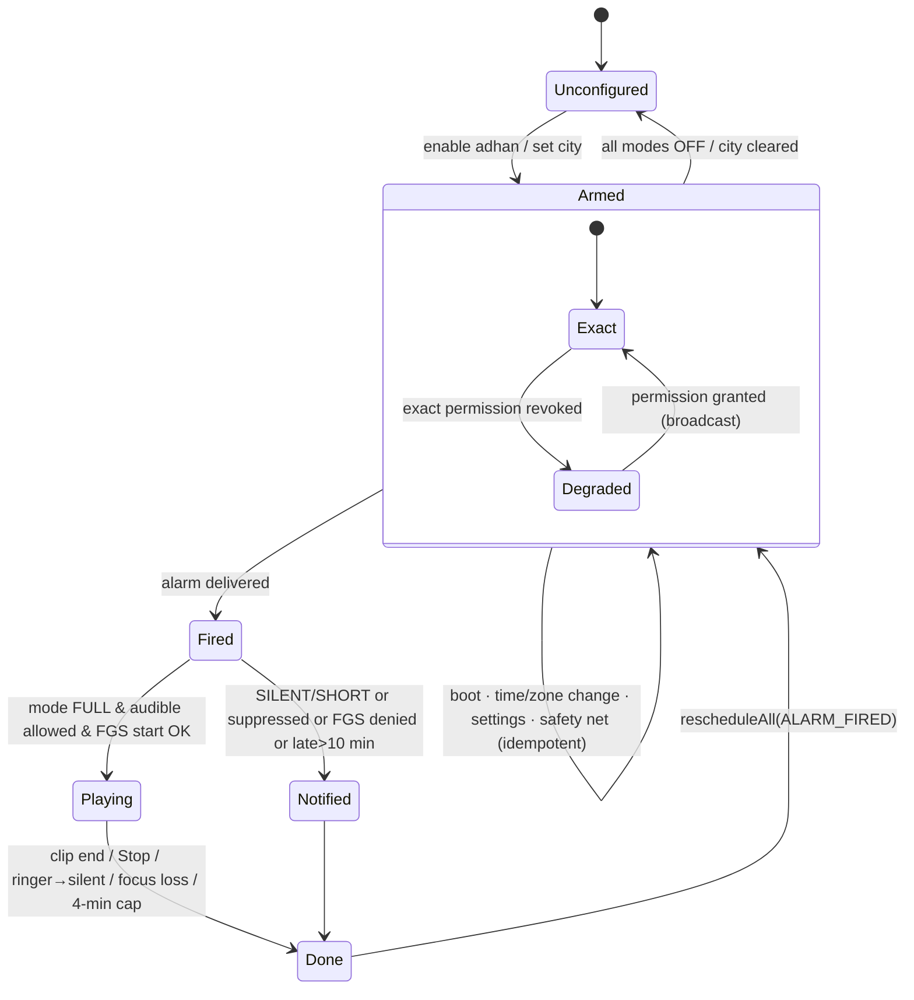

# 07 — Companion, Engagement & Hifz Features

**Purpose.** This document is the implementable design for everything around the mushaf that brings a Pakistani user back every day. It covers prayer times, adhan, Qibla, Hijri, tasbeeh, azkar and duas, Ramadan, reminders, widgets and share. It also covers the habit layer (khatam planner, streaks, notes, group khatam) and the differentiators after v1.0 (Hifz mode, Noorani Qaida, AI recitation). For each feature it gives the requirement, a UX summary (screens are specified in [02 UX/UI spec](02-ux-ui-spec.md)), the data model, the algorithms, the Android implementation, edge cases and tests. An engineer or AI agent should be able to build each feature from this doc without redoing the research in r08 (and r01, r02, r06, r07, r09).

**Status: Draft v1 — 2026-10-19** · Phases covered: P2 (v1.0 "Ramadan launch" and v1.1), P3 (v1.x), P4 (v2).

**Release labels** (doc 09 FINAL v1.0 scope; doc 09 owns the schedule): **v1.0** = Tier A (prayer times with Sehri/Iftar, Hijri + PK feed, Ramadan core, khatam planner with the Taraweeh preset). **v1.0-stretch** = tasbeeh and the Manzil-dua playlist (ladder rungs L3/L4). **v1.1 (2027-03-22)** = everything else in P2, including adhan alarms and the Sehri alarm. There is no feature release during Ramadan: 2027-02-05 → Eid (≈ 2027-03-10) is a hotfix-only freeze.

**Key decisions in this doc**
- **D-16** Prayer and adhan:
  - adhan2 0.0.7; Pakistan defaults KARACHI + HANAFI.
  - Use `SCHEDULE_EXACT_ALARM` and `setAlarmClock()` for audible adhan.
  - Play the full adhan in a `mediaPlayback` FGS with `USAGE_ALARM`. The app itself enforces silent mode and DND.
  - Never declare `USE_EXACT_ALARM`, `ACCESS_NOTIFICATION_POLICY` or `REQUEST_IGNORE_BATTERY_OPTIMIZATIONS`, and use no full-screen intents in v1.
  - Ship an in-app Adhan health check.
- **D-15** No GMS in core:
  - Location: coarse, one-shot location through `LocationManagerCompat`, plus an offline GeoNames city DB.
  - Qibla: adhan2 bearing + `TYPE_ROTATION_VECTOR` + `GeomagneticField`.
  - Hijri: `HijrahDate` + a ±2-day offset + Maghrib rollover + a signed PK month-start feed.
- **D-20 / D-17** No tracking, no ads, nothing leaves the device in v1. Firebase is allowed only for realtime group khatam (P3, `play` flavor only; D-24).
- **D-22** Content governance: every dua or azkar item needs a stated source and a scholar sign-off. Event labels are neutral. Nothing generative is religious.
- **D-13 / D-14** Hifz, azkar, reminders and Manzil-dua audio all use doc 04's `PlayRequest`/`PlayScope` (incl. `PlayScope.Passage` for multi-range passages) and doc 06's `PlanExpander`. Playback starts only from user actions.
- **D-05 / D-07** Hifz hide/reveal and mistakes use the renderer's word boxes. Khatam and Taraweeh portions snap to the Indo-Pak ruku and Para tables.
- **D-10 / D-24 / D-30** Static, Ed25519-signed files on R2 with a detached `.sig` (doc 04 §7.6): the Hijri PK feed, plus packs for azkar, cities, the mutashabihat and AI models.
- **D-25** Scope by phase is in §1. The P2 tiers in §1.3 follow doc 09's FINAL v1.0 scope ruling and scope-cut ladder.

---

## 1. Scope, phasing, modules, effort

### 1.1 Feature map

Estimates are focused hours for a solo developer working with AI coding agents. They include tests but not external content work. Module names are doc 04's (§3.2–§3.3). The Release column follows doc 09's FINAL v1.0 scope.

| ID | Feature | Phase | Release | Module(s) (doc 04) | Hard deps | Est. h |
|---|---|---|---|---|---|---|
| (prereq) | Coarse location + offline city DB | P2 | v1.0 | `:core:prayer` (`LocationProviderImpl`), `:core:content` (`CitiesDb`) | `cities` pack (doc 04 §7.3, built by doc 08) | 10 |
| F-CP-01 | Prayer times (region defaults, offsets, monthly table with Sehri/Iftar labels) | P2 | v1.0 | `:core:prayer`, `:feature:prayer` | adhan2, desugaring | 20 |
| F-CP-02 | Adhan alarms + Adhan health check | P2 | v1.1 (v1.0 only if B1/B5 are pulled in) | `:core:prayer`, `:feature:prayer` | F-CP-01, adhan audio assets | 44 |
| F-CP-03 | Qibla compass (sun mode + Rasd al-Qibla in P3) | P2 (+P3) | v1.1 | `:feature:prayer` (UI), `:core:prayer` (`QiblaSensor`) | location | 18 (+6) |
| F-CP-04 | Hijri date, calendar, events, PK feed | P2 | v1.0 | `:core:prayer` (`HijrahHijriCalendarProvider`), `:feature:prayer` | R2 feed, signer (doc 08) | 14 |
| F-CP-05 | Tasbeeh | P2 | v1.0-stretch (L3) | `:feature:companion` | — | 10 |
| F-CP-06 | Morning/evening azkar, core duas, Manzil dua | P2 | azkar v1.1; Manzil dua v1.0-stretch (L4) | `:feature:companion`, `:core:content` (`AzkarPackDb`) | `azkar` pack (doc 08), Urdu translation | 20 |
| F-CP-07 | Ramadan: **core** = 30-day timetable, Home countdown card, Taraweeh preset; **extras** = Sehri alarm, sourced duas, share image, odd-night reminders | P2 | core v1.0; extras v1.1 | `:feature:companion` (Ramadan hub), `:core:prayer` (times) | F-CP-01, F-CP-04, F-BM-04 (extras: F-CP-02, azkar pack) | 16 (core ≈ 8) |
| F-CP-08 | Glance widgets (next prayer, continue reading, ayah of the day) | P2 | v1.1 | `:app` (`widget` pkg) | F-CP-01, F-BM-01, `daily_ayah` | 18 |
| F-CP-09 | Smart reminders (≤3/day, tap-to-play) | P2 | v1.1 | `:core:prayer` (`ReminderScheduler`) | F-CP-01 scheduler, `daily_ayah` | 14 |
| F-CP-10 | Share ayah as image (text share ships with F-RD-04) | P2 | v1.1 | `:feature:reader` (share pkg), `:core:data` (`shareText`) | DK font, translations | 12 |
| F-BM-03 | Notes | P2 | v1.1 | `:feature:bookmarks` | F-RD-04 action sheet | 8 |
| F-BM-04 | Khatam planner & tracker (incl. Taraweeh preset) | P2 | v1.0 | `:feature:bookmarks` (splits to `:feature:khatam` per doc 04's trigger), `:core:domain` (`ComputeKhatamPlan`) | Para/ruku/manzil tables (D-07) | 22 |
| F-BM-05 | Private streaks & stats | P2 | v1.1 | `:feature:bookmarks` | reader dwell + `PlaybackStateHub` | 10 |
| F-CP-11 | Group khatam: text sheet (P2) → realtime Firestore (P3) | P2 / P3 | sheet v1.1; realtime P3 | `:feature:bookmarks` (sheet); `:core:groupkhatam` (P3, `play` flavor) | F-BM-04; Firebase (P3) | 10 / 40 |
| F-CP-12 | Hifz mode | P3 | v1.2 (doc 09) | `:feature:hifz`; planner + FSRS in `:core:domain` (`hifz` package) | word boxes (doc 05), gapped audio (doc 06, G2) | ~120 |
| F-CP-13 | Noorani Qaida (own content) | P4 | v2 | `:feature:companion` (`qaida` package) unless doc 04 adds a P4 module | recordings + typesetting | 40 + content |
| F-CP-14 | AI recitation follow-along | spike P3, build P4 | — | `:core:asr`, `:feature:hifz` | sherpa-onnx, model pack | 60–70 spike; XL build |

**P2 companion total ≈ 250 h.** That is more than the whole P2 window (6 weeks × 30–35 h ≈ 190–210 h), and P2 also carries credits, compliance and the store listing. The tiers in §1.3 are therefore load-bearing.

**Tier A estimate vs doc 09.** By this doc's estimates, Tier A is location 10 h + F-CP-01 20 h + F-CP-04 14 h + F-CP-07 core ≈ 8 h + F-BM-04 22 h ≈ **74 h ≈ 12.3 id** (6 h per ideal day). Doc 09's plan of record budgets **6.5 id** for the same stories (E-15-S01..S03, E-16-S01, E-16-S03, E-18-S01). That is an implied AI-assistance factor of ≈ 0.53×. Doc 09's estimate-reconciliation table owns this gap. If the factor does not hold at the 2026-11-30 checkpoint, the ladder cuts L5 (Ramadan core) first; this doc does not shrink Tier A on its own.

### 1.2 Module placement

Doc 04 owns module names (§3.2). This doc uses only doc 04's modules; its earlier names map as follows.

| Doc 04 module | Contents from this doc | Former name in this doc |
|---|---|---|
| `:core:prayer` (android.library + hilt, P2) | Pure-Kotlin packages with no `android.*` imports: `PrayerTimesCalculator` (wraps adhan2, behind doc 04's `PrayerTimesRepository`), `RegionDefaults`, `QiblaMath`, `SolarPosition` (P3 sun mode), the Hijri resolver of §7.1, `IslamicEvents`. Android parts: `LocationProviderImpl` (LocationManagerCompat + `cities` pack), `HijrahHijriCalendarProvider` (D-27), `QiblaSensor` impl, `AlarmSchedulerImpl`, `AdhanAlarmReceiver`, `SystemEventsReceiver` (boot, time, zone, package replaced), `AdhanPlaybackService`, `ReminderScheduler`/`ReminderPlanner`, channel registry, direct-boot snapshot | `:core:prayer`, `:core:location`, `:core:notifications` (doc 04 splits these out only when reminders outgrow prayer) |
| `:feature:prayer` (P2) | Prayer times screen, monthly table, city picker, adhan settings, **Adhan health check**, Qibla screen and calibration UX, Hijri calendar | `:feature:prayer`, `:feature:qibla` |
| `:feature:companion` (P2) | Ramadan hub, tasbeeh, azkar sessions, dua library, Manzil-dua passage reader; Qaida lessons (P4) | `:feature:adhkar`, `:feature:qaida` |
| `:feature:bookmarks` (P1; P2 additions) | Notes (F-BM-03), khatam planner, streaks and stats, group khatam text sheet. Splits into `:feature:khatam` when the planner exceeds 3 screens (doc 04 trigger) | `:feature:khatam` |
| `:core:domain` | `KhatamMath` behind doc 04's `ComputeKhatamPlan` use case; `KhatamSheetParser`; P3 `hifz` package (FSRS port, `HifzPlanner`, rating mapper, heatmap maths) | `:core:hifz` |
| `:core:groupkhatam` (P3, `play` flavor) | Firestore realtime group khatam | `src/play/` of `:feature:khatam` |
| `:feature:hifz` (P3) | Dashboard, hide/reveal reader overlay, test/mark flow, recordings, report | — |
| `:core:asr` (P4) | sherpa-onnx wrapper, VAD, aligner | `:core:recitation-ai` |
| `:app` `widget` package | Glance receivers and widgets (Hilt `EntryPoint`s into repositories) | — |

Receivers, services and widgets cannot use constructor injection, so they get dependencies through Hilt `@EntryPoint`. The `foss` flavor never contains Firebase. Interfaces (`PrayerTimesRepository`, `LocationProvider`, `HijriCalendarProvider`, `QiblaSensor`, `AlarmScheduler`, `ReminderScheduler`, `KhatamRepository`, `TasbeehRepository`, `AzkarRepository`, `NoteRepository`) are doc 04 §6's; features compile only against `:core:domain`.

### 1.3 P2 tiers and sequencing (doc 09 FINAL v1.0 scope; doc 09 owns the ladder)

| Tier | Contents | Why | Est. h |
|---|---|---|---|
| **A: v1.0, merged into the closed-test track by 2027-01-18** (closed test opens ≤ 2027-01-11) | Location + city DB; F-CP-01 incl. Sehri/Iftar labels in the monthly table; F-CP-04 incl. PK feed; F-CP-07 core (30-day timetable, Home countdown card, Taraweeh preset); F-BM-04 | Ramadan 1448 (≈ 8–9 Feb 2027). No alarms or notifications, so no OEM-reliability risk in v1.0 | ~74 (doc 09 POR: 6.5 id) |
| **Stretch: v1.0 only if ladder rungs L3/L4 are restored** | F-CP-05 tasbeeh (L3); Manzil-dua playlist, part of F-CP-06 (L4) | Cheap, independent, no content-rights risk | ~16 (tasbeeh 10 + Manzil dua 6) |
| **B: v1.1 (2027-03-22) by default** | F-CP-02 (notifications, full adhan, health check, OEM matrix); the Sehri alarm, Ramadan duas, timetable share image and odd-night reminders (F-CP-07 extras); F-CP-03; F-CP-06 azkar; F-CP-08; F-CP-09; F-CP-10; F-CP-11 sheet; F-BM-03; F-BM-05 | Adhan reliability needs a full OEM-matrix pass (§21), and azkar need Urdu content | ~155 |

- **Pull-ins.** A Tier B item enters v1.0 only through doc 09 §5.2's pull-in order (B1…B17) and only if it is merged by **2027-01-18**. The adhan scheduler (B1) and full adhan (B5) are realistic only if the freelancer lever is pulled at the 2026-11-30 checkpoint. The **Sehri alarm** rides on B1: it is v1.0-stretch only if B1 is pulled in that way, otherwise v1.1.
- **No mid-Ramadan release.** Anything not in the v1.0 build waits for v1.1 (2027-03-22). From 2027-02-05 to Eid (≈ 2027-03-10) only hotfixes ship (doc 09 §12).
- **Sprint placement (doc 09).** S6 (2027-01-05 → 01-18) builds all of Tier A: E-15-S01..S03 (prayer core, location, prayer screen), E-18-S01 (khatam planner), E-16-S01 (Hijri + PK feed) and E-16-S03 (Ramadan core). Hijri and Ramadan core sit in S6 so testers get ≥ 7 days with them before Go/No-Go. S7 is stabilisation and release prep only.
- **Pull-forward candidate:** `:core:prayer`'s calculator package with its golden tests has no UI. An agent can build it whenever P1 has slack (e.g. S4's spare capacity, if doc 09 moves E-15-S01 there); the spike already proves adhan2 works.

### 1.4 External content deliverables (owner-driven; doc 03 tracks the rights)

| Deliverable | Needed by (release) | Fallback if late |
|---|---|---|
| Commissioned Pakistani muezzin recordings: standard adhan, Fajr adhan, takbeer clip ≤ 30 s, post-adhan dua. Work-for-hire with a written assignment; 48 kHz WAV masters | 2027-03-01 (v1.1); 2027-01-04 only if B5 full adhan is pulled into v1.0 | Ship Commons CC0 `File:Adhan.ogg` (42 s, trimmed for the short sound) and `File:Beautiful adhan.ogg` (154 s) (r08 §2.4) |
| Ruet-e-Hilal PK feed live on R2, covering Rajab–Ramadan 1448 | 2027-01-04 (v1.0 Tier A) | UQ + user offset, with the default offset for PK set to **−1** (r08 §2.7: PK is currently UQ −1) |
| Urdu translation of ~150 core duas + scholar review (or HadeethEnc permission) | 2027-03-01 (v1.1) | Azkar ship Arabic + English; Urdu follows in a later v1.x |
| `daily_ayah` list of 366 curated entries, scholar-reviewed | 2027-03-01 (v1.1) | Ayah-of-the-day widget and reminder slip to a later v1.x |
| DontKillMyApp-derived OEM guide text (CC BY, attributed), EN + UR | 2027-03-01 (v1.1; 2027-01-08 if B1 is pulled in) | English only |

---

## 2. Cross-cutting foundations

### 2.1 Product principles (non-negotiable; from r09 §2.6 / QF connected-apps ethics, r08)

1. **No hasanat counters** or numeric spiritual-reward claims, and no fadha'il text unless it has a graded source (D-22).
2. **No shame and no pressure.**
   - Streaks are private, have freeze days and can be hidden.
   - No "you broke your streak" copy, no leaderboards, no social comparison.
   - No manipulative countdown notifications. In-app Sehri/Iftar countdowns are informational only.
3. **Never touch the ringer or DND.** The app enforces silent mode itself (§5.5).
4. **Notifications.**
   - Non-prayer notifications are capped at **≤ 3/day** with quiet hours.
   - Every notification deep-links to an exact page or ayah.
   - Audio starts only from a user tap (tap-to-play). The adhan is the only audio that starts unattended, and only when the user configured it.
5. **Nothing leaves the device in v1.**
   - Location is stored rounded to 0.01°.
   - Recordings (P3) are local only.
   - AI (P4) runs on-device.
   - The only network calls in this doc are the signed static feeds and packs on R2.
6. **Content:**
   - Arabic is always shown alongside a translation (D-09).
   - Every dua/dhikr carries a reference chip.
   - Share and copy always carry the reference and translator attribution.
   - PUA and control characters are stripped from copied or shared text (D-08).
   - No generative religious content anywhere.

### 2.2 Permissions (companion features)

| Permission | Phase | Requested when | Used by |
|---|---|---|---|
| `ACCESS_COARSE_LOCATION` | P2 | On first opening Prayer/Qibla, or in the onboarding optional step (F-PL-01). Never at cold start | §3 |
| `POST_NOTIFICATIONS` (API 33+) | P2 | When the user first enables an adhan or a reminder (in context) | §5, §11 |
| `SCHEDULE_EXACT_ALARM` | P2 | Explainer screen → `Settings.ACTION_REQUEST_SCHEDULE_EXACT_ALARM` when adhan is first enabled. Re-check `canScheduleExactAlarms()` before every schedule | §5 |
| `RECEIVE_BOOT_COMPLETED` | P2 | Install-time. Receiver component enabled only while ≥ 1 alarm is configured | §5 |
| `FOREGROUND_SERVICE`, `FOREGROUND_SERVICE_MEDIA_PLAYBACK`, `WAKE_LOCK` | P2 (already present for recitation) | Install-time | §5.5 |
| `VIBRATE` | P2 | Install-time (adhan vibration pattern in vibrate mode). Tasbeeh haptics use `View.performHapticFeedback` and need no permission | §5, §8 |
| `RECORD_AUDIO` | P3 | On the first "Record yourself" tap (Hifz). On-device only | §18 |
| `INTERNET` | — | Already present | feeds |
| **Never** | — | `USE_EXACT_ALARM`, `USE_FULL_SCREEN_INTENT` (v1), `ACCESS_NOTIFICATION_POLICY`, `REQUEST_IGNORE_BATTERY_OPTIMIZATIONS`, `ACCESS_FINE_LOCATION`, `ACCESS_BACKGROUND_LOCATION`, `FOREGROUND_SERVICE_MICROPHONE` | — |

**By release.** v1.0 (Tier A) needs only `ACCESS_COARSE_LOCATION` and the existing `INTERNET`: it posts no notifications and schedules no alarms. `POST_NOTIFICATIONS`, `SCHEDULE_EXACT_ALARM`, `RECEIVE_BOOT_COMPLETED` and the adhan FGS use arrive with F-CP-02/F-CP-09 in v1.1, or in v1.0 only if B1 is pulled in. Doc 04 §10.2 and doc 11's Data safety/FGS declarations follow the build that actually ships them.

### 2.3 Notification channels

These are created at app start by `ChannelRegistry.ensure()`, starting with the build that ships F-CP-02/F-CP-09 (v1.1 by default; v1.0 creates none). Group "Prayer" holds the first six; group "Quran & reminders" holds the last three. Doc 06 owns the playback and download channels.

| Channel id | Importance | Sound | Purpose |
|---|---|---|---|
| `adhan_full` | HIGH | none (the service plays the audio) | Ongoing full-adhan notification with **Stop** |
| `adhan_short_<soundId>` | HIGH | takbeer clip ≤ 30 s (OGG Vorbis, `res/raw`) | Short adhan; the system applies silent/DND |
| `prayer_silent` | DEFAULT | none | Silent prayer notice; also late or missed adhan |
| `pre_prayer` | DEFAULT | default soft | "Asr in 15 min" |
| `sehri_alarm` | HIGH | none (the service plays the alarm clip) | Sehri wake-up, with Snooze/Stop |
| `adhan_health` | DEFAULT | none | "Adhan may be blocked on this phone. Open health check" (≤ 1/week) |
| `quran_reminders` | DEFAULT | soft | Kahf, Mulk, daily ayah, azkar, khatam/hifz goals, group digest |
| `companion_info` | LOW | none | Hijri events, moon-sighting updates, Rasd al-Qibla (P3) |

A channel's sound is fixed once the channel is created. When the user changes the short-adhan sound, we delete `adhan_short_<old>` and create `adhan_short_<new>`. Only one `adhan_short_*` exists at a time.

### 2.4 Settings model (inside doc 04's typed `DataStore<UserSettings>`, kotlinx.serialization)

```kotlin
@Serializable data class CompanionSettings(
  val location: LocationSetting? = null,
  val prayer: PrayerSettings = PrayerSettings(),
  val adhan: AdhanSettings = AdhanSettings(),
  val hijri: HijriSettings = HijriSettings(),
  val reminders: ReminderSettings = ReminderSettings(),
  val ramadan: RamadanSettings = RamadanSettings(),
  val tasbeeh: TasbeehSettings = TasbeehSettings(),
  val streaks: StreakSettings = StreakSettings(),
)
@Serializable data class LocationSetting(
  val lat: Double, val lon: Double,          // rounded to 0.01° before storing
  val cityId: Long?, val cityName: String, val cc: String, val tz: String,  // IANA zone of the city
  val source: Source, val fixedAtEpochMs: Long) { enum class Source { GPS, MANUAL } }
@Serializable data class PrayerSettings(
  val method: CalcMethod? = null,            // null = RegionDefaults.forCountry(cc)
  val asr: AsrSchool? = null,                // null = region default
  val highLat: HighLatRule? = null,          // null = adhan2 recommendedFor(coords)
  val offsetsMin: Map<Prayer, Int> = emptyMap(), // −30..+30, per prayer (ihtiyat)
  val customAngles: CustomAngles? = null,    // only for CalcMethod.CUSTOM
  val autoRefreshLocation: Boolean = true)
@Serializable data class AdhanSettings(
  val modes: Map<Prayer, AdhanMode> = Prayer.FARD.associateWith { AdhanMode.OFF }, // set by the enable flow
  val sunriseNotice: Boolean = false,
  val fullSoundId: String = "std_pk", val fajrSoundId: String = "fajr_pk", val shortSoundId: String = "takbeer_pk",
  val playInSilent: Boolean = false,         // opt-in; explicit warning
  val useAlarmClockApi: Boolean = true,      // setAlarmClock for audible modes (shows alarm icon)
  val preReminderMin: Map<Prayer, Int> = emptyMap(),  // 5..60; absent = off
  val ayatulKursiAfter: Set<Prayer> = emptySet(),    // opt-in at onboarding (r01 loved feature)
  val duaAfterAdhan: Boolean = false, val jumuahReminderMin: Int? = null)
enum class AdhanMode { OFF, SILENT, SHORT, FULL }
@Serializable data class HijriSettings(val userOffsetDays: Int = 0 /* −2..+2 */, val followRegionFeed: Boolean = true,
  val maghribRollover: Boolean = true, val eventNotifications: Set<String> = setOf("ramadan_start", "eid_fitr", "eid_adha"))
```

`ReminderSettings`, `RamadanSettings`, `TasbeehSettings` and `StreakSettings` are defined in their own sections.

**Where it lives.** Doc 04 §7.5 embeds this as `UserSettings.companion: CompanionSettings` (types in `:core:model`) and fixes the defaults: `location = null` (prayer features idle until set); `method`/`asr` = `null` means the region default (needed for diaspora users); the adhan enable flow pre-selects **FULL for all five fard prayers**, while silent/vibrate/DND keep it silent unless the user opts in (`playInSilent`, default off; doc 01 F-CP-02 AC 3); reminders ≤ 3/day with quiet hours 22:30–05:00.

### 2.5 Storage map

Doc 04 owns the `user.db` schema and the DDL of the content DB and every pack type (§7.2–§7.4); this doc owns the algorithms and the companion content rules. **`user.db` v1** is frozen on 2026-12-21 and already contains every P1 and P2 table below, including those for features that default to v1.1, so neither the v1.0 Ramadan release nor v1.1 needs a migration. **P3 tables arrive in `user.db` v2**, the first migration (doc 04 §7.4 migration policy).

| Store | Tables / files (doc 04 names) | Phase | Notes |
|---|---|---|---|
| `user.db` **v1** (doc 04 §7.4) | `khatam_plan`, `khatam_progress` (§14); `group_khatam`, `group_khatam_part` (§17.1); `tasbeeh_preset`, `tasbeeh_session`, `tasbeeh_day` (§8); `azkar_progress` (§9); `alarm_schedule`, `adhan_log` (§5); `reminder`, `reminder_log` (§11); `note` (§16); `page_dwell`, `reading_day` (§14, §15) | P2 | Auto Backup includes them; `alarm_schedule` is rebuilt after restore. Earlier names in this doc: `khatam_portion` → `khatam_progress`, `page_read_log` → `page_dwell`, `activity_day` → `reading_day`, `alarm_log` → `adhan_log` |
| `user.db` **v2** (P3) | `hifz_plan`, `hifz_page`, `hifz_session`, `hifz_mistake`, `hifz_recording` (§18.2); realtime group-khatam cache (`:core:groupkhatam`) | P3 | Recordings are files under `filesDir/hifz/rec/`, excluded from backup |
| `quran_content.db` (read-only, doc 04 §7.2) | `passage` + `passage_range` (code `manzil-dua` etc.; shared with F-IX-08 quick access); `daily_ayah` (366 rows from v1.1, may be empty in v1.0) | P1/P2 | Built by doc 08 |
| `azkar` pack (doc 04 §7.3 DDL; content rules in §9 here) | `pack_info`, `dhikr_category`, `dhikr`, `dhikr_translation` | P2 (v1.1) | Bundled as `azkar.core` from v1.1. Quranic items reference ayahs by `quran_ranges` and always render from `quran_content.db` (D-30) |
| `cities` pack (doc 04 §7.3; columns per §3 here) | `pack_info`, `city`, `city_alias`, `country`, `admin1` | P2 (v1.0) | Pre-installed from the APK, ~1.5 MB compressed (r08 §2.5). A pack, so geo updates don't bump the content version |
| `res/raw` | Adhan audio (AAC-LC `.m4a` ≤ 1 MB each), takbeer and Sehri clips (`.ogg` Vorbis) | P2 (v1.1) | Bundled, so adhan works offline from first launch |
| Device-protected storage | `alarm_snapshot.json`, `boot_log.jsonl` | P2 (v1.1) | Readable in direct boot (§5.4) |
| Remote cache (doc 04 §7.7) | `files/remote/feeds/hijri-pk.json` (+ `.sig`, `.etag`), fetched from `${CDN_BASE_URL}/v1/feeds/hijri-pk.json` | P2 (v1.0) | §7.4 |
| Packs (D-10c) | `hifz-mutashabihat` (P3, QUL permission), `ai-model-*` (P4), `qaida-audio` (P4) | P3/P4 | Signed `index.json` entries with licence flags |

### 2.6 Time primitives

- All schedule math uses `java.time` (desugared) and `kotlin.time.Instant` from adhan2. Convert with `Instant.ofEpochMilli(x.toEpochMilliseconds())`.
- **The city's IANA zone defines "today" for prayer times.** Alarms are absolute Instants, so they stay correct when the device zone differs. The UI shows city-local times and adds the label "(Lahore time)" when the device zone differs.
- **"Quran day"** (streaks, stats, khatam "today") runs from **03:00 to 03:00 local device time**, so late-night reading counts for the evening before. Display dates use the civil date of the day's start.
- An injectable `kotlin.time.Clock` (bound in doc 04's `DispatchersModule`, §9) is used everywhere, so tests run on fixed instants.

### 2.7 Deep links (resolved to `:core:navigation` NavKeys; doc 04 owns the scheme)

This doc uses doc 04 §8.3's URIs:
- `criterion://page/{mushafCode}/{label}` · `criterion://ayah/{surah}/{ayah}` · `criterion://surah/{n}` · `/para/{n}` · `/manzil/{n}` · `/ruku/{id}`.
- `criterion://resume` (continue reading).
- `criterion://play?scope=surah:18` (`para:23`, `range:2:285-2:286`, `ayah:2:255`, `passage:manzil-dua`, …) opens the reader with `autoplay` and a `PendingPlayRequest`. Autoplay is honoured only for our own explicit `PendingIntent.getActivity` (reminders, widgets) or launcher shortcuts, so playback starts from a visible activity, which counts as user-initiated (§11.4). External links open the reader paused.
- `criterion://khatam/{id}` · `criterion://prayer` · `/prayer/health` · `/qibla` · `/tasbeeh` · `/hijri` · `/azkar/{category}`.
- P3 adds `criterion://hifz/today` (doc 04 adds it with `HifzKey`).

---

## 3. Location and offline city database (prerequisite for F-CP-01/03/04/07) [P2 · v1.0]

**Requirement.**
- Coarse location only. A 3 km error moves the Qibla by ≤ 0.07° and prayer times by seconds (r08 §2.5).
- The manual city picker is a first-class path.
- Works without GMS.
- Urdu city search works offline.

**UX.** The prayer screen header shows "Lahore, Punjab ▾", which opens a picker with two options: "Use my location" and a search box with results. Details in [02](02-ux-ui-spec.md).

**Data: the bundled `cities` pack (doc 04 §7.3 pack type, `CitiesDb` in `:core:content`; the columns are specified here), built by doc 08 from GeoNames `cities15000.zip`.**
- Licence CC BY 4.0. Attribution "GeoNames, CC BY 4.0" goes in Credits (F-PL-04).
- 34,173 rows, of which PK 372 (r08 §2.5).

```kotlin
@Entity(tableName = "city") data class City(@PrimaryKey val id: Long /*geonameid*/, val name: String, val ascii: String,
  @ColumnInfo(name = "name_ur") val nameUr: String?, val lat: Double, val lon: Double, val cc: String,
  val admin1: String?, val tz: String, val population: Int)
@Entity(tableName = "city_alias", primaryKeys = ["alias_norm", "city_id"], indices = [Index("city_id")])
data class CityAlias(@ColumnInfo(name = "alias_norm") val aliasNorm: String, @ColumnInfo(name = "city_id") val cityId: Long)
@Entity(tableName = "country") data class Country(@PrimaryKey val cc: String, val nameEn: String, val nameUr: String?)
@Entity(tableName = "admin1") data class Admin1(@PrimaryKey val code: String /*"PK.04"*/, val name: String)
```

Pipeline rules (doc 08 implements them):
- **Aliases:** `ascii` lower-cased, plus every Arabic-script entry of `alternatenames` (any char in U+0600–U+06FF), normalised with the D-11 Urdu folder.
- **`name_ur`:**
  - For PK, IN and AF, use the first Arabic-script alias that contains an Urdu-specific letter (ٹ ڈ ڑ ں ے ہ ھ گ), else the first Arabic-script alias.
  - A hand-checked override CSV covers the 100 most populous PK cities (≈ 2 h owner work).
- **admin1** comes from GeoNames `admin1CodesASCII.txt` (same licence).

**Algorithms.**
- **Search.** Run one query per keystroke (debounced 150 ms):

  ```sql
  SELECT c.* FROM city_alias a JOIN city c ON c.id = a.city_id
  WHERE a.alias_norm >= :q AND a.alias_norm < :q || char(0x10FFFF)      -- prefix range on the PK index
  GROUP BY c.id ORDER BY (c.cc = :homeCc) DESC, c.population DESC LIMIT 30;
  ```

  `alias_norm` is already lower-cased and folded, so a range scan on the primary key serves prefix search (SQLite's `LIKE` would not use the index without `NOCASE`). Doc 04 §7.3's FTS5 index over names is therefore optional for this query.

- **Nearest city** for a GPS fix: take candidates inside lat ±1°, lon ±1.2°, rank by haversine distance and pick the minimum. If there are none within 50 km, show "Near <nearest>" but use the raw rounded coordinates with the nearest city's `tz`.
- **One-shot fix:**
  - Call `LocationManagerCompat.getCurrentLocation(lm, provider, cancel, executor, consumer)`.
  - Provider: `FUSED_PROVIDER` on API 31+ if `lm.hasProvider()`, else `NETWORK_PROVIDER`, else `GPS_PROVIDER`.
  - Timeout 15 s. Then fall back to `getLastKnownLocation`, if it is ≤ 24 h old. Then fall back to the picker.
  - Location services off: show "Turn on location" (`Settings.ACTION_LOCATION_SOURCE_SETTINGS`) or "Pick city".
- **Refresh:**
  - If `autoRefreshLocation` is on and the last fix is > 24 h old, re-fix **only while the prayer screen or home is visible**.
  - If the new position is > 25 km away, show a prompt ("You seem to be in Islamabad. Switch?"). Never switch silently, because switching moves the alarms.
  - A `TIMEZONE_CHANGED` broadcast also sets a "check location" flag for the next app open.

**Edge cases.**
- Coarse location is denied → picker only, with no nagging. Show the picker again from the header.
- A city exists in two zones (rare) → use the GeoNames `tz`.
- Indian-administered and other disputed names → use GeoNames names as-is, without political labelling.
- Huawei/AOSP devices without the fused provider → network/GPS fallback.

**Tests.**
- JVM: normaliser; nearest-city (Lahore fix → Lahore; mid-sea → "Near Karachi").
- Robolectric: search "lah" / "لاہ" / "karachi" → expected top hits; rounding to 0.01°.
- Instrumented: one-shot fix with a mock provider; timeout fallback.

---

## 4. F-CP-01 Prayer times [P2 · v1.0 Tier A]

**Requirement.**
- Accurate offline times with region defaults: PK = KARACHI + HANAFI (D-16).
- An onboarding Asr choice: "Hanafi (later)" / "Standard: Shafi'i, Maliki, Hanbali, Ahl-e-Hadith (earlier)".
- Per-prayer ihtiyat offsets.
- Views: today/tomorrow, next-prayer countdown in minutes, monthly table, Jumu'ah label on Fridays.
- Fixes the reference app's top complaint about inaccurate times with no manual control (r01: +4,501 votes).

**UX.** Shown in [02](02-ux-ui-spec.md) as "Prayer times":

```
┌ Lahore, Punjab ▾                 13 Jumada I 1448 ┐
│  Asr in 1 h 12 min                       (15:48)  │
│  Fajr     04:47   🔔 Full                         │
│  Sunrise  06:08   ·                               │
│  Dhuhr    11:48   🔔 Short     (Fri: Jumu'ah)     │
│  Asr      15:48   🔔 Full  ◀ next                 │
│  Maghrib  17:26   🔔 Full                         │
│  Isha     18:48   🔕 Silent                       │
│ Karachi · Hanafi · ±0 min        [Month] [⚙]      │
└───────────────────────────────────────────────────┘
```

Tapping a bell opens a per-prayer sheet: mode Off/Silent/Short/Full, sound, pre-reminder, Ayatul Kursi nudge and offset. The footer link opens the method settings. **v1.0 has no bells** (F-CP-02 is v1.1): the row shows the time only, and the per-prayer sheet offers just the offset.

**API (`:core:prayer`, pure Kotlin):**

```kotlin
enum class Prayer { FAJR, SUNRISE, DHUHR, ASR, MAGHRIB, ISHA; companion object { val FARD = listOf(FAJR, DHUHR, ASR, MAGHRIB, ISHA) } }
enum class CalcMethod { KARACHI, MOONSIGHTING_COMMITTEE, UMM_AL_QURA, MUSLIM_WORLD_LEAGUE, EGYPTIAN, DUBAI, QATAR, KUWAIT, SINGAPORE, TURKEY, NORTH_AMERICA, CUSTOM }
enum class AsrSchool { HANAFI, STANDARD }
data class GeoPoint(val lat: Double, val lon: Double)
data class DayPrayerTimes(val date: LocalDate, val zone: ZoneId, val times: Map<Prayer, java.time.Instant>, val isFriday: Boolean)
interface PrayerTimesCalculator {
  fun day(at: GeoPoint, date: LocalDate, zone: ZoneId, s: PrayerSettings, cc: String): DayPrayerTimes
  fun range(at: GeoPoint, from: LocalDate, days: Int, zone: ZoneId, s: PrayerSettings, cc: String): List<DayPrayerTimes>
  fun next(at: GeoPoint, now: java.time.Instant, zone: ZoneId, s: PrayerSettings, cc: String): Pair<Prayer, java.time.Instant>
  fun qiblaBearing(at: GeoPoint): Double                    // adhan2 Qibla(coords).direction, degrees from true north
  fun sunnah(at: GeoPoint, date: LocalDate, zone: ZoneId, s: PrayerSettings, cc: String): Pair<java.time.Instant, java.time.Instant> // middle, last third
}
```

**adhan2 mapping (verified API: r08 §2.2; spike `PrayerCalculator.kt`):**

```kotlin
internal fun params(s: PrayerSettings, cc: String, at: GeoPoint): CalculationParameters {
  val d = RegionDefaults.forCountry(cc)
  val coords = Coordinates(at.lat, at.lon)
  val base = when (s.method ?: d.method) {
    KARACHI -> CalculationMethod.KARACHI; MOONSIGHTING_COMMITTEE -> CalculationMethod.MOON_SIGHTING_COMMITTEE
    UMM_AL_QURA -> CalculationMethod.UMM_AL_QURA; /* … one-to-one … */ CUSTOM -> CalculationMethod.OTHER
  }.parameters
  val o = s.offsetsMin
  return base.copy(
    madhab = if ((s.asr ?: d.asr) == AsrSchool.HANAFI) Madhab.HANAFI else Madhab.SHAFI,
    highLatitudeRule = s.highLat?.toAdhan() ?: HighLatitudeRule.recommendedFor(coords),  // SEVENTH > 48° N else MIDDLE
    prayerAdjustments = PrayerAdjustments(fajr = o[FAJR] ?: 0, sunrise = o[SUNRISE] ?: 0, dhuhr = o[DHUHR] ?: 0,
      asr = o[ASR] ?: 0, maghrib = o[MAGHRIB] ?: 0, isha = o[ISHA] ?: 0)
  ).let { p -> s.customAngles?.let { p.copy(fajrAngle = it.fajr, ishaAngle = it.isha, ishaInterval = it.ishaIntervalMin ?: 0) } ?: p }
}
// KARACHI already carries methodAdjustments(dhuhr = +1). User offsets add on top; never subtract the built-in +1.
// UMM_AL_QURA: Isha +30 min during Ramadan (effective Hijri month 9) per the adhan2 README; applied by `day()`.
// Rounding: display and alarms both use the same minute-rounded Instant (seconds = 0).
```

The exact enum constant names in adhan2 (e.g. `MOON_SIGHTING_COMMITTEE`, `OTHER`) must be checked against the 0.0.7 sources during implementation. The mapping table stays as written.

**Region defaults** (`RegionDefaults.forCountry(cc)`; r08 §2.2.2; always overridable):

| Countries | Method | Asr (pre-selected in onboarding) | High-lat |
|---|---|---|---|
| PK, IN, BD, AF | KARACHI | HANAFI | n/a |
| GB, IE + EU (AT BE DE DK ES FR IT NL NO SE CH) | MOONSIGHTING_COMMITTEE | HANAFI (South-Asian diaspora; still asked) | `recommendedFor` |
| US, CA | MOONSIGHTING_COMMITTEE | asked, STANDARD pre-selected | `recommendedFor` |
| SA | UMM_AL_QURA (+30 min Isha in Ramadan) | STANDARD | n/a |
| AE / QA / KW / TR / SG | DUBAI / QATAR / KUWAIT / TURKEY / SINGAPORE | STANDARD | n/a |
| everything else | MUSLIM_WORLD_LEAGUE | STANDARD | `recommendedFor` |

- Offsets default to **0 for every prayer**. The Karachi Dhuhr +1 is built in.
- The "Pakistani timetables add precaution minutes" convention is unverified (r08). Users set offsets per prayer (−30…+30). Validating a PK masjid-timetable preset is an open issue.

**Monthly table:**
- `range(first of month, 28–31)`.
- Columns: Date, Hijri, Fajr, Sunrise, Dhuhr, Asr, Maghrib, Isha.
- In Ramadan (per §7), the Fajr column also shows **"Sehri ends"** (Fajr − `sehriMarginMin`) and Maghrib shows **"Iftar"** (Maghrib + `iftarIhtiyatMin`), so Sehri/Iftar stay visible even if the Ramadan card is cut (ladder L5). This is part of v1.0 Tier A.
- Share as text/CSV.
- 12-h/24-h follows `DateFormat.is24HourFormat`. Digits are Western in both languages (PK convention; doc 02 may override).

**Edge cases.**
- DST days in Europe/London: compute per civil date in the city zone, never by adding 24 h to an Instant.
- High latitude: Isha can fall after local midnight in June. Order checks compare Instants, not LocalTimes.
- Latitude > 60°: show the banner "Times are approximated (high latitude). Follow your local masjid."
- City zone differs from device zone: label the times (§2.6).
- Date rollover: the "today" view flips at 00:00 city time.
- Next prayer after Isha is tomorrow's Fajr.

**Tests (golden vectors; CI-gated, doc 10).** These are Aladhan values for 2026-10-19, Karachi method + Hanafi for **all six cities**, including Manchester (r08 §2.2.3). Assert |adhan2 − vector| ≤ 2 min, and Qibla bearing within ±0.1°.

| City (lat, lon) · zone | Fajr | Sunrise | Dhuhr | Asr | Maghrib | Isha | Qibla ° |
|---|---|---|---|---|---|---|---|
| Karachi (24.8607, 67.0011) · Asia/Karachi | 05:16 | 06:32 | 12:17 | 16:25 | 18:02 | 19:18 | 267.7 |
| Lahore (31.5497, 74.3436) | 04:47 | 06:08 | 11:48 | 15:48 | 17:26 | 18:48 | 260.3 |
| Islamabad (33.6844, 73.0479) | 04:52 | 06:16 | 11:53 | 15:51 | 17:30 | 18:53 | 255.9 |
| Peshawar (34.0151, 71.5249) | 04:59 | 06:22 | 11:59 | 15:56 | 17:35 | 18:59 | 254.0 |
| Quetta (30.1798, 66.9750) | 05:17 | 06:37 | 12:17 | 16:19 | 17:57 | 19:17 | 256.7 |
| Manchester (53.4808, −2.2426) · Europe/London | 05:47 | 07:43 | 12:54 | 16:11 | 18:04 | 20:00 | 118.5 |

Snapshot test: adhan2's exact Karachi output, verified in the spike (g04), is Fajr 05:16, Sunrise 06:32, Dhuhr 12:18, Asr 16:24, Maghrib 18:02, Isha 19:18 PKT. Pin it to detect library drift on upgrade.

Additional tests:
- **Manchester MSC.** An Aladhan golden-vector fetch script in doc 08's `tools/` workspace generates Manchester MSC vectors for 2026-10-19 and 2027-06-21 (Aladhan `method=15`). They are added before the P2 closed test.
- **Midsummer property test** (Manchester, 2027-06-21, `recommendedFor` rule): all six times exist and are strictly ordered. Aladhan's angle-based reference is Fajr 02:34 / Isha 23:47; allow ±15 min, since the rule differs.
- **Ordering property test:** 365 days × 6 cities, times strictly increasing.
- **DST:** 2027-03-28 and 2027-10-31 in Europe/London have no gaps or duplicates.
- **Offsets:** +2 Maghrib moves only Maghrib.
- **Region:** RegionDefaults table test.

---

## 5. F-CP-02 Adhan alarms, playback and Adhan health check [P2 · v1.1 default; v1.0 only if B1/B5 are pulled in]

**Requirement.**
- Each fard prayer has a mode Off / Silent / Short / Full, plus a separate Fajr sound and an optional sunrise notice.
- Optional extras: pre-prayer reminders (5–60 min), the Ayatul Kursi nudge, the Jumu'ah reminder, and the dua after adhan.
- The adhan fires on time through Doze, reboot and timezone changes, and **never overrides silent or DND** unless the user opts in.
- The health check makes failures on OEM devices diagnosable.
- This fixes r01's "adhan not firing / silent override" theme (4,837 votes).

**Enable flow (in context, first time).**
1. Global choice: "Full adhan / Short takbeer / Notification only". The default pre-selection is Full for all five, with silent and DND respected.
2. `POST_NOTIFICATIONS` (API 33+).
3. Exact-alarm explainer → `ACTION_REQUEST_SCHEDULE_EXACT_ALARM`. If declined: red banner "Adhan may be up to 1 hour late" with a [Fix] button.
4. If `Build.MANUFACTURER` is in the OEM table (§5.7), show the vendor setup sheet.
5. Offer "Test adhan in 1 minute".

### 5.1 Which AlarmManager API (r08 §2.3.2)

| Event | Exact allowed | Exact denied (degraded) |
|---|---|---|
| Adhan SHORT/FULL, Sehri alarm, test | `setAlarmClock(AlarmClockInfo(at, showPi), firePi)` (fires normally in Doze). With `useAlarmClockApi=false`: `setExactAndAllowWhileIdle(RTC_WAKEUP)` | `setAndAllowWhileIdle(RTC_WAKEUP)` + banner. FULL downgrades to SHORT: without exact alarms the FGS start from background is not exempt |
| Adhan SILENT, pre-prayer, Ayatul Kursi nudge | `setExactAndAllowWhileIdle(RTC_WAKEUP)` (≤ 1 per 9 min per app in Doze; our events are ≥ 10 min apart, and pre/post events within 10 min of an audible adhan merge into it) | `setAndAllowWhileIdle` |
| Widget tick at each prayer boundary | `set(RTC, at)`, non-wakeup, delivered on next wake; only if a prayer widget is placed | same |
| Quran reminders (§11) | `setWindow(RTC_WAKEUP, start, 30 min)` | same |
| Safety net | WorkManager `PeriodicWorkRequest(24 h)` with initial delay to ≈ 00:30 local, unique name `prayer-safety-net` | same |

**Request codes** (stable and unique for 27 years): `code = (epochDay mod 10_000) * 100 + slot`.
- Slots: 0–5 adhan (`Prayer.ordinal`, 1 = sunrise notice), 10–15 pre-prayer, 20–25 Ayatul Kursi, 30 Sehri, 31 Sehri snooze, 32 Jumu'ah reminder, 40–45 widget tick, 90 test.
- Reminders (§11) use `1_000_000 + (epochDay mod 10_000) * 100 + type`.

### 5.2 Scheduler (doc 04's `AlarmScheduler`, impl `AlarmSchedulerImpl`; idempotent, < 10 ms)

```kotlin
interface AlarmScheduler {                       // doc 04 §6; scheduleTest is a requested addition
  suspend fun rescheduleAll(reason: RescheduleReason)
  fun exactAlarmsAllowed(): Boolean
  fun health(): Flow<AdhanHealth>
  suspend fun scheduleTest(delay: Duration = 60.seconds, mode: AdhanMode)
}
enum class RescheduleReason { APP_START, SETTINGS_CHANGED, LOCATION_CHANGED, BOOT, LOCKED_BOOT, PACKAGE_REPLACED,
  TIME_SET, TIMEZONE_CHANGED, EXACT_PERMISSION_CHANGED, ALARM_FIRED, SAFETY_NET, BACKUP_RESTORED, RAMADAN_CHANGED }

@Entity(tableName = "alarm_schedule") data class AlarmScheduleRow(@PrimaryKey val requestCode: Int, val type: String,
  val prayer: String?, val fireAt: Long, val api: String /*CLOCK|EXACT_IDLE|INEXACT|RTC|WINDOW*/, val mode: String?, val createdAt: Long)
// Field semantics for doc 04 §7.4's v1 tables alarm_schedule and adhan_log (doc 04 owns the snake_case DDL; adhan_log was "alarm_log")
@Entity(tableName = "adhan_log", indices = [Index("scheduledAt")]) data class AlarmLogRow(@PrimaryKey(autoGenerate = true) val id: Long = 0,
  val requestCode: Int, val type: String, val prayer: String?, val scheduledAt: Long, val firedAt: Long?, val latenessMs: Long?,
  val outcome: String /*PLAYED_FULL|PLAYED_SHORT|NOTIFIED_SILENT|SUPPRESSED_SILENT|SUPPRESSED_DND|IN_CALL|LATE_NOTIFIED|MISSED|FGS_DENIED|STOPPED_BY_USER*/,
  val exactAllowed: Boolean, val standbyBucket: Int?, val api: String)        // keep the newest 200 rows
```

```text
rescheduleAll(reason):
  if no LocationSetting or all events disabled → cancelAll(); disable the boot receiver; write empty snapshot; return
  desired = []
  for day in [today, tomorrow] (city zone):  t = calc.day(...)
     for p in FARD: mode = adhan.modes[p]; if mode != OFF → desired += AdhanEvent(p, t[p], mode)
     sunriseNotice → desired += Adhan(SUNRISE, SILENT); preReminder[p] → PrePrayer(p, t[p] − m)
     ayatulKursiAfter ∋ p → AyatulKursi(p, t[p] + 12 min)   // merged into the adhan notification if ≤ 10 min apart
     Friday & jumuahReminderMin → Jumuah(t[DHUHR] − m); Ramadan day & ramadan.sehriAlarm → Sehri(t[FAJR] − margin − lead)
     prayer widget placed → WidgetTick(p, t[p])
  drop events with fireAt ≤ now + 5 s
  existing = alarm_schedule rows
  for row in existing − desired: am.cancel(pi(row.requestCode, FLAG_NO_CREATE))
  for e in desired: schedule(e) per §5.1 (replaces any PendingIntent with the same code); upsert row
  writeSnapshot(desired)          // device-protected storage, for direct boot
  enable the boot receiver component (`SystemEventsReceiver`); detectMissed(now)   // §5.6
```

PendingIntents use `FLAG_IMMUTABLE | FLAG_UPDATE_CURRENT`. Extras: `code`, `type`, `prayer`, `scheduledAt`, `mode`. `AlarmClockInfo.showIntent` opens `criterion://prayer`.

**Triggers.**
- App start, settings change, city change.
- `BOOT_COMPLETED`, plus `LOCKED_BOOT_COMPLETED` via a `directBootAware` receiver.
- `MY_PACKAGE_REPLACED`, `TIME_SET`, `TIMEZONE_CHANGED`.
- `ACTION_SCHEDULE_EXACT_ALARM_PERMISSION_STATE_CHANGED` (re-check `canScheduleExactAlarms()`).
- Every `AdhanAlarmReceiver` fire, which chains the 48 h horizon.
- The daily safety net, Auto Backup restore, and a Ramadan state change.
- On boot, only reschedule. Never start a media FGS from `BOOT_COMPLETED` (Android 15 restriction; r07 §2.8).



### 5.3 `AdhanAlarmReceiver` (directBootAware, `goAsync()`, finishes < 10 s)

```text
onReceive(intent):
  ev = parse(intent); now = clock.now(); late = now − ev.scheduledAt
  log(ev, firedAt=now, lateness=late, bucket=usm.appStandbyBucket (API 28+))
  if ev.type == WIDGET_TICK → updateWidgets(); reschedule; return
  if late > 10 min → notify(prayer_silent, "Asr time began at 15:48") if before next prayer; outcome LATE_NOTIFIED; reschedule; return
  when ev.mode:
    SILENT → notify(prayer_silent)
    SHORT  → notify(adhan_short_<id>)                // the system plays the channel sound and applies silent/DND
    FULL   → if audibleAllowed(adhan.playInSilent) && !inCall():
                try startForegroundService(AdhanPlaybackService, ev)   // exact-alarm FGS exemption
                catch (ForegroundServiceStartNotAllowedException) { notify(adhan_short_<id>); outcome FGS_DENIED }
             else if ringerMode == VIBRATE → notify(prayer_silent) + vibrate(pattern 0,400,200,400) ; outcome SUPPRESSED_SILENT
             else → notify(prayer_silent); outcome SUPPRESSED_SILENT | SUPPRESSED_DND
  reschedule(ALARM_FIRED)
```

Notification text:
- Title: "Asr · 15:48" ("Jumu'ah" on Fridays; "Iftar · Maghrib 17:58" in Ramadan).
- Body: city and Hijri date.
- Actions: [Stop] for FULL, and [Ayatul Kursi ▶] when that nudge is merged in. The Play action opens the reader (§11.4).
- `CATEGORY_REMINDER`. Sehri uses `CATEGORY_ALARM`.

### 5.4 Direct boot

- **Before unlock,** Room and DataStore are not readable. Each `rescheduleAll` writes `alarm_snapshot.json` to `createDeviceProtectedStorageContext()`:

  ```json
  {"v":1,"generatedAt":1792300000000,"playInSilent":false,"locale":"ur",
   "events":[{"code":2104900,"type":"ADHAN","prayer":"FAJR","at":1792302360000,"mode":"FULL","sound":"fajr_pk","api":"CLOCK"}]}
  ```

- **On `LOCKED_BOOT_COMPLETED`:** re-register the future events from the snapshot. `AdhanAlarmReceiver` and `AdhanPlaybackService` are `android:directBootAware="true"`. In locked state they read mode and sound from the snapshot, play from `res/raw`, and append to `boot_log.jsonl`. After unlock (`BOOT_COMPLETED`), the scheduler merges the boot log into `adhan_log` and runs a full `rescheduleAll(BOOT)`.
- **Localised strings** come from resources, which are available in direct boot.

### 5.5 Full adhan playback (`AdhanPlaybackService`)

The Android 17 hardening rule (r08 §2.3.4) requires a `mediaPlayback` foreground service playing with `USAGE_ALARM`. This keeps working once we target API 37: the while-in-use requirement is waived for exact-alarm holders using `USAGE_ALARM`.

- `startForeground(id, notif(adhan_full, [Stop]), FOREGROUND_SERVICE_TYPE_MEDIA_PLAYBACK)` within 5 s of start.
- **Player:** platform `MediaPlayer`. It is small and works in direct boot.
  - `setAudioAttributes(USAGE_ALARM, CONTENT_TYPE_SPEECH)`, `setWakeMode(PARTIAL_WAKE_LOCK)`, source `res/raw/<soundId>.m4a`.
  - Request `AUDIOFOCUS_GAIN_TRANSIENT` via `AudioManagerCompat.requestAudioFocus`. Recitation in doc 06's engine pauses on the transient loss and resumes afterwards (D-13: pause, don't duck).
- **`audibleAllowed(playInSilent)`:**
  - **Default (doc 01 F-CP-02 AC 3: silent unless the user opts in):** `ringerMode == RINGER_MODE_NORMAL && currentInterruptionFilter == INTERRUPTION_FILTER_ALL`. On silent, vibrate or any DND the full adhan becomes a silent notification (plus vibration on vibrate).
  - **With `playInSilent` ("Play adhan even when silent", default off, shown with a warning):** also allowed in silent/vibrate and in DND modes that admit alarms. Still never when the filter is `INTERRUPTION_FILTER_NONE`, nor during a call.
  - **Call check:** `inCall()` = `AudioManager.mode ∈ {MODE_IN_CALL, MODE_IN_COMMUNICATION, MODE_RINGTONE}`.
- **Stop conditions:**
  - Notification [Stop], or swiping the notification away (`deleteIntent`, API 34+).
  - Clip end, or the 4-minute hard cap.
  - `RINGER_MODE_CHANGED_ACTION` to silent/vibrate: the user's natural "silence it" gesture, reliable on all OEMs.
  - Permanent audio-focus loss or call start.
  - Best effort: a `ContentObserver` on `Settings.System` that detects an alarm-volume change during playback.
  - Each stop logs `STOPPED_BY_USER`, abandons focus and calls `stopSelf()`.
- **Then:** if `duaAfterAdhan` is on, play `dua_after_adhan.m4a` and show its text with the reference (verified in content QA).
- **Volume:** the alarm stream. The health check warns when `getStreamVolume(STREAM_ALARM) == 0`. Settings offers a [Preview] button that plays 5 s through the same path.
- **Sehri alarm** uses the same service with `sehri.m4a` and actions [Snooze 10 min] [Stop]. Its gate is "user-set alarm", so it plays in silent/vibrate but not in total-silence DND (§10).
- **Test:** `adb shell cmd audio set-enable-hardening throw` on Android 17 (r08). Logcat must show no `AudioHardening` entry.

### 5.6 Missed-alarm detection and lateness

`detectMissed(now)` runs at app start and in the safety net. Each `alarm_schedule` row with `fireAt < now − 2 min` and no `adhan_log` row becomes a `MISSED` row. If any adhan was missed in the last 72 h, show the home banner "An adhan didn't fire on this phone. [Run health check]" and post at most one `adhan_health` notification per week.

Lateness classes: ≤ 60 s is OK; 1–10 min is late (amber); > 10 min is missed (red, no audio).

### 5.7 Adhan health check (`criterion://prayer/health`)

```
┌ Adhan health check ───────────────────────────────┐
│ ✓ Notifications allowed            [Settings]     │
│ ✓ Exact alarms allowed                            │
│ ! Battery: optimised               [Fix]          │
│ ✓ Not background-restricted · bucket ACTIVE       │
│ ✓ Alarm volume 9/15                [Preview]      │
│ · DND off · Ringer normal                         │
│ ✓ City Lahore · zone matches device               │
│ Last 10 adhans: Fajr 0s · Dhuhr 4s · Asr 7 min ⚠ …│
│ [ Test adhan in 1 minute ]                        │
│ Your phone: Infinix (XOS) – 4 steps        [Open] │
│ [ Copy diagnostic report ]                        │
└───────────────────────────────────────────────────┘
```

Each check is listed with its API and the action offered:

| Check | API | Action |
|---|---|---|
| Notifications | `NotificationManagerCompat.areNotificationsEnabled()`, and each enabled channel's `importance != NONE` | `Settings.ACTION_APP_NOTIFICATION_SETTINGS` / channel settings |
| Exact alarms | `AlarmManager.canScheduleExactAlarms()` (API 31+) | `ACTION_REQUEST_SCHEDULE_EXACT_ALARM` (package Uri) |
| Battery optimisation | `PowerManager.isIgnoringBatteryOptimizations(pkg)` (shown as info) | `Settings.ACTION_IGNORE_BATTERY_OPTIMIZATION_SETTINGS` (the list screen; no restricted permission needed) |
| Background restriction | `ActivityManager.isBackgroundRestricted()` (API 28+) | App details settings |
| Standby bucket | `UsageStatsManager.getAppStandbyBucket()` (API 28+); `RESTRICTED`/`RARE` flagged | Explain "open the app daily or remove restriction" |
| Alarm / notification volume | `AudioManager.getStreamVolume` | Preview |
| Last 10 events | `adhan_log` | Colour by lateness class |
| Vendor guide | `Build.MANUFACTURER`/`BRAND` lower-case → table below | Steps + deep links |

**Test adhan in 1 minute:**
- `scheduleTest(60 s, mode)` uses the **identical** path: `setAlarmClock` → receiver → service.
- When it fires, the notification reads "Test adhan. If you heard this, adhan works."
- On return, the app asks "Did you hear it? [Yes] [No]". [No] opens the vendor guide, and the result is stored with the lateness.

**OEM table.**
- Ship our own vendored intent table, seeded from `judemanutd/AutoStarter` (MIT, stale since 2021: vendor it, don't depend on it). Text is adapted from dontkillmyapp.com (CC BY, "Adapted from dontkillmyapp.com"). PK share figures are from StatCounter, Sep 2026 (r08 §2.3.5).
- Every deep-link button is shown only if `intent.resolveActivity(pm) != null`; otherwise it falls back to app details.
- The component names come from AutoStarter and are **unverified**. They must be confirmed on the §21 device matrix.

| Vendor (PK share) | Steps shown | Deep-link candidates (guarded) |
|---|---|---|
| Infinix / Tecno / itel (25.5%) | Battery → app → "Unrestricted"; Phone Master → Auto-start ON; lock the app in Recents | `com.transsion.phonemaster/com.cyin.himgr.autostart.AutoStartActivity` |
| Vivo (11.9%) | Allow "high background power consumption"; i Manager → Auto-start | `com.vivo.permissionmanager/.activity.BgStartUpManagerActivity`, `com.iqoo.secure/.ui.phoneoptimize.AddWhiteListActivity` |
| Xiaomi / Redmi / POCO (10.6%) | Security → Autostart ON; Battery saver → "No restrictions"; lock in Recents | `com.miui.securitycenter/com.miui.permcenter.autostart.AutoStartManagementActivity` |
| Oppo / realme (14.1%) | Allow auto-launch; Battery → allow background activity; disable "Sleep standby optimization" | `com.coloros.safecenter/.permission.startup.StartupAppListActivity` |
| Samsung (17.3%) | Battery → Background usage limits → remove from Sleeping / Deep sleeping; add to "Never sleeping apps" | `com.samsung.android.lool/com.samsung.android.sm.battery.ui.BatteryActivity` |
| Others / Pixel | Notifications + exact alarm + "Unrestricted" battery | App details |

**Diagnostic report.** This is plain text with: device model, Android version, vendor, checks, the last 30 log rows and the scheduler snapshot. It goes through `ACTION_SEND` only; nothing is uploaded (D-20).

### 5.8 Adhan audio assets (rights tracked in doc 03)

| soundId | File | Source | Use |
|---|---|---|---|
| `std_pk` | `adhan_std_pk.m4a` (AAC-LC 96 kbps mono, ≤ 1 MB) | Commissioned PK muezzin (work-for-hire) | Full adhan (default) |
| `fajr_pk` | `adhan_fajr_pk.m4a` | Commissioned (with "as-salatu khayrun minan-nawm") | Fajr full |
| `takbeer_pk` | `takbeer_pk.ogg` (≤ 30 s) | Commissioned | Short channel sound |
| `dua_after` | `dua_after_adhan.m4a` | Commissioned | Optional |
| `cc0_short` | `adhan_cc0_short.ogg` | Commons `File:Adhan.ogg`, CC0, trimmed to ≤ 30 s | Fallback short |
| `cc0_full` | `adhan_cc0_full.m4a` | Commons `File:Beautiful adhan.ogg`, CC0, 154 s | Fallback full |
| `sehri` | `sehri_alarm.m4a` | Commissioned recording or our own gentle tone | Sehri alarm |

No Makkah/Madinah or Alafasy adhans are used: no licence was found for them (r08 §2.4).

**Edge cases (all of §5).**
- Exact permission revoked: all exact alarms are cancelled by the system. The broadcast and the next app start reschedule them, and FULL becomes SHORT with a banner.
- The user changes the time or zone while an adhan is pending → `TIME_SET`/`TIMEZONE_CHANGED` triggers a reschedule.
- The device is off at prayer time → on boot the event is in the past and is not replayed; it is logged MISSED only if it was never delivered.
- Two FULL starts (a test plus a real adhan) → the service stops the current clip and plays the new one.
- A Bluetooth headset is connected → the alarm stream routes per the system. QA must check it plays on both speaker and headset (§21).
- An app update while an alarm is pending → `MY_PACKAGE_REPLACED` triggers a reschedule.
- Process death between schedule and fire is fine: the PendingIntent targets the manifest receiver.

**Tests.**
- **JVM:** desired-set computation (fixed clock, Karachi, all modes); request-code uniqueness over 10,000 days; merge rule for events ≤ 10 min apart; lateness classes; `audibleAllowed` truth table (ringer × filter × playInSilent × call).
- **Robolectric:** `ShadowAlarmManager` sees the correct API per event and mode; cancellation of stale codes; snapshot write/read; boot-receiver enable/disable; Sehri only on Ramadan days.
- **Instrumented (CI emulator API 34 + 36):** schedule `now+60 s`; `adb shell dumpsys deviceidle force-idle` → fires within 60 s; `adb shell cmd appops set com.chughtai.criterion SCHEDULE_EXACT_ALARM deny` → degraded path and banner; `adb shell am set-standby-bucket com.chughtai.criterion rare`.
- **Manual:** the OEM matrix in §21.

---

## 6. F-CP-03 Qibla compass [P2 · v1.1 default; sun mode + Rasd al-Qibla P3]

**Requirement.**
- A reliable Qibla direction on cheap phones: rotation-vector fusion with fallbacks, true-north correction, calibration and interference UX.
- No GMS, no maps.
- The reference app lacks Qibla in-app (r01).

**UX:** see [02](02-ux-ui-spec.md).

```
┌ Qibla · Lahore ───────────────────┐
│        N                          │
│     ╱  ▲  ╲     Kaaba ◆ 260°      │
│    │   │   │    You: 255° → turn 5° right
│     ╲     ╱                       │
│ Accuracy: ●●○ Medium  [Calibrate] │
│ ⚠ Magnetic interference – move away from metal/magnet case │
└───────────────────────────────────┘
```

- A haptic tick fires when within ±3°, and the dial goes green.
- The screen stays on while open.
- Devices with no compass show the text bearing "Qibla is 260.3° from true North" plus sun mode (P3).

**Engine (doc 04's `QiblaSensor`, implemented in `:core:prayer`; the screen is in `:feature:prayer`):**

```kotlin
data class QiblaReading(val trueAzimuthDeg: Double, val accuracy: Int /*SensorManager.SENSOR_STATUS_* */,
  val fieldUt: Float?, val source: Source) { enum class Source { ROTATION_VECTOR, GEOMAGNETIC_RV, ACCEL_MAG, NONE } }
fun readings(): Flow<QiblaReading>        // callbackFlow, SENSOR_DELAY_GAME, UI throttled to 30 fps
```

1. **Source chain:**
   - `TYPE_ROTATION_VECTOR` (gyro + accel + mag), then `TYPE_GEOMAGNETIC_ROTATION_VECTOR` (no gyro), then `TYPE_ACCELEROMETER` + `TYPE_MAGNETIC_FIELD` via `getRotationMatrix`.
   - Cheap PK phones often lack a gyro (r07 §2.6). Feature-detect `PackageManager.FEATURE_SENSOR_COMPASS`.
2. **Pose:**
   - `getRotationMatrixFromVector(R, v)`.
   - If |pitch| and |roll| < 25° (flat), `remapCoordinateSystem(R, AXIS_X, AXIS_Y, out)`; otherwise upright, `remapCoordinateSystem(R, AXIS_X, AXIS_Z, out)`.
   - Then adjust for `display.rotation` (0/90/180/270 → swap axes) and call `getOrientation(out, o)`.
3. **True north:**
   - `trueAz = (deg(o[0]) + GeomagneticField(lat, lon, 0f, now).declination + 360) % 360`.
   - AOSP still ships WMM-2020, but the drift is ≤ 0.14° in PK. **Do not bundle WMM2025** (r08 §2.6).
4. **Smoothing:** a circular low-pass filter on sin/cos with α = 0.15. Never average raw angles.
5. **Needle:** `rotation = (qiblaBearing − trueAz + 360) % 360`, where `qiblaBearing` = adhan2 `Qibla(coords).direction`.
6. **Calibration and interference:**
   - Watch `onAccuracyChanged`: on `UNRELIABLE`/`LOW`, show the figure-8 animation sheet.
   - Compute the field magnitude from `TYPE_MAGNETIC_FIELD`. Outside ~25–65 µT → interference banner. The range is unverified physics; tune it on the §21 devices.
   - A stability indicator turns green when the needle variance over 1 s is < 2°.

**P3 increment:**
- **Sun mode:** NOAA solar-position algorithm (`SolarPosition`, pure Kotlin). While the sun is above 5° elevation, show "Qibla is X° to the right/left of the Sun". At night, show "Use the compass or the text bearing".
- **Rasd al-Qibla:** a once-a-year opt-in `companion_info` notification at the two moments when the sun is over the Kaaba. In 2027 these are **2027-05-28 09:18 UTC (14:18 PKT)** and **2027-07-16 09:27 UTC (14:27 PKT)** (r08, NOAA approximation ±1–2 min). The text reads "Shadows now point away from the Qibla. Check your prayer direction."
  - Later years are computed with the same `SolarPosition` (find the instant when the solar declination is closest to the Kaaba latitude 21.4225° at Mecca solar noon).
  - Unit test: 2027 is within ±3 min.

**Edge cases.**
- No location → prompt for a city.
- No magnetometer → text and sun mode only.
- The phone is in a magnetic flip case → banner.
- Tablet in landscape → handled by the display-rotation remap.
- Near the Kaaba (< 1 km) → show "You are at the Haram".

**Tests.**
- JVM: bearings for the six golden cities ±0.1° (§4 table); circular smoothing across 359°→1°; remap axis table.
- Robolectric: fake sensor events → expected needle.
- Manual: compare against a physical compass at 3 PK locations on the matrix devices (±5° acceptance on rotation-vector devices, ±10° on accel+mag).

---

## 7. F-CP-04 Hijri date, calendar and events [P2 · v1.0 Tier A]

**Requirement.**
- Show the Hijri date as Pakistan observes it, since PK is **currently one day behind Umm al-Qura**: 1 Jumada I 1448 = 12 Oct 2026 in UQ, 13 Oct 2026 in PK (r08 §2.7).
- A user offset of ±2 days.
- **Maghrib rollover**: after Maghrib, show the next Hijri date marked "(from Maghrib)".
- A signed PK month-start feed maintained monthly by the owner.
- Month view and an events list.

### 7.1 Algorithm (Hijri resolver, pure Kotlin in `:core:prayer`; behind doc 04's `HijriCalendarProvider`, impl `HijrahHijriCalendarProvider`)

```kotlin
data class HijriDay(val year: Int, val month: Int, val day: Int, val source: Source, val fromMaghrib: Boolean, val provisional: Boolean)
{ enum class Source { FEED, CALCULATED } }

fun hijriFor(civil: LocalDate, now: ZonedDateTime?, maghrib: java.time.Instant?, s: HijriSettings, feed: HijriFeed?, cc: String): HijriDay {
  val rolled = s.maghribRollover && now != null && maghrib != null && now.toInstant() >= maghrib
  val d = if (rolled) civil.plusDays(1) else civil
  if (s.followRegionFeed && feed != null && feed.region == cc && !feed.isExpired(now)) {
    val m = feed.months.lastOrNull { !it.start.isAfter(d) }
    if (m != null) {
      val k = ChronoUnit.DAYS.between(m.start, d).toInt()          // 0-based
      val next = feed.months.firstOrNull { it.start.isAfter(m.start) }
      when {
        k <= 28 -> return HijriDay(m.year, m.month, k + 1, FEED, rolled, m.provisional)
        k == 29 && (next == null || next.start.isAfter(d)) ->        // 30th day unless next month starts today
          return HijriDay(m.year, m.month, 30, FEED, rolled, provisional = next == null)
      }                                                                // k ≥ 30 or month change → fall through
    }
  }
  val h = HijrahDate.from(d.plusDays(s.userOffsetDays.toLong()))     // Umm al-Qura via desugaring (D-15)
  return HijriDay(h.get(ChronoField.YEAR), h.get(ChronoField.MONTH_OF_YEAR), h.get(ChronoField.DAY_OF_MONTH), CALCULATED, rolled, false)
}
```

- **Rollover needs Maghrib,** so it requires a city. Without one, there is no rollover.
- **Provisional:** a provisional day shows "(expected)".
- **First run in PK:** the default `userOffsetDays` for PK is **−1** until the first verified feed arrives, so the date matches PK on day one. Once the feed is active for the current month, the feed wins and the user offset applies only when the feed doesn't cover the date.
- **Device check and fallback (D-27):** `HijrahDate` via core-library desugaring is unverified on API 24–25. On first use per process, `HijrahHijriCalendarProvider` self-tests `HijrahDate.from(2026-10-12) == 1448-05-01`. If that fails, or if `HijrahDate` throws (outside the Umm al-Qura range, roughly 1300–1600 AH, unverified), it uses ICU `android.icu.util.IslamicCalendar(ISLAMIC_UMALQURA)` (API 24; r07) for the rest of the process. The fallback lives in the Android layer behind doc 04's `HijriCalendarProvider` interface; the pure resolver above takes the calculated date as an input.
- **Month names:** Pakistani style. Urdu: محرم، صفر، ربیع الاول، ربیع الثانی، جمادی الاول، جمادی الثانی، رجب، شعبان، رمضان، شوال، ذوالقعدہ، ذوالحجہ. English: Muharram, Safar, Rabi-ul-Awwal, Rabi-us-Sani, Jumada-al-Ula, Jumada-al-Ukhra, Rajab, Sha'ban, Ramadan, Shawwal, Zul-Qa'dah, Zul-Hijjah.

### 7.2 Events (`IslamicEvents`, a constant in code; neutral labels; no fadha'il text)

| Hijri | Key | Label (EN) | Shown in calendar | Notification default |
|---|---|---|---|---|
| 1/1 | `new_year` | Islamic New Year | ✓ | off |
| 1/9–10 | `ashura` | Ashura (9–10 Muharram) | ✓ | off |
| 3/12 | `rabi_12` | 12 Rabi-ul-Awwal (public holiday, PK) | ✓ | off |
| 7/27 | `rajab_27` | 27 Rajab (Shab-e-Mi'raj, traditional) | ✓ | off |
| 8/15 | `shaban_15` | 15 Sha'ban (Shab-e-Barat) | ✓ | off |
| 9/1 | `ramadan_start` | Ramadan begins | ✓ | **on** ("Ramadan starts tomorrow" on the evening of announcement or expected start) |
| 9/21,23,25,27,29 nights | `qadr_nights` | Odd nights (last ten) | ✓ | off (offered in the Ramadan hub) |
| 10/1 | `eid_fitr` | Eid al-Fitr | ✓ | **on** |
| 12/9 | `arafah` | Day of Arafah | ✓ | off |
| 12/10 | `eid_adha` | Eid al-Adha | ✓ | **on** |
| 13–15 each month | `ayyam_bid` | Ayyam al-Bid | toggle (off) | off |

Event notifications use the `quran_reminders` channel and count toward the cap (§11), so they ship with F-CP-09 in **v1.1**. In v1.0 events appear only in the calendar and, for Ramadan, as the Home card (§10). Defaults are the owner's call under the neutrality policy (open issue O-07).

### 7.3 UX

- The Hijri date appears in the home header, the prayer screen and the widgets.
- The calendar month view has Hijri numbers large and Gregorian small, with event dots. Tapping a day opens its prayer times and events.
- Settings has the offset stepper (−2…+2), "Follow Pakistan moon sighting (Ruet-e-Hilal)" and "Start the Islamic day at Maghrib".

### 7.4 Signed PK month-start feed

- **URL:** `${CDN_BASE_URL}/v1/feeds/hijri-pk.json` plus a detached `hijri-pk.json.sig` (doc 04 §1). Hosted on R2 (D-24).
- **Signature:** the `.sig` holds the base64 Ed25519 signature over the **exact file bytes** (no envelope, no canonicalisation). The app verifies it with the same two pinned public keys and `Ed25519Verifier`/`SignedFileFetcher` as the pack `index.json` (doc 04 §7.6, D-30). The JSON carries `kid`, `sequence`, `generatedAt` and `expiresAt` (doc 04 §7.6 names). Doc 08 builds and signs the file; the private key stays offline on the owner's machine.

```json
{
  "schema": 1, "kid": "k1", "region": "PK", "authority": "Central Ruet-e-Hilal Committee",
  "sequence": 37, "generatedAt": "2026-10-12T16:05:00Z", "expiresAt": "2026-11-26T16:05:00Z",
  "months": [
    { "hijri": "1448-05", "start": "2026-10-13", "status": "CONFIRMED",
      "source": "Ruet-e-Hilal announcement / MoRA notification", "announced": "2026-10-12T15:30:00Z" },
    { "hijri": "1448-06", "start": "<yyyy-mm-dd>", "status": "PROVISIONAL" }
  ],
  "notices": [ { "id": "ramadan-1448", "lang": { "en": "…", "ur": "…" }, "until": "<date>" } ]
}
```

- **Client rules:**
  - Reject the feed when the signature is bad under both pinned keys, `sequence` ≤ the cached sequence (anti-rollback), or the schema is unknown.
  - Cache the last verified file as `files/remote/feeds/hijri-pk.json` (doc 04 §7.7).
  - `isExpired(now)` = `now > expiresAt` (doc 08 sets `expiresAt` = `generatedAt` + 45 days). When expired, show "Moon-sighting data not updated; showing calculated date" in settings, and calculate any month the feed doesn't cover.
  - Keep ≤ 24 months of entries.
  - `notices` (optional) render as an in-app card only; they never push.
- **Fetch cadence:**
  - Doc 04's `RemoteRefreshWorker` (periodic 24 h, `CONNECTED`), plus on app open if the last fetch was > 12 h ago. Use `If-None-Match`/ETag.
  - On Hijri days 29 and 30, add one-time works at Maghrib + 60 min, + 150 min and + 240 min, and the next day at 07:00 (announcements come in the evening).
  - A feed change that alters today's date → refresh the Home Ramadan card and timetable; from v1.1 also `rescheduleAll(RAMADAN_CHANGED)` and a widget update.
- **Ops runbook (owner, ~5 min × 12 per year; r08):**
  1. On the evening of the 29th, follow the Ruet-e-Hilal announcement.
  2. Run doc 08's `crit hijri set <hijri-month> <start> --source … --announced …`, which confirms the month and bumps `sequence` and `expiresAt`.
  3. Run `crit sign hijri` on the owner's machine (offline key; never in CI).
  4. Run `crit publish feeds --go`, which uploads to R2 and verifies by fetching and checking the signature (doc 08 §9.2 owns the exact commands).
  - **SLA:** ≤ 2 h after the announcement; **≤ 1 h for Ramadan, Shawwal and Dhul-Hijjah.**
  - Name a backup maintainer (open issue O-06).
  - Pre-fill the next 3 months as `PROVISIONAL` (UQ − 1) so a lapse degrades gracefully.

**Edge cases.**
- The user is outside PK → the feed is ignored, and the user gets UQ + offset.
- A traveller with a PK home → the city's `cc` decides.
- Feed signature fails → keep the cached feed, and record a diagnostics line.
- Maghrib rollover near midnight in high-latitude summer → uses the Instant comparison.
- The user's offset plus the feed → the feed wins inside covered months.

**Tests.**
- `HijrahDate.from(2026-10-12)` = 1448-05-01 (UQ).
- With the feed (start 2026-10-13): 2026-10-13 → 1448-05-01 FEED; 2026-10-12 → the last day of 1448-04, per the fixture's start date for that previous month.
- k = 29 with no next month → day 30, provisional; k = 30 → falls back.
- Maghrib rollover: 17:59 vs 18:03 Karachi.
- Signature tampering → rejected. A replayed lower sequence → rejected.
- Expiry → falls back.

---

## 8. F-CP-05 Tasbeeh [P2 · v1.0-stretch (L3), else v1.1]

**Requirement.**
- A full-screen tap counter with presets, targets, phases, haptics, volume-key counting, keep-screen-on, a reset lock and private history.
- Huge standalone demand (5–10M-install apps; r08 §2.1).

**UX:** see [02](02-ux-ui-spec.md).

```
┌ Tasbih-e-Fatimah            ⋮ ┐
│   سُبْحَانَ اللّٰهِ                │
│        27 / 33                  │
│   ●●●○  phase 1 of 3            │
│                                 │
│     (tap anywhere to count)     │
│ [↶ undo]   today: 312   [reset ⟲ hold] │
└─────────────────────────────────┘
```

**Data** (doc 04 §7.4 v1 tables, through doc 04's `TasbeehRepository`):
- `tasbeeh_preset(id, title_en, title_ur, phases_json /*[{"ar":"سُبْحَانَ اللّٰهِ","target":33},…]*/, builtin_key, sort, loop /*restart after last phase*/)`.
- `tasbeeh_session(id, preset_id, started_at, updated_at, phase, count_in_phase, total, rounds)`: the live counter state.
- `tasbeeh_day(day, preset_id, total)`: the private per-Quran-day history.

```kotlin
@Serializable data class TasbeehSettings(val haptics: Boolean = true, val volumeKeys: Boolean = true,
  val volumeDownUndo: Boolean = false, val keepScreenOn: Boolean = true, val activePresetId: Long? = null)
```

**Built-in presets.** These are seeded rows. Texts are Arabic with Urdu/English titles; there are no reward claims.
- Tasbih-e-Fatimah: سُبْحَانَ اللّٰهِ 33 → اَلْحَمْدُ لِلّٰهِ 33 → اَللّٰهُ اَكْبَرُ 34.
- Istighfar (أَسْتَغْفِرُ اللّٰهَ) 100.
- Durood (اَللّٰهُمَّ صَلِّ عَلٰى مُحَمَّدٍ) 100.
- لَا إِلٰهَ إِلَّا اللّٰهُ 100.
- سُبْحَانَ اللّٰهِ وَبِحَمْدِهٖ 100.
- Custom: free text, target 1–10,000 or none.

**Implementation.**
- **State:** a `StateFlow` in `TasbeehViewModel`. Persist the `tasbeeh_session` row with a 500 ms debounce, and immediately in `onStop`. `tasbeeh_day` is upserted per Quran-day (§2.6).
- **Haptics:**
  - Per tap: `view.performHapticFeedback(HapticFeedbackConstants.CLOCK_TICK)`.
  - Phase end or target: `CONFIRM` (API 30+, else `LONG_PRESS`) plus a 1 s colour pulse.
  - Respect the system haptics setting.
- **Volume keys:**
  - `MainActivity.dispatchKeyEvent` delegates to `VolumeKeyRouter`. The tasbeeh screen registers with it while `RESUMED` and the setting is on.
  - It consumes `KEYCODE_VOLUME_UP` and `KEYCODE_VOLUME_DOWN` (both +1, or down = undo).
  - It is unregistered on pause, so volume works normally everywhere else.
- **Keep screen on:** `LocalView.current.keepScreenOn = true` while composed.
- **Reset:** hold 1 s → reset, with a snackbar "Reset · Undo (5 s)".
- **Accessibility:** `contentDescription` "Count 27 of 33, SubhanAllah". TalkBack double-tap counts.
- **History:** last 30 days per preset (bar list). Private; included in the JSON export.
- **P3 increment:** a 2×1 Glance widget "+1" using `actionRunCallback<IncrementTasbeeh>()`. It increments the active session.

**Edge cases.**
- Process death → lose ≤ 0.5 s of taps.
- Counting past the target → continue, or loop if `loop`.
- Counting with the screen off is impossible: volume keys don't reach a backgrounded app. Document this.
- Rapid taps (> 15/s) → all counted, with haptics throttled to 1 per 40 ms.

**Tests.**
- JVM: phase transitions 33/33/34; loop; undo across a phase boundary.
- Robolectric: volume-key routing only while resumed; debounce persistence.
- Screenshot (doc 10): EN/UR, light/night.

---

## 9. F-CP-06 Azkar, core duas and the Manzil dua [P2 · azkar v1.1 default; Manzil-dua playlist v1.0-stretch (L4)]

**Requirement.**
- Morning and evening azkar with a counter and auto-advance, after-salah and sleep adhkar, and ~70 core duas: ≈ 150 items total in P2.
- Arabic text, with Urdu/English translation and transliteration toggles. Every item carries a reference chip.
- Opt-in reminders.
- Plus the **Manzil dua** (protective verses), which is pure Quran text played on our audio engine.
- No openly licensed Urdu Hisn al-Muslim exists, so we build our own curated set (r08 §2.8).

### 9.1 Dataset plan (rights in doc 03; build in doc 08)

| Layer | Source | Licence (as stated) | Use |
|---|---|---|---|
| Arabic text + categories + counts + references | **`osamayy/azkar-db`**: 345 rows / 135 categories (morning 31, evening 30, ruqyah 33, sleep 13, after-salah 8 …) | "No usage licence; you may do whatever you want" dedication | **Primary Arabic.** Attribute anyway |
| Structure, `source` refs, cross-check | Seen-Arabic Morning-And-Evening-Adhkar-DB (34 items) | MIT, but its English/transliteration come from hisnmuslim.com/sunnah.com | Arabic + refs only. **Do not use its English** |
| English | fitrahive/dua-dhikr (MIT; en/id) where items overlap; the rest commissioned, or sunnah.com with permission | MIT / ours / permission | English |
| Urdu (~150 items) + Roman Urdu (P3) | **Commissioned translation by a qualified translator + scholar review**, or HadeethEnc permission (Urdu categories exist; no licence text) | Ours / permission | Urdu |
| Not used | hisnmuslim.com API, rn0x/hisn_almuslim_json, Darussalam Urdu edition | No licence / copyrighted | Reference only |

**Inclusion rules.**
- An item is included only if it has a checkable hadith or Quran reference.
- The `reviewed_by` sign-off is mandatory for public builds (D-22).
- Fadha'il text appears only if graded and sourced. P2 shows **no fadha'il at all**.

### 9.2 Where azkar data lives

- **`azkar` pack** (doc 04 §7.3 owns the DDL; Room `AzkarPackDb` in `:core:content`, read through doc 04's `AzkarRepository`): `dhikr_category(id, slug /*morning, evening, after_salah, sleep, waking, travel, ramadan, general*/, name_en, name_ur, sort)`, `dhikr(id, category_id, sort, arabic, repeat, reference /*"Bukhari 6306"*/, quran_ranges /*"2:255;112:1-4"*/, audio /*NONE|QURAN|CLIP*/, clip, source_dataset, licence, reviewed_by, reviewed_on)` and `dhikr_translation(dhikr_id, lang /*en, ur, ur-Latn*/, text, transliteration, source, licence)`. It ships bundled as `azkar.core` from v1.1; signed `index.json` entries can update it.
- **Quranic items never use pack text.** When `quran_ranges` is set, the app renders the Arabic from `quran_content.db`. The pack's `arabic` copy is used only by the doc 08 pipeline check that it matches the content DB. Remote updates therefore never change Quran text (D-30).
- **Passages** (`manzil-dua`, `ayatul-kursi`, `baqarah-end`, …) are doc 04's `passage` + `passage_range` tables in `quran_content.db` (ranges as `from_ayah_id`/`to_ayah_id`), shared with F-IX-08 quick access. They surface as doc 04's `Passage(code, title, ranges)`.
- **`daily_ayah`** (366 curated, scholar-reviewed ranges for the v1.1 widget and reminder, §11.4, §12) is a doc 04 §7.2 table in `quran_content.db`. It may be empty in v1.0.
- **User progress:** `azkar_progress(day, category_id, dhikr_id, count)` in `user.db` v1 (doc 04 §7.4).

### 9.3 Manzil dua

Ranges (Kandhlawi compilation; r08 §2.8), stored as `passage_range` rows for passage code `manzil-dua`, in order:

| seq | Range | seq | Range | seq | Range |
|---|---|---|---|---|---|
| 1 | 1:1–7 | 7 | 3:26–27 | 13 | 59:21–24 |
| 2 | 2:1–5 | 8 | 7:54–56 | 14 | 72:1–4 |
| 3 | 2:163 | 9 | 17:110–111 | 15 | 109:1–6 |
| 4 | 2:255–257 | 10 | 23:115–118 | 16 | 112:1–4 |
| 5 | 2:284–286 | 11 | 37:1–11 | 17 | 113:1–5 |
| 6 | 3:18 | 12 | 55:33–40 | 18 | 114:1–6 |

That gives 18 rows and 79 ayahs. The total is computed from the r08 list and must be verified against a printed Manzil booklet during P2 content QA.

- **Reader:** the "Passage reader" is a continuous list, not mushaf pages, since the ranges are discontiguous.
  - Each segment has a header ("Al-Baqarah 1–5 · Para 1").
  - Arabic is reflowed in DigitalKhatt IndoPak (non-justified text view; D-05's mushaf-line rules don't apply here). Translation toggles.
  - "Open in mushaf" per segment.
- **Audio:** one `PlayRequest(scope = PlayScope.Passage(ranges = passage.ranges, titleRes = "passage_manzil_dua"))` over the ordered ranges (doc 04 `PlayScope.Passage`; doc 06's `PlanExpander` expands it). The deep link is `criterion://play?scope=passage:manzil-dua`.
  - Basmala per D-13 strategies: before 109/112/113/114 starting at ayah 1, none extra for 1:1.
  - Repeat ×N whole passage.
- **Disambiguation:** search alias "manzil" shows **both** "Manzil dua (protective verses)" and "7 Manzils index" (F-SR-03 alias table).

### 9.4 Azkar UX and implementation

- **Session screen:** one card per dhikr. Tapping the large counter area decrements the remaining count; at 0 the card auto-advances after 400 ms. A progress ring shows items done out of total.
- **Fonts:**
  - Quranic items (`quran_ranges IS NOT NULL`): DigitalKhatt IndoPak, with text from `quran_content.db`.
  - Hadith Arabic: Noto Naskh Arabic (OFL).
  - Urdu: Noto Nastaliq Urdu (line height 1.9×).
- **Reference chip:** "Bukhari 6306". Tapping shows the full reference and the translation source.
- **Audio:** Quranic items play via `PlayRequest(PlayScope.Range(AyahRange(from, to)))` (or `PlayScope.Passage` when `quran_ranges` lists several ranges) with the user's favourite recitation. Hadith items have no audio in P2; own recordings are planned for P3.
- **Reminders (opt-in, §11):** morning at Fajr + 30 min, evening at Asr + 15 min. Both are suppressed if that session is already complete today.

**Edge cases.**
- The Urdu translation is missing for an item → show Arabic + English and hide the Urdu toggle for that card; never show an empty card.
- A category is only partially reviewed → unreviewed items are excluded from BETA and PUBLIC builds by a CI check (`reviewed_by IS NOT NULL` unless `BuildConfig.CONTENT_TIER == PERSONAL`).
- Translation-only display is impossible: Arabic is always shown.

**Tests.**
- Pipeline (doc 08): every `dhikr` has a reference; no item without `licence`; Quranic items have valid `quran_ranges` and an `arabic` copy identical to the content DB; the `manzil-dua` passage has 18 rows / 79 ayahs and all keys are valid.
- App: auto-advance; progress persisted per day; reminder suppressed when the session is complete.

---

## 10. F-CP-07 Ramadan [P2 · core v1.0 Tier A (before Ramadan 1448 ≈ 8–9 Feb 2027); extras v1.1]

**Requirement.**
- **Core (v1.0 Tier A; doc 09 E-16-S03, ladder rung L5):** a 30-day Sehri/Iftar timetable from prayer times, a calm countdown card on Home and in the Ramadan hub, and the Taraweeh khatam preset (§14). No notifications, no alarms.
- **Extras (v1.1 by default; doc 09 E-16-S04 / B6):** the Sehri wake-up alarm, sourced duas (from the `azkar` pack), the shareable timetable image, odd-night reminders, and Iftar labelling on the Maghrib notification. The Sehri alarm reuses the adhan scheduler and service, so it is v1.0-stretch **only** if the adhan scheduler (B1) is pulled into v1.0 through the freelancer lever (decided 2026-11-30); otherwise v1.1. There is no mid-Ramadan feature release (hotfix-only freeze 2027-02-05 → Eid).
- **No full-screen intent in v1** (D-16).

**Algorithms.**
- **Ramadan detection:** `HijriCalendarProvider` (§7) gives the effective month.
  - "Ramadan mode" runs from the evening of 29 Sha'ban (provisional) or the confirmed start, until 1 Shawwal.
  - The start shows "(expected)" until the feed confirms it.
- **Timetable:** `days = 30` starting on the 1 Ramadan civil date.
  - Sehri end = `Fajr − sehriMarginMin`, where `sehriMarginMin` is 0…10 (default **0**). The label always says "Sehri ends (Fajr)" with the margin shown.
  - Iftar = `Maghrib + iftarIhtiyatMin`, where `iftarIhtiyatMin` is 0…3 (default **0**).
  - Defaults are 0 because the PK precaution convention is unverified (r08). Validate with 2–3 ustads during the closed test (open issue O-03).
  - Day 30 is shown greyed as "if the month completes".
- **Countdown card** (core; home + Ramadan hub): "Iftar in 2 h 14 min · 17:58". Updated per minute while visible. Never a notification countdown and never seconds (§2.1).
- **Sehri alarm** (extra; opt-in in the Ramadan hub):
  - Fires at `Sehri end − leadMin` (default 45, range 15–120) on Ramadan days. Optional extra dates can be picked (voluntary fasts).
  - Uses `setAlarmClock` and `AdhanPlaybackService` with `sehri.m4a`, `USAGE_ALARM`, the `sehri_alarm` channel and `CATEGORY_ALARM`. Actions: [Snooze 10 min] [Stop].
  - It plays even in silent/vibrate, because the user set an alarm (the label says so). It does not play when the interruption filter is `NONE`.
  - No full-screen intent: the heads-up plus audio is enough. If the alarm is not stopped within 4 min, it auto-snoozes once.
- **Maghrib in Ramadan** (extra, with F-CP-02): the adhan notification reads "Iftar · Maghrib 17:58", with an [Iftar dua] action that opens the dua card.
- **Duas** (extra): only items with stated sources and reviewer sign-off from the `azkar` pack (category `ramadan`).
  - Candidates: the Iftar dua "ذَهَبَ الظَّمَأُ…" (Abu Dawud) and the last-ten-nights dua "اللّٰهُمَّ إِنَّكَ عَفُوٌّ…" (Tirmidhi). Exact reference numbers are confirmed in content QA.
  - **The popular Sehri niyyah formula is excluded** unless a scholar signs off (r08: no hadith basis).
- **Taraweeh khatam plan** (core): a khatam preset (§14) created from the Ramadan hub.
  - It starts on the night before 1 Ramadan; nights 1..N with N ∈ {27 (default), 29, 30}.
  - Unit PAGE snapped to ruku ends: 548 pages ÷ 27 ≈ 20.3 pages per night.
  - "Tonight: Para 3, p. 45–65 (to ruku ع …)", with [Read] and [Listen tonight's portion] (`PlayRequest(PlayScope.Range(portion))`).
- **Odd-night reminders** (extra; 21, 23, 25, 27, 29): opt-in, Isha + 30 min, `quran_reminders`, counted in the cap.
- **Timetable sharing:**
  - Text (core): a WhatsApp list.
  - Image (extra): 1080 × 1920 PNG.
    - Header: city, Hijri year, method ("Karachi · Hanafi").
    - 30 rows × 50 px: Roza #, date, day, Sehri, Iftar.
    - Footer: "Sehri = Fajr − 0 min · Follow your local masjid if different", app mark, and "Times: adhan2 (MIT)".
  - Rendered with the share renderer (§13).
- **Fitrana:** an optional, P3-only feed field (`notices`) showing an announced amount with its source; not built in P2.

**Edge cases.**
- Ramadan starts a day later than expected → a feed update shifts the timetable, the countdown card and the Taraweeh plan (plan re-date prompt); from v1.1 also the Sehri alarms (`rescheduleAll(RAMADAN_CHANGED)`).
- The user travels → the timetable follows the active city.
- Exact alarm denied → the Sehri alarm can't be guaranteed: red banner, and the user is advised to use the clock app.
- High latitude → the banner from §4.

**Tests.**
- **v1.0 core:**
  - Timetable for Karachi and Lahore, Ramadan 1448 (feed fixture start 2027-02-09 vs expected 2027-02-08): 30 rows with Sehri = Fajr − margin and Iftar = Maghrib + ihtiyat, within ±2 min of a published PK timetable.
  - Ramadan card appears on 1 Ramadan per the PK feed and disappears on 1 Shawwal (simulated dates; JVM with a fixed `Clock`).
  - A feed flip of the month start re-dates the timetable and offers the Taraweeh re-date prompt.
  - Taraweeh 27-night preset: portions cover 548 pages exactly once and end on ruku ends (shared with §14 tests).
- **v1.1 extras:**
  - Sehri alarm only on Ramadan days; snooze reschedules +10 min with code slot 31.
  - Image golden screenshot (EN/UR).

---

## 11. F-CP-09 Smart reminders [P2 · v1.1 default]

**Requirement.**
- Habit reminders that respect the user: **≤ 3 non-prayer notifications per day**, quiet hours, suppression when already done, and deep links to the exact page or ayah.
- **Tap-to-play only:** audio never auto-starts from a reminder.

### 11.1 Catalogue

| Type | Default | When | Suppress if | Opens |
|---|---|---|---|---|
| `kahf_friday` | **On** | Friday (local), Fajr + 60 min, 30-min window | Surah 18 read (≥ 1 page dwell) or played since Thursday Maghrib | Reader at 18:1 |
| `mulk_night` | **On** | Isha + 30 min | Surah 67 read/played today | Reader at 67:1 |
| `daily_ayah` | **On** | User time (default 08:00) | — | Ayah of the day card |
| `khatam_goal` | With each plan | User time (default 20:00) | Today's portion done | Plan → today's portion |
| `azkar_morning` / `azkar_evening` | Off (prompted at first azkar use) | Fajr + 30 / Asr + 15 | Session complete | Azkar session |
| `yaseen` / `waqiah` / `rahman` | Off | User time | Read today | Reader |
| `qadr_nights`, events (§7.2) | Per Ramadan hub / events | Isha + 30 / 18:00 day before | — | Ramadan hub / calendar |
| `group_digest` (P3) | With membership | ≤ 1 per day, 19:00 | No changes | Group khatam |
| `hifz_goal` (P3) | With hifz plan | User time | Today's sabaq marked | Hifz today |

**Not counted in the cap:** prayer-attached events the user configured (adhan, pre-prayer, Ayatul Kursi nudge, Jumu'ah, Sehri). The Ayatul Kursi nudge **replaces** the prayer notification (same id) instead of stacking a new one.

### 11.2 Data

```kotlin
@Serializable data class ReminderSettings(val enabled: Map<String, Boolean> = mapOf("kahf_friday" to true, "mulk_night" to true, "daily_ayah" to true),
  val times: Map<String, Int /*minute of day*/> = mapOf("daily_ayah" to 480), val quietStart: Int = 22 * 60 + 30, val quietEnd: Int = 5 * 60,
  val dailyCap: Int = 3 /*1..3; can only be lowered*/)
// ReminderSettings lives in UserSettings.companion (doc 04 §7.5). Custom and khatam reminders are rows in doc 04's
// `reminder` table. reminder_log below is doc 04 §7.4's v1 table (Room entity shown for the field semantics).
@Entity(tableName = "reminder_log", primaryKeys = ["day", "type"]) data class ReminderLog(val day: String, val type: String,
  val scheduledAt: Long, val deliveredAt: Long?, val outcome: String /*DELIVERED|SUPPRESSED_DONE|SUPPRESSED_CAP|SUPPRESSED_QUIET|DISMISSED_TODAY*/)
```

### 11.3 Planner algorithm (`ReminderPlanner`, pure Kotlin)

```text
plan(day): candidates = enabled types whose rule yields a time on `day` (prayer-relative ones use calc.day)
  move any candidate inside quiet hours to quietEnd + 15 min, unless its time was explicitly set by the user
  priority: khatam_goal > hifz_goal > kahf_friday > qadr_nights/events > azkar_morning > azkar_evening > mulk_night > daily_ayah > others
  keep the top `dailyCap` by priority → schedule each with setWindow(RTC_WAKEUP, t, 30 min), code 1_000_000 + …
on fire (ReminderReceiver): re-check (a) delivered today < cap, (b) not in quiet hours, (c) suppression rule (reads today's `page_dwell` rows, `recent_item` and the `reading_day` listening totals fed by `PlaybackEvent.AyahCompleted`)
  → post or log the suppression; a missed window is never re-sent
```

### 11.4 Notification contents and tap-to-play

- **Content:** title "Surah Al-Kahf · Friday"; body "Para 15 · Page <label of 18:1>" (from the content DB).
- **Actions:**
  - [Read]: `PendingIntent.getActivity(criterion://ayah/18/1)`.
  - [Listen]: `PendingIntent.getActivity(criterion://play?scope=surah:18)` with the internal autoplay extra (doc 04 §8.3). The reader becomes visible and then sends the `PlayRequest`, so playback is started by a user action from a visible activity (D-13, Android 17 rules). There are no broadcast trampolines (blocked on API 31+).
  - [Not today]: logs `DISMISSED_TODAY`.
- **Ayah of the day:** `daily_ayah(day_of_year 1..366, from_ayah_id, to_ayah_id)` in `quran_content.db` (doc 04 §7.2), read through `ContentRepository.dailyAyah(date)`.
  - The list is **curated and scholar-reviewed**, never random (r08 §2.15).
  - The same entry feeds the widget. Text: Arabic plus the translation in the UI language, with the translator credit.

**Edge cases.**
- Notification permission denied → reminders are disabled, with an inline card "Allow notifications to get reminders".
- Device timezone change → re-plan on `TIMEZONE_CHANGED` (shared receiver).
- A user-set time inside quiet hours → respected.
- The user lowers the cap to 1 → priority decides what is kept.

**Tests.**
- JVM planner: a Friday with 5 eligible reminders delivers only the top 3; quiet-hours shift; suppression when Kahf was read.
- Robolectric: receiver re-check.
- Instrumented: [Listen] opens the reader and plays only after `onResume`.

---

## 12. F-CP-08 Glance widgets [P2 · v1.1 default]

Built with Glance 1.2.0, which is verified in the spike (`AyahWidget.kt`). There are no periodic XML updates (`updatePeriodMillis="0"`); every update is event-driven. Each widget uses `SizeMode.Responsive` and implements `providePreview` (Glance 1.2 generated previews).

| Widget | Sizes (cells → dp sets) | Content | Updated by | Tap |
|---|---|---|---|---|
| `NextPrayerWidget` | 2×1 (110×48 dp), 3×1 (180×48) | "Asr 15:48" + "next: Maghrib 17:26" (3×1) + Hijri date | `WidgetTick` RTC alarms at each prayer boundary (§5.1); `rescheduleAll`; city/settings change; the daily worker | `criterion://prayer` |
| `PrayerTimesWidget` | 4×2 (250×110) | All six times, next one highlighted, city, Hijri | same | `criterion://prayer` |
| `ContinueReadingWidget` | 2×2 (110×110), 4×1 | Surah name, "Para 3 · Page 45", today's khatam goal "12/20 pp" | Reader page change (debounced 2 s, ≤ 1 update/min); khatam progress; `onStop` of the reader | `criterion://resume` (last read) |
| `AyahOfDayWidget` | 4×2 (250×110), 4×3 | Arabic (bitmap), translation in the UI language, reference + translator | 00:05 local RTC alarm + the daily worker; language change | Ayah of the day card |
| `TasbeehWidget` (P3) | 2×1 | Preset + count + [+1] | `actionRunCallback` | `criterion://tasbeeh` |

**Implementation.**
- **Data:** `provideGlance` loads data through a Hilt `@EntryPoint` (repositories), then calls `provideContent { … }`. `updateAll(context)` is called from scheduler and reader hooks.
- **Text:** Glance `Text` uses system fonts, so Urdu renders in the system Naskh fallback (accepted).
- **Arabic ayah:**
  - Rendered offscreen into a bitmap with `StaticLayout` and the DigitalKhatt IndoPak typeface. This is allowed outside mushaf lines (D-05).
  - Width = widget width in px, height ≤ 3 lines, `ARGB_8888`, cached per (dayOfYear, size, theme).
  - Keep the total bitmap bytes ≤ 1 MB. Android 17 caps RemoteViews bitmap memory at 1.5 × screen w × h × 4 (r07).
  - Strip PUA characters before the alt text.
- **Theme:** `GlanceTheme` with day/night `ColorProviders`, plus a sepia variant matching F-RD-03.
- **Gating:** if no prayer widget is placed (`GlanceAppWidgetManager.getGlanceIds(NextPrayerWidget::class.java).isEmpty()` and the same for `PrayerTimesWidget`), no `WidgetTick` alarms are scheduled.

**Edge cases.**
- No city → "Set your city" with a deep link.
- Day change without the app opening → the 00:05 alarm + worker.
- Locale change → `updateAll` on `LOCALE_CHANGED`.
- Large font scale → responsive sizes drop the secondary line.

**Tests.**
- Glance unit tests (`glance-appwidget-testing`) render content for fixtures.
- Screenshot previews EN/UR, light/dark.
- Robolectric: a prayer boundary tick triggers `updateAll`.

---

## 13. F-CP-10 Share ayah as image or text [P2 · image v1.1 default; text share ships with F-RD-04 in v1.0]

**Requirement.**
- Shares are WhatsApp-friendly: image or text, always with the reference and **translator attribution**, which is a licence condition of QuranEnc and Tanzil (r05).
- Backgrounds are geometric or plain only.
- Arabic is always included (D-09).

**Image spec** (`ShareCardRenderer.render(spec): Bitmap`, pure `android.graphics.Canvas`; deterministic, so it is screenshot-testable):

| Element | Spec |
|---|---|
| Size | 1080×1350 ("Post") or 1080×1920 ("Status"); 72 px margins |
| Arabic | DigitalKhatt IndoPak via `StaticLayout` (RTL, centred), auto-size 44–72 px to fit ≤ 45% of height; text from the canonical word table (the mushaf script), ayah-end marks drawn as our own medallion |
| Translation | Urdu: Noto Nastaliq Urdu 34–40 px, line height 1.9; English: Noto Sans 34–40 px; ≤ 700 characters, else offer text share |
| Reference | "Al-Baqarah 2:255 · Para 3" (Para from the Indo-Pak table, D-07); Urdu "البقرہ ۲:۲۵۵ · پارہ ۳" |
| Attribution | "Translation: Muhammad Junagarhi · QuranEnc.com v<version>" (or the active translator and source) |
| Mark | Small app mark + brand name (after G3; a neutral "Quran" mark in personal builds) |
| Themes | Cream plain, Night, Sepia, Green geometric, Blue geometric, White. Patterns are drawn procedurally (an 8-point star lattice at 6% opacity). **No photos or animate imagery** |
| Scope | 1–3 consecutive ayahs; more → text share only |

**Flow.**
- Ayah action sheet (F-RD-04) → Share → preview with theme chips → [Share image] [Copy text] [Share text].
- The PNG is written to `cacheDir/share/` (cleaned after 24 h) and shared via `FileProvider` with `ACTION_SEND`, `image/png`, `EXTRA_TEXT` = reference + link. A WhatsApp-first chooser uses `Intent.createChooser`.

**Text template.** Arabic is Tanzil Uthmani verbatim (D-08), with PUA and control characters stripped:

```
﴿ {arabic} ﴾
{translation}
— {surahName} {s}:{a} · Para {n}
Arabic: Tanzil.net · Translation: {translator}, {source} {version}
{storeLink}
```

**Edge cases.**
- Saheeh International carries an embedded "(2)" number prefix. Render it as-is (QuranEnc: no modification; r05 open question).
- A range crosses a surah → disallowed for image (text only).
- Very long single ayahs (e.g. 2:282) → text only.
- The device has no WhatsApp → the system chooser.

**Tests.**
- Golden screenshots: 4 ayahs × 2 sizes × EN/UR.
- PUA stripper unit test.
- Text template snapshot.
- `FileProvider` URI permission grant test.

---

## 14. F-BM-04 Khatam planner and tracker [P2 · v1.0 Tier A]

**Requirement.**
- Multiple independent khatam plans, each with its own pointer. Bookmarks never move them, which fixes r01's ≈ 10k-vote complaint.
- Units: page, Para, ruku or Manzil. Presets, rest days, automatic catch-up, ruku snapping, explicit "mark read" with an auto-suggestion, and a Para checklist.

**UX:** see [02](02-ux-ui-spec.md).

```
┌ Ramadan khatam (Taraweeh, 27 nights) ┐
│ Tonight: Para 3 · p.45 → p.65 (ruku ع) │
│ [Read] [Listen]   [✓ Mark read]     │
│ ███████░░░░░░░ 8/27 nights · 162/548 pp │
│ Para checklist: 1✓ 2✓ 3◐ 4○ … 30○   │
└──────────────────────────────────────┘
```

**Data** (doc 04 §7.4 v1 tables, through doc 04's `KhatamRepository`):
- `khatam_plan`: `title`, `kind` (`PERSONAL` | `RAMADAN` | `GROUP_SHEET`), `preset` (e.g. `TARAWEEH_27`; NULL = custom), `mushaf_id`, `unit` (`PAGE|PARA|RUKU|MANZIL`), `snap_to_ruku`, `start_page`/`end_page` (page_index range), `start_day`, `target_day`, `rest_days_mask` (bit0 = Mon … bit6 = Sun), `cursor_surah`/`cursor_ayah` (first unread Kufan key) + `cursor_page`, `reminder_minute`, `dedication`, `completed_at`, `archived_at`.
- `khatam_progress` (this doc's former `khatam_portion`): one row per portion: `seq`, `day` (planned Quran-day), `from_surah:from_ayah → to_surah:to_ayah`, `from_page`/`to_page`, `done_at`, `via` (`MANUAL|SUGGESTED|AUDIO`).
- `page_dwell(day, mushaf_id, page_index, dwell_ms)` (former `page_read_log`) is written through `ReadingProgressRepository.recordDwell` from the reader's `PageSettled` dwell events (doc 05; the reader never writes `user.db` directly). It also feeds streaks and reminders.

**Position measure.** `pos(verse)` = `page_index − 1 + (slotOfAyahEnd / 16)`, a fractional page. The page and line slot where an ayah ends are layout-specific: they come from the mushaf pack's `ayah_page` via `MushafRepository.ayahSpan(mushaf, key)` (doc 05 §3.3; doc 04 owns the interface). Ruku ends, Para starts and Manzil starts come from the D-07 tables in `quran_content.db`.

**Algorithm (`KhatamMath`, `:core:domain`):**

```text
todayPortion(plan, today):
  if plan.completed → none
  days   = activeDays(today, plan.targetDate, plan.restDaysMask)        // includes today if active
  if today is a rest day → show "Rest day" (an optional portion is still offered)
  if days ≤ 0 → overdue: portion = pace of the original plan; banner "Target date passed: [Extend 3/7 days] [Keep going]"
  remaining = pos(endOfPlan) − pos(cursor)
  remainingUnits(U) = number of units U whose last ayah ≥ cursor and ≤ endOfPlan (a partly read current unit counts as 1)
  when unit:
    PARA   → n = ceil(remainingUnits(PARA) / days); end = end of Para (paraOf(cursor) + n − 1) [Indo-Pak table D-07]
    MANZIL → n = ceil(remainingUnits(MANZIL) / days); end = end of Manzil (manzilOf(cursor) + n − 1)
    RUKU   → n = ceil(remainingUnits(RUKU) / days); end = end of ruku (rukuOf(cursor) + n − 1)
    PAGE   → target = pos(cursor) + remaining / days
             if snapToRuku: tol = max(1.0, 0.25 × remaining/days)
                end = ruku end with |pos − target| minimal within [target − tol, target + tol] (ties → later); none → page end at ceil(target)
             else end = last ayah ending on page ceil(target)
  portion = [cursor .. end]; never past endOfPlan; stored as today's khatam_progress row (recomputed until done; KhatamRepository.replan re-dates later rows)
markDone(portion): done_at = now, via; cursor = verseAfter(portion.to); if cursor > end → completed_at = now → completion screen
catch-up: implicit, because each day recomputes from cursor. If today's goal > 2 × the original pace → gentle suggestion "Extend target?" (never shaming copy)
auto-suggest: if every page in today's portion has ≥ 20 s dwell today (page_dwell), or PlaybackEvent.AyahCompleted was seen for all its ayahs today,
              show an inline card "Mark today's portion read?" — never auto-complete silently
```

**Presets:**

| Preset | Unit | Range | Pace |
|---|---|---|---|
| 30 days | PARA | whole Quran | 1 Para/day |
| Ramadan (29 or 30 days) | PARA | whole | 1 Para/day from 1 Ramadan |
| Taraweeh 27 / 29 / 30 nights | PAGE + snapToRuku | whole | 548 / N pages/night ≈ 20.3 (27) |
| 7 days (Manzil-wise) | MANZIL | whole | 1 Manzil/day (Manzils start at surahs 1, 5, 10, 17, 26, 37, 50) |
| 60 days | PAGE + snap | whole | ≈ 9.1 pp/day |
| 1 year | PAGE + snap | whole | ≈ 1.5 pp/day |
| Custom | any | any page range / Para range | by end date or by pages/day (end date derived) |

- **Multiple khatams:** any number. Home shows the 2 most recently active. Each plan has its own reminder (§11, `khatam_goal`).
- **Completion screen:**
  - The dedication text (esal-e-sawab, user-written).
  - Quranic duas only (e.g. 2:201, 2:286, 3:8) until a scholar signs off a traditional Dua-e-Khatm text (D-22).
  - "Start another khatam", and share a completion message (text).
- **Para checklist:** derived from the cursor plus the `khatam_progress` history. A Para is ✓ when its last ayah ≤ cursor − 1, ◐ when partial.

**Edge cases.**
- The mushaf layout changes (P3 15/13-line): plans keep `cursor_surah:cursor_ayah` (Kufan) and recompute `cursor_page` and positions for the new `mushaf_id`.
- Rest days exhaust the remaining days → overdue path.
- The plan range is a single Para → the Para checklist shows only that Para.
- The user reads ahead → the cursor advances only on markDone; auto-suggest offers to mark the larger range.

**Tests.**
- JVM property tests over all presets: summing portions covers the range exactly once, with no gaps or overlaps.
- Snapped ends are ruku ends.
- The 27-night plan ends on night 27.
- Catch-up after 3 missed days spreads the work.
- Rest-day mask.
- Overdue.
- Layout migration keeps the verse cursor.

---

## 15. F-BM-05 Private streaks and stats [P2 · v1.1 default]

**Requirement.**
- Motivation without riya or shame. Private by default and can be hidden.
- 2 automatic freeze days per month. No leaderboards, no hasanat numbers, no streak-loss notifications (§2.1).

**Data:**

```kotlin
// doc 04 §7.4 v1 table reading_day (former activity_day; day = epochDay of the Quran day, §2.6):
//   pages_read, read_ms, listen_ms, ayahs_listened, portion_done, freeze_used
@Serializable data class StreakSettings(val show: Boolean = true, val minPages: Int = 1, val minListenMin: Int = 3)
```

**Rules.**
- A day is **active** if `pages_read ≥ minPages` (a page counts at dwell ≥ 20 s), or `listen_ms ≥ minListenMin` minutes, or `portion_done`.
- Streak = consecutive active days ending today or yesterday. Missed days are bridged by up to **2 freezes per calendar month**, applied automatically and not carried over.
- **Display:** "12 days" with a small "1 rest day used this month".
- **When a streak breaks:** "Welcome back. Start again today." No red or sad imagery.
- **Weekly summary:** an in-app card on Fridays with pages, minutes listened, Paras completed and khatams completed. There is no push.
- **Stats screen:** 30-day bars, totals, plus an option to reset stats.
- **Sources:**
  - The reader's `PageSettled` dwell events (doc 05) go through `ReadingProgressRepository.recordDwell` into `page_dwell` and `reading_day`.
  - A process-wide `ActivityRecorder` collects `PlaybackStateHub.events` (`PlaybackEvent.AyahCompleted` → `ayahs_listened`) and `PlaybackStateHub.state` (`isPlaying` time → `listen_ms`), with debounced writes every 30 s while playing.

**Tests.**
- Freeze logic across a month boundary.
- The 03:00 boundary.
- Hidden setting removes all streak UI.
- Copy lint: a string-resource test bans "broke", "lost" and "shame" equivalents.

---

## 16. F-BM-03 Notes [P2 · v1.1 default]

**Requirement.** Personal notes per ayah or range, reachable from the ayah action sheet (F-RD-04). Plus a notes list, search, and inclusion in the JSON export (F-BM-06).

**Data:** doc 04 §7.4 v1 table `note` (`uuid`, `surah`, `ayah`, `end_surah`, `end_ayah`, optional `mushaf_id`/`page_index` where it was written, `body` ≤ 10,000 chars plain text, `color`, `created_at`, `updated_at`, `deleted_at` for undo), through doc 04's `NoteRepository`.

**Implementation.**
- **Editor:** a bottom sheet with autosave (debounced 1 s). It shows the anchored ayah (Arabic + reference) on top.
- **List:** sort by mushaf order or recent. Search is `LIKE '%q%'` over `body`; that is fine for hundreds of notes. Upgrade to FTS4 in `user.db` only if notes exceed 5k.
- **Indicator:** a small dot on the ayah marker comes through the renderer's furniture/highlight layer API (doc 05). It is optional in P2; if the API isn't ready, the indicator appears only in the action sheet.
- **Delete:** soft delete with a 5 s undo, purged after 30 days.
- **Share:** the user's note text + reference, through the §13 text path (the note is the user's own content).
- **Privacy:** local only. Included in Auto Backup and the JSON export.

**Tests.** DAO CRUD; soft-delete purge; export round-trip; RTL editor screenshot.

---

## 17. F-CP-11 Group khatam [P2 text sheet · v1.1 default → P3 realtime]

**Requirement.**
- Families and WhatsApp groups distribute 30 Paras (or 7 Manzils for a Shabeena) for esal-e-sawab.
- P2 does this with **no backend**: a shareable text sheet that the app can parse back.
- P3 adds an optional realtime khatam in the `play` flavor only (D-24).
- Competing apps are tiny (≤ 1k installs; r08 §2.1), so the field is open.

### 17.1 P2 text sheet (v1.1 default)

**Data** (doc 04 §7.4 v1 tables; the P3 realtime cache is a v2 table):
- `group_khatam(id, sheet_id /*6 chars Crockford base32*/, title, dedication, unit /*PARA|MANZIL*/, copies /*1..5*/, deadline_day, mushaf_id, created_at, completed_at, owner)`.
- `group_khatam_part(khatam_id, copy, part, name, status /*FREE|CLAIMED|DONE*/, updated_at)`.

**Generated text** (English UI; the Urdu UI uses Urdu labels and Para names in Arabic script; `*bold*` is WhatsApp markup):

```
*Khatam-e-Quran* — Esal-e-Sawab
For: Marhoom Muhammad Aslam
Complete by: Thu 29 Oct 2026
Write your name next to a free Para. Add ✓ when done.

01. Alif Lam Meem (الم) — Ahmed ✓
02. Sayaqool (سیقول) — Fatima
03. Tilkar Rusul (تلک الرسل) —
…
30. Amma (عم) —
Done 1/30 · Taken 2/30
ID: K7F3QX · <brand> <link>
```

With `copies > 1`, each copy is a block headed `*Khatam 2*` / `*ختم ۲*`.

**Parser (`KhatamSheetParser`, pure Kotlin):**

```text
normalise: Arabic-Indic/Urdu digits → ASCII; strip WhatsApp *_~ markup; trim zero-width/bidi chars
id   = /ID:\s*([0-9A-HJKMNP-TV-Z]{6})/i                       → match the local sheetId, else "Import as new khatam?"
block= /^(?:Khatam|ختم)\s*(\d+)/ → current copy (default 1)
line = /^\s*(\d{1,2})\s*[.)\-:،]\s*(?<label>.*?)\s*(?:[—–\-:]\s*(?<rest>.*))?$/   with 1 ≤ n ≤ partsPerCopy
rest → done if it contains any of {✓ ✔ ✅ [x] done complete completed mukammal مکمل "ہو گیا" "پڑھ لیا"} (case-insensitive);
       name = rest minus the done tokens, trimmed, max 40 chars; empty / "_" runs / "-" → no name
```

**Merge rules:**
- Parts move FREE → CLAIMED(name) → DONE monotonically. Pasted DONE always wins.
- Local CLAIMED(A) vs pasted name B ≠ A → **conflict**. A review list defaults to the pasted value (the group chat is the shared truth).
- Undoing DONE requires an explicit tap.
- The review screen shows "3 new names · 2 completed · 1 conflict" with [Apply] before anything is written.
- When all parts are DONE: completion screen (Quranic duas, dedication) plus "Share completion message".

**Privacy.** Names and dedications stay on the device and in the user's own WhatsApp. Nothing is uploaded.

**Tests.**
- Parser fixtures from 20 realistic WhatsApp edits: emoji, Urdu digits, reordered lines, missing ID, names with dashes, extra chatter lines.
- Round-trip generate → parse = identity.
- Merge conflict matrix.

### 17.2 P3 realtime (play flavor only; Firebase Auth anonymous + Firestore)

**Firestore model:**

```
khatams/{khatamId}            { title, dedication?(≤80), unit:"PARA"|"MANZIL", copies, mushafId, deadline: Timestamp?,
                                createdBy: uid, createdAt, status:"OPEN"|"COMPLETE"|"CLOSED", inviteCode (8 base32),
                                partsTotal, partsDone, expireAt: Timestamp }
khatams/{id}/parts/{copy_part} { claimedBy: uid?, claimedName?, claimedAt?, completedAt?, expireAt }
khatams/{id}/members/{uid}     { displayName (≤30), role:"OWNER"|"MEMBER", joinedAt, inviteCode, expireAt }
invites/{inviteCode}           { khatamId, expireAt }
```

**Claim transaction (client):**

```kotlin
db.runTransaction { tx ->
  val p = tx.get(partRef)
  if (p.getString("claimedBy") != null && p.getString("claimedBy") != uid) throw AlreadyClaimed
  tx.update(partRef, mapOf("claimedBy" to uid, "claimedName" to displayName, "claimedAt" to FieldValue.serverTimestamp()))
}.await()
```

Transactions need connectivity. Offline, the UI says "Connect to claim a Para".

**Security rules (sketch).**
- Read is allowed only for members.
- Member create is allowed when `request.resource.data.inviteCode == get(/khatams/$(k)).data.inviteCode` and `uid == request.auth.uid`.
- Claim is allowed only if `resource.data.claimedBy == null && request.resource.data.claimedBy == request.auth.uid`.
- Complete/release is allowed only for the claimer. The owner may reassign, close or remove members.
- Field allow-lists and length limits apply. Max 200 members, and ≤ 5 open khatams per uid (counter doc).

**Invites:**
- App Links `https://<brand-domain>/k/<inviteCode>` with `autoVerify`. `assetlinks.json` is served from the R2 custom domain (D-24); the domain is decided at G3.
- If the app isn't installed, a static landing page on R2 explains and links to Play.
- The `foss` flavor offers the text sheet instead.

**Notifications:**
- No FCM sends: they need a server, and Cloud Functions require the paid plan.
- Use snapshot listeners while the app is open, plus a 6-hourly WorkManager check that posts at most one `group_digest` per day ("Para 12 completed · 18/30 done"), counted in the cap.

**Privacy and retention:**
- Display names only. No phone numbers, no contacts permission.
- The dedication is optional and flagged sensitive (it may name the deceased).
- `expireAt` = completion + 90 days, or deadline + 30 days, with a Firestore TTL policy on every doc type (TTL availability and limits are verified in the P3 spike).
- "Leave", "Delete khatam" (owner) and "Report member" (owner removes) controls.
- **Data safety (play flavor):** declare "Name", "User IDs", "Other user-generated content" for app functionality, encrypted in transit, deletable (doc 11). This ends "No data collected" for the play flavor: an owner decision (open issue O-09).

**P3 tests.** The Firebase emulator suite runs the rules tests (claim race with 2 clients, non-member read denied, field limits), the transaction conflict test and TTL field presence.

---

## 18. F-CP-12 Hifz mode [P3]

**Requirement.** The traditional South-Asian **Sabaq / Sabqi / Manzil** system as a product, on the edition's page grid, without AI:
- a plan builder and a daily dashboard
- hide/reveal with first-letter hints and peek counting
- range-repeat audio and record-yourself
- mistake tapping ("nishani"), with a weak-spot heatmap and a juz grid
- FSRS-weighted Manzil revision
- mutashabihat alerts
- a weekly ustad/parent report

It is the strongest differentiator for this audience (r08 §2.11; r02 W6). **Validate the defaults with 2–3 local ustads at P3 start (O-02).**

### 18.1 Concepts and defaults

| Term | Meaning | Default (validate) |
|---|---|---|
| Sabaq | Today's new lesson | 5 lines of the 16-line page (setting: lines 1–16, ½ page, 1 page) |
| Sabqi | Recent portion revised daily | The last 1 Para of memorised pages (setting: ¼–2 Paras) |
| Manzil | Old portion cycled | `quota` Paras/day: 1 if < 10 Paras memorised, 2 if 10–20, 3 if > 20 (setting 0.5–5) |
| Rest days | No new sabaq | none (user sets, e.g. Friday) |
| Sequence | Order of memorisation | "Para 1 → 30", or "Juz Amma first (surah 114 → 78), then Para 1 → 29", or custom start page |

- **Editions:** hifz state is keyed by `(mushafId, page_index)` and also stored as ayah ranges, so switching edition migrates by verse.
- **Default edition:** 16-line. The 15-line Hafizi edition becomes available when F-RD-11 ships in P3 (huffaz commonly use it; O-02).

### 18.2 Data (`user.db` v2, the P3 migration; doc 04 owns the final DDL)

```kotlin
@Entity(tableName = "hifz_plan") data class HifzPlan(@PrimaryKey(autoGenerate = true) val id: Long = 0, val learnerName: String?,
  val mushafId: String, val sequence: String /*FORWARD|AMMA_FIRST|CUSTOM*/, val startPage: Int, val sabaqLines: Int,
  val sabqiParas: Double, val manzilQuota: Double?, /*null = auto*/ val restDaysMask: Int, val manzilCursorPara: Int,
  val desiredRetention: Double = 0.90, val createdAt: Long, val active: Boolean)
@Entity(tableName = "hifz_page", primaryKeys = ["planId", "pageIndex"]) data class HifzPage(val planId: Long, val pageIndex: Int,
  val firstVerse: String, val lastVerse: String, val memorizedLines: Int /*0..16*/, val status: String /*NEW|SABAQ|SABQI|MANZIL*/,
  val memorizedOn: String?, val stability: Double?, val difficulty: Double?, val due: String?, val lastReview: Long?, val reps: Int, val lapses: Int)
@Entity(tableName = "hifz_session") data class HifzSession(@PrimaryKey(autoGenerate = true) val id: Long = 0, val planId: Long,
  val kind: String /*SABAQ|SABQI|MANZIL|TEST|EXTRA*/, val startedAt: Long, val endedAt: Long?, val pageFrom: Int, val pageTo: Int,
  val lineFrom: Int?, val lineTo: Int?, val mistakes: Int, val peeks: Int, val rating: Int? /*1..4 FSRS*/, val assessor: String /*SELF|USTAD|AI*/)
@Entity(tableName = "hifz_mistake", indices = [Index("planId", "pageIndex")]) data class HifzMistake(@PrimaryKey(autoGenerate = true) val id: Long = 0,
  val sessionId: Long, val planId: Long, val pageIndex: Int, val wordId: Int /*DK canonical token 1..83,669 (D-06)*/, val verseKey: String,
  val type: String /*WRONG|SKIPPED|STUCK|TAJWEED|PEEK*/, val at: Long)
@Entity(tableName = "hifz_recording") data class HifzRecording(@PrimaryKey(autoGenerate = true) val id: Long = 0, val sessionId: Long?,
  val verseFrom: String, val verseTo: String, val file: String, val durationMs: Long, val createdAt: Long, val starred: Boolean)
```

### 18.3 Daily plan generation (`HifzPlanner`, `hifz` package in `:core:domain`)

```text
dailyPlan(plan, today):
  SABAQ (skip on rest days):
    pos  = first (page, line) in plan.sequence with line > memorizedLines(page)
    end  = pos + sabaqLines − 1 lines, never crossing the page end (a new page starts tomorrow)
    if an ayah ends ≤ 2 lines after `end` → extend to that ayah end; else if one ends ≤ 2 lines before → shrink to it
  SABQI:
    pages with status SABQI (the most recent `sabqiParas` × Para-length pages, in mushaf order) → one card
  MANZIL (traditional round robin by Para):
    pool  = Paras containing ≥ 1 MANZIL page, in sequence order; quota = plan.manzilQuota ?: auto(memorisedParas)
    block = the next ceil(quota) Paras from manzilCursorPara (wraps)
    focus = within the block, the 2 pages with the lowest FSRS retrievability R → badge "Focus" and default to Test mode
  EXTRA ("Weak pages", optional): up to 2 MANZIL pages outside the block with R < 0.80, lowest first
  ADVICE: if mean R(pool) < 0.85 for 7 days → suggest "Increase daily manzil to N Paras" (never automatic)
on completion:
  SABAQ passed (rating ≥ Good, or the ustad marks pass) → memorizedLines += lines; page full → status SABQI, memorizedOn = today
  pages older than the sabqi window → status MANZIL; FSRS card initialised from that page's SABQI review history
  MANZIL block done → manzilCursorPara advances past the block
  each SABQI/MANZIL/EXTRA review → FSRS update per page with rating from the mistakes (below)
```

**FSRS.**
- Port `open-spaced-repetition/FSRS-Kotlin` (FSRS v6, ~337 lines). Its README says MIT but there is no LICENSE file, so ask the maintainer to add one (O-10). Keep the MIT header; port only, never GPL code (D-18).
- One card per page. Default FSRS-6 parameters. `desiredRetention` = 0.90.
- Retrievability comes from the library's function. **FSRS orders and prioritises within the traditional cycle; it never replaces the cycle** (r08).
- **Rating from a review:** `score = mistakes(WRONG|SKIPPED|STUCK) + 0.5 × peeks + 0.5 × TAJWEED`.
  - 0 → Easy; ≤ 2 → Good; ≤ 5 → Hard; > 5 → Again (r08 mapping, extended with peeks).
  - The user or ustad may override the rating before saving.

### 18.4 Hide / reveal (reader overlay; needs doc 05 word boxes)

**Modes:**
1. All words hidden.
2. First letter of each word (hint).
3. First word of each ayah.
4. Alternate lines hidden.
5. Reveal-as-you-go: lines unhide one by one as the user swipes down.

**Overlay.**
- It is drawn on the renderer's overlay layer, above text and below selection.
- Each hidden word box gets a page-colour rounded rect with a faint 1 dp outline. Ayah markers stay visible, so the user knows where ayahs end.
- **First-letter hint:**
  - Take the word's canonical text (DK token), apply the D-11 normaliser and take the first Arabic letter.
  - Draw it with the DK font in its **initial form** (letter + U+200D ZWJ), right-aligned in the word box at 80% size.
  - If the letter cannot join (e.g. ا د ر و), draw it isolated.
- **Peek:** tap a word → reveal it for the session; `peeks += 1` and a `hifz_mistake(type=PEEK)` row is written. Long-press a line → reveal the line, counted as 3 peeks.
- **Mistake marking ("nishani"):**
  - In Test mode, after reciting, the user (or the ustad holding the phone) taps the wrong words. The first tap marks WRONG; long-press opens the type menu SKIPPED / STUCK / TAJWEED.
  - Marks render as a small red dot under the word, and the next sessions show a faint underline on words that were wrong 2 or more times.
- **Assessor toggle:** "Self / Ustad", stored per session.

### 18.5 Listen and repeat (doc 06 integration)

- **Request:** `PlayRequest(scope = PlayScope.Range(AyahRange(from, to)), recitation = hifzRecitation, repeat = RepeatSpec(ayahTimes = N, rangeTimes = M /*0 = ∞*/, pauseAfterAyah = PauseRule.Proportional(1.0) /*"repeat after the qari"*/, cumulative = true|false), speed ∈ 0.5–1.25)` (doc 04 §5.4 types).
- **Presets:**
  - "Classic hifz": each ayah ×5, then the range ×3.
  - "Repeat after qari": pause = 1.0× ayah duration.
  - "Chain": 1, 1–2, 1–3, ….
- **Recitations:** gapped recitations are preferred (licenceStatus gates public use, G2). Gapless recitations work through doc 06's per-ayah clipping. Husary Muallim and Minshawi kids-repeat stay personal-build only (D-12).
- **Highlight:** follow-along highlight works in hide mode (the word box flashes) without revealing the text.

### 18.6 Record yourself

- **Recorder:** `MediaRecorder` with AAC-LC, 16 kHz, mono, 32 kbps into `.m4a` under `filesDir/hifz/rec/<id>.m4a`. Max 15 min.
- **Permission:** `RECORD_AUDIO` is requested on first use. Recording only while the hifz screen is visible: it stops on `onStop`, so there is **no microphone FGS**.
- **Playback:** a local ExoPlayer instance, not the MediaLibraryService. "Compare" plays the qari's ayah, then mine, alternately.
- **Retention:** auto-delete after 30 days unless starred. Excluded from Auto Backup and the JSON export. Data safety: on-device only, not collected (r09).

### 18.7 Mutashabihat alerts

- **Data:** QUL Mutashabihat (5,277 phrases; login-gated JSON; per-resource permission requested in the G1 thread with QUL/Tarteel). If permission is not granted, the feature ships without it.
- **Pack:** doc 08 builds a `hifz-mutashabihat` pack (D-10c): `phrase(id, text_norm, occurrences)` + `occurrence(phrase_id, verse_key, word_from, word_to)`. Word keys are mapped QUL → DK 1:1 except 72:16 (D-06).
- **Alert:** when the sabaq or sabqi range contains an occurrence of a phrase with ≥ 2 occurrences, show the chip "Similar in 13 places".
- **Compare view:** each occurrence's ayah with the shared phrase underlined and the **first differing word after it highlighted**. Tap → open in mushaf.

### 18.8 Heatmap, juz grid, report

- **Heatmap:**
  - Per page, word weight = Σ over mistakes of 0.5^(ageDays/30), over the last 180 days.
  - 4 colour buckets on the overlay (toggle "Show weak spots").
  - Page list sorted by total weight.
- **Juz grid:** 30 Paras × their pages. Cell colour = R (≥ 0.9 green, 0.8–0.9 yellow, < 0.8 red, NEW grey). Tap → page.
- **Weekly ustad/parent report** (text + PNG via §13 renderer; optional PDF via `android.graphics.pdf.PdfDocument`):

```
Hifz report — Ahmed · 13–19 Oct 2026
Sabaq: 5 days · p.212 l.1 → p.214 l.10 (2.6 pages)
Sabqi: 6 days · pp.195–211
Manzil: Paras 1–4 (cycle day 4/10)
Mistakes: 23 (sabaq 4 · sabqi 9 · manzil 10) · Peeks: 31
Weak pages: 201, 188, 37
Active days: 6/7
```

- **Learner profiles:** up to 5 local plans (`learnerName`) for a parent with several children or a small class. No accounts. A teacher dashboard is a v2 premium candidate (D-17).

### 18.9 UX sketch (dashboard; details in [02](02-ux-ui-spec.md))

```
┌ Hifz · Ahmed (16-line)      Wed 14 Apr ┐
│ SABAQ  p.212 lines 1–5          [Read][Listen][Test] │
│ SABQI  pp.195–211 (Para 12)     [Read][Listen][Test] │
│ MANZIL Paras 3–4  · Focus p.45, p.61  [Start]        │
│ WEAK   p.201, p.188 (optional)                       │
│ ▒▒▓▓██░░  juz grid →        Report →                 │
└──────────────────────────────────────────────────────┘
```

**Edge cases.**
- A sabaq ends mid-ayah on a page break → split; the ayah continues tomorrow (the "shrink to ayah end" rule applies only within a page).
- The user memorised before installing → "Mark Paras/pages as already memorised" bulk action, with FSRS cards initialised at stability 30 days (first review = Good).
- Edition switch → map `memorizedLines` via verse ranges to the new pages (a partial page rounds down).
- Gapped audio unavailable (G2 pending, public build) → gapless with clipping; if timing is unavailable for that surah (kill-switch), repeat is disabled with an explanation.
- The ustad marks on the student's phone → assessor USTAD; no account needed.

**Tests.**
- **JVM:**
  - Planner golden days: FORWARD and AMMA_FIRST, 30-day simulation with random ratings; invariants hold (sabaq never skips lines; manzil cycle visits every Para within ⌈pool/quota⌉ + 2 days).
  - FSRS port parity against the upstream test vectors.
  - Rating mapper; heatmap decay; first-letter extraction for 200 sample words (incl. لا, الله, ٱ).
- **Robolectric:** overlay hit-testing via doc 05 fixtures.
- **Instrumented:** record and playback; permission denial path.

**Estimate (P3).** Overlay + peeks 30 h · planner + dashboard 24 h · FSRS port 8 h · mistakes/heatmap/grid 20 h · recording 12 h · mutashabihat 12 h · report 8 h · audio integration 8 h ≈ **122 h**. Ustad interviews: owner, 6 h.

---

## 19. F-CP-13 Noorani Qaida [P4]

**Requirement.**
- An Indo-Pak-style Noorani Qaida built from **our own content**: typeset lesson grids and audio recorded under work-for-hire.
- No open Qaida content or audio exists (r08 §2.16).
- Demand is 1M+ installs per app.
- Visuals stay **age-neutral** (adults learn Qaida too), so the app keeps the 13+ audience and avoids the Families policy (D-22, r09). A cartoon kids version would be a separate app.

**Content plan.**
1. **Lesson structure:** the standard Pakistani Qaida takhti sequence. Typically ~17 takhtis:
   - single letters, compound letters, muqatta'at
   - harakat, tanween
   - khari zabar/zer/ulta pesh, madd, leen
   - sukun/jazm, tashdeed and its combinations
   - final practice with Quranic words

   The exact list is confirmed against a chosen print edition with the ustad. **Letters and harakat combinations are facts; the layout is ours.**
2. **Typesetting:** DigitalKhatt IndoPak (OFL) for letters and words in grid cells. Each grid is defined as data, not images.
3. **Audio:** ~1,500–2,000 short clips by a local qari (work-for-hire, written assignment) over 3 × 3 h sessions.
   - Clips are Opus 24 kbps, ~1.5–2 s each → ~12 MB `qaida-audio` pack (D-10c).
   - Normalised to −16 LUFS, with 80 ms head/tail silence trimmed.
4. **Review:** a second qari checks every clip and cell. A sign-off is recorded (governance as D-22).

**Data:**

```kotlin
@Entity(tableName = "qaida_lesson") data class QaidaLesson(@PrimaryKey val no: Int, val titleUr: String, val titleEn: String, val cols: Int)
@Entity(tableName = "qaida_item", primaryKeys = ["lesson", "idx"]) data class QaidaItem(val lesson: Int, val idx: Int, val row: Int, val col: Int,
  val text: String, val clip: String, val roman: String?)
@Entity(tableName = "qaida_progress", primaryKeys = ["lesson", "idx"]) data class QaidaProgress(val lesson: Int, val idx: Int, val mastered: Boolean, val by: String /*SELF|TEACHER*/, val at: Long)
```

**Features:**
- Tap a cell to hear it.
- "Listen and repeat" a row: play, pause 1.2× the clip length, next.
- Per-takhti progress.
- Teacher mode: mark cells mastered and hide Roman labels.
- Big touch targets (≥ 56 dp).

**Estimate:** dev 40 h; typesetting and data entry 40–60 h; recording and review paid externally (budget is the owner's call, O-05).

**Tests:** data validation (every item has a clip, sha256 in the pack); screenshots; playback.

---

## 20. F-CP-14 AI recitation follow-along [spike P3 → build P4]

**Requirement.** On-device recitation tracking with three uses:
- **Follow-along:** auto page-turn and highlight while the user recites.
- **Test:** word-level mistake *suggestions* feeding the hifz mistake log.
- **Recite-to-search** (F-SR-05).

Wrongly flagging correct recitation is a religious-UX harm, so it is built **only if the spike passes**. Nothing generative, no tajweed grading claims, an AI notice is always shown, and audio never leaves the device.

### 20.1 P3 evaluation spike (2 weeks, ~60–70 h)

| Item | Plan |
|---|---|
| Dataset | 50–100 consented recordings from Pakistani reciters: ≥ 30 adults, ≥ 20 children **with guardian consent**, mixed skill. 1–3 min each, from 16-line pages. 50% clean, 50% with scripted mistakes (substitution, omission, insertion/repeat, wrong harakat, long hesitation). A qari annotates them to word level (DK word ids). Consent form: evaluation use only; stored encrypted; deleted after the spike unless separately consented |
| Candidates (licences from r08 §2.12) | **mohammed/fastconformer-quran-ar** (CC-BY-4.0; 114.6M params; export NeMo → ONNX int8) as the primary *checking* model (CTC). **tarteel-ai/whisper-tiny-ar-quran** (Apache-2.0; WER 7.05%; 151 MB fp32) and **whisper-base-ar-quran** (Apache-2.0; 5.75%; 290 MB) for follow-along/search only (seq2seq models "auto-correct" mistakes). **TBOGamer22/wav2vec2-quran-phonetics** (Apache-2.0; 377.6 MB) as a phoneme-CTC alternative |
| Excluded | Muno459/fastconformer-quran (gated "npl-1.1"), Quran-Lab zipformer (custom gated), **Muaalem** (QML v1.0: an ads ban we already meet (D-17), but also a Sharia clause, a mandatory AI notice, an HF/GitHub licence mismatch and 2.4 GB size → server-only; reconsider only with written clarification) |
| Runtime | **sherpa-onnx 1.13.8** (Apache-2.0; Kotlin/Android; Whisper / NeMo CTC / Zipformer; Silero VAD). Fallbacks: ONNX Runtime Android 1.31.0, LiteRT 2.3.0, whisper.cpp (MIT) |
| Pipeline | mic 16 kHz → Silero VAD → CTC greedy tokens (letters/phonemes, **no LM bias**) → D-11 normaliser → **banded Needleman–Wunsch** against the expected window (current page ± 1 line) → events MATCH / SUBSTITUTION / OMISSION / INSERTION / HESITATION (> 3 s) |
| Harness | Python offline eval (WER/PER, event precision/recall, false alarms/min) + an Android benchmark APK (RTF, RAM, latency) on a **Helio G99** device and a **Snapdragon 6-series** device |
| Data provenance | Record which training sets each model used. `tarteel-ai/everyayah` has **no licence**, `tlog` is CC-BY-4.0 gated, and `muaalem-annotated-v3` is MIT (r08). Include this in the go/no-go memo |

**Pass criteria** (all must hold on both devices for the chosen model):

| Metric | Threshold |
|---|---|
| False alarms on correct recitation | **≤ 0.5 per minute** (hard gate, r08) |
| Word-mistake recall / precision (scripted mistakes) | ≥ 0.70 / ≥ 0.60 (proposed) |
| Follow-along position error | ≤ 1 word for ≥ 95% of frames (proposed) |
| Latency (word end → UI event) | ≤ 700 ms p90 (proposed) |
| Real-time factor / RAM / model download | RTF ≤ 0.3 · RAM ≤ 400 MB · ≤ 150 MB int8 |
| Licence | Apache-2.0 / MIT / CC-BY-4.0, with attribution recorded |

**Outcomes:**
- **GO:** build P4 with follow-along first, then test mode.
- **PARTIAL:** follow-along and search only, no test mode.
- **NO-GO:** re-evaluate in 6 months.

The memo goes to doc 12 as a new ADR.

### 20.2 P4 build (if GO)

- **Model delivery:** a signed `ai-model-<name>-int8` pack (D-10c) downloaded on demand from R2. Not in the APK.
- **Modes:**
  - **Follow-along:** tolerant alignment. Drives the F-RD-05 highlight and auto page-turn.
  - **Test (hifz):** strict alignment. Mistakes become suggestions ("AI suggestion: confirm?") that the user accepts before they become `hifz_mistake(assessor=AI)` rows. **Never auto-recorded.**
  - **Search:** n-gram lookup over the normalised corpus, using the Whisper model.
- **AI advisory notice:** shown before first use and always reachable from the menu, in the UI language and Arabic: "This is an AI model that may make mistakes… not a replacement for a qualified teacher."
- **No tajweed claims.**
- **Privacy:** `RECORD_AUDIO` while visible only. No audio stored unless the user saves a recording. No network.
- **Business:** on-device features stay free. A server-side tajweed model would be a v2 premium candidate with a financial-aid path (D-17).

---

## 21. Release QA matrix (companion)

**v1.0 Tier A rows gate the closed test and the 2027-01-25 Go/No-Go.** JVM tests use a fixed `Clock`; the manual rows run on the closed-test devices.

| Scenario (v1.0) | How | Pass |
|---|---|---|
| Prayer times golden vectors | §4 table in CI (6 cities, Karachi + Hanafi) | ±2 min; Qibla bearing ±0.1° |
| Ramadan timetable | 30 rows for Karachi and Lahore vs a published PK timetable | Sehri = Fajr − margin, Iftar = Maghrib + ihtiyat, ±2 min |
| Ramadan card | Simulated dates: 29 Sha'ban → 1 Ramadan per the PK feed → 1 Shawwal | Appears on 1 Ramadan ("(expected)" until confirmed); disappears on 1 Shawwal |
| Hijri PK feed | Signed fixture flips a month start; then a stale (expired) feed; then a tampered `.sig` and a replayed lower `sequence` | Flip honoured on the right civil date; expired → UQ + offset with the settings note; tampered/replayed → rejected, cached feed kept |
| `HijrahDate` device check | API 24/25 phone (doc 10 smoke device) | Self-test passes, or the ICU fallback gives the same date |
| Taraweeh plan | Create the 27-night preset on 1 Ramadan; mark 3 nights; skip 2 | Portions end on ruku ends; catch-up spreads the rest; ends on night 27 |
| City picker | Offline; search "lah" / "لاہ" / "karachi"; location denied | Expected top hits; picker-only path works |

**v1.1 rows** (v1.0 only if B1/B5 are pulled in). **Devices** (r08 §2.3.5; PK mix): Infinix Hot/Note (XOS), Tecno Spark (HiOS), Vivo Y-series, Redmi Note (HyperOS), Oppo A, realme C, Samsung A-series (One UI), Pixel. Android 11, 13, 14, 15, 16, plus the 17 beta on the Pixel.

| Scenario (v1.1) | How | Pass |
|---|---|---|
| Doze | `adb shell dumpsys deviceidle force-idle`; wait for the next adhan | Fires ≤ 60 s late |
| Exact alarm denied | `adb shell cmd appops set com.chughtai.criterion SCHEDULE_EXACT_ALARM deny` | Banner; degraded alarms; FULL → SHORT |
| Standby bucket | `adb shell am set-standby-bucket com.chughtai.criterion rare` (and `restricted`) | Fires; the health check flags the bucket |
| Reboot, no unlock | Reboot; leave locked over a prayer time | Adhan plays from the snapshot (direct boot) |
| Timezone / time change | Settings change; Karachi ↔ London | Rescheduled; labels correct |
| App update | `adb install -r` | Alarms intact |
| Silent / vibrate / DND / call | Each state at prayer time | Matches the §5.5 truth table; never changes ringer |
| Bluetooth headset | Connected at prayer time | Plays (per system routing); Stop works |
| Android 17 audio hardening | `adb shell cmd audio set-enable-hardening throw` | No `AudioHardening` exceptions |
| OEM killers | Kill from Recents; battery saver on; 24 h idle | Fires, or the health check explains why; vendor deep links resolve |
| 7-day soak | Daily use on each device | ≥ 98% of adhans ≤ 60 s late in `adhan_log` (exported report) |
| Qibla | Physical compass at 3 locations | ±5° (RV) / ±10° (accel+mag) |
| Widgets | Place all; cross prayer boundary; midnight | Updated within 1 min of screen-on |

---

## 22. Cross-doc contracts and assumptions (other docs must match)

| Doc | Contract this doc relies on |
|---|---|
| 02 UX | Screens: Prayer times, per-prayer sheet, Adhan health check, Qibla, Hijri calendar, Ramadan hub, Azkar session, Passage reader (Manzil dua), Tasbeeh, Khatam plan/list/completion, Stats, Notes, Group sheet review, Share preview, Widgets. Hifz dashboard/overlay (P3). Western digits, 12/24 h per system |
| 03 Content | Rights rows for: commissioned adhan + Sehri clips, Commons CC0 adhans, GeoNames CC BY 4.0, DontKillMyApp CC BY text, AutoStarter MIT table, osamayy/azkar-db, fitrahive MIT, commissioned Urdu duas / HadeethEnc permission, `daily_ayah` curation, QUL mutashabihat permission, Qaida recordings, adhan2 MIT notice |
| 04 Architecture | Doc 04 module names as mapped in §1.2 (no new modules before P3/P4); `UserSettings.companion: CompanionSettings` with the §2.4 defaults; **`user.db` v1 (frozen 2026-12-21) holds every P1+P2 table of §2.5; P3 hifz tables = v2 migration**; `azkar` pack and `daily_ayah` DDL; `cities` pack with the §3 columns; `PlayScope.Passage`; `MushafRepository.ayahSpan(mushaf, key)` (doc 05 has it; doc 04's interface must expose it); `AlarmScheduler.scheduleTest`; `HijriCalendarProvider` with the D-27 device check; injectable `kotlin.time.Clock`; `SignedFileFetcher`/`Ed25519Verifier` with detached `.sig` for `feeds/hijri-pk.json`; deep links and NavKeys of §2.7; Hilt EntryPoints for receivers, services and widgets; `VolumeKeyRouter` in `MainActivity` |
| 05 Rendering | `PageGeometry` exposing word boxes `{wordId (DK token), verseKey, line, rect}` and an **overlay layer** API (masks, hint glyphs, mistake dots, note dots, heatmap); `ayahSpan(mushaf, key)` from the pack's `ayah_page`; `PageSettled` dwell events that the data layer records in `page_dwell` (the reader never writes `user.db`) |
| 06 Audio | Doc 04's `PlayRequest`/`PlayScope` incl. `Range(AyahRange)` and `Passage(ranges, titleRes)` (Manzil dua: 18 ranges / 79 ayahs) expanded by `PlanExpander`; `RepeatSpec(ayahTimes, rangeTimes (0 = ∞), pauseAfterAyah: PauseRule.Fixed/Proportional, cumulative)`; `PlaybackStateHub { state: StateFlow<PlaybackState>; events: SharedFlow<PlaybackEvent> }` with `PlaybackEvent.AyahCompleted` and `PlaybackState.isPlaying`; transient focus loss → pause and auto-resume; playback started only from a visible activity |
| 08 Pipelines | Builders: `cities` pack (§3 columns and alias rules), `passage`/`passage_range` and `daily_ayah` rows in `quran_content.db`, `azkar.core` pack (§9; v1.1, incl. the Quranic-text match check), `hifz-mutashabihat` pack (P3), `qaida-audio` pack (P4); `crit hijri` / `crit sign hijri` / `crit publish feeds` for `feeds/hijri-pk.json` + detached `.sig` with `kid`/`sequence`/`generatedAt`/`expiresAt`; an Aladhan golden-vector fetch script |
| 09 Roadmap | §1.3 tiers match doc 09's FINAL v1.0 scope and ladder (Tier A = L5–L8; stretch = L3/L4; Tier B = B1…B17); Tier A merged by 2027-01-18 in S6; estimate reconciliation for Tier A (74 h here vs 6.5 id in the POR, §1.1); Ramadan hotfix-only freeze; v1.1 = 2027-03-22 |
| 10 Quality | v1.0: golden prayer/Qibla vectors in CI, Ramadan timetable/card and Hijri feed tests, the §21 v1.0 rows as closed-test gates. v1.1: Robolectric scheduler tests, emulator alarm tests, the §21 OEM matrix and 7-day soak, screenshot tests for share cards and widgets |
| 11 Release | Manifest permissions of §2.2 per release (v1.0: coarse location only; adhan permissions and the adhan FGS declaration from v1.1); v1.0 listing claims no adhan, Qibla, azkar or widgets; Data safety: approximate location used on-device only; microphone (P3) on-device only; the play flavor's Firebase (P3) changes the form; privacy policy lists the R2 feed host |
| 12 Decisions/risks | Risks to register: adhan reliability on OEMs, Hijri feed ops lapse, azkar translation rights/accuracy, AI false alarms, group-khatam sensitive data; new ADR after the AI spike |

---

## 23. Open issues

| # | Issue | Proposed handling / owner |
|---|---|---|
| O-01 | Prayer offset presets for PK masjid timetables are unverified; defaults are 0 | Collect 3 published PK timetables in the closed test; add a preset only if consistent (owner) |
| O-02 | Hifz pedagogy defaults and the primary hifz edition (16- vs 15-line) | Interview 2–3 ustads at P3 start; the 15-line edition depends on F-RD-11 |
| O-03 | Sehri margin / Iftar ihtiyat defaults are 0 | Validate in the closed test with local ustads |
| O-04 | Default adhan mode pre-selection (Full for all five vs Short for Fajr) | Owner decision (v1.1); this doc pre-selects Full, and silent/vibrate/DND keep it silent unless the user opts in (doc 01 F-CP-02 AC 3, OQ-14) |
| O-05 | Budget for commissioned adhan, ~150 Urdu dua translations + scholar review, Qaida recordings | Owner (doc 11 business) |
| O-06 | Hijri feed ops: a named backup maintainer and the ≤ 1 h SLA for Ramadan/Shawwal/Dhul-Hijjah | Owner |
| O-07 | Which Islamic events are on by default (neutrality) | This doc shows all in the calendar; notifications on only for Ramadan start and the two Eids. Owner/scholar confirm |
| O-08 | **Deviation from r08:** no FCM for group khatam (sends need a server and the paid Firebase plan); digest via WorkManager instead | Accept, or approve the Blaze plan + Cloud Functions with a budget alert in P3 |
| O-09 | The realtime group khatam (P3, play flavor) means the Data safety form can no longer say "No data collected" (D-20) | Owner decision before P3. Alternative: keep text-sheet only |
| O-10 | FSRS-Kotlin has an MIT README but no LICENSE file | Ask the maintainer to add one before porting; fallback: implement from the published FSRS-6 algorithm description |
| O-11 | Vendor auto-start component names are unverified | Verify on the §21 devices; keep `resolveActivity` guards |
| O-12 | Firestore TTL availability/limits on the free plan are unverified | Check in the P3 spike; fallback: owner-triggered cleanup on app open |
| O-13 | The P2 companion scope (~250 h) exceeds the P2 window, and Tier A alone is ~74 h here vs 6.5 id in doc 09's POR | Resolved by doc 09's FINAL v1.0 scope (§1.3): Tier A only, merged by 2027-01-18; everything else v1.1. Doc 09's ladder still cuts L5 (Ramadan core) first if Tier A runs late |
| O-14 | Saheeh International's embedded verse-number prefix in share text (QuranEnc no-modification term) | Ask QuranEnc (doc 03); render as-is meanwhile |
