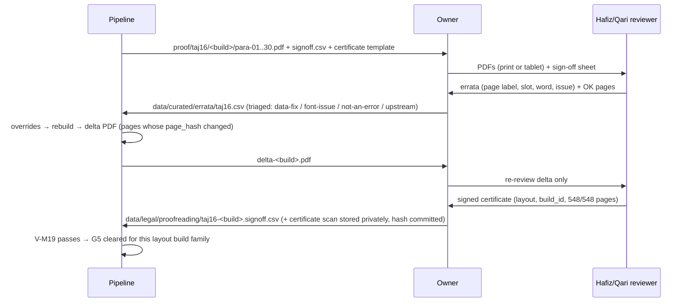

# 08 · Offline Data Pipelines (`tools/`)

**Purpose.** This doc specifies every offline tool that turns upstream Quran data into the files the app ships or downloads. It covers the read-only content DB, the typeset mushaf layout packs with precomputed justification, translation and tafsir packs, audio timing packs, the reciter catalogue, the signed pack index, the offline city DB and the Hijri month-start feed. It also covers publishing to Cloudflare R2. For each tool it gives the repo layout, pinned inputs, stage-by-stage pseudocode, output schemas, the full list of validation invariants that CI enforces, the CI jobs and the proofreading workflow. The device never shapes, justifies, parses upstream formats or validates timings: it opens SQLite files and draws. The doc is written so an engineer or AI agent can implement `tools/` without redoing the research.

**Status:** Draft v1, 2026-10-19

**Key decisions in this doc**
- Python 3.12 + `uv` workspace under `tools/`. Every stage runs as `uv run --frozen python -I -m crit …`. Inputs are pinned by SHA-256 in `data/pins.lock`. Downloaded files are parsed as data and never executed (D-02, D-10).
- The content DB, and every Room-opened pack, is written by **executing the Room-exported schema JSON verbatim**: `createSql`, indices, `contentSyncTriggers`, `setupQueries`. Then `rebuild`/`optimize`, `PRAGMA user_version`, `VACUUM`. CI also emits a `--no-master` copy so `onValidateSchema` actually runs (D-10, D-11).
- Canonical word table = the **DigitalKhatt MIT token stream (83,669 tokens)** keyed to Kufan verse keys, with QUL positions mapped 1:1 except 72:16 (D-06).
- Indexing tables (Para, Manzil, Ruku, Sajda, Quarters, aliases, surah headers) are **our own curated CSVs**, cross-checked against the print-verified facts (D-07).
- Mushaf layout = **QUL resource 11 export** joined to DK tokens. Justification is precomputed offline: per-word x-fractions plus `cv01` kashida, ≤ 3 steps. Font = DK IndoPak converted CFF2 → glyf (D-04, D-05, D-06).
- Timing packs come only from the **mp3quran `ayat_timing` + the same host's audio**, through the g03 normaliser (relabel, clamp, onset snap, per-surah disable) with ETag/length/sha256 guards (D-12, D-13).
- Every remote JSON (pack `index.json`, `catalogue.json`, Hijri feed) is a **single-object Ed25519 signed envelope**. The private key is offline on the owner's machine and **never in CI**; the public keys are compiled into the app (D-10, D-15, D-24).
- Hosting = R2 bucket behind a custom domain. Immutable versioned paths for packs and audio, short-TTL mutable envelopes, `rclone` uploads (D-24).
- Licence and eligibility flags travel with every dataset. CI blocks non-commercial content in a monetized profile and permission-pending content in a public profile (D-09, D-12, D-17, D-22).

Related: [Content & licensing](03-content-data-licensing.md) · [Architecture](04-architecture.md) · [Mushaf rendering](05-mushaf-rendering-engine.md) · [Audio engine](06-audio-engine.md) · [Companion features](07-companion-engagement-features.md) · [Roadmap](09-roadmap-backlog.md) · [Quality & CI](10-quality-testing-ci.md) · [Release & compliance](11-release-compliance-business.md) · [Decisions & risks](12-decisions-risks.md)

---

## 1. Overview

```mermaid
flowchart LR
  subgraph Inputs["Pinned inputs (data/pins.lock)"]
    TZ[Tanzil Uthmani + Simple-Clean XML\nquran-data.xml]
    DK[DigitalKhatt @4213fab\nquran_text_indopak_15.ts + hb/indopak.otf]
    QUL[QUL res 11 layout + res 565 script\n(owner login, private)]
    CUR[data/curated/*.csv\n(our own tables)]
    QE[QuranEnc SQLite zips\n+ Tanzil translation txt]
    MP3Q[mp3quran ayat_timing + MP3s]
    EA[everyayah 000_checksum.md5]
    GN[GeoNames cities15000.zip]
  end
  TZ & DK & CUR --> S1[1 content-db]
  QUL & DK & CUR --> S2[2 mushaf-pack]
  S1 --> S2
  QE --> S3[3 translation packs]
  MP3Q & EA --> S4[4 timing packs]
  S1 --> S4
  S2 & S3 & S4 --> S5[5 catalogue.json + index.json\nEd25519 envelopes]
  GN --> S6[6 geo pack]
  S6 --> S5
  S5 --> S7[7 publish → R2]
  S1 --> APK[(APK assets)]
  S2 --> APK
  S3 --> APK
  S2 --> PROOF[proof PDFs → hafiz sign-off (G5)]
```

| # | Stage | Tool dir | Output | Ships how | Phase |
|---|---|---|---|---|---|
| 1 | content-db | `tools/data-pipeline` | `quran_content.db` | APK asset (createFromAsset) | P0 v0, P1 v1 |
| 2 | mushaf-pack | `tools/mushaf-pipeline` | `mushaf.taj16.sqlite`, `criterion_indopak.ttf`, proof PDFs | APK asset (pre-installed pack); later layouts downloadable | P0 font, P1 pack, P2 sign-off |
| 3 | translation/tafsir packs | `tools/packs` | `tr.*.sqlite` | 2 bundled (D-09), rest downloadable | P1 bundled, P2 packs, P3 tafsir |
| 4 | timing packs | `tools/audio-timing` | `timing.<recitation>.sqlite` | Default reciter bundled, others downloaded | P1 |
| 5 | catalogue + index + signing | `tools/catalogue` | `catalogue.json`, `index.json` (signed envelopes) | Bundled copy + remote override | P1 |
| 6 | geo DB | `tools/packs` (`geonames`) | `geo.cities15000.sqlite` | APK asset (pre-installed pack) | P2 |
| 6b | Hijri PK feed | `tools/catalogue` (`hijri`) | `feeds/hijri-pk.json` envelope | Remote only | P2 |
| 7 | publish | `tools/catalogue` (`publish`) | R2 objects | CDN | P1 → ongoing |

---

## 2. Repository layout

```
tools/
  pyproject.toml            # uv workspace root (members below); ruff + pytest config
  uv.lock                   # exact versions + hashes (committed)
  .python-version           # 3.12.x (exact patch recorded at P0)
  .uv-version               # uv version used by CI (setup-uv reads it)
  pipeline.toml             # paths, asset destinations, tunables (gap/kashida params), CDN host
  justfile                  # short aliases for the canonical commands (optional sugar)
  crit/                     # thin CLI dispatcher: python -I -m crit <stage> <cmd>
  common/criterion_common/
    pins.py                 # read/verify/update data/pins.lock; cache dir resolution
    fetch.py                # HTTP GET with ETag, size, sha256; rate limit; no redirects to new hosts
    roomdb.py               # write SQLite from Room schema JSON (generalised build_content_db.py)
    normalize.py            # Arabic / Urdu / English normalisers (spec §4.4) — mirrored in Kotlin
    quran_ref.py            # surah ayah counts, global id <-> s:a, Kufan keys
    registry.py             # data/curated/content_registry.yaml (licence, attribution, eligibility)
    envelope.py             # Ed25519 signed-envelope create/verify
    report.py               # JSON + Markdown run reports (posted by CI)
  data-pipeline/criterion_data/
    tanzil.py  dk_text.py  dk_numbering.py  qul_script.py  align.py
    curated.py  derive_rukus.py  build_content.py  validate_content.py  vectors.py
  mushaf-pipeline/criterion_mushaf/
    fontconv.py             # CFF2 -> glyf (from spikes/.../cff2_to_glyf.py) + rename
    fontcheck.py            # feature table + width vectors (from font_features.py, hb_widths.py)
    shape.py                # uharfbuzz shaping cache: token -> widths at cv01 0..3
    qul_layout.py           # read res-11 export, restore 16-slot grid
    quirks.py               # p.529 fix, sar-lauh remap, embedded-basmala flags, text overrides
    justify.py              # page scale + kashida + gap solver
    markers.py  furniture.py  build_pack.py  validate_pack.py
    proof.py                # SVG -> PDF/PNG proof renders, sign-off sheet, certificate template
    oracle.py               # LOCAL ONLY: diff vs scraped previews / Waqar (never in CI)
    rebreak.py              # P0-gated fallback tool (clean-room line breaker + correction UI backend)
  audio-timing/criterion_timing/
    mp3quran.py  mp3probe.py  letters.py  shift.py  onset.py
    normalise.py  build_timing.py  gapped_manifest.py  validate_timing.py  drift.py
  packs/criterion_packs/
    quranenc.py  tanzil_trans.py  build_translation.py  build_tafsir.py  geonames.py  validate_pack.py
  catalogue/criterion_catalogue/
    build_catalogue.py  build_index.py  hijri.py  keys.py  publish.py  verify_live.py
  tests/                    # pytest; tiny fixtures only (no upstream data committed)
data/
  pins.lock                 # TOML, every upstream input (§3)
  curated/                  # our own facts, hand-verified (§3.3)
    paras.csv  manzils.csv  sajdas.csv  para_quarters.csv  ruku_print_checks.csv
    surahs.csv  surah_headers.csv  aliases.csv  quick_access.csv
    taj16_empty_slots.csv  taj16_text_overrides.csv  skeleton_whitelist_qul.csv
    skeleton_whitelist_tanzil.csv  reciters.yaml  content_registry.yaml  ummalqura_months.csv
    errata/taj16.csv
  keys/content-signing-<kid>.pub      # public keys only
  legal/permissions.yml               # machine-readable grant status per dataset (drives CI gates)
  legal/evidence/*.sha256             # hashes of archived statements (files themselves private)
  legal/proofreading/<layout>-<build>.signoff.csv   # G5 sign-off rows (certificate scans private, hash committed)
out/                                  # git-ignored build outputs and reports
```

**Rules.**
- `~/criterion-data/` (outside the repo) is the **private input store**: QUL exports, King Fahd Complex ZIPs, scraped-preview oracle, Waqar clone, the owner's checkpoint photos and archived statements. CI reads the private inputs it needs from a private R2 bucket (`criterion-private`, read-only token). **Taj scans and owner photos never enter the repo, CI artifacts or app assets** (g02 Rec 12).
- Upstream files are parsed with explicit parsers: XML via `xml.etree`, DK `.ts` via string-literal extraction, `quran-data.js` never `eval`'d, SQLite via `sqlite3` read-only URI. Each download lands in its own fresh directory under the cache. No third-party build script is ever run.
- GPL sources (quran_android, QuranApp) are never read by `tools/` code. Waqar144 and preview data are used **only** by `oracle.py`, locally (D-06, D-18).

**Generated assets in git.** Outputs copied into module asset dirs are committed through **Git LFS** (`*.db`, `*.sqlite`, `*.ttf` under `*/src/main/assets/`), so Android Studio builds need no Python. CI rebuilds them and checks reproducibility (§12). Asset destinations are configured in `pipeline.toml`. Defaults, which doc 04 may override:

| Output | Default destination |
|---|---|
| `quran_content.db` | `core/content/src/main/assets/databases/quran_content.db` |
| `mushaf.taj16.sqlite` + `criterion_indopak.ttf` | `core/mushaf/src/main/assets/packs/` and `…/assets/fonts/` |
| `tr.ur.junagarhi.qe.sqlite`, `tr.en.saheeh.qe.sqlite` | `core/translation/src/main/assets/packs/` |
| `timing.alafasy.murattal.gapless.sqlite` + `catalogue.json` (envelope) | `core/audio/src/main/assets/` |
| `geo.cities15000.sqlite` (P2) | `feature/prayer` or `core/location` assets (doc 04) |
| `index.json` envelope (bundled snapshot) | `core/content/src/main/assets/index.json` |

---

## 3. Inputs, pins and curated data

### 3.1 Toolchain pins

| Item | Pin | Note |
|---|---|---|
| Python | 3.12.x via `uv python install` (uv-managed CPython; exact patch in `.python-version`) | Fixes the bundled SQLite version, so the content DB is byte-reproducible. Preflight asserts `sqlite3.sqlite_version ≥ 3.45` and that FTS5 + `trigram` are available |
| uv | version in `tools/.uv-version` (set at P0) | `uv sync --frozen` only; `uv.lock` committed |
| uharfbuzz | `==0.56.3` (HarfBuzz 14.6.0) | Widths verified identical to Android Minikin/HarfBuzz 2.6.4 for `cv01` (g04 §2.7) |
| fontTools | `==4.67.*`, locked exactly | `Cu2QuPen` conversion, name table, SVG pen |
| cryptography (pyca) | locked at P0 | Ed25519 sign/verify |
| numpy | locked at P0 | Envelopes, correlation |
| cairosvg + pypdf | locked at P0 | Proof SVG → PDF/PNG, merge per Para (system `libcairo2` on the CI image) |
| ffmpeg CLI | ≥ 6 from the CI image (`apt`), version recorded in run report | Decode MP3 → 8 kHz mono s16 for onset snapping only. Tool only, never shipped |
| rclone | ≥ 1.6x, version recorded | R2 uploads (S3 API) |
| ruff, pytest, jsonschema | locked | Lint, unit tests, JSON schema validation |

**Canonical invocation** (documented in `tools/README` and wrapped by `justfile`):

```bash
cd tools && uv sync --frozen
uv run --frozen python -I -m crit fetch all            # verify/download pinned inputs into cache
uv run --frozen python -I -m crit content build        # stage 1
uv run --frozen python -I -m crit mushaf build taj16   # stage 2 (needs private inputs)
uv run --frozen python -I -m crit mushaf proof taj16   # proof PDFs
uv run --frozen python -I -m crit packs build tr.ur.junagarhi.qe
uv run --frozen python -I -m crit timing build alafasy.murattal.gapless
uv run --frozen python -I -m crit catalogue build && python -I -m crit index build
uv run --frozen python -I -m crit validate all         # every invariant in §6
uv run --frozen python -I -m crit install-assets       # copy outputs to module asset dirs
uv run --frozen python -I -m crit sign index|catalogue|hijri   # owner machine only
uv run --frozen python -I -m crit publish --dry-run|--go       # owner machine only
```

`justfile` aliases: `just fetch`, `just content`, `just mushaf`, `just proof`, `just packs`, `just timing`, `just validate`, `just assets`, `just ci` (lint + tests + build + validate + repro), `just sign`, `just publish`.

### 3.2 `data/pins.lock` (TOML)

Each entry: `id`, `url`, `version`, `retrieved_at`, `sha256`, `bytes`, `licence`, `downloader` (`auto` | `owner-login` | `owner-manual`), `storage` (`cache` = re-downloadable, git-ignored; `private` = `~/criterion-data` + private R2; `oracle` = local QA only), `used_by`. `crit fetch` fails if a hash changes, unless it is run with `--accept-update <id>`. That flag rewrites the pin and records the old hash in `pins.history`.

```toml
[[input]]
id = "tanzil.uthmani"
url = "https://tanzil.net/pub/download/index.php?quranType=uthmani&outType=xml&marks=true&sajdah=true&rub=false&tatweel=true&agree=true"
version = "1.1"
sha256 = "<fill at P0>"
licence = "CC BY 3.0, verbatim copies only (tanzil.net/docs/text_license)"
downloader = "auto"; storage = "cache"; used_by = ["content"]
```

| id | URL / location | Version / pin | Licence | Downloader → storage | Used by |
|---|---|---|---|---|---|
| `tanzil.uthmani` | `https://tanzil.net/pub/download/index.php?quranType=uthmani&outType=xml&marks=true&sajdah=true&rub=false&tatweel=true&agree=true` | v1.1, sha256 TBD | CC BY 3.0, verbatim (r05 §2.8) | auto → cache | content |
| `tanzil.simple_clean` | same with `quranType=simple-clean` | v1.1 | same | auto → cache | content |
| `tanzil.metadata` | `https://tanzil.net/res/text/metadata/quran-data.xml` | sha256 TBD | CC BY 3.0 | auto → cache | content (counts, Madani juz/hizb, manzil, ruku-556 cross-check, revelation type/order) |
| `dk.repo` | `https://github.com/DigitalKhatt/digitalkhatt.org` @ `4213fab…` (full SHA recorded at P0) | commit | MIT (code + text) | auto (git archive of the single paths) → cache | content, mushaf |
| `dk.text15` | `ClientApp/src/app/services/quran_text_indopak_15.ts` @ commit | sha256 TBD | MIT; upstream QuranWBW/QUL res 59 (g01 §2.2.3), so credit both | auto → cache | content, mushaf (hafizi15 later) |
| `dk.font` | `ClientApp/src/assets/fonts/hb/indopak.otf` @ commit | 2,569,560 B, sha256 `8110e0c3…` (full hash at P0) | SIL OFL 1.1 | auto → cache | mushaf. **Never** the QUL CDN `DigitalKhattIndoPak.otf`, which has no cv features (g04 §2.7) |
| `qul.res11` | `https://qul.tarteel.ai/resources/mushaf-layout/11` (SQLite export; login) | export date + sha256 | Unstated; **ship only after G1** | owner-login → private | mushaf |
| `qul.res565` | QUL Quran-script resource 565, DK Indo-Pak WBW SQLite (resource 59 if 565 lacks `word_key`); path confirmed at download | export date + sha256 | Unstated; G1 | owner-login → private | content (QUL map + skeleton check), mushaf |
| `qul.res65` | QUL ruku metadata 65 (optional cross-check) | sha256 | Unstated | owner-login → private | validate only |
| `quranenc.ur.junagarhi` | `https://quranenc.com/downloads/sqlite/urdu_junagarhi.zip` + version from `https://quranenc.com/api/v1/translations/list/ur` | v1.1.3 (zip 2.1 MB; sqlite 6.16 MB) | QuranEnc republish terms (7 conditions) | auto → cache | packs (bundled) |
| `quranenc.en.saheeh` | `https://quranenc.com/downloads/sqlite/english_saheeh.zip` + `…/translations/list/en` | v1.1.2 (sqlite 1.25 MB) | QuranEnc terms | auto → cache | packs (bundled) |
| `quranenc.*` (P2) | `english_hilali_khan`, `hindi_omari` (v1.1.5), `indonesian_affairs`, `turkish_rwwad`, `english_rwwad`, `pashto_rwwad`, `punjabi_arif` | per list API | QuranEnc terms | auto → cache | packs |
| `tanzil.tr.*` (P2) | `https://tanzil.net/trans/?transID=ur.jalandhry&type=txt-2`, `ur.kanzuliman`, `en.pickthall`, `bn.bengali` | sha256 | Tanzil: **non-commercial** file terms | auto → cache | packs |
| `quranenc.tafsir.ur.saadi` (P3) | `https://quranenc.com/api/v1/tafsir/sura/urdu_saadi/{n}` ×114 | version | QuranEnc terms | auto → cache | packs |
| `mp3quran.reads` | `https://www.mp3quran.net/api/v3/ayat_timing/reads` | JSON sha256 | Host statement archived (D-12) | auto → cache | timing |
| `mp3quran.timing.<read>` | `https://www.mp3quran.net/api/v3/ayat_timing?surah={1..114}&read={read}` | per-surah JSON sha256 | same | auto → cache | timing |
| `mp3quran.reciters` | `https://www.mp3quran.net/api/v3/reciters?language=eng` | sha256 | same | auto → cache | catalogue (server/folder URLs) |
| `mp3quran.audio.<read>` | `{folder_url}{sss}.mp3` ×114 (from the API; `www.` host for the API) | per file: Content-Length, ETag, sha256 | same | auto → cache (streamed, deleted after hashing/decoding) | timing |
| `mp3quran.statement` | `https://mp3quran.net/eng/privacy` + contact page (archived HTML/PDF) | sha256 + date | evidence | owner-manual → private (hash in `data/legal/evidence/`) | registry |
| `everyayah.md5.<folder>` | `https://everyayah.com/data/{folder}/000_checksum.md5` | sha256 | No site licence; personal/PENDING (D-12) | auto → cache | timing (gapped manifest) |
| `kfc.zips.<reciter>` | King Fahd Complex per-ayah/per-surah ZIPs (geo-blocked; owner fetches from PK) | sha256 per ZIP | "free general use" (search-verified); permission email | owner-manual → private | publish (self-host after permission) |
| `geonames.cities15000` | `https://download.geonames.org/export/dump/cities15000.zip` (+ `readme.txt`) | dump date, sha256; 3.36 MB, 34,173 rows on 2026-10-19 | CC BY 4.0 | auto → cache | geo |
| `oracle.qul_previews` | 548 scraped `/mushaf_layouts/7?page_number=N` HTML (already fetched in research) | sha256 of tarball | Tarteel ToS: no copying → **oracle only; delete once `qul.res11` arrives** | private → oracle | oracle.py |
| `oracle.waqar144` | `Waqar144/quran_memorization_helper` @ `b6470fb` | commit | MIT label, QUL-derived → oracle only | auto → oracle | oracle.py |
| `owner.checkpoints` | Owner's photos of printed pp. 2, 39, 70, 115, 483 of his own copy (g02 §4) | sha256 | private | owner-manual → private | manual check only |

### 3.3 Curated data (`data/curated/`, our own facts)

All CSVs are UTF-8 with a header row, LF line endings, and are sorted. Each has a `source` or `verified_source` column, e.g. `taj16-scan p.70 L7` or `tanzil` or `computed`. The validator owns the cross-checks (§11).

| File | Columns | Rows | Seed / verification |
|---|---|---|---|
| `paras.csv` | `para, name_ar, name_ur, name_roman, start_surah, start_ayah, taj16_page_index, verified_source` | 30 | r05 §2.3.2 table. Names are hand-typed with Indo-Pak diacritics. Starts follow D-07: 7 differ from Madani (3:92, 5:83, 9:94, 15:2, 27:60, 29:45, 36:22). Pages 1, 20, 38, 56, 74, …, 488 (18n−16), 508, 528 |
| `manzils.csv` | `manzil, start_surah, start_ayah, taj16_page_index, taj16_qul_line` | 7 | 1:1, 5:1, 10:1, 17:1, 26:1, 37:1, 50:1. Pages/lines (1,2), (96,3), (187,4), (254,2), (330,5), (401,14), (466,7) (g01 §2.4) |
| `sajdas.csv` | `surah, ayah, print_no, kind, label_ar` | 15 | 7:206, 13:15, 16:50, 17:109, 19:58, 22:18, 25:60, 27:26, 32:15, 38:24, 41:38, 53:62, 84:21, 96:19 numbered 1–14 in mushaf order (`kind=both`). **22:77** `print_no` NULL, `kind=shafii_only`, label «السجدة عند الامام الشافعی رح» (g02 §2.6) |
| `para_quarters.csv` | `para, quarter(1..3), surah, ayah, word_pos, verified_source` | 90 | g02 Appendix A, with the 3 print corrections: P4 ¾ = 3:198; P7 ¼ = 5:113; P7 ¾ = 6:73 `word_pos=10` (the «۵» after فَيَكُوْنُ). 37 print-verified so far; the remaining 53 are hand-checked before public release. **Never derived from Madani rub** |
| `ruku_print_checks.csv` | `surah, first_ayah, last_ayah, n1, n2, n3, scan_ref` | 29 | g02 §2.3 decoded triples (top/in-ع/bottom) |
| `surahs.csv` | `surah, name_ar, name_ur, name_roman, name_en, meaning_ur, meaning_en, revelation, revelation_order, roman_aliases` | 114 | Hand-curated; revelation/order cross-checked with Tanzil metadata. No QF payloads copied (r05 §2.8) |
| `surah_headers.csv` | `style, surah, header_ar, verified_source` | 114 (`style=taj`) | Generated draft «سورة {name} {مكية/مدنية} وهي {N} آية و{M} ركوعات» (single-ruku surahs omit M; Fatiha «وهي سبع آيات»), then hand-proofed against the print (≈75 verified in g02) |
| `aliases.csv` | `term, lang, target_type(surah/ayah/range/playlist), target` | ~150 | r05 §2.7.5: yasin/yaseen/ya-sin/یس → 36; rahman/rehman → 55; mulk/tabarak → 67; kahf → 18; waqia/waqiah → 56; muzammil; ayatul kursi/آیت الکرسی → 2:255; "last 2 of baqarah" → 2:285–286; manzil dua → playlist |
| `quick_access.csv` | `id, title_en, title_ur, target_type, target, order` | ~10 | F-IX-08: Yaseen, Rahman, Mulk, Waqiah, Kahf, Ayatul Kursi, last two ayat of Baqarah, Manzil dua. The **Manzil dua ayah list must be sourced from a cited print** before P1 ends (open issue) |
| `taj16_empty_slots.csv` | `page_index, slot` | 24 | p.1 slots 8–16, p.2 slots 1–9, p.548 slots 11–16 (g01 §2.4). Used to restore the exporter-dropped empty lines |
| `taj16_text_overrides.csv` | `script, surah, ayah, pos, old_sha256, new_text, reason, decided_by` | small | Fatiha end-marker digits; 1:7:4 RLO strip; 59:13:1 and 27:21 spellings once the hafiz decides |
| `skeleton_whitelist_qul.csv` | `qul_key, dk_text, qul_text, nature` | 3 | {4:112:3, 18:19:34, 59:13:1} (D-06) |
| `skeleton_whitelist_tanzil.csv` | `verse_key, dk_skel, tanzil_skel, reviewed_by` | frozen at P0 | Generated once from the first full run, reviewed, then frozen. New diffs fail CI |
| `reciters.yaml` | per recitation: id, reciter names (en/ar/ur), style, riwayah, layout, host, read id / folder, basmala strategy, attribution, licenceStatus, blocklists | ~20 | D-12 shortlist; ids per doc 06 |
| `content_registry.yaml` | per dataset: id, title, source_url, licence, attribution (en/ur), notice, `eligibility{personal,public,monetized}`, `permission_ref` | all | Owned by doc 03; the pipeline copies it into packs, the index and the `attribution` table |
| `errata/taj16.csv` | `report_id, page_label, slot, word, issue, reviewer, status, resolution, build_id` | grows | Proofreading loop (§14) |
| `ummalqura_months.csv` | `hijri_month, civil_start` | 180 (1446–1460 AH) | Exported from `java.time` `HijrahDate` by a JVM test; sanity bound for the PK feed (§9.2) |

`data/legal/permissions.yml` (machine-readable, from doc 03/11):
```yaml
qul_res_11: {status: pending, requested: 2026-10-2x, scope: null}   # G1
qul_res_565: {status: pending}
dk_text_mit_confirmation: {status: pending}
mp3quran_statement: {status: archived, evidence_sha256: "<…>"}
alafasy_berhad: {status: pending}
```
Release-profile CI fails if any bundled or listed item whose registry entry has `permission_ref` points at a status other than `granted` or `archived` (§8.4).

---

## 4. Stage 1: content-db (`tools/data-pipeline`)

### 4.1 Output schema (contract with `:core:content`)

The **Room entities in `:core:content` are the source of truth**. The pipeline executes their exported schema `core/content/schemas/<fqcn QuranContentDb>/<N>.json`. The DDL below is the contract those entities must produce. Column names are snake_case. All ayah references use the **global Kufan ayah id 1..6236** (`ayah.id`, mushaf order) and/or `(surah, ayah)`.

```sql
-- Non-entity (allowed; Room ignores it, g04 §2.4)
CREATE TABLE content_meta (k TEXT PRIMARY KEY, v TEXT NOT NULL);
-- keys: content_version, build_id, data_hash, pins_hash, tools_hash, schema_identity_hash,
--       tanzil_version, dk_commit, qul_res565_sha256 (or 'none'), normalizer_version, profile

CREATE TABLE surah (id INTEGER PRIMARY KEY NOT NULL, name_ar TEXT NOT NULL, name_ur TEXT NOT NULL,
  name_roman TEXT NOT NULL, name_en TEXT NOT NULL, meaning_ur TEXT, meaning_en TEXT,
  revelation TEXT NOT NULL,                -- 'makki' | 'madani'
  revelation_order INTEGER NOT NULL, ayah_count INTEGER NOT NULL, ruku_count INTEGER NOT NULL,
  first_ayah_id INTEGER NOT NULL, has_basmala INTEGER NOT NULL);   -- 0 for surah 9; Fatiha 1 (1:1 is a verse)

CREATE TABLE ayah (id INTEGER PRIMARY KEY NOT NULL,   -- 1..6236
  surah INTEGER NOT NULL, ayah INTEGER NOT NULL,
  text_uthmani TEXT NOT NULL,              -- Tanzil verbatim (copy/share source, D-08)
  text_imlaei TEXT NOT NULL,               -- Tanzil Simple-Clean verbatim
  norm_imlaei TEXT NOT NULL, norm_uthmani TEXT NOT NULL, norm_indopak TEXT NOT NULL,  -- FTS content columns
  para INTEGER NOT NULL, manzil INTEGER NOT NULL, ruku INTEGER NOT NULL,
  juz_madani INTEGER NOT NULL, rub_madani INTEGER NOT NULL,          -- Madani mode only (D-07)
  letters INTEGER NOT NULL);               -- simple-clean letter count (timing QA, reading stats)
CREATE UNIQUE INDEX ix_ayah_sa ON ayah(surah, ayah);

CREATE TABLE para (id INTEGER PRIMARY KEY NOT NULL, name_ar TEXT NOT NULL, name_ur TEXT NOT NULL, name_roman TEXT NOT NULL,
  start_ayah_id INTEGER NOT NULL, end_ayah_id INTEGER NOT NULL, ruku_count INTEGER NOT NULL);  -- by-end, Fatiha excluded
CREATE TABLE manzil (id INTEGER PRIMARY KEY NOT NULL, start_ayah_id INTEGER NOT NULL, end_ayah_id INTEGER NOT NULL);
CREATE TABLE ruku (id INTEGER PRIMARY KEY NOT NULL,          -- 1..558 mushaf order
  surah INTEGER NOT NULL, surah_ruku INTEGER NOT NULL,
  first_ayah_id INTEGER NOT NULL, last_ayah_id INTEGER NOT NULL, ayah_count INTEGER NOT NULL,
  para INTEGER NOT NULL,                   -- Indo-Pak Para containing last ayah
  para_ruku INTEGER);                      -- NULL for Fatiha
CREATE TABLE sajda (ayah_id INTEGER PRIMARY KEY NOT NULL, print_no INTEGER, kind TEXT NOT NULL);  -- 'both' | 'shafii_only'
CREATE TABLE para_quarter (para INTEGER NOT NULL, quarter INTEGER NOT NULL, ayah_id INTEGER NOT NULL,
  word_pos INTEGER, verified_source TEXT, PRIMARY KEY(para, quarter));
CREATE TABLE surah_header (style TEXT NOT NULL, surah INTEGER NOT NULL, text TEXT NOT NULL, PRIMARY KEY(style, surah));

-- Script-level (shared by all Indo-Pak layouts). script_id 1 = DK IndoPak.
CREATE TABLE word (script_id INTEGER NOT NULL, word_index INTEGER NOT NULL,   -- 1..83,669 in mushaf order
  ayah_id INTEGER NOT NULL, pos INTEGER NOT NULL,                             -- 1..k within ayah; end token = k
  is_end INTEGER NOT NULL,
  text TEXT NOT NULL,                      -- render text after overrides (font-bound; never copied/shared)
  qul_pos INTEGER,                         -- QUL word position (72:16 tokens 1,2 -> 1; p>=3 -> p-1); NULL if no QUL script
  PRIMARY KEY(script_id, word_index));
CREATE INDEX ix_word_ayah ON word(script_id, ayah_id, pos);
CREATE TABLE ayah_marker (script_id INTEGER NOT NULL, word_index INTEGER NOT NULL,
  ayah_id INTEGER NOT NULL, display_number INTEGER,   -- Kufan number; NULL for disputed «۵»
  is_kufan_end INTEGER NOT NULL, disputed_end INTEGER NOT NULL,
  has_ruku_sign INTEGER NOT NULL, has_sajda_sign INTEGER NOT NULL,
  PRIMARY KEY(script_id, word_index));

CREATE TABLE alias (term_norm TEXT NOT NULL, lang TEXT NOT NULL, target_type TEXT NOT NULL, target TEXT NOT NULL,
  PRIMARY KEY(term_norm, target_type, target));
CREATE TABLE quick_access (id TEXT PRIMARY KEY NOT NULL, title_en TEXT NOT NULL, title_ur TEXT NOT NULL,
  target_type TEXT NOT NULL, target TEXT NOT NULL, sort INTEGER NOT NULL);
CREATE TABLE attribution (dataset_id TEXT PRIMARY KEY NOT NULL, title TEXT NOT NULL, source_url TEXT NOT NULL,
  licence TEXT NOT NULL, version TEXT NOT NULL, notice_en TEXT NOT NULL, notice_ur TEXT NOT NULL);

-- FTS5 (Room @Fts5, external content = ayah, content_rowid = id) — D-11
CREATE VIRTUAL TABLE ayah_fts USING FTS5(norm_imlaei, norm_uthmani, norm_indopak, tokenize=`unicode61`, content=`ayah`, content_rowid=`id`);
CREATE VIRTUAL TABLE ayah_fts_tri USING FTS5(norm_imlaei, tokenize=`trigram`, content=`ayah`, content_rowid=`id`);
```

Decisions inside the schema:
- **Fatiha numbering.** `display_number` is **Kufan** (1:1 = 1 … 1:7 = 7). The Taj "seven empty circles" look is a **layout-level** override in the mushaf pack (`ayah_display_override`, §5.1). It is not baked into script data. DK's own Fatiha digits (basmala bare, الحمد = ١, ٦ at عليهم) are discarded (g02 Rec 2).
- **Trigram covers one column, `norm_imlaei`.** The measured cost is about 1.2 MB per column (g04). Uthmani/Indo-Pak spelling variants are covered by the 3-column unicode61 index. Doc 04 can widen this; the pipeline follows whatever the schema declares.
- Translations are **not** in the content DB. They are separate packs, including the two bundled ones (§6), so QuranEnc's "keep updated" condition can be met without an app update.

### 4.2 Algorithm

```python
def build_content(cfg):
    pins.verify(["tanzil.uthmani", "tanzil.simple_clean", "tanzil.metadata", "dk.text15"])
    schema = room_schema(cfg.content_schema_dir)               # latest N.json
    U  = tanzil.parse_xml(cache("tanzil.uthmani"))             # [(s, a, text)] ×6236, verbatim
    C  = tanzil.parse_xml(cache("tanzil.simple_clean"))
    M  = tanzil.parse_metadata(cache("tanzil.metadata"))       # ayah counts, juz, hizb quarters, manzil, rukus(556), sajdas(15), type/order
    assert len(U) == len(C) == 6236 and counts(U) == M.ayah_counts

    # --- DK token stream (g01 §2.8 step 3)
    pages = dk_text.extract_pages(cache("dk.text15"))          # string literals only; assert 610 pages, 9,131 lines
    toks, headers, basm_skipped = [], 0, 0
    for line in flatten(pages):
        if line.startswith("سُورَةُ "): headers += 1; continue
        t = [x for x in line.split(" ") if x]
        if len(t) == 5 and t[0].startswith("بِسْمِ") and t[-1] == "۝" and headers != 1:
            basm_skipped += 1; continue                         # non-Fatiha basmala line
        toks += t
    assert headers == 114 and basm_skipped == 112 and len(toks) == 83_669
    assert sum(is_end(x) for x in toks) == 6_236 and count_cp(toks, 0x08E2) == 118
    assert count_cp(toks, 0x202E) == 1 and on_end_tokens(toks, 0x08D6) == 558 and on_end_tokens(toks, 0x08DB) == 15
    assert no_standalone_mark_tokens(toks) and distinct_codepoints(toks) == 84   # warn-only if 84 changes

    # --- Kufan keys (dk_numbering.py): walk surahs (header order 1..114), ayah += 1 at each end token
    words = assign_keys(toks)                                   # (word_index, surah, ayah, pos, is_end, text)
    assert per_surah_ayahs(words) == M.ayah_counts
    words = overrides.apply(words, "data/curated/taj16_text_overrides.csv")   # sha-checked old text
    #   - 1:1..1:7 end tokens -> U+06DD + Kufan digits in DK's own digit block (detected from 2:1 end)
    #   - 1:7:4: drop "U+202E ٦", keep U+08E2 (+ U+06D9 «لا» if the P0 render check passes; else ornament)
    markers = [Marker(w, kufan_end=w.is_end, disputed="࣢" in w.text,
                      display=w.ayah if w.is_end else None,
                      ruku="ࣖ" in w.text, sajda="ࣛ" in w.text) for w in words
               if w.is_end or "࣢" in w.text]
    assert len(markers) == 6_354

    # --- QUL map + skeleton check (only when qul.res565 is present; otherwise qul_pos = NULL and C06/C07 skip with a warning)
    if have("qul.res565"):
        Q = qul_script.read(cache("qul.res565"))                # word_index -> word_key s:a:w (83,668)
        qmap = align.map_dk_to_qul(words, Q)                    # identity except 72:16 (DK 1,2 -> QUL 1; p>=3 -> p-1)
        diffs = align.skeleton_diffs(words, Q, pua_wildcard=True)
        assert set(diffs) == whitelist("skeleton_whitelist_qul.csv")
    tz_diffs = align.skeleton_vs_tanzil(words, U)              # per-ayah skeleton (normalize + strip)
    assert set(tz_diffs) == whitelist("skeleton_whitelist_tanzil.csv")

    # --- Curated tables + derivations
    paras   = curated.paras();   assert boundaries_differ_from_madani(paras, M) == {(3,92),(5,83),(9,94),(15,2),(27,60),(29,45),(36,22)}
    manzils = curated.manzils(); assert starts(manzils) == M.manzil_starts
    rukus   = derive_rukus.from_dk(markers, paras)              # ends at U+08D6 tokens; numbering per §4.3
    sajdas  = curated.sajdas();  assert {s.key for s in sajdas} == {m.key for m in markers if m.sajda}
    quarters, aliases, headers_taj, surahs, quick = curated.load_rest()

    # --- Normalised columns (normalize.py; identical spec in Kotlin, §4.4)
    rows = []
    for gid, ((s, a, ut), (_, _, cl)) in enumerate(zip(U, C), 1):
        ip = " ".join(w.text for w in words_of(s, a) if not w.is_end)
        rows.append(Ayah(gid, s, a, ut, cl, ar_norm(cl), ar_norm(ut), ar_norm(ip),
                         para_of(gid), manzil_of(gid), ruku_of(gid), M.juz(gid), M.rub(gid), letters(cl)))

    # --- Write (generalised spikes/toolchain-spike/scripts/build_content_db.py)
    db = roomdb.create(out("quran_content.db"), schema, master=True)   # createSql, indices, triggers, setupQueries verbatim
    roomdb.insert_all(db, {...})                                # FTS filled by content-sync triggers
    roomdb.fts_rebuild_optimize(db)                             # 'rebuild' + 'optimize' per FTS table
    roomdb.extra(db, "content_meta", meta(build_id, data_hash, ...))
    db.execute(f"PRAGMA user_version = {schema.version}"); db.commit(); db.execute("VACUUM")
    roomdb.create_copy(out("quran_content.nomaster.db"), master=False)  # CI-only: forces onValidateSchema
    validate_content.run_all(out("quran_content.db"))           # §11.1
```

**Determinism.** Inserts go in primary-key order. `content_meta` has no wall-clock time: `build_id = sha256(pins_hash ‖ tools_hash ‖ curated_hash ‖ schema_identity_hash)[:16]`. Page size is the SQLite default. With the pinned Python, the output is byte-identical. CI asserts logical equality (sorted `.dump` hash) as a hard check and byte equality as a soft check.

**Version rule.** Content changes ⇒ bump `@Database(version)` of `QuranContentDb`, which re-exports `N+1.json`, then rebuild. The validator fails if `data_hash` differs from the committed asset's while `user_version` is unchanged ("content changed without version bump"). Room's copy-destructive path then replaces the on-device copy (D-10).

### 4.3 Ruku derivation (D-07, g02 §2.3)

```python
def from_dk(markers, paras):
    ends = [m.ayah_id for m in markers if m.ruku]               # 558, mushaf order
    rukus, start = [], 1
    for i, end in enumerate(ends, 1):
        s = surah_of(end); first = max(start, first_ayah_id(s))  # a ruku never crosses a surah
        rukus.append(Ruku(i, s, None, first, end, end - first + 1, para_of(end), None))
        start = end + 1
    for s in 1..114: number surah_ruku 1..k in order
    for p in 1..30: number para_ruku 1..k over rukus with para == p, excluding surah 1 (Fatiha -> NULL)
    assert contiguous_cover(rukus, 1, 6236)
    assert [count(para == p) for p in 1..30 if not fatiha] == [16,16,17,14,17,14,19,17,18,17,16,16,19,22,21,
                                                            17,17,17,19,16,19,18,17,19,20,18,20,20,22,39]
    assert surah_ruku_count[26] == 11 and [28] == 9 and [31] == 4          # print headers
    assert ends contain 26:51, 26:68, 28:82, 31:30, 56:38                     # Tanzil/Waqar disputes resolved
    assert triples(rukus) ⊇ ruku_print_checks.csv                            # 29 print-decoded marks
    if have("qul.res65"): assert ruku_sets_equal(rukus, qul65)
    return rukus
```

### 4.4 Normalisers (one spec, two implementations)

Python `criterion_common/normalize.py` is the reference; Kotlin lives in `:core:model` (doc 04). `crit content vectors` emits `out/normalization_vectors.json` with at least 300 `{lang, input, expected}` pairs. These cover every rule plus the r05 query set, and are copied into the Kotlin test resources by `install-assets`. **The spike's simplistic `normalize()` is replaced by this spec.** `normalizer_version` is stored in `content_meta`, and the app re-normalises queries with the same version.

| Lang | Rules (in order) — r05 §2.7.5 |
|---|---|
| Arabic | (1) ZWSP/ZWNJ/ZWJ/LRM/RLM/BOM/NBSP/EN/EM SPACE → space; drop PUA U+E000–F8FF and bidi controls U+202A–202E, U+2066–2069. (2) Drop U+0610–061A, U+064B–065F, **U+0670 (dropped, not → alef)**, U+06D6–06ED, U+08D3–08FF, ۞ ۩, Arabic-Indic and Extended digits, tatweel U+0640. (3) Fold آأإٱٲٳٵ→ا; ىیےئي→ي; ؤ→و; ةۃہھە→ه; کڪ→ك; ٮ→ب; ء ٴ→removed. (4) NFKC, collapse whitespace |
| Urdu | Strip U+064B–065F, U+0670, ZWNJ; fold ي ى→ی, ك→ک, ه ة ۃ→ہ, أ إ آ→ا, ؤ→و, ئ→ی, Urdu digits→ASCII; **keep ے and ھ distinct** |
| English | NFKD + strip combining marks, drop ʿ ʾ ' , lowercase, ASCII-fold. FTS uses unicode61 on the folded text. Porter is not used, because Room FTS5 tokenizer options are per the schema |
| Alias key | lowercase, `aa→a`, `ee→i`, `oo→u`, drop `'` `-` and spaces |

---

## 5. Stage 2: mushaf-pack (`tools/mushaf-pipeline`)

### 5.1 Output: `mushaf.<code>.sqlite` (Room `MushafPackDb`, one file per layout)

```sql
CREATE TABLE mushaf_info (code TEXT PRIMARY KEY NOT NULL,     -- 'taj16'
  name_en TEXT NOT NULL, name_ur TEXT NOT NULL, script_id INTEGER NOT NULL, font_file TEXT NOT NULL,
  lines_per_page INTEGER NOT NULL, page_count INTEGER NOT NULL,
  page_label_offset INTEGER NOT NULL,       -- taj16 = 1 → labels 2..549 (g02)
  min_content_version INTEGER NOT NULL, build_id TEXT NOT NULL, font_sha256 TEXT NOT NULL,
  gap_min_em REAL NOT NULL, gap_target_em REAL NOT NULL);
CREATE TABLE page (page_index INTEGER PRIMARY KEY NOT NULL,   -- 1..548 (QUL index)
  template TEXT NOT NULL,                   -- 'sarlauh' | 'regular'
  em_per_line_width REAL NOT NULL,          -- line width in font units (upem 1000) → device scale = widthPx / this
  first_ayah_id INTEGER NOT NULL, last_ayah_id INTEGER NOT NULL,
  header_para INTEGER NOT NULL,             -- para of the page's last ayah (print check pp.508/528)
  header_surahs TEXT NOT NULL,              -- '102,103,104'
  footer_manzil INTEGER NOT NULL,           -- manzil of the page's last ayah (g02 Rec 8)
  outer_margin TEXT NOT NULL,               -- 'R' if label even else 'L'
  page_hash TEXT NOT NULL);                 -- proofreading binding (§14)
CREATE TABLE line (page_index INTEGER NOT NULL, slot INTEGER NOT NULL,  -- 1..16 after grid restore + remap
  type INTEGER NOT NULL,                    -- 1 AYAH, 2 SURAH_HEADER, 3 SURAH_HEADER_WITH_BASMALA, 4 BASMALA, 5 EMPTY
  centered INTEGER NOT NULL, first_word INTEGER, last_word INTEGER,      -- DK word_index range (AYAH only)
  surah INTEGER,                            -- header/basmala lines
  line_scale REAL NOT NULL DEFAULT 1.0,     -- ≤ 1; per-line shrink if the line overflows the page width
  PRIMARY KEY(page_index, slot)) WITHOUT ROWID;
CREATE TABLE word_pos (font_id INTEGER NOT NULL, word_index INTEGER NOT NULL,   -- font_id 1 = Criterion IndoPak
  left_frac REAL NOT NULL, width_frac REAL NOT NULL,   -- of line width, from the LEFT edge (RTL order implied)
  features TEXT,                            -- NULL or "'cv01' N" (N = 1..3), passed verbatim to setFontFeatureSettings
  PRIMARY KEY(font_id, word_index)) WITHOUT ROWID;
CREATE TABLE margin_marker (page_index INTEGER NOT NULL, slot INTEGER NOT NULL,
  kind INTEGER NOT NULL,                    -- 1 RUKU(n1 surah_ruku, n2 ayah_count, n3 para_ruku|NULL) 2 QUARTER(n1 1..3)
                                            -- 3 SAJDA(n1 print_no|NULL, n2 1=shafii_only) 4 MANZIL_START(n1) 5 PARA_START(n1)
  n1 INTEGER, n2 INTEGER, n3 INTEGER, anchor_word INTEGER NOT NULL,
  PRIMARY KEY(page_index, slot, kind, anchor_word)) WITHOUT ROWID;
CREATE TABLE ayah_page (ayah_id INTEGER PRIMARY KEY NOT NULL, page_start INTEGER NOT NULL, page_end INTEGER NOT NULL);
CREATE TABLE ayah_display_override (ayah_id INTEGER PRIMARY KEY NOT NULL, show_number INTEGER NOT NULL);  -- taj16: 1..7 → 0
```

The renderer contract (doc 05):
1. Word text comes from the content DB's `word(script_id = mushaf_info.script_id)`.
2. End markers are drawn from `word.text`, unless `ayah_display_override.show_number = 0`, in which case the bare U+06DD is drawn. The pack's widths are computed for the overridden form.
3. Optional "numbered Fatiha" only affects centred lines, which the renderer may re-centre at runtime.

The page bundle is ≈ 0.1–0.2 MB of line rows plus ≈ 84k `word_pos` rows (§13).

### 5.2 Font preparation (`fontconv.py`, `fontcheck.py`)

```python
src = cache("dk.font"); assert sha256(src) == pins["dk.font"].sha256
ttf = cff2_to_glyf(src, max_err=1.0)          # spikes/toolchain-spike/scripts/cff2_to_glyf.py, unchanged algorithm
rename(ttf, family="Criterion IndoPak", keep_licence_ids=(0, 13, 14))   # OFL: no RFN declared (r04 §2.10)
assert "CFF " not in ttf and "CFF2" not in ttf and "glyf" in ttf
assert "cv01" in gsub_features(ttf) and lookup_type(ttf, "cv01") == "7->3"
assert advances(ttf) == advances(src)                                     # every glyph
assert hb_width(ttf, "الْكِتٰبُ", cv01=[0,1,2,3,6]) == [2060, 2847, 3615, 4384, 6691]   # g04 vector
assert hb_width(ttf, "بِسْمِ",    cv01=[0,1,2,3,6]) == [1216, 1405, 1594, 1783, 2350]
write(out("criterion_indopak.ttf")); write(out("OFL.txt"))
```

P0 device smoke test (doc 10) uses the same vectors through `Paint.getRunAdvance` on API 24/25 and 26/27 (g04 Rec 10). The 1:7:4 rendering of U+08E2 (± U+06D9) and the absence of U+202E are checked in the same session. The result decides the `taj16_text_overrides.csv` row.

### 5.3 Layout ingestion (`qul_layout.py`, `quirks.py`)

```python
L = sqlite_ro(cache("qul.res11"))                 # info + pages(page_number, line_number, line_type, is_centered, first_word_id, last_word_id, surah_number)
Q = qul_script.read(cache("qul.res565"))          # word_index -> word_key
assert L.info.number_of_pages == 548 and L.info.lines_per_page == 16
rows = group_by_page(L.pages)
for p, lines in rows:
    lines = restore_grid(p, lines, empty_slots("taj16_empty_slots.csv"))   # exporter drops/renumbers empties
    assert len(lines) == 16
grid = fix_p529(grid)                              # swap: surah 79 header must precede its basmala; report upstream
for each SURAH_HEADER line h: if next line is AYAH (not BASMALA) and h.surah not in (1, 9): h.type = SURAH_HEADER_WITH_BASMALA
assert count(type==SURAH_HEADER_WITH_BASMALA) == 80 and count(BASMALA) == 32
grid[1] = remap_sarlauh_p1(grid[1])                # QUL lines 1/2/3–7 → slots 10/11/12–16; slots 1–9 EMPTY
assert sarlauh_shape(grid[2])                      # slots 1–9 EMPTY, 10 header, 11 basmala, 12–16 text
for line in AYAH lines:
    a, b = dk_index(Q[line.first_word_id]), dk_index_last(Q[line.last_word_id])   # 72:16:1 → DK t1..t2
    line.first_word, line.last_word = a, b
assert contiguous_in_order(all AYAH ranges, 1, 83_669)          # each token exactly once
assert first_last_skeleton_match(lines, except={(493, 13)})     # 59:13 spelling line (g01 §2.4)
```

Before G1, `oracle.py` runs **locally** to diff the grid against the scraped previews. Expect 0 diffs on the 548 pages, apart from the documented fixes. The oracle data is deleted once `qul.res11` is pinned (g01 §2.8 step 5).

### 5.4 Shaping and justification solver (`shape.py`, `justify.py`)

Units: font units, upem 1000. Tunables live in `pipeline.toml` and are calibrated in P0/P1 by owner + hafiz visual review. Changing them changes `page_hash`.

| Tunable | Default | Source |
|---|---|---|
| `gap_min_em` | 0.18 | r04 §2.5 prototype |
| `gap_target_em` | 0.30 | r04 (kashida until gap ≤ 0.3 em) |
| `gap_centered_em` | 0.25 | g01 §2.5 natural gap |
| `kashida_max_steps` | 3 | D-05 |
| `kashida_max_words_frac` | 0.34 (≤ ⌈n/3⌉ stretched words per line) | design choice; review |
| `page_scale_clamp` | ±4 % of the layout median `em_per_line_width` | design choice; review |
| `line_shrink_max` | 0.06 | design choice; fails above |

```python
W = {}                                              # token -> [w0, w1, w2, w3] (cv01 = 0..3)
for t in tokens(script=1, overrides=layout.overrides):          # render text after overrides
    for k in 0..3:
        buf = hb.Buffer(); buf.add_str(t.text); buf.guess_segment_properties()   # RTL, Arab
        hb.shape(font, buf, {"cv01": k} if k else {})
        assert all(g.codepoint != 0 for g in buf.glyph_infos)    # no .notdef
        W[t][k] = sum(p.x_advance for p in buf.glyph_positions)
    if is_end(t) or W[t][1] <= W[t][0]: W[t] = [W[t][0]] * 4     # markers and non-stretchable words never stretch

def natural(line, g): return sum(W[t][0] for t in line) + (len(line) - 1) * g * 1000

for page in pages:
    J = [l for l in page.lines if l.type == AYAH and not l.centered]
    E_raw = max(natural(l, gap_min) for l in J) if J else median_E   # widest line at min gap fits exactly
    page.E = clamp(E_raw, median_E * 0.96, median_E * 1.04)          # median_E computed in a first pass
    for l in page.lines:
        if l.type != AYAH: continue                                  # header/basmala art is drawn by the renderer
        n = len(l.words)
        if l.centered or n == 1:
            total = sum(W[t][0]) + (n - 1) * gap_centered * 1000
            l.scale = min(1, page.E / total); x0 = (page.E - total * l.scale) / 2
            place(l, x0, gap_centered, steps=0); continue
        if natural(l, gap_min) > page.E:                             # only after clamping
            l.scale = page.E / natural(l, gap_min); assert 1 - l.scale <= line_shrink_max
            place_even(l, scale=l.scale); continue
        steps = {t: 0 for t in l.words}
        gap = lambda: (page.E - sum(W[t][steps[t]] for t in l.words)) / (n - 1)
        rounds = 0
        while gap() > gap_target * 1000 and rounds < kashida_max_steps:
            cand = sorted([t for t in l.words if W[t][1] > W[t][0] and steps[t] == rounds],
                          key=lambda t: -W[t][0])[:ceil(n * kashida_max_words_frac)]
            for t in cand:                                           # one step per word per round, longest first
                if gap() <= gap_target * 1000: break
                d = W[t][steps[t] + 1] - W[t][steps[t]]
                if (page.E - sum_w(l, steps) - d) / (n - 1) < gap_min * 1000: continue   # never below min gap
                steps[t] += 1
            rounds += 1
        g = gap()                                                     # spread the remainder evenly
        x = page.E                                                    # RTL: first word at the right edge
        for t in l.words:
            w = W[t][steps[t]]
            pos[t] = (left_frac=(x - w) / page.E, width_frac=w / page.E,
                      features=f"'cv01' {steps[t]}" if steps[t] else None)
            x -= w + g
        assert abs(x + g) < 1e-6 * page.E                             # last word touches the left edge
```

Rationale: the layout is resolution-independent. Device x = `left_frac × lineWidthPx` and text size = `lineWidthPx / page.E × 1000 / upem` (r04 Rec 4). Precomputing these values makes rendering deterministic and makes the proof PDF identical to the device page, because the widths are equal (g04 §2.7).

Alternatives considered:
- Runtime fitting (D-05 Fallback 1) stays available in the app, keyed off the same `line` rows.
- A global font size for the whole mushaf was rejected: one long line would shrink every page. The ±4 % clamp gives near-uniform size instead.

### 5.5 Markers and furniture (`markers.py`, `furniture.py`)

```python
loc = {word_index: (page, slot)}                      # from line ranges
for r in rukus:     add(RUKU, loc[end_token(r.last_ayah_id)], n1=r.surah_ruku, n2=r.ayah_count, n3=r.para_ruku)   # 558
for q in quarters:  anchor = word(q.ayah_id, q.word_pos) if q.word_pos else end_token(q.ayah_id)
                    add(QUARTER, loc[anchor], n1=q.quarter)                                               # 90
for s in sajdas:    add(SAJDA, loc[end_token(s.ayah_id)], n1=s.print_no, n2=int(s.kind == 'shafii_only'))  # 15
for m in manzils[2:]: add(MANZIL_START, loc[header_or_first(m.start)], n1=m.id)                           # 6
for p in paras[2:]:   add(PARA_START, loc[first_token(p.start_ayah_id)], n1=p.id)                         # 29
for page in pages:
    page.template = 'sarlauh' if page.index <= 2 else 'regular'
    page.header_para = para_of(page.last_ayah_id); page.footer_manzil = manzil_of(page.last_ayah_id)
    page.header_surahs = surahs_with_tokens_or_headers(page)
    page.outer_margin = 'R' if (page.index + 1) % 2 == 0 else 'L'                       # label parity
ayah_display_override = [(gid(1, a), 0) for a in 1..7]                                  # Taj: 7 empty circles (D-06)
```

Waqf margin notes (e.g. «وقف لازم» beside p.358 L5) have no dataset and are **out of scope for v1**. The in-text waqf signs come from the DK text.

### 5.6 Proof renders (`proof.py`)

- **Vector SVG per page.** Glyph outlines come from fontTools `SVGPathPen` at the same positions and features as the pack. The page carries the page frame placeholder, header/footer text, the margin markers as text labels, a **page label + `build_id` + `page_hash[:8]` watermark**, and slot numbers 1–16 in the gutter.
- `--debug` adds word boxes and kashida step colours for engineers.
- `cairosvg` → per-page PDF; `pypdf` → 30 files `proof/taj16/<build_id>/para-NN.pdf` plus PNG at 1260 px wide (screenshot baselines for doc 10).
- `proof-manifest.json` holds `{page_index, page_label, page_hash, pdf_sha256}` ×548 and the font sha256.
- `signoff.csv` template and `certificate-template.pdf` (layout, build_id, page count, reviewer name and qualification, statement mirroring Punjab Act 2011 s.5(3), signature/date; legal wording per doc 11).
- `--changed-since <build_id>` renders only the pages whose `page_hash` changed (`delta-<build>.pdf`).

`page_hash = sha256(canonical_json(page row minus page_hash, its 16 line rows, token texts as rendered, word_pos rounded to 1e-6, markers, overrides))`. A font change (new `font_sha256`) forces re-review of a 30-page sample (the first page of every Para) plus every page whose widths changed.

### 5.7 Fallback E: clean-room tooling (`rebreak.py`)

This is built **only if G1 fails by 2026-11-19** (D-06). `rebreak.py` implements the g01 §2.5 dynamic-programming breaker: Σ(width − target)², the surah-final line free, no line starting with an ayah marker. It takes as input operator-captured anchors (per page: first DK token, header/basmala/empty slots) and emits the same `line` grid as §5.3. A small local web UI (photo beside pre-broken page, ← → to move line starts) writes `data/curated/taj16_cleanroom_lines.csv`. Clean-room rule: operators never open QUL, Waqar or QuranApp 16-line data. Effort 40–60 h plus 15–20 h hafiz QA, with 10 % double entry (g01 §2.8). Stages §5.4–5.6 then run unchanged.

### 5.8 Later layouts

| Code | Source | Pages | Notes |
|---|---|---|---|
| `hafizi15` (P3) | DK `quran_text_indopak_15.ts` line breaks (MIT; = QUL layout 6 on 369/370 sampled lines) | 610 | Page-label offset **unverified**: check against print. Needs DK author confirmation + G5 |
| `taj13` (P3) | QUL resource 313 (login) | 847 | Word-key family checked with the §5.3 asserts; G1-style permission + G5 |
| `madani15` (P4) | QUL 604-page layout + DK New Madina / KFGQPC Hafs script | 604 | Needs its own `script_id` word table (shipped inside the pack); Madani juz/hizb markers |

---

## 6. Stage 3: translation and tafsir packs (`tools/packs`)

### 6.1 Output: `tr.<lang>.<name>.<src>.sqlite` (Room `TranslationPackDb`)

```sql
CREATE TABLE pack_info (k TEXT PRIMARY KEY NOT NULL, v TEXT NOT NULL);
-- id, type=translation, lang, dir(rtl/ltr), title, translator, upstream_version, pack_version, licence,
-- attribution_en, attribution_ur, notice, source_url, source_sha256, min_content_version,
-- eligibility_personal, eligibility_public, eligibility_monetized, has_footnotes, normalizer_version
CREATE TABLE translation (ayah_id INTEGER PRIMARY KEY NOT NULL, text TEXT NOT NULL, footnotes TEXT,
  text_norm TEXT NOT NULL);                -- normalised text + footnotes (search only, never displayed)
CREATE VIRTUAL TABLE translation_fts USING FTS5(text_norm, tokenize=`unicode61`, content=`translation`, content_rowid=`ayah_id`);
CREATE VIRTUAL TABLE translation_fts_tri USING FTS5(text_norm, tokenize=`trigram`, content=`translation`, content_rowid=`ayah_id`);  -- Urdu packs only (schema variant flag)
```

Tafsir packs (P3) use `TafsirPackDb`: `tafsir(id PK, from_ayah_id, to_ayah_id, text)` with an index on `(from_ayah_id, to_ayah_id)`, the same `pack_info`, and no FTS in v1.

### 6.2 Algorithm

```python
def build_translation(pack_id):
    reg = registry[pack_id]; src = reg.source             # quranenc | tanzil
    if src.kind == "quranenc":
        meta = quranenc.list(src.lang)[src.key]           # version, last_update (pin both)
        z = fetch_pinned(f"https://quranenc.com/downloads/sqlite/{src.key}.zip")
        rows = sqlite_ro(unzip_single(z)).select("id, sura, aya, translation, footnotes")
    else:                                                  # Tanzil txt-2: "s|a|text", '#' comment lines = notice
        rows, notice = tanzil_trans.parse(fetch_pinned(src.url))
    assert len(rows) == 6236 and all(r.text.strip() for r in rows) and keys(rows) == all_kufan_keys()
    out = []
    for r in rows:                                         # VERBATIM (QuranEnc cond. 1 / Tanzil terms)
        norm = (ur_norm if reg.lang == "ur" else en_norm if reg.lang == "en" else generic_norm)(
                    strip_markup(r.text + " " + (r.footnotes or "")))
        out.append((gid(r.sura, r.aya), r.text, r.footnotes or None, norm))
    db = roomdb.create(out(f"{pack_id}.sqlite"), schema("TranslationPackDb"), master=True)
    insert(db, out); pack_info(db, reg, meta); fts_rebuild_optimize(db); user_version; VACUUM
    zip_deterministic(f"{pack_id}.sqlite")                # fixed mtime, sorted entries → .sqlite.zip + sha256
```

- QuranEnc `english_saheeh` prefixes ayah numbers inside the text, e.g. "(2) [All] praise…". It is stored **verbatim**; only `text_norm` drops the prefix. Whether the display may strip it is a question for QuranEnc (open issue).
- Hygiene: `text` is never altered. The app strips PUA and controls at copy/share time (D-08). The validator reports any such characters found.

| Pack | Phase | Bundled? | Eligibility (registry; doc 03 confirms) |
|---|---|---|---|
| `tr.ur.junagarhi.qe` (v1.1.3, with Ahsan-ul-Bayan footnotes) | P1 | Yes | personal ✓ public ✓ monetized ✓ (QuranEnc terms) |
| `tr.en.saheeh.qe` (v1.1.2, "Noor International Center") | P1 | Yes | ✓ ✓ ✓ |
| `tr.ur.jalandhari.tz` | P2 | No | ✓ ✓ **✗ (Tanzil non-commercial)** |
| `tr.ur.kanzuliman.tz`, `tr.en.pickthall.tz` | P2 | No | ✓ ✓ ✗ until a PD-clean source is proofread |
| `tr.en.hilalikhan.qe`, `tr.hi.omari.qe`, `tr.id.affairs.qe`, `tr.tr.rwwad.qe` | P2 | No | ✓ ✓ ✓ |
| `tr.bn.bengali.tz` | P2 | No | ✓ ✓ ✗ (QuranEnc has no Bangla: r05 §2.4.3) |
| `tafsir.ur.saadi.qe` | P3 | No | ✓ ✓ ✓ |

---

## 7. Stage 4: timing packs (`tools/audio-timing`)

### 7.1 Output: `timing.<recitation_id>.sqlite` (Room `TimingPackDb`; r06 §2.8.2 + guards)

```sql
CREATE TABLE properties (k TEXT PRIMARY KEY NOT NULL, v TEXT NOT NULL);
-- recitation_id, host, read_id, layout(gapless|gapped), pack_version, source_sha256s, attribution, onset_snapped(0/1),
-- normaliser_version, built_from_etags_hash
CREATE TABLE ayah_timing (sura INTEGER NOT NULL, ayah INTEGER NOT NULL,   -- ayah 0 = intro (isti'adha/basmala) if any
  start_ms INTEGER NOT NULL, end_ms INTEGER NOT NULL, words BLOB,          -- words NULL in v1 (F-AU-12 later)
  PRIMARY KEY(sura, ayah)) WITHOUT ROWID;
CREATE TABLE audio_file (sura INTEGER NOT NULL, ayah INTEGER NOT NULL,    -- ayah 0 = whole-surah file (gapless)
  content_length INTEGER NOT NULL, etag TEXT, duration_ms INTEGER, sha256 TEXT, md5 TEXT,
  PRIMARY KEY(sura, ayah)) WITHOUT ROWID;
CREATE TABLE surah_status (sura INTEGER PRIMARY KEY NOT NULL, highlight INTEGER NOT NULL, reason TEXT);
```

Gapped recitations (everyayah/i.n.) produce the same pack type with **no** `ayah_timing` rows. `audio_file` then has one row per ayah with `md5` from `000_checksum.md5` (6,350 entries for Alafasy) and sizes from a one-off HEAD sweep at ≤ 2 req/s.

### 7.2 Algorithm (g03 §2.6, completed)

```python
BLOCK_TIMING_READS = {74, 53}                 # D-12: never use for timing
def build_timing(rec):                         # rec from reciters.yaml; host must be mp3quran for timing
    assert rec.read_id not in BLOCK_TIMING_READS
    reads = mp3quran.reads(); folder = reads[rec.read_id].folder_url
    pack = TimingPack(rec)
    for s in 1..114:
        rows = mp3quran.timing(s, rec.read_id)                 # [{ayah, start_time, end_time, ...}] pinned JSON
        f = mp3probe.head(f"{folder}{s:03d}.mp3")              # Content-Length, ETag
        hdr = mp3probe.range(f, 0, 65536); tail = mp3probe.range(f, -512)
        cbr = all_frames_same_bitrate(hdr); id3v2 = id3v2_len(hdr); id3v1 = 128 if tail.has_tag else 0
        f.duration_ms = (f.content_length - id3v2 - id3v1) * 8 / kbps(hdr)   # exact for CBR (g03 §2.5.2)
        status = normalise(rec, s, rows, f, cbr)               # below
        if status.ok and cfg.onset_snap and rec.snap:
            pcm = ffmpeg_decode(download_stream(f), rate=8000)  # sha256 computed while streaming
            status.rows = snap_starts_to_onset(status.rows, envelope(pcm), max_shift_ms=1500, lead_ms=150)
            f.sha256 = stream_sha256
        pack.add(s, status, f)
    validate_timing.run_all(pack); pack.write()

def normalise(rec, s, rows, f, cbr):
    rows = sorted(rows, key=ayah)
    k, gain, r_k = best_label_shift(rows, letters[s])          # argmax_k Pearson(duration, letters[a+k]), k ∈ {-1,0,+1}
    if k != 0 and gain >= 0.25 and r_k >= 0.6:
        rows = [r.with_ayah(r.ayah + k) for r in rows]; log("relabel", s, k)    # 51/31/112 s9, 31 s91
    if s == 1 and has(rows, 0) and not has(rows, 7): return DISABLE("basmala swallowed by intro")   # 118, 74
    intro = pop(rows, 0)
    if intro is None and rows[0].start > 300: intro = Row(0, 0, rows[0].start)  # implicit-gap convention → explicit ayah 0
    if {r.ayah for r in rows} != set(1..AYAH_COUNT[s]): return DISABLE("missing/extra ayahs")
    if any(r.end <= r.start for r in rows) or not strictly_increasing(starts(rows)): return DISABLE("non-monotonic")
    if any(rows[i].end > rows[i+1].start for i): rows = trim_overlaps(rows)       # set end = next start (logged)
    over = rows[-1].end - f.duration_ms
    if over > 1000: return DISABLE("file/timing mismatch")      # swapped files: 118 s21, 112 s9/52/53, 31 s12/40/80, 92 s4
    rows[-1].end = min(rows[-1].end, f.duration_ms)             # clamp ≤ 1 s (54, 92)
    if not cbr: return DISABLE("VBR/mixed bitrate")             # 92 s4, 5 s42
    rate = [r.dur / letters[s][r.ayah] for r in rows if letters[s][r.ayah] >= 10]
    flagged = [r for r in rows if outside(r.rate, median_rate(rec) / 3, median_rate(rec) * 3)]
    if len(flagged) >= 3: return DISABLE("rate outliers → manual review")
    return OK([intro] + rows if intro else rows)

def snap_starts_to_onset(rows, env, max_shift_ms, lead_ms):
    # env: 10 ms RMS dB frames; floor = 10th percentile; thr = floor + cfg.onset_db (default 10 dB, tuned per reciter)
    for r in rows[1:]:                                        # mp3quran marks pause starts (g03 §2.5.2)
        on = first t in [r.start, r.start + max_shift_ms] with env > thr for ≥ 50 ms after a ≥ 120 ms run below thr
        if on: r.start = max(r.start, on - lead_ms); prev(r).end = r.start
    return rows
```

**Per-read expectations (regression tests from g03 §2.5.1).**
- Clean: 123, 30, 54 (after clamp), 4, 89, 109, 159.
- 51: s9 relabelled +1.
- Disabled surahs: 118 {1, 21}; 112 {52, 53} (+ s9 relabel); 31 six surahs (incl. s65 missing 65:12, s12/40/80 mismatches); 92 {4}.

If a rebuild changes this list, CI fails until `reciters.yaml` is updated with a reason. Reads 54, 4, 89, 109 and 159 also get the 3-surah decode check (in-pause ratio ≥ 0.9 on surahs 36 and 67, against midpoint controls) plus one owner listening pass before public release (g03 Rec 2).

**Never pair timing and audio across hosts.** `build_timing` only accepts `rec.host == "mp3quran"`. The catalogue check (V-T08) asserts that `timing.host == audio.primary.host`. Mirrors of a timed recitation must be byte-identical (`sha256`) to the primary, e.g. our R2 self-host after permission; otherwise highlighting is disabled for that mirror.

---

## 8. Stage 5: catalogue, pack index and signing (`tools/catalogue`)

### 8.1 `catalogue.json` payload (reciters; semantics owned by doc 06)

```json
{ "schema": 1, "sequence": 7, "generated": "2026-12-01", "expires": "2027-03-01",
  "recitations": [{
    "id": "alafasy.murattal.gapless", "reciter": {"id": "alafasy", "en": "Mishary Rashid Alafasy", "ar": "مشاري راشد العفاسي", "ur": "مشاری راشد العفاسی"},
    "style": "MURATTAL", "riwayah": "hafs", "language": "ar", "layout": "GAPLESS_SURAH",
    "bitrate_kbps": 128, "is_vbr": false, "basmala": "EMBEDDED",
    "sources": [{"host": "mp3quran", "template": "<folder_url>{sss}.mp3"}],
    "timing": {"pack_id": "timing.alafasy.murattal.gapless", "version": 3, "sha256": "…", "url": "https://<CDN_HOST>/v1/timing/…"},
    "highlight_disabled_surahs": [], "surah_bytes": [/*114 measured Content-Length*/],
    "attribution": "Recitation: Mishary Rashid Alafasy · Audio: mp3quran.net",
    "licence_status": "PERMITTED_BY_HOST", "eligibility": {"personal": true, "public": true, "monetized": false},
    "enabled": true }]}
```

`highlight_disabled_surahs` in the signed catalogue **overrides** the timing pack's `surah_status`. This makes the kill-switch remote, with no pack rebuild. `licence_status` values (doc 06 owns the enum): `PERMITTED`, `PERMITTED_BY_HOST`, `PENDING`, `PERSONAL_ONLY`.

### 8.2 `index.json` payload (packs)

```json
{ "schema": 1, "sequence": 12, "generated": "2026-12-01", "expires": "2027-03-01", "min_app_version": 1,
  "packs": [{
    "id": "tr.ur.junagarhi.qe", "type": "translation", "lang": "ur", "dir": "rtl", "title": "محمد جوناگڑھی",
    "upstream_version": "1.1.3", "pack_version": 2, "schema_version": 1, "min_content_version": 1,
    "url": "https://<CDN_HOST>/v1/packs/tr.ur.junagarhi.qe/2/tr.ur.junagarhi.qe-2.sqlite.zip",
    "bytes": 2109171, "sha256": "…", "unzipped_bytes": 6160000, "unzipped_sha256": "…",
    "licence": "QuranEnc republish terms", "attribution": {"en": "…QuranEnc.com v1.1.3", "ur": "…"},
    "eligibility": {"personal": true, "public": true, "monetized": true},
    "enabled": true, "revoked_versions": [] }],
  "advisories": [{"id": "ADV-1", "mushaf": "taj16", "page_index": 312, "severity": "text", "message_en": "…", "message_ur": "…", "fixed_in_content_version": 4}]
}
```

`advisories` carries the text-error kill-switch and notice (D-22, F-PL-05). The mushaf pack types (`mushaf.taj13` etc.), timing packs and `geo.cities15000` use the same entry shape.

### 8.3 Signed envelope (all remote JSON)

```json
{ "v": 1, "alg": "Ed25519", "kid": "c26a", "payload": "<base64 of the exact UTF-8 payload bytes>", "sig": "<base64 64-byte signature over the payload bytes>" }
```

- One object, uploaded atomically. Bytes are signed directly, with no JSON canonicalisation.
- The app (doc 04) verifies `sig` with the key named by `kid` from its compiled-in key set, then parses `payload`.
- It rejects `sequence ≤` the last accepted value (anti-rollback). After `expires` it keeps the last good copy but stops trusting new kill-switch *removals*.
- A human-readable `*.payload.json` is uploaded alongside for debugging; the app ignores it.
- Bundled snapshots in assets are the same envelopes.

**Keys** (`crit keys`):
- `crit keys generate --kid c26a` creates two Ed25519 keypairs, **primary** (`c26a`) and **backup** (`c26b`).
- Private keys are PKCS#8 PEM encrypted with a passphrase, stored at `~/.criterion/keys/` on the owner's machine, with copies in the owner's password manager and an offline paper/QR backup. **They never go into the repo, CI secrets or any cloud bucket.**
- Public keys (raw 32 bytes, base64) are committed to `data/keys/*.pub` and compiled into the app; both are trusted.
- Rotation: sign with `c26b` and ship an app update that adds `c27a` and drops the compromised key.
- `crit sign` refuses to sign a payload that fails `crit validate` or whose `sequence` is not greater than the live one.
- App-side verifier: doc 04 decides. On API ≥ 33 the platform `Signature("Ed25519")` exists. Below that a vetted library is needed (recommendation: Tink `Ed25519Verify`, Apache-2.0, verified in P0).

### 8.4 Profiles and eligibility gate

The build profile is `personal` | `public` | `public_monetized`. It is a Gradle property set by doc 10/11's flavor and track matrix.

```python
def gate(profile, bundled_items, listed_items):
    for it in bundled_items + listed_items:
        r = registry[it.id]
        assert r.eligibility[profile_key(profile)], f"{it.id} not eligible for {profile}"
        if profile != "personal" and r.permission_ref:
            assert permissions[r.permission_ref].status in {"granted", "archived"}   # G1/G2
        if profile == "public_monetized": assert r.licence_commercial_ok             # D-17
        assert r.attribution.en and r.attribution.ur and r.licence
```

- Separate remote envelopes exist per profile: `v1/personal/…`, `v1/public/…`. A public build can never even see a personal-only pack URL.
- Personal-only audio (Shamshad Ali Khan Urdu voice, Husary Muallim, Qari Sadaqat Ali) appears **only** in the personal catalogue (D-12).

---

## 9. Stage 6: geo DB and Hijri feed

### 9.1 `geo.cities15000.sqlite` (Room `GeoDb`, P2)

```python
rows = parse_tsv(unzip(fetch_pinned("geonames.cities15000")))   # 19 GeoNames columns
keep: geonameid, name, asciiname, lat, lon, country_code, admin1, timezone, population,
      names_ar_script = [n for n in alternatenames.split(",") if is_arabic_script(n)]   # Urdu: لاہور, کراچی, گوجرانوالہ
city(id PK, name, ascii, lat, lon, cc, admin1, tz, population)
city_name(city_id, name, name_norm, lang_hint)     # ascii + Arabic-script names, normalised (ur_norm / alias key)
FTS5 city_fts(name_norm, unicode61, content=city_name)
assert rows == pinned_count (34,173 on the 2026-10-19 dump), PK rows == 372, all PK tz == "Asia/Karachi"
assert lookup("لاہور") and lookup("کراچی") and lookup("lahore") resolve to the expected geonameids
```

The output is ≈ 3.14 MB raw / 1.49 MB zipped (r08 §2.5), bundled as a pre-installed pack. Attribution: "GeoNames, CC BY 4.0". Refresh it at most once per release, since GeoNames changes daily: re-pin, diff the row counts and review.

### 9.2 PK Hijri month-start feed (`crit hijri`, P2; semantics in doc 07)

```bash
uv run --frozen python -I -m crit hijri set 1448-06 2026-11-11 --source "Central Ruet-e-Hilal Committee / MoRA notification" --announced 2026-11-10T15:30:00Z
uv run --frozen python -I -m crit sign hijri && python -I -m crit publish feeds --go
```

The payload follows the r08 §2.7 body (`schema`, `region`, `authority`, `months[{hijri, start, source, announced}]`) plus `sequence`/`expires`. It is wrapped in the §8.3 envelope; r08's embedded `"sig"` field is replaced by the envelope. Validation:
- months are contiguous and increasing;
- each `start` is 29 or 30 days after the previous month's `start`;
- each `start` is within ±2 days of the Umm al-Qura month start in `data/curated/ummalqura_months.csv`. That table covers 1446–1460 AH and is exported once from `java.time.chrono.HijrahDate` by a JVM unit test in `:core:model` (doc 10), so Python and app use the same calendar;
- only the latest 24 months are kept.

Owner effort is about 5 minutes per month (r08).

---

## 10. Stage 7: publish to Cloudflare R2 (`crit publish`)

**Bucket `criterion-content`** (public through the custom domain `<CDN_HOST>`, chosen at G3) and **bucket `criterion-private`** (no public access; CI read-only token).

```
v1/<profile>/index.json            envelope   Cache-Control: public, max-age=300
v1/<profile>/catalogue.json        envelope   max-age=300
v1/feeds/hijri-pk.json             envelope   max-age=300
v1/packs/<pack_id>/<pack_version>/<pack_id>-<pack_version>.sqlite.zip   immutable  max-age=31536000, immutable
v1/timing/<recitation_id>/<version>/timing.<recitation_id>-<version>.sqlite.zip   immutable
v1/audio/<recitation_id>/<sss>.mp3 | <sss><aaa>.mp3   immutable (only permission-cleared audio: KFC reciters, granted others)
v1/legal/attributions.json        informational
```

```python
def publish(go: bool):
    plan = diff(local_outputs(), r2_listing())                 # new immutable objects + changed envelopes
    assert crit_validate_all_ok() and signatures_verify(plan.envelopes, data/keys/*.pub)
    for obj in plan.immutable:                                  # 1) immutable first; never overwrite an existing key
        assert not r2.exists(obj.key)
        rclone_copyto(obj.path, obj.key, header=CACHE_IMMUTABLE, checksum=True)
        assert sha256(r2.get(obj.key)) == obj.sha256            # read-back verify through <CDN_HOST>
    for env in plan.envelopes:                                  # 2) envelopes last (atomic single objects)
        rclone_copyto(env.path, env.key, header=CACHE_SHORT)
    verify_live()                                               # fetch, verify sig, HEAD every URL, check bytes/sha
    write("out/publish-log.jsonl", plan)                        # committed summary in docs/ops via PR (doc 11)
```

- `rclone` remote type `s3`, provider `Cloudflare`, endpoint `https://<ACCOUNT_ID>.r2.cloudflarestorage.com`, with an R2 API token scoped to the bucket and stored in the owner's rclone config (never in the repo).
- `wrangler` is used only for one-time bucket and custom-domain setup.
- Original hosts stay as fallback mirrors in the catalogue (D-24).
- Self-hosting King Fahd Complex audio: `crit audio import-kfc <zip>` renames files to `SSSAAA.mp3`, checks the counts (6,236 + basmala file), hashes them, builds a gapped timing pack (manifest only) and uploads to `v1/audio/<rec>/` **only when** `permissions.yml: kfc.status == granted` or the registry marks the recording as producer-licensed "free general use" with archived evidence (doc 03 decides). The credit is "Recording: King Fahd Glorious Qur'an Printing Complex".

---

## 11. Validation invariants (all are CI checks; IDs local to this doc)

Failing any **hard** check fails the build. **Warn** checks are posted in the CI report.

### 11.1 Content DB (V-C)

| ID | Check | Kind |
|---|---|---|
| V-C01 | 114 surahs; per-surah ayah counts = Tanzil; 6,236 ayahs; `ayah.id` 1..6236 contiguous in mushaf order | hard |
| V-C02 | Tanzil inputs match pins; `text_uthmani`/`text_imlaei` byte-equal to the parsed source (verbatim, D-08) | hard |
| V-C03 | DK stream: 83,669 tokens = 77,433 words + 6,236 ends; 118 U+08E2; 558 U+08D6 and 15 U+08DB, all on end tokens; 114 headers + 112 basmala lines skipped; 0 standalone-mark tokens | hard |
| V-C04 | 84 distinct code points in the DK text | warn |
| V-C05 | Per-surah numbered ends 1..n = Tanzil counts (after the Fatiha rewrite); each ayah has ≥ 1 word + exactly 1 end; `pos` contiguous | hard |
| V-C06 | `ayah_marker`: 6,354 rows; `is_kufan_end` XOR `disputed_end`; 6,236 + 118; `display_number = ayah` on Kufan rows, NULL on disputed rows; 1:7:4 disputed present; 0 U+202E in `word.text` | hard |
| V-C07 | DK↔QUL map (if `qul.res565`): 83,668 QUL positions all mapped; the only many-to-one is 72:16 | hard |
| V-C08 | DK vs QUL skeleton diffs ⊆ {4:112:3, 18:19:34, 59:13:1} | hard |
| V-C09 | DK vs Tanzil per-ayah skeleton diffs == frozen whitelist (new → fail; removed → warn) | hard |
| V-C10 | Para: 30 rows, contiguous cover; starts = `paras.csv`; differs from Tanzil juz at exactly {3:92, 5:83, 9:94, 15:2, 27:60, 29:45, 36:22} | hard |
| V-C11 | Manzil: 7 starts at 1:1, 5:1, 10:1, 17:1, 26:1, 37:1, 50:1 = Tanzil | hard |
| V-C12 | Ruku: 558; contiguous; within surahs; surah counts 26=11, 28=9, 31=4; by-end Para counts = D-07 list (sum 557 + Fatiha); Fatiha `para_ruku` NULL; ⊇ 29 print triples; ends = DK U+08D6 | hard |
| V-C13 | Sajda: 15 rows = DK U+08DB set; `print_no` 1..14 in mushaf order; 22:77 `shafii_only`, `print_no` NULL; 38:24 numbered | hard |
| V-C14 | Quarters: 90 = 30 × {1,2,3}; strictly increasing; inside their Para; anchors exist (6:73 w10 carries U+08E2); the 3 corrections present | hard |
| V-C15 | Quarters `verified_source` non-null for all 90 | hard in `public*`, warn in `personal` |
| V-C16 | Aliases: targets exist; no normalised term maps to conflicting targets | hard |
| V-C17 | Surah headers: 114 `taj` rows; each contains its `name_ar`; ruku phrase omitted iff ruku_count = 1 | hard; wording proofed manually |
| V-C18 | FTS: 6,236 docs in each FTS table; the r05 query vectors give: الصلاة 55, الصلوة 55, السماوات 180, السموت 180, يأيها الذين آمنوا 90, ابرهيم 40, إبراهيم 56, مالك يوم الدين 1, ملك يوم الدين 1, إِيَّاكَ نَعْبُدُ 1 (any column). Any change needs a reviewed re-baseline | hard |
| V-C19 | Normaliser vectors: Python passes all; file regenerated (the Kotlin side runs in doc 10's unit tests) | hard |
| V-C20 | Room: identity hash in `room_master_table` = schema JSON; `user_version` = schema version; `--no-master` copy produced; `PRAGMA integrity_check` = ok | hard |
| V-C21 | Content changed ⇒ `user_version` bumped (vs committed asset) | hard |
| V-C22 | Hygiene: no PUA / bidi controls / ZW chars in `text_uthmani`, `text_imlaei`, `norm_*` | hard |
| V-C23 | Size: `quran_content.db` ≤ 14 MB raw | warn > 12 MB, hard > 14 MB |
| V-C24 | `attribution` has a row for every dataset used, with en+ur notices | hard |

### 11.2 Mushaf pack (V-M)

| ID | Check | Kind |
|---|---|---|
| V-M01 | 548 pages × 16 slots = 8,768 line rows; before template: 8,598 AYAH, 114 header (incl. 80 with basmala), 32 BASMALA, 24 EMPTY | hard |
| V-M02 | Each DK token exactly once per layout, in order: AYAH ranges contiguous and cover 1..83,669 | hard |
| V-M03 | First/last word skeletons match QUL on every AYAH line, except p.493 slot 13 (59:13) | hard |
| V-M04 | `page_label_offset = 1` → labels 2..549 | hard |
| V-M05 | Para starts: P1 p.1; Pn (n = 2..28) on page 18n−16 at slot 1 or its header slot; P29 p.508 (slot 3), P30 p.528 | hard |
| V-M06 | Manzil starts at QUL (page, line) (1,2), (96,3), (187,4), (254,2), (330,5), (401,14), (466,7) (pre-remap) | hard |
| V-M07 | `footer_manzil`/`header_para` = values for the page's last ayah; `outer_margin` from label parity; `header_surahs` non-empty | hard |
| V-M08 | Templates: index 1–2 `sarlauh`, p.1 remapped (slots 10/11/12–16), slots 1–9 EMPTY; others `regular` | hard |
| V-M09 | p.529: surah 79 header precedes its basmala | hard |
| V-M10 | Markers: 558 RUKU (Fatiha `n3` NULL), 90 QUARTER, 15 SAJDA, 6 MANZIL_START, 29 PARA_START; each on a line that contains its `anchor_word` | hard |
| V-M11 | `ayah_display_override` = {1:1..1:7 → 0} for taj16 | hard |
| V-M12 | Zero `.notdef` after shaping every token (as rendered), header and basmala strings, and digits 0–9 in both digit blocks | hard |
| V-M13 | Justified lines: words ordered RTL, non-overlapping; Σwidth + gaps spans [0, 1] ± 1e-6; every gap ≥ `gap_min`; `cv01` ∈ 1..3 only on non-marker words; `line_scale` ≥ 1 − `line_shrink_max` | hard |
| V-M14 | Gap > 0.5 em on a justified line | warn (list for review) |
| V-M15 | Stretched words get strictly increasing widths per step (catches a cv-less font) | hard |
| V-M16 | Font: glyf only, `cv01` lookup 7→3, advances = source OTF, width vectors (§5.2) | hard |
| V-M17 | `ayah_page`: 6,236 rows, `page_start ≤ page_end`, monotonic | hard |
| V-M18 | `page_hash` deterministic (two runs equal); `proof-manifest.json` covers 548 pages | hard |
| V-M19 | Release gate: every page's current `page_hash` has an `OK` sign-off row and a certificate for this `build_id` family (G5) | hard in `public*` |

### 11.3 Translation / tafsir packs (V-P)

| ID | Check | Kind |
|---|---|---|
| V-P01 | 6,236 rows (translation), non-empty text, keys = Kufan set | hard |
| V-P02 | Verbatim: sha256 over the concatenated source rows = over the stored `text`/`footnotes` | hard |
| V-P03 | `pack_info` complete (licence, attribution en/ur, upstream + pack version, source sha, eligibility, `min_content_version`) | hard |
| V-P04 | FTS doc count = 6,236; Urdu vectors keep ے/ھ distinct (کی ≠ کے, بھ ≠ بہ) | hard |
| V-P05 | Upstream version = QuranEnc `translations/list` version at build time | hard |
| V-P06 | PUA/control chars present in the source text | warn (app strips at copy/share) |

### 11.4 Timing packs (V-T)

| ID | Check | Kind |
|---|---|---|
| V-T01 | Enabled surahs: rows for ayahs 1..n exactly (plus optional 0) | hard |
| V-T02 | `start_ms` strictly increasing; `end_ms > start_ms`; `end_i ≤ start_{i+1}` | hard |
| V-T03 | Last `end_ms ≤ duration_ms + 100` | hard |
| V-T04 | `audio_file` for 114 surahs: `content_length`, `etag`, `duration_ms`; CBR confirmed; `sha256` when onset-snapped | hard |
| V-T05 | Relabels only with gain ≥ 0.25 and r ≥ 0.6; logged | hard |
| V-T06 | Per-read disabled-surah set = `reciters.yaml` expectation (g03 list) | hard |
| V-T07 | Read ids 74 and 53 never produce timing | hard |
| V-T08 | Timing host = audio primary host; mirrors byte-identical or highlight off | hard |
| V-T09 | Letter-rate outliers (≥ 10-letter ayahs, > 3× read median) listed | warn |
| V-T10 | Gapped manifest: 6,236 ayah rows (+ basmala/isti'adha files) with md5 | hard |

### 11.5 Catalogue / index / feeds / geo (V-X)

| ID | Check | Kind |
|---|---|---|
| V-X01 | JSON Schema valid (`tools/catalogue/schemas/*.json`) | hard |
| V-X02 | Envelope verifies with a committed public key; `sequence` > live | hard |
| V-X03 | Every URL resolves (HEAD 200); bytes + sha256 match the object | hard at publish, weekly live |
| V-X04 | Every entry has licence, attribution (en/ur) and eligibility; profile gate (§8.4) passes for bundled and listed items | hard |
| V-X05 | `public_monetized` contains no non-commercial items (D-17) | hard |
| V-X06 | Personal-only recitations absent from `public*` catalogues | hard |
| V-X07 | Geo: pinned row count, PK = 372, PK tz = Asia/Karachi, Urdu lookups resolve | hard |
| V-X08 | Hijri feed contiguity and ±2-day sanity | hard |

---

## 12. CI jobs (GitHub Actions; details of runners and caching in doc 10)

| Workflow | Trigger | Steps | Secrets |
|---|---|---|---|
| `tools.yml` | PR/push touching `tools/**`, `data/**`, `core/*/schemas/**` | `setup-uv` (version from `.uv-version`) → `uv sync --frozen` → `ruff` → `pytest` → `crit fetch all` (cache keyed by `pins.lock` hash; private inputs from `criterion-private`) → build all stages → `crit validate all` → **repro**: rebuild twice, compare logical dumps (hard) and bytes (soft); compare with the LFS-committed assets (must match, or the PR must include the updated assets) → size report → upload artifacts (reports, `delta-*.pdf` and PNG diffs of changed pages, `normalization_vectors.json`) → PR comment with the summary table | `R2_PRIVATE_RO` (read-only, private bucket) |
| `android.yml` (doc 10) | always | Includes the Robolectric opens of `quran_content.db` **and** `quran_content.nomaster.db` (forces `onValidateSchema`), plus a pack open test per pack type | — |
| `upstream-drift.yml` | weekly, Monday 02:17 UTC; manual | Tanzil (3 files: hash); QuranEnc `translations/list/{ur,en,…}` versions + `last_update` for every shipped key ("keep updated" condition); mp3quran: `ayat_timing/reads` hash, per-surah timing JSON hash and **HEAD every audio file** of every catalogue read (ETag/Content-Length, ≈ 1,400 requests per read; g03 Rec 10); everyayah `000_checksum.md5` per gapped folder; DK repo HEAD vs pinned commit; GeoNames (monthly). Any change opens or updates a GitHub issue "Upstream drift: <id>" with a diff, and builds candidate packs as artifacts. **It never publishes** | none |
| `verify-live.yml` | daily | Fetch every live envelope, verify the signature and expiry, HEAD a random 5 % of URLs (all URLs weekly), compare sha256 for small objects | none |
| `release-gate` (job in doc 11's release workflow) | release tags | `crit validate all --profile public` (V-C15, V-M19, V-X04–X06, permissions gate) | none |

There is no CI job with the signing key or a write token. Publishing is `just sign && just publish --go` on the owner's machine after `tools.yml` is green (§8.3, §10).

**Drift response.**
1. **QuranEnc version bump:** rebuild the pack, review the diff, bump `pack_version`, re-sign the index; bundled packs are refreshed in the next app release.
2. **mp3quran ETag/length change:** the app already disables highlighting for that surah via the guard. The pipeline rebuilds the timing pack. Publish if `V-T*` passes and the decode check passes on the changed surahs.
3. **DK commit change:** report only. Adopting a change is a deliberate re-pin and requires §5.6 re-review of the affected pages.
4. **QUL** cannot be polled (login). The owner keeps QUL update e-mails on and re-exports manually, and `align.py` diffs before adoption (g01 Rec 9).

---

## 13. Output artifacts and sizes

| Artifact | Raw | Compressed | Where | Basis |
|---|---|---|---|---|
| `quran_content.db` | ≈ 10–13 MB (budget ≤ 14) | ≈ 4 MB in APK | APK | r05 §2.7.4 (9–11 MB) + trigram ≈ 1.2 MB (g04) + `word` table [estimate] |
| `criterion_indopak.ttf` | 1.63 MB | 0.34 MB | APK | r04 §2.9, g04 |
| `mushaf.taj16.sqlite` | ≈ 1.5–2.5 MB | ≈ 0.6–0.9 MB | APK | 8,768 lines + 83,669 `word_pos` rows [estimate; r04 "0.35 MB packed"] |
| `tr.ur.junagarhi.qe.sqlite` (+ footnotes, FTS) | ≈ 8–9 MB | ≈ 2.5 MB | APK | 6.16 MB source + FTS [estimate] |
| `tr.en.saheeh.qe.sqlite` (+ FTS) | ≈ 2 MB | ≈ 0.7 MB | APK | 1.25 MB source + FTS [estimate] |
| `timing.<rec>.sqlite` | ≈ 150–250 KB | ≈ 60–100 KB | APK (default reciter) / CDN | 6,350 rows + 114 file rows [estimate] |
| gapped manifest pack | ≈ 300 KB | ≈ 150 KB | CDN | 6,350 md5 rows [estimate] |
| `catalogue.json` envelope | ≈ 30–60 KB | — | APK + CDN | ~20 recitations × 114 sizes |
| `index.json` envelope | ≈ 10–20 KB | — | APK + CDN | |
| `geo.cities15000.sqlite` (P2) | 3.14 MB | 1.49 MB | APK | r08 §2.5 (measured) |
| Proof set (per build) | ≈ 548 PDFs merged into 30, ~50–150 MB | — | CI artifact / owner drive, **never shipped** | [estimate] |
| **APK content total (P1)** | ≈ 25–30 MB on disk | ≈ 8–9 MB of download | | sum (AAB per-ABI adds ≈ 1.3 MB sqlite-bundled .so, g04) |

---

## 14. Proofreading workflow (gate G5)



- **Sheet columns:** `layout, build_id, para, page_label, page_hash, reviewer, qualification, status(OK|ERRATA), errata_ref, date`.
- **Known decisions routed to the reviewer:**
  - 59:13:1 spelling (لَاَانْتُمْ vs لَاَنْتُمْ) and 27:21;
  - Fatiha 1:7:4 «۵» + «لا» rendering;
  - 80 embedded-basmala header bands;
  - the 53 unverified quarter marks, if they are checked on the same pass;
  - the 114 surah-header wordings;
  - header Para on pp.508/528.
- **Triage SLA** (D-22): a data error found after release goes into `advisories` within 24 h (signed index); a fixed content DB/pack ships in the next release.
- **Each layout gets its own certificate.** `hafizi15` and `taj13` repeat the whole loop.
- The 5 owner checkpoint photos (g02 §4) are compared with the proof before the first review round, to confirm that the owner's printing matches.

---

## 15. Build order and estimates (solo dev + AI agents; feeds doc 09)

| Step | Phase / target date | Effort |
|---|---|---|
| `tools/` skeleton, uv workspace, pins, fetch, `roomdb.py` (from spike), CI `tools.yml` | P0 · by 2026-10-25 | 8 h |
| Normalisers + vectors; Tanzil parse; DK token stream + Kufan keys + `ayah_marker`; curated CSVs (paras, manzils, sajdas, quarters seed, surahs, aliases); ruku derivation; content DB v0 + V-C checks | P0 · by 2026-11-02 | 16 h (+ 4 h owner curation of Urdu names) |
| Font conversion + `fontcheck` + vectors for the device smoke test | P0 · by 2026-10-28 | 3 h |
| QUL res 11/565 ingestion (after owner export), grid restore, quirks, map | P1 · week 1 (by 2026-11-09) | 8 h |
| Shaping cache + justification solver + markers + furniture + pack writer + V-M checks | P1 · by 2026-11-23 | 16 h |
| Proof renders (SVG/PDF/PNG), manifest, sign-off templates, delta mode | P1 · by 2026-11-30 | 8 h |
| Translation packs (2 bundled) + V-P | P1 · by 2026-11-16 | 5 h |
| Timing pipeline + 12 reads + gapped manifests + V-T + decode checks | P1 · by 2026-12-07 | 14 h (+ owner listening passes) |
| Catalogue/index builders, envelopes, keys, profiles gate, publish + verify-live, R2 setup | P1 · by 2026-12-14 | 10 h |
| `upstream-drift.yml`, `verify-live.yml` | P1 · by 2026-12-21 | 4 h |
| Geo pack, Hijri feed tooling, P2 translation packs | P2 · by 2027-01-04 | 8 h |
| Hafiz review loop (tooling support) | P2 · 2026-12 → 2027-01-11 | 4 h engineering (review time per doc 11) |
| Fallback E tooling (only if G1 fails on 2026-11-19) | P1 | 1 week tooling + 40–60 h correction + 15–20 h hafiz |
| **Total (primary path)** | | **≈ 104 h engineering** |

---

## 16. Acceptance criteria

1. On a clean machine, `uv sync --frozen && just fetch && just ci` reproduces every committed asset: identical logical dumps and identical sha256 with the pinned Python.
2. All V-C, V-M, V-P, V-T and V-X hard checks pass. The CI report lists every warn item with a reviewer note.
3. `quran_content.db` and every pack open in Robolectric through Room with and without `room_master_table` (doc 10). The FTS vectors return the counts in V-C18.
4. Proof PDFs of all 548 pages exist for the current `build_id`. 30 random pages compared against device screenshots on API 24/26/36 differ by ≤ 1 px in word box positions at 1080 px width (doc 10 harness).
5. A tampered envelope (1 byte changed) and a replayed older `sequence` are both rejected by `crit verify` and by the app test vectors exported from `tools/catalogue/test_vectors/`.
6. The weekly drift job detects a simulated mp3quran ETag change and a QuranEnc version bump, and opens issues.
7. A `public_monetized` profile build fails when `tr.ur.jalandhari.tz` is listed; a `public` build fails while `qul_res_11` is `pending`.

---

## 17. Alternatives considered

- **Ktor/Gradle-based pipeline in Kotlin.** Rejected: uharfbuzz/fontTools are the verified shaping and font tools, and the same Python shaped the research prototypes.
- **Bundling translations into the content DB.** Rejected: packs keep licences isolated and survive destructive content upgrades (r05 §2.7.1).
- **A detached `.sig` per JSON file.** Rejected: there is a race between two objects. The single envelope is atomic.
- **Signing in CI with a GitHub secret.** Rejected for v1: the key's blast radius would be too large for a solo project, and the publishing cadence is low.
- **Integer fixed-point `word_pos`.** Rejected in favour of r04's REAL fractions: it saves ~1 MB raw, but would diverge from the renderer spec.
- **A per-page font size without clamp** (r04 prototype). Replaced by a clamped page scale plus per-line shrink, for consistent glyph size across pages.

---

## 18. Cross-doc contracts (other docs must match)

| Contract | Owner doc |
|---|---|
| The content DB tables/columns in §4.1 (incl. `word`, `ayah_marker` with Kufan `display_number`, FTS5 `ayah_fts` on 3 cols + `ayah_fts_tri` on `norm_imlaei`) are what `QuranContentDb` entities export | 04, 05 |
| Mushaf layouts are **packs** (`MushafPackDb`, §5.1); taj16 is pre-installed in assets; word text is read from the content DB by `script_id`; `features` TEXT is passed verbatim to `setFontFeatureSettings`; `left_frac` is measured from the left edge | 04, 05 |
| Translation packs are also used for the 2 bundled translations; per-pack FTS5; cross-pack search fans out | 04 |
| Timing pack schema (§7.1) incl. `ayah 0` intro and the `surah_status` + catalogue `highlight_disabled_surahs` override | 06 |
| Catalogue/index payloads (§8.1–8.2) inside the §8.3 envelope; anti-rollback `sequence`; per-profile remote paths | 04, 06, 11 |
| Ed25519 public keys compiled into the app; verifier library choice | 04 |
| Normaliser spec §4.4 and the vectors file consumed by Kotlin tests | 04, 10 |
| Hijri feed body (r08) wrapped in the envelope | 07 |
| Build profiles `personal` / `public` / `public_monetized` drive the eligibility gate | 10, 11 |
| `data/legal/permissions.yml` and `content_registry.yaml` are maintained per doc 03; G5 sign-off files per §14 | 03, 11 |

---

## 19. Open issues (owner of each in brackets)

1. **Which word-index family does the QUL res 11 export use?** Is resource 565 the right script join (83,668 positions)? This is answered only after the owner's login download, in P0 [owner → this doc].
2. **The 1:7:4 «۵» + «لا» rendering** with the DK font (U+08E2 ± U+06D9) and Minikin's handling of the stripped RLO are settled in the P0 device smoke test [doc 05/10].
3. **The 53 unverified Para quarters** must be hand-checked against the print before public release (V-C15). About 45 min with the scan crop method (g02) [owner].
4. **The Manzil dua ayah list** for `quick_access.csv` needs a cited printed source [doc 03/07].
5. **QuranEnc `english_saheeh` embeds "(n)" number prefixes.** Do we keep them verbatim or ask QuranEnc whether stripping them for display is allowed? [doc 03]
6. **Bangla.** D-09 lists Bangla among the QuranEnc packs, but r05 found no Bangla in the QuranEnc API. Planned source: Tanzil `bn.bengali` (non-commercial) until QuranEnc adds one [doc 03/12].
7. **Trigram scope** (1 column vs 3) and the APK size budget, after real search UX testing (g04 open question 1) [doc 04].
8. **App-side Ed25519 verifier on API 24–32** (Tink vs vendored code). To be verified in P0 [doc 04].
9. **`<CDN_HOST>` custom domain** depends on G3 (brand). Until then the R2 bucket is set up but publishing is personal-profile only [owner/doc 11].
10. **The tunables in §5.4** (page-scale clamp, kashida word fraction, line shrink) are design defaults that need calibration on 30 sample pages with the owner and hafiz in P1 [owner].
11. **Header Para on pp.508/528 and Taj print page-label offsets for the 15- and 13-line layouts** are unverified [doc 05; P3].
12. **King Fahd Complex self-hosting criterion:** is the "free general use" statement enough (archived), or is the e-mail reply required? [doc 03]
