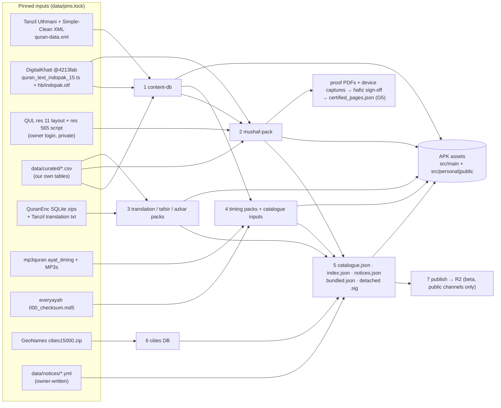
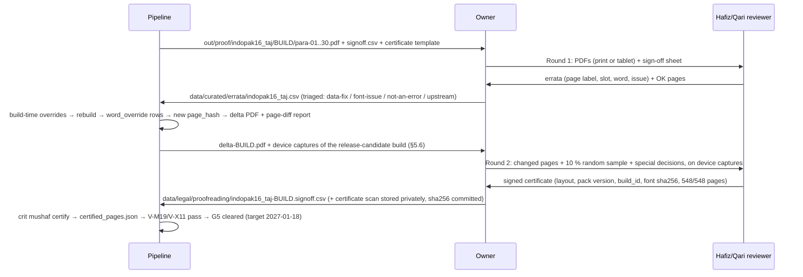

# 08 · Offline Data Pipelines (`tools/`)

**Purpose.** This doc specifies every offline tool that turns upstream Quran data into the files the app ships or downloads. It covers:
- the read-only content DB;
- the typeset mushaf layout packs with precomputed justification;
- translation, tafsir and azkar packs;
- audio timing packs and the reciter catalogue;
- the signed pack index, the signed notices file (F-PL-11) and the Hijri month-start feed;
- the offline city DB;
- the per-tier eligibility manifest (`bundled.json`) and the G5 page-hash list (`certified_pages.json`);
- publishing to Cloudflare R2.

For each tool it gives the repo layout, pinned inputs, stage-by-stage pseudocode, which owner doc's schema the output follows, the full list of validation invariants that CI enforces, the CI jobs and the proofreading workflow. The device never shapes, justifies, parses upstream formats or validates timings: it opens SQLite files and draws. The doc is written so an engineer or AI agent can implement `tools/` without redoing the research.

**Status:** Draft v2, 2026-10-19 (revised after cross-doc review)

**Schema ownership.** This doc owns the pipeline, its outputs, file names and V-checks. It does **not** own the schemas it writes:

| Output | Schema owner |
|---|---|
| `quran_content.db` DDL | [04 §7.2](04-architecture.md) |
| Translation, tafsir, cities and azkar pack shapes | [04 §7.3](04-architecture.md), with azkar tables per [07 §9.2](07-companion-engagement-features.md) |
| `index.json` and `notices.json` | [04 §7.6 / §14.3](04-architecture.md) |
| `bundled.json` and asset paths | [04 §7.7 / §11.2](04-architecture.md) |
| Mushaf-pack DDL and the justification contract | [05 §3.3 / §4](05-mushaf-rendering-engine.md) |
| Timing-pack DDL, `catalogue.json` and recitation IDs | [06 §5.1 / §3.2](06-audio-engine.md) |

Where this doc shows a schema, it is an abridged copy for orientation. The owner doc wins.

**Key decisions in this doc**
- **Toolchain.** Python 3.12 + `uv` workspace under `tools/`. Every stage runs as `uv run --frozen python -I -m crit …`. Inputs are pinned by SHA-256 in `data/pins.lock`. Downloaded files are parsed as data and never executed (D-02, D-10).
- **Room-opened DBs.** The content DB and every Room-opened pack (mushaf, translation, tafsir, azkar, cities) are written by **executing the Room-exported schema JSON verbatim**: `createSql`, indices, `contentSyncTriggers`, `setupQueries`. Then `rebuild`/`optimize`, `PRAGMA user_version`, `VACUUM`. CI also emits a `--no-master` copy so `onValidateSchema` actually runs (D-10, D-11). Rows are inserted by the **column names in the exported JSON**, never by a DDL copied into this doc.
- **Timing packs are the one exception.** They are plain SQLite with doc 06 §5.1's DDL, read through `androidx.sqlite`. They have no Room identity table (writer ruling).
- **Canonical word table.** The **DigitalKhatt MIT token stream (83,669 tokens)**, keyed to Kufan verse keys. QUL positions are mapped 1:1 except 72:16 (D-06).
- **Indexing tables.** Para, Manzil, Ruku, Sajda, Quarters, aliases, passages and surah headers are **our own curated CSVs**, cross-checked against the print-verified facts (D-07).
- **Mushaf layout.** The **QUL resource 11 export** (or the clean-room grid if G1 fails) is joined to DK tokens. Justification is precomputed offline with **doc 05 §4.3's algorithm**: integer x-fractions, kashida and plain variants, `cv01` ≤ 3 steps. The font is DK IndoPak converted from CFF2 to glyf (D-04, D-05, D-06).
- **Timing packs** come only from the **mp3quran `ayat_timing` + the same host's audio**. They go through the g03 normaliser (relabel, clamp, onset snap, per-surah disable), with ETag/length/sha256 guards (D-12, D-13).
- **Signing.** Every remote JSON (`index.json`, `catalogue.json`, `notices.json`, `feeds/hijri-pk.json`) is plain JSON carrying `kid`, `sequence` and `expiresAt`. It has a **detached `X.json.sig`**: base64 of the 64-byte Ed25519 signature over the exact file bytes (doc 04 §7.6). The private key is offline on the owner's machine and **never in CI**. Two public keys are compiled into the app (D-10, D-15, D-24, D-30).
- **Hosting.** An R2 bucket behind a brand-neutral custom domain (`CDN_BASE_URL`, doc 04 §1). Packs and audio use immutable versioned paths. Signed JSON uses short-TTL mutable paths. Uploads go through `rclone` (D-24).
- **Eligibility** travels with every dataset as `licenceStatus` (5 values: `PERMITTED`, `HOST_GRANT`, `PENDING`, `PERSONAL_ONLY`, `REVOKED`), free-text `basis`, `eligibleTiers` (subset of `PERSONAL`, `BETA`, `PUBLIC`), `commercialOk` and `fossOk` (final naming ruling). The pipeline builds per **content tier** `PERSONAL` / `BETA` / `PUBLIC` plus the `MONETIZED` flag (D-29). The CI gate:
  - blocks non-commercial content when `MONETIZED`;
  - blocks `PENDING`/`PERSONAL_ONLY` content from PUBLIC, and `PERSONAL_ONLY` from BETA;
  - blocks any layout that is neither G1-cleared nor clean-room from BETA and PUBLIC.

  `PERSONAL` outputs are bundled only and **never uploaded to R2** (D-09, D-12, D-17, D-22, D-29).

Related: [Content & licensing](03-content-data-licensing.md) · [Architecture](04-architecture.md) · [Mushaf rendering](05-mushaf-rendering-engine.md) · [Audio engine](06-audio-engine.md) · [Companion features](07-companion-engagement-features.md) · [Roadmap](09-roadmap-backlog.md) · [Quality & CI](10-quality-testing-ci.md) · [Release & compliance](11-release-compliance-business.md) · [Decisions & risks](12-decisions-risks.md)

---

## 1. Overview



| # | Stage | Tool dir | Output | Ships how | Release |
|---|---|---|---|---|---|
| 1 | content-db | `tools/data-pipeline` | `quran_content.db`, `normalization_vectors.json` | APK asset (`createFromAsset`) | v1.0 (P0 v0, P1 v1); `daily_ayah` rows v1.1 |
| 2 | mushaf-pack | `tools/mushaf-pipeline` | `mushaf.indopak16_taj.dk@<ver>.db`, `criterion_indopak.ttf`, proof PDFs, `certified_pages.json` | Bundled pack per tier; later layouts downloadable | v1.0 (P0 font, P1 pack, G5 sign-off 2027-01-18) |
| 3 | translation / tafsir / azkar packs | `tools/packs` | `ur.junagarhi.qe@<ver>.db`, `en.saheeh.qe@<ver>.db`, `azkar.core@<ver>.db`, … | 2 translations bundled (D-09); the rest downloadable | v1.0 bundled translations; v1.1 downloadable packs (F-TR-02) and azkar (F-CP-06); P3 tafsir |
| 4 | timing packs | `tools/audio-timing` | `<packId>@<ver>.db`, e.g. `timing.alafasy.mp3q123@1.db` (plain SQLite) | 12 PUBLIC timing packs bundled (doc 06 §5.1); updates through the index | v1.0 |
| 5 | catalogue, index, notices, eligibility manifest, signing | `tools/catalogue` | `catalogue.json`, `index.json`, `notices.json` (+ `.sig` each), `bundled.json` per tier | Bundled copies plus remote override | v1.0 for the catalogue override, `notices.json` (F-PL-11) and `bundled.json`; v1.1 for the remote `index.json` (pack system, doc 09 B8) |
| 6 | cities DB | `tools/packs` (`geonames`) | `cities@<ver>.db` | Bundled pack | v1.0 (prayer times, F-CP-01) |
| 6b | Hijri PK feed | `tools/catalogue` (`hijri`) | `feeds/hijri-pk.json` + `.sig` | Remote only | v1.0 (F-CP-04) |
| 7 | publish | `tools/catalogue` (`publish`) | R2 objects | CDN | v1.0 → ongoing |

---

## 2. Repository layout

```
tools/
  pyproject.toml            # uv workspace root (members below); ruff + pytest config
  uv.lock                   # exact versions + hashes (committed)
  .python-version           # 3.12.x (exact patch recorded at P0)
  .uv-version               # uv version used by CI (setup-uv reads it)
  pipeline.toml             # paths, asset destinations, tunables (gap/kashida params), CDN host
  justfile                  # short aliases for the canonical commands (optional sugar)
  crit/                     # thin CLI dispatcher: python -I -m crit <stage> <cmd>
  common/criterion_common/
    pins.py                 # read/verify/update data/pins.lock; cache dir resolution
    fetch.py                # HTTP GET with ETag, size, sha256; rate limit; no redirects to new hosts
    roomdb.py               # write SQLite from Room schema JSON (generalised build_content_db.py)
    normalize.py            # Arabic / Urdu / English normalisers (spec §4.4) — mirrored in Kotlin
    quran_ref.py            # surah ayah counts, global id <-> s:a, Kufan keys
    registry.py             # data/curated/content_registry.yaml (licenceStatus, basis, eligibleTiers, commercialOk, fossOk, attribution)
    tiers.py                # ONE eligibility function shared by every gate (§8.6); mirrors doc 04 ContentPolicy
    sign.py                 # Ed25519 detached-signature create/verify over exact file bytes (§8.4)
    report.py               # JSON + Markdown run reports (posted by CI)
  data-pipeline/criterion_data/
    tanzil.py  dk_text.py  dk_numbering.py  qul_script.py  align.py
    curated.py  derive_rukus.py  build_content.py  validate_content.py  vectors.py
  mushaf-pipeline/criterion_mushaf/
    fontconv.py             # CFF2 -> glyf (from spikes/.../cff2_to_glyf.py) + rename
    fontcheck.py            # feature table + width vectors (from font_features.py, hb_widths.py)
    shape.py                # uharfbuzz shaping cache: token -> advances + ink box at cv01 0..3
    qul_layout.py           # read res-11 export, restore 16-slot grid
    quirks.py               # p.529 fix, sar-lauh remap, three-part headers, build-time text overrides/errata
    justify.py              # doc 05 §4.3 solver (page em, kashida + plain variants, vertical metrics)
    markers.py  furniture.py  build_pack.py  validate_pack.py
    hashes.py               # per-page text-layer hash + ornament-layer hash (§5.6)
    certify.py              # signoff.csv + certificate → certified_pages.json (§14)
    proof.py                # SVG -> PDF/PNG proof renders, sign-off sheet, certificate template
    oracle.py               # LOCAL ONLY: diff vs scraped previews / Waqar (never in CI)
    rebreak.py              # G1-fallback tool (clean-room line breaker + correction UI backend)
  audio-timing/criterion_timing/
    mp3quran.py  mp3probe.py  letters.py  shift.py  onset.py
    normalise.py  build_timing.py  gapped_checks.py  validate_timing.py  drift.py
  packs/criterion_packs/
    quranenc.py  tanzil_trans.py  build_translation.py  build_tafsir.py  build_azkar.py
    geonames.py  validate_pack.py
  catalogue/criterion_catalogue/
    build_catalogue.py  build_index.py  build_notices.py  build_bundled.py  hijri.py
    keys.py  publish.py  verify_live.py
    schemas/                # JSON Schemas copied from docs 04 §7.6/§14.3 and 06 §3.2 (V-X01)
    test_vectors/           # {json bytes, .sig} pairs incl. tampered + rolled-back cases (exported to app tests)
  tests/                    # pytest; tiny fixtures only (no upstream data committed)
data/
  pins.lock                 # TOML, every upstream input (§3)
  curated/                  # our own facts, hand-verified (§3.3)
    paras.csv  manzils.csv  sajdas.csv  para_quarters.csv  ruku_print_checks.csv
    surahs.csv  surah_headers.csv  aliases.csv  passages.csv  passage_ranges.csv
    daily_ayah.csv                                      # v1.1 (F-CP-08/09)
    azkar/categories.csv  azkar/dhikr.csv  azkar/dhikr_translation.csv   # v1.1 (F-CP-06)
    taj16_empty_slots.csv  taj16_text_overrides.csv  skeleton_whitelist_qul.csv
    skeleton_whitelist_tanzil.csv  reciters.yaml  content_registry.yaml  ummalqura_months.csv
    errata/indopak16_taj.csv
  notices/*.yml                       # one file per notice (F-PL-11); source of notices.json (§8.3)
  keys/content-signing-<kid>.pub      # public keys only
  legal/permissions.yml               # machine-readable grant status per dataset (drives CI gates)
  legal/evidence/*.sha256             # hashes of archived statements (files themselves private)
  legal/proofreading/<layout>-<build>.signoff.csv   # G5 sign-off rows (certificate scans private, hash committed)
  legal/proofreading/<layout>.certified_pages.json  # G5 page-hash list (§14), committed
out/                                  # git-ignored build outputs and reports
```

**Rules.**
- `~/criterion-data/` (outside the repo) is the **private input store**. It holds QUL exports, King Fahd Complex ZIPs, the scraped-preview oracle, the Waqar clone, the owner's checkpoint photos and archived statements. Raw QUL exports sit in the gitignored `data/private/` symlink to it. CI reads the private inputs it needs from a private R2 bucket (`criterion-private`, read-only token). **Taj scans and owner photos never enter the repo, CI artifacts or app assets** (g02 Rec 12).
- Upstream files are parsed with explicit parsers: XML via `xml.etree`, DK `.ts` via string-literal extraction, `quran-data.js` never `eval`'d, SQLite via `sqlite3` read-only URI. Each download lands in its own fresh directory under the cache. No third-party build script is ever run.
- GPL sources (quran_android, QuranApp) are never read by `tools/` code. Waqar144 and preview data are used **only** by `oracle.py`, locally (D-06, D-18).

**Generated assets in git (lead ruling).**
- **Only public-eligible generated assets are committed**, through **Git LFS** (`*.db`, `*.ttf` under `core/content/src/main/assets/`, `app/src/main/assets/` and `app/src/public/assets/`). Build outputs first land in the gitignored `out/`. This covers the Tanzil/DK-based content DB, the font, a G1-cleared or clean-room layout pack, the bundled QuranEnc translations, the PUBLIC timing packs, the cities pack, and the BETA/PUBLIC catalogue. Android Studio builds of the public flavour therefore need no Python. CI rebuilds these files and checks reproducibility (§12).
- **QUL-derived (G1-pending) packs and any personal-only content are never committed to git or LFS.** `crit` writes them to the gitignored `data/private/out/`, a symlink into `~/criterion-data`. At build time, the Gradle task `syncPersonalAssets` (in the `criterion.content.eligibility` plugin, doc 04 §11.3) copies them into the **gitignored** `app/src/personal/assets/packs/` and `…/audio/`. A personal build on a machine without `~/criterion-data` fails with a clear message instead of shipping without a layout.
- `crit install-assets --tier <T>` writes both locations, and a pre-commit hook rejects any staged file under `app/src/personal/assets/` or any LFS object whose `bundled.json` entry is not PUBLIC- or BETA-eligible.

Destinations follow doc 04 §7.7/§11.2 and doc 06 §5.1, and are configured in `pipeline.toml`:

| Output | Destination | In git? |
|---|---|---|
| `quran_content.db` | `core/content/src/main/assets/content/quran_content.db`: module `:core:content`, asset path `content/quran_content.db` = `QuranContentDb.ASSET` (doc 04 §7.2). It merges into every variant | LFS (eligible in every tier: Tanzil CC BY, DK MIT, our curated tables) |
| `criterion_indopak.ttf` + `OFL.txt` | `app/src/main/assets/fonts/criterion_indopak.ttf` (doc 05 §3.1) and `app/src/main/assets/licenses/OFL-1.1.txt` | LFS (OFL, every tier) |
| `normalization_vectors.json` | `core/model/src/test/resources/` (test only, never shipped) | yes |
| Mushaf layout pack `mushaf.indopak16_taj.dk@<ver>.db` | PERSONAL: `app/src/personal/assets/packs/mushaf_layout/` (QUL-derived allowed). BETA/PUBLIC: `app/src/public/assets/packs/mushaf_layout/` **only** if G1-cleared or clean-room; otherwise the directory is empty and the public build fails (doc 04 §11.3). Never `src/main` | personal copy: **no** (build-time copy). Public copy: LFS |
| Bundled translations `ur.junagarhi.qe`, `en.saheeh.qe` | `app/src/{personal,public}/assets/packs/translation/<id>@<ver>.db` | public copy LFS; the personal copy is the same file, copied at build time |
| Timing packs (12 PUBLIC gapless recitations, doc 06 §4.1–4.2) | `app/src/{personal,public}/assets/packs/timing/<packId>@<ver>.db`, listed in `bundled.json` (doc 06 §5.1 "Bundling") | public copy LFS |
| Cities pack | `app/src/{personal,public}/assets/packs/cities/cities@<ver>.db` | public copy LFS |
| `catalogue.json` + `.sig` | `app/src/{personal,public}/assets/audio/catalogue.json` (doc 04 §7.7). The public-source-set copy is generated for BETA, and regenerated for PUBLIC at release | public copy: yes. Personal copy: **no** |
| `personal-overlay.json` | `app/src/personal/assets/audio/` only. Original-host URLs for personal-only items; never uploaded (doc 04 §11.2) | **no** |
| `bundled.json` | `app/src/{personal,public}/assets/content/bundled.json` | public copy: yes |
| `index.json` + `.sig` (seed snapshot) | `app/src/{personal,public}/assets/remote-seed/` | public copy: yes (v1.1) |

**Tier vs. source set.** The `public` flavour source set serves both BETA and PUBLIC builds (doc 04 §11.1). By default a public-flavour build is BETA, so the committed `src/public` assets are generated with `--tier BETA`. Only the mushaf layout pack is tier-independent there: it must be G1-cleared or clean-room in both tiers. The production release workflow (`-Pcriterion.release=production`) first re-runs `crit install-assets --tier PUBLIC` and `crit validate all --tier PUBLIC` (§12). Those steps drop PENDING items and require G5.

---

## 3. Inputs, pins and curated data

### 3.1 Toolchain pins

| Item | Pin | Note |
|---|---|---|
| Python | 3.12.x via `uv python install` (uv-managed CPython; exact patch in `.python-version`) | Fixes the bundled SQLite version, so the content DB is byte-reproducible. Preflight asserts `sqlite3.sqlite_version ≥ 3.45` and that FTS5 + `trigram` are available |
| uv | version in `tools/.uv-version` (set at P0) | `uv sync --frozen` only; `uv.lock` committed |
| uharfbuzz | `==0.56.3` (HarfBuzz 14.6.0) | Widths verified identical to Android Minikin/HarfBuzz 2.6.4 for `cv01` (g04 §2.7) |
| fontTools | `==4.67.*`, locked exactly | `Cu2QuPen` conversion, name table, SVG pen |
| cryptography (pyca) | locked at P0 | Ed25519 sign/verify (detached `.sig`) |
| numpy | locked at P0 | RMS energy envelopes (onset snap), correlation |
| cairosvg + pypdf | locked at P0 | Proof SVG → PDF/PNG, merge per Para (system `libcairo2` on the CI image) |
| ffmpeg CLI | ≥ 6 from the CI image (`apt`), version recorded in run report | Decode MP3 → 8 kHz mono s16 for onset snapping only. Tool only, never shipped |
| rclone | ≥ 1.6x, version recorded | R2 uploads (S3 API) |
| ruff, pytest, jsonschema | locked | Lint, unit tests, JSON schema validation |

**Canonical invocation** (documented in `tools/README` and wrapped by `justfile`):

```bash
cd tools && uv sync --frozen
uv run --frozen python -I -m crit fetch all            # verify/download pinned inputs into cache
uv run --frozen python -I -m crit content build        # stage 1 (+ normalization_vectors.json)
uv run --frozen python -I -m crit mushaf build indopak16_taj   # stage 2 (needs private inputs)
uv run --frozen python -I -m crit mushaf proof indopak16_taj   # proof PDFs + proof-manifest.json
uv run --frozen python -I -m crit mushaf certify indopak16_taj # signoff.csv → certified_pages.json (§14)
uv run --frozen python -I -m crit packs build ur.junagarhi.qe
uv run --frozen python -I -m crit timing build alafasy.murattal.mp3q123
uv run --frozen python -I -m crit catalogue build --channel beta|public
uv run --frozen python -I -m crit index build --channel beta|public     # v1.1 (pack system)
uv run --frozen python -I -m crit notices build                         # F-PL-11
uv run --frozen python -I -m crit validate all --tier PERSONAL|BETA|PUBLIC [--monetized]   # every invariant in §11
uv run --frozen python -I -m crit install-assets --tier PERSONAL|BETA|PUBLIC   # copy to app/src/{main,personal,public}/assets + bundled.json
uv run --frozen python -I -m crit sign catalogue|index|notices|hijri    # owner machine only; writes X.json.sig
uv run --frozen python -I -m crit publish --channel beta|public --dry-run|--go   # owner machine only; never 'personal'
```

`justfile` aliases: `just fetch`, `just content`, `just mushaf`, `just proof`, `just certify`, `just packs`, `just timing`, `just validate`, `just assets`, `just ci` (lint + tests + build + validate + repro), `just notice` (build + validate + sign notices), `just sign`, `just publish`.

### 3.2 `data/pins.lock` (TOML)

Each entry: `id`, `url`, `version`, `retrieved_at`, `sha256`, `bytes`, `licence`, `downloader` (`auto` | `owner-login` | `owner-manual`), `storage` (`cache` = re-downloadable, git-ignored; `private` = `~/criterion-data` + private R2; `oracle` = local QA only), `used_by`. `crit fetch` fails if a hash changes, unless it is run with `--accept-update <id>`. That flag rewrites the pin and records the old hash in `pins.history`.

```toml
[[input]]
id = "tanzil.uthmani"
url = "https://tanzil.net/pub/download/index.php?quranType=uthmani&outType=xml&marks=true&sajdah=true&rub=false&tatweel=true&agree=true"
version = "1.1"
sha256 = "<fill at P0>"
licence = "CC BY 3.0, verbatim copies only (tanzil.net/docs/text_license)"
downloader = "auto"; storage = "cache"; used_by = ["content"]
```

| id | URL / location | Version / pin | Licence | Downloader → storage | Used by |
|---|---|---|---|---|---|
| `tanzil.uthmani` | `https://tanzil.net/pub/download/index.php?quranType=uthmani&outType=xml&marks=true&sajdah=true&rub=false&tatweel=true&agree=true` | v1.1, sha256 TBD | CC BY 3.0, verbatim (r05 §2.8) | auto → cache | content |
| `tanzil.simple_clean` | same with `quranType=simple-clean` | v1.1 | same | auto → cache | content |
| `tanzil.metadata` | `https://tanzil.net/res/text/metadata/quran-data.xml` | sha256 TBD | CC BY 3.0 | auto → cache | content (counts, Madani juz/hizb, manzil, ruku-556 cross-check, revelation type/order) |
| `dk.repo` | `https://github.com/DigitalKhatt/digitalkhatt.org` @ `4213fab…` (full SHA recorded at P0) | commit | MIT (code + text) | auto (git archive of the single paths) → cache | content, mushaf |
| `dk.text15` | `ClientApp/src/app/services/quran_text_indopak_15.ts` @ commit | sha256 TBD | MIT; upstream QuranWBW/QUL res 59 (g01 §2.2.3), so credit both | auto → cache | content, mushaf (hafizi15 later) |
| `dk.font` | `ClientApp/src/assets/fonts/hb/indopak.otf` @ commit | 2,569,560 B, sha256 `8110e0c3…` (full hash at P0) | SIL OFL 1.1 | auto → cache | mushaf. **Never** the QUL CDN `DigitalKhattIndoPak.otf`, which has no cv features (g04 §2.7) |
| `qul.res11` | `https://qul.tarteel.ai/resources/mushaf-layout/11` (SQLite export; login) | export date + sha256 | Unstated; **ship only after G1** | owner-login → private | mushaf |
| `qul.res565` | QUL Quran-script resource 565, DK Indo-Pak WBW SQLite (resource 59 if 565 lacks `word_key`); path confirmed at download | export date + sha256 | Unstated; G1 | owner-login → private | content (QUL map + skeleton check), mushaf |
| `qul.res65` | QUL ruku metadata 65 (optional cross-check) | sha256 | Unstated | owner-login → private | validate only |
| `quranenc.ur.junagarhi` | `https://quranenc.com/downloads/sqlite/urdu_junagarhi.zip` + version from `https://quranenc.com/api/v1/translations/list/ur` | v1.1.3 (zip 2.1 MB; sqlite 6.16 MB) | QuranEnc republish terms (7 conditions) | auto → cache | packs (bundled) |
| `quranenc.en.saheeh` | `https://quranenc.com/downloads/sqlite/english_saheeh.zip` + `…/translations/list/en` | v1.1.2 (sqlite 1.25 MB) | QuranEnc terms | auto → cache | packs (bundled) |
| `quranenc.*` (P2) | `english_hilali_khan`, `hindi_omari` (v1.1.5), `indonesian_affairs`, `turkish_rwwad`, `english_rwwad`, `pashto_rwwad`, `punjabi_arif` | per list API | QuranEnc terms | auto → cache | packs |
| `tanzil.tr.*` (P2) | `https://tanzil.net/trans/?transID=ur.jalandhry&type=txt-2`, `ur.kanzuliman`, `en.pickthall`, `bn.bengali` | sha256 | Tanzil: **non-commercial** file terms | auto → cache | packs |
| `quranenc.tafsir.ur.saadi` (P3) | `https://quranenc.com/api/v1/tafsir/sura/urdu_saadi/{n}` ×114 | version | QuranEnc terms | auto → cache | packs |
| `mp3quran.reads` | `https://www.mp3quran.net/api/v3/ayat_timing/reads` | JSON sha256 | Host statement archived (D-12) | auto → cache | timing |
| `mp3quran.timing.<read>` | `https://www.mp3quran.net/api/v3/ayat_timing?surah={1..114}&read={read}` | per-surah JSON sha256 | same | auto → cache | timing |
| `mp3quran.reciters` | `https://www.mp3quran.net/api/v3/reciters?language=eng` | sha256 | same | auto → cache | catalogue (server/folder URLs) |
| `mp3quran.audio.<read>` | `{folder_url}{sss}.mp3` ×114 (from the API; `www.` host for the API) | per file: Content-Length, ETag, sha256 | same | auto → cache (streamed, deleted after hashing/decoding) | timing |
| `mp3quran.statement` | `https://mp3quran.net/eng/privacy` + contact page (archived HTML/PDF) | sha256 + date | evidence | owner-manual → private (hash in `data/legal/evidence/`) | registry |
| `everyayah.md5.<folder>` | `https://everyayah.com/data/{folder}/000_checksum.md5` | sha256 | No site licence; personal/PENDING (D-12) | auto → cache | timing (gapped manifest) |
| `kfc.zips.<reciter>` | King Fahd Complex per-ayah/per-surah ZIPs (geo-blocked; owner fetches from PK) | sha256 per ZIP | "free general use" (search-verified); permission email | owner-manual → private | publish (self-host after permission) |
| `geonames.cities15000` | `https://download.geonames.org/export/dump/cities15000.zip` (+ `readme.txt`) | dump date, sha256; 3.36 MB, 34,173 rows on 2026-10-19 | CC BY 4.0 | auto → cache | geo |
| `oracle.qul_previews` | 548 scraped `/mushaf_layouts/7?page_number=N` HTML (already fetched in research) | sha256 of tarball | Tarteel ToS: no copying → **oracle only; delete once `qul.res11` arrives** | private → oracle | oracle.py |
| `oracle.waqar144` | `Waqar144/quran_memorization_helper` @ `b6470fb` | commit | MIT label, QUL-derived → oracle only | auto → oracle | oracle.py |
| `owner.checkpoints` | Owner's photos of printed pp. 2, 39, 70, 115, 483 of his own copy (g02 §4) | sha256 | private | owner-manual → private | manual check only |

### 3.3 Curated data (`data/curated/`, our own facts)

All CSVs are UTF-8 with a header row, LF line endings, and are sorted. Each has a `source` or `verified_source` column, e.g. `taj16-scan p.70 L7` or `tanzil` or `computed`. The validator owns the cross-checks (§11).

| File | Columns | Rows | Seed / verification |
|---|---|---|---|
| `paras.csv` | `para, arabic_name, printed_header_form, roman_name, english_name, start_verse` (Indo-Pak, `s:a`), `madani_start_verse, start_page_index, start_page_label, ayah_count, ruku_count_by_end, margin_label, name_ur, verified_source` (field set per doc 03's Para table) | 30 | Loaded into `para` (doc 04 §7.2: `name_ar` ← `arabic_name`, `name_ur`, `name_roman` ← `roman_name`, `start_ayah_id`, `end_ayah_id`, `madani_start_ayah_id`). The other fields are cross-checks: `start_page_index`/`start_page_label` against V-M05, `ayah_count`, `ruku_count_by_end` against V-C12, and `printed_header_form`/`margin_label` against the furniture strings (§5.5). r05 §2.3.2 table. Names are hand-typed with Indo-Pak diacritics. Starts follow D-07: 7 differ from Madani (3:92, 5:83, 9:94, 15:2, 27:60, 29:45, 36:22). Page indices: **Para 1 = index 1** (label 2); Para *n* = 18n−16 **for n = 2..28 only** (20, 38, 56, …, 488); P29 = 508; P30 = 528 |
| `manzils.csv` | `manzil, start_surah, start_ayah, taj16_page_index, taj16_qul_line` | 7 | 1:1, 5:1, 10:1, 17:1, 26:1, 37:1, 50:1. Pages/lines (1,2), (96,3), (187,4), (254,2), (330,5), (401,14), (466,7) (g01 §2.4) |
| `sajdas.csv` | `surah, ayah, number, kind, label_ar` | 15 | 7:206, 13:15, 16:50, 17:109, 19:58, 22:18, 25:60, 27:26, 32:15, 38:24, 41:38, 53:62, 84:21, 96:19 numbered 1–14 in mushaf order (`kind=hanafi`, doc 04 §7.2). **22:77** `number` NULL, `kind=shafii_only`, label «السجدة عند الامام الشافعی رح» (g02 §2.6) |
| `para_quarters.csv` | `para, quarter(1..3), surah, ayah, after_word_pos, verified_source` | 90 | g02 Appendix A, with the 3 print corrections: P4 ¾ = 3:198; P7 ¼ = 5:113; P7 ¾ = 6:73 `word_pos=10` (the «۵» after فَيَكُوْنُ). 37 print-verified so far; the remaining 53 are hand-checked before public release. **Never derived from Madani rub** |
| `ruku_print_checks.csv` | `surah, first_ayah, last_ayah, n1, n2, n3, scan_ref` | 29 | g02 §2.3 decoded triples (top/in-ع/bottom) |
| `surahs.csv` | `surah, name_ar, name_ur, name_roman, name_en, meaning_ur, meaning_en, revelation, revelation_order, roman_aliases` | 114 | Hand-curated; revelation/order cross-checked with Tanzil metadata. No QF payloads copied (r05 §2.8) |
| `surah_headers.csv` | `layout, surah, variant, title_text, right_text, left_text, verified_source` | 114 (`layout=indopak16_taj`) | Goes into the mushaf pack's `surah_header` table (doc 05 §3.3), not the content DB. Generated draft «سورة {name} {مكية/مدنية} وهي {N} آية و{M} ركوعات» (single-ruku surahs omit M; Fatiha «وهي سبع آيات»), then hand-proofed against the print (≈75 verified in g02). `THREE_PART` split proofed per doc 05 §5.3 |
| `aliases.csv` | `term, lang(roman/ur/ar/en), target_type(surah/ayah/passage/para/manzil), target, weight` | ~150 | Becomes `alias(id, term_norm, lang, target_type, target_id, weight)` (doc 04 §7.2). `target` is written human-readably (`36`, `2:255`, `manzil_dua`) and resolved to the integer `target_id`. r05 §2.7.5: yasin/yaseen/ya-sin/یس → 36; rahman/rehman → 55; mulk/tabarak → 67; kahf → 18; waqia/waqiah → 56; muzammil; ayatul kursi/آیت الکرسی → 2:255; "last 2 of baqarah" → passage `baqarah_end`; "manzil" → **both** passage `manzil_dua` and the Manzil index (doc 07 §9.3) |
| `passages.csv` | `id, code, title_en, title_ur, title_ar, sort_order, is_quick_access` | ~10 | Becomes `passage` (doc 04 §7.2). F-IX-08 quick access: Yaseen, Rahman, Mulk, Waqiah, Kahf, Ayatul Kursi, last two ayat of Baqarah, Manzil dua |
| `passage_ranges.csv` | `passage_code, seq, from_surah, from_ayah, to_surah, to_ayah` | ~30 | Becomes `passage_range(passage_id, seq, from_ayah_id, to_ayah_id)`. `manzil_dua` = the 18 ranges / 79 ayahs of doc 07 §9.3 (Kandhlawi compilation). They **must be checked against a cited printed Manzil booklet** before public release (open issue 4) |
| `daily_ayah.csv` (v1.1) | `day_of_year(1..366), from_surah, from_ayah, to_surah, to_ayah, theme, reviewed_by` | 366 | F-CP-08 ayah-of-the-day widget and F-CP-09 daily-ayah reminder (doc 07 §12). Curated by the owner, scholar-reviewed (`reviewed_by` required for BETA/PUBLIC). Row 366 is used only in leap years |
| `azkar/categories.csv`, `azkar/dhikr.csv`, `azkar/dhikr_translation.csv` (v1.1) | Columns = doc 07 §9.2 entities (`dhikr_category`, `dhikr`, `dhikr_translation`), snake_case | 345 Arabic rows (osamayy/azkar-db) + translations | Built into the `azkar.core` pack (§9.3). Every `dhikr` needs `reference`, `licence` and, for BETA/PUBLIC, `reviewed_by`. Fadha'il text is excluded |
| `taj16_empty_slots.csv` | `page_index, slot` | 24 | p.1 slots 8–16, p.2 slots 1–9, p.548 slots 11–16 (g01 §2.4). Used to restore the exporter-dropped empty lines |
| `taj16_text_overrides.csv` | `scope(script/layout), surah, ayah, pos, old_sha256, new_text, reason, decided_by` | small | `script` rows change the content DB `word.text`: the Fatiha end-marker Kufan digits, the 1:7:4 RLO strip, and the 59:13:1 and 27:21 spellings once the hafiz decides. `layout` rows change only the pack `word.text`, e.g. the Taj bare ۝ for 1:1–1:7. All of them are **build-time** overrides. The `word_override` table in the pack, if doc 05 keeps it, only records the overrides that were applied. It is never a remote hotfix channel (D-30, writer ruling) |
| `skeleton_whitelist_qul.csv` | `qul_key, dk_text, qul_text, nature` | 3 | {4:112:3, 18:19:34, 59:13:1} (D-06) |
| `skeleton_whitelist_tanzil.csv` | `verse_key, dk_skel, tanzil_skel, reviewed_by` | frozen at P0 | Generated once from the first full run, reviewed, then frozen. New diffs fail CI |
| `reciters.yaml` | per recitation: id (doc 06 format, e.g. `alafasy.murattal.mp3q123`), timing `packId` (doc 06, e.g. `timing.alafasy.mp3q123`), reciter names (en/ar/ur), style, riwayah, layout, host, read id / folder, basmala strategy, attribution, `licenceStatus`, `basis`, `commercialOk`, `fossOk`, expected `highlightDisabledSurahs`, blocklists (`eligibleTiers` is derived, §8.6) | ~30 | D-12 shortlist; ids and fields per doc 06 §3.2 and §4 |
| `content_registry.yaml` | per dataset: id (doc 03 `DS-xx`), title, source_url, licence, attribution id + strings (en/ur, `ATTR-xx`), credits `section`/`sort`, notice, `licenceStatus` (`PERMITTED`/`HOST_GRANT`/`PENDING`/`PERSONAL_ONLY`/`REVOKED`), `basis` (free text, e.g. `open_licence`, `host_grant`, `written_permission PERM-01`, `clean-room`), `eligibleTiers` (subset of `PERSONAL`, `BETA`, `PUBLIC`), `commercialOk`, `fossOk`, `requiredGates` (e.g. `[G1, G5]`), `permission_ref` | all | Owned by doc 03 (`LicenceInfo`, doc 03 §4.1). The pipeline copies it into packs (`pack_info`), the index, the catalogue, `bundled.json`, and the content-DB `source` + `attribution` tables |
| `errata/indopak16_taj.csv` | `report_id, page_label, slot, word, issue, reviewer, status, resolution, build_id` | grows | Proofreading loop (§14) |
| `ummalqura_months.csv` | `hijri_month, civil_start` | 180 (1446–1460 AH) | Exported from `java.time` `HijrahDate` by a JVM test; sanity bound for the PK feed (§9.2) |

`data/legal/permissions.yml` (machine-readable, from doc 03/11):
```yaml
qul_res_11: {status: pending, requested: 2026-10-2x, scope: null}   # G1
qul_res_565: {status: pending}
dk_text_mit_confirmation: {status: pending}
mp3quran_statement: {status: archived, evidence_sha256: "<…>"}
alafasy_berhad: {status: pending}
```
For BETA and PUBLIC tiers, CI fails if any bundled or listed item has a `permission_ref` whose status is not `granted` or `archived`, unless the tier rules in §8.6 allow it. For example, PENDING audio is allowed in BETA.

---

## 4. Stage 1: content-db (`tools/data-pipeline`)

### 4.1 Output schema (contract with `:core:content`)

**Schema = doc 04 §7.2, verbatim.** The Room entities of `QuranContentDb` in `:core:content` are the source of truth. The pipeline executes their exported schema `core/content/schemas/<fqcn QuranContentDb>/<N>.json` and **inserts by the column names in that JSON**. This doc keeps no DDL copy, so the two cannot drift. If an entity changes, the builder's column mapping below must change in the same PR; V-C20 fails otherwise. All ayah references use the **global Kufan ayah id 1..6236** (`ayah.id`, mushaf order).

What the pipeline writes into each doc 04 table:

| Doc 04 table | Rows | Filled from |
|---|---|---|
| `surah` (incl. `basmala_kind` 'verse' for 1, 'none' for 9, 'header' otherwise) | 114 | `surahs.csv` + Tanzil metadata counts; `ruku_count` from the derived rukus |
| `ayah` (`surah_id`, `ayah_no`, verbatim `text_uthmani`/`text_imlaei`, `para_id`, `manzil_id`, `ruku_id`, `juz_madani`, `rub_madani`, `first_word_index`, `last_word_index`, `letters`) | 6,236 | Tanzil XML (verbatim, D-08), curated Para/Manzil, derived rukus, Tanzil metadata (Madani), DK token ranges. `letters` is the simple-clean letter count, also used by the timing QA (§7.2) |
| `para` (`name_ar`, `name_ur`, `name_roman`, `start_ayah_id`, `end_ayah_id`, `madani_start_ayah_id`) | 30 | `paras.csv` |
| `manzil` | 7 | `manzils.csv` |
| `ruku` (`surah_id`, `ruku_in_surah`, `para_id`, `ruku_in_para`, `start_ayah_id`, `end_ayah_id`, `ayah_count`) | 558 | Derived from DK U+08D6 (§4.3) |
| `sajda` (`number`, `kind` 'hanafi'/'shafii_only', `label_ar`) | 15 | `sajdas.csv`, cross-checked with DK U+08DB |
| `para_quarter` (`para_id`, `quarter`, `ayah_id`, `after_word_pos`, `verified_source`) | 90 | `para_quarters.csv`. `verified_source` must be non-NULL for all 90 rows in BETA/PUBLIC (V-C15) |
| `word` (`word_index`, `ayah_id`, `position`, `qul_position`, `is_end`, `text`) | 83,669 | DK token stream after **script-level** overrides. `qul_position` comes from the deterministic DK→QUL rule (identity except 72:16), so it is never NULL. It is verified against `qul.res565` when that input is present |
| `ayah_marker` (`script_id`=1, `word_index`, `surah`, `verse_ayah`, `display_number`, `is_kufan_end`, `disputed_end`, `has_ruku_sign`, `has_sajda_sign`) | 6,354 | DK end tokens + U+08E2 tokens. This is the **only** `ayah_marker` table. Mushaf packs reference it and do not copy it (writer ruling) |
| `ayah_search` (`ayah_id`, `norm_imlaei`, `norm_uthmani`, `norm_indopak`) + `ayah_fts`, `ayah_fts_tri` | 6,236 | §4.4 normalisers. The FTS tables are filled by the content-sync triggers, then `rebuild` + `optimize` |
| `alias` (`id`, `term_norm`, `lang`, `target_type`, `target_id`, `weight`) | ~150 | `aliases.csv` |
| `passage`, `passage_range` | ~10 / ~30 | `passages.csv`, `passage_ranges.csv` (F-IX-08, Manzil dua) |
| `content_meta` (`key`, `value`) | — | Doc 04 keys (`content_version`, `built_at`, `pipeline_git_sha`, `sources_lock_sha256`, `normalizer_version`, `dk_font_sha256`, `content_tier` = `ALL`, because the DB sits in `src/main` and must be eligible in every tier), plus pipeline keys `build_id`, `data_hash`, `schema_identity_hash`, `tanzil_version`, `dk_commit`, `qul_res565_sha256` (or `none`). `built_at` = the commit time of `pipeline_git_sha`, never the wall clock, which keeps the file reproducible |
| `source` (`dataset_id`, `licence_json`) | one per dataset in the DB | `content_registry.yaml` → doc 03 `LicenceInfo` JSON (`licenceStatus`, `basis`, `eligibleTiers`, `commercialOk`, `fossOk`, …) |
| `attribution` (`dataset_id` = `ATTR-xx`, `title`, `title_ur`, `source_url`, `licence`, `version`, `notice_en`, `notice_ur`, `section`, `sort`, `licence_text_asset`) | one per credit string | `content_registry.yaml` (doc 03 ATTR strings). `section` is validated against doc 04's list |
| `daily_ayah` (`day_of_year`, `from_ayah_id`, `to_ayah_id`) | 0 in v1.0; 366 in **v1.1** | `daily_ayah.csv`. `reviewed_by` stays in the CSV and is required for BETA/PUBLIC |

Decisions inside the schema:
- **Fatiha numbering.** `ayah_marker.display_number` is **Kufan** (1:1 = 1 … 1:7 = 7), and the content-DB `word.text` of the 1:1–1:7 end tokens carries those Kufan digits. The Taj "seven empty circles" look is a **layout-level** build-time override: the mushaf pack's `word.text` holds a bare ۝, and its `ayah_display_override` rows record that (§5.1). It is not baked into script data. DK's own Fatiha digits (basmala bare, الحمد = ١, ٦ at عليهم) are discarded (g02 Rec 2).
- **Trigram columns.** Doc 04 §7.2 declares `ayah_fts_tri` over all 3 normalised columns, at about 1.2 MB per column (g04). The pipeline builds whatever the exported schema declares. Narrowing it to `norm_imlaei` alone is doc 04 spike S-4's decision, not a pipeline deviation.
- **Translations are not in the content DB.** They are separate packs, including the two bundled ones (§6), so QuranEnc's "keep updated" condition can be met without an app update.
- **No pipeline-private columns.** Anything the pipeline needs beyond doc 04's entities stays in the curated CSVs or in memory.

### 4.2 Algorithm

```python
def build_content(cfg):
    pins.verify(["tanzil.uthmani", "tanzil.simple_clean", "tanzil.metadata", "dk.text15"])
    schema = room_schema(cfg.content_schema_dir)               # latest N.json
    U  = tanzil.parse_xml(cache("tanzil.uthmani"))             # [(s, a, text)] ×6236, verbatim
    C  = tanzil.parse_xml(cache("tanzil.simple_clean"))
    M  = tanzil.parse_metadata(cache("tanzil.metadata"))       # ayah counts, juz, hizb quarters, manzil, rukus(556), sajdas(15), type/order
    assert len(U) == len(C) == 6236 and counts(U) == M.ayah_counts

    # --- DK token stream (g01 §2.8 step 3)
    pages = dk_text.extract_pages(cache("dk.text15"))          # string literals only; assert 610 pages, 9,131 lines
    toks, headers, basm_skipped = [], 0, 0
    for line in flatten(pages):
        if line.startswith("سُورَةُ "): headers += 1; continue
        t = [x for x in line.split(" ") if x]
        if len(t) == 5 and t[0].startswith("بِسْمِ") and t[-1] == "۝" and headers != 1:
            basm_skipped += 1; continue                         # non-Fatiha basmala line
        toks += t
    assert headers == 114 and basm_skipped == 112 and len(toks) == 83_669
    assert sum(is_end(x) for x in toks) == 6_236 and count_cp(toks, 0x08E2) == 118
    assert count_cp(toks, 0x202E) == 1 and on_end_tokens(toks, 0x08D6) == 558 and on_end_tokens(toks, 0x08DB) == 15
    assert no_standalone_mark_tokens(toks) and distinct_codepoints(toks) == 84   # warn-only if 84 changes

    # --- Kufan keys (dk_numbering.py): walk surahs (header order 1..114), ayah += 1 at each end token
    words = assign_keys(toks)                                   # (word_index, surah, ayah, position, is_end, text)
    assert per_surah_ayahs(words) == M.ayah_counts
    words = overrides.apply(words, "data/curated/taj16_text_overrides.csv", scope="script")   # sha-checked old text
    #   - 1:1..1:7 end tokens -> U+06DD + Kufan digits in DK's own digit block (detected from 2:1 end)
    #   - 1:7:4: drop "U+202E ٦", keep U+08E2 (+ U+06D9 «لا» if the P0 render check passes; else ornament)
    markers = [Marker(w, surah=w.surah, verse_ayah=w.ayah, kufan_end=w.is_end, disputed="࣢" in w.text,
                      display=w.ayah if w.is_end else None,        # Kufan, incl. 1:1 = 1
                      has_ruku_sign="ࣖ" in w.text, has_sajda_sign="ࣛ" in w.text)
               for w in words if w.is_end or "࣢" in w.text]
    assert len(markers) == 6_354

    # --- QUL positions: deterministic rule, verified against QUL when available
    for w in words: w.qul_position = qul_rule(w)                # identity except 72:16 (DK 1,2 -> QUL 1; p>=3 -> p-1)
    if have("qul.res565"):                                      # otherwise V-C07/V-C08 skip with a warning
        Q = qul_script.read(cache("qul.res565"))                # word_index -> word_key s:a:w (83,668)
        assert align.map_dk_to_qul(words, Q) == {w.word_index: w.qul_position for w in words}
        diffs = align.skeleton_diffs(words, Q, pua_wildcard=True)
        assert set(diffs) == whitelist("skeleton_whitelist_qul.csv")
    tz_diffs = align.skeleton_vs_tanzil(words, U)              # per-ayah skeleton (normalize + strip)
    assert set(tz_diffs) == whitelist("skeleton_whitelist_tanzil.csv")

    # --- Curated tables + derivations
    paras   = curated.paras();   assert boundaries_differ_from_madani(paras, M) == {(3,92),(5,83),(9,94),(15,2),(27,60),(29,45),(36,22)}
    manzils = curated.manzils(); assert starts(manzils) == M.manzil_starts
    rukus   = derive_rukus.from_dk(markers, paras)              # ends at U+08D6 tokens; numbering per §4.3
    sajdas  = curated.sajdas();  assert {s.key for s in sajdas} == {m.key for m in markers if m.has_sajda_sign}
    quarters, aliases, surahs, passages, ranges = curated.load_rest()   # surah headers go to the pack (§5.5)
    daily = curated.daily_ayah() if cfg.release >= "1.1" else []   # table exists from v1.0; rows from v1.1

    # --- ayah + ayah_search rows (normalize.py; identical spec in Kotlin, §4.4)
    ayahs, search = [], []
    for gid, ((s, a, ut), (_, _, cl)) in enumerate(zip(U, C), 1):
        ws = words_of(s, a)
        ip = " ".join(w.text for w in ws if not w.is_end)
        ayahs.append(dict(id=gid, surah_id=s, ayah_no=a, text_uthmani=ut, text_imlaei=cl,
                          para_id=para_of(gid), manzil_id=manzil_of(gid), ruku_id=ruku_of(gid),
                          juz_madani=M.juz(gid), rub_madani=M.rub(gid),
                          first_word_index=ws[0].word_index, last_word_index=ws[-1].word_index,
                          letters=letter_count(cl)))
        search.append(dict(ayah_id=gid, norm_imlaei=ar_norm(cl), norm_uthmani=ar_norm(ut), norm_indopak=ar_norm(ip)))

    # --- Write (generalised spikes/toolchain-spike/scripts/build_content_db.py)
    db = roomdb.create(out("quran_content.db"), schema, master=True)   # createSql, indices, triggers, setupQueries verbatim
    roomdb.insert_all(db, schema, {"ayah": ayahs, "ayah_search": search, "word": words, ...})   # by exported column names;
                                                                # unknown/missing column → hard error
    roomdb.fts_rebuild_optimize(db)                             # 'rebuild' + 'optimize' per FTS table
    roomdb.insert(db, schema, "content_meta", meta(build_id, data_hash, ...))
    db.execute(f"PRAGMA user_version = {schema.version}"); db.commit(); db.execute("VACUUM")
    roomdb.create_copy(out("quran_content.nomaster.db"), master=False)  # CI-only: forces onValidateSchema
    validate_content.run_all(out("quran_content.db"))           # §11.1
```

**Determinism.** Inserts go in primary-key order. `content_meta` has no wall-clock time: `build_id = sha256(pins_hash ‖ tools_hash ‖ curated_hash ‖ schema_identity_hash)[:16]`. Page size is the SQLite default. With the pinned Python, the output is byte-identical. CI asserts logical equality (sorted `.dump` hash) as a hard check and byte equality as a soft check.

**Version rule.** Content changes ⇒ bump `@Database(version)` of `QuranContentDb`, which re-exports `N+1.json`, then rebuild. The validator fails if `data_hash` differs from the committed asset's while `user_version` is unchanged ("content changed without version bump"). Room's copy-destructive path then replaces the on-device copy (D-10).

### 4.3 Ruku derivation (D-07, g02 §2.3)

```python
def from_dk(markers, paras):
    ends = [m.verse_ayah_id for m in markers if m.has_ruku_sign]               # 558, mushaf order
    rukus, start = [], 1
    for i, end in enumerate(ends, 1):
        s = surah_of(end); first = max(start, first_ayah_id(s))  # a ruku never crosses a surah
        rukus.append(Ruku(id=i, surah_id=s, ruku_in_surah=None, para_id=para_of(end), ruku_in_para=None,
                          start_ayah_id=first, end_ayah_id=end, ayah_count=end - first + 1))
        start = end + 1
    for s in 1..114: number ruku_in_surah 1..k in order
    for p in 1..30: number ruku_in_para 1..k over rukus with para_id == p, excluding surah 1 (Fatiha -> NULL)
    assert contiguous_cover(rukus, 1, 6236)
    assert [count(para_id == p) for p in 1..30 if not fatiha] == [16,16,17,14,17,14,19,17,18,17,16,16,19,22,21,
                                                            17,17,17,19,16,19,18,17,19,20,18,20,20,22,39]
    assert surah_ruku_count[26] == 11 and [28] == 9 and [31] == 4          # print headers
    assert ends contain 26:51, 26:68, 28:82, 31:30, 56:38                     # Tanzil/Waqar disputes resolved
    assert triples(rukus) ⊇ ruku_print_checks.csv                            # 29 print-decoded marks
    if have("qul.res65"): assert ruku_sets_equal(rukus, qul65)
    return rukus
```

### 4.4 Normalisers (one spec, two implementations)

Python `criterion_common/normalize.py` is the reference; Kotlin `TextNormalizer` lives in `:core:model` (doc 04 §5.7). `crit content vectors` emits `out/normalization_vectors.json` (the file name doc 04 consumes) with at least 300 `{lang, input, expected}` pairs. These cover every rule plus the r05 query set, and are copied into `core/model/src/test/resources/` by `install-assets`. **The spike's simplistic `normalize()` is replaced by this spec.** `normalizer_version` is stored in `content_meta`, and the app re-normalises queries with the same version.

| Lang | Rules (in order) — r05 §2.7.5 |
|---|---|
| Arabic | (1) ZWSP/ZWNJ/ZWJ/LRM/RLM/BOM/NBSP/EN/EM SPACE → space; drop PUA U+E000–F8FF and bidi controls U+202A–202E, U+2066–2069. (2) Drop U+0610–061A, U+064B–065F, **U+0670 (dropped, not → alef)**, U+06D6–06ED, U+08D3–08FF, ۞ ۩, Arabic-Indic and Extended digits, tatweel U+0640. (3) Fold آأإٱٲٳٵ→ا; ىیےئي→ي; ؤ→و; ةۃہھە→ه; کڪ→ك; ٮ→ب; ء ٴ→removed. (4) NFKC, collapse whitespace |
| Urdu | Strip U+064B–065F, U+0670, ZWNJ; fold ي ى→ی, ك→ک, ه ة ۃ→ہ, أ إ آ→ا, ؤ→و, ئ→ی, Urdu digits→ASCII; **keep ے and ھ distinct** |
| English | NFKD + strip combining marks, drop ʿ ʾ ' , lowercase, ASCII-fold. FTS uses unicode61 on the folded text. Porter is not used, because Room FTS5 tokenizer options are per the schema |
| Alias key | lowercase, `aa→a`, `ee→i`, `oo→u`, drop `'` `-` and spaces |

---

## 5. Stage 2: mushaf-pack (`tools/mushaf-pipeline`)

### 5.1 Output: one mushaf layout pack per (layout, script, font)

**Schema = doc 05 §3.3 (pack schema v1), executed from the Room-exported `MushafPackDb` JSON.** Rows are inserted by the exported column names. This doc keeps no DDL copy.

| Item | Value |
|---|---|
| Pack id | `mushaf.<code>.<script>` per doc 04 §5.2, e.g. `mushaf.indopak16_taj.dk` (`MushafId.INDOPAK_16_TAJ`, numeric id 1). Later: `mushaf.indopak15_hafizi.dk` (2), `mushaf.indopak13_taj.dk` (3), `mushaf.madani15.<script>` (4) |
| File | `mushaf.indopak16_taj.dk@<ver>.db` in `app/src/{personal,public}/assets/packs/mushaf_layout/` (§2). Installed by `PackManager` to `files/packs/mushaf_layout/<id>/<ver>/pack.db` (doc 04 §7.1) |
| Tables written | `pack_info`, `mushaf`, `page` (incl. `page_hash`, §5.6), `line`, `word` (keyed by `word_index` = content-DB `word.word_index`; integer x-fractions in `frac_unit` = 100,000; `x0`/`x1` kashida variant, `x0_plain`/`x1_plain`, `kashida` 0..3, `ink_top`/`ink_bottom`), `ayah_page`, `surah_header`, `margin_marker`, `furniture_run`, `ornament_item`, `calibration`, `ayah_display_override` and `word_override` (a build-time errata record, §3.3) |
| **Not** in the pack | `ayah_marker`. It lives once in `quran_content.db` (doc 04 §7.2, doc 05 §3.3). The pack's `word` rows give the marker tokens' positions. Para, ruku, manzil, sajda and quarter metadata also stay in the content DB. The pack copies only the values drawing needs (`page.para_id`, `page.manzil_id`, `margin_marker.n1..n3`), and V-M20 asserts that both agree |
| `pack_info` keys | Exactly doc 05 §3.3:<br>• doc 04 common keys: `id`, `type`, `version`, `schema_version`, `title`, `licence`, `attribution`, `source_url`, `source_sha256`, `min_content_version`, `built_at`;<br>• layout keys: `mushaf_id`, `mushaf_code`, `script`, `build_id`, `font_file`, `font_sha256`, `font_source`, `pipeline_git_sha`, `sources_lock_sha256`, `uharfbuzz_version`, `furniture_digits`, the §5.4 tunables (`g_min` … `page_em_band`), `proof_certificate_id`, `fatiha_style`;<br>• D-29 eligibility keys: `licence_status` (5-value), `basis`, `eligible_tiers`, `commercial_ok`, `foss_ok`.<br>A QUL-derived pack is `PERSONAL_ONLY` with `eligible_tiers = PERSONAL` until G1 clears |
| `word.text` | The DK token text **after layout-level build-time overrides** (doc 05 §4.2). For Taj-16, the 1:1–1:7 end tokens become a bare ۝, so the Fatiha shows seven empty circles. `ayah_display_override` rows (1:1..1:7 → show no number) record that decision for the reader and a11y. The shaped widths are those of the overridden form |
| Errata | Hafiz errata (`data/curated/errata/indopak16_taj.csv`) and text decisions are applied to `word` **at build time**, before placement and before `page_hash`. Each applied row is recorded in `word_override` (`word_index`, `text`, optional `x0`/`x1`/`kashida`, `reason`, `approved_by`). The app never applies overrides at runtime. A text fix always ships as a new pack version **inside an app update**. The remote channel can only disable or annotate a page via `notices.json` (D-30, §8.3) |

Size: about 3–3.5 MB raw, about 1 MB deflated in the APK (doc 05 §3.1).

### 5.2 Font preparation (`fontconv.py`, `fontcheck.py`)

```python
src = cache("dk.font"); assert sha256(src) == pins["dk.font"].sha256
ttf = cff2_to_glyf(src, max_err=1.0)          # spikes/toolchain-spike/scripts/cff2_to_glyf.py, unchanged algorithm
rename(ttf, family="Criterion IndoPak", keep_licence_ids=(0, 13, 14))   # OFL: no RFN declared (r04 §2.10)
assert "CFF " not in ttf and "CFF2" not in ttf and "glyf" in ttf
assert "cv01" in gsub_features(ttf) and lookup_type(ttf, "cv01") == "7->3"
assert advances(ttf) == advances(src)                                     # every glyph
assert hb_width(ttf, "الْكِتٰبُ", cv01=[0,1,2,3,6]) == [2060, 2847, 3615, 4384, 6691]   # g04 vector
assert hb_width(ttf, "بِسْمِ",    cv01=[0,1,2,3,6]) == [1216, 1405, 1594, 1783, 2350]
write(out("criterion_indopak.ttf")); write(out("OFL.txt"))
```

P0 device smoke test (doc 10) uses the same vectors through `Paint.getRunAdvance` on API 24/25 and 26/27 (g04 Rec 10). The 1:7:4 rendering of U+08E2 (± U+06D9) and the absence of U+202E are checked in the same session. The result decides the `taj16_text_overrides.csv` row.

### 5.3 Layout ingestion (`qul_layout.py`, `quirks.py`)

```python
L = sqlite_ro(cache("qul.res11"))                 # info + pages(page_number, line_number, line_type, is_centered, first_word_id, last_word_id, surah_number)
Q = qul_script.read(cache("qul.res565"))          # word_index -> word_key
assert L.info.number_of_pages == 548 and L.info.lines_per_page == 16
rows = group_by_page(L.pages)
for p, lines in rows:
    lines = restore_grid(p, lines, empty_slots("taj16_empty_slots.csv"))   # exporter drops/renumbers empties
    assert len(lines) == 16
grid = fix_p529(grid)                              # swap: surah 79 header must precede its basmala; report upstream
# doc 05 line enums: type 0 AYAH 1 SURAH_HEADER 2 BASMALA 3 OPENING_PANEL 4 EMPTY;
#                    header_variant 0 NONE 1 THREE_PART 2 TITLE 3 SARLAUH_TITLE
for each SURAH_HEADER line h: h.header_variant = THREE_PART if next line is AYAH (not BASMALA) and h.surah_id not in (1, 9) else TITLE
assert count(header_variant == THREE_PART) == 80 and count(type == BASMALA) == 32
grid[1] = remap_sarlauh_p1(grid[1])                # QUL L1/L2/L3–7 → slots 10 (SARLAUH_TITLE) / 11 / 12–16; slots 1–9 OPENING_PANEL
assert sarlauh_shape(grid[2])                      # slots 1–9 OPENING_PANEL, 10 SARLAUH_TITLE, 11 BASMALA, 12–16 AYAH
for line in AYAH lines:
    a, b = dk_index(Q[line.first_word_id]), dk_index_last(Q[line.last_word_id])   # 72:16:1 → DK t1..t2
    line.first_word_index, line.last_word_index = a, b    # DK word_index (doc 05 line columns)
assert contiguous_in_order(all AYAH ranges, 1, 83_669)          # each token exactly once
assert first_last_skeleton_match(lines, except={(493, 13)})     # 59:13 spelling line (g01 §2.4)
```

Before G1, `oracle.py` runs **locally** to diff the grid against the scraped previews. Expect 0 diffs on the 548 pages, apart from the documented fixes. The oracle data is deleted once `qul.res11` is pinned (g01 §2.8 step 5).

### 5.4 Shaping cache and justification solver (`shape.py`, `justify.py`)

**The solver is doc 05 §4.3, implemented verbatim** (doc 05 owns the offline precompute contract). That means:
- one em per page: `em_fit` per page, `E_ref` = 20th percentile, clamped to `[PAGE_EM_BAND·E_ref, E_ref]`;
- per line: `scale = min(1, L / W_nat)` with `SCALE_FLOOR`;
- a **plain** variant (no kashida) and a **kashida** variant: at most `KMAX_WORDS` stretched words per line, each at the smallest `j ∈ 1..KMAX_STEP` that brings the gap to ≤ `G_MAX`; ends, U+08E2-only tokens, non-stretchable words and neighbours of a stretched word are excluded;
- RTL emission into integer `x0/x1` (frac_unit 100,000, LTR within the text block) and `x0_plain/x1_plain`;
- mushaf-wide `pitch_min` and `baseline_offset_em` from the ink boxes.

The constants and their defaults come from doc 05: `G_MIN = 0.18 em`, `G_MAX = 0.30 em`, `G_NAT = 0.25 em`, `KMAX_STEP = 3`, `KMAX_WORDS = 2`, `SCALE_FLOOR = 0.90`, `PAGE_EM_BAND = 0.94`. They live in `pipeline.toml`, are recorded in `pack_info`, and may be retuned once in P1 after the hafiz's visual review (doc 05 §4.3). Changing them changes the page text hashes (§5.6) and therefore needs G5 re-review of the affected pages.

This doc adds only the shaping cache that feeds the solver, and the integer rounding rule:

```python
A, INK = {}, {}                                     # token -> advances [k=0..3] in em; ink box (milli-em)
for t in tokens(layout.overrides_applied):          # pack word.text, i.e. after layout-level overrides
    for k in 0..3:
        buf = hb.Buffer(); buf.add_str(t.text); buf.guess_segment_properties()   # RTL, Arab
        hb.shape(font, buf, {"cv01": k} if k else {})
        assert all(g.codepoint != 0 for g in buf.glyph_infos)    # no .notdef (V-M12)
        A[t][k] = sum(p.x_advance for p in buf.glyph_positions) / upem
    INK[t] = union_extents(font, buf_k0)                         # ink_top / ink_bottom, milli-em rel. baseline
    if t.is_end or A[t][1] == A[t][0]: A[t] = [A[t][0]] * 4      # markers and non-stretchable words never stretch

page_models = justify.solve(pages, A, INK, consts)  # doc 05 §4.3 pseudocode, line for line
for w in words:                                     # integerise once, at the end
    w.x0, w.x1 = round(w.x0_tw * 100_000), round(w.x1_tw * 100_000)               # kashida variant
    w.x0_plain, w.x1_plain = round(w.x0p_tw * 100_000), round(w.x1p_tw * 100_000)
# rounding is "round half to even" on exact decimals (Python round on Fraction) → byte-identical across machines
```

Pipeline report (CI artifact, doc 05 §4.3): the `gap_em` distribution per variant, the count of `scale < 1` lines (target ≤ 1 %), stretched words per line, the em spread, and any FAIL rows.

Rationale: the layout is resolution-independent. Device x = `x / 100000 × textWidthPx`, and font px = `em_ratio × textWidthPx` (doc 05 §6.1). Precomputing these values makes rendering deterministic and makes the proof PDF identical to the device page, because the widths are equal (g04 §2.7).

Alternatives considered:
- Runtime fitting (D-05 Fallback 1) stays available in the app, keyed off the same `line` rows.
- A global font size for the whole mushaf was rejected, because one long line would shrink every page. The percentile-plus-band page em gives near-uniform size instead.
- Doc 08's earlier solver (median ±4 %, ⌈n/3⌉ stretched words, round-robin steps, REAL fractions) is withdrawn in favour of doc 05 §4.3, so there is one algorithm, one set of tunables and one column set.

### 5.5 Markers, page rows and furniture (`markers.py`, `furniture.py`)

Enums and columns follow doc 05 §3.3. `margin_marker.kind` values are 0 RUKU, 1 PARA_START, 2 MANZIL_START, 3 QUARTER, 4 SAJDA and 5 SAJDA_SHAFII. `page.template` is 0 REGULAR or 1 SARLAUH. `page.outer_side` is 0 RIGHT or 1 LEFT.

```python
loc = {word_index: (page_index, slot)}                # from line ranges
for r in rukus:     add(RUKU, loc[end_token(r.end_ayah_id)], ayah_id=r.end_ayah_id,
                        n1=r.ruku_in_surah, n2=r.ayah_count, n3=r.ruku_in_para)                # 558 (Fatiha n3 NULL)
for q in quarters:  anchor = word(q.ayah_id, q.after_word_pos) if q.after_word_pos else end_token(q.ayah_id)
                    add(QUARTER, loc[anchor], anchor_word_index=anchor, ref_id=q.quarter)       # 90
for s in sajdas:    add(SAJDA if s.kind == 'hanafi' else SAJDA_SHAFII,
                        loc[end_token(s.ayah_id)], ref_id=s.number)                             # 15 (14 + 22:77)
for m in manzils[1:]: add(MANZIL_START, loc[header_or_first(m.start_ayah_id)], ref_id=m.id)    # 6 (Manzils 2..7)
for p in paras[1:]:   add(PARA_START, loc[first_token(p.start_ayah_id)], ref_id=p.id)          # 29 (Paras 2..30)
# 0-based Python lists: [1:] skips only Manzil 1 / Para 1, which start on index 1 with the Fatiha
for page in pages:
    page.page_label = page.page_index + 1                                                # Taj-16 offset 1
    page.template   = SARLAUH if page.page_index <= 2 else REGULAR
    page.para_id    = para_of(page.last_ayah_id); page.manzil_id = manzil_of(page.last_ayah_id)
    page.surah_ids  = surahs_with_tokens_or_headers(page)                                # '102,103,104'
    page.outer_side = RIGHT if page.page_label % 2 == 0 else LEFT                        # label parity
surah_header = surah_headers.csv rows for layout 'indopak16_taj'                          # 114 (doc 05 §3.3)
ayah_display_override = [(ayah_id(1, a), 0) for a in 1..7]                               # Taj: 7 empty circles (D-06)
furniture_run, ornament_item = furniture.layout(pages, ornaments_manifest)               # doc 05 §4.4, verbatim
calibration = seed rows from §5.2 vectors (الْكِتٰبُ 2060/2847/3615/4384, بِسْمِ 1216/1405/1594/1783)
```

`furniture.layout` implements doc 05 §4.4:
- header runs `HDR_RIGHT` / `HDR_CENTER` / `HDR_LEFT` and the `FOOTER` «منزل N»;
- the `THREE_PART` / `TITLE` / `SARLAUH_TITLE` header runs and the `BASMALA` runs;
- margin-marker stacking at `pitch_min`, which gives `y_center_slot`;
- the ruku digit runs placed from `ornaments/manifest.json`;
- `furniture_digits` chosen by font coverage.

Waqf margin notes (e.g. «وقف لازم» beside p.358 L5) have no dataset and are **out of scope for v1**. The in-text waqf signs come from the DK text.

### 5.6 Page hashes, proof renders and device captures (`hashes.py`, `proof.py`)

**`page_hash` (doc 05 §3.5).** G5 certifies the **text layer**, not the ornament layer (lead ruling). `hashes.py` computes `page_hash` exactly as doc 05 §3.5 defines it and writes it into `page.page_hash` and `proof-manifest.json`. The hash covers:
- the page row (minus `page_hash`), its line rows and its word rows (`word_index`, `ayah_id`, `text`, `slot`, `x0`, `x1`, `kashida`, `x0_plain`, `x1_plain`);
- its `margin_marker` rows and its `furniture_run` rows;
- the `ayah_display_override` and `word_override` rows touching the page;
- `font_sha256` and the `mushaf` geometry row.

`ornament_item` and the designer's SVG art are **excluded**. Ornaments can therefore be finalised without voiding the certificate, but the final art must be integrated by the end of S5 (2027-01-04), so that hafiz round 2 sees the shipping look.

Canonical JSON uses sorted keys, no whitespace, integers as-is, and REALs formatted `%.6f`. `hashes.py` also writes an informational `ornament_hash` per page into `proof-manifest.json`. A change to it triggers a visual spot-check, not G5 re-review. `pack_info` carries no whole-book hash: `certified_pages.json` (§14) is the list the release gate checks.

**Proof renders (`proof.py`).**
- **Vector SVG per page.** Glyph outlines come from fontTools `SVGPathPen`, at the same positions and features as the pack, using the same ornament SVGs. Each page carries the furniture, the margin markers, a **page label + `build_id` + `page_hash[:8]` watermark**, and slot numbers 1–16 in the gutter.
- `--debug` adds word boxes and kashida step colours for engineers.
- `cairosvg` renders each page to PDF. `pypdf` merges them into 30 files `out/proof/indopak16_taj/<build_id>/para-NN.pdf`. A PNG at 1080 px wide is also written for each page (screenshot baselines for doc 10). Every proofing output, PDFs and PNGs alike, stays out of the repo and out of the APK.
- `proof-manifest.json` holds `{page_index, page_label, page_hash, ornament_hash, pdf_sha256}` × 548, plus the font sha256.
- `--changed-since <build_id>` renders only the pages whose `page_hash` changed, as `delta-<build>.pdf`. It also emits the **per-pack-version page-diff report** `page-diff-<old>-<new>.md`, listing changed pages with their reason (text, position, marker, furniture text, ornament only).
- Templates: `signoff.csv` and `certificate-template.pdf`. The certificate records the layout, `build_id`, page count, reviewer name and qualification, a statement mirroring Punjab Act 2011 s.5(3), and signature/date. Legal wording is per doc 11 §5.4.

**Device captures for hafiz round 2.** Round 2 and the G5 certificate cover device-rendered pages, not only the pipeline PDF (doc 09 ruling).
- `crit mushaf device-captures` takes the Roborazzi or instrumented captures of all 548 pages from doc 10's harness, at 1080 px on the reference device.
- It checks that each capture's `page_hash[:8]` stamp (doc 05 `FullBookCaptureTest`) equals the pipeline's.
- It bundles the captures per Para for the reviewer.
- Acceptance 4 (§16) bounds the pixel difference between PDF and device.

A font change (new `font_sha256`) changes every `page_hash`. It therefore forces a certificate addendum: re-review of a 30-page sample (the first page of every Para) plus every page whose word positions changed.

### 5.7 Fallback E: clean-room tooling (`rebreak.py`)

This is built **only if G1 fails by 2026-11-19** (D-06). `rebreak.py` implements the g01 §2.5 dynamic-programming breaker: Σ(width − target)², the surah-final line free, no line starting with an ayah marker. It takes as input operator-captured anchors (per page: first DK token, header/basmala/empty slots) and emits the same `line` grid as §5.3. A small local web UI (photo beside pre-broken page, ← → to move line starts) writes `data/curated/taj16_cleanroom_lines.csv`. Clean-room rule: operators never open QUL, Waqar or QuranApp 16-line data. The operator is therefore a second person (a contractor), never the owner, who has already seen QUL data. Doc 09 §5.3 plans about 7 weeks elapsed. Effort 40–60 h plus 15–20 h hafiz QA, with 10 % double entry (g01 §2.8). Stages §5.4–5.6 then run unchanged. Clean-room packs carry `basis: clean-room` and are the only layout source allowed in BETA/PUBLIC builds if G1 fails (§8.6).

### 5.8 Later layouts

| Code | Source | Pages | Notes |
|---|---|---|---|
| `hafizi15` (P3) | DK `quran_text_indopak_15.ts` line breaks (MIT; = QUL layout 6 on 369/370 sampled lines) | 610 | Page-label offset **unverified**: check against print. Needs DK author confirmation + G5 |
| `taj13` (P3) | QUL resource 313 (login) | 847 | Word-key family checked with the §5.3 asserts; G1-style permission + G5 |
| `madani15` (P4) | QUL 604-page layout + DK New Madina / KFGQPC Hafs script | 604 | Needs its own `script_id` word table (shipped inside the pack); Madani juz/hizb markers |

---

## 6. Stage 3: translation and tafsir packs (`tools/packs`)

### 6.1 Output: `<id>@<ver>.db` (Room `TranslationPackDb` / `TafsirPackDb`; shape owned by doc 04 §7.3)

**Translation pack:** the doc 04 §7.3 shape, the same entity classes for **every** language. FTS tokenizer settings are part of Room's schema validation, so one schema serves all packs:
- `pack_info(key, value)`;
- `translation(ayah_id, text, footnotes)`;
- `translation_search(ayah_id, text_norm)`;
- `translation_fts` (FTS5 unicode61) and `translation_fts_tri` (FTS5 trigram), both external content over `translation_search`.

There is no "Urdu only" schema variant: both FTS tables are filled for every pack. `text_norm` is the normalised text plus footnotes, used for search only and never displayed.

`pack_info` keys are the doc 04 §7.3 set:
- `id`, `type=translation`, `version`, `schema_version`, `lang`, `dir`, `title`;
- `licence`, `attribution`, `source_url`, `source_sha256`;
- `min_content_version`, `built_at`;
- the D-29 eligibility keys `licence_status` (5-value), `basis`, `eligible_tiers`, `commercial_ok`, `foss_ok`.

The pipeline adds: `translator`, `upstream_version`, `attribution_en`, `attribution_ur`, `notice`, `has_footnotes` and `normalizer_version`.

**Tafsir packs** (P3) use doc 04's `TafsirPackDb`: `tafsir(id PK, from_ayah_id, to_ayah_id, text)` with an index on `(from_ayah_id, to_ayah_id)`, the same `pack_info`, and no FTS in v1.

### 6.2 Algorithm

```python
def build_translation(pack_id):
    reg = registry[pack_id]; src = reg.source             # quranenc | tanzil
    if src.kind == "quranenc":
        meta = quranenc.list(src.lang)[src.key]           # version, last_update (pin both)
        z = fetch_pinned(f"https://quranenc.com/downloads/sqlite/{src.key}.zip")
        rows = sqlite_ro(unzip_single(z)).select("id, sura, aya, translation, footnotes")
    else:                                                  # Tanzil txt-2: "s|a|text", '#' comment lines = notice
        rows, notice = tanzil_trans.parse(fetch_pinned(src.url))
    assert len(rows) == 6236 and all(r.text.strip() for r in rows) and keys(rows) == all_kufan_keys()
    trans, search = [], []
    for r in rows:                                         # VERBATIM (QuranEnc cond. 1 / Tanzil terms)
        norm = (ur_norm if reg.lang == "ur" else en_norm if reg.lang == "en" else generic_norm)(
                    strip_markup(r.text + " " + (r.footnotes or "")))
        trans.append(dict(ayah_id=gid(r.sura, r.aya), text=r.text, footnotes=r.footnotes or None))
        search.append(dict(ayah_id=gid(r.sura, r.aya), text_norm=norm))
    schema = room_schema("TranslationPackDb")              # one schema for every language (doc 04 §7.3)
    db = roomdb.create(out(f"{pack_id}@{reg.version}.db"), schema, master=True)
    roomdb.insert_all(db, schema, {"translation": trans, "translation_search": search})
    pack_info(db, reg, meta); fts_rebuild_optimize(db)    # both translation_fts and translation_fts_tri
    user_version; VACUUM
    zip_deterministic(f"{pack_id}@{reg.version}.db")      # fixed mtime, sorted entries → <id>-<ver>.zip + sha256
```

- QuranEnc `english_saheeh` prefixes ayah numbers inside the text, e.g. "(2) [All] praise…". It is stored **verbatim**; only `text_norm` drops the prefix. Whether the display may strip it is a question for QuranEnc (open issue).
- Hygiene: `text` is never altered. The app strips PUA and controls at copy/share time (D-08). The validator reports any such characters found.

Pack ids follow doc 04 (`<lang>.<name>.<source>`, with `source` ∈ `qe` (QuranEnc) / `tanzil`). They are referenced by `UserSettings.translation` defaults, so they are permanent.

| Pack id | Release | Bundled? | `licenceStatus` · `basis` | Eligibility personal / beta / public / monetized (registry; doc 03 confirms) |
|---|---|---|---|---|
| `ur.junagarhi.qe` (v1.1.3, with Ahsan-ul-Bayan footnotes) | v1.0 | Yes (D-09) | PERMITTED · QuranEnc republish terms | ✓ ✓ ✓ ✓ |
| `en.saheeh.qe` (v1.1.2, "Noor International Center") | v1.0 | Yes (D-09) | PERMITTED · QuranEnc terms | ✓ ✓ ✓ ✓ |
| `ur.jalandhari.tanzil` | v1.1 (F-TR-02/03) | No | PERMITTED · Tanzil translation terms | ✓ ✓ ✓ **✗** (`commercialOk = false` for every Tanzil translation file) |
| `ur.kanzuliman.tanzil`, `en.pickthall.tanzil` | v1.1 | No | PERMITTED · Tanzil terms | ✓ ✓ ✓ ✗ |
| `en.hilalikhan.qe`, `hi.omari.qe`, `id.affairs.qe`, `tr.rwwad.qe` | v1.1 | No | PERMITTED · QuranEnc terms | ✓ ✓ ✓ ✓ |
| `bn.bengali.tanzil` | v1.1 | No | PERMITTED · Tanzil terms | ✓ ✓ ✓ ✗. A QuranEnc Bangla pack replaces it if one exists at build time (r05 §2.4.3 found none) |
| `ur.saadi.qe` (type `tafsir`) | P3 | No | PERMITTED · QuranEnc terms | ✓ ✓ ✓ ✓ |

---

## 7. Stage 4: timing packs (`tools/audio-timing`)

### 7.1 Output: `<packId>@<ver>.db` timing packs (plain SQLite; DDL owned by doc 06 §5.1)

**Schema = doc 06 §5.1, executed verbatim** from `tools/audio-timing/schema/timing-v1.sql`. That file is a byte copy of doc 06's DDL, and a pytest asserts it matches the doc's code block. The tables are:
- `pack_info(key, value)`. Required keys: `schema=1`, `pack_id`, `recitation_id`, `version`, `source`, `source_fetched_at`, `built_at`, `pipeline_git_sha`, `attribution`, `onset_snapped`, `words`;
- `audio_file(recitation_id, surah, url, content_length, etag, last_modified, duration_ms, bitrate_kbps, sample_rate_hz, cbr, highlight_ok, disabled_reason, fixes)`;
- `ayah_timing(recitation_id, surah, ayah, start_ms, end_ms, words)`. `ayah = 0` is the intro. Rows exist only for surahs with `highlight_ok = 1`.

**Plain SQLite, not Room.** The app reads timing packs through `androidx.sqlite` (`BundledSQLiteDriver`), so the file has **no `room_master_table`** and no Room identity hash. This is the one exception to "every pack is built from its Room-exported schema" (writer ruling; doc 04 §7.3). `PRAGMA user_version = 1` (schema 1), `VACUUM`.

**Naming.**
- The pack id is whatever doc 06 assigns as the catalogue's `timing.packId`, e.g. `timing.alafasy.mp3q123` for recitation `alafasy.murattal.mp3q123`. `reciters.yaml` carries it, and the pipeline never derives it.
- The bundled file is `app/src/{personal,public}/assets/packs/timing/<packId>@<ver>.db`, listed in `bundled.json` (doc 06 §5.1 "Bundling").
- On the CDN (v1.1 updates) the pack is listed in the index with `compression: "zip"`, the only compressed value doc 04 §7.6's enum allows. Doc 04 §7.3 and doc 06 §5.1 mention `.db.gz`; that is a residual for docs 04/06 to settle, and the pipeline can emit either.

**Gapless only.** Only `GAPLESS_SURAH` recitations with mp3quran timings get a timing pack. Gapped recitations (everyayah, islamic.network, King Fahd Complex) have **no** timing pack. Their integrity data lives in the catalogue `qualities[].checksums`:
- for everyayah, an `MD5_MANIFEST` pointing at the host's `000_checksum.md5`, which `gapped_checks.py` verifies covers 6,236 ayahs plus basmala files;
- for our R2 self-hosted sets, a `SHA256_MANIFEST` that the pipeline writes and uploads beside the audio (§10).

### 7.2 Algorithm (g03 §2.6, completed)

```python
BLOCK_TIMING_READS = {74, 53}                 # D-12: never use for timing
def build_timing(rec):                         # rec from reciters.yaml; host must be mp3quran for timing
    assert rec.read_id not in BLOCK_TIMING_READS
    reads = mp3quran.reads(); folder = reads[rec.read_id].folder_url
    pack = TimingPack(rec)
    for s in 1..114:
        rows = mp3quran.timing(s, rec.read_id)                 # [{ayah, start_time, end_time, ...}] pinned JSON
        f = mp3probe.head(f"{folder}{s:03d}.mp3")              # Content-Length, ETag
        hdr = mp3probe.range(f, 0, 65536); tail = mp3probe.range(f, -512)
        cbr = all_frames_same_bitrate(hdr); id3v2 = id3v2_len(hdr); id3v1 = 128 if tail.has_tag else 0
        f.duration_ms = (f.content_length - id3v2 - id3v1) * 8 / kbps(hdr)   # exact for CBR (g03 §2.5.2)
        status = normalise(rec, s, rows, f, cbr)               # below
        if status.ok and cfg.onset_snap and rec.snap:
            pcm = ffmpeg_decode(download_stream(f), rate=8000)  # sha256 computed while streaming
            status.rows = snap_starts_to_onset(status.rows, envelope(pcm), max_shift_ms=1500, lead_ms=150)
            f.sha256 = stream_sha256
        pack.add_audio_file(rec.id, s, url=f.url, content_length=f.content_length, etag=f.etag,
                            last_modified=f.last_modified, duration_ms=f.duration_ms, bitrate_kbps=kbps(hdr),
                            sample_rate_hz=rate(hdr), cbr=cbr, highlight_ok=status.ok,
                            disabled_reason=status.reason, fixes=",".join(status.fixes))   # doc 06 §5.1 columns
        if status.ok: pack.add_ayah_timing(rec.id, s, status.rows)   # rows only for highlight_ok = 1
    validate_timing.run_all(pack); pack.write(schema="timing-v1.sql")   # plain SQLite, no Room tables

def normalise(rec, s, rows, f, cbr):
    rows = sorted(rows, key=ayah)
    k, gain, r_k = best_label_shift(rows, letters[s])          # argmax_k Pearson(duration, letters[a+k]), k ∈ {-1,0,+1}
    if k != 0 and gain >= 0.25 and r_k >= 0.6:
        rows = [r.with_ayah(r.ayah + k) for r in rows]; log("relabel", s, k)    # 51/31/112 s9, 31 s91
    if s == 1 and has(rows, 0) and not has(rows, 7): return DISABLE("basmala swallowed by intro")   # 118, 74
    intro = pop(rows, 0)                                        # explicit intro only; implicit-gap reads (123, 30, 54, 4,
                                                                #   92, 89, 109) get NO ayah-0 row: lead-in = [0, start(1)) (doc 06)
    if {r.ayah for r in rows} != set(1..AYAH_COUNT[s]): return DISABLE("missing/extra ayahs")
    if any(r.end <= r.start for r in rows) or not strictly_increasing(starts(rows)): return DISABLE("non-monotonic")
    if any(rows[i].end > rows[i+1].start for i): rows = trim_overlaps(rows)       # set end = next start (logged)
    over = rows[-1].end - f.duration_ms
    if over > 1000: return DISABLE("file/timing mismatch")      # swapped files: 118 s21, 112 s9/52/53, 31 s12/40/80, 92 s4
    rows[-1].end = min(rows[-1].end, f.duration_ms)             # clamp ≤ 1 s (54, 92)
    if not cbr: return DISABLE("VBR/mixed bitrate")             # 92 s4, 5 s42
    rate = [r.dur / letters[s][r.ayah] for r in rows if letters[s][r.ayah] >= 10]
    flagged = [r for r in rows if outside(r.rate, median_rate(rec) / 3, median_rate(rec) * 3)]
    if len(flagged) >= 3: return DISABLE("rate outliers → manual review")
    return OK([intro] + rows if intro else rows)

def snap_starts_to_onset(rows, env, max_shift_ms, lead_ms):
    # env: 10 ms RMS dB frames; floor = 10th percentile; thr = floor + cfg.onset_db (default 10 dB, tuned per reciter)
    for r in rows[1:]:                                        # mp3quran marks pause starts (g03 §2.5.2)
        on = first t in [r.start, r.start + max_shift_ms] with env > thr for ≥ 50 ms after a ≥ 120 ms run below thr
        if on: r.start = max(r.start, on - lead_ms); prev(r).end = r.start
    return rows
```

**Per-read expectations (regression tests from g03 §2.5.1).**
- Clean: 123, 30, 54 (after clamp), 4, 89, 109, 159.
- 51: s9 relabelled +1.
- Disabled surahs (`highlight_ok = 0`):
  - 118 {1, 21};
  - **112 {9, 52, 53}**. s9 is relabelled +1, but its end still overshoots the file by +8,155 ms, which fails the > 1 s guard, so s9 **stays highlight-off** (g03 §2.5; doc 06 §4.2);
  - 31 {12, 40, 65, 80, 83, 91}: s65 is missing 65:12, s12/40/80 are file mismatches, s91 has a label shift;
  - 92 {4}.

If a rebuild changes this list, CI fails until `reciters.yaml` is updated with a reason. Reads 54, 4, 89, 109 and 159 also get the 3-surah decode check (in-pause ratio ≥ 0.9 on surahs 36 and 67, against midpoint controls) plus one owner listening pass before public release (g03 Rec 2).

**Never pair timing and audio across hosts.** `build_timing` only accepts `rec.host == "mp3quran"`. The catalogue check (V-T08) asserts that `timing.host == audio.primary.host`. Mirrors of a timed recitation must be byte-identical (`sha256`) to the primary, e.g. our R2 self-host after permission; otherwise highlighting is disabled for that mirror.

---

## 8. Stage 5: catalogue, pack index, notices, eligibility manifest and signing (`tools/catalogue`)

Every signed JSON shares a **header** (writer ruling). The header has these fields:
- `schema`;
- `kid`: the signing key id, used as a hint. The app still tries both pinned keys;
- `sequence`: monotonic per file and channel, for anti-rollback;
- `generatedAt` and `expiresAt`: ISO-8601 UTC. `generatedAt` is the commit time of the pipeline sha, not the wall clock.

Field names are the owner doc's camelCase. `crit validate` checks every file against the JSON Schemas copied into `tools/catalogue/schemas/` (V-X01), so kotlinx.serialization on the device never silently drops a field.

### 8.1 `catalogue.json` (reciters; schema owned by doc 06 §3.2)

The pipeline emits exactly doc 06 §3.2's shape (`AudioCatalogue`), plus the header fields. Abridged:

```json
{ "schema": 1, "kid": "c26a", "sequence": 7, "generatedAt": "2026-12-22T00:00:00Z", "expiresAt": "2027-03-22T00:00:00Z",
  "catalogueVersion": 7, "minAppVersionCode": 0,
  "hosts": { "mp3q": "https://cdn.mp3quran.net/audio", "ea": "https://everyayah.com/data",
             "in": "https://cdn.islamic.network/quran", "r2": "${CDN_BASE_URL}/v1/audio" },
  "defaults": { "PUBLIC": "alafasy.murattal.mp3q123", "BETA": "alafasy.murattal.mp3q123", "PERSONAL": "alafasy.murattal.mp3q123" },
  "reciters": [ { "id": "alafasy", "names": { "en": "Mishary Rashid Alafasy", "ar": "مشاري راشد العفاسي", "ur": "مشاری راشد العفاسی" }, "sortKey": 10 } ],
  "recitations": [ {
    "id": "alafasy.murattal.mp3q123", "reciterId": "alafasy", "style": "MURATTAL", "riwayah": "hafs",
    "language": "ar", "layout": "GAPLESS_SURAH",
    "qualities": [ { "tier": "STANDARD", "bitrateKbps": 128, "sampleRateHz": 44100, "isVbr": false,
        "mirrors": [ { "id": "mp3quran", "template": "{host:mp3q}/mishary-alafasy/r1/{sss}.mp3", "role": "PRIMARY", "byteIdentical": true } ],
        "surahBytes": ["…114 measured Content-Length…"], "surahDurationMs": ["…114…"], "totalBytes": 1720000000 } ],
    "basmala": "EMBEDDED_INTRO",
    "timing": { "packId": "timing.alafasy.mp3q123", "minVersion": 1, "source": "mp3quran ayat_timing read=123" },
    "highlightDisabledSurahs": [],
    "fallbackRecitationId": "alafasy.murattal.ea",
    "licenceStatus": "HOST_GRANT", "basis": "host_grant: mp3quran.net statement archived 2026-10-19",
    "eligibleTiers": ["PERSONAL", "BETA", "PUBLIC"], "commercialOk": false, "fossOk": true,
    "attribution": { "en": "Recitation: Mishary Rashid Alafasy · Audio: mp3quran.net", "ur": "…" },
    "sourceUrl": "https://www.mp3quran.net/eng/privacy", "enabled": true, "killAction": "DISABLE" } ] }
```

- **`highlightDisabledSurahs`** is generated from the timing pack's `audio_file.highlight_ok = 0` rows (doc 06 §5.3). In the signed catalogue it **overrides** the pack, so a surah's highlight can be turned off remotely with no pack rebuild. Remote kill-switch edits are allowed to add surahs, never to remove ones the pack disabled (V-T11).
- **`licenceStatus`** takes the doc 12 D-29 values `PERMITTED`, `HOST_GRANT`, `PENDING`, `PERSONAL_ONLY` and `REVOKED`. `basis` is free text saying why. `REVOKED` entries are emitted with `enabled: false` and `killAction: DISABLE_AND_PURGE`, so installed copies are purged (doc 06 §3.4).
- **`eligibleTiers`** is derived by `tiers.py` (§8.6), never hand-written:
  - `PERMITTED`/`HOST_GRANT` → PERSONAL + BETA + PUBLIC;
  - `PENDING` → PERSONAL + BETA;
  - `PERSONAL_ONLY` → PERSONAL;
  - `REVOKED` → none.
- **`sequence` drives acceptance** (doc 04 §7.6 `SignedFileFetcher`). `catalogueVersion` is informational only (doc 06 §3.1), and the pipeline sets it equal to `sequence`.
- **Per channel.** The pipeline emits one catalogue per channel:
  - `v1/public/catalogue.json` lists only PUBLIC-eligible recitations;
  - `v1/beta/catalogue.json` adds the BETA ones, i.e. the PENDING gapped sets;
  - the PERSONAL catalogue is **bundled only**, together with `personal-overlay.json`, and is never uploaded (doc 04 §11.2).
- **MONETIZED.** A monetized catalogue (v1.5+) contains only `commercialOk = true` entries (doc 06 §16.2).

### 8.2 `index.json` (packs; schema owned by doc 04 §7.6) — remote copy v1.1

The pipeline emits exactly doc 04 §7.6's JSON Schema, plus the header fields. Abridged entry:

```json
{ "schema": 1, "kid": "c26a", "sequence": 12, "generatedAt": "2027-03-01T00:00:00Z", "expiresAt": "2027-06-01T00:00:00Z",
  "channel": "public", "minAppVersionCode": 1010099,
  "packs": [ {
    "id": "ur.jalandhari.tanzil", "type": "translation", "version": 1, "schemaVersion": 1, "lang": "ur", "dir": "rtl",
    "title": { "en": "Fateh Muhammad Jalandhari", "ur": "فتح محمد جالندھری" },
    "url": "${CDN_BASE_URL}/v1/packs/translation/ur.jalandhari.tanzil/1/ur.jalandhari.tanzil-1.zip",
    "compression": "zip", "bytes": 731004, "sha256": "…", "unpackedBytes": 2201088, "unpackedSha256": "…",
    "minContentVersion": 1,
    "licence": { "name": "Tanzil translation terms (non-commercial, verbatim, with attribution)", "redistribution": true },
    "attribution": { "en": "Translation by Fateh Muhammad Jalandhari, via Tanzil.net", "ur": "…" },
    "licenceStatus": "PERMITTED", "basis": "Tanzil translation terms (DS-xx, doc 03)",
    "eligibleTiers": ["PERSONAL", "BETA", "PUBLIC"], "commercialOk": false, "fossOk": true, "enabled": true,
    "autoUpdate": false } ] }
```

- `licenceStatus`, `basis`, `eligibleTiers`, `commercialOk`, `fossOk` and `enabled` are required on every entry (doc 04 §7.6). `channel` must equal the path the file is published under.
- Entries of every pack type use this one shape: `translation`, `tafsir`, `mushaf_layout`, `timing`, `font`, `azkar`, `cities`.
- Text-error notices are **not** carried here. The earlier `advisories` array moved to `notices.json` (§8.3).
- v1.0 ships no downloadable pack (doc 09: pack system = B8 / v1.1). In v1.0, `crit index build` produces only the bundled `remote-seed/index.json` + `.sig` used by the shared verifier tests. Publishing `v1/<channel>/index.json` starts in v1.1 (E-03-S10).

### 8.3 `notices.json` (F-PL-11 signed notices; schema owned by doc 04 §14.3) — v1.0 floor

`notices.json` carries text-error banners, takedown and kill-switch notices, and min-version nudges. It is the delivery path for the text-error SLA:
- triage ≤ 24 h;
- signed notice or kill-switch ≤ 48 h;
- corrected build submitted ≤ 72 h;
- reporter acknowledged ≤ 72 h.

The fix itself always ships as an app update: the content DB and the layout pack are bundled, and notices never change Quran text or layout (D-30).

**Source.** One YAML file per notice in `data/notices/`, written by the owner (or by `crit notices new --page 412 --mushaf indopak16_taj` from a template):

```yaml
id: n-2027-02-10-01
target: {type: page, mushaf: indopak16_taj, page: 412}     # page | surahHighlight | pack | recitation | feature | minVersion
action: warn                                                # warn | disable
message: {en: "A possible text issue on this page is under review.", ur: "…"}
until: 2027-03-31T00:00:00Z
evidence: errata/indopak16_taj.csv#R-0007                           # internal; stripped from the output
```

**Build (`build_notices.py`, `--channel beta|public`).**
1. Drop notices whose `until` has passed, and those whose optional `channels:` list excludes this channel.
2. Emit doc 04 §14.3's `{schema, kid, sequence, generatedAt, expiresAt, notices[]}`.
3. Set `expiresAt` = min(now + 30 days, the latest `until`), so a stale file stops being trusted.

**Validation (V-X09).** The build is checked before signing:
- every `target` resolves: page 1..548 for the named mushaf code; a known recitation id, plus surah 1..114 for `surahHighlight`; a known pack id; a feature id from doc 04's flag list;
- `message.en` and `message.ur` are both present for `warn`;
- `sequence` is greater than the live value;
- no notice tries to carry text or layout data, i.e. no unknown keys.

**Owner runbook ("publish a text-error notice", target ≤ 15 min, §14):**
1. Write the notice: `crit notices new …`, then edit the YAML.
2. `just notice`, which runs `crit notices build`, `crit validate notices` and `crit sign notices`.
3. `crit publish --channel public --go`, then `crit publish --channel beta --go`. Each channel has its own `v1/<channel>/notices.json` (doc 04 §1); a text-error notice normally goes to both. PERSONAL builds read the beta channel's notices.
4. `crit verify-live notices`, then a screenshot on a device to confirm the Home card and the reader chip (UI per doc 02).

### 8.4 Detached signatures and keys (`sign.py`, `crit keys`)

**Format (doc 04 §7.6).**
- Each signed file `X.json` is published as-is, as plain UTF-8 JSON: the exact bytes that were validated.
- Beside it sits `X.json.sig`, containing `base64(Ed25519_sign(sk, bytes(X.json)))`: 64 raw signature bytes, base64-encoded, with no newline.
- There is no envelope, no JSON canonicalisation and no payload re-encoding.
- `kid`, `sequence` and `expiresAt` live **inside** `X.json`.

```python
def sign(path, key):                                # owner machine only
    data = open(path, "rb").read()
    doc = json.loads(data); validate_schema(doc); assert doc["kid"] == key.kid
    assert doc["sequence"] > live_sequence(path)    # never re-sign an older or equal sequence
    sig = key.sign(data); assert verify_any(data, sig, data/keys/*.pub)
    open(path + ".sig", "w").write(base64.b64encode(sig).decode())
```

**Upload order and caching.** `X.json` and `X.json.sig` are uploaded back to back with `Cache-Control: public, max-age=60`. During the few seconds between the two PUTs, a client can fetch a new body with an old signature, or the reverse. Verification then fails, and the app keeps its last verified copy until the next refresh (doc 04 §7.6 `SignedFileFetcher`). The race is therefore harmless, and the short TTL bounds it.

**Bundled snapshots.** The bundled snapshots in `assets/catalogue/` and `assets/remote-seed/` are the same `X.json` + `X.json.sig` pairs.

**Test vectors.** `tools/catalogue/test_vectors/` holds `{json bytes, sig}` pairs for the doc 04/10 verifier tests:
- valid pairs, signed with both the primary and the backup key;
- a 1-byte-tampered body;
- a truncated signature;
- a wrong key;
- a rolled-back `sequence`.

The app's verifier is the vendored TweetNaCl verify port in `:core:remote` (doc 04 §7.6). It is tested against RFC 8032 §7.1 and Wycheproof vectors plus these pairs. There is **no Tink dependency** on the device.

**Keys (`crit keys`).**
- `crit keys generate --kid c26a` creates two Ed25519 keypairs: **primary** (`c26a`) and **backup** (`c26b`).
- Private keys are PKCS#8 PEM encrypted with a passphrase. They are stored at `~/.criterion/keys/` on the owner's machine, with copies in the owner's password manager and an offline paper/QR backup. **They never go into the repo, CI secrets or any cloud bucket.**
- Public keys (raw 32 bytes) are committed to `data/keys/*.pub`. They are passed to the app as the hex `criterion.trustedKeys` Gradle property (`BuildConfig.TRUSTED_KEYS`, doc 04 §11.1), and both are trusted.
- Rotation: sign with `c26b`, then ship an app update that adds a new standby key (`c27a`) and drops the compromised one.
- `crit sign` refuses to sign a file that fails `crit validate`, or whose `sequence` is not greater than the live one.

### 8.5 `bundled.json` (per-tier eligibility manifest; schema owned by doc 04 §11.2)

`crit install-assets --tier <T>` writes `app/src/{personal,public}/assets/content/bundled.json`. It lists **every** file it copied into that source set's `assets/packs/` and `assets/catalogue/`:

```json
{ "schema": 1, "tier": "BETA", "generatedAt": "…", "pipelineGitSha": "…",
  "items": [
    { "id": "mushaf.indopak16_taj.dk", "type": "mushaf_layout", "version": 3,
      "path": "packs/mushaf_layout/mushaf.indopak16_taj.dk@3.db", "sha256": "…",
      "licenceStatus": "PERMITTED", "basis": "written_permission PERM-01 (G1)",
      "eligibleTiers": ["PERSONAL", "BETA", "PUBLIC"], "commercialOk": false, "fossOk": true,
      "requiredGates": ["G1", "G5"], "proofCertificateId": "G5-indopak16_taj-001", "certifiedPages": 548 },
    { "id": "ur.junagarhi.qe", "type": "translation", "version": 1, "path": "…", "sha256": "…",
      "licenceStatus": "PERMITTED", "basis": "QuranEnc republish terms",
      "eligibleTiers": ["PERSONAL", "BETA", "PUBLIC"], "commercialOk": true, "fossOk": true } ] }
```

Doc 04's `verifyContentEligibility` Gradle task (per variant) reads this file before `merge<Variant>Assets`. It recomputes each file's sha256 and fails on any unlisted file in `assets/packs`. The pipeline runs the **same** eligibility function (§8.6) when it writes the file, so CI and the device agree.

### 8.6 Content tiers and the eligibility gate (`tiers.py`)

The tiers follow D-29 and doc 04 §11.1:

| Tier | Built from | Remote channel |
|---|---|---|
| `PERSONAL` | `tier=personal` flavour (`fossPersonalRelease`, owner's phone) | Personal-only items are bundled only and **never uploaded to R2**. For shared items the app reads the beta channel |
| `BETA` | `tier=public` flavour, default (closed test) | `v1/beta/…` |
| `PUBLIC` | `tier=public` flavour with `-Pcriterion.release=production`, which requires G1 + G5 evidence | `v1/public/…` |

`MONETIZED` is a separate flag (`-Pcriterion.monetized=true`, v1.5+, play only). The pipeline CLI takes the same names: `--tier PERSONAL|BETA|PUBLIC [--monetized]`. The withdrawn profile names map as `personal` → PERSONAL, `public` → PUBLIC (BETA is the new closed-test tier), and `public_monetized` → PUBLIC + `--monetized`.

```python
def eligible(r, tier, monetized):                 # ONE function: install-assets, catalogue, index, publish, CI
    if r.licenceStatus == "REVOKED": return False
    if tier not in r.eligibleTiers: return False   # registry eligibleTiers (doc 03 LicenceInfo)
    if r.licenceStatus == "PERSONAL_ONLY" and tier != "PERSONAL": return False
    if r.licenceStatus == "PENDING" and tier == "PUBLIC": return False        # PENDING allowed in PERSONAL + BETA (D-29)
    if r.type == "mushaf_layout" and tier in ("BETA", "PUBLIC"):
        if not (permissions["qul_res_11"].status == "granted" or r.basis.startswith("clean-room")): return False
    if r.type == "mushaf_layout" and tier == "PUBLIC":
        if not certified_pages_cover(r): return False                          # G5 (§14)
    if tier == "PUBLIC" and r.permission_ref:
        if permissions[r.permission_ref].status not in {"granted", "archived"}: return False
    if monetized and not r.commercialOk: return False                          # D-17
    return bool(r.attribution.en and r.attribution.ur and r.licence)

def gate(tier, monetized, bundled, listed):
    bad = [it.id for it in bundled + listed if not eligible(registry[it.id], tier, monetized)]
    assert not bad, f"not eligible for {tier}{'+MONETIZED' if monetized else ''}: {bad}"
```

- **BETA** (closed testers are third parties) may carry PENDING audio, such as the gapped verse-by-verse sets. It may **not** carry `PERSONAL_ONLY` items, and it may not carry any mushaf layout data unless that data is G1-cleared or clean-room. Builds show the "proofreading in progress" banner until G5 (doc 04).
- **PERSONAL-only audio** appears **only** in the bundled PERSONAL catalogue and in `personal-overlay.json`, which holds original-host URLs: the Shamshad Ali Khan Urdu voice, Husary Muallim and Qari Sadaqat Ali (D-12). It is never in any R2 object.
- **Public builds never reference** quranicaudio, QF/QDC, Tarteel audio hosts or archive.org rips (D-28). V-X06 checks every mirror host against an allowlist.

## 9. Stage 6: cities DB, Hijri feed and companion content

### 9.1 Cities pack `cities@<ver>.db` (Room `CitiesDb`; tables per doc 07 §3 / doc 04 §7.3) — v1.0 (F-CP-01)

This is doc 04's `cities` pack type. Its tables are `city`, plus `city_alias(alias_norm, city_id)`, whose primary key starts with `alias_norm` so lookups are a prefix scan; `country` and `admin1` come with them. FTS is optional and is built only if the exported schema declares it. Columns come from doc 04 §7.3 / doc 07 §3 via the exported Room schema. The pipeline implements doc 07's rules:

```python
rows = parse_tsv(unzip(fetch_pinned("geonames.cities15000")))   # 19 GeoNames columns
admin1 = parse_tsv(fetch_pinned("geonames.admin1CodesASCII"))    # same licence
for r in rows:
    city(id=r.geonameid, name=r.name, ascii=r.asciiname, name_ur=pick_name_ur(r), lat, lon, cc=r.country_code,
         admin1=f"{r.cc}.{r.admin1}", tz=r.timezone, population)
    aliases = {r.asciiname.lower()} | {ur_norm(n) for n in r.alternatenames.split(",") if any_char_in(n, 0x0600, 0x06FF)}
    city_alias rows (alias_norm, city_id) for each alias
# pick_name_ur: PK/IN/AF → first Arabic-script alias with an Urdu-specific letter (ٹ ڈ ڑ ں ے ہ ھ گ), else first
#   Arabic-script alias; then the hand-checked override CSV data/curated/cities_name_ur.csv (top-100 PK cities)
assert len(rows) == pinned_count (34,173 on the 2026-10-19 dump) and count(cc == "PK") == 372
assert all(tz == "Asia/Karachi" for PK rows)
assert lookup("لاہور") and lookup("کراچی") and lookup("lahore") resolve to the expected geonameids
```

The output is ≈ 3.14 MB raw / 1.49 MB zipped (r08 §2.5), bundled as a pack per tier. Attribution: "GeoNames, CC BY 4.0". Refresh it at most once per release, since GeoNames changes daily: re-pin, diff the row counts and review.

### 9.2 PK Hijri month-start feed (`crit hijri`; semantics in doc 07) — v1.0 (F-CP-04)

```bash
uv run --frozen python -I -m crit hijri set 1448-06 2026-11-11 --source "Central Ruet-e-Hilal Committee / MoRA notification" --announced 2026-11-10T15:30:00Z
uv run --frozen python -I -m crit sign hijri && uv run --frozen python -I -m crit publish --channel feeds --go
```

The file is `v1/feeds/hijri-pk.json` + `.sig`, shared by all channels (doc 04 §1). The body is r08 §2.7's (`schema`, `region`, `authority`, `months[{hijri, start, source, announced}]`) plus the §8 header fields `kid`, `sequence`, `generatedAt`, `expiresAt`. r08's embedded `"sig"` field is replaced by the detached `.sig` (§8.4).

Validation (V-X08):
- months are contiguous and increasing;
- each `start` is 29 or 30 days after the previous month's `start`;
- each `start` is within ±2 days of the Umm al-Qura month start in `data/curated/ummalqura_months.csv`. That table covers 1446–1460 AH and is exported once from `java.time.chrono.HijrahDate` by a JVM unit test in `:core:model` (doc 10), so Python and the app use the same calendar. If doc 07's ICU fallback is chosen, the test exports from ICU instead;
- only the latest 24 months are kept.

Owner effort is about 5 minutes per month (r08).

### 9.3 Companion content builders (lead ruling: azkar, daily ayah, passages)

| Output | Release | Builder | Source | Checks |
|---|---|---|---|---|
| Content-DB `passage` + `passage_range` (F-IX-08 quick access, Manzil dua `PlayScope.Passage`) | v1.0 | `build_content.py` (§4.2) | `passages.csv`, `passage_ranges.csv` | V-C25: every range valid and ordered; `manzil_dua` = 18 ranges / 79 ayahs; every quick-access passage has en + ur titles; the print citation is recorded before BETA |
| Content-DB `daily_ayah` | table v1.0 (empty), rows v1.1 (F-CP-08 widget, F-CP-09 reminder) | `build_content.py` | `daily_ayah.csv` | V-C26: 0 or exactly 366 rows; valid Kufan ranges of ≤ 5 ayahs; `reviewed_by` non-empty for BETA/PUBLIC |
| `azkar.core@<ver>.db` pack (Room `AzkarPackDb`, tables per doc 04 §7.3: `dhikr_category`, `dhikr`, `dhikr_translation`, `pack_info`) | v1.1 (F-CP-06) | `build_azkar.py` | `data/curated/azkar/*.csv`: Arabic from osamayy/azkar-db, English from fitrahive (MIT) where it overlaps, Urdu commissioned and scholar-reviewed (doc 07 §9.1) | V-P07 (below): every `dhikr` has `reference`, `licence`, `source_dataset`; `quran_ranges` parse to valid Kufan ranges; BETA/PUBLIC drop rows with no `reviewed_by` (doc 07 §9.4); no fadha'il text; Arabic is never empty and every translation has a dhikr |

AI agents never author or translate this content (D-31). The pipeline only loads curated, reviewed CSVs.

---

## 10. Stage 7: publish to Cloudflare R2 (`crit publish`)

**Bucket `criterion-content`** is public through the brand-neutral custom domain behind `CDN_BASE_URL`. The owner registers that domain in week 1 (doc 04 §1; doc 09 E-23-S01), so G3 never forces a URL change. **Bucket `criterion-private`** has no public access; CI holds a read-only token.

```
v1/<channel>/catalogue.json (+ .sig)     channel ∈ {beta, public}   Cache-Control: public, max-age=60
v1/<channel>/notices.json   (+ .sig)                                max-age=60
v1/<channel>/index.json     (+ .sig)     v1.1                       max-age=60
v1/feeds/hijri-pk.json      (+ .sig)     shared by all channels     max-age=60
v1/packs/<type>/<id>/<version>/<id>-<version>.zip     immutable    max-age=31536000, immutable
v1/audio/<recitationId>/<sss>.mp3 | <sss><aaa>.mp3 (+ sha256 manifest)   immutable (only permission-cleared audio)
v1/legal/attributions.json                                            informational
```

**There is no `personal` channel and no `v1/personal/` prefix.** `publish.py` refuses `--channel personal`. It also refuses any object whose registry entry is not eligible for the target channel's tier: beta = BETA, public = PUBLIC (§8.6).

```python
def publish(channel: str, go: bool):
    assert channel in ("beta", "public", "feeds")              # never "personal"
    tier = {"beta": "BETA", "public": "PUBLIC", "feeds": None}[channel]
    plan = diff(local_outputs(channel), r2_listing())          # new immutable objects + changed signed JSON
    assert crit_validate_all_ok(tier)
    for obj in plan.immutable + plan.signed:
        if tier: assert eligible(registry[obj.item_id], tier, monetized=False), obj.item_id   # §8.6
    for f in plan.signed:
        assert verify_any(read(f.json), b64decode(read(f.json + ".sig")), data/keys/*.pub)
        assert json(f).get("channel", channel) == channel
    for obj in plan.immutable:                                  # 1) immutable first; never overwrite an existing key
        assert not r2.exists(obj.key)
        rclone_copyto(obj.path, obj.key, header=CACHE_IMMUTABLE, checksum=True)
        assert sha256(http_get(CDN_BASE_URL + obj.key)) == obj.sha256      # read-back verify through the CDN
    for f in plan.signed:                                       # 2) signed JSON last: body, then .sig, back to back
        rclone_copyto(f.json, f.key, header=CACHE_SHORT)
        rclone_copyto(f.json + ".sig", f.key + ".sig", header=CACHE_SHORT)
    verify_live(channel)                                        # fetch, verify .sig + sequence + expiresAt, HEAD every URL
    write("out/publish-log.jsonl", plan)                        # summary committed to docs/ops via PR (doc 11)
```

- `rclone` remote type `s3`, provider `Cloudflare`, endpoint `https://<ACCOUNT_ID>.r2.cloudflarestorage.com`. The R2 API token is scoped to the bucket and stored in the owner's rclone config, never in the repo.
- `wrangler` is used only for one-time bucket and custom-domain setup.
- Original hosts stay as fallback mirrors in the catalogue (D-24).
- **Self-hosting King Fahd Complex audio.** `crit audio import-kfc <zip>`:
  - renames the files to `SSSAAA.mp3`;
  - checks the counts (6,236 + the basmala file);
  - writes a `SHA256_MANIFEST` for the catalogue's `checksums` (gapped, so no timing pack);
  - uploads to `v1/audio/<recitationId>/` **only when** `permissions.yml: kfc.status == granted`, or the registry marks the recording as producer-licensed "free general use" with archived evidence (doc 03 decides). Until then nothing is uploaded, and the recitation stays `PENDING` in the catalogue.

  The credit is "Recording: King Fahd Glorious Qur'an Printing Complex".

---

## 11. Validation invariants (all are CI checks; IDs local to this doc)

Failing any **hard** check fails the build. **Warn** checks are posted in the CI report.

### 11.1 Content DB (V-C)

| ID | Check | Kind |
|---|---|---|
| V-C01 | 114 surahs; per-surah ayah counts = Tanzil; 6,236 ayahs; `ayah.id` 1..6236 contiguous in mushaf order | hard |
| V-C02 | Tanzil inputs match pins; `text_uthmani`/`text_imlaei` byte-equal to the parsed source (verbatim, D-08) | hard |
| V-C03 | DK stream: 83,669 tokens = 77,433 words + 6,236 ends; 118 U+08E2; 558 U+08D6 and 15 U+08DB, all on end tokens; 114 headers + 112 basmala lines skipped; 0 standalone-mark tokens | hard |
| V-C04 | 84 distinct code points in the DK text | warn |
| V-C05 | Per-surah numbered ends 1..n = Tanzil counts; each ayah has ≥ 1 word + exactly 1 end; `word.position` contiguous; `ayah.first_word_index..last_word_index` contiguous and ending on an `is_end` token; `qul_position` follows the DK→QUL rule | hard |
| V-C06 | `ayah_marker`: 6,354 rows; `is_kufan_end` XOR `disputed_end`; 6,236 + 118; `display_number` = Kufan `verse_ayah` on Kufan rows (including 1:1..1:7 = 1..7), NULL on disputed rows; `has_ruku_sign` on 558 rows and `has_sajda_sign` on 15; 1:7:4 disputed present; 0 U+202E in `word.text` | hard |
| V-C07 | DK↔QUL map (if `qul.res565`): 83,668 QUL positions all mapped; the only many-to-one is 72:16 | hard |
| V-C08 | DK vs QUL skeleton diffs ⊆ {4:112:3, 18:19:34, 59:13:1} | hard |
| V-C09 | DK vs Tanzil per-ayah skeleton diffs == frozen whitelist (new → fail; removed → warn) | hard |
| V-C10 | Para: 30 rows, contiguous cover; starts = `paras.csv`; differs from Tanzil juz at exactly {3:92, 5:83, 9:94, 15:2, 27:60, 29:45, 36:22} | hard |
| V-C11 | Manzil: 7 starts at 1:1, 5:1, 10:1, 17:1, 26:1, 37:1, 50:1 = Tanzil | hard |
| V-C12 | Ruku: 558; contiguous; within surahs; surah counts 26=11, 28=9, 31=4; by-end Para counts = D-07 list (sum 557 + Fatiha) = `paras.csv` `ruku_count_by_end`; Fatiha `ruku_in_para` NULL; ⊇ 29 print triples; ends = DK U+08D6 | hard |
| V-C13 | Sajda: 15 rows = DK U+08DB set; 14 `hanafi` with `number` 1..14 in mushaf order; 22:77 `shafii_only`, `number` NULL; 38:24 numbered | hard |
| V-C14 | Quarters: 90 = 30 × {1,2,3}; strictly increasing; inside their Para; anchors exist (6:73 w10 carries U+08E2); the 3 corrections present | hard |
| V-C15 | Quarters `verified_source` non-null for all 90 (the 53 unverified marks are a closed-test blocker, doc 03) | hard for BETA and PUBLIC; warn for PERSONAL |
| V-C16 | Aliases: targets exist; no normalised term maps to conflicting targets | hard |
| V-C17 | `surah_headers.csv`: 114 rows for `indopak16_taj`; each contains its `name_ar`; ruku phrase omitted iff `ruku_count` = 1. The rows load into the pack's `surah_header` table | hard; wording proofed manually (39 headers still to verify before BETA, doc 03) |
| V-C18 | FTS: 6,236 docs in each FTS table; the r05 query vectors give: الصلاة 55, الصلوة 55, السماوات 180, السموت 180, يأيها الذين آمنوا 90, ابرهيم 40, إبراهيم 56, مالك يوم الدين 1, ملك يوم الدين 1, إِيَّاكَ نَعْبُدُ 1 (any column). Any change needs a reviewed re-baseline | hard |
| V-C19 | Normaliser vectors: Python passes all; file regenerated (the Kotlin side runs in doc 10's unit tests) | hard |
| V-C20 | Room: identity hash in `room_master_table` = schema JSON; `user_version` = schema version; `--no-master` copy produced; `PRAGMA integrity_check` = ok | hard |
| V-C21 | Content changed ⇒ `user_version` bumped (vs committed asset) | hard |
| V-C22 | Hygiene: no PUA / bidi controls / ZW chars in `text_uthmani`, `text_imlaei`, `norm_*` | hard |
| V-C23 | Size: `quran_content.db` ≤ 14 MB raw | warn > 12 MB, hard > 14 MB |
| V-C24 | Every dataset in the DB has a `source` row whose `licence_json` parses as doc 03 `LicenceInfo` and whose `licenceStatus` is not `REVOKED`; `attribution` has a row for every credit string, with en+ur notices and a valid `section` | hard |
| V-C25 | Passages: every `passage_range` valid and ordered; `manzil_dua` = 18 ranges / 79 ayahs; quick-access passages have en+ur titles; every alias `target_id` exists for its `target_type` | hard |
| V-C26 | `daily_ayah`: 0 rows (v1.0) or exactly 366 (v1.1); valid Kufan ranges; `reviewed_by` non-empty in the CSV for BETA/PUBLIC | hard |

### 11.2 Mushaf pack (V-M)

| ID | Check | Kind |
|---|---|---|
| V-M01 | 548 pages × 16 slots = 8,768 `line` rows: 8,598 AYAH, 114 SURAH_HEADER (80 `THREE_PART`), 32 BASMALA, 18 OPENING_PANEL (indices 1–2, slots 1–9), 6 EMPTY (index 548, slots 11–16) | hard |
| V-M02 | Each DK token exactly once per layout, in order: AYAH ranges contiguous and cover 1..83,669 | hard |
| V-M03 | First/last word skeletons match QUL on every AYAH line, except p.493 slot 13 (59:13) | hard |
| V-M04 | `page_label_offset = 1` → labels 2..549 | hard |
| V-M05 | Para starts: P1 p.1; Pn (n = 2..28) on page 18n−16 at slot 1 or its header slot; P29 p.508 (slot 3), P30 p.528 | hard |
| V-M06 | Manzil starts at QUL (page, line) (1,2), (96,3), (187,4), (254,2), (330,5), (401,14), (466,7) (pre-remap) | hard |
| V-M07 | `page.manzil_id`/`page.para_id` = values for the page's last ayah (content DB); `outer_side` from label parity; `surah_ids` non-empty; `page_label = page_index + 1` | hard |
| V-M08 | Templates: indices 1–2 `SARLAUH`, slots 1–9 `OPENING_PANEL`, slot 10 `SARLAUH_TITLE`, slot 11 BASMALA, slots 12–16 AYAH (index 1 remapped); others `REGULAR` | hard |
| V-M09 | p.529: surah 79 header precedes its basmala | hard |
| V-M10 | `margin_marker`: 558 RUKU (Fatiha `n3` NULL), 90 QUARTER, 14 SAJDA + 1 SAJDA_SHAFII, 6 MANZIL_START, 29 PARA_START; each on the slot containing its `anchor_word_index`; no overlap at `pitch_min` (doc 05 §4.4) | hard |
| V-M11 | `ayah_display_override` = exactly {ayah_id 1..7 → `show_number` 0} for `indopak16_taj` | hard |
| V-M12 | Zero `.notdef` after shaping every token (as rendered), header and basmala strings, and digits 0–9 in both digit blocks | hard |
| V-M13 | Justified lines, both variants (doc 05 §4.3 / FC-6): words ordered RTL and non-overlapping; first word in reading order has `x1` = 100,000 and the last reaches 0 within ±1 unit; every gap ≥ `G_MIN`; `kashida` ∈ 1..3 only on non-marker, stretchable words; ≤ `KMAX_WORDS` stretched words per line; `scale` ≥ `SCALE_FLOOR`; `scale < 1` on ≤ 1 % of lines | hard |
| V-M14 | Gap > 0.5 em on a justified line | warn (list for review) |
| V-M15 | Stretched words get strictly increasing widths per step (catches a cv-less font) | hard |
| V-M16 | Font: glyf only, `cv01` lookup 7→3, advances = source OTF, width vectors (§5.2) | hard |
| V-M17 | `ayah_page`: 6,236 rows, `page_start ≤ page_end`, monotonic | hard |
| V-M18 | `page.page_hash` recomputes per doc 05 §3.5 and is deterministic (two runs equal); `proof-manifest.json` covers 548 pages | hard |
| V-M19 | G5 release gate: `pack_info.proof_certificate_id` set and every page's current `page_hash` listed in `certified_pages.json` (§14) | hard for PUBLIC |
| V-M20 | Pack ↔ content DB agreement: every content-DB `ayah_marker` token has a placed `word` row; `word.ayah_id`/`pos`/`is_end` equal the content DB; every `word_override` row has `reason` + `approved_by` and its `text` equals `word.text`; the pack has no `ayah_marker` table | hard |
| V-M21 | Furniture: zero `.notdef` in every `furniture_run` string; `pitch_min` ≤ `pitch_nominal` ≤ `pitch_max`; `furniture_digits` recorded | hard |
| V-M22 | Page-diff report vs the previous pack version exists and lists every page whose `page_hash` changed (input to the hafiz delta review) | hard |

### 11.3 Translation / tafsir packs (V-P)

| ID | Check | Kind |
|---|---|---|
| V-P01 | 6,236 rows (translation), non-empty text, keys = Kufan set | hard |
| V-P02 | Verbatim: sha256 over the concatenated source rows = over the stored `text`/`footnotes` | hard |
| V-P03 | `pack_info` complete (licence, attribution en/ur, upstream + pack version, source sha, `licence_status`, `basis`, `eligible_tiers`, `commercial_ok`, `foss_ok`, `min_content_version`); `id` matches doc 04's id pattern | hard |
| V-P04 | `translation_fts` and `translation_fts_tri` each hold 6,236 docs (every pack, every language); Urdu vectors keep ے/ھ distinct (کی ≠ کے, بھ ≠ بہ) | hard |
| V-P05 | Upstream version = QuranEnc `translations/list` version at build time | hard |
| V-P06 | PUA/control chars present in the source text | warn (app strips at copy/share) |
| V-P07 | Azkar pack (v1.1): every `dhikr` has `reference`, `licence`, `source_dataset`; `quran_ranges` parse to valid Kufan ranges; BETA/PUBLIC builds contain no row with NULL `reviewed_by`; every `dhikr_translation` has a parent `dhikr` | hard |

### 11.4 Timing packs (V-T)

| ID | Check | Kind |
|---|---|---|
| V-T01 | `ayah_timing` rows only for surahs with `audio_file.highlight_ok = 1`, each with ayahs 1..n exactly (plus optional 0); `recitation_id` constant and equal to `pack_info.recitation_id` | hard |
| V-T02 | `start_ms` strictly increasing; `end_ms > start_ms`; `end_i ≤ start_{i+1}` | hard |
| V-T03 | Last `end_ms ≤ duration_ms + 100` | hard |
| V-T04 | `audio_file` has 114 rows with `url`, `content_length`, `etag`, `duration_ms`, `bitrate_kbps`, `sample_rate_hz`, `cbr` = 1 for timed surahs, and `disabled_reason` set iff `highlight_ok = 0` | hard |
| V-T05 | Relabels only with gain ≥ 0.25 and r ≥ 0.6; logged | hard |
| V-T06 | Per-read disabled-surah set = `reciters.yaml` expectation (g03 list; Minshawi 112 = {9, 52, 53}, Husary 118 = {1, 21}) | hard |
| V-T07 | Read ids 74 and 53 never produce timing | hard |
| V-T08 | Timing host = audio primary host; mirrors byte-identical or highlight off | hard |
| V-T09 | Letter-rate outliers (≥ 10-letter ayahs, > 3× read median) listed | warn |
| V-T10 | Gapped recitations: no timing pack; the catalogue `checksums` manifest (everyayah MD5 or our SHA-256) covers 6,236 ayah files + basmala | hard |
| V-T11 | Catalogue `highlightDisabledSurahs` = the pack's `highlight_ok = 0` set at build time; later catalogue-only edits may add surahs, never remove them | hard |
| V-T12 | Timing pack DDL byte-equals doc 06 §5.1 (`timing-v1.sql`); no `room_master_table`; `pack_info` has every required key | hard |

### 11.5 Catalogue / index / feeds / geo (V-X)

| ID | Check | Kind |
|---|---|---|
| V-X01 | JSON Schema valid (`tools/catalogue/schemas/*.json`: doc 04 §7.6 index, §14.3 notices, §11.2 `bundled.json`; doc 06 §3.2 catalogue; r08 Hijri feed) | hard |
| V-X02 | Detached `.sig` verifies over the exact bytes with a committed public key; `kid` names a committed key; `sequence` > live; `generatedAt` present; `expiresAt` in the future; no envelope fields | hard |
| V-X03 | Every URL resolves (HEAD 200); bytes + sha256 match the object | hard at publish, weekly live |
| V-X04 | Every entry has licence, attribution (en/ur), `licenceStatus` (5-value), `basis`, `eligibleTiers`, `commercialOk`, `fossOk`; the tier gate (§8.6) passes for every bundled and listed item | hard |
| V-X05 | `--monetized` outputs contain no `commercialOk = false` item (D-17) | hard |
| V-X06 | No `PERSONAL_ONLY` item in any BETA/PUBLIC file; no `PENDING` item in PUBLIC; nothing under a `personal` prefix in R2; BETA/PUBLIC mirror hosts on the allowlist (never quranicaudio, QF/QDC, Tarteel audio hosts, archive.org; D-28) | hard |
| V-X07 | Geo: pinned row count, PK = 372, PK tz = Asia/Karachi, Urdu lookups resolve | hard |
| V-X08 | Hijri feed contiguity and ±2-day sanity | hard |
| V-X09 | `notices.json`: every target resolves (page 1..548 for the mushaf code, known recitation + surah, known pack, known feature id); en+ur message for `warn`; expired notices dropped; no unknown keys | hard |
| V-X10 | `bundled.json` lists every file under the source set's `assets/packs/` and `assets/audio/`; sha256s match; every item is eligible for the tier it was generated for | hard |
| V-X11 | `certified_pages.json` covers all 548 `page_hash`es of the bundled public layout pack, matches the sign-off sheet's `OK` rows, and names a certificate whose hash is in `data/legal/evidence/` | hard for PUBLIC |
| V-X12 | `channel` field equals the publish path; the public catalogue/index ⊆ the beta one | hard |

---

## 12. CI jobs (GitHub Actions; details of runners and caching in doc 10)

| Workflow | Trigger | Steps | Secrets |
|---|---|---|---|
| `tools.yml` | PR/push touching `tools/**`, `data/**`, `core/*/schemas/**` | `setup-uv` (version from `.uv-version`) → `uv sync --frozen` → `ruff` → `pytest` → `crit fetch all` (cache keyed by `pins.lock` hash; private inputs from `criterion-private`) → build all stages → `crit validate all --tier BETA` and `--tier PERSONAL` → **repro**: rebuild twice, compare logical dumps (hard) and bytes (soft); compare with the LFS-committed public-eligible assets (must match, or the PR must include the updated assets). QUL-derived/personal outputs are compared by sha256 only, against `data/private/manifest.json`, and are never uploaded as artifacts → size report → upload artifacts (reports, page-diff report, `normalization_vectors.json`; delta PDFs only for clean-room/G1-cleared layouts) → PR comment with the summary table | `R2_PRIVATE_RO` (read-only, private bucket) |
| `android.yml` (doc 10) | always | Includes the Robolectric opens of `quran_content.db` **and** `quran_content.nomaster.db` (forces `onValidateSchema`), plus a pack open test per pack type | — |
| `upstream-drift.yml` | weekly, Monday 02:17 UTC; manual | Tanzil (3 files: hash); QuranEnc `translations/list/{ur,en,…}` versions + `last_update` for every shipped key ("keep updated" condition); mp3quran: `ayat_timing/reads` hash, per-surah timing JSON hash and **HEAD every audio file** of every catalogue read (ETag/Content-Length, ≈ 1,400 requests per read; g03 Rec 10); everyayah `000_checksum.md5` per gapped folder; DK repo HEAD vs pinned commit; GeoNames (monthly). Any change opens or updates a GitHub issue "Upstream drift: <id>" with a diff, and builds candidate packs as artifacts. **It never publishes** | none |
| `verify-live.yml` | daily | For each channel (`beta`, `public`) and `feeds/`: fetch every live `X.json` + `X.json.sig`, verify the detached signature against `data/keys/*.pub`, check that `sequence` never decreased and that `expiresAt` is more than 14 days away (warn) or in the future (hard). HEAD a random 5 % of URLs (all URLs weekly) and compare sha256 for small objects. Also asserts that no `v1/personal/` key exists | none |
| `release-gate` (job in doc 10's `release.yml`) | release tags with `-Pcriterion.release=production` | `crit install-assets --tier PUBLIC` → `crit validate all --tier PUBLIC` (V-C15, V-M19, V-X04–X06, V-X10, V-X11, permissions gate) → `verifyContentEligibility` (doc 04 §11.3). The same job runs with `--monetized` for monetized builds (v1.5+) | none |

There is no CI job with the signing key or an R2 write token. Publishing is `just sign && just publish --channel beta|public --go` on the owner's machine after `tools.yml` is green (§8.4, §10). The CLI flag everywhere is `--tier PERSONAL|BETA|PUBLIC [--monetized]`; the old `--profile` flag is removed.

**Drift response.**
1. **QuranEnc version bump:** rebuild the pack, review the diff and bump the pack `version`. Bundled packs are refreshed in the next app release; from v1.1, the downloadable copy is re-published through the signed index.
2. **mp3quran ETag/length change:** the app already disables highlighting for that surah via the guard. The pipeline rebuilds the timing pack. If `V-T*` and the decode check pass on the changed surahs, ship the new pack in the next app release (v1.0) or through the index (v1.1+). Until then, a catalogue `highlightDisabledSurahs` edit or a `surahHighlight` notice turns the surah off explicitly.
3. **DK commit change:** report only. Adopting a change is a deliberate re-pin and requires §5.6 re-review of the affected pages.
4. **QUL** cannot be polled (login). The owner keeps QUL update e-mails on and re-exports manually, and `align.py` diffs before adoption (g01 Rec 9).

---

## 13. Output artifacts and sizes

| Artifact | Raw | Compressed | Where | Basis |
|---|---|---|---|---|
| `quran_content.db` | ≈ 11–14 MB (budget ≤ 14) | ≈ 4 MB in APK | APK | r05 §2.7.4 (9–11 MB) + 3-column trigram ≈ 3.6 MB (g04: ≈ 1.2 MB/column; doc 04 S-4 may narrow it) + `word` table [estimate] |
| `criterion_indopak.ttf` | 1.63 MB | 0.34 MB | APK | r04 §2.9, g04 |
| `mushaf.indopak16_taj.dk@<ver>.db` | ≈ 3–3.5 MB | ≈ 1 MB | APK (per tier) | doc 05 §3.1: ~84k `word` rows with text + integer placements, 8,768 lines, furniture [estimate] |
| `ur.junagarhi.qe@<ver>.db` (+ footnotes, both FTS) | ≈ 9–11 MB | ≈ 2.8 MB | APK (per tier) | 6.16 MB source + unicode61 + trigram FTS [estimate] |
| `en.saheeh.qe@<ver>.db` (+ both FTS) | ≈ 2.5 MB | ≈ 0.8 MB | APK (per tier) | 1.25 MB source + FTS [estimate] |
| Timing pack `<packId>@<ver>.db` | ≈ 0.3 MB | ≈ 60–100 KB | APK (12 PUBLIC packs, ≈ 1–4 MB in all) / CDN from v1.1 | doc 06 §5.1: ~6,300 rows + 114 file rows [estimate] |
| `catalogue.json` + `.sig` | ≈ 30–60 KB | — | APK + CDN | ~30 recitations × 114 sizes |
| `index.json` + `.sig` | ≈ 10–20 KB | — | APK seed + CDN (v1.1) | |
| `notices.json` + `.sig` | < 10 KB | — | CDN | |
| `bundled.json`, `certified_pages.json` | < 50 KB each | — | APK (per tier) / repo | |
| `cities@<ver>.db` | 3.14 MB | 1.49 MB | APK (per tier) | r08 §2.5 (measured) |
| `azkar.core@<ver>.db` (v1.1) | ≈ 0.5 MB [estimate] | ≈ 0.2 MB | APK or CDN (v1.1) | 345 Arabic rows + translations |
| Proof set (per build) | ≈ 548 PDFs merged into 30, ~50–150 MB | — | `out/proof/<code>/<build_id>/` + owner drive, **never shipped**; a CI artifact only for clean-room/G1-cleared layouts | [estimate] |
| **APK content total (P1)** | ≈ 25–30 MB on disk | ≈ 8–9 MB of download | | sum (AAB per-ABI adds ≈ 1.3 MB sqlite-bundled .so, g04) |

---

## 14. Proofreading workflow (gate G5) and `certified_pages.json`



- **Sheet columns:** `layout, build_id, para, page_label, page_hash, reviewer, qualification, status(OK|ERRATA), errata_ref, date`.
- **`certified_pages.json`** is built by `crit mushaf certify` and committed to `data/legal/proofreading/indopak16_taj.certified_pages.json`. `install-assets` copies it beside the pack in the public source set. Shape:

  ```json
  { "layout": "indopak16_taj", "packId": "mushaf.indopak16_taj.dk", "packVersion": 3, "buildId": "…",
    "fontSha256": "…", "certificateId": "G5-indopak16_taj-001", "certificateSha256": "…",
    "addenda": [ { "id": "G5-indopak16_taj-001-A1", "sha256": "…", "pages": [412] } ],
    "pages": [ { "pageIndex": 1, "pageLabel": 2, "pageHash": "…" }, "… 548 entries …" ] }
  ```

  Consumers: the PUBLIC release gate (V-M19/V-X11 here; `verifyContentEligibility`, doc 04 §11.3; doc 11 §5.4 validity rule) and doc 05's `PageHashTest`.
- **Changed hashes.** Any page whose `page_hash` is not in the file blocks a PUBLIC build until a certificate addendum covers it. Ornament-only changes do not change `page_hash` (§5.6), so they need no addendum.
- **Known decisions routed to the reviewer:**
  - 59:13:1 spelling (لَاَانْتُمْ vs لَاَنْتُمْ) and 27:21;
  - Fatiha 1:7:4 «۵» + «لا» rendering;
  - 80 embedded-basmala (`THREE_PART`) header bands;
  - the 53 unverified quarter marks, if they are checked on the same pass;
  - the 114 surah-header wordings;
  - header Para on pp.508/528.
- **Text-error SLA after release** (unified ruling, doc 12):
  - **triage ≤ 24 h**;
  - **signed notice or kill-switch ≤ 48 h**, via a `notices.json` `page` warn notice and the §8.3 runbook;
  - **corrected build submitted ≤ 72 h**: errata → rebuilt pack/content DB → addendum for the changed pages → app update. Text fixes are always app updates (D-30);
  - **reporter acknowledged ≤ 72 h**.
- **Each layout gets its own certificate.** `hafizi15` and `taj13` repeat the whole loop.
- The 5 owner checkpoint photos (g02 §4) are compared with the proof before the first review round, to confirm that the owner's printing matches.

---

## 15. Build order and estimates (solo dev + AI agents; feeds doc 09)

| Step | Phase / target date | Effort |
|---|---|---|
| `tools/` skeleton, uv workspace, pins, fetch, `roomdb.py` (from spike), CI `tools.yml` | P0 · by 2026-10-25 | 8 h |
| Normalisers + vectors; Tanzil parse; DK token stream + Kufan keys + `ayah_marker`; curated CSVs (paras, manzils, sajdas, quarters seed, surahs, aliases); ruku derivation; content DB v0 + V-C checks | P0 · by 2026-11-02 | 16 h (+ 4 h owner curation of Urdu names) |
| Font conversion + `fontcheck` + vectors for the device smoke test | P0 · by 2026-10-28 | 3 h |
| QUL res 11/565 ingestion (after owner export), grid restore, quirks, map | P1 · week 1 (by 2026-11-09) | 8 h |
| Shaping cache + justification solver + markers + furniture + pack writer + V-M checks | P1 · by 2026-11-23 | 16 h |
| Proof renders (SVG/PDF/PNG), manifest, sign-off templates, delta mode | P1 · by 2026-11-30 | 8 h |
| Translation packs (2 bundled) + V-P | P1 · by 2026-11-16 | 5 h |
| Timing pipeline + 12 reads + gapped manifests + V-T + decode checks | P1 · by 2026-12-07 | 14 h (+ owner listening passes) |
| Catalogue/index builders, envelopes, keys, profiles gate, publish + verify-live, R2 setup | P1 · by 2026-12-14 | 10 h |
| `upstream-drift.yml`, `verify-live.yml` | P1 · by 2026-12-21 | 4 h |
| Geo pack, Hijri feed tooling, P2 translation packs | P2 · by 2027-01-04 | 8 h |
| Hafiz review loop (tooling support) | P2 · 2026-12 → 2027-01-11 | 4 h engineering (review time per doc 11) |
| Fallback E tooling (only if G1 fails on 2026-11-19) | P1 | 1 week tooling + 40–60 h correction + 15–20 h hafiz |
| **Total (primary path)** | | **≈ 104 h engineering** |

---

## 16. Acceptance criteria

1. On a clean machine, `uv sync --frozen && just fetch && just ci` reproduces every committed asset: identical logical dumps and identical sha256 with the pinned Python.
2. All V-C, V-M, V-P, V-T and V-X hard checks pass. The CI report lists every warn item with a reviewer note.
3. `quran_content.db` and every pack open in Robolectric through Room with and without `room_master_table` (doc 10). The FTS vectors return the counts in V-C18.
4. Proof PDFs of all 548 pages exist for the current `build_id`. 30 random pages compared against device screenshots on API 24/26/36 differ by ≤ 1 px in word box positions at 1080 px width (doc 10 harness).
5. A tampered envelope (1 byte changed) and a replayed older `sequence` are both rejected by `crit verify` and by the app test vectors exported from `tools/catalogue/test_vectors/`.
6. The weekly drift job detects a simulated mp3quran ETag change and a QuranEnc version bump, and opens issues.
7. A `public_monetized` profile build fails when `tr.ur.jalandhari.tz` is listed; a `public` build fails while `qul_res_11` is `pending`.

---

## 17. Alternatives considered

- **Ktor/Gradle-based pipeline in Kotlin.** Rejected: uharfbuzz/fontTools are the verified shaping and font tools, and the same Python shaped the research prototypes.
- **Bundling translations into the content DB.** Rejected: packs keep licences isolated and survive destructive content upgrades (r05 §2.7.1).
- **A detached `.sig` per JSON file.** Rejected: there is a race between two objects. The single envelope is atomic.
- **Signing in CI with a GitHub secret.** Rejected for v1: the key's blast radius would be too large for a solo project, and the publishing cadence is low.
- **Integer fixed-point `word_pos`.** Rejected in favour of r04's REAL fractions: it saves ~1 MB raw, but would diverge from the renderer spec.
- **A per-page font size without clamp** (r04 prototype). Replaced by a clamped page scale plus per-line shrink, for consistent glyph size across pages.

---

## 18. Cross-doc contracts (other docs must match)

| Contract | Owner doc |
|---|---|
| The content DB tables/columns in §4.1 (incl. `word`, `ayah_marker` with Kufan `display_number`, FTS5 `ayah_fts` on 3 cols + `ayah_fts_tri` on `norm_imlaei`) are what `QuranContentDb` entities export | 04, 05 |
| Mushaf layouts are **packs** (`MushafPackDb`, §5.1); taj16 is pre-installed in assets; word text is read from the content DB by `script_id`; `features` TEXT is passed verbatim to `setFontFeatureSettings`; `left_frac` is measured from the left edge | 04, 05 |
| Translation packs are also used for the 2 bundled translations; per-pack FTS5; cross-pack search fans out | 04 |
| Timing pack schema (§7.1) incl. `ayah 0` intro and the `surah_status` + catalogue `highlight_disabled_surahs` override | 06 |
| Catalogue/index payloads (§8.1–8.2) inside the §8.3 envelope; anti-rollback `sequence`; per-profile remote paths | 04, 06, 11 |
| Ed25519 public keys compiled into the app; verifier library choice | 04 |
| Normaliser spec §4.4 and the vectors file consumed by Kotlin tests | 04, 10 |
| Hijri feed body (r08) wrapped in the envelope | 07 |
| Build profiles `personal` / `public` / `public_monetized` drive the eligibility gate | 10, 11 |
| `data/legal/permissions.yml` and `content_registry.yaml` are maintained per doc 03; G5 sign-off files per §14 | 03, 11 |

---

## 19. Open issues (owner of each in brackets)

1. **Which word-index family does the QUL res 11 export use?** Is resource 565 the right script join (83,668 positions)? This is answered only after the owner's login download, in P0 [owner → this doc].
2. **The 1:7:4 «۵» + «لا» rendering** with the DK font (U+08E2 ± U+06D9) and Minikin's handling of the stripped RLO are settled in the P0 device smoke test [doc 05/10].
3. **The 53 unverified Para quarters** must be hand-checked against the print before public release (V-C15). About 45 min with the scan crop method (g02) [owner].
4. **The Manzil dua ayah list** for `quick_access.csv` needs a cited printed source [doc 03/07].
5. **QuranEnc `english_saheeh` embeds "(n)" number prefixes.** Do we keep them verbatim or ask QuranEnc whether stripping them for display is allowed? [doc 03]
6. **Bangla.** D-09 lists Bangla among the QuranEnc packs, but r05 found no Bangla in the QuranEnc API. Planned source: Tanzil `bn.bengali` (non-commercial) until QuranEnc adds one [doc 03/12].
7. **Trigram scope** (1 column vs 3) and the APK size budget, after real search UX testing (g04 open question 1) [doc 04].
8. **App-side Ed25519 verifier on API 24–32** (Tink vs vendored code). To be verified in P0 [doc 04].
9. **`<CDN_HOST>` custom domain** depends on G3 (brand). Until then the R2 bucket is set up but publishing is personal-profile only [owner/doc 11].
10. **The tunables in §5.4** (page-scale clamp, kashida word fraction, line shrink) are design defaults that need calibration on 30 sample pages with the owner and hafiz in P1 [owner].
11. **Header Para on pp.508/528 and Taj print page-label offsets for the 15- and 13-line layouts** are unverified [doc 05; P3].
12. **King Fahd Complex self-hosting criterion:** is the "free general use" statement enough (archived), or is the e-mail reply required? [doc 03]
