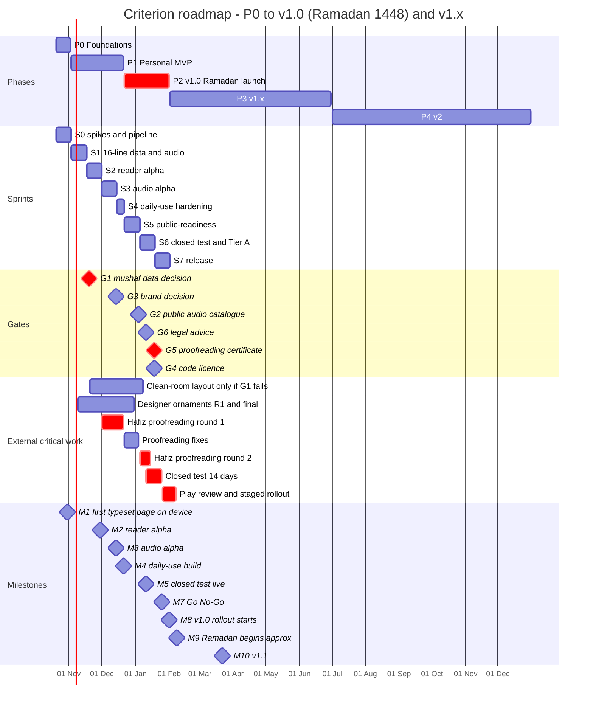
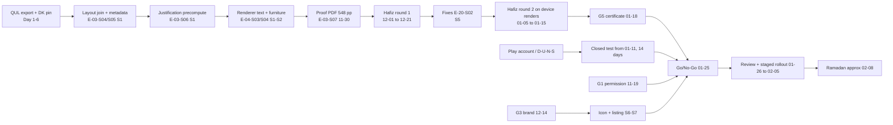

# 09 — Roadmap, Milestones & Backlog

**Purpose.** This doc turns the Decision Register (D-01…D-25), the gates (G1–G6) and the Feature Catalogue into a dated, capacity-checked delivery plan. It runs from Sprint 0 (Tuesday 2026-10-20) to the public v1.0 "Ramadan launch" (staged rollout from 2027-02-01), then continues at milestone level through v1.x (P3) and v2 (P4). It covers: the roadmap and Gantt chart, gate dates with fallbacks, phase exit criteria, a sprint-by-sprint plan, the complete backlog (epics → stories → tasks, with estimates and dependencies), capacity math, the scope-cut ladder, the critical path, a day-by-day checklist for the first 10 working days, external lead times, and the Definitions of Ready and Done. The owner decides scope with it. The owner and the AI coding agents pick the next story from it.

**Status: Draft v1 — 2026-10-19**

**Key decisions in this doc**
- Phases and dates follow **D-25** exactly. Sprints are 2 weeks long and run Tuesday → Monday. S4 is a 1-week hardening sprint, so P1 can end on 2026-12-21.
- **Capacity:** 32.5 h/week ÷ 6 h per ideal day = **5.4 id/week**, with no separate admin allowance; outreach and admin are stories. **The full D-25 scope is ~100 id against ~80 id available to v1.0.** The plan of record (POR) therefore pre-applies part of the scope-cut ladder (§5), and P1 carries 10.75 id of P1-catalogue items into S5–S7 ("C" tier).
- **v1.0 POR =** Quran core (all P1 features) + compliance floor + Tier A companion (prayer times with Sehri/Iftar, Hijri with PK feed, Ramadan core, khatam planner). **Adhan alarms, Qibla, widgets, reminders, azkar and share-image** default to **v1.1 (2027-03-22)**. They are pulled into v1.0 only if they can reach the closed-test build by 2027-01-18.
- **Risk first.** The renderer spike, device smoke test, content pipeline and all permission emails happen in S0. The audio spike happens in the first days of S1. The proofreading PDF goes out on 2026-11-30, because the hafiz review (G5) is the longest human lead time on the critical path.
- **Gate timing (D-25):** G1 decision 2026-11-19; G3 2026-12-14; G2 (public catalogue) 2027-01-04; G6 2027-01-11; G4 and G5 2027-01-18; Go/No-Go 2027-01-25. If any gate is open at Go/No-Go, **Ramadan runs as a closed test and the public launch follows after the gate clears** (D-25).
- **Ramadan freeze:** from 2027-02-05 to Eid (≈ 2027-03-10), hotfixes only. v1.1 ships after Eid.

---

## 0. Conventions

| Item | Convention |
|---|---|
| **id** (ideal day) | 6 focused hours of the owner working *with AI coding agents* (doc 13). The AI leverage is already in the estimate: boilerplate UI and DAO work is estimated low, while pipeline, renderer, audio-timing and OEM work is estimated as careful human-reviewed work. P3/P4 estimates are rough (±40%). |
| Epic / story / task IDs | `E-xx` epics (this doc owns the numbering), `E-xx-Syy` stories. Tasks are listed inline in each story's "key tasks" cell. When a story is opened as a GitHub issue, each task becomes a checklist item `E-xx-Syy-Tn`. |
| Tiers | **P0**, **P1** = committed to that phase · **C** = P1-catalogue item carried into S5–S7 (part of the v1.0 floor) · **F** = v1.0 floor; never cut, so if it is late the public launch moves · **A** = v1.0 Tier A companion (committed; ladder rungs L5–L8) · **S** = v1.0 stretch (ladder rungs L1–L4; pre-cut) · **B** = v1.1 by default (pull-in list B1–B17) · **X** = conditional (only if a gate fails) · **ADM** = owner admin/outreach (counted in capacity) |
| Milestones / ladder rungs | `M0…M14` (milestones) and `L1…L9` / `B1…B17` (ladder) are local to this doc. |
| Sprint IDs | `S0` … `S7` up to v1.0. |
| Spec doc | Every story names the plan doc that specifies it: [01](01-product-requirements.md) · [02](02-ux-ui-spec.md) · [03](03-content-data-licensing.md) · [04](04-architecture.md) · [05](05-mushaf-rendering-engine.md) · [06](06-audio-engine.md) · [07](07-companion-engagement-features.md) · [08](08-data-pipelines.md) · [10](10-quality-testing-ci.md) · [11](11-release-compliance-business.md) · [12](12-decisions-risks.md) · [13](13-ai-assisted-build-playbook.md) |

---

## 1. Roadmap at a glance

| Phase | Dates | Goal | Ships |
|---|---|---|---|
| **P0 Foundations** | 2026-10-20 → 2026-11-02 (S0) | Prove the stack on real devices; content DB v0; start every long-lead dependency | Nothing user-facing; CI + spikes |
| **P1 Personal MVP** | 2026-11-03 → 2026-12-21 (S1–S4) | Daily-use build: reader, indexes, audio with highlight, downloads, translation view, bookmarks | Sideload / internal track (personal-build content allowed) |
| **P2 v1.0 Ramadan launch** | 2026-12-22 → 2027-02-01 (S5–S7) | P1 carry-over, public-readiness floor, Tier A companion, closed test, store, staged rollout | v1.0 on Play: closed test from ≤ 2027-01-11, production from 2027-02-01 (if gates clear) |
| **P3 v1.x** | 2027-02-02 → 2027-06-30 | Ramadan support, Tier B (v1.1), Hifz (v1.2), extra layouts / tablet / sync (v1.3), supporter IAP (v1.5) | v1.1 2027-03-22 · v1.2 2027-05-03 · v1.3 2027-06-07 · v1.5 2027-06-28 |
| **P4 v2** | H2 2027 | AI follow-along, tajweed colours, Madani mode, word-by-word (if permitted), Noorani Qaida, Wear OS | v2.0 ≈ 2027-10 |

### 1.1 Milestones

| ID | Date | Milestone | Evidence (demo / artefact) |
|---|---|---|---|
| M0 | 2026-11-02 | P0 exit — Foundations | P0 exit checklist (§3) all green |
| M1 | 2026-10-30 | First typeset page on device | Printed pp. 2, 3 and 20 drawn by our renderer on API 24/25 and 26/27 devices, with kashida visible; photos in `docs/spikes/` |
| M2 | 2026-11-30 | Reader alpha | All 548 pages swipe RTL with labels 2–549; Surah/Para/Manzil index rows open the right page; proof PDF of 548 pages handed to the hafiz |
| M3 | 2026-12-14 | Audio alpha | "Play Para 4" starts at **3:92** (Indo-Pak boundary) with ayah highlight and auto page-turn; a downloaded surah plays in airplane mode |
| M4 | 2026-12-21 | **Daily-use build (P1 exit)** | Owner's daily routine script (§6, S4) passes on the owner's phone; build sideloaded or on the internal track |
| M5 | 2027-01-11 | Closed test live | Floor feature-complete build on the closed track; ≥ 12 testers opted in (15–20 invited) |
| M6 | 2027-01-22 | v1.0 code-complete cut-off | Anything not merged and green moves to v1.1 per the ladder |
| M7 | 2027-01-25 | RC + Go/No-Go | Gate table (§2) all cleared; 14 closed-test days complete; P2 exit criteria met |
| M8 | 2027-02-01 | v1.0 staged rollout | 10% → 50% (02-03) → 100% (02-05) if vitals are clean |
| M9 | ≈ 2027-02-08/09 | Ramadan 1448 begins | Ramadan freeze: hotfixes only until Eid (≈ 2027-03-10) |
| M10 | 2027-03-22 | v1.1 | Tier B pull-ins + opt-in crash reports (F-PL-09) |
| M11 | 2027-05-03 | v1.2 "Hifz" | F-CP-12 core, 15-line layout (gated), Android Auto |
| M12 | 2027-06-07 | v1.3 | 13-line layout, tablet spread, word highlight, QF sync, realtime group khatam |
| M13 | 2027-06-28 | v1.5 "Support" | Supporter IAP (play flavor) after commercial-content audit; AI spike report |
| M14 | ≈ 2027-10 | v2.0 | P4 bundle (§12) |

---

## 2. Gates G1–G6

The owner is accountable for every gate. External parties are named. Every decision is recorded in `docs/legal/data-permissions.md` and `permissions.yml`, and in doc 12's decision log.

| Gate | What "cleared" means | Start | Follow-ups | **Decision date** | Fallback if not cleared |
|---|---|---|---|---|---|
| **G1** Mushaf data | Written permission from Tarteel/QUL to bundle resource 11 (+ 565/59), with attribution text; DK author confirms the MIT scope of the text. `permissions.yml: qul_res_11: granted` | Emails + GitHub issue on 2026-10-20 (Day 1), to support@tarteel.ai cc naveed.ahmad@tarteel.ai and ananeamine@gmail.com (drafts in g01 §2.9) | 2026-11-03 (email + issue ping + QUL Discord), 2026-11-12 | **2026-11-19** (30 days) | Start the clean-room Taj-16 layout on 2026-11-20 (E-03-S11 + a contractor operator who has never opened QUL/Waqar/QuranApp 16-line data; 40–60 h + 15–20 h hafiz QA, g01 §2.8 E). Builds containing QUL-derived layout stay **personal-only**. Expect Ramadan = closed test with clean-room data if it is ready by ~2027-01-08; otherwise public after Eid (§5.3) |
| **G2** Audio (public catalogue) | Every public catalogue entry has `licenceStatus` ≠ PENDING-only. The mp3quran host statement is archived (PDF + SHA-256 + date) and no rights-holder refusal has arrived. Decode checks passed for the structural-only reads (E-09-S04) | Emails 2026-10-21 (ai@alafasy.co, developers@quran.com, info@qurancomplex.gov.sa); Complex ZIPs fetched in S1 | 2026-11-18, 2026-12-16 | **2027-01-04** (catalogue freeze for the closed-test build) | Public build = the D-12 mp3quran shortlist minus any refusing rights-holder. If Alafasy Berhad refuses, the default reciter becomes **Saad Al-Ghamdi (read 30)**. Gapped per-ayah (F-AU-04) and Urdu interleave (F-AU-10) stay personal/beta |
| **G3** Brand / trademark | Self-search clean on IPO-Pakistan, WIPO Global Brand DB and USPTO, plus a Play search; name and domain chosen ("Hamdam" ہمدم is the working candidate) | 2026-11-17 (S2) | — | **2026-12-14** | Next shortlisted name that passes the same search; never "Criterion" in public, never the reference app's name or assets (D-19) |
| **G4** Public code licence | Owner decision memo: GPL-3.0-or-later or proprietary (D-18) | 2027-01-05 | — | **2027-01-18** | Launch "all rights reserved" (proprietary). Clean-room development keeps GPL open for later |
| **G5** Proofreading certificate (16-line) | A qualified hafiz/qari signs a dated certificate after round 2, covering all 548 device-rendered pages, the Fatiha display, the 59:13 and 27:21 spellings, the 90 quarters, the 114 headers and the Para names | Hafiz contracted by 2026-11-16; round 1 2026-12-01 → 12-21; round 2 2027-01-05 → 01-15 | Weekly check-in | **2027-01-18** | No public release. Closed test continues (G5 is also a D-22 compliance gate) |
| **G6** Pakistani legal advice | Written advice covering the Punjab Holy Quran Act 2011 / Quran Board, Taj pagination (typographical arrangement), and the business entity | Lawyer engaged by 2026-11-30 | 2026-12-15 | **2027-01-11** | Closed test only until advice arrives. If advice requires a Quran Board review, public launch moves after that review |

---

## 3. Phase goals and exit criteria

### P0 Foundations (2026-10-20 → 2026-11-02)
**Goal:** de-risk the three unknowns that can sink the plan (old-Android kashida/CFF2, Room 3 + FTS5 on devices, the QUL data path), and start every external clock.

**Exit criteria (M0):**
1. The toolchain matches D-02 on `main`: AGP 9.4.1, Gradle 9.8.1, Kotlin 2.4.21 lifted (CI greps `kotlin-gradle-plugin:2.2.10 -> 2.4.21`), KSP 2.3.12, compileSdk 37 / target 36 / min 24, desugaring, R8. `assembleDebug`, `assembleRelease` and `testDebugUnitTest` are green.
2. Convention plugins and the lean module skeleton are in place. The `criterion.root` check fails on any `:feature:*` → `:feature:*` dependency.
3. CI runs on every PR (build, tests, Lint, Spotless, release build).
4. Content DB v0 is built by `tools/content-pipeline`. It has Tanzil text, DK tokens with all the g01 count asserts, and 6,354 `ayah_marker` rows. It opens via `createFromAsset` on a device.
5. The device smoke test passes on API 24/25 and 26/27: `getRunAdvance(الْكِتٰبُ)` is 2060 / 2847 / 4384 at cv01 = 0/1/3, FTS5 returns hits, and adhan2 times are correct. If kashida fails, the switch to Fallback 1 (inter-word fitting) is recorded.
6. The renderer spike draws pages 2, 3 and 20 on device (M1). The decision note is in `docs/spikes/`.
7. All G1 and G2 emails are sent and logged. The QUL export is stored outside the repo with SHA-256s. Two Taj 16-line prints are ordered. The entity/D-U-N-S process has started. The designer brief is published.

### P1 Personal MVP (2026-11-03 → 2026-12-21)
**Goal:** the owner reads and listens with *this* app every day from 2026-12-21.

**Exit criteria (M4):**
1. Every P1-tier story meets the DoD (§13).
2. **Reader.** All 548 pages render, show labels 2–549 and swipe RTL. Header row and margin markers are drawn (placeholder art is fine). Themes, lock, chrome and ayah action sheet work. An automated test checks that every Para (30), Surah (114) and Manzil (7) start opens the correct page per D-07.
3. **Audio.** Surah, Para (Indo-Pak table), Manzil, Ruku, Page, range, ayah and play-from-here all play. Follow-along highlight and auto page-turn work for the 8 highlight-enabled D-12 reciters, with the per-surah DISABLE honoured. Background playback, notification and lock-screen controls, speed and sleep timer all work.
4. A surah or Para downloads (Wi-Fi-only default) and plays offline. The 256 MB streaming cache is active.
5. The translation view shows Urdu Junagarhi and English Saheeh with Arabic. Last-read and bookmarks survive a restart.
6. i18n infrastructure works: the per-app language switch changes the UI to Urdu (strings may be partial; complete in S5).
7. The proof PDF of all 548 pages is with the hafiz (since 2026-12-01). G1 is resolved (granted, or the clean-room track has started). G3 is decided.
8. Startup and page-turn timings are measured on the owner's phone and an API 24 device and recorded as the baseline for doc 10's budgets.

### P2 v1.0 Ramadan launch (2026-12-22 → ~2027-02-01)
**Goal:** a public, compliant, ad-free v1.0 that beats the reference app on the Quran core, in users' hands before Ramadan.

**Exit criteria (M7/M8):**
1. All C, F and A stories meet the DoD, minus any ladder rungs applied (§5). No open P0/P1 severity bugs.
2. **Gates G1, G2 (public catalogue), G3, G4, G5 and G6 cleared** (§2). Otherwise apply the gate ladder (§5.3).
3. The closed test has run ≥ 14 continuous days with ≥ 12 opted-in testers (mandatory for a personal account, kept for an organization account). Pre-launch report and closed-test vitals show no crash or ANR cluster.
4. Play Console: Data safety "No data collected"; target audience 13+; ads "No"; FGS declarations (mediaPlayback; dataSync for API ≤ 33) approved with videos; privacy policy live in the console and in the app.
5. The Sources & Credits screen lists every source with its licence, and shows the proofreading certificate. The report-error flow and remote kill-switches are verified end to end on R2.
6. Store listing in en + ur-PK, using the brand from G3 and original art (D-19).
7. The staged rollout reaches 100% before Ramadan 1448 (≈ 2027-02-08).

### P3 v1.x (2027-02-02 → 2027-06-30)
**Goal:** retain Ramadan users, ship the differentiators (Hifz, more layouts), and start sustainability.

**Exit criteria:** v1.1, v1.2, v1.3 and v1.5 shipped (§12). The 15-line and 13-line layouts each have their own permission and G5 certificate. The Hifz mode has been validated with 2–3 ustads (r08 rec. 11). The AI spike report gives a go/no-go against r08's threshold (≤ 0.5 false alarms/min). The supporter IAP ships only after the commercial-content audit (D-17). targetSdk 37 migration is planned (Play deadline ≈ Aug 2027 [unverified forecast, r09]).

### P4 v2 (H2 2027)
**Goal:** the v2 bets named in D-25.

**Exit criteria:** each P4 feature either ships or is formally deferred with a decision record. AI follow-along ships only if the P3 spike passed. Word-by-word ships only with a licence. Madani mode ships with its own G5 certificate.

---

## 4. Capacity math

**Assumptions.**
- 30–35 productive h/week (midpoint 32.5) at 6 h/id gives **5.0 / 5.4 / 5.8 id per week**.
- No separate admin overhead: outreach, hiring, Play Console and the hafiz/designer/lawyer work are ADM stories with estimates.
- 2026-12-25 (Quaid-e-Azam Day) is a holiday, which costs one day in S5.
- Velocity is unproven. The S1 and S2 actuals recalibrate everything (§4.2).

| Phase (weeks) | Capacity @30h | @32.5h (plan) | @35h | Demand: committed POR | Demand: full D-25 scope | Fits? |
|---|---|---|---|---|---|---|
| P0 (2) | 10.0 | **10.8** | 11.7 | 9.25 (7.75 eng + 1.5 ADM) | 9.25 | ✅ 1.6 id slack |
| P1 (7) | 35.0 | **37.9** | 40.8 | 37.0 (35.5 P1 + 1.5 ADM) | **47.75** (P1 + the 10.75 id of P1-catalogue items in C) | ❌ Full P1 scope is ~9.8 id (~1.8 weeks) over. **Resolution:** C items move to S5–S7 |
| P2 (6, −1 day) | 29.0 | **31.4** | 33.8 | 30.25 (C 10.75 + F 12.5 + A 6.5 + ADM 0.5) | **53.75** (+ S 2.0 + B 21.5) | ❌ Full P2 scope is ~22 id over. **Resolution:** Tier B → v1.1, Tier S pre-cut |
| **Total to v1.0 (15 wks −1 day)** | 74.0 | **80.2** | 86.3 | **76.5** | **100.0** | POR fits with 3.7 id (4.6%) buffer + 9.0 id of ladder rungs L5–L9 |

**What the numbers say.**
- The Quran core alone (P0 eng + P1 + C) is **54.0 id, about 10 weeks**, against the 9 weeks of P0+P1. That is why some P1-catalogue items (search, Urdu string completion, repeat, gapped mode, zoom, ruku/sajda lists, a11y pass, storage manager, onboarding) land in S5–S7. They are still in v1.0.
- At **30 h/week** the POR is 2.5 id over. Apply L5 and L6 in the S5 planning and keep L9 ready.
- At **35 h/week**, the stretch tier (L1–L4) and B1–B3 come back.
- The renderer, the pipeline and the audio engine (E-03, E-04, E-08: 27.0 id committed) are the irreducible core. Never trade them for companion features.

### 4.1 Sprint loading (POR, plan rate 5.4 id/week)

| Sprint | Dates | Capacity | Planned | Of which ADM | Notes |
|---|---|---|---|---|---|
| S0 | 10-20 → 11-02 | 10.8 | 9.25 | 1.5 | Spikes + pipeline + outreach |
| S1 | 11-03 → 11-16 | 10.8 | 10.5 | 0.75 | 16-line data join + renderer text layer + audio spike |
| S2 | 11-17 → 11-30 | 10.8 | 10.75 | 0.75 | Reader alpha; G1 decision 11-19 |
| S3 | 12-01 → 12-14 | 10.8 | 11.0 | 0 | Audio alpha (≈ 2% over; first slip candidate: E-11-S01 → S4) |
| S4 | 12-15 → 12-21 | 5.4 | 4.75 | 0 | Daily-use hardening |
| S5 | 12-22 → 01-04 | 9.75 | 9.75 | 0.25 | Search, UIDT, R2 + kill-switch, proofreading fixes; G2 01-04 |
| S6 | 01-05 → 01-18 | 10.8 | 10.25 | 0.25 | Closed test 01-11; Tier A; G5/G4 01-18 |
| S7 | 01-19 → 02-01 | 10.8 | 10.25 | 0 | Code-complete 01-22; RC 01-25; rollout 02-01 |
| **Total** | | **80.2** | **76.5** | **3.5** | |
| Conditional | G1 fails | — | +2.5 (E-03-S11) | | Funded by rungs L5–L7 (4.75 id) |

### 4.2 Velocity checkpoints and levers

| Checkpoint | Rule |
|---|---|
| End of S1 (2026-11-16) | Compute velocity = done id ÷ 2 weeks. If < 4.6 id/week (85% of plan), re-plan P2 now: pre-apply L5–L6 and re-size the remaining ladder. |
| End of S2 (2026-11-30) | If cumulative done < 90% of planned, apply L5–L7 to P2, which makes v1.0 Quran-only + khatam. If < 75%, also decide on lever 3 and warn that a closed-test-only Ramadan is likely. |
| End of S3 (2026-12-14) | Freeze the v1.0 POR. Tier B pull-ins are allowed only if S3 closed ≥ 100%. |
| End of S5 (2027-01-04) | Floor at risk (any F/C story not started)? Cut L9, then move M5 by ≤ 3 days. Never shorten the 14-day closed test. |
| 2027-01-22 | Code-complete cut-off. Anything unmerged moves to v1.1. |

**Levers, in order of use:**
1. Owner hours toward 35 h/week, especially over the year-end break (+0.4 id/week).
2. **Parallel agent sessions** on fully specified, low-risk stories (UI screens, DAOs, tests). Doc 13 defines the workflow. Count them as upside only, never in the plan.
3. **Contract a freelance Android developer for Tier A + B companion work** (E-15, E-16, E-17; ≈ 8–12 id), under a written clean-room and no-GPL-copy clause (D-18) and an IP assignment. Decide at the S2 checkpoint; budget TBD by the owner.
4. Ladder rungs (§5).

---

## 5. Scope-cut ladder for the Ramadan launch

The **floor** is never cut. If a floor item is late, the public date moves and Ramadan runs as a closed test (§5.3). Everything else is laddered. "Cut" means the item moves to **v1.1 (2027-03-22)**; it is not dropped.

### 5.1 Ladder (cut in this order; restore in reverse order)

| Rung | Cut | Stories | Features | id freed | Cumulative | POR status | Consequence |
|---|---|---|---|---|---|---|---|
| — | All Tier B (§5.2) | 22 stories | F-CP-02, -03, -06 (azkar), -08, -09, -10, -11; F-BM-03, -05, -06 (JSON); F-TR-02/03; F-RD-09, -12; F-AU-10 | 21.5 | 21.5 | **Cut by default** | v1.0 has no adhan alarms, Qibla, widgets, reminders, azkar, downloadable packs or share-image |
| L1 | Tafsir-summary sheet | E-05-S07 | F-RD-13 | 0.5 | 22.0 | Pre-cut (stretch) | Ahsan-ul-Bayan footnotes not shown until v1.1 |
| L2 | Para-quarter navigation list | E-06-S09 | F-IX-07 | 0.5 | 22.5 | Pre-cut | Quarter markers are still drawn on pages; only the jump list is missing |
| L3 | Tasbeeh | E-16-S02 | F-CP-05 | 0.5 | 23.0 | Pre-cut | — |
| L4 | Manzil-dua playlist | E-16-S05 | F-CP-06 (part) | 0.5 | 23.5 | Pre-cut | Manzil dua stays readable from quick access (F-IX-08) |
| **L5** | Ramadan core | E-16-S03 | F-CP-07 | 0.75 | 24.25 | **Committed: first cut if late** | Sehri/Iftar still visible in the monthly prayer table; Taraweeh preset still in the khatam planner |
| L6 | Hijri date + PK month-start feed | E-16-S01 | F-CP-04 | 1.0 | 25.25 | Committed | No Hijri date on home; Ramadan day numbers unavailable (forces L5) |
| L7 | Prayer times + location | E-15-S01..S03 | F-CP-01 | 3.0 | 28.25 | Committed | v1.0 is a pure Quran app + khatam planner |
| L8 | Khatam planner | E-18-S01 | F-BM-04 | 1.75 | 30.0 | Committed | No Ramadan khatam plan. Painful, so it is last before L9 |
| L9 | P1 polish carry-over | E-05-S06, E-06-S07, E-06-S08, E-07-S05, E-08-S09 | F-RD-06, F-IX-04 (list), F-IX-06, F-BM-02 (collections/undo), F-AU-04 | 2.5 | 32.5 | Committed (C) | Pinch zoom, ruku/sajda lists, bookmark collections and personal gapped mode wait for v1.1. Ruku and sajda markers remain on the page |
| **Floor** | — never cut — | all F + remaining C | Reader core, indexes, audio core, downloads incl. UIDT, translation view, search, Urdu UI, onboarding, a11y baseline, credits, report error, privacy, signed fetcher + kill-switch, proofreading, release hardening, store, closed test | — | — | — | If late, the launch moves (§5.3) |

### 5.2 Tier B pull-in order (only after L1–L4 are restored)
**Rule:** a Tier B item may enter v1.0 only if it can be merged into the closed-test build by **2027-01-18**, giving at least 7 days of tester exposure. Otherwise it waits for v1.1.

| # | Item | Stories | id |
|---|---|---|---|
| B1 | Prayer/Sehri/Iftar notifications + adhan health check + OEM matrix | E-15-S04, E-15-S06, E-15-S07 | 3.25 |
| B2 | Continue-reading widget | E-17-S01 | 0.75 |
| B3 | Smart reminders (Kahf Friday, Mulk night, daily ayah) | E-17-S03 | 1.0 |
| B4 | Qibla compass | E-16-S07 | 1.0 |
| B5 | Full adhan (FGS, USAGE_ALARM) | E-15-S05 | 1.0 |
| B6 | Ramadan extras (share image, sourced duas, Sehri alarm) | E-16-S04 | 0.75 |
| B7 | Next-prayer + ayah-of-the-day widgets | E-17-S02 | 1.0 |
| B8 | Pack system + downloadable translations + translator choice | E-03-S10, E-10-S06, E-11-S03 | 3.25 |
| B9 | Notes + JSON export/import | E-07-S06, E-07-S07 | 1.5 |
| B10 | Share ayah as image | E-17-S04 | 0.75 |
| B11 | Streaks & stats | E-18-S02 | 0.75 |
| B12 | Morning/evening azkar (needs Urdu content) | E-16-S06 | 1.75 |
| B13 | Group-khatam WhatsApp sheet | E-17-S05 | 0.5 |
| B14 | Speech-onset snapping | E-09-S06 | 0.75 |
| B15 | Vertical auto-scroll | E-05-S08 | 1.25 |
| B16 | Page-curl animation | E-05-S09 | 1.25 |
| B17 | Arabic + Urdu interleave (personal build) | E-08-S10 | 1.0 |

**Why adhan is not in Tier A.** r08 calls adhan reliability "the biggest engineering risk in this whole area". About 62% of PK devices come from aggressive-killer OEMs. A missed or late adhan during Ramadan does more damage than no adhan. B1 needs ~0.75 id of device-matrix testing on Infinix, Tecno, Xiaomi, Vivo and Oppo, so it ships in v1.0 only if it clears the 01-18 rule.

### 5.3 Gate ladder (applies at Go/No-Go, 2027-01-25)
1. **All gates cleared** → production 10% on 02-01, 100% by 02-05.
2. **G2 partially cleared** → release with the cleared subset of reciters. Any refusal disables that entry through the signed catalogue (Alafasy refusal → Ghamdi default).
3. **G4 undecided** → launch proprietary (default in §2). Not blocking.
4. **G1, G3, G5 or G6 not cleared** → no production release. Keep the closed test running through Ramadan and widen it to 100+ testers via email lists/Google Groups. Ship "Ramadan edition" updates there. Go public within one week of the gate clearing, and not during the last 10 nights of Ramadan; otherwise after Eid (target 2027-03-22, merged with v1.1).
5. **G1 failed on 11-19 (clean-room track).** Re-plan on 11-20:
   - E-03-S11 (2.5 id) enters S3, funded by applying L5–L7.
   - The contractor operator works 2026-11-30 → ~12-27; double entry and hafiz QA follow on ~12-28 → 01-08.
   - The closed test starts only once the clean-room data is in (no QUL-derived layout in any distributed build).
   - The public launch most likely moves after Eid.

---

## 6. Sprint plan (S0 → S7)

Cadence:
- **Monday:** 60-minute review/demo, then planning.
- **Daily:** 10-minute log.
- **Burn-down:** in id, tracked in GitHub Projects (§14).

Story lists below are in execution order. All IDs are defined in §11.

### S0 — 2026-10-20 → 11-02 · P0 · cap 10.8 · plan 9.25
- **Goal:** prove the stack on real devices and start every external clock.
- **Deliverables:**
  - E-01-S01..S05 (toolchain, plugins, skeleton, flavors, device smoke test)
  - E-02-S01 (CI)
  - E-03-S01..S03 (pipeline skeleton, DK text + Kufan keys + `ayah_marker`, font build)
  - E-04-S01 (renderer spike)
  - ADM: E-21-S01, E-21-S02 (G1/G2 emails), E-22-S01 (entity, D-U-N-S), E-14-S02 (designer brief)
- **Demo criteria:**
  1. A PR shows the CI checks passing.
  2. `buildEnvironment` shows the lift.
  3. Content DB v0 is opened on an API 24/25 device and an FTS5 query returns hits.
  4. Pages 2, 3 and 20 are rendered with kashida on two old devices plus one modern device.
  5. Outreach log with timestamps.
- **Events:** M1 (10-30), M0 (11-02).

### S1 — 11-03 → 11-16 · P1 · cap 10.8 · plan 10.5
- **Goal:** the real 16-line data is joined and validated, the renderer draws all text, and audio clipping is proven.
- **Deliverables:**
  - E-03-S04 (layout join), E-03-S05 (Para/Manzil/ruku/sajda/quarter tables), E-03-S06 (justification precompute)
  - E-04-S02, E-04-S03 (geometry + text layer)
  - E-01-S06 (app shell)
  - E-08-S01 (audio spike) **in the first 3 days**
  - E-09-S02 (timing pipeline for 12 reads)
  - ADM: E-20-S01 (hafiz contracted by 11-16), E-21-S03 (Complex ZIPs), E-21-S04 (translation/azkar permission emails)
- **Demo criteria:**
  1. Swipe through all 548 pages showing text only, with the correct label on each page.
  2. Pipeline asserts are green in CI.
  3. Alafasy 2:255–257 plays as a clipped range and per-ayah PlayerMessage logs land within ±100 ms of the timing rows.
  4. The timing report lists every DISABLEd surah per read and matches g03 (e.g. read 51 s9 relabelled; read 74 not used).
- **Events:** G1 follow-ups 11-03 and 11-12; velocity checkpoint 11-16.

### S2 — 11-17 → 11-30 · P1 · cap 10.8 · plan 10.75
- **Goal:** Reader alpha.
- **Deliverables:**
  - E-04-S04, E-04-S05 (furniture/ornament layer with placeholder art; hit-test + highlight layer)
  - E-03-S07 (validation gates + proof PDF), E-03-S09 (bundled translations), E-02-S02 (content-DB CI)
  - E-05-S01 (pager)
  - E-06-S01..S03 (Surah/Para/Manzil index, Read path)
  - E-07-S01 (user.db + DataStore)
  - E-08-S02 (playback service)
  - E-09-S01 (catalogue)
  - E-13-S01 (i18n infra), E-14-S01 (design tokens)
  - ADM: E-21-S05 (G3 search), E-21-S06 (lawyer)
- **Demo criteria (M2):**
  1. Tapping Para 14 in the index opens page label 237 (index 18·14−16 = 236), first ayah 15:2.
  2. The automated index test passes for all 7 differing Para starts against D-07: P4 3:92, P7 5:83, P11 9:94, P14 15:2, P20 27:60, P21 29:45, P23 36:22. It also passes for P29 (index 508), P30 (index 528) and all 7 Manzil starts.
  3. Header row reads "Para · page label · surah".
  4. Ruku triples and the «منزل N» footer are visible.
  5. A 548-page PDF is delivered to the hafiz on 11-30.
- **Events:** **G1 decision 11-19**; S2 velocity checkpoint 11-30.

### S3 — 12-01 → 12-14 · P1 · cap 10.8 · plan 11.0
- **Goal:** Audio alpha + reading essentials.
- **Deliverables:**
  - E-08-S03, E-08-S04, E-08-S06, E-08-S07 (PlanExpander, gapless highlight + hub, player UI, cache)
  - E-05-S02..S05 (chrome, action sheet, follow-along, locks), E-04-S06 (themes)
  - E-06-S04, E-06-S06 (go-to, home continue reading), E-07-S02 (last-read)
  - E-10-S01, E-10-S02 (downloader + worker)
  - E-11-S01 (translation view)
  - E-14-S03 (core components)
- **Demo criteria (M3):**
  1. "Play Para 4" starts at 3:92, highlights each ayah and turns the page automatically, and suspends for 8 s after a touch.
  2. Sleep at end of surah.
  3. Download Yaseen over Wi-Fi, then play it in airplane mode.
  4. Night/AMOLED themes.
  5. The translation view stays in sync with the mushaf position.
- **Events:** hafiz round 1 under way; designer ornaments round 1 due 12-04; **G3 decision 12-14**; P2 POR freeze.

### S4 — 12-15 → 12-21 · P1 hardening · cap 5.4 · plan 4.75
- **Goal:** Daily-use build.
- **Deliverables:**
  - E-10-S03 (download UI), E-07-S03 (bookmarks), E-07-S04 (Auto Backup)
  - E-09-S03 (favourite qari), E-13-S04 (settings), E-08-S05 (speed/sleep), E-06-S05 (quick access), E-11-S02 (translation settings)
  - E-24-S01 (hardening)
- **Demo criteria (M4) — the owner's routine script:**
  1. Cold start → "Continue reading" → page L.
  2. Play the favourite qari for the current Para with highlight.
  3. Bookmark an ayah, then switch to night mode and lock rotation.
  4. Open the Urdu translation of the current ayah.
  5. Kill the app and reboot → last-read and bookmark persist.
  6. Downloaded audio plays offline.
  7. Install on the owner's phone (sideload, or the internal track if the Play account exists).

### S5 — 12-22 → 2027-01-04 · P2 · cap 9.75 · plan 9.75
- **Goal:** Public-readiness platform.
- **Deliverables:**
  - E-03-S08 + E-12-S01..S03 (search)
  - E-13-S02 (Urdu strings complete)
  - E-08-S08 (repeat/pause-between)
  - E-10-S04, E-10-S05 (storage manager, UIDT)
  - E-23-S01, E-23-S02 (R2 + signed fetcher + kill-switch)
  - E-20-S02 (proofreading round-1 fixes)
  - E-09-S04 (decode checks)
  - E-22-S02 (Play Console setup + FGS videos)
  - ADM: E-19-S04 (governance policy)
- **Demo criteria:**
  1. Search finds الرحمن (diacritic-insensitive), Urdu and English phrases, and the "yaseen" / "ayatul kursi" aliases.
  2. A signed catalogue override on R2 disables highlighting for one surah, and the app honours it after refresh.
  3. A UIDT download runs on an API 34+ device.
  4. All round-1 issues are closed or waived by the hafiz.
- **Events:** **G2 decision + catalogue freeze 01-04**; recruit 15–20 testers.

### S6 — 01-05 → 01-18 · P2 · cap 10.8 · plan 10.25
- **Goal:** closed test live on 01-11, then Tier A.
- **Deliverables (week 1, to the 01-11 build):**
  - E-13-S03 (onboarding), E-13-S05 (a11y baseline)
  - E-19-S01..S03 (credits, report error, privacy)
  - E-02-S04 (licence and content CI gates), E-04-S07 (drift guard), E-02-S03 (goldens)
  - E-22-S04 (closed test)
- **Deliverables (week 2):**
  - E-18-S01 (khatam planner)
  - E-15-S01..S03 (prayer core, location, prayer screen)
  - ADM: E-21-S07 (G4 memo + QF OAuth client application)
- **Demo criteria (M5):**
  1. ≥ 12 testers opted in on 01-11.
  2. TalkBack reads an ayah as "Surah Al-Baqarah, ayah 255" with a "Play recitation" action.
  3. Karachi prayer times match the golden vectors (r08 §2.2.3 / g04: 05:16 / 06:32 / 12:18 / 16:24 / 18:02 / 19:18 for 2026-10-19).
  4. The 30-day Ramadan khatam preset gives 1 Para/day with a Para checklist.
- **Events:** hafiz round 2 (01-05 → 01-15) runs on **device-rendered screenshots of all 548 pages**; **G6 01-11**; **G5 + G4 01-18**.

### S7 — 01-19 → 02-01 · P2 · cap 10.8 · plan 10.25
- **Goal:** Release.
- **Deliverables:**
  - E-16-S01, E-16-S03 (Hijri + PK feed, Ramadan core)
  - E-04-S09, E-14-S04 (final ornaments, icon)
  - L9 polish: E-04-S08, E-05-S06, E-06-S07, E-06-S08, E-07-S05, E-08-S09
  - E-02-S05, E-02-S06 (baseline profile, release job), E-09-S05 (weekly re-validation)
  - E-20-S03 (certificate in Credits)
  - E-22-S03, E-22-S05 (listing, production), E-24-S02 (release hardening)
- **Dates:** code-complete **01-22 (M6)**; RC + Go/No-Go **01-25 (M7)**; submit 01-26 (budget up to 7 days of review for a new app [unverified]); rollout **02-01 (M8)** → 50% 02-03 → 100% 02-05.
- **Demo criteria:**
  1. RC passes the v1.0 regression checklist (doc 10).
  2. The baseline profile is in the AAB.
  3. The listing is approved.
  4. Rollout is live.

---

## 7. First 10 working days (2026-10-20 → 11-02)

Each day ends with a commit or a log entry. "Spike" outputs go to `spikes/` or `docs/spikes/`, never into shipped assets.

| Day | Date | Do (concrete) | Done when |
|---|---|---|---|
| 1 | Tue 10-20 | **(a) QUL export.** Create the QUL account (owner's email). Download resource 11 (16-line Taj) and resource 565 (or 59) as SQLite, plus metadata, into `~/criterion-data/qul/2026-10-20/` (outside the repo). Record SHA-256s and turn on QUL update emails. **(b) G1 outreach.** Send the g01 §2.9 emails to support@tarteel.ai cc naveed.ahmad@tarteel.ai and to ananeamine@gmail.com. Open the GitHub issue on TarteelAI/quranic-universal-library. **(c) Legal records.** Create `docs/legal/data-permissions.md` and `permissions.yml` (`qul_res_11: requested`). **(d) Toolchain.** Branch `p0/toolchain`, copy `spikes/toolchain-spike/gradle/libs.versions.toml` and the root/app build files, and remove the Ktor entries (D-02). | Hashes recorded; 2 emails + 1 issue sent; toolchain branch builds `assembleDebug` |
| 2 | Wed 10-21 | **(a) G2 outreach.** Send emails to ai@alafasy.co, developers@quran.com and info@qurancomplex.gov.sa (template in g03 §2.7). Save mp3quran `/eng/privacy` and `/eng/contact-us` as PDF with SHA-256 + date into `docs/legal/evidence/`, and send the courtesy note via the mp3quran form. **(b) Prints.** Order 2 Taj Company 16-line (548 pp) prints and record edition/printing on arrival. **(c) Toolchain.** Finish the PR: `assembleRelease` + tests green; add the CI grep guard `kotlin-gradle-plugin:2.2.10 -> 2.4.21`. Merge. | PR merged; evidence PDFs hashed |
| 3 | Thu 10-22 | **(a) Plugins.** Write `build-logic/convention`: application/library/compose/feature/jvm/hilt/room3/lint/spotless/robolectric/root (feature→feature check). **(b) Play account.** Start the sole-proprietorship/SMC registration path and the D-U-N-S request for the Play Organization account (D-22). **(c) Checkpoint photos.** Owner photographs his own mushaf's checkpoint pages p.2, 39, 70, 115, 483 (g02 §4). | Plugins applied to an empty module; D-U-N-S request reference noted |
| 4 | Fri 10-23 | **(a) Skeleton.** Lean module skeleton (E-01-S03): `QuranContentDb` internal behind `ContentRepository`. **(b) Flavors.** `play`/`foss` flavors; manifest permission plan with `tools:node="remove"` lines (r09 §2.6). **(c) CI.** `.github/workflows/pr.yml` (checkout v7, setup-java v6 Temurin 21, gradle/actions v6). | CI green on a PR touching every module; check fails when a test feature→feature dep is added |
| 5 | Mon 10-26 | **(a) Pipeline skeleton.** Move `spikes/.../scripts/build_content_db.py` into `tools/content-pipeline/`. Add `inputs.lock.json` (URL + SHA-256 for Tanzil Uthmani, Simple-Clean, `quran-data.js`, QuranEnc `urdu_junagarhi` + `english_saheeh` versions); run with `python3 -I`. **(b) DK pin.** Clone digitalkhatt.org @ `4213fab`; record SHA-256 of `quran_text_indopak_15.ts` and `hb/indopak.otf`. | `make content-db` produces `quran_content.db` with Tanzil 6,236 ayahs; DK hashes match g04 |
| 6 | Tue 10-27 | **(a) DK tokens.** `tok_dk.py` with the g01 asserts (83,669 / 77,433 / 6,236 / 118 / 558 / 15). **(b) Kufan keys.** `dk_numbering.py` → `ayah_marker` (6,354 rows) + Taj Fatiha override. **(c) Font.** `cff2_to_glyf.py` → glyf TTF (~1.63 MB), OFL rename, `.notdef` sweep. | Asserts pass in CI; TTF hash recorded |
| 7 | Wed 10-28 | **(a) Device smoke test (E-01-S05)** on an API 24/25 device and an API 26/27 device. `getRunAdvance` of الْكِتٰبُ at cv01 = 0/1/3 must be 2060/2847/4384 at textSize 1000. BundledSQLiteDriver loads and FTS5 `MATCH 'الرحمن'` returns hits. adhan2 Karachi/Hanafi returns times. **(b) Content DB in app.** Content DB v0 shipped in assets and opened via `createFromAsset` on device. | Results table committed to `docs/spikes/device-smoke.md`. Go/no-go on cv01 kashida (no-go = Fallback 1 noted for E-04) |
| 8 | Thu 10-29 | **Renderer spike part 1.** Privately extract the line ranges of QUL indices 1, 2 and 19 (labels 2, 3, 20) from the export into a throwaway JSON. Run `hb_widths.py` for x-fractions + cv01 N. Draw in a debug-only Compose screen with `drawTextRun` per word, setting features only on stretched words. | Pages render on the emulator |
| 9 | Fri 10-30 | **Renderer spike part 2.** Run on the old devices + one modern device; measure frame time; check the 1:7 «۵» and RLO handling and the sarlauh page. **M1.** Publish the **designer brief** (ornament list in E-14-S02) and ask 2–3 freelancers for quotes. Shortlist hafiz candidates (masjid/madrasa network) and a lawyer. | Photos + timing in `docs/spikes/renderer-spike.md`; brief sent |
| 10 | Mon 11-02 | **Sprint 0 review (M0):** walk the P0 exit checklist (§3), record decisions (kashida path, any toolchain deviations) for doc 12, then plan S1. Confirm no G1/G2 replies are pending without a follow-up date. | P0 exit signed off in `docs/plan/status.md` |

---

## 8. Critical path

**Path and slack:**
- **Primary chain (zero slack):** QUL data → pipeline → renderer → proof PDF (11-30) → hafiz R1 → fixes → hafiz R2 → G5 (01-18) → Go/No-Go (01-25) → rollout (02-01 to 02-05).
- **Proof PDF timing.** A one-week slip in the proof PDF eats the whole margin before Ramadan. Protect E-03-S04..S07 and E-04-S03/S04 above everything else in S1–S2.
- **Font fixes after R1.** If R1 finds systematic font or glyph errors (DK IndoPak is v0.1, r04), switch R2 to the affected pages + a 10% sample, and file the fixes upstream.
- **Parallel near-critical chains:**
  - G1 (11-19; on failure the clean-room work becomes critical).
  - Play account → closed test start ≤ 01-11. A personal account needs 14 days before production access (r09), so a late account start directly delays M7. Decision rule: if the Organization account is not verified by **12-14**, create a personal account that day.
  - G3 (12-14) → icon + store graphics (designer, ~3 weeks) → listing (S7).
- **Not on the critical path:** companion features (by design), audio permissions (the D-12 host-grant shortlist works without them), G4.

---

## 9. Risk-driven ordering rationale

| Risk (doc 12 owns R-xx numbering) | Why it is early | Where |
|---|---|---|
| `cv01` kashida / CFF2 on API 24–27 fails on real hardware (g04: verified only from source and in Robolectric) | Decides between the precomputed-kashida renderer and Fallback 1, which changes E-03-S06 and E-04 | S0 Day 7–9 (E-01-S05, E-04-S01) |
| BundledSQLiteDriver/FTS5 or Room 3 misbehaves on an old device | Both DBs depend on it; fallback is Room 2.8.5 + FTS4 (D-02) | S0 Day 7 |
| QUL permission (G1) refused or silent | 30-day clock; the fallback needs a contractor + 2–3 calendar weeks | Emails on Day 1; follow-ups 11-03, 11-12 |
| Data defects (p.529, 59:13, index-1 remap, quarters) | Every downstream artefact (renderer goldens, proof PDF) inherits them | S1 pipeline with frozen asserts and whitelist |
| Audio clipping and timing accuracy; CDN re-uploads (g03: mp3quran re-uploaded reads 123/30/51 on 2026-09-27) | The highlight differentiator depends on it; the ETag guard must exist before data is trusted | S1 audio spike + timing pipeline before PlanExpander (S3) |
| Proofreading lead time (G5) | Longest human task on the critical path | Hafiz contracted by 11-16; PDF on 11-30 |
| Play account verification / D-U-N-S / 14-day closed test | External clocks the owner cannot speed up | Started Day 3; decision rule on 12-14 |
| Brand (G3) | Icon, listing and domain all depend on it | Decision 12-14 |
| Adhan OEM reliability | High-risk, not needed for the Quran core | Deliberately Tier B (v1.1) unless it clears the 01-18 rule |
| Capacity overrun | Full scope ≈ 1.25× capacity | Ladder pre-applied; checkpoints in §4.2 |

---

## 10. External dependencies and lead times

| Dependency | Owner / party | Start | Needed by | Lead time (known / assumed) | Fallback |
|---|---|---|---|---|---|
| QUL account + resource 11/565 export | Owner | 10-20 | 10-26 | Same day | — |
| G1 reply (Tarteel/QUL, DK author; optional QuranWBW) | Owner → Tarteel | 10-20 | 11-19 | ≤ 30 days (gate) | Clean-room (§5.3) |
| G2 replies (Alafasy Berhad, QF, King Fahd Complex) | Owner | 10-21 | 01-04 | Unknown; the Complex site is geo-blocked outside PK (g03) | D-12 host-grant shortlist; Ghamdi default |
| King Fahd Complex ZIPs (5 reciters) | Owner (from PK) | S1 | v1.x self-hosting | Download time only | Mirrors as listed in D-12 |
| Hafiz/qari proofreader | Owner | Shortlist 10-30; contract 11-16 | R1 12-01, R2 01-05 | R1 ≈ 30–40 h of reading (≈ 3–4 min/page, our estimate), R2 ≈ 8–10 h | Second hafiz on standby; without a certificate there is no public launch |
| Freelance designer (ornaments, icon, feature graphic) | Owner | Brief 10-30; hire 11-09 | R1 12-04, final 12-31, icon 01-08 | ~3 weeks per batch (assumed) | Ship placeholder geometric ornaments (original, not traced); the icon blocks the listing |
| Taj 16-line prints (×2) | Owner | 10-21 | 11-16 (53 quarter hand-checks; clean-room if needed) | ~1 week delivery (assumed) | Owner's own copy for checks |
| Pakistani lawyer (G6) | Owner | Shortlist 10-30; engage ≤ 11-30 | 01-11 | 4–6 weeks (assumed) | Closed test until advice arrives |
| Trademark self-search (G3) | Owner | 11-17 | 12-14 | 1–2 days of searching | Next candidate name |
| Entity + D-U-N-S + Play Organization account | Owner | 10-22 | 12-14 (decision rule) | Unknown; D-U-N-S is free (r09) | Personal account by 12-14 → mandatory 12 testers × 14 days |
| Play identity verification / app review | Google | Account creation | Closed test 01-11; production 01-26 | Days to weeks [unverified] | Submit early; never shorten the closed test |
| Closed testers (15–20) | Owner (family, masjid, WhatsApp group) | 12-01 | Opted in by 01-11 | 1 month of recruiting | Over-recruit to 20 for dropouts |
| FGS declaration videos (mediaPlayback, dataSync) | Owner | S5 | Console setup before 01-11 | 1 h recording | — |
| Domain + privacy-policy hosting + R2 | Owner | After G3 (12-14) | S5 | Hours | Policy page on GitHub Pages under the brand |
| Muezzin adhan recordings (B5) | Owner | Commission by 01-15 | v1.1 | 2–4 weeks (assumed) | 1–2 CC0 fallbacks (D-16) |
| Urdu azkar translation (~150 duas) or HadeethEnc permission (B12) | Owner + scholar | S1 request | v1.1 | 4–8 weeks (assumed) | Arabic + English only until ready |
| Translation permissions (Maududi, Taqi Usmani, Qadri, Israr, Clear Quran, QuranWBW, tafsir publishers) | Owner | S1 | v1.x packs | Weeks to months (r05) | Not needed for v1.0 (D-09 bundled set) |
| QF OAuth client (F-BM-07) | Owner | S6 | v1.3 | Review process (r05/r08) | Feature waits |
| Ustad interviews for Hifz (2–3) | Owner | Feb 2027 | v1.2 design | — | Defaults from r08 §2.11 |

---

## 11. Backlog: epics → stories → tasks

### 11.1 Epic summary (to v1.0)

| Epic | Spec | Features covered | P0 | P1 | C | F | A | S | B | X | ADM | **Total** |
|---|---|---|---|---|---|---|---|---|---|---|---|---|
| E-01 Toolchain & project skeleton | 04 | F-RD-01 | 3 | 0.75 | — | — | — | — | — | — | — | **3.75** |
| E-02 CI & quality gates | 10 | F-RD-01 | 0.75 | 0.5 | 0.5 | 1.5 | — | — | — | — | — | **3.25** |
| E-03 Content pipeline & content DB (tools/) | 08 | F-RD-01, F-IX-01..06, F-SR-01..03, F-TR-01, F-TR-02, F-PL-06 | 2.5 | 6 | 1 | — | — | — | 1.25 | 2.5 | — | **13.25** |
| E-04 Mushaf renderer (:core:mushaf-render) | 05 | F-RD-01, F-IX-04, F-IX-06, F-RD-04, F-RD-05, F-RD-03 | 1.5 | 5.25 | 1.25 | 0.75 | — | — | — | — | — | **8.75** |
| E-05 Reader UX | 02 | F-RD-01, F-RD-02, F-RD-04, F-RD-05, F-RD-07, F-RD-06, F-RD-13, F-RD-09, F-RD-12 | — | 3 | 0.5 | — | — | 0.5 | 2.5 | — | — | **6.5** |
| E-06 Indexes & navigation | 02 | F-IX-01, F-IX-02, F-IX-03, F-IX-05, F-IX-08, F-IX-09, F-IX-04, F-IX-06, F-IX-07 | — | 2.25 | 0.75 | — | — | 0.5 | — | — | — | **3.5** |
| E-07 Bookmarks, last-read & user data | 04 | F-BM-01, F-BM-02, F-BM-06, F-BM-03 | — | 1.75 | 0.5 | — | — | — | 1.5 | — | — | **3.75** |
| E-08 Audio engine (playback) | 06 | F-AU-03, F-AU-07, F-AU-02, F-AU-06, F-AU-09, F-AU-05, F-AU-04, F-AU-10 | — | 6 | 1.75 | — | — | — | 1 | — | — | **8.75** |
| E-09 Reciter catalogue & timing packs | 06 | F-AU-01, F-AU-03 | — | 2.25 | 0.5 | 0.25 | — | — | 0.75 | — | — | **3.75** |
| E-10 Downloads, storage & packs | 06 | F-AU-08, F-PL-06 | — | 2.5 | 0.5 | 1.5 | — | — | 0.75 | — | — | **5.25** |
| E-11 Translation view & packs | 03 | F-RD-08, F-TR-01, F-TR-02, F-TR-03 | — | 1.25 | — | — | — | — | 1.25 | — | — | **2.5** |
| E-12 Search | 04 | F-SR-01, F-SR-02, F-SR-03 | — | — | 1.75 | — | — | — | — | — | — | **1.75** |
| E-13 Onboarding, settings, Urdu UI & accessibility | 02 | F-PL-03, F-PL-01, F-PL-02, F-PL-07 | — | 1.5 | 1.75 | — | — | — | — | — | — | **3.25** |
| E-14 Design system & ornaments (freelance designer) | 02 | — (enabler) | — | 1.5 | — | 0.25 | — | — | — | — | 0.5 | **2.25** |
| E-15 Prayer times, notifications & adhan | 07 | F-CP-01, F-CP-02 | — | — | — | — | 3 | — | 4.25 | — | — | **7.25** |
| E-16 Hijri, tasbeeh, Ramadan, Manzil dua, azkar, Qibla | 07 | F-CP-04, F-CP-05, F-CP-07, F-CP-06, F-CP-03 | — | — | — | — | 1.75 | 1 | 3.5 | — | — | **6.25** |
| E-17 Widgets, reminders & share | 07 | F-CP-08, F-CP-09, F-CP-10, F-CP-11 | — | — | — | — | — | — | 4 | — | — | **4** |
| E-18 Khatam planner & habits | 07 | F-BM-04, F-BM-05 | — | — | — | — | 1.75 | — | 0.75 | — | — | **2.5** |
| E-19 Credits, compliance & governance | 11 | F-PL-04, F-PL-05 | — | — | — | 1.75 | — | — | — | — | 0.25 | **2** |
| E-20 Proofreading (hafiz engagement, G5) | 11 | F-RD-01 | — | — | — | 1 | — | — | — | — | 0.25 | **1.25** |
| E-21 Permission outreach & legal (G1, G2, G3, G4, G6) | 03 | — (enabler) | — | — | — | — | — | — | — | — | 2 | **2** |
| E-22 Play account, store listing & release | 11 | — (enabler) | — | — | — | 2.5 | — | — | — | — | 0.5 | **3** |
| E-23 Hosting & signed static files (R2) | 04 | — (enabler) | — | — | — | 1.5 | — | — | — | — | — | **1.5** |
| E-24 Hardening & release readiness | 10 | — (enabler) | — | 1 | — | 1.5 | — | — | — | — | — | **2.5** |
| **Total** | | | **7.75** | **35.5** | **10.75** | **12.5** | **6.5** | **2** | **21.5** | **2.5** | **3.5** | **102.5** |

The 102.5 id total includes 2.5 id of conditional work (X). Without it, the full scope is 100.0 id; the POR (P0 + P1 + C + F + A + ADM) is 76.5 id.

### 11.2 Epic detail

Each row is one story. "Scope and key tasks" lists the tasks; they become issue checklist items `E-xx-Syy-Tn`. "When" is the sprint, or L1–L4 (stretch), v1.1 (Tier B) or cond. (conditional).

#### E-01 Toolchain & project skeleton — 3.75 id (spec: doc 04)

| Story | Scope and key tasks | Features | Est | Depends on | When | Tier |
|---|---|---|---|---|---|---|
| E-01-S01 | Toolchain upgrade PR — copy spike `gradle/libs.versions.toml` + build files; AGP 9.4.1 / Gradle 9.8.1 wrapper; root `alias(libs.plugins.kotlin.jvm) apply false` (KGP 2.2.10→2.4.21); KSP 2.3.12; compileSdk 37 / target 36 / min 24; desugar_jdk_libs 2.1.5; R8 `optimization { enable = true }`; no Ktor | — | 0.5 | — | S0 | P0 |
| E-01-S02 | Convention plugins in `build-logic/convention` — `criterion.android.application(.compose)`, `.library(.compose)`, `.feature`, `.jvm.library`, `.hilt`, `.room3`, `.lint`, `.spotless`, `.robolectric` (JVM flags, host sqlite .so), `.root` (fails on feature→feature deps) | — | 1 | E-01-S01 | S0 | P0 |
| E-01-S03 | Lean module skeleton — `:app`, `:core:{model,common,domain,content,database,datastore,network,data,designsystem,ui,navigation,mushaf-render,audio,audio-api,testing}`, `:feature:{home,reader,index,audio,search,settings}`; `QuranContentDb` internal, `ContentRepository` façade; Hilt bindings | — | 0.75 | E-01-S02 | S0 | P0 |
| E-01-S04 | Flavors, manifest & signing — `play`/`foss`; v1 permission plan incl. `tools:node="remove"` for AD_ID, FINE_LOCATION, USE_FULL_SCREEN_INTENT; upload key + Play App Signing; versionCode scheme | — | 0.25 | E-01-S03 | S0 | P0 |
| E-01-S05 | Device smoke test (1 h + setup) — API 24/25 and 26/27 phones: `getRunAdvance(الْكِتٰبُ)` = 2060/2847/4384 at cv01 0/1/3 (textSize 1000, glyf TTF); BundledSQLiteDriver FTS5 hit; adhan2 + desugared java.time | F-RD-01 | 0.5 | E-01-S01, E-03-S03 | S0 | P0 |
| E-01-S06 | App shell & navigation — Nav3 `NavDisplay`, all NavKeys in `:core:navigation`, top-level destinations, predictive back, edge-to-edge | — | 0.75 | E-01-S03 | S1 | P1 |

#### E-02 CI & quality gates — 3.25 id (spec: doc 10)

| Story | Scope and key tasks | Features | Est | Depends on | When | Tier |
|---|---|---|---|---|---|---|
| E-02-S01 | PR pipeline on GitHub Actions — checkout v7, setup-java v6 (Temurin 21), gradle/actions v6 cache; build, unit tests, Lint, Spotless/ktlint + compose-rules, `assembleRelease`, `buildEnvironment` grep guard (`2.2.10 -> 2.4.21`), Maven 429 retry | — | 0.75 | E-01-S02 | S0 | P0 |
| E-02-S02 | Content-DB CI — run pipeline, JVM content-invariant tests, Robolectric open of the **no-`room_master_table`** copy (forces `onValidateSchema`), input SHA-256 check | — | 0.5 | E-03-S01 | S2 | P1 |
| E-02-S03 | Mushaf golden screenshots — Roborazzi, 20 reference pages × 2 themes, NATIVE graphics one SDK per JVM, never a `fonts/` test-resource folder | F-RD-01 | 0.5 | E-04-S03 | S6 | C |
| E-02-S04 | Licence & content gates — release fails unless `permissions.yml: qul_res_11: granted`; build-eligibility flags block NC content in monetized builds and personal-only reciters in public builds; lint forbids QF/quran.com hosts in pipeline inputs | — | 0.5 | E-09-S01 | S6 | F |
| E-02-S05 | Baseline profile + Macrobenchmark 1.5.0 — startup, page-turn, index scroll; nightly job | — | 0.75 | E-05-S01 | S7 | F |
| E-02-S06 | Release job — signed AAB, mapping archive, version bump; Console upload manual in v1 | — | 0.25 | E-22-S02 | S7 | F |

#### E-03 Content pipeline & content DB (tools/) — 13.25 id (spec: doc 08)

| Story | Scope and key tasks | Features | Est | Depends on | When | Tier |
|---|---|---|---|---|---|---|
| E-03-S01 | Pipeline skeleton & pinned inputs — `tools/content-pipeline/` from spike `build_content_db.py`; inputs manifest with SHA-256 (Tanzil Uthmani + Simple-Clean + `quran-data.js`; QuranEnc `urdu_junagarhi`, `english_saheeh`); execute Room exported schema SQL verbatim; rebuild/optimize, `user_version`, VACUUM; `python3 -I` | — | 0.75 | E-01-S03 | S0 | P0 |
| E-03-S02 | DK text & Kufan keys — pin digitalkhatt.org @4213fab (`quran_text_indopak_15.ts`, `hb/indopak.otf`); tokenise; assert 83,669 tokens / 77,433 words / 6,236 ends / 118 U+08E2 / 558 U+08D6 / 15 U+08DB; Kufan walk; `ayah_marker` 6,354 rows; Taj Fatiha override | F-RD-01 | 1.5 | E-03-S01 | S0 | P0 |
| E-03-S03 | Font build — CFF2→glyf TTF (`cff2_to_glyf.py`), OFL rename, SHA pin, `.notdef` sweep over all tokens | F-RD-01 | 0.25 | E-03-S02 | S0 | P0 |
| E-03-S04 | 16-line layout join — QUL res 11 `word_index`→`word_key`→DK token (identity except 72:16), whitelist {4:112:3, 18:19:34, 59:13:1}; p.529 fix; 80 `SURAH_NAME_WITH_BASMALA`; 16-slot grid restore; index-1 sarlauh remap; `page_label = page_index + 1` | F-RD-01 | 1.5 | E-03-S02, QUL export | S1 | P1 |
| E-03-S05 | Indexing metadata — Indo-Pak Para table (7 differing boundaries, names, starts), 7 Manzils, 558 rukus + marker triple, sajda (14 + 22:77 shafii_only), 90 quarters (seed + 3 corrections, `word_pos`, `verified_source`), 114 surah-header strings | F-IX-01..06 | 1.5 | E-03-S04 | S1 | P1 |
| E-03-S06 | Justification precompute — per-word x-fractions + `cv01` N ≤ 3 (`hb_widths.py`, uharfbuzz on the glyf TTF); stretch report | F-RD-01 | 1.25 | E-03-S04, E-03-S03 | S1 | P1 |
| E-03-S07 | Validation gates & proof PDF — 548×16 slots; Para starts 18n−16 (n=2..28), 508, 528; Manzil starts [1,96,187,254,330,401,466]; every word once & in order; zero `.notdef`; render all 548 pages to PDF | F-RD-01 | 1 | E-03-S05, E-03-S06 | S2 | P1 |
| E-03-S08 | Search columns — normalizers (imla'i/simple-clean, Uthmani, Indo-Pak; Urdu keeps ے/ھ; English ASCII-fold); FTS5 unicode61 + trigram (external content); alias seed; shared test-vector JSON | F-SR-01..03 | 1 | E-03-S01 | S5 | C |
| E-03-S09 | Bundled translations — Junagarhi (+ Ahsan-ul-Bayan footnotes) and Saheeh (credit Noor International Center), verbatim, version-pinned, `content_meta.sources_json` | F-TR-01 | 0.75 | E-03-S01 | S2 | P1 |
| E-03-S10 | Pack builder & signed `index.json` — pack SQLite + meta; sha256, size, licence, attribution, build-eligibility, kill-switch; Ed25519 (offline key) | F-TR-02, F-PL-06 | 1.25 | E-23-S01 | v1.1 | B |
| E-03-S11 | [Conditional on G1 failure] Clean-room tooling — anchor capture, pre-break (`rebreak2` logic), correction UI (photo beside page, ←/→), 10% double-entry diff; operator is a contractor who never saw QUL/Waqar/QuranApp 16-line data | F-RD-01 | 2.5 | G1 = fail (2026-11-19) | cond. | X |

#### E-04 Mushaf renderer (:core:mushaf-render) — 8.75 id (spec: doc 05)

| Story | Scope and key tasks | Features | Est | Depends on | When | Tier |
|---|---|---|---|---|---|---|
| E-04-S01 | Renderer spike — pages 2, 3, 20 (labels) via `drawTextRun` per word + `setFontFeatureSettings("'cv01' N")` on stretched words; API 24/26/30+; frame time; go/no-go for Fallback 1 | F-RD-01 | 1.5 | E-03-S02, E-03-S03 | S0 | P0 |
| E-04-S02 | PageGeometry (pure Kotlin fractions→px), typeface load, PaintCache keyed by N, `isSubpixelText` | F-RD-01 | 0.75 | E-04-S01 | S1 | P1 |
| E-04-S03 | Text layer — line types (TEXT, SURAH_NAME, SURAH_NAME_WITH_BASMALA, BASMALA, EMPTY, sarlauh), ayah-end circles, «۵» marks; recorded once in its own graphicsLayer/RenderNode | F-RD-01 | 1.75 | E-04-S02, E-03-S04, E-03-S06 | S1 | P1 |
| E-04-S04 | Furniture & ornament layer — frame, header row (Para · page label · surah), margin markers (ruku triple, manzil, quarter, sajda) by page parity, footer «منزل N»; placeholder vectors | F-RD-01, F-IX-04, F-IX-06 | 1.25 | E-04-S03, E-03-S05 | S2 | P1 |
| E-04-S05 | Hit-testing & highlight layer — word boxes→ayah key, selection, highlight layer under text (alpha 0.25–0.35); audio ticks invalidate highlight only | F-RD-04, F-RD-05 | 1 | E-04-S03 | S2 | P1 |
| E-04-S06 | Mushaf themes — light/sepia/night/AMOLED tokens, ornament tint, night brightness | F-RD-03 | 0.5 | E-04-S04, E-14-S01 | S3 | P1 |
| E-04-S07 | Width-drift guard & Fallback 1 — instrumented `getRunAdvance` vs offline widths (0.5%); runtime inter-word fitting (TextMeasurer) behind a flag | F-RD-01 | 0.75 | E-04-S03 | S6 | C |
| E-04-S08 | Page cache & performance — ±3-page LRU, prefetch, 2 GB-device target, no page bitmaps | F-RD-01 | 0.5 | E-04-S03 | S7 | C |
| E-04-S09 | Final ornament integration — designer SVG→ImageVector; embedded-basmala header band; sarlauh panel | F-RD-01 | 0.75 | E-14-S02 | S7 | F |

#### E-05 Reader UX — 6.5 id (spec: doc 02)

| Story | Scope and key tasks | Features | Est | Depends on | When | Tier |
|---|---|---|---|---|---|---|
| E-05-S01 | RTL pager — 548 pages, labels 2–549, deep link to page/ayah | F-RD-01 | 0.5 | E-04-S03 | S2 | P1 |
| E-05-S02 | Reader chrome — toolbar "Para N · Page L · Surah", immersive tap-to-toggle, keep-screen-on, bookmark/night/lock icons | F-RD-02 | 0.75 | E-05-S01 | S3 | P1 |
| E-05-S03 | Ayah action sheet — play from here, bookmark, copy/share (PUA/control stripped + attribution), translation, tafsir summary, note stub | F-RD-04 | 0.75 | E-04-S05 | S3 | P1 |
| E-05-S04 | Follow-along — highlight from `PlaybackStateHub` + auto page-turn, suspended 8 s after pager touch | F-RD-05 | 0.75 | E-08-S04 | S3 | P1 |
| E-05-S05 | Locks — rotation lock on phones (hidden ≥ 600dp) + page-turn lock | F-RD-07 | 0.25 | E-05-S01 | S3 | P1 |
| E-05-S06 | Pinch zoom | F-RD-06 | 0.5 | E-05-S01 | S7 | C |
| E-05-S07 | Tafsir-summary sheet (Ahsan-ul-Bayan footnotes) | F-RD-13 | 0.5 | E-03-S09 | L1 | S |
| E-05-S08 | Vertical auto-scroll mode with speed | F-RD-09 | 1.25 | E-05-S01 | v1.1 | B |
| E-05-S09 | Page-curl animation option | F-RD-12 | 1.25 | E-05-S01 | v1.1 | B |

#### E-06 Indexes & navigation — 3.5 id (spec: doc 02)

| Story | Scope and key tasks | Features | Est | Depends on | When | Tier |
|---|---|---|---|---|---|---|
| E-06-S01 | Surah index (Read + Play) — 114 rows, Makki/Madani, ayah count, start page label | F-IX-01 | 0.5 | E-03-S05, E-01-S06 | S2 | P1 |
| E-06-S02 | Para index — Indo-Pak names, start page, ruku count, progress, Read + Play | F-IX-02 | 0.5 | E-06-S01 | S2 | P1 |
| E-06-S03 | Manzil index (Read + Play) | F-IX-03 | 0.25 | E-06-S01 | S2 | P1 |
| E-06-S04 | Go to page (labels) / surah:ayah | F-IX-05 | 0.25 | E-05-S01 | S3 | P1 |
| E-06-S05 | Quick access (Yaseen, Rahman, Mulk, Waqiah, Kahf, Ayatul Kursi, Manzil dua, last 2 ayat of Baqarah) | F-IX-08 | 0.25 | E-06-S01 | S4 | P1 |
| E-06-S06 | Home — continue reading + recents | F-IX-09 | 0.5 | E-07-S02 | S3 | P1 |
| E-06-S07 | Ruku navigation (next/prev, list per surah/Para) | F-IX-04 | 0.5 | E-06-S01 | S7 | C |
| E-06-S08 | Sajda list | F-IX-06 | 0.25 | E-06-S01 | S7 | C |
| E-06-S09 | Para-quarter navigation list | F-IX-07 | 0.5 | E-06-S02 | L2 | S |

#### E-07 Bookmarks, last-read & user data — 3.75 id (spec: doc 04)

| Story | Scope and key tasks | Features | Est | Depends on | When | Tier |
|---|---|---|---|---|---|---|
| E-07-S01 | `user.db` v1 + settings — Room 3 schema keyed by Kufan verse key / mushafId+page_index, exported schema JSON, migration-test harness; typed `DataStore<UserSettings>` | — | 0.75 | E-01-S03 | S2 | P1 |
| E-07-S02 | Auto last-read pointer (per mushaf, separate from bookmarks) | F-BM-01 | 0.25 | E-07-S01 | S3 | P1 |
| E-07-S03 | Ayah & page bookmarks + list screen | F-BM-02 | 0.5 | E-07-S01 | S4 | P1 |
| E-07-S04 | Auto Backup rules (user.db + settings only) | F-BM-06 | 0.25 | E-07-S01 | S4 | P1 |
| E-07-S05 | Bookmark collections/colours + undo | F-BM-02 | 0.5 | E-07-S03 | S7 | C |
| E-07-S06 | Notes | F-BM-03 | 0.75 | E-07-S03 | v1.1 | B |
| E-07-S07 | JSON export/import via SAF | F-BM-06 | 0.75 | E-07-S01 | v1.1 | B |

#### E-08 Audio engine (playback) — 8.75 id (spec: doc 06)

| Story | Scope and key tasks | Features | Est | Depends on | When | Tier |
|---|---|---|---|---|---|---|
| E-08-S01 | Audio spike — `MediaLibraryService` + ExoPlayer streaming mp3quran Alafasy (read 123); `ClippingConfiguration` ayah range from timing rows; PlayerMessages per ayah; CBR seeking flag; seek-accuracy log | F-AU-03 | 1 | E-01-S03 | S1 | P1 |
| E-08-S02 | Playback service & session — notification, lock screen, headset, USAGE_MEDIA + CONTENT_TYPE_SPEECH (pause, no duck), start only from user action | F-AU-07 | 1 | E-08-S01 | S2 | P1 |
| E-08-S03 | `PlanExpander` — scopes Surah / Para (Indo-Pak) / Manzil / Ruku / Page / AyahRange / Ayah / play-from-here; basmala strategies; unit tests per scope | F-AU-02 | 1.25 | E-08-S01, E-03-S05 | S3 | P1 |
| E-08-S04 | Gapless timing + `PlaybackStateHub` — binary search after seek, per-surah highlight kill-switch, ETag/length guard, per-ayah MediaMetadata | F-AU-03 | 1 | E-08-S03, E-09-S02 | S3 | P1 |
| E-08-S05 | Speed 0.5–2× + sleep timer (minutes / end of ayah, surah, Para; fade-out) | F-AU-06 | 0.5 | E-08-S02 | S4 | P1 |
| E-08-S06 | Player UI — mini + full player, scope picker sheet, reciter switch | F-AU-02 | 1 | E-08-S03 | S3 | P1 |
| E-08-S07 | Streaming cache — SimpleCache LRU 256 MB | F-AU-09 | 0.25 | E-08-S02 | S3 | P1 |
| E-08-S08 | Repeat ayah×N, range×M/∞, pause-after-ayah (fixed/proportional); gapless re-expansion to per-ayah clips | F-AU-05 | 1 | E-08-S03 | S5 | C |
| E-08-S09 | Gapped verse-by-verse mode (everyayah / islamic.network; `licenceStatus=PENDING` → personal/beta builds) | F-AU-04 | 0.75 | E-08-S03 | S7 | C |
| E-08-S10 | Arabic + Urdu translation-audio interleave (personal build only) | F-AU-10 | 1 | E-08-S09 | v1.1 | B |

#### E-09 Reciter catalogue & timing packs — 3.75 id (spec: doc 06)

| Story | Scope and key tasks | Features | Est | Depends on | When | Tier |
|---|---|---|---|---|---|---|
| E-09-S01 | Catalogue — `catalogue.json` schema (read id, host, mirrors, bitrate, licenceStatus, attribution, enabled, highlight-disabled surahs, build eligibility); bundled shortlist; no reciter photos | F-AU-01 | 0.5 | E-01-S03 | S2 | P1 |
| E-09-S02 | Timing pipeline — mp3quran `ayat_timing` for 12 reads; `normalise()` (label shift, intro→ayah 0, set check, monotonic, clamp ≤ 1 s / disable > 1 s, CBR check); guard (length, ETag, duration); bundled timing tables | F-AU-03 | 1.25 | E-03-S01 | S1 | P1 |
| E-09-S03 | Reciter list + favourite qari (preview, favourite) | F-AU-01 | 0.5 | E-09-S01 | S4 | P1 |
| E-09-S04 | Decoded-audio checks for structural-only reads 54, 4, 89, 109, 159 (3 surahs each) + one listening pass per reciter | F-AU-03 | 0.5 | E-09-S02 | S5 | C |
| E-09-S05 | Weekly re-validation job (ETag/length diff → rebuild) | F-AU-03 | 0.25 | E-09-S02, E-02-S01 | S7 | F |
| E-09-S06 | Speech-onset snapping (±1.5 s; Mujawwad lead fix) | F-AU-03 | 0.75 | E-09-S02 | v1.1 | B |

#### E-10 Downloads, storage & packs — 5.25 id (spec: doc 06)

| Story | Scope and key tasks | Features | Est | Depends on | When | Tier |
|---|---|---|---|---|---|---|
| E-10-S01 | Downloader core — OkHttp Range resume, `.part` + atomic rename, MD5/SHA-256, per-surah ZIP, `getExternalFilesDirs` + `.nomedia`, Wi-Fi-only default | F-AU-08 | 1 | E-01-S03 | S3 | P1 |
| E-10-S02 | WorkManager long-running `dataSync` worker (all APIs in P1; API ≤ 33 from v1.0) | F-AU-08 | 0.75 | E-10-S01 | S3 | P1 |
| E-10-S03 | Download UI (surah / Para / full; progress; cancel) + offline-first resolution in player | F-AU-08 | 0.75 | E-10-S01 | S4 | P1 |
| E-10-S04 | Storage manager (usage per reciter, delete, SD card) | F-PL-06 | 0.5 | E-10-S03 | S5 | C |
| E-10-S05 | UIDT job on API 34+ (`RUN_USER_INITIATED_JOBS`, no Jetpack wrapper) | F-AU-08 | 1.5 | E-10-S01 | S5 | F |
| E-10-S06 | Pack installer — verify signed index, sha256, atomic install, kill-switch | F-PL-06 | 0.75 | E-03-S10, E-23-S02 | v1.1 | B |

#### E-11 Translation view & packs — 2.5 id (spec: doc 03)

| Story | Scope and key tasks | Features | Est | Depends on | When | Tier |
|---|---|---|---|---|---|---|
| E-11-S01 | Translation view — Arabic + translation ayah list, position synced with mushaf | F-RD-08, F-TR-01 | 1 | E-03-S09 | S3 | P1 |
| E-11-S02 | Translation display settings (Urdu / English / both, size) | F-TR-01 | 0.25 | E-11-S01 | S4 | P1 |
| E-11-S03 | Downloadable translation packs + translator choice per language | F-TR-02, F-TR-03 | 1.25 | E-10-S06 | v1.1 | B |

#### E-12 Search — 1.75 id (spec: doc 04)

| Story | Scope and key tasks | Features | Est | Depends on | When | Tier |
|---|---|---|---|---|---|---|
| E-12-S01 | SearchRepository — Kotlin normalizer on shared vectors, FTS5 query builder (prefix, AND), trigram fallback | F-SR-01 | 0.75 | E-03-S08 | S5 | C |
| E-12-S02 | Search UI — grouped Arabic/Urdu/English results, snippet highlight, jump to ayah | F-SR-02 | 0.75 | E-12-S01 | S5 | C |
| E-12-S03 | Alias search (Yaseen, Ayatul Kursi, Manzil dua …) | F-SR-03 | 0.25 | E-12-S01 | S5 | C |

#### E-13 Onboarding, settings, Urdu UI & accessibility — 3.25 id (spec: doc 02)

| Story | Scope and key tasks | Features | Est | Depends on | When | Tier |
|---|---|---|---|---|---|---|
| E-13-S01 | i18n infra — `AppCompatDelegate.setApplicationLocales`, `generateLocaleConfig`, language splits off, Noto Nastaliq Urdu, RTL checks, hard-coded-string lint | F-PL-03 | 0.75 | E-01-S03 | S2 | P1 |
| E-13-S02 | Urdu UI strings (owner translates, reviewer checks), pseudo-locale run | F-PL-03 | 0.5 | E-13-S01 | S5 | C |
| E-13-S03 | Onboarding — UI language, mushaf, favourite qari (location step added with E-15) | F-PL-01 | 0.5 | E-09-S03 | S6 | C |
| E-13-S04 | Settings screen (reader, audio, downloads, language, theme, about) | F-PL-02 | 0.75 | E-07-S01 | S4 | P1 |
| E-13-S05 | Accessibility baseline — ayah semantics, custom "Play recitation" action, 200% font on non-mushaf UI, contrast, TalkBack pass | F-PL-07 | 0.75 | E-05-S03 | S6 | C |

#### E-14 Design system & ornaments (freelance designer) — 2.25 id (spec: doc 02)

| Story | Scope and key tasks | Features | Est | Depends on | When | Tier |
|---|---|---|---|---|---|---|
| E-14-S01 | Design tokens & theme — M3 1.4.0, typography (Nastaliq UI), colour schemes; wrapper seam for M3 Expressive 1.5 | — | 0.75 | E-01-S03 | S2 | P1 |
| E-14-S02 | Designer engagement (owner) — brief, hire, 2 review rounds, licence assignment; deliverables: frame, header bar, surah cartouche (incl. embedded-basmala variant), sarlauh panel, «ع»/manzil/quarter/sajda badges, app icon, feature graphic | — | 0.5 | — | S0 | ADM |
| E-14-S03 | Core components — SurahRow, ParaBadge, AyahNumber, DownloadButton, player bar, empty/error states | — | 0.75 | E-14-S01 | S3 | P1 |
| E-14-S04 | Icon & store-graphic integration (adaptive + monochrome icon, splash) | — | 0.25 | G3, E-14-S02 | S7 | F |

#### E-15 Prayer times, notifications & adhan — 7.25 id (spec: doc 07)

| Story | Scope and key tasks | Features | Est | Depends on | When | Tier |
|---|---|---|---|---|---|---|
| E-15-S01 | `:core:prayer` — adhan2 wrapper (KARACHI + HANAFI, offsets, region presets, high-latitude rule); golden vectors (Karachi 2026-10-19: 05:16 / 06:32 / 12:18 / 16:24 / 18:02 / 19:18) | F-CP-01 | 0.75 | E-01-S03 | S6 | A |
| E-15-S02 | Location — coarse one-shot `LocationManagerCompat` + GeoNames cities15000 SQLite (Urdu names, pipeline-built) | F-CP-01 | 1.25 | E-15-S01, E-03-S01 | S6 | A |
| E-15-S03 | Prayer-times screen — today/tomorrow/monthly table, Sehri/Iftar labels; Asr choice in onboarding | F-CP-01 | 1 | E-15-S02 | S6 | A |
| E-15-S04 | Prayer/Sehri/Iftar notifications — SCHEDULE_EXACT_ALARM explainer, `setAlarmClock`/`setExactAndAllowWhileIdle`, inexact fallback banner, reschedule on boot/time/tz/permission, daily Work safety net, POST_NOTIFICATIONS in context, short adhan via channel sound | F-CP-02 | 1.5 | E-15-S03 | v1.1 | B |
| E-15-S05 | Full adhan — `mediaPlayback` FGS with USAGE_ALARM, app-enforced silent/DND respect, Stop; commissioned + CC0 audio | F-CP-02 | 1 | E-15-S04 | v1.1 | B |
| E-15-S06 | Adhan health check + OEM guidance (DontKillMyApp, CC-BY), test adhan, lateness log | F-CP-02 | 1 | E-15-S04 | v1.1 | B |
| E-15-S07 | OEM device-matrix test (Infinix, Tecno, Xiaomi, Vivo, Oppo, Samsung; Doze; reboot) | F-CP-02 | 0.75 | E-15-S06 | v1.1 | B |

#### E-16 Hijri, tasbeeh, Ramadan, Manzil dua, azkar, Qibla — 6.25 id (spec: doc 07)

| Story | Scope and key tasks | Features | Est | Depends on | When | Tier |
|---|---|---|---|---|---|---|
| E-16-S01 | Hijri — HijrahDate (Umm al-Qura) + ±2 offset + Maghrib rollover + signed PK month-start feed; monthly ops runbook | F-CP-04 | 1 | E-23-S02 | S7 | A |
| E-16-S02 | Tasbeeh — haptics, presets, targets, volume keys, history | F-CP-05 | 0.5 | — | L3 | S |
| E-16-S03 | Ramadan core — 30-day Sehri/Iftar timetable, home countdown, Taraweeh khatam preset | F-CP-07 | 0.75 | E-15-S03, E-18-S01 | S7 | A |
| E-16-S04 | Ramadan extras — timetable share image, sourced duas, Sehri alarm | F-CP-07 | 0.75 | E-16-S03, E-15-S04 | v1.1 | B |
| E-16-S05 | Manzil dua — 33-verse non-contiguous playlist + reader entry | F-CP-06 | 0.5 | E-08-S03 | L4 | S |
| E-16-S06 | Morning/evening azkar — dataset (osamayy/azkar-db Arabic, fitrahive English, Urdu by commission/permission), counter | F-CP-06 | 1.75 | Urdu azkar content | v1.1 | B |
| E-16-S07 | Qibla — adhan2 bearing + TYPE_ROTATION_VECTOR (+ fallbacks) + GeomagneticField; calibration/interference UX | F-CP-03 | 1 | E-15-S02 | v1.1 | B |

#### E-17 Widgets, reminders & share — 4 id (spec: doc 07)

| Story | Scope and key tasks | Features | Est | Depends on | When | Tier |
|---|---|---|---|---|---|---|
| E-17-S01 | Glance widget: continue reading | F-CP-08 | 0.75 | E-07-S02 | v1.1 | B |
| E-17-S02 | Glance widgets: next prayer + ayah of the day | F-CP-08 | 1 | E-15-S03 | v1.1 | B |
| E-17-S03 | Smart reminders — Kahf Friday, Mulk night, daily ayah; ≤ 3/day; tap-to-play | F-CP-09 | 1 | E-15-S04 | v1.1 | B |
| E-17-S04 | Share ayah as image with attribution (text share ships in F-RD-04) | F-CP-10 | 0.75 | E-04-S03 | v1.1 | B |
| E-17-S05 | Group khatam WhatsApp-shareable sheet | F-CP-11 | 0.5 | E-18-S01 | v1.1 | B |

#### E-18 Khatam planner & habits — 2.5 id (spec: doc 07)

| Story | Scope and key tasks | Features | Est | Depends on | When | Tier |
|---|---|---|---|---|---|---|
| E-18-S01 | Khatam planner & tracker — multiple khatams, presets (30-day Ramadan, 1 Para/day, custom), Para checklist, catch-up, ruku snap | F-BM-04 | 1.75 | E-07-S01, E-03-S05 | S6 | A |
| E-18-S02 | Private streaks & stats (freeze days) | F-BM-05 | 0.75 | E-18-S01 | v1.1 | B |

#### E-19 Credits, compliance & governance — 2 id (spec: doc 11)

| Story | Scope and key tasks | Features | Est | Depends on | When | Tier |
|---|---|---|---|---|---|---|
| E-19-S01 | Sources & Credits — `content_meta.sources_json` + catalogue attribution + AboutLibraries + proofreading certificate block | F-PL-04 | 0.75 | E-03-S09, E-09-S01 | S6 | F |
| E-19-S02 | Report text error — prefilled email/form (ayah key, page label, mushaf + content version); kill-switch handling | F-PL-05 | 0.75 | E-23-S02 | S6 | F |
| E-19-S03 | Privacy policy page, in-app links, Data-safety answers, SDK inventory | — | 0.25 | E-23-S01 | S6 | F |
| E-19-S04 | Content-governance policy + provenance log (`docs/legal/`) | — | 0.25 | — | S5 | ADM |

#### E-20 Proofreading (hafiz engagement, G5) — 1.25 id (spec: doc 11)

| Story | Scope and key tasks | Features | Est | Depends on | When | Tier |
|---|---|---|---|---|---|---|
| E-20-S01 | Recruit & contract hafiz/qari — credentials, scope (548 pp + Fatiha display + 59:13 & 27:21 + 90 quarters + 114 headers + Para names), fee, certificate wording | — | 0.25 | — | S1 | ADM |
| E-20-S02 | Round-1 package & triage — PDF + checklist, issue log, pipeline fixes | F-RD-01 | 0.75 | E-03-S07, E-04-S04 | S5 | F |
| E-20-S03 | Round 2 on changed pages + signed certificate (G5) | — | 0.25 | E-20-S02 | S7 | F |

#### E-21 Permission outreach & legal (G1, G2, G3, G4, G6) — 2 id (spec: doc 03)

| Story | Scope and key tasks | Features | Est | Depends on | When | Tier |
|---|---|---|---|---|---|---|
| E-21-S01 | G1 — emails (Tarteel/QUL cc Naveed; DK author; optional QuranWBW) + GitHub issue; follow-ups 11-03, 11-12; decision 11-19; `docs/legal/data-permissions.md` + `permissions.yml` | — | 0.25 | — | S0 | ADM |
| E-21-S02 | G2 — emails (Alafasy Berhad, QF developers@quran.com, King Fahd Complex); archive mp3quran /eng/privacy + /eng/contact-us (PDF + SHA-256 + date); courtesy form | — | 0.25 | — | S0 | ADM |
| E-21-S03 | King Fahd Complex ZIPs downloaded by owner from Pakistan (Huthaify, Maher, Ayyub, Muhanna, Akhdar) + licence page PDF | — | 0.25 | — | S1 | ADM |
| E-21-S04 | Translation & azkar permission emails (Maududi, Taqi Usmani, Tahir-ul-Qadri, Israr Ahmad, Clear Quran, QuranWBW, Ibn Kathir/Ma'ariful Qur'an publishers, HadeethEnc) | — | 0.25 | — | S1 | ADM |
| E-21-S05 | G3 — trademark self-search (IPO-Pakistan, WIPO, USPTO) + Play search; brand decision | — | 0.5 | — | S2 | ADM |
| E-21-S06 | G6 — engage Pakistani lawyer (Punjab Act 2011 / Quran Board; Taj pagination; entity & tax) | — | 0.25 | — | S2 | ADM |
| E-21-S07 | G4 — code-licence decision memo (GPL-3.0-or-later vs proprietary); QF OAuth client application for F-BM-07 | — | 0.25 | — | S6 | ADM |

#### E-22 Play account, store listing & release — 3 id (spec: doc 11)

| Story | Scope and key tasks | Features | Est | Depends on | When | Tier |
|---|---|---|---|---|---|---|
| E-22-S01 | Developer account — entity + D-U-N-S + Organization account; fallback personal account by 12-15 | — | 0.5 | — | S0 | ADM |
| E-22-S02 | Play Console setup — app record, App content (13+, ads No, Data safety, rating), FGS declarations + videos (mediaPlayback, dataSync), internal track | — | 0.5 | E-22-S01 | S5 | F |
| E-22-S03 | Store listing en + ur-PK — "<Brand>: Quran 16 Line & Audio", copy, screenshots, feature graphic | — | 1 | G3, E-14-S04 | S7 | F |
| E-22-S04 | Closed test — 15–20 testers, start ≤ 2027-01-11, 14 days continuous, feedback loop | — | 0.5 | E-22-S02 | S6 | F |
| E-22-S05 | Production — release checklist, staged rollout 10%→50%→100%, vitals watch, Ramadan hotfix policy | — | 0.5 | E-22-S04, gates | S7 | F |

#### E-23 Hosting & signed static files (R2) — 1.5 id (spec: doc 04)

| Story | Scope and key tasks | Features | Est | Depends on | When | Tier |
|---|---|---|---|---|---|---|
| E-23-S01 | R2 bucket + custom domain + offline Ed25519 key + publish script (catalogue override, PK feed) | — | 0.75 | — | S5 | F |
| E-23-S02 | App-side signed fetcher — Ed25519 verify, cache/staleness, kill-switch application | — | 0.75 | E-23-S01 | S5 | F |

#### E-24 Hardening & release readiness — 2.5 id (spec: doc 10)

| Story | Scope and key tasks | Features | Est | Depends on | When | Tier |
|---|---|---|---|---|---|---|
| E-24-S01 | Daily-use hardening — bug bash, API 24 + 2 GB device pass, crash/ANR fixes, internal-track build | — | 1 | — | S4 | P1 |
| E-24-S02 | v1.0 release hardening — regression, R8/mapping, a11y pass, Android 15/16/17 behaviours, large-screen sanity | — | 1.5 | — | S7 | F |

### 11.3 P3 / P4 epics (milestone level; rough ±40%)

| Epic | Scope | Features | Est (id) | Release | Gate / dependency | Spec |
|---|---|---|---|---|---|---|
| E-25 Hifz mode | Sabaq/sabqi/manzil planner on the edition's page grid; hide/reveal with first-letter hints; range repeat; record-yourself (on-device); mistake marking + heatmap; FSRS-Kotlin (MIT port) manzil ordering; mutashabihat alerts (QUL data, permission); ustad report | F-CP-12 | 12–14 | v1.2 (core), v1.3 (FSRS, mutashabihat) | Ustad validation (2–3); word boxes (E-04); gapped audio (G2 for public) | 07 |
| E-26 Additional layouts | Pipeline + renderer support for **15-line Hafizi (610 pp)** and **13-line Taj (847 pp)**: per-layout `page_label_offset` check, furniture variants, per-layout proof PDF and certificate; Madani 15-line (604 pp) + QCF option in P4 | F-RD-11 | 4 + 3 (+5 Madani) | v1.2 (15-line), v1.3 (13-line), v2 (Madani) | Per-layout data permission (D-04) + G5 per layout | 05, 08 |
| E-27 Android Auto & word highlight | Media3 library tree for Auto; word-level timing (QUL segments / forced alignment) mapped to Indo-Pak words | F-AU-11, F-AU-12 | 1.5 + 3 | v1.2 (Auto), v1.3 (word) | QUL segment permission or own alignment | 06 |
| E-28 Large screens & reading modes | Two-page RTL spread on ≥ 600dp / book posture (window 1.5.1, adaptive); "large text" reflow mode | F-RD-10, F-RD-06 | 3 + 3 | v1.3 | — | 02, 05 |
| E-29 Sync & social | "Sign in with Quran.com" (QF User APIs, PKCE public client); realtime group khatam (Firestore + FCM + App Links, `play` flavor only) | F-BM-07, F-CP-11 | 4 + 5 | v1.3 | QF client approval; Data safety update | 04, 07 |
| E-30 Content expansion | Translation packs beyond v1.1 (Kanz-ul-Iman, Pickthall, Hilali-Khan, Jalandhari NC-flagged, QuranEnc languages); transliteration EN/Roman-Urdu; tafsir packs; topic search (QUL topics, permission); self-host permitted audio on R2 (Complex reciters) | F-TR-02..05, F-SR-04 | 8 | v1.1 → v1.3 | Per-pack licence flags; D-09 permissions | 03, 08 |
| E-31 Sustainability & telemetry | Opt-in crash reports (ACRA, user-confirmed dialog) in v1.1; commercial-content audit → Play Billing "Support / Sadqa-e-Jaria" one-time IAP (play flavor only); CI blocks NC content in the monetized build | F-PL-09, F-PL-08 | 1 + 3 | v1.1, v1.5 | D-17 audit; Data safety update for ACRA | 11 |
| E-32 AI recitation | P3: 2-week spike (sherpa-onnx; FastConformer CC-BY-4.0 / Tarteel Whisper Apache-2.0; 50–100 PK recordings with consent); P4: follow-along, recite-to-search | F-CP-14, F-SR-05 | 10 (spike) + 15–20 | Spike report v1.5; feature v2 | Pass ≤ 0.5 false alarms/min (r08) | 07 |
| E-33 v2 content & platforms | Tajweed colours (Madani first), word-by-word (only if licensed), Noorani Qaida (own content + audio, age-neutral), Wear OS (prayer tile, tasbeeh; no catalogue ID yet), targetSdk 37 migration | F-RD-15, F-RD-14, F-CP-13 | 20+ | v2.0 / v2.1 | WBW licence; recording budget; Families-policy check | 05, 07 |

---

## 12. P3 and P4 milestones

| Release | Target | Contents | Est (id) | Capacity note |
|---|---|---|---|---|
| **Ramadan support** | 02-05 → ≈ 03-10 | Hotfixes only; monthly PK month-start feed (Ramadan + Shawwal); monitor vitals and the report-error inbox (D-22 fast-fix SLA) | — | Assume 60% capacity in Ramadan |
| **v1.1** | 2027-03-22 | Tier B items not pulled into v1.0 (≤ 21.5), any ladder rungs cut, F-PL-09 opt-in ACRA, weekly timing re-validation fixes | ≤ 25 | ≈ 28 id available 02-02 → 03-19 at 60% during Ramadan |
| **v1.2 "Hifz"** | 2027-05-03 | E-25 core (hide/reveal, range repeat, record-yourself, mistakes heatmap), 15-line layout (E-26, gated), Android Auto (E-27) | ≈ 19 | 6 weeks ≈ 32 id (leaves room for v1.1 fallout) |
| **v1.3** | 2027-06-07 | 13-line layout, tablet spread + large-text reflow, word highlight, QF sync, realtime group khatam, transliteration, tafsir packs, topic search | ≈ 26–30 | 5 weeks ≈ 27 id: tight; realtime group khatam is the first to slip to v1.4 |
| **v1.5 "Support"** | 2027-06-28 | Supporter IAP after the commercial-content audit; AI spike report (go/no-go) | ≈ 13 | Spike can run in parallel from May |
| **v2.0** | ≈ 2027-10 | Per the AI spike: follow-along; tajweed colours; Madani mode (+ QCF); Noorani Qaida; WBW if licensed; voice search; Wear OS; targetSdk 37 | 40+ | Re-plan in July 2027 against actual velocity |

---

## 13. Definition of Ready / Definition of Done

**Definition of Ready (a story may enter a sprint when all of these hold):**
1. It has an ID, linked F-IDs and a link to a spec section (doc 01–08/10/11) holding its schema/interface/algorithm.
2. Acceptance criteria are written as Given/When/Then, including at least one negative case and an RTL/Urdu case for UI.
3. The estimate is ≤ 2 id; anything larger is split.
4. Dependencies are done, or stubbed behind an interface in `:core:*-api` / fakes in `:core:testing`.
5. **Content stories:** the source is pinned (URL + SHA-256), the licence and build-eligibility flags are known, and the attribution text is drafted.
6. **UI stories:** the wireframe and states (loading/empty/error/offline) are in doc 02, and the strings exist in English and Urdu (or are queued).
7. Test approach named: JVM / Robolectric / Roborazzi / instrumented / device-matrix.
8. Agent-ready: the doc 13 prompt template is filled in (context files, constraints such as "no GPL copying", done criteria).

**Definition of Done (every story):**
1. Merged via PR. CI is green: build, unit tests, Lint, Spotless/ktlint + compose-rules, `assembleRelease` with R8, goldens unchanged or intentionally updated.
2. Tests at the right level:
   - logic → JVM;
   - DB and ViewModels → Robolectric (`runTest` + `MainDispatcherRule`);
   - UI → at least one screenshot test;
   - user.db changes → migration test;
   - content → pipeline asserts.
3. Behaviour checked on **an API 24 (or 25) device/emulator and one current device**, in RTL Urdu UI and in dark theme.
4. Accessibility: content descriptions and semantics, touch targets ≥ 48 dp, font scale 200% on non-mushaf UI.
5. **Privacy:** no new third-party SDK or permission without an updated SDK inventory and Data-safety note (D-20).
6. **Licences:**
   - new content → `content_meta.sources_json` / catalogue attribution updated and visible in Credits;
   - new library → AboutLibraries entry;
   - no GPL code copied (D-18 checklist ticked in the PR template).
7. Kill-switch or flag in place for any remote-content-dependent behaviour (packs, highlight, reciters).
8. Spec doc updated if the implementation deviated; a doc 12 decision log entry if a D-xx was touched.
9. Demoed at the Monday review and the estimate vs actual logged.

**Content DoD (additionally, for pipeline outputs):** input SHA-256s pinned; all count and position asserts pass; provenance log entry; the proofreading status of affected pages is reset to "needs review" when glyph-visible output changes.

**Release DoD (v1.0):** the P2 exit criteria (§3) plus the doc 11 release checklist.

---

## 14. Tracking and cadence
- **Tooling:** GitHub Issues + Projects (board columns: Backlog → Ready → In progress → Review → Done).
  - Milestones = sprints S0–S7, then releases.
  - Labels: `epic:E-xx`, `tier:P1|C|F|A|S|B|X|ADM`, `feature:F-xx-nn`, `gate:Gn`, `agent-ok` (well-specified enough for an unattended agent session, doc 13).
  - Estimates go in a number field (id); actuals are logged on close.
- **Weekly status** in `docs/plan/status.md` (Mondays): velocity, burn-down vs §4.1, gate table, ladder rungs applied, external-dependency changes.
- **Re-planning triggers:**
  - a velocity checkpoint rule fires (§4.2);
  - any gate decision;
  - the device smoke test fails;
  - hafiz R1 returns more than ~50 issues (renderer- or font-level problem) → re-plan S5.

---

## 15. Cross-doc assumptions and open issues

**Assumptions other docs must match:**
1. **Sprint calendar.** S0 10-20→11-02, S1 11-03→11-16, S2 11-17→11-30, S3 12-01→12-14, S4 12-15→12-21, S5 12-22→01-04, S6 01-05→01-18, S7 01-19→02-01.
2. **Key dates.**
   - Closed test starts 2027-01-11.
   - Code-complete 01-22; Go/No-Go 01-25; rollout 02-01 → 100% by 02-05.
   - v1.1 on 2027-03-22; Ramadan freeze 02-05 → Eid.
3. **v1.0 scope = POR (Floor + C + Tier A).**
   - The F-CP-02/03/06 (azkar)/08/09/10/11, F-BM-03/05, F-BM-06 (JSON), F-TR-02/03, F-RD-09/12 and F-AU-10 items remain "P2" in the catalogue but **default to v1.1**.
   - F-RD-13, F-IX-07, F-CP-05 and the Manzil-dua part of F-CP-06 are v1.0 stretch.
   - Docs 01, 02, 07 and 11 should label these "v1.0 stretch / v1.1" rather than "launch".
4. **Downloads.** In P1 the WorkManager `dataSync` worker is used on all API levels (personal build); the UIDT path (API 34+) lands in S5 before any public build (D-14 is fully met at v1.0).
5. **Timing data in v1.0.** Highlight timing for the 12 D-12 reads is **bundled** (pipeline-built tables) in v1.0. The pack system (signed `index.json`, pack installer) arrives with B8 / v1.1. The signed **catalogue override** and **PK month-start feed** (E-23) are in the v1.0 floor, so kill-switches work from day 1.
6. **Proofreading.** Hafiz round 2 and the G5 certificate cover **device-rendered** page captures (not only the pipeline PDF), so the certificate certifies what users see.
7. **Epic numbering.** E-01…E-33 as defined here; other docs may cite stories by `E-xx-Syy`.

**Open issues:**
1. **Capacity.** The full D-25 P2 scope does not fit (≈ 100 id demand vs ≈ 80 id capacity to v1.0). The POR defers adhan alarms, Qibla, widgets, reminders, azkar and share-image to v1.1. If the owner considers adhan essential for a Ramadan launch, lever 3 (freelancer, decided at the S2 checkpoint) is the only way to add B1 + B5 without risking the floor.
2. **Closed test vs G1.** A closed test distributes builds to non-owners. This plan treats it as distribution: no QUL-derived layout until G1 is granted. If G1 is silent on 11-19, the clean-room track becomes critical, and the closed test may start late (§5.3). Doc 12 should record this interpretation.
3. **Hafiz effort.** The proofreading effort (30–40 h R1, 8–10 h R2) is our estimate, not a researched figure. Confirm it with the candidate before contracting on 11-16.
4. **External lead times.** D-U-N-S / Organization-account and Play review times are unverified. The 12-14 decision rule protects the 01-11 closed-test start.
5. **Velocity.** AI-assisted velocity (5.4 id/week) is unproven. The S1 checkpoint (11-16) is the first real measurement, and the ladder should be re-sized then.
6. **Clean-room operator.** The operator must be someone who has never opened the QUL/Waqar/QuranApp 16-line data. The owner has (Day 1), so the owner cannot be the operator. Budget and recruitment are needed only if G1 fails.
7. **Pack manager.** F-PL-06 (content-pack & storage manager) is tagged P1. This plan delivers the **storage-manager half** in v1.0 (E-10-S04). The **pack half** (signed `index.json`, installer) arrives with B8 / v1.1, because no downloadable pack exists in v1.0: translations are bundled (D-09) and timing tables are bundled (assumption 5). Docs 04, 06 and 08 should treat the pack format as v1.1, with the signed-file verifier (E-23-S02) shared from v1.0.
8. **Urdu UI.** F-PL-03 / D-21 (Urdu UI from MVP) is met at P1 exit for infrastructure and the language switch. **String-complete Urdu lands in S5** (E-13-S02, carry-over), before the closed test.
