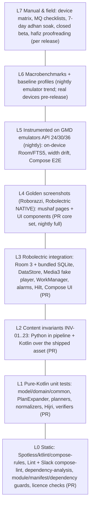

# 10 — Quality, Testing & CI

**Purpose.** This doc says how we prove the app is correct, fast and dependable before it reaches the owner's phone and, later, the public. It covers: quality budgets; the test strategy for each layer and module; the content-invariant suite that guards the Quran text and the Indo-Pak metadata; renderer golden screenshots; audio, download and alarm tests; benchmarks; the device matrix; manual QA checklists; hafiz proofreading and render-regression review; static analysis and licence checks; the GitHub Actions workflows (PR, nightly, data pipeline, upstream drift, release); the beta programme; and production monitoring. The doc is written so the owner or an AI coding agent can build the test infrastructure and CI with no further research.

**Status:** Draft v1 — 2026-10-19

**Key decisions in this doc**
- Toolchain and test stack follow **D-02**, as verified by the spike (g04). Test libraries:
  - JUnit 4.13.2, Truth 1.4.5, Turbine 1.2.1, kotlinx-coroutines-test 1.11.0
  - Robolectric 4.17, Roborazzi 1.76.0
  - room3-testing 3.0.3, work-testing 2.12.0, media3-test-utils(-robolectric) 1.11.1, mockwebserver3 5.5.0
  - hilt-android-testing 2.60.1, Compose ui-test (BOM 2026.09.00)
  - benchmark-macro-junit4 + androidx.baselineprofile 1.5.0, UiAutomator 2.4.0
  - LeakCanary 2.14 (debug only), Kover 0.9.11

  We use fakes, not mocks (r07 §2.7).
- **Content is tested like code (D-06, D-07, D-10, D-11).** 23 content invariants (INV-01…INV-23) run twice: in the Python pipeline (doc 08) and again in Kotlin against the exact asset the APK ships. CI also opens a **no-`room_master_table` copy** of the content DB to force Room's `onValidateSchema` (g04 §2.4).
- **The mushaf renderer is guarded by golden images (D-05).**
  - Roborazzi 1.76.0 on Robolectric NATIVE graphics, with zero pixel tolerance on mushaf pages.
  - A ≈60-page core set runs on every PR. All 548 pages run nightly when the renderer or content changes.
  - Pipeline-version render diffs feed the hafiz re-certification (**D-22, G5**).
- **Robolectric convention plugin `criterion.android.robolectric`** with the g04 fixes:
  - `--add-exports`/`--add-opens` JVM flags;
  - host `libsqliteJni` taken from `sqlite-bundled-jvm`;
  - NATIVE graphics run one SDK per JVM;
  - no classpath folder named `fonts/`.
- **Privacy and policy are enforced by CI (D-15, D-16, D-17, D-20).** CI checks:
  - a merged-manifest permission denylist;
  - a runtime-dependency group allowlist (no GMS, Firebase, ads or analytics in v1);
  - a block on non-commercial content in any monetized build;
  - a block on PENDING-licence audio in public catalogues.
- **CI/CD runs on GitHub Actions** (checkout v7, setup-java v6 with Temurin 21, gradle/actions v6, upload-artifact v7; r07 §2.7). There are five workflows. Releases are signed with the **Play App Signing upload key** held in a protected `release` environment. AAB uploads to Play stay manual through P2.
- **Monitoring = Play Console Android vitals + pre-launch reports only in v1 (D-20).** Opt-in ACRA arrives in v1.1 (F-PL-09). No SDK telemetry.
- **Device QA is weighted to the Pakistani OEM mix** (r08 §2.3.5):
  - Transsion (Infinix/Tecno/itel) 25.5%, Samsung 17.3%, Oppo/realme 14.1%, Vivo 11.9%, Xiaomi 10.6%;
  - API 24 → 37;
  - a **7-day adhan soak** on OEM devices is a release gate for F-CP-02.

Related docs: [PRD](01-product-requirements.md) · [UX](02-ux-ui-spec.md) · [Content & licensing](03-content-data-licensing.md) · [Architecture](04-architecture.md) · [Renderer](05-mushaf-rendering-engine.md) · [Audio](06-audio-engine.md) · [Companion](07-companion-engagement-features.md) · [Pipelines](08-data-pipelines.md) · [Roadmap](09-roadmap-backlog.md) · [Release](11-release-compliance-business.md) · [Decisions & risks](12-decisions-risks.md) · [AI playbook](13-ai-assisted-build-playbook.md)

---

## 1. Quality goals and budgets

These budgets are the acceptance thresholds for the release workflow (§12.6) and for closed-test exit (§13). "Ref-high" is a Pixel 6a-class phone. "Ref-low" is a 3 GB Transsion or Redmi phone on Android 12–14 with a Helio G-class SoC. Budgets marked *[inferred]* are our own targets; r07 §2.7 gives the starting points.

| ID | Metric | Budget | Measured by | Enforced |
|---|---|---|---|---|
| QB-01 | User-perceived crash-free users (28-day) | **≥ 99.5%** (stretch 99.8%) | Play vitals | Staged-rollout halt rule (§14) |
| QB-02 | User-perceived ANR rate | **< 0.2%** | Play vitals | Staged-rollout halt rule |
| QB-03 | Cold start to first frame (TTID) | Ref-high **≤ 500 ms** p50; Ref-low **≤ 1,500 ms** p50 | `StartupBenchmark` (`StartupTimingMetric`), Partial(BaselineProfile) | Manual on real devices before every public release; emulator trend nightly |
| QB-04 | Cold start → last-read mushaf page fully drawn (`reportFullyDrawn`) | Ref-high ≤ 800 ms; Ref-low ≤ 2,000 ms | `ReaderOpenBenchmark` | Same as QB-03. The reference app has 80 slow-start/splash complaint reviews with 11,713 helpful votes (r01 §2.9) |
| QB-05 | Page-turn smoothness (swipe 20 pages) | p90 frame ≤ 16 ms; p99 ≤ 32 ms; janky frames < 5% (Ref-low < 10%) | `PageTurnBenchmark` (`FrameTimingMetric`) | Same as QB-03 |
| QB-06 | Index scroll (Surah 114 rows, Para 30 rows, fling ×5) | p95 frame ≤ 16.7 ms | `IndexScrollBenchmark` | Same as QB-03 |
| QB-07 | Search latency (FTS5 query → results state) | p95 ≤ 100 ms Ref-low for 1–3-word Arabic and Urdu queries | `SearchBenchmark` (`TraceSectionMetric("search.query")`) + JVM micro-test ≤ 50 ms | Nightly trend; manual pre-release |
| QB-08 | Memory | Reader PSS ≤ 150 MB after 100 page turns on Ref-low. Java heap growth < 5 MB after 100 more turns. **0 page bitmaps** in the default path (D-05). 0 LeakCanary leaks on the scripted journeys | `dumpsys meminfo`, LeakCanary 2.14 (debug), heap dump in the benchmark | Manual pre-release; LeakCanary in daily dev use |
| QB-09 | Download size (Play, arm64 device) | **≤ 25 MB** target, **30 MB hard ceiling** (r07 rec 17). Warn on > +500 KB vs `main` | `bundletool build-apks --device-spec arm64.json` + `get-size total` | PR workflow (warn), release workflow (fail) |
| QB-10 | Battery, 1 h screen-off recitation | Downloaded file: ≤ 3% of a 5,000 mAh battery. Streaming on Wi-Fi: ≤ 5%. No partial wakelock held > 60 s after pause or stop | `dumpsys batterystats --reset` → 1 h → `dumpsys batterystats` (+ Battery Historian), Ref-low | Manual pre-release (MQ-AU-20) *[inferred targets]* |
| QB-11 | Adhan punctuality | With exact-alarm permission and the vendor guidance applied: **0 missed of 35** over 7 days per matrix device; lateness p95 ≤ 60 s, max ≤ 180 s | In-app lateness log (Adhan health check, F-CP-02) | 7-day soak (MQ-AD), release gate for F-CP-02 |
| QB-12 | Download integrity | 100% of completed files match the expected MD5/SHA-256. Resume after kill or network drop without re-downloading finished bytes | Unit + MockWebServer tests; MQ-DL | PR (unit), pre-release (manual) |
| QB-13 | Text correctness | **0 known open errors** in shipped Arabic text, marks or layout. Report-text-error: acknowledge ≤ 48 h; fix or kill-switch ≤ 7 days (D-22) | Content invariants, hafiz certificate, F-PL-05 inbox | Release gate (G5); ops SLA |
| QB-14 | Follow-along accuracy (F-AU-03/F-RD-05) | Highlighted ayah = audible ayah within ±300 ms at ≥ 95% of ayah starts in sampled surahs (1, 36, 67 + 3 random) for every highlight-enabled reciter (g03 §2.5.2 shows 83–87% within ±300 ms *before* onset snapping) | Pipeline onset check + manual listen (MQ-AU-15) | Timing-pack publication gate |
| QB-15 | Accessibility (F-PL-07) | All interactive elements have labels. Touch targets ≥ 48 dp. Text contrast ≥ 4.5:1 (UI chrome). Usable at font scale 2.0. TalkBack can complete the 6 core journeys (MQ-A11Y) | Compose UI tests + Accessibility Scanner + manual | PR (automated subset), pre-release (manual) |
| QB-16 | Build health | PR workflow ≤ 15 min wall-clock (warm cache). 0 lint errors. 0 new baseline entries without review | Actions timing | Ongoing |

Play's own "bad behaviour" thresholds (user-perceived crash rate 1.09%, ANR 0.47%) are far looser than QB-01/QB-02 [unverified: from memory; check in Console in P2]. Our budgets are deliberately tighter because the reference app's reputation rests on reliability as well as ads.

---

## 2. Test strategy

### 2.1 Pyramid



Target counts at v1.0 *[inferred]*:
- L1: ≈ 600 tests, under 30 s in total.
- L2: 23 invariant groups (≈ 150 assertions).
- L3: ≈ 250 tests.
- L4: ≈ 60 PR goldens plus 548 nightly page goldens plus ≈ 80 UI goldens.
- L5: ≈ 25 tests.
- L6: 6 benchmarks.

### 2.2 Conventions

- **Locations:**
  - `src/test` holds JVM and Robolectric tests.
  - `src/androidTest` holds instrumented tests.
  - `:baselineprofile` holds macrobenchmarks and profile generators.
  - `tools/*/tests` holds pytest suites (doc 08).
- **`:core:testing`** (android library) provides:
  - a fake for every repository interface in `:core:data` (`FakeQuranRepository`, `FakeRecitationRepository`, …);
  - `MainDispatcherRule`, `FakeClock`, `TestDispatchers`;
  - `TestContentDb` (opens the real shipped asset through the bundled driver);
  - `FakePlaybackController`, `FakeDownloadScheduler`, `FakeAlarmScheduler`, `FakeLocationProvider`.
- **Fakes over MockK.** MockK 1.14.11 is allowed only for Android framework types that we cannot fake. Every use gets a one-line justification comment.
- **Coroutines:** use `runTest` with injected dispatchers. **Never `runBlocking` around `viewModelScope`.** It deadlocks the Robolectric main looper (g04 §2.3 #5). Collect flows with Turbine `test { }`.
- **Hilt tests:** `@HiltAndroidTest` + `HiltAndroidRule` + `@TestInstallIn` modules that swap real repositories for fakes. The Robolectric application is `HiltTestApplication` via `@Config(application = HiltTestApplication::class)`.
- **Naming:** `methodOrBehaviour_condition_expectedResult`. Golden files are named `<suite>/<id>_<variant>.png`, for example `mushaf/p021_light_w360.png`.
- **Determinism:**
  - Inject the clock and the time zone (`Asia/Karachi` default).
  - Pin `Locale` per test.
  - Robolectric default `sdk=36` lives in `src/test/resources/robolectric.properties`.
  - API-gated logic gets explicit `@Config(sdk = [24, 33, 34])`. Whether the SDK 24 `android-all` jar resolves must be verified in P0, because the g04 sandbox failed to fetch it.

### 2.3 Per-module test matrix

Module names follow r07 §2.10; doc 04 owns the final list.

| Module | L1 unit | L2 | L3 Robolectric | L4 goldens | L5/L6 | Key suites |
|---|---|---|---|---|---|---|
| `:core:model` (JVM) | ✅ | | | | | `VerseKeyTest`, `PageLabelTest`, `ParaTableTest`, `ManzilTest`, `RukuTest`, `SurahMetaTest` |
| `:core:common` (JVM) | ✅ | | | | | `OutcomeTest`, `AppErrorMappingTest` |
| `:core:domain` (JVM) | ✅ | | | | | `PlanExpanderTest`, `AyahTrackerTest`, `SleepTimerTest`, `KhatamPlannerTest`, `ResolveScopeTest`, `NextPrayerTest` |
| `:core:content` | ✅ normalizers | ✅ **INV suite** | ✅ Room/FTS5, no-master, re-copy | | L5 FTS5 on API 24 | `ContentInvariantsTest`, `PrepackagedSchemaTest`, `SearchDaoTest`, `NormalizerParityTest` |
| `:core:database` (user.db) | | | ✅ DAOs, migrations, backup rules | | | `UserDbMigrationTest`, `BookmarkDaoTest`, `LastReadDaoTest`, `BackupRulesTest` |
| `:core:datastore` | ✅ serializer | | ✅ | | | `UserSettingsSerializerTest` (defaults, unknown-field tolerance, corruption handler) |
| `:core:network` | ✅ verifiers | | ✅ MockWebServer | | | `SignedIndexVerifierTest` (Ed25519), `MirrorFailoverTest`, `CatalogueParserTest` |
| `:core:download` | ✅ state machine | | ✅ MockWebServer, work-testing, JobScheduler shadow | | Manual MQ-DL | `RangeResumeTest`, `ChecksumTest`, `ZipInstallTest`, `HostSelectionTest` (UIDT vs Worker) |
| `:core:data` | ✅ with fakes | | ✅ | | | `*RepositoryTest`, `PackRepositoryTest` (licence flags, kill-switch) |
| `:core:audio` | ✅ | INV-22 consumer | ✅ ExoPlayer on Robolectric, MediaSession | | L6 `AudioStartBenchmark` | `PlaybackStateHubTest`, `ResolvingDataSourceTest`, `BasmalaStrategyTest`, `TimingGuardTest`, `AudioFocusPolicyTest` |
| `:core:mushaf-render` | ✅ geometry | INV-14/15 | ✅ NATIVE graphics | ✅ **mushaf goldens** | L5 `WidthDriftTest`; L6 `PageTurnBenchmark` | `LineGeometryTest`, `HitTestTest`, `GeometryParityTest`, `MushafGoldenTest`, `KashidaNativeGraphicsTest` |
| `:core:prayer` | ✅ | | ✅ | | | `PrayerTimesGoldenTest`, `HijriTest`, `QiblaTest`, `MonthStartFeedTest` |
| `:core:notifications` | ✅ decisions | | ✅ ShadowAlarmManager | | Soak MQ-AD | `PrayerSchedulerTest`, `RescheduleTriggersTest`, `AdhanModeDecisionTest`, `ChannelsTest` |
| `:core:location` | ✅ | | ✅ | | | `CityDbTest` (cities15000 Urdu names), `CoarseLocationFlowTest` |
| `:core:designsystem` / `:core:ui` | | | ✅ Compose | ✅ component goldens | | `ThemeGoldenTest` (4 themes × en/ur), `RowsGoldenTest` |
| `:core:navigation` | ✅ | | | | | `NavKeySerializationTest` (every NavKey round-trips), `DeepLinkParseTest` |
| `:feature:*` | ✅ ViewModels | | ✅ Compose UI | ✅ screen goldens | L5 E2E | `<Screen>ViewModelTest`, `<Screen>ScreenTest` |
| `:app` | | | ✅ Hilt graph | | L5 smoke, L6 startup | `HiltGraphTest`, `ManifestGuard` (Gradle), `FlavorDependencyGuard` (Gradle) |
| `tools/*` (Python) | pytest | ✅ **INV suite (source of truth)** | | pipeline renders | | doc 08 |

---

## 3. L1 — pure-Kotlin unit tests (what must be covered)

### 3.1 Model and metadata (`:core:model`)

| Suite | Cases (each one a test or a parameter row) |
|---|---|
| `VerseKeyTest` | Parse/format `s:a`. Global id 1..6236 ↔ key (1:1 = 1, 114:6 = 6236). Reject 0:0, 115:1, 2:287. Fatiha 1:1 = basmala (D-06). |
| `PageLabelTest` | For mushaf `taj16`: `label = index + 1`. Labels 2..549 are valid. Go-to-page rejects 1 and 550 with a typed error. Labels show in Urdu digits in the ur locale and parse back from both digit sets (F-IX-05). |
| `ParaTableTest` | 30 rows. The 7 Indo-Pak starts: P4 3:92, P7 5:83, P11 9:94, P14 15:2, P20 27:60, P21 29:45, P23 36:22. The Madani juz table stays separate and never leaks into `taj16`. For n = 1..28 the start page_index is 18n−16; P29 is at 508 and P30 at 528. `paraOf(3:92) = 4` and `paraOf(3:91) = 3`. The 30 traditional names match a frozen list (الم، سیقول، تلک الرسل، لن تنالوا …). The by-end ruku counts per Para are the D-07 vector. |
| `ManzilTest` | 7 manzils starting at surahs 1, 5, 10, 17, 26, 37, 50. `footerManzil(page) = manzil(lastAyah(page))`. |
| `RukuTest` | 558 rukus. `paraRuku` is NULL for Fatiha. A ruku that straddles a Para is numbered in the Para where it ends (2:249–253 → para-ruku 1 of P3; 15:1–15 → para-ruku 1 of P14). Marker triple = (surahRuku, ayahCount, paraRuku). |
| `SajdaTest` | 14 numbered (incl. 38:24) plus 22:77 `shafii_only`. The label strings are exact. |
| `QuarterTest` | 90 quarters, 3 per Para, ordered. P7 ¾ = 6:73 after word 10 (mid-ayah; `wordPos = 10`). "Jump to quarter" for a mid-ayah anchor resolves to the ayah start plus a word offset. |

### 3.2 Audio domain (`:core:domain`)

**`PlanExpanderTest`** uses a table-driven fixture over the real metadata tables (D-13; r06 §2.8). `G` = gapped per-ayah items; `L` = gapless clipped surah items.

| # | PlayRequest | Layout | Expected |
|---|---|---|---|
| 1 | Surah 1 | G | 7 items 1:1…1:7. **No extra basmala item** (1:1 is the basmala) |
| 2 | Surah 9 | G | 129 items, no basmala |
| 3 | Surah 2 | G | 1 basmala + 286 = 287 items |
| 4 | Para 30 | G | **601 items** (564 ayahs + 37 basmalas) |
| 5 | Para 30 | L | **37** clipped surah items |
| 6 | Para 4 | G/L | First ayah **3:92**, last 4:23. The gapless clip of surah 3 starts at `timing(3:92).start` |
| 7 | Paras 7, 11, 14, 20, 21, 23 | G/L | Start at 5:83, 9:94, 15:2, 27:60, 29:45, 36:22; end one ayah before the next Para's start |
| 8 | Manzil 7 | G | Surahs 50..114 with basmalas; count = Σ ayahs + 65 basmalas |
| 9 | Full Quran | G | **6,348 items** (6,236 + 112 basmalas); queue windowing keeps ≤ 500 materialised items |
| 10 | Ruku 2:8–20 | G/L | 13 ayahs. L = one clipped item, 2:8 start → 2:20 end |
| 11 | Page label 21 | G | Ayahs of page_index 20 (Para 2 start = 2:142) |
| 12 | AyahRange 1:6 → 2:5 | G | 1:6, 1:7, basmala(2), 2:1…2:5 |
| 13 | Ayah 2:255 ×3 | G | 3 items, repeat counter metadata 1/3, 2/3, 3/3 |
| 14 | Range 67:1–5 ×2, pause-after fixed 2 s | G | 10 items plus `pauseAfterMs = 2000` on each |
| 15 | Range ×∞ | G/L | Repeat mode ALL over the range; never expands unbounded |
| 16 | Pause proportional ×1.0 | G | `pauseAfterMs = itemDuration × 1.0` (needs a duration from the catalogue or timing) |
| 17 | Play-from-here 18:10 within "Surah 18" | G/L | Starts at 18:10. L: `startPositionMs = timing(18:10).start` |
| 18 | Hifz cumulative chain 1–3 | G | 1; 1,2; 1,2,3 (6 items) |
| 19 | Basmala strategies | L | `EMBEDDED`: no extra item. `USE_FATIHA_1_1`: prepend 1:1 clip. `BISMILLAH_FILE`: prepend file. `NONE` for surah 9 always |
| 20 | Reciter lacks timing for a surah (kill-switch) | L | Item plays with `highlight = DISABLED` for that surah only |

| Suite | Cases |
|---|---|
| `AyahTrackerTest` | `ayahAt(positionMs)` by binary search over starts. The boundary belongs to the next ayah. Before the first start → intro (ayah 0). After the last end → last ayah. Seek forward and back re-syncs. Property test: 10k random positions agree with a linear scan. |
| `SleepTimerTest` | Minutes mode. End-of-ayah, end-of-surah and end-of-para are evaluated against the plan, not wall time. The fade-out volume ramp is monotonic over 10 s. Cancel restores volume. |
| `AutoPageTurnPolicyTest` | Auto-turn suspends 8 s after the last pager touch (FakeClock). Turns are suppressed while page-turn lock is on (F-RD-07). The turn targets the page of the *current* ayah, so ayahs that span pages are handled. |
| `KhatamPlannerTest` (F-BM-04, r08 §2.13) | 30-day preset on taj16 → ceil(548/30) = 19 pages for the first days, converging to 18.27/day. "Stop at ruku ع" snaps each daily end to the next ruku end. Rest-day mask. Missed days redistribute (no negative goals). Ramadan 27 and 29 nights. Plan complete → `completedAt` set. Para-unit plan uses the Indo-Pak Para table. |
| `StreakTest` (F-BM-05) | Day boundary in the local time zone. 2 freeze days per month. No streak broken by a DST or time-zone change. |

### 3.3 Text, search and copy

| Suite | Cases |
|---|---|
| `ArabicNormalizerTest` | The r05 §2.7.5 spec: (1) ZW* and BOM become a space and PUA is dropped. (2) Harakat and Quranic marks are dropped, with **U+0670 dropped, not mapped**. (3) The letter folds. (4) NFKC, then whitespace collapse. |
| `NormalizerParityTest` | Runs the Kotlin normalizer over `normalizer_vectors.json` (generated by the pipeline: ≥ 500 hand-picked vectors plus a SHA-256 of the normalized text of all 6,236 ayahs × 3 columns). Output must be **byte-identical** to the Python normalizer (INV-17). |
| `UrduNormalizerTest` | Folds ي ى → ی, ك → ک, ه ة ۃ → ہ, Urdu digits → ASCII. **ے and ھ stay distinct**: کی ≠ کے, بھ ≠ بہ (D-11). |
| `EnglishNormalizerTest` | Allāh → allah; ʿ and ʾ are removed; lowercase; ASCII fold. |
| `AliasTest` (F-SR-03) | Folding: aa→a, ee→i, oo→u; drop `'`, `-` and spaces. yasin, yaseen, ya-sin, یس → 36. rahman, rehman → 55. mulk, tabarak → 67. ayatul kursi, آیت الکرسی → 2:255. "last 2 of baqarah" → 2:285–286. "manzil dua" → playlist. |
| `QuerySyntaxTest` | User input is escaped for FTS5 (quotes and operators). Explicit AND, prefix `*` and phrase all work. An empty or whitespace query → empty state, no SQL. |
| `CopyShareSanitizerTest` (D-08) | Output has no PUA (U+E000–F8FF, U+F500–F69x medallions) and no bidi controls (U+202A–202E, U+2066–2069). The attribution line is appended. Arabic is always present when a translation is shared. |

### 3.4 Companion domain

| Suite | Cases |
|---|---|
| `PrayerTimesGoldenTest` (F-CP-01) | adhan2 KARACHI + HANAFI, Karachi (24.8607, 67.0011), **2026-10-19 PKT: Fajr 05:16, Sunrise 06:32, Dhuhr 12:18, Asr 16:24, Maghrib 18:02, Isha 19:18** (g04 §1 #9, exact). The cross-check rows for Lahore, Islamabad, Peshawar, Quetta and Manchester (r08 §2.2, from Aladhan) are asserted at **±2 min**. Per-prayer offsets apply. The Asr Standard/Hanafi switch moves Asr later for Hanafi. |
| `QiblaTest` (F-CP-03) | Bearing within 0.1° of Karachi 267.7°, Lahore 260.3°, Islamabad 255.9°, Peshawar 254.0°, Quetta 256.7°, Manchester 118.5° (r08). True-north correction uses `GeomagneticField` (Robolectric). |
| `HijriTest` (F-CP-04, D-15) | `effective = feedOverride ?: HijrahDate.from(civil + userOffset)` with offset ∈ −2..+2 (out of range is rejected). Golden: 2026-10-12 → 1 Jumada I 1448 (UQ). The PK feed `{"hijri":"1448-05","start":"2026-10-13"}` → 2026-10-13 shows 1 Jumada I 1448. After Maghrib (adhan2 Maghrib via FakeClock) the next date shows, flagged "from Maghrib". Feed precedence > user offset. Stale feed (> 35 days) → falls back to UQ + offset. |
| `MonthStartFeedTest` | Ed25519 signature valid → accepted. One flipped byte → rejected, last-known value kept. Wrong key id → rejected. Schema version unknown → ignored. |
| `TasbeehTest` (F-CP-05) | Counter target or loop, haptic event at the target, persisted across process death. |

### 3.5 Packs, catalogue, licences

| Suite | Cases |
|---|---|
| `SignedIndexVerifierTest` (D-10) | `index.json` and `catalogue.json` Ed25519 signatures verify against the pinned public key. A tampered sha256, size or licence field fails. The kill-switch entry removes the pack from the UI and blocks its use. |
| `PackEligibilityTest` (D-17) | A pack with `commercialOk=false` (e.g. Tanzil Jalandhari) is hidden when `BuildConfig.MONETIZED = true`. Build-eligibility flags `personal`/`beta`/`public` are honoured per flavor/channel. |
| `CatalogueEligibilityTest` (D-12) | A public channel never lists `licenceStatus = PENDING` recitations (Shamshad Ali Khan, Husary Muallim, Qari Sadaqat Ali). Reads 74 and 53 never carry timing. Timing host = audio host for every recitation. |

---

## 4. L2 — content invariants (INV-01 … INV-23)

**Where they run.**
1. **Pipeline (source of truth, doc 08).** The pytest/assert gates run while building `quran_content.db` and the packs. A failure stops the build.
2. **App side.** `:core:content` `ContentInvariantsTest` (Robolectric + `BundledSQLiteDriver`) runs the same checks against **the exact asset file that will be packaged**, plus Room's open path. This catches drift between pipeline and app: wrong asset version, stale lock file, schema mismatch.

Expected constants live once in `tools/content-spec/expected.json`. Both sides read it, so the numbers are never duplicated by hand.

| ID | Invariant (all must hold for `taj16` + base content) | Source |
|---|---|---|
| INV-01 | 114 surahs; 6,236 ayahs; per-surah ayah counts equal Tanzil `quran-data.js`; global ids 1..6236 contiguous | D-06, r05 |
| INV-02 | Tanzil Uthmani and Simple-Clean texts are **verbatim**: per-column SHA-256 of the concatenated source text equals the pinned source hash (CC BY 3.0 "changing it is not allowed") | D-08 |
| INV-03 | DK token stream: **83,669 tokens, 77,433 words, 6,236 ends (6,235 numbered + 1 bare), 118 U+08E2, 1 U+202E, 558 U+08D6, 15 U+08DB, 0 standalone-mark tokens**. 114 surah-title lines and 112 basmala lines are skipped | g01 §2.8 step 3 |
| INV-04 | DK ↔ QUL mapping: 83,668 QUL word positions, every one mapped. Identity except **72:16 (QUL w1 = DK t1–2)**. First/last skeleton match per line, with the **frozen whitelist {4:112:3, 18:19:34, 59:13:1}**. The whitelist size never grows without a hafiz decision recorded | D-06, g01 |
| INV-05 | Layout: **548 pages × 16 slots**. Every DK token appears exactly once and in reading order. Every ayah line maps to a contiguous range. Empty slots restored on pp. 1–2 and 548. **p.529 header/basmala order fixed**. 80 `SURAH_NAME_WITH_BASMALA` lines + 32 separate basmala lines (incl. surah 2's, in the sar-lauh panel) = 112. Surah 9 is title-only. Index 1 remapped to slots 10/11/12–16 (sar-lauh template on indices 1–2) | g01, g02 §3 rec 9 |
| INV-06 | Para table = D-07 exactly: 30 rows, the 7 Indo-Pak starts, start page_index 18n−16 (n = 1..28), 508, 528, each starting at the top line. Names equal the frozen list | D-07, g02 |
| INV-07 | 7 manzils starting at surahs 1, 5, 10, 17, 26, 37, 50, on page_index **[1, 96, 187, 254, 330, 401, 466]**. `page.footer_manzil` = manzil of the page's last ayah, for all 548 pages | D-07, g01 step 9, g02 rec 8 |
| INV-08 | Rukus: **558** rows that partition all 6,236 ayahs contiguously. Surah ruku counts match the header strings (Shu'ara 11, Qasas 9, Luqman 4). Ruku ends at **26:51, 26:68, 28:82, 31:30, 56:38** (not 56:40). `para_ruku` NULL only for Fatiha. Para of a ruku = Para of `last_ayah`. Per-Para by-end counts = **16,16,17,14,17,14,19,17,18,17,16,16,19,22,21,17,17,17,19,16,19,18,17,19,20,18,20,20,22,39** | D-07, g02 §1 #5–8 |
| INV-09 | Sajda: 15 rows. `print_no` 1..14 unique, including 38:24. 22:77 is `shafii_only` with label «السجدة عند الامام الشافعی رح». The positions equal the 15 U+08DB marks in DK | D-07, g02 |
| INV-10 | Para quarters: **90 rows** (30 × 3), strictly ordered within each Para. Corrections present: P4 ¾ = 3:198, P7 ¼ = 5:113, P7 ¾ = 6:73 word 10. **Release builds additionally require `verified_source IS NOT NULL` on all 90** (53 still need hand-checking, g02 rec 6) | D-07 |
| INV-11 | `ayah_marker`: **6,354 rows = 6,236 Kufan ends + 118 «۵» disputed marks**. A disputed mark is never an ayah boundary (no audio, highlight or count effect). The `taj16` Fatiha display override has 7 rows with `show_number = 0`; data keys stay Kufan | D-06, g02 rec 2–3 |
| INV-12 | Pages: `page_label = page_index + 1` (2..549). `mushaf.first_page_label = 2`. `outer_margin = 'R'` iff the label is even. Header Para/surah fields are non-null on every page | D-04, g02 |
| INV-13 | 114 surah header strings exist, match the generator rule («سورة {name} {مكية/مدنية} وهي … آية و … ركوعات», rukus omitted for 1), and carry a `proofread = 1` flag before release | g02 rec 10 |
| INV-14 | Font: the shipped TTF SHA-256 equals the pipeline's regenerated conversion of `indopak.otf` @4213fab (source SHA-256 pinned). **The `cv01` feature is present and active**: الْكِتٰبُ advance is 2060 at cv01=0 and **2847** at cv01=1 (upem 1000). This guards against shipping the cv-less QUL CDN font (g04 §1 #11a). **0 `.notdef`** over all words after shaping | D-05, g04 |
| INV-15 | Justification: per line, Σ(width_frac) + gaps ≤ 1.0 + 1e-6 (no overflow). `cv01 ∈ {0,1,2,3}`. Word x-positions decrease monotonically (RTL). Inter-word gaps ≥ 0.10 em hard and 0.18–0.31 em target band (warn outside; r04 §2.5). Centered lines (headers, basmala, short last lines) are flagged and not justified | D-05, r04 |
| INV-16 | Search: each FTS table has 6,236 rows (Arabic) or the translation's row count. Golden queries over the 3 Arabic columns: الصلاة 55, الصلوة 55, السماوات 180, السموت 180, يأيها الذين آمنوا 90, ابرهيم 40, إبراهيم 56, مالك يوم الدين 1, ملك يوم الدين 1, إِيَّاكَ نَعْبُدُ 1 (r05 §2.7.5, measured under FTS4). Single-column `text_norm` (g04): الرحمن 45 (first = 1:1), trigram رحم 201. **The FTS5 baseline is captured from DB v0 in P0, reviewed and frozen; later changes need a reviewed diff** | D-11 |
| INV-17 | Python and Kotlin normalizers are byte-identical on `normalizer_vectors.json`, including the 6,236 × 3 normalized-column hashes | D-11 |
| INV-18 | Translations (base: Urdu Junagarhi + Ahsan-ul-Bayan footnotes, English Saheeh): rows keyed by Kufan key, covering 6,236 (merged-verse rows explicit). Source SHA-256 and QuranEnc version recorded. Text unmodified vs source. Attribution strings exact (Saheeh → "Noor International Center"). No translation row lacks a matching Arabic ayah | D-09 |
| INV-19 | Hygiene: the search, copy and TTS columns contain no PUA or control characters. **No pipeline input URL or host matches quran.com / api.quran.com / quran.foundation / qurancdn.com** (QF terms, r05 risk) | D-08, D-09 |
| INV-20 | Room: the `room_master_table` identity hash equals the exported schema's hash. `PRAGMA user_version` = `@Database(version)`. **The no-master copy opens and passes `onValidateSchema`**. FTS tokenizer options equal the schema (`unicode61`, `trigram`) | D-10, g04 §2.4 |
| INV-21 | Licence metadata: every source in `content_meta.sources_json` and every pack has licence, attribution, URL, retrieved-at and `commercialOk`. The credits screen (F-PL-04) resolves every entry. Non-commercial content is absent from monetized builds | D-17, D-22 |
| INV-22 | Timing packs, per recitation and surah (g03 §2.6): ayahs 1..n complete; strictly increasing; `end > start`; intro stored as ayah 0; last end ≤ duration + 1,000 ms (clamped); guard tuple (content_length, etag, duration_ms) present; letter-count off-by-one detector selects k = 0 after repair (r ≥ 0.6). Expected **DISABLE** list asserted (e.g. 118 s1/s21; 112 s9/52/53; 31 s12/40/80; 92 s4). Never read 74 or 53. Timing host = audio host | D-12, g03 |
| INV-23 | Signed indexes: `index.json` and `catalogue.json` verify with the release public key. Each listed file's size and sha256 match the published object. `minAppVersion` ≤ current. Kill-switch entries are well-formed | D-10, D-24 |

Pre-release only (not on every PR): the **owner's 5 checkpoint pages** from his own copy (labels 2, 39, 70, 115, 483; g02 §4) match our render, and this is checked off in the certificate (§10).

**App-side sketch** (`:core:content`, Robolectric):

```kotlin
@RunWith(RobolectricTestRunner::class)
class ContentInvariantsTest {
    private val spec = ExpectedSpec.load()            // tools/content-spec/expected.json (copied as test resource)
    private val db = TestContentDb.openShippedAsset() // createFromAsset + BundledSQLiteDriver, read-only

    @Test fun inv01_counts() = runTest {
        assertThat(db.count("SELECT COUNT(*) FROM ayah")).isEqualTo(6236)
        assertThat(db.ayahsPerSurah()).containsExactlyElementsIn(spec.ayahsPerSurah).inOrder()
    }
    @Test fun inv06_paraStarts() = runTest {
        spec.paraStarts.forEach { (para, key, pageIndex) ->
            assertWithMessage("Para $para").that(db.paraStart(para)).isEqualTo(key to pageIndex)
        }
    }
    @Test fun inv08_rukuPerPara() = runTest { assertThat(db.rukusPerParaByEnd()).isEqualTo(spec.rukusPerPara) }
    // … one @Test per INV id; the message always names the INV id for triage
}
```

---

## 5. L3 — Room 3 database tests

### 5.1 Robolectric + bundled SQLite setup (convention plugin)

`build-logic/convention/.../AndroidRobolectricConventionPlugin.kt` registers `criterion.android.robolectric`. It moves the spike's per-module block (g04 §2.9) into one place:

```kotlin
class AndroidRobolectricConventionPlugin : Plugin<Project> {
  override fun apply(target: Project) = with(target) {
    extensions.configure<LibraryExtension> { testOptions.unitTests.isIncludeAndroidResources = true } // also ApplicationExtension
    val libs = the<VersionCatalogsExtension>().named("libs")
    dependencies {
      add("testImplementation", libs.findLibrary("robolectric").get())
      add("testImplementation", libs.findLibrary("androidx-test-core").get())
      add("testImplementation", libs.findLibrary("truth").get())
      add("testImplementation", libs.findLibrary("turbine").get())
      add("testImplementation", libs.findLibrary("kotlinx-coroutines-test").get())
      add("testImplementation", project(":core:testing"))
    }
    // Host libsqliteJni for BundledSQLiteDriver (g04 §2.3 #4). sqlite-bundled-jvm 2.7.1 ships
    // linux_x64, linux_arm64, osx_arm64, windows_x64 only (no Intel mac).
    val sqliteNative = configurations.create("sqliteNative") { isTransitive = false }
    dependencies.add("sqliteNative", libs.findLibrary("androidx-sqlite-bundled-jvm").get())
    val os = System.getProperty("os.name").lowercase()
    val arm = System.getProperty("os.arch") in setOf("aarch64", "arm64")
    val dir = when { "mac" in os -> "osx_arm64"; "win" in os -> "windows_x64"; arm -> "linux_arm64"; else -> "linux_x64" }
    val lib = when { dir.startsWith("osx") -> "libsqliteJni.dylib"; dir.startsWith("win") -> "sqliteJni.dll"; else -> "libsqliteJni.so" }
    val extract = tasks.register<Sync>("extractSqliteNative") {
      from({ zipTree(sqliteNative.singleFile) }) { include("natives/$dir/**"); eachFile { path = name }; includeEmptyDirs = false }
      into(layout.buildDirectory.dir("sqlite-native"))
    }
    val roboSdks = providers.gradleProperty("roboSdks")
    tasks.withType<Test>().configureEach {
      dependsOn(extract)
      systemProperty("androidx.sqlite.driver.bundled.path", layout.buildDirectory.dir("sqlite-native").get().asFile.absolutePath)
      systemProperty("androidx.sqlite.driver.bundled.name", lib)
      // SDK 36 ApplicationSharedMemory + JDK 21 strong encapsulation (g04 §2.3 #3)
      jvmArgs("--add-exports=java.base/jdk.internal.access=ALL-UNNAMED", "--add-opens=java.base/java.io=ALL-UNNAMED")
      maxHeapSize = "3g"
      // NATIVE-graphics suites abort the JVM if two SDKs share it → default task excludes them (§7.4)
      if (roboSdks.isPresent) systemProperty("robolectric.enabledSdks", roboSdks.get())
      else filter { excludeTestsMatching("*NativeGraphics*"); excludeTestsMatching("*Golden*") }
    }
  }
}
```

Rules that go with the plugin:
- **No classpath directory named `fonts/` in any test source set.** Robolectric's native runtime copies `fonts/` from the classpath, which shadows the system fonts (g04 §1 #12). Test fonts live in `mushaf-fonts/`, as the spike's `kashida-fonts/` does. `ForbiddenTestResourceDirCheck` (a Gradle task, §11.3) fails the build if a `src/test*/resources/fonts` directory exists.
- **NATIVE graphics need SDK ≥ 26.** SDK 25 silently falls back to fake metrics. Every NATIVE suite starts with `assumeNativeGraphics()`, which **fails** (does not skip) if `Paint().measureText("Hello") == 5.0f`.

### 5.2 Content DB (`PrepackagedSchemaTest`)

| Test | Fixture (built by the pipeline in CI, g04 §2.10 flags) | Expectation |
|---|---|---|
| `shippedAsset_opens_andQueries` | Shipped DB (with master table) | 6,236 rows. FTS5 MATCH and trigram work. `sqlite_version()` = 3.50.1 with `ENABLE_FTS5` |
| `noMasterCopy_passesFullValidation` | `--no-master` copy of the same build | Opens. Room runs `onValidateSchema` and accepts the extra non-entity tables (`word`, `line`, `page`, `ruku` …) |
| `noMasterNoTriggers_roomAddsTriggers` | `--no-master --skip-triggers` | Opens. The sync triggers exist afterwards |
| `badHash_rejected` | `--bad-hash` | `IllegalStateException` containing "Room cannot verify the data integrity" |
| `tokenizerMismatch_rejected` | Negative fixture (porter instead of unicode61, no master) | Rejected with "Pre-packaged database has an invalid schema" |
| `versionBump_recopiesContent_keepsUserDb` | Install asset v1 → open → write user.db rows → swap in asset v2 (bumped `@Database(version)`) → reopen | Content shows the v2 marker row in `content_meta`. user.db rows are intact (D-10 destructive re-copy) |
| `readOnly_guard` | Shipped DB | Any write through the content DAO throws, or the content DAO has no write methods (compile-time) |

**Why the no-master test is non-negotiable:** with a matching `room_master_table`, Room checks only the identity hash. A pipeline bug that changes a column would ship and fail only at query time (g04 §4).

### 5.3 user.db migrations (`UserDbMigrationTest`)

- Exported schemas are committed in `core/database/schemas/<db>/<version>.json`. Room 3's Gradle plugin fails without `room3 { schemaDirectory(...) }` (g04 §2.6).
- Use `room3-testing` `MigrationTestHelper` with `BundledSQLiteDriver`. For every version N there are three tests:
  - **N−1 → N** with seeded rows;
  - **1 → N** (all migrations chained);
  - `runMigrationsAndValidate`.
- Seed data covers every table: bookmarks (ayah and page), collections and colours, last-read pointer, khatam plans and progress, notes, downloads registry, reading-history aggregates.
- Assertions:
  - **keys stay stable** (Kufan verse key, `mushafId + page_index`);
  - no orphan rows;
  - `last_read` survives;
  - bookmark ordering is preserved.
- **Destructive fallback is forbidden for user.db.** The builder has no `fallbackToDestructiveMigration`, and `UserDbBuilderTest` asserts this by reflection over the builder config or by an explicit wrapper flag.
- `BackupRulesTest` (F-BM-06) parses `res/xml/data_extraction_rules.xml` and `backup_rules.xml`. It asserts:
  - `user.db` and the DataStore file are **included**;
  - audio, packs, caches and `quran_content.db` are **excluded** (D-20).
- `JsonExportImportTest` (P2) round-trips export → wipe → import and compares equal. Import is idempotent. An export from a newer schema version is rejected with a clear message.

---

## 6. L3 — Robolectric integration (other areas)

| Area | Tests |
|---|---|
| DataStore | Typed `DataStore<UserSettings>`: defaults on first read; unknown JSON fields ignored; a corrupt file → `ReplaceFileCorruptionHandler` restores defaults and logs |
| Hilt graph | `HiltGraphTest` builds the full `SingletonComponent`. A `@HiltViewModel` runs an FTS query; a `@HiltWorker` gets its dependencies through `@AssistedInject`; `PlaybackService` gets the singleton `OkHttpClient` (as in the spike, g04 §1 #3) |
| Per-app language (F-PL-03, D-21) | `AppCompatDelegate.setApplicationLocales("ur")` → layout direction RTL, Nastaliq font family on UI text, Urdu digits in page labels. The mushaf stays RTL in **both** locales. `LocaleConfigTest` asserts that `generateLocaleConfig` yields en + ur |
| Notifications | Channel ids and importance exactly as specified in doc 07 (r08 §2.3.4: `adhan_full`, `adhan_short_<soundId>`, `prayer_silent`, `pre_prayer`, `quran_reminders`). `POST_NOTIFICATIONS` denied → no crash, in-app banner state |
| Widgets (F-CP-08, P2) | Glance `GlanceAppWidgetUnitTest` for the 3 widgets: content per state (no last-read, playing, next prayer) |

---

## 7. L4 — renderer golden screenshots (Roborazzi 1.76.0)

### 7.1 What is compared

1. **`MushafGoldenTest`** renders our real Compose Canvas renderer (`:core:mushaf-render`) under Robolectric NATIVE graphics. It reads the shipped content DB and font and captures with `captureRoboImage()`.
2. **`GeometryParityTest`** is a JVM test with no pixels. Every word box from our geometry engine (page width W → x, width, baseline) must equal the pipeline's `word_pos` (`left_frac × W`, `width_frac × W`) **within 0.5% of line width** for all 548 pages. This catches drift between the offline precompute and on-device drawing logic independently of the rasterizer.
3. **`WidthDriftTest`** (L5, instrumented on GMD API 24/26/30/36 and on real devices). It runs `Paint.getRunAdvance` with the shipped TTF plus each word's `cv01` value against the offline HarfBuzz width, with a tolerance of 0.5% (r04 §2.10 step 6). It samples 2,000 words, including every word with cv01 = 3, plus الْكِتٰبُ = 2060 / 2847 / 4384 at cv01 = 0/1/3 (g04 rec 10).

Limitation (g04 §4): Robolectric's native runtime is **one** HarfBuzz 2.6.4 / ICU 68 build for every SDK. Goldens catch **our** regressions, not OEM or old-platform shaping differences; those are covered by `WidthDriftTest` and the device matrix.

### 7.2 Golden page set

The pipeline emits `golden_pages.json` from rules, so the set follows the data. The list is frozen per content version and reviewed whenever it changes.

| Group | Pages (label = index + 1) | Why |
|---|---|---|
| Openings | **2, 3** (sar-lauh; index 1 remapped) | Fatiha with 7 empty circles plus «۵» + «لا» after عليهم; ornament panel; 5-line layout |
| Para starts | **21, 39, 57, 75, 93 … 489** (18n−15), **509, 529** | Para header field, «الجزء» margin label, top-of-page start. The 7 Indo-Pak-specific starts: P4, P7, P11, P14, P20, P21, P23 |
| Manzil starts | **2, 97, 188, 255, 331, 402, 467** | «المنزل …» margin label, footer manzil change |
| Sajda pages | The 15 pages holding sajda ayahs (query), incl. 38:24 and 22:77 (Shafi'i label) | Margin «السجدة» label variants |
| Surah header variants | First page of a three-part header (title · basmala · counts); first page of a two-line header (title + basmala line); the page with 9:1 (title only); the page with the most surah starts (e.g. label 549: 112–114); **label 530** (QUL p.529 misorder fix) | Header line types (g02 §1 #12) |
| Ruku edge cases | Pages with 26:51, 26:68, 28:82, 31:30, 56:38; one page with two rukus ending on one line; 2:253/2:254 (straddling ruku) | Triple numerals, outer margin side by parity |
| Quarters | The page with 6:73 (mid-ayah ثلثة at word 10), the P4 ¾ page (3:198) and the P7 ¼ page (5:113) | Quarter labels, mid-ayah anchor |
| Text edge cases | Pages with 72:16 (QUL merge), 4:112, 18:19, 59:13, 27:21 (hafiz-decided spellings), 2:282 (longest ayah), 1 page containing U+202E handling | Data rules from g01 |
| Dense kashida | Top 5 pages by count of cv01 = 3 words, top 5 by max residual gap, label 51 (r04 prototype page, 3:40–49) | Justification extremes |
| Last page | **549** | Empty slots, final surahs, closing ornament |

That is ≈ 60 pages, which form the **PR core set**. Nightly runs **all 548 pages** in the light theme at w360 (§12.3).

**Variant axes, applied to a 6-page subset (labels 2, 3, 51, 21, the 22:77 page, 549):**
- **Themes** (F-RD-03): light, sepia, night, AMOLED.
- **Sizes:** `w360dp-h800dp-xxhdpi` (default), `w320dp-h640dp-mdpi` (low-end, roughly 720 px wide per r04), `w411dp-h891dp-xxxhdpi`, landscape `w800dp-h360dp`, `sw600dp` tablet single page. The F-RD-10 spread adds goldens in P3.
- **Locale (D-21):** `en` and `ur`. **Mushaf pixels must be identical across locales.** `LocaleInvarianceTest` diffs them with threshold 0. Only the chrome mirrors.
- **Overlay states (F-RD-05, F-RD-04, F-BM-02):**
  - ayah highlight spanning a line break;
  - ayah highlight continuing onto the next page;
  - long-press selection;
  - bookmark marker;
  - audio-follow highlight with the page-turn lock on.

**UI component goldens** (`:core:designsystem`, `:core:ui`, `:feature:*`):
- reader toolbar "Para N · Page L · Surah" in en/ur (F-RD-02);
- Surah/Para/Manzil index rows with Read + Play and Indo-Pak Para names (F-IX-01..03);
- ruku navigator (F-IX-04);
- quick-access cards (F-IX-08);
- mini-player and full player in each repeat state (F-AU-05/06);
- download button states (F-AU-08);
- ayah action sheet (F-RD-04);
- translation view, Arabic + Urdu with footnote marker (F-RD-08);
- onboarding steps (F-PL-01);
- storage manager (F-PL-06);
- font scale 1.0 / 1.3 / 2.0 on chrome only.

### 7.3 Tolerances and approval

| Golden kind | `changeThreshold` | Re-record rule |
|---|---|---|
| Mushaf pages | **0.0** (exact pixels; deterministic on the pinned runner image + Robolectric native runtime) | PR label `goldens-approved` plus the diff images attached by CI. **If any Arabic text, mark or layout pixel changed, the PR must link the render-diff report (§10.3) and the change goes into the re-certification scope (G5)** |
| UI components | 0.001 (0.1%) | PR label `goldens-approved` |

Settings:
- `RoborazziOptions(compareOptions = CompareOptions(changeThreshold = …))`.
- Output in `src/test/snapshots/` (core set committed, PNG-optimized; ≈ 6–8 MB in total *[inferred]*).
- The **full 548-page baseline** is not committed. The nightly stores it as a release asset `goldens-<contentVersion>-<rendererVersion>.zip`, regenerated when either version changes and compared on later nightlies.
- Tasks:
  - `./gradlew :core:mushaf-render:verifyRoborazziDebug -ProboSdks=36` (PR);
  - `recordRoborazziDebug` (local or `workflow_dispatch` only, never automatic on PR);
  - `compareRoborazziDebug` makes the HTML diff.
- Runner pinning: goldens run in CI on `ubuntu-24.04` (not `ubuntu-latest`). Local macOS/Windows renders are **not** authoritative; developers record via `workflow_dispatch`.

### 7.4 NATIVE-graphics task wiring (one SDK per JVM)

```kotlin
// in criterion.android.screenshot (applies io.github.takahirom.roborazzi + criterion.android.robolectric)
tasks.register<Test>("testGoldens") {                         // PR + nightly
    val base = tasks.named<Test>("testDebugUnitTest").get()
    testClassesDirs = base.testClassesDirs; classpath = base.classpath
    filter { includeTestsMatching("*Golden*") }
    systemProperty("robolectric.enabledSdks", "36"); systemProperty("robolectric.graphicsMode", "NATIVE")
    maxParallelForks = 1; forkEvery = 0                         // one JVM, one SDK
}
tasks.register<Test>("testKashidaSdk26") {                    // nightly: Java framework path at SDK 26
    val base = tasks.named<Test>("testDebugUnitTest").get()
    testClassesDirs = base.testClassesDirs; classpath = base.classpath
    filter { includeTestsMatching("*KashidaNativeGraphicsTest*") }
    systemProperty("robolectric.enabledSdks", "26")
}
```

```kotlin
@RunWith(RobolectricTestRunner::class) @GraphicsMode(GraphicsMode.Mode.NATIVE)
@Config(sdk = [36], qualifiers = "w360dp-h800dp-xxhdpi")
class MushafGoldenTest(private val page: GoldenPage) { // ParameterizedRobolectricTestRunner over golden_pages.json
    @get:Rule val compose = createComposeRule()
    @Test fun page() {
        assumeNativeGraphics()
        compose.setContent { CriterionTheme(MushafTheme.Light) { MushafPage(TestContentDb.pageLayout("taj16", page.index)) } }
        compose.onRoot().captureRoboImage("src/test/snapshots/mushaf/p%03d_light_w360.png".format(page.label),
            roborazziOptions = RoborazziOptions(compareOptions = RoborazziOptions.CompareOptions(changeThreshold = 0f)))
    }
}
```

---

## 8. L3/L5 — Compose UI, audio, downloads, alarms

### 8.1 Compose UI tests

Robolectric runs these on PR. The E2E subset also runs instrumented on GMD nightly.

| Test | Asserts |
|---|---|
| `ReaderChromeTest` (F-RD-02) | Tap toggles immersive mode. Toolbar text = "Para N · Page L · Surah" using **labels**. Keep-screen-on flag is set while the reader is visible |
| `PagerDirectionTest` (F-RD-01) | Swipe left-to-right goes to the next page (RTL book) in both en and ur locales |
| `RotationLockTest` (F-RD-07, D-23) | Lock icon visible at w360. **Hidden at sw600dp**. Page-turn lock sets `userScrollEnabled = false` and survives recreation |
| `AyahSheetTest` (F-RD-04) | Long-press → sheet with Play from here / Bookmark / Copy / Share / Translation / Tafsir summary / Note. Copy puts sanitized text plus attribution on the clipboard (D-08) |
| `TranslationViewTest` (F-RD-08, D-22) | Every translation row shows its Arabic text. **No control or setting yields translation-only output** |
| `IndexRowsTest` (F-IX-01..03) | Each row has Read and Play actions with content descriptions. Para row shows the Indo-Pak name, start **label** and progress |
| `GoToTest` (F-IX-05) | Accepts labels 2–549 and `s:a`. Shows inline errors for 1, 550, 2:287 |
| `BookmarkUndoTest` (F-BM-02) | Add → snackbar Undo → removed. The last-read pointer is unaffected (F-BM-01) |
| `OnboardingTest` (F-PL-01) | Language → mushaf → favourite qari → optional location. Skip works. Choices persist |
| `SearchScreenTest` (F-SR-01..03) | Arabic query with diacritics, Urdu query, alias "yaseen" → 36 at the top. Empty, loading and error states |
| `PlayerControlsTest` (F-AU-05/06) | Repeat ×N, range ×M/∞, pause-between, speed 0.5–2×, sleep timer modes all reach the `FakePlaybackController` with the right request |
| `A11yLabelsTest` (F-PL-07) | Walks the semantics tree of 8 key screens: no clickable node without `contentDescription` or text; touch target ≥ 48 dp |

### 8.2 Audio tests (`:core:audio`, D-13)

- **ExoPlayer under Robolectric.** Use `media3-test-utils-robolectric` (`TestExoPlayerBuilder` + `TestPlayerRunHelper`, fake clock) with local test MP3s. These are 3 short CBR files that we generate ourselves (silence and tone, 64 kbps), committed to `src/test/resources/audio/`. No recitation audio goes in the repo.

| Test | Asserts |
|---|---|
| `PlaybackStateHubTest` | Gapless: PlayerMessages at each ayah start → the hub emits ayah keys in order (Turbine). Seek → binary-search resync within one emission. Gapped: the current ayah comes from the item `mediaId` |
| `RepeatAndPauseTest` | Ayah ×3 produces 3 transitions. Pause-after-ayah uses `setPauseAtEndOfMediaItems` / timed resume with FakeClock. Range ×∞ loops |
| `SpeedTest` | 0.5× and 2.0× applied through `PlaybackParameters`. Highlight timing still tracks (positions are media time) |
| `SleepTimerIntegrationTest` | End-of-surah stops exactly at the item transition; the fade-out ramp is applied |
| `BasmalaStrategyTest` | Surah 9: none. Surah 1: no duplicate basmala. EMBEDDED / USE_FATIHA_1_1 / BISMILLAH_FILE produce the right first item |
| `ResolvingDataSourceTest` | `quran-audio://<rec>/<s>` → local file if present and verified, else mirror 1. MockWebServer 500 on mirror 1 → mirror 2. **Range reads** (`DataSpec(position=1000, length=500)` → `Range: bytes=1000-1499`; g04 §2.5). `CacheDataSource` hit on the 2nd play |
| `TimingGuardTest` | A HEAD response with a changed ETag or Content-Length → highlight DISABLED for that surah, playback continues (g03 §2.6). The catalogue kill-switch disables highlight per surah |
| `ExtractorFlagsTest` | `FLAG_ENABLE_CONSTANT_BITRATE_SEEKING` set globally; a seek on the CBR fixture lands within 50 ms of the target |
| `AudioFocusPolicyTest` | `USAGE_MEDIA` + `CONTENT_TYPE_SPEECH`. Transient loss → **pause** (not duck). Opt-in "duck under navigation" → duck |
| `MediaSessionTest` | `MediaController` connects (`ControllerInfo.createTestOnlyControllerInfo`). Custom commands (repeat, sleep) round-trip. The media notification is posted while playing |
| `NoAutoStartTest` | A reminder notification tap starts playback through an activity or user action. No code path starts playback from a broadcast or boot (Android 17 rule; r06 §1 #10) |

### 8.3 Download tests (`:core:download`, D-14)

These use MockWebServer3 5.5.0.

| Test | Scenario → expected |
|---|---|
| `RangeResumeTest` | Server sends 40% and then disconnects → the worker restarts with `Range: bytes=<partLen>-` and a 206 → the final file is byte-identical and **finished bytes are never re-fetched** |
| `EtagChangedTest` | Resume sees a different `ETag`/`If-Range` → 200 full body → restart from 0, old `.part` deleted |
| `RangeIgnoredTest` | Server ignores Range (200) → truncate and restart |
| `Http416Test` | 416 with `.part` length = total → treat as complete, then verify the checksum |
| `ChecksumTest` | MD5 (everyayah `000_checksum.md5`) or SHA-256 (our packs) mismatch → file deleted, retried once, then error state. Never renamed into place |
| `AtomicRenameTest` | Process "killed" (simulated) between write and rename → no partial file visible under its final name |
| `ZipInstallTest` | Per-surah ZIP extracted with a **zip-slip guard** (`../` entries rejected). Entry count and sizes equal the manifest |
| `StorageFullTest` | `ENOSPC` while writing → error with a "free space needed" figure; `.part` kept for resume |
| `ConstraintsTest` | Wi-Fi-only default: no transfer on a metered network (work-testing `TestDriver` / `NetworkCapabilities` shadow). The override applies to one download |
| `HostSelectionTest` | `@Config(sdk=[33])` → WorkManager long-running worker with `dataSync` FGS. `@Config(sdk=[34])` → **UIDT** job via JobScheduler (`setUserInitiated(true)`, `RUN_USER_INITIATED_JOBS`). Cancellation works in both |
| `NomediaTest` | Audio dir under `getExternalFilesDirs` contains `.nomedia`. SD-card choice is honoured when present |
| `StorageManagerTest` (F-PL-06) | Totals per reciter, surah and pack match the files on disk. Delete removes files and registry rows atomically |

### 8.4 Alarm and scheduler tests (`:core:notifications`, D-16)

| Test | Asserts |
|---|---|
| `PrayerSchedulerTest` | `rescheduleAll(reason)` is idempotent: run twice → the same `ShadowAlarmManager` set. `requestCode = stableHash(eventType, epochDay)`. Today and tomorrow are scheduled. Audible adhan → `setAlarmClock`. Silent or pre-reminder → `setExactAndAllowWhileIdle`, spaced ≥ 9 min apart. `canScheduleExactAlarms() == false` → `setAndAllowWhileIdle` plus degraded-state flag |
| `RescheduleTriggersTest` | `BOOT_COMPLETED`, `LOCKED_BOOT_COMPLETED` (direct-boot-aware receiver), `MY_PACKAGE_REPLACED`, `TIME_SET`, `TIMEZONE_CHANGED`, `DATE_CHANGED` and `ACTION_SCHEDULE_EXACT_ALARM_PERMISSION_STATE_CHANGED` each re-arm alarms. **No FGS start from boot** (Android 15) |
| `AdhanModeDecisionTest` | Truth table over (mode SILENT/SHORT/FULL) × ringer (NORMAL/VIBRATE/SILENT) × interruption filter × `playInSilent` opt-in. FULL plays only when ringer = NORMAL and filter = ALL, or with opt-in. Otherwise it posts a notification plus vibration |
| `AdhanPlaybackServiceTest` | FULL → `mediaPlayback` FGS with `AudioAttributes.USAGE_ALARM`. Stop action works. Service stops at clip end |
| `SafetyNetWorkerTest` | Daily 00:30 periodic work re-runs `rescheduleAll` (work-testing) |
| `LatenessLogTest` | Each fire records `now − scheduled`. The Adhan health check shows the last 10 and exports a text log |
| `ManifestGuard` (Gradle, §11.3) | The merged manifest **does not** contain `USE_EXACT_ALARM`, `ACCESS_NOTIFICATION_POLICY`, `REQUEST_IGNORE_BATTERY_OPTIMIZATIONS` or `USE_FULL_SCREEN_INTENT` |

Device-level adb scenarios belong to MQ-AD (§9.3); they cannot be emulated on the JVM.

---

## 9. L6/L7 — benchmarks, devices and manual QA

### 9.1 Macrobenchmarks and baseline profiles (`:baselineprofile`)

The module uses `com.android.test` + `androidx.baselineprofile` 1.5.0 and `benchmark-macro-junit4` 1.5.0.

| Benchmark | Metric | Journey |
|---|---|---|
| `StartupBenchmark` | `StartupTimingMetric` (cold, warm, hot) × `CompilationMode.None()` / `Partial(BaselineProfileMode.Require)` | Launcher → home (F-IX-09) |
| `ReaderOpenBenchmark` | `StartupTimingMetric` + `reportFullyDrawn()` | Cold start → "Continue reading" → page drawn |
| `PageTurnBenchmark` | `FrameTimingMetric` | Open label 21 → 20 swipes |
| `IndexScrollBenchmark` | `FrameTimingMetric` | Surah index fling ×5, Para index fling ×5 |
| `SearchBenchmark` | `TraceSectionMetric("search.query")` | Type الرحمن, رحم, "patience", صبر |
| `AudioStartBenchmark` | `TraceSectionMetric("audio.firstAyah")` | Tap Play on Surah 36 (downloaded fixture) → first ayah emitted by `PlaybackStateHub` |

The **baseline profile generator** (r07 §2.7 journey) covers: cold start → home → open last page → swipe 10 pages → open index → play ayah → open search. Its output goes to `app/src/main/generated/baselineProfiles/`. Nightly regenerates it. When the profile changes, a bot PR is opened rather than committing directly to `main`.

```kotlin
@RunWith(AndroidJUnit4::class)
class PageTurnBenchmark {
    @get:Rule val rule = MacrobenchmarkRule()
    @Test fun turn20() = rule.measureRepeated(
        packageName = "com.chughtai.criterion", metrics = listOf(FrameTimingMetric()),
        compilationMode = CompilationMode.Partial(BaselineProfileMode.Require), iterations = 8,
        startupMode = StartupMode.WARM, setupBlock = { startActivityAndWait(readerIntent(label = 21)) }
    ) { val pager = device.findObject(By.res("mushaf_pager")); repeat(20) { pager.swipe(Direction.RIGHT, 0.9f); device.waitForIdle() } }
}
```

**Running them.**
- Nightly on a GMD emulator (KVM): AOSP API 34 image, `-Pandroid.testInstrumentationRunnerArguments.androidx.benchmark.suppressErrors=EMULATOR`. These numbers are a **trend only**: regression alert at > 10% vs the 7-day median.
- **Budget pass/fail (QB-03..07) uses real devices.** Before every public release the owner runs `./gradlew :baselineprofile:connectedBenchmarkReleaseAndroidTest` on Ref-high and Ref-low over USB and attaches the JSON to the release issue.

### 9.2 Device matrix

**API levels** (each one tests something specific):

| API | Android | Why it is in the matrix | Must verify | Source |
|---|---|---|---|---|
| 24 | 7.0 | minSdk. FreeType 2.6.0 (no CFF2, so the glyf TTF is mandatory). Platform SQLite 3.9.2 (irrelevant with bundled 3.50.1). Desugared `java.time`/HijrahDate | `cv01` advances (2060/2847/4384), bundled FTS5 loads, Hijri and prayer times correct, no crash on any screen | Real device (Samsung J-series/QMobile class; g04 open q 4) **+ GMD** |
| 26 | 8.0 | FreeType 2.7.1. Lowest SDK for Robolectric NATIVE graphics. Notification channels | Same as 24 plus channels | GMD + real if available |
| 28 | 9 | HarfBuzz 1.7.4. Old background limits | Kashida render, playback in background | GMD |
| 30 | 11 | HarfBuzz 2.6.4 (= Robolectric runtime). Big low-end Pakistani cohort (11.46%) | Goldens vs device eyeball, Ref-low benchmarks | Real Ref-low candidate + GMD (ATD) |
| 33 | 13 | `POST_NOTIFICATIONS`. `SCHEDULE_EXACT_ALARM` not pre-granted. Last API using the WorkManager download host | Permission flows, Worker downloads | Real (OEM) |
| 34 | 14 | **UIDT downloads**. FGS types mandatory | UIDT host, FGS declarations | Real (OEM) |
| 35 | 15 | `dataSync` 6 h cap. 16 KB pages. Edge-to-edge. No media/dataSync FGS from boot | Insets, boot behaviour, `zipalign -P 16` | Real (OEM) |
| 36 | 16 | **targetSdk**. Orientation locks ignored ≥ sw600dp. Predictive back. Biggest Pakistani share (21.4%) | Rotation lock hidden on tablet/foldable, back gestures, everything | Real (owner) + GMD |
| 37 | 17 | compileSdk. **Background-audio hardening** | `adb shell cmd audio set-enable-hardening throw` → recitation and adhan still audible; no `AudioHardening` errors in logcat | GMD (+ real when available) |

**OEM, form-factor and RAM coverage** (Pakistani shares from r08 §2.3.5):

| Tier | Devices | When |
|---|---|---|
| A — every release candidate | Owner's daily phone (Ref-high or similar). **Ref-low:** Infinix Hot/Smart or Tecno Spark, 3 GB, XOS/HiOS. Samsung Galaxy A-series (One UI) | P1 internal builds weekly; every RC |
| B — before any public or closed release | Xiaomi/Redmi Note (HyperOS), Vivo Y-series (Funtouch), Oppo A / realme (ColorOS), itel 2 GB (low-RAM; `isLowRamDevice`), API 24/25 device, 10" tablet (≥ 600 dp), foldable (Pixel Fold/Galaxy Z Fold emulator acceptable until P3) | Closed-test RC, public RC |
| C — automated | GMD: `api24` (aosp), `api26` (aosp), `api30` (aosp-atd), `api34` (aosp, benchmarks + baseline profile), `api36` (aosp-atd), `api37` | Nightly |

Procurement (P1, owner): buy **two used phones**, one Transsion 3 GB on Android 12–14 and one API 24/25 phone. Borrow Tier B devices from family and the beta group; at least 5 of the 12+ closed testers must own Tier B brands. Firebase Test Lab is not required. Play's **pre-launch report** gives us a free robo crawl on Google's device pool for every testing-track upload (§14).

### 9.3 Manual QA checklists

Run the checklists for the areas a release touches. **The full set runs on Tier A before every closed or public release; Tier B runs MQ-RD, MQ-AU and MQ-AD.** Results go in `qa/runs/<version>/<device>.md`, copied from `qa/templates/`.

**MQ-RD — Reader (F-RD-*, F-IX-*, F-BM-01/02)**
- [ ] RD-01: first launch → onboarding → reader opens on label 2. Fatiha shows 7 empty circles and «۵ لا» after عليهم
- [ ] RD-02: swipe direction is RTL-book in both en and ur UI. Page labels 2→549 with no gaps (spot-check 21, 39, 529, 549)
- [ ] RD-03: toolbar "Para N · Page L · Surah" is correct at the 7 Indo-Pak Para starts (labels of P4, P7, P11, P14, P20, P21, P23 start pages). The Para changes exactly at the boundary ayah's page
- [ ] RD-04: footer «منزل N» is correct on the 7 manzil start pages and the pages before them
- [ ] RD-05: ruku ع and margin triple are on the outer margin (right on even labels) on 5 sampled pages; sajda labels on 32:15 and 22:77 (Shafi'i text)
- [ ] RD-06: themes light, sepia, night and AMOLED: no unreadable ornaments, highlight visible in each
- [ ] RD-07: pinch zoom stays crisp, with no bitmap blur; double-tap resets
- [ ] RD-08: rotation lock icon shown on phone, hidden on tablet or unfolded foldable. Page-turn lock blocks swipe but not toolbar navigation
- [ ] RD-09: long-press ayah → each sheet action works; copy/share text contains no odd boxes (PUA) and includes attribution
- [ ] RD-10: Surah, Para and Manzil index: **Read** opens the right label; **Play** starts the right scope. Ruku navigation goes next and previous
- [ ] RD-11: Sajda list (F-IX-06) shows 14 numbered + 22:77; tapping opens the page
- [ ] RD-12: go to page (label) / `s:a`; quick access (Yaseen, Rahman, Mulk, Waqiah, Kahf, Ayatul Kursi, Manzil dua, 2:285–286)
- [ ] RD-13: last-read survives process death, reboot and app update. Adding a bookmark does **not** move last-read
- [ ] RD-14: keep-screen-on while reading; screen times out normally elsewhere
- [ ] RD-15: Ref-low: 50 fast swipes with no visible jank and no OOM; cold start to page < 2 s

**MQ-AU — Audio scopes and playback (F-AU-*, F-RD-05)**
- [ ] AU-01: favourite qari from onboarding is the default everywhere
- [ ] AU-02: **Play Para 4 starts at 3:92** (not 3:93) and stops after 4:23. The same check at P7 5:83, P11 9:94, P14 15:2, P20 27:60, P21 29:45, P23 36:22, each stopping one ayah before the next Para
- [ ] AU-03: Play Para 30 runs across 37 surahs with basmalas; no basmala before 9:1 (test Para 10, which crosses 8:75 → 9:1); no double basmala at Fatiha
- [ ] AU-04: Play Manzil 2 starts at 5:1 and ends at 9:129
- [ ] AU-05: Play Ruku (2:8–20), Page (label 21), range 1:6→2:5 (crosses a surah, basmala inserted), single ayah, play-from-here mid-surah
- [ ] AU-06: follow-along: highlight moves with the voice; auto page-turn at page ends; touch the pager → auto-turn pauses ~8 s, then resumes
- [ ] AU-07: repeat ayah ×3, range ×2, ∞; pause-between fixed 2 s and proportional ×1
- [ ] AU-08: speed 0.5×, 1.25× and 2× (highlight stays aligned); sleep timer 5 min with fade, end-of-ayah, end-of-surah, end-of-Para
- [ ] AU-09: screen off for 10 min, playback continues; notification and lock-screen controls; headset play/pause/next; Bluetooth disconnect pauses
- [ ] AU-10: incoming call or another app's audio → pause, then resume on our side only when the user acts (transient: auto-resume)
- [ ] AU-11: reciter switch mid-surah keeps the position at the ayah level
- [ ] AU-12: gapped verse-by-verse mode (personal build) vs gapless: the same scopes work
- [ ] AU-13: Arabic + Urdu interleave (personal build only, F-AU-10)
- [ ] AU-14: streaming with flaky network (toggle Wi-Fi) → buffering UI, mirror failover, no crash
- [ ] AU-15: highlight accuracy listen-test (QB-14): surahs 1, 36, 67 + 3 random for each highlight-enabled reciter; note ayahs off by > 300 ms
- [ ] AU-16: Android 17 device or emulator with `set-enable-hardening throw`: recitation audible in background through the FGS
- [ ] AU-20: battery run (QB-10): 1 h screen-off, downloaded Surah 2, `batterystats` before and after

**MQ-DL — Downloads and offline (F-AU-08/09, F-PL-06)**
- [ ] DL-01: download Surah 36, Para 30 and full Quran (Juz 'Amma ≈ 29 MB at 64 kbps; r06); progress notification; sizes shown before start
- [ ] DL-02: kill the app mid-download → reopen → resumes from the partial bytes. Reboot → resumes or restarts per policy
- [ ] DL-03: Wi-Fi-only default: on mobile data the download waits, with a clear explanation; the one-off override works
- [ ] DL-04: **airplane mode**: reader, indexes, search, translations, bookmarks and downloaded audio all work; non-downloaded audio shows a clear offline state
- [ ] DL-05: storage manager totals match Android Settings → Storage within 1%. Delete per surah, reciter or all
- [ ] DL-06: SD card present → choice offered; eject the card → graceful "files unavailable"
- [ ] DL-07: low storage (< 200 MB free) → warning before start; ENOSPC mid-way → resumable error
- [ ] DL-08: API 34+: UIDT notification behaviour; API ≤ 33: dataSync FGS notification. Both cancel cleanly
- [ ] DL-09: pack download (translation pack, P2) → signature verified → appears in translator choice; kill-switched pack disappears after index refresh

**MQ-AD — Adhan reliability, 7-day soak (F-CP-01/02, D-16, QB-11)**
Devices: Infinix or Tecno, Samsung A, Redmi, Vivo Y, Oppo A, and the owner's phone. They should cover Android 11, 13, 14, 15, 16 and 17 (r08 §2.3.5).
- [ ] AD-01: Day 0 setup: Karachi or the device's city, all 5 prayers FULL or SHORT mix, exact-alarm permission granted via the explainer, OEM guidance followed from the in-app health check (auto-start, unrestricted battery, lock in Recents)
- [ ] AD-02: for 7 days, normal use (the phone sleeps overnight, the app is not opened). Record from the health-check log: fires, lateness, misses. **Pass = 35/35 fired; p95 lateness ≤ 60 s; max ≤ 180 s**
- [ ] AD-03: during the week, run once each: Doze (`adb shell dumpsys deviceidle force-idle`), reboot **without unlocking** (direct boot), time-zone change, manual time change, app update (`adb install -r`), standby bucket `rare` (`adb shell am set-standby-bucket <pkg> rare`)
- [ ] AD-04: deny exact alarms (`adb shell appops set <pkg> SCHEDULE_EXACT_ALARM deny`) → red degraded banner; inexact fires within the window
- [ ] AD-05: ringer silent / vibrate / DND → FULL adhan does **not** play unless "play in silent" is opted in; SHORT follows the channel rules; the phone is never switched out of silent (no `ACCESS_NOTIFICATION_POLICY`)
- [ ] AD-06: Bluetooth headset connected → adhan plays on the alarm stream per OS routing; Stop works; volume keys stop it
- [ ] AD-07: "Test adhan in 1 minute" works from the health check
- [ ] AD-08: Ramadan mode (F-CP-07): Sehri/Iftar notifications on 3 consecutive days (simulated dates on a test build)
- [ ] AD-09: export the lateness log and attach it to the release issue

**MQ-UR — Urdu RTL UI (F-PL-03, D-21)**
- [ ] UR-01: switch to Urdu in Settings without a restart; Android 13+ per-app language page shows en/ur; the setting survives an update
- [ ] UR-02: every screen mirrors (navigation icons, progress, sliders, back arrow); the mushaf is **not** mirrored differently from en
- [ ] UR-03: Noto Nastaliq Urdu renders without clipping (tall ascenders and descenders) in toolbars, chips, dialogs and notifications; line height is OK at font scale 1.3
- [ ] UR-04: Urdu digits in page labels, Para numbers and times (per setting); mixed Urdu + English strings (reciter names) bidi-correct
- [ ] UR-05: Urdu translation footnotes (Ahsan-ul-Bayan) readable; ے/ھ search works (کی vs کے)
- [ ] UR-06: no truncated strings on w320; plurals correct
- [ ] UR-07: notifications and widgets in Urdu

**MQ-A11Y — TalkBack and accessibility (F-PL-07, QB-15)**
- [ ] A11Y-01: with TalkBack on, complete: open the Para index → Read Para 4; Play Surah 36; bookmark the current ayah; search "yaseen"; change the theme; set the sleep timer
- [ ] A11Y-02: every icon button announces its purpose in en and ur; the reader announces "Page L, Para N, Surah X" on page change
- [ ] A11Y-03: mushaf ayah focus: swipe-to-next-ayah speaks the ayah number and offers actions (play, bookmark, translation) via custom actions
- [ ] A11Y-04: font scale 2.0 and display size max: chrome usable, no overlapping controls
- [ ] A11Y-05: Accessibility Scanner on the 8 key screens: no contrast or touch-target errors
- [ ] A11Y-06: Switch Access / keyboard: focus order is logical; the player is reachable

**MQ-CP — Companion (P2)**
- [ ] CP-01: prayer times for 5 Pakistani cities vs a published local timetable (±2 min after ihtiyat offsets)
- [ ] CP-02: Qibla: compare the bearing with a known reference at a mosque; calibration prompt on high interference; no-gyro fallback works
- [ ] CP-03: Hijri date equals the Ruet-e-Hilal date with the PK feed; ±offset; Maghrib rollover label
- [ ] CP-04: tasbeeh count survives process death; widgets update at prayer boundaries; reminders ≤ 3/day; tap-to-play opens the player (no auto-start)

**MQ-REL — Release smoke (every RC, 20 min)**
- [ ] REL-01: clean install from the Play internal track; upgrade install from the previous production version (user.db migrated, last-read kept)
- [ ] REL-02: the R8 release build's reader, audio, search and downloads work (catches keep-rule gaps)
- [ ] REL-03: Sources & Credits (F-PL-04) lists every content source and library licence; privacy-policy link opens
- [ ] REL-04: `adb shell dumpsys package <pkg> | grep permission`: exactly the permission set in doc 11

---

## 10. Content QA: proofreading, certificate, render regression

### 10.1 Hafiz proofreading workflow (G5, D-22)

```mermaid
flowchart LR
  P[Pipeline build vN] --> R[Render all 548 pages to PDF<br/>app-equivalent geometry + font]
  R --> H1[Pass 1: Hafiz A<br/>full read vs owner's Taj print]
  H1 --> L[(content-qa/issues.csv)]
  L --> F[Fix in pipeline<br/>(data rule / override, never hand-edit DB)]
  F --> D[diff_renders vN→vN+1]
  D --> H2[Pass 2: Hafiz B<br/>changed pages + 10% sample + golden set]
  H2 -->|0 open issues| C[Sign certificate<br/>bound to content sha256]
  C --> G[G5 cleared for this layout+version]
```

- **Reviewers:** two qualified huffaz or qaris, ideally one with a madrasa sanad (owner to source). The fee and SLA are agreed in writing. Effort: Pass 1 is **15–20 h** for 548 pages (g01 §3 rec 7 budget); Pass 2 is 4–6 h.
- **Packet.** The pipeline produces:
  - `proof-<layout>-<contentVersion>.pdf`: one page per sheet with page label, line numbers 1–16 in the margin, and the page's ayah range;
  - a page checklist (`proof-checklist.csv`: page, reviewer, status, notes);
  - the special-decision sheet. Items on it: 59:13 and 27:21 spellings; the 4:112:3 and 18:19:34 whitelist entries; Fatiha display; the U+202E handling; the 53 unverified quarter marks (≈ 45 min hand-check, g02 rec 6); the 114 surah header strings (≈ 75 verified so far, g02 rec 10).
- **Issue log** `content-qa/issues.csv`: `id, page_label, line, word_index, category{text, harakat, waqf, ayah_marker, ruku, sajda, quarter, manzil, para, header, ornament, layout}, severity{S1 text/marks, S2 marker/metadata, S3 layout/ornament}, found_by, decision, fix_commit, verified_by`.
- **Fix rule.** Every fix is a pipeline rule or override table row (doc 08) with a test. **Nobody edits the SQLite file by hand.**
- **Owner checkpoint.** The owner photographs labels 2, 39, 70, 115 and 483 from his own copy (edition variance, g02 §4). They are compared side by side and recorded in the certificate.
- The print and scan images are used **for QA only**. They are never committed, shipped or uploaded as CI artifacts (g02 rec 12).

### 10.2 Proofreading certificate

Stored as `docs/legal/proofreading/<layout>-<contentVersion>.pdf` (signed scan) plus a machine-readable entry in `docs/legal/proofreading/certificates.yml`:

```yaml
- layout: taj16                      # D-04
  content_version: 2026.12.1
  content_db_sha256: "<sha256 of quran_content.db>"
  font_sha256: "<sha256 of shipped TTF>"
  pages: 548
  scope: [arabic_text, harakat, waqf_marks, ayah_markers, ruku, sajda, para, manzil, quarters, surah_headers]
  reviewers:
    - { name: "<Hafiz/Qari name>", qualification: "<sanad / institution>", pass: 1, date: 2027-01-05 }
    - { name: "<second reviewer>", qualification: "<…>", pass: 2, date: 2027-01-09 }
  open_issues: 0
  statement: "I have read every page of this layout against the Taj Company 16-line print and found it free of error."  # Urdu + English
  owner_checkpoints: [2, 39, 70, 115, 483]
```

**CI enforcement.** The release workflow computes the SHA-256 of the packaged content DB and font. **Public-track builds fail unless a `certificates.yml` entry matches both hashes with `open_issues: 0`** (G5). Personal and internal builds skip this check but show a "pre-release text — not yet certified" line on the credits screen.

### 10.3 Render regression diffing between pipeline versions

The tool is `tools/mushaf-pipeline/diff_renders.py <vA> <vB>`. It runs in the data-pipeline workflow on every content-version bump and on demand.
1. **Data diff.** Per page it compares the `word` text, `line` ranges, `ayah_marker`, `margin_marker`, `page` furniture and `word_pos` (x-fraction deltas > 0.001).
2. **Pixel diff.** Pages are rendered at 1260 px. It reports the changed-pixel ratio and an overlay image (A red / B blue).
3. **Classification** of every changed page:
   - **TEXT**: any word text, harakat, waqf or marker change. Needs hafiz re-check of those pages.
   - **LAYOUT**: justification, positions or ornaments only. Needs owner visual review.
   - **NONE**.
4. **Output.** `render-diff-<vA>-<vB>.html` (artifact, retained 90 days), plus `recert-scope.json` listing the TEXT pages. A certified layout whose new version has TEXT pages needs a **delta certificate** for exactly those pages, with the certificate entry `scope: delta, pages: [...]`. A LAYOUT-only change keeps the previous certificate but records the owner's review.

### 10.4 Translation and audio content QA

- **Translations (D-09).**
  - The upstream-drift job (§12.5) detects new QuranEnc versions; QuranEnc requires keeping translations updated (r05 risk).
  - An Urdu or English reader spot-checks 30 ayahs per pack (Fatiha, Ayatul Kursi, the 7 Para starts, the last 10 surahs, plus 10 random) before a pack is published.
  - Text is never modified (INV-18). Errors found are reported to the source (QuranEnc's "notify the source" condition).
- **Timing packs (D-12).**
  - Packs are generated only by the pipeline rules (g03 §2.6).
  - The QB-14 listen-test runs before a recitation's highlight flag goes `enabled` in the public catalogue.
  - A failing surah → `highlight: disabled` for that surah.
- **Report-text-error inbox (F-PL-05).**
  - Triage acknowledges within ≤ 48 h.
  - S1 (text or marks) is confirmed by a hafiz. Then either a hotfix content version within 7 days, or the per-page / per-pack kill-switch is flipped remotely within 24 h, which shows a banner on the affected page.
  - Every report and its resolution is logged in `content-qa/issues.csv`.

---

## 11. Static analysis, build guards, licence checks

### 11.1 Formatting and lint

| Tool | Version | Config | Gate |
|---|---|---|---|
| Spotless + ktlint + compose-rules (`io.nlopez.compose.rules:ktlint`) | 8.10.4 / 1.8.0 / 0.6.8 | `criterion.spotless` convention plugin: `.editorconfig` (ktlint_official, max line 140, compose-rules enabled); Kotlin, KTS, XML, Markdown trailing whitespace | `spotlessCheck` on PR (fail) |
| Android Lint + Slack compose-lint-checks | AGP 9.4.1 / 1.6.1 | `criterion.android.lint`: `warningsAsErrors = true` on CI, `abortOnError = true`, `checkDependencies = true`, `lint-baseline.xml` per module (created in P0, may only shrink), `disable += "GradleDependency"` (Renovate handles updates) | `lintFossDebug lintPlayDebug` on PR |
| dependency-analysis | 3.19.2 | `buildHealth` with `onAny { severity("fail") }` for unused/misdeclared deps; `onIncorrectConfiguration { severity("fail") }` | Nightly fail, PR warn (keeps PRs fast) |
| Kover | 0.9.11 | Aggregate report; no hard gate before v1.0; target ≥ 80% line coverage on `:core:model`, `:core:domain`, `:core:content` normalizers by v1.0 | Nightly report |
| Compose compiler reports | Kotlin 2.4.21 | `-PcomposeReports`; `stabilityConfigurationFiles` lists `:core:model` types (r07 §2.7) | On demand (perf work) |
| StrictMode | — | Debug `Application.onCreate`: `detectAll().penaltyLog()` (thread + VM) | Dev builds |
| detekt | — | Not used until 2.0 is stable (r07) | — |

### 11.2 Custom lint rules (`:lint-rules`, a small Android Lint module)

| Rule id | Flags | Why |
|---|---|---|
| `MushafLetterSpacing` | `letterSpacing`, `Paint.setLetterSpacing`, `TextAlign.Justify`, `StaticLayout`, `Layout.JUSTIFICATION_MODE_*` inside `:core:mushaf-render` | D-05: Minikin disables `liga`/`clig` above 0.03 em; the justification is precomputed |
| `FontFeatureOnlyOnStretched` | `setFontFeatureSettings` called outside `GlyphRunDrawer` | Minikin bypasses its layout cache for any paint with features (g04 §1 #10) |
| `NoRawQuranTextShare` | `ClipData`/`Intent.EXTRA_TEXT` built from content strings without `CopyShareSanitizer` | D-08 |
| `NoAutoStartPlayback` | `MediaController.play()` / `player.play()` reachable from `BroadcastReceiver`/`Worker` classes | Android 17 rule, D-13 |
| `NoTranslationOnly` | Translation composables used without an `ArabicAyah` sibling in the same item | D-22 |

### 11.3 Build guards (Gradle tasks in `build-logic`, wired into `check`)

| Task | What it does | Fails when |
|---|---|---|
| `verifyToolchain` | Runs `buildEnvironment` and greps `kotlin-gradle-plugin:2.2.10 -> 2.4.21` and `symbol-processing-gradle-plugin:… -> 2.3.12` (g04 rec 1) | The KGP lift is lost |
| `verifyModuleGraph` (`criterion.root`) | Inspects project dependencies | Any `:feature:*` depends on another `:feature:*`; `:core:model`/`:core:domain` depend on Android or DI annotations (D-03) |
| `verifyMergedManifest<Variant>` | Parses `build/intermediates/merged_manifest/<variant>/AndroidManifest.xml` | It contains `USE_EXACT_ALARM`, `ACCESS_NOTIFICATION_POLICY`, `REQUEST_IGNORE_BATTERY_OPTIMIZATIONS`, `USE_FULL_SCREEN_INTENT`, `ACCESS_FINE_LOCATION`, `ACCESS_BACKGROUND_LOCATION`, `com.google.android.gms.permission.AD_ID`, `READ_MEDIA_*` or storage permissions; or a permission outside the doc 11 allowlist (D-16, D-20) |
| `verifyRuntimeDependencies<Variant>` | Resolves `<variant>RuntimeClasspath` and compares groups with `build-logic/dependency-allowlist.txt` (androidx.*, org.jetbrains.kotlin(x), com.google.dagger, com.squareup.okhttp3, com.squareup.okio, com.batoulapps.adhan, com.mikepenz, com.google.errorprone (annotations), …) | A new group appears. **Always fails** for `com.google.android.gms`, `com.google.firebase`, `com.google.android.play`* (foss), `com.appsflyer`, `com.facebook`, ads and analytics groups (D-15, D-20). (*`play` flavor: Play Core review/update only after an explicit allowlist entry; Billing only at v1.5, D-17) |
| `verifyNoDebugProbes` | Inspects the release APK | `DebugProbesKt.bin` is present (exclude via `packaging`, g04 §2.6) |
| `verify16kAlignment` | `zipalign -c -P 16 -v 4` on the release APKs (r07 §2.8) | Any `.so` is misaligned. Mandatory for updates from 2027-02-01 |
| `verifyAppSize` | `bundletool build-apks --device-spec=ci/arm64-v8a.json` + `get-size total` (bundletool version pinned in P0) | > 30 MB (fail) or > +500 KB vs `main` (warn), QB-09 |
| `ForbiddenTestResourceDirCheck` | Scans test source sets | A `resources/fonts` directory exists (g04) |
| `verifyContentLock` | Compares the packaged `quran_content.db` SHA-256 with `content/content.lock.json` | Mismatch (stale or unknown asset) |
| `verifyLanguageSplitsDisabled` | Reads the bundle config | `bundle.language.enableSplit != false` (D-21) |

### 11.4 Licence checks

- **Libraries.** AboutLibraries plugin 15.3.0 generates the library list for F-PL-04. CI runs the export task in strict mode with an **allowlist** of Apache-2.0, MIT, BSD-2/3-Clause, ISC, OFL-1.1, Unicode-DFS and EPL-2.0 (only if a dependency needs it). Anything else fails, including **GPL/LGPL/AGPL** in the runtime classpath, so both G4 licence options stay open (D-18). The exact 15.3.0 DSL (`strictMode`, `allowedLicenses`) is verified in P0.
- **Clean-room check (D-18).**
  - `tools/cleanroom/scan.py` fails CI if any file contains the GPL project package names `com.quran.labs.androidquran` or QuranApp's namespaces.
  - It also fails on any `Copyright` header naming those projects.
  - Ported Apache/MIT files (QuranKit, LinePageGeometryEngine, FSRS-Kotlin) must carry their original header plus an entry in `THIRD_PARTY_NOTICES.md`.
- **Content packs (D-10, D-17).**
  - `tools/licence-check/check_packs.py` validates every entry in `index.json` and `catalogue.json`: licence, attribution, source URL, `commercialOk`, `buildEligibility` and `licenceStatus` are present.
  - Release builds pass `--channel public|beta|personal --monetized true|false`. It fails if:
    - a `public` catalogue contains `licenceStatus: PENDING` or `PERSONAL_ONLY` recitations or packs;
    - a **monetized** build (play flavor with `MONETIZED=true` from v1.5) can reach a pack with `commercialOk: false`, such as Tanzil-sourced Jalandhari;
    - QF/quran.com-hosted content is present in any bundled or pack data (INV-19).
- **Permissions register.** Before public builds, `docs/legal/permissions.yml` (g01 §2.8 step 0) must show `qul_res_11: granted` (**G1**) and a granted status for each public recitation host (**G2**). The release workflow reads it.

---

## 12. CI/CD architecture (GitHub Actions)

```mermaid
flowchart LR
  subgraph PR["pr.yml (every PR + push main) ≤15 min"]
    A1[guard: wrapper validation, verifyToolchain] --> A2[static: spotless, lint, guards]
    A1 --> A3[unit + Robolectric tests]
    A1 --> A4[goldens core set NATIVE sdk36]
    A1 --> A5[content: fetch locked DB → INV suite<br/>or rebuild if tools/ changed]
    A2 & A3 & A4 & A5 --> A6[assemble: bundlePlayRelease + assembleFossRelease (unsigned), size + 16 KB]
  end
  subgraph N["nightly.yml (02:00 PKT, skip if no new commits)"]
    N1[full 548 goldens] --> N4[report + issue on failure]
    N2[GMD instrumented api24/26/30/36/37] --> N4
    N3[macrobench + baseline profile api34] --> N4
    N5[buildHealth, Kover, kashida sdk26] --> N4
  end
  subgraph DP["data-pipeline.yml (tools/** or dispatch)"]
    D1[fetch pinned inputs (sha256)] --> D2[build DB + packs] --> D3[INV gates] --> D4[render PDF + diff_renders] --> D5[publish to private R2 + lock PR]
  end
  subgraph UD["upstream-drift.yml (weekly)"]
    U1[Tanzil, QuranEnc, DK repo, mp3quran ETags, everyayah md5, mirrors, toolchain] --> U2[drift issue / kill-switch PR]
  end
  subgraph RL["release.yml (tag v*) — env: release (owner approval)"]
    R1[gates: certificates, permissions, licence checks] --> R2[signed AAB (upload key) + foss APK] --> R3[mapping + symbols archive, AboutLibraries, checksums] --> R4[GitHub Release draft; manual Play upload P1–P2]
  end
```

### 12.1 Shared CI conventions

- **Runners.** `ubuntu-24.04`, pinned so goldens stay deterministic. Timeouts: PR jobs 30 min, nightly 120 min. `concurrency: { group: ${{ github.workflow }}-${{ github.ref }}, cancel-in-progress: true }`.
- **Actions** (versions from r07 §2.7): `actions/checkout@v7` (7.0.1), `actions/setup-java@v6` (6.1.0, Temurin 21), `gradle/actions/setup-gradle@v6` (6.4.0), `actions/upload-artifact@v7` (7.0.2). Pin each to its commit SHA in P0; Renovate keeps them updated. Python uses the runner's `python3` in a venv with `pip install --require-hashes -r tools/requirements.lock`. That lock pins fontTools 4.67 and uharfbuzz 0.56.3, the versions g04 measured with.
- **Gradle caching.** `setup-gradle` with `cache-read-only: ${{ github.ref != 'refs/heads/main' }}`. Configuration cache, build cache and parallel are on (r07 §2.12).
- **Maven Central 429 retries** (g04 §2.3 #1). Add to `gradle.properties`:

  ```properties
  systemProp.org.gradle.internal.http.connectionTimeout=60000
  systemProp.org.gradle.internal.http.socketTimeout=60000
  systemProp.org.gradle.internal.repository.max.retries=8
  systemProp.org.gradle.internal.repository.initial.backoff=1000
  ```

- **Supply chain.** `gradle/verification-metadata.xml` (SHA-256 for all artifacts, generated with `--write-verification-metadata sha256`) and wrapper validation in setup-gradle. GitHub secret scanning and push protection are on.
- **Content DB input.**
  - `quran_content.db` is **not committed**: it is QUL-derived until G1, and the repo may go public at G4.
  - `content/content.lock.json` = `{version, sha256, size, objectKey}`. The Gradle task `fetchContentDb` downloads it from the private R2 bucket `criterion-build` (read-only token in secret `R2_BUILD_RO_*`), verifies the hash and caches it in `~/.gradle/criterion-content/`.
  - Without a token (fork PRs), content-dependent tests are **skipped with a visible notice**, not passed.
- **Minutes budget.** Private-repo GitHub-hosted minutes are limited [unverified quota; check the account plan in P0]. So:
  - PRs target ≤ 15 min;
  - the nightly skips when `main` has no new commits since the last green run;
  - GMD and macrobench run Mon/Wed/Fri;
  - full goldens run only when `:core:mushaf-render`, the content lock or the font changed.
  - If minutes run short, register the owner's PC as a self-hosted runner, used for nightly only.

### 12.2 `pr.yml`

```yaml
name: pr
on:
  pull_request: {}
  push: { branches: [main] }
concurrency: { group: pr-${{ github.ref }}, cancel-in-progress: true }
permissions: { contents: read, pull-requests: write }
env:
  GRADLE_OPTS: -Dorg.gradle.daemon=false
  R2_BUILD_RO_KEY: ${{ secrets.R2_BUILD_RO_KEY }}
  R2_BUILD_RO_SECRET: ${{ secrets.R2_BUILD_RO_SECRET }}
jobs:
  checks:
    runs-on: ubuntu-24.04
    timeout-minutes: 30
    steps:
      - uses: actions/checkout@v7
        with: { fetch-depth: 0 }
      - uses: actions/setup-java@v6
        with: { distribution: temurin, java-version: '21' }
      - uses: gradle/actions/setup-gradle@v6
        with: { cache-read-only: "${{ github.ref != 'refs/heads/main' }}" }
      - name: Toolchain guard
        run: ./gradlew verifyToolchain
      - name: Detect pipeline changes
        id: chg
        run: echo "tools=$(git diff --name-only origin/main...HEAD | grep -E '^(tools/|content/)' -c || true)" >> "$GITHUB_OUTPUT"
      - name: Rebuild content DB (tools changed)
        if: steps.chg.outputs.tools != '0'
        run: |
          python3 -m venv .venv && . .venv/bin/activate
          pip install --require-hashes -r tools/requirements.lock
          python3 -I tools/content-pipeline/build.py --inputs-from r2 --out build/content --also-no-master
          python3 -I -m pytest -q tools/   # INV gates (doc 08)
      - name: Static + unit + Robolectric + content invariants
        run: >
          ./gradlew spotlessCheck lintFossDebug lintPlayDebug
          verifyModuleGraph verifyMergedManifestFossRelease verifyMergedManifestPlayRelease
          verifyRuntimeDependenciesFossRelease verifyRuntimeDependenciesPlayRelease
          ForbiddenTestResourceDirCheck
          testFossDebugUnitTest :core:content:testDebugUnitTest
          --continue
      - name: Goldens (core set, NATIVE, sdk 36)
        run: ./gradlew testGoldens verifyRoborazziDebug -ProboSdks=36 --continue
      - name: Assemble release (unsigned) + size + 16 KB
        run: ./gradlew :app:bundlePlayRelease :app:assembleFossRelease verifyNoDebugProbes verify16kAlignment verifyAppSize verifyContentLock
      - name: Licence checks
        run: |
          ./gradlew :app:exportLibraryDefinitions
          python3 -I tools/licence-check/check_packs.py --channel beta --monetized false
          python3 -I tools/cleanroom/scan.py
      - uses: actions/upload-artifact@v7
        if: always()
        with:
          name: reports-${{ github.run_id }}
          path: |
            **/build/reports/**
            **/build/outputs/roborazzi/**
            **/build/test-results/**
          retention-days: 7
```

**Branch protection on `main`:** the `pr / checks` job is required; linear history; no direct pushes, except the bot PRs from nightly (baseline profile) and drift (kill-switch), which also go through `pr`.

### 12.3 `nightly.yml`

```yaml
name: nightly
on:
  schedule: [ { cron: '0 21 * * *' } ]        # 02:00 PKT
  workflow_dispatch: {}
jobs:
  gate:
    runs-on: ubuntu-24.04
    outputs:
      run: ${{ steps.c.outputs.run }}
      devices: ${{ steps.c.outputs.devices }}
    steps:
      - uses: actions/checkout@v7
        with: { fetch-depth: 50 }
      - id: c
        run: |   # skip if no commits since last green nightly (tag nightly-green); devices only Mon/Wed/Fri (PKT) or on dispatch
          git fetch --tags; last=$(git rev-list -n1 nightly-green 2>/dev/null || echo none)
          [ "$last" = "$(git rev-parse HEAD)" ] && echo run=false >> $GITHUB_OUTPUT || echo run=true >> $GITHUB_OUTPUT
          dow=$(TZ=Asia/Karachi date +%u)
          { [ "${{ github.event_name }}" = workflow_dispatch ] || [[ "$dow" =~ ^[135]$ ]]; } && echo devices=true >> $GITHUB_OUTPUT || echo devices=false >> $GITHUB_OUTPUT
  full-goldens:
    needs: gate
    if: needs.gate.outputs.run == 'true'
    runs-on: ubuntu-24.04
    timeout-minutes: 90
    steps:
      - uses: actions/checkout@v7
      - uses: actions/setup-java@v6
        with: { distribution: temurin, java-version: '21' }
      - uses: gradle/actions/setup-gradle@v6
      - run: ./gradlew :core:mushaf-render:testGoldens -Pgoldens=full -ProboSdks=36 :core:mushaf-render:testKashidaSdk26 -ProboSdks=26
      - run: ./gradlew buildHealth koverHtmlReport --continue
  devices:
    needs: gate
    if: needs.gate.outputs.run == 'true' && needs.gate.outputs.devices == 'true'
    runs-on: ubuntu-24.04
    timeout-minutes: 120
    steps:
      - uses: actions/checkout@v7
      - name: Enable KVM
        run: |
          echo 'KERNEL=="kvm", GROUP="kvm", MODE="0666", OPTIONS+="static_node=kvm"' | sudo tee /etc/udev/rules.d/99-kvm4all.rules
          sudo udevadm control --reload-rules && sudo udevadm trigger --name-match=kvm
      - uses: actions/setup-java@v6
        with: { distribution: temurin, java-version: '21' }
      - uses: gradle/actions/setup-gradle@v6
      - name: Instrumented tests on Gradle Managed Devices
        run: ./gradlew nightlyGroupDebugAndroidTest -Pandroid.testoptions.manageddevices.emulator.gpu=swiftshader_indirect
      - name: Baseline profile + macrobenchmarks (emulator = trend only)
        run: >
          ./gradlew :app:generateBaselineProfile
          :baselineprofile:api34BenchmarkReleaseAndroidTest
          -Pandroid.testInstrumentationRunnerArguments.androidx.benchmark.suppressErrors=EMULATOR
      - run: python3 -I tools/ci/bench_trend.py build/outputs/benchmark --history gh-pages:bench/history.json --alert 0.10
      - uses: actions/upload-artifact@v7
        if: always()
        with: { name: nightly-${{ github.run_id }}, path: '**/build/outputs/**', retention-days: 14 }
  report:
    needs: [full-goldens, devices]
    if: always()
    runs-on: ubuntu-24.04
    permissions: { issues: write, contents: write }
    steps:
      - uses: actions/checkout@v7
      - run: tools/ci/nightly_report.sh   # opens/updates "Nightly failing" issue; moves tag nightly-green on success; opens baseline-profile PR if changed
        env: { GH_TOKEN: ${{ github.token }} }
```

GMD definitions live in `:app` and `:baselineprofile` (AGP 9.4 DSL names to be confirmed in P0):

```kotlin
testOptions.managedDevices {
    localDevices {
        create("api24") { device = "Pixel 2"; apiLevel = 24; systemImageSource = "aosp" }
        create("api26") { device = "Pixel 2"; apiLevel = 26; systemImageSource = "aosp" }
        create("api30") { device = "Pixel 4"; apiLevel = 30; systemImageSource = "aosp-atd" }
        create("api34") { device = "Pixel 6"; apiLevel = 34; systemImageSource = "aosp" }      // benchmarks/profiles
        create("api36") { device = "Pixel 6"; apiLevel = 36; systemImageSource = "aosp-atd" }
        create("api37") { device = "Pixel 6"; apiLevel = 37; systemImageSource = "aosp" }
    }
    groups { create("nightly") { targetDevices.addAll(listOf(localDevices["api24"], localDevices["api30"], localDevices["api36"])) } }
}
```

**Instrumented suite (L5, ≈ 25 tests):**
- `WidthDriftTest`;
- `BundledFts5OnDeviceTest` (FTS5 + trigram on the API 24 image);
- `DesugarTimeOnDeviceTest` (HijrahDate + adhan2 on API 24);
- `ReaderE2ETest` (open, swipe, toolbar labels);
- `PlaybackE2ETest` (local fixture, notification shown);
- `DownloadE2ETest` (local MockWebServer on device);
- `PerAppLanguageE2ETest`;
- `EdgeToEdgeInsetsTest`;
- `PredictiveBackTest`;
- `BackgroundAudioHardeningTest` (api37, with `cmd audio set-enable-hardening throw` via UiAutomation shell).

### 12.4 `data-pipeline.yml`

```yaml
name: data-pipeline
on:
  push: { branches: [main], paths: ['tools/**', 'content/**'] }
  workflow_dispatch:
    inputs: { publish: { type: boolean, default: false } }
jobs:
  build:
    runs-on: ubuntu-24.04
    timeout-minutes: 60
    environment: ${{ inputs.publish && 'content-publish' || '' }}   # publish needs owner approval
    steps:
      - uses: actions/checkout@v7
        with: { fetch-depth: 0 }
      - run: python3 -m venv .venv && . .venv/bin/activate && pip install --require-hashes -r tools/requirements.lock
      - name: Fetch pinned inputs (QUL export, DK @4213fab, Tanzil, QuranEnc, timing JSON) — sha256-verified
        run: . .venv/bin/activate && python3 -I tools/fetch_inputs.py --manifest tools/inputs.lock.json --from r2
        env: { R2_KEY: ${{ secrets.R2_BUILD_RO_KEY }}, R2_SECRET: ${{ secrets.R2_BUILD_RO_SECRET }} }
      - name: Build DB, packs, timing packs; run INV-01..23
        run: . .venv/bin/activate && python3 -I tools/build_all.py --out out/ --also-no-master && python3 -I -m pytest -q tools/
      - name: Render proof PDF + golden list + diff vs previous content version
        run: |
          . .venv/bin/activate
          python3 -I tools/mushaf-pipeline/render_pdf.py out/quran_content.db --layout taj16 --out out/proof-taj16.pdf
          python3 -I tools/mushaf-pipeline/diff_renders.py --prev "$(jq -r .version content/content.lock.json)" --next out/ --report out/render-diff.html
      - uses: actions/upload-artifact@v7
        with: { name: content-${{ github.sha }}, path: out/, retention-days: 90 }
      - name: Sign indexes + publish to R2 + open content.lock PR
        if: inputs.publish
        run: . .venv/bin/activate && python3 -I tools/publish.py --sign-key-env ED25519_SIGNING_KEY --bucket criterion-build --open-lock-pr
        env:
          ED25519_SIGNING_KEY: ${{ secrets.ED25519_SIGNING_KEY }}   # only in the 'content-publish' environment
          R2_KEY: ${{ secrets.R2_BUILD_RW_KEY }}
          R2_SECRET: ${{ secrets.R2_BUILD_RW_SECRET }}
          GH_TOKEN: ${{ github.token }}
```

Public objects (signed `catalogue.json`, pack `index.json`, packs, timing packs, PK month-start feed; D-24) are published by the same `publish.py --bucket criterion-public` from the protected environment. Nothing public is published from PR context.

### 12.5 `upstream-drift.yml` (weekly)

```yaml
name: upstream-drift
on:
  schedule: [ { cron: '0 22 * * 0' } ]   # Mon 03:00 PKT
  workflow_dispatch: {}
permissions: { contents: write, issues: write, pull-requests: write }
jobs:
  drift:
    runs-on: ubuntu-24.04
    timeout-minutes: 30
    steps:
      - uses: actions/checkout@v7
      - run: python3 -m venv .venv && . .venv/bin/activate && pip install --require-hashes -r tools/requirements.lock
      - name: Check upstreams
        run: . .venv/bin/activate && python3 -I tools/drift/check_all.py --report drift.md --killswitch-pr
        env: { GH_TOKEN: ${{ github.token }} }
```

`check_all.py` checks:

| Upstream | Check | Action on drift |
|---|---|---|
| Tanzil Uthmani / Simple-Clean / `quran-data.js` | SHA-256 of the download vs `inputs.lock.json` | Issue: "Tanzil changed: review the diff, re-run the pipeline" |
| QuranEnc translations (Junagarhi, Saheeh, Hilali-Khan, pack languages) | Published version vs the pinned version | Issue plus a draft PR bumping `inputs.lock.json` (QuranEnc "keep updated" condition) |
| DigitalKhatt `digitalkhatt.org` | `git ls-remote` HEAD vs 4213fab; SHA-256 of `hb/indopak.otf` at HEAD | Issue; never auto-adopted (INV-14 widths and goldens would change) |
| QUL resources | Not automatable (login). The checklist reminds the owner to read QUL update emails (g01 §2.8 step 1) | Issue checklist item |
| mp3quran gapless audio (shortlist reads × 114 surahs ≈ 1.4k HEADs) | `ETag` + `Content-Length` vs the timing-pack guard (g03 §2.6; every 123/30/51 file was re-uploaded 2026-09-27) | **Auto PR**: set `highlight: disabled` for the changed surahs in the catalogue override, plus an issue to regenerate timing |
| everyayah / islamic.network (gapped, personal/beta) | `000_checksum.md5` hash; mirror HEAD 200 | Issue; mirror order update PR |
| R2-hosted audio + public indexes | HEAD 200, sha256 sample (5%) | Issue (S2) |
| Toolchain | Latest AGP/Gradle/Kotlin/Compose BOM/Media3/Room3 from maven-metadata vs `libs.versions.toml`; Android Studio stable AGP ceiling | Issue (Renovate handles library PRs; AGP > 9.4 waits for a stable IDE, g04 §1 #8) |
| DontKillMyApp vendor JSON | `api/v2/<vendor>.json` hash (CC BY) | Issue: refresh the in-app OEM guidance |

### 12.6 `release.yml`

```yaml
name: release
on: { push: { tags: ['v*'] } }
jobs:
  release:
    runs-on: ubuntu-24.04
    timeout-minutes: 60
    environment: release                       # required reviewer: owner
    permissions: { contents: write }
    steps:
      - uses: actions/checkout@v7
        with: { fetch-depth: 0 }
      - uses: actions/setup-java@v6
        with: { distribution: temurin, java-version: '21' }
      - uses: gradle/actions/setup-gradle@v6
        with: { cache-read-only: true }
      - name: Derive version + channel
        id: v
        run: python3 -I tools/ci/version.py "${GITHUB_REF_NAME}" >> "$GITHUB_OUTPUT"   # versionName, versionCode, channel
      - name: Release gates
        run: |
          python3 -I tools/ci/release_gates.py --channel ${{ steps.v.outputs.channel }} \
            --permissions docs/legal/permissions.yml --certificates docs/legal/proofreading/certificates.yml \
            --content-lock content/content.lock.json
          python3 -I tools/licence-check/check_packs.py --channel ${{ steps.v.outputs.channel }} --monetized false
      - name: Decode upload keystore
        run: echo "$UPLOAD_KEYSTORE_B64" | base64 -d > "$RUNNER_TEMP/upload.jks"
        env: { UPLOAD_KEYSTORE_B64: ${{ secrets.UPLOAD_KEYSTORE_B64 }} }
      - name: Build signed bundle (play) + foss APK + full checks
        run: >
          ./gradlew check testGoldens verifyRoborazziDebug -ProboSdks=36
          :app:bundlePlayRelease :app:assembleFossRelease
          verify16kAlignment verifyAppSize verifyContentLock verifyNoDebugProbes :app:exportLibraryDefinitions
          -Pcriterion.versionCode=${{ steps.v.outputs.versionCode }} -Pcriterion.versionName=${{ steps.v.outputs.versionName }}
          -PcriterionSigningStoreFile=$RUNNER_TEMP/upload.jks
        env:
          ORG_GRADLE_PROJECT_criterionSigningStorePassword: ${{ secrets.UPLOAD_STORE_PASSWORD }}
          ORG_GRADLE_PROJECT_criterionSigningKeyAlias: ${{ secrets.UPLOAD_KEY_ALIAS }}
          ORG_GRADLE_PROJECT_criterionSigningKeyPassword: ${{ secrets.UPLOAD_KEY_PASSWORD }}
      - name: Archive mapping + symbols + checksums
        run: |
          mkdir dist && cp app/build/outputs/bundle/playRelease/*.aab dist/
          cp app/build/outputs/apk/foss/release/*.apk dist/ || true
          cp app/build/outputs/mapping/playRelease/mapping.txt dist/mapping-play-${{ steps.v.outputs.versionCode }}.txt
          (cd dist && sha256sum * > SHA256SUMS)
      - name: Draft GitHub Release (private repo)
        run: gh release create "$GITHUB_REF_NAME" dist/* --draft --notes-file docs/release-notes/${{ steps.v.outputs.versionName }}.md
        env: { GH_TOKEN: ${{ github.token }} }
      - run: rm -f "$RUNNER_TEMP/upload.jks"
        if: always()
```

**Signing and keys.**
- **Play App Signing** is used: Google holds the app signing key; we hold only the **upload key**, so a lost upload key can be reset via Play support.
- The upload keystore lives as `UPLOAD_KEYSTORE_B64` plus passwords in the `release` environment secrets, with an offline backup in the owner's password manager.
- The `foss` flavor gets its own key only if foss distribution is chosen (doc 11). Its SHA-256 is registered for Android developer verification (r09 §2.6).
- Debug builds use a committed debug keystore so the signature is stable for internal sideloads.

**Version codes.**
- Tag `vMAJOR.MINOR.PATCH[-rc.N]`.
- `versionCode = MAJOR*1_000_000 + MINOR*10_000 + PATCH*100 + n`, where `n` = the RC number (1–98) and **final = 99**. Examples: `v1.0.0-rc.3` → 1000003; `v1.0.0` → 1000099; `v1.1.0-rc.1` → 1010001.
- P1 internal daily builds use `v0.MINOR.PATCH-rc.N`.
- Both flavors share the code. Play enforces monotonicity per package.

**R8 mapping.**
- AGP embeds the R8 mapping in the AAB's `BUNDLE-METADATA`, which Play uses to deobfuscate vitals stack traces [unverified: confirm on the first internal upload in P1, and upload manually in the Console under App bundle explorer → Downloads if it is missing].
- `mapping.txt` for every release is also archived forever in the draft release and in private R2.
- No native symbols are needed: there is no NDK code, and `libsqliteJni.so` is a prebuilt.

**AboutLibraries.** The plugin regenerates the library JSON at build time. The credits screen (F-PL-04) merges it with `content_meta.sources_json` and the pack/catalogue attributions (INV-21). REL-03 verifies the result.

**Upload to Play.**
- **Manual through P2.** The owner uploads the signed AAB from the draft release to internal, then closed, then production. This is low frequency and avoids wiring a service-account key early.
- Automate in P3 with the Play Developer Publishing API (service account in the `release` environment), using a tool verified against AGP 9.4 at that time.

**Release gates by channel** (`release_gates.py`):

| Channel (tag suffix / input) | Gates |
|---|---|
| `personal` (sideload, internal track) | Tests and guards only. Personal-only content allowed |
| `beta` (closed test) | + no PENDING audio in the catalogue unless the tester list is private + the G1 state recorded (a closed test of QUL-derived data before G1 is allowed only with private testers; doc 11 decides) |
| `public` (production) | + **G1** granted, **G2** for every public recitation, **G3** brand fields set (app name not "Criterion"), **G4** licence file present, **G5** certificate matching the hashes, **G6** legal note on file, QB budgets attached (benchmark JSON from real devices, 7-day adhan soak log) |

---

## 13. Beta programme and feedback loop

| Track | Who | When | Purpose |
|---|---|---|---|
| Sideload / internal testing | Owner + ≤ 5 family members | From 2026-12-21 (P1 end, D-25), weekly builds | Daily-use dogfooding; personal-build content allowed |
| Closed testing | **≥ 15 testers** (to keep 12 opted in for 14 days if on a personal account, r09 §2.6): family, masjid circle, WhatsApp group; ≥ 5 on Tier B brands; ≥ 3 huffaz or regular daily readers; ≥ 2 elderly users on large-font settings | **Start ≤ 2027-01-11** (D-25), RCs every 3–4 days | Device coverage, adhan soak at scale, Urdu UX, text-error reports; Play pre-launch report |
| Production staged rollout | Public | After gates (§12.6); Ramadan 1448 ≈ 8–9 Feb 2027 | See §14 |

**Feedback channels (no SDKs, D-20):**
- In-app **Send feedback**: an email intent pre-filled with app version, device model, Android version and locale, shown to the user before sending.
- In-app **Report text error** (F-PL-05): page label, line, ayah key, chosen category and free text, sent by email or opening a prefilled GitHub-issue form. It goes into `content-qa/issues.csv` triage.
- A beta WhatsApp group, with a pinned message on how to report and the weekly known-issues list.
- Play closed-test private feedback and pre-launch report findings.

**Triage cadence.** Twice a week in P2, daily during the closed test's last week and during rollout.

| Severity | Definition | Response | Fix target |
|---|---|---|---|
| S1 | Quran text or mark error; crash or ANR on a core flow; adhan not firing; data loss (bookmarks or last-read) | Same day | Hotfix ≤ 48 h, or kill-switch now (text) |
| S2 | Wrong index or scope (e.g. Para boundary), audio highlight wrong for a surah, download corruption | ≤ 2 days | Next RC |
| S3 | UI or Urdu layout issue, minor perf | Weekly | Planned |
| S4 | Suggestions | Backlog (doc 09) | — |

**Closed-test exit criteria** (needed before production):
- 0 open S1 and ≤ 3 open S2, each with a workaround;
- in the Play Console closed-track vitals for the last 7 days: no crash cluster affecting > 1 tester, 0 ANRs on core flows;
- MQ-AD soak passed on ≥ 4 OEM brands;
- MQ-RD, MQ-AU, MQ-DL, MQ-UR and MQ-A11Y passed on Tier A and Tier B;
- G5 certificate signed;
- 14 days elapsed with ≥ 12 opted-in testers (personal account only).

---

## 14. Production monitoring

**v1.0: Play Console only (D-20).** No in-app telemetry. Data safety says "No data collected".

| Signal | Source | Watch | Action threshold |
|---|---|---|---|
| User-perceived crash rate, ANR rate | Android vitals (overall + per device, per Android version) | Daily during rollout, then weekly | > 0.5% crashes or > 0.2% ANR on any rollout stage → **halt** (QB-01/02) |
| Crash clusters | Vitals → Crashes (deobfuscated via mapping) | Daily during rollout | New cluster > 0.1% of users → S1/S2 issue |
| Excessive wake-ups, stuck partial wake locks, excessive background network | Vitals (battery) | Weekly | Any "bad behaviour" flag → S2 (audio service or alarms suspect) |
| Startup time, slow and frozen frames | Vitals (performance) | Weekly | Regression > 20% vs previous release → investigate with benchmarks |
| Pre-launch report | Play (every testing-track upload) | Each RC | Crash or accessibility errors → fix before promoting |
| Ratings and reviews (en/ur) | Play Console | Twice weekly | Text-error or adhan complaints → triage S1/S2 |
| Upstream health | `upstream-drift.yml` | Weekly | §12.5 |
| Ops feeds | PK month-start feed published? (monthly), R2 objects reachable | Monthly (feed), weekly (R2) | Feed not updated by the 30th evening → ops reminder issue (r08 §2.7) |

**Staged rollout** (exact percentages in doc 11): 5% → 20% → 50% → 100%, at least 24 h per stage, gated by the table above. Halt with the Console's "halt rollout". The fix ships as a new versionCode. Content issues use the remote kill-switch and need no app release.

**v1.1 — opt-in ACRA (F-PL-09, P3).**
- Apache-2.0 ACRA with `acra-dialog` ("Send crash report?" shows the content) and `acra-mail` (no backend, D-24).
- Payload: stack trace, app version, device model, Android version, locale. **No** reading history, location or identifiers.
- Off by default. The toggle lives in Settings → Privacy. The Data safety form is updated to "Crash logs, Diagnostics: collected, optional, not shared" (r09 §2.7).
- Shipped in both flavors: ACRA has no GMS dependency, but it still needs a `dependency-allowlist.txt` entry (`ch.acra`).

**Local diagnostics (all versions).** The Adhan health check lateness log (§8.4) and "Export diagnostics" (text file through SAF/share: settings snapshot, permissions, last 50 internal log lines) are user-initiated and never automatic.

---

## 15. Delivery plan and estimates

Effort is solo owner + AI agents (D-25). Each item maps to doc 09 epics by feature ID.

| Phase | Item | Est. (h) | Done when |
|---|---|---|---|
| **P0** (→ 2026-11-02) | Toolchain PR with `verifyToolchain`; `build-logic` conventions incl. `criterion.android.robolectric`, `criterion.spotless`, `criterion.android.lint`, `criterion.root` | 8 | Green `pr.yml` on the module skeleton |
| | `pr.yml`, branch protection, Gradle verification metadata, retries, Renovate | 4 | Required check enforced |
| | `:core:testing` skeleton; `ContentInvariantsTest` INV-01/06/07/16/20 on DB v0; `PrepackagedSchemaTest` incl. **no-master** | 6 | Runs on PR with the locked DB |
| | FTS5 golden baseline captured and frozen (INV-16) | 1 | Committed `expected.json` |
| | **Device smoke test** (g04 rec 10): API 24/25 + API 26/27, real or GMD with KVM: `getRunAdvance` 2060/2847/4384, bundled FTS5 loads, desugared `java.time` via adhan2 | 2 | Result recorded in doc 12 (closes the kashida device risk) |
| | Guards: manifest, dependency allowlist, module graph, fonts-dir, 16 KB, DebugProbes | 4 | Guards in `check` |
| **P1** (→ 2026-12-21) | Roborazzi + NATIVE golden infra; core golden set; `GeometryParityTest`; `LocaleInvarianceTest` | 10 | Core set verified on PR |
| | L1 suites: model, PlanExpander (20 rows), tracker, sleep, normalizers + parity, copy sanitizer, verifiers | 12 | Kover ≥ 70% on `:core:domain` |
| | Audio Robolectric suites (§8.2) | 10 | Green |
| | Download MockWebServer suites + host selection (§8.3) | 8 | Green |
| | user.db migration harness (v1 schema baseline) + backup rules test | 3 | Green |
| | Compose UI tests (§8.1, P1 features) + component goldens | 8 | Green |
| | `:baselineprofile`: profile generator + 6 benchmarks; first real-device run on Ref-high/Ref-low | 8 | Profile shipped in the 12-21 build; QB-03..06 measured |
| | `nightly.yml` (goldens full, GMD, bench trend) + `data-pipeline.yml` | 6 | Nightly green 3 nights running |
| | Manual: MQ-RD, MQ-AU, MQ-DL, MQ-UR on Tier A before 2026-12-21 | 6 | Run logs in `qa/runs/` |
| **P2** (→ ~2027-02-01) | Alarm and scheduler suites (§8.4), companion L1 suites (§3.4), widget tests | 10 | Green |
| | **MQ-AD 7-day soak**: start **≤ 2027-01-04** on ≥ 4 OEM devices (so it finishes before the closed test fills); repeat on the RC | 6 (+7 calendar days) | QB-11 met |
| | Proofreading: packet, Pass 1 (hafiz 15–20 h), fixes, Pass 2, certificate (G5) — **target signed by 2027-01-15** | 8 owner + hafiz time | `certificates.yml` matches the hashes |
| | `release.yml`, `upstream-drift.yml`, licence checks, release gates | 8 | Dry-run tag `v0.9.0-rc.1` produces a signed draft release |
| | MQ-A11Y, MQ-CP, MQ-REL; closed-test management and triage | 12 | §13 exit criteria |
| **P3** | ACRA opt-in (F-PL-09); golden sets + certificates for 15-line and 13-line (F-RD-11); spread goldens (F-RD-10); Android Auto tests (F-AU-11); hifz suites (F-CP-12); automated Play upload | — | Planned in doc 09 |

**Definition of Done**
- **Per PR:**
  - `pr.yml` is green;
  - new logic has L1/L3 tests;
  - UI changes have goldens (re-recorded with the `goldens-approved` label);
  - mushaf pixel changes link a render-diff report;
  - no new lint baseline entries;
  - a guard or allowlist change carries a rationale in the PR body.
- **Per feature (F-ID):** acceptance criteria from doc 01 are automated where feasible; the relevant MQ items are added to the checklist; the a11y labels exist.
- **Per release:**
  - the §12.6 gates for the channel pass;
  - MQ-REL passes;
  - for public releases: real-device QB-03..QB-10 JSON attached, the MQ-AD log attached, and the G5 certificate matching the hashes.

---

## 16. Alternatives considered

| Decision | Chosen | Alternatives | Why not |
|---|---|---|---|
| Screenshot tool | Roborazzi 1.76.0 on Robolectric | Paparazzi (layoutlib); Compose Preview Screenshot Testing | Paparazzi uses layoutlib, not Robolectric's HWUI/Minikin/HarfBuzz native path, so it would not exercise `cv01` shaping the way our NATIVE tests do [inferred]. Preview Screenshot Testing is "Experimental" (alpha16) and is moving to AGP test suites from 9.5.0-alpha03 (r07 §2.7) |
| Device farm | Owner devices + GMD + Play pre-launch | Firebase Test Lab paid; BrowserStack | Cost. Pakistani OEMs (Transsion, Vivo) are under-represented in farms [inferred]. Real devices are needed for the adhan soak anyway |
| Crash reporting v1 | Play vitals only | Crashlytics; Sentry | Breaks "no data collected" and needs GMS (Crashlytics is forbidden on F-Droid); r09 §2.7 |
| Mocking | Fakes (`:core:testing`) | MockK everywhere | Fakes are reusable, fast and refactor-safe (NiA pattern, r07) |
| Content DB in git | Lock file + private R2 | Commit DB / Git LFS | QUL-derived data must not enter git history before G1, given a possible public repo at G4. Binary churn |
| Play upload | Manual through P2 | Gradle Play Publisher / API now | Low release frequency; avoids an unverified plugin on AGP 9.4 and an early service-account key |
| Static analysis | ktlint + Lint + compose rules | detekt 2.0 alpha | Not stable on Kotlin 2.4 (r07) |

---

## 17. Open issues

1. **Device availability.** No API 24/25 physical device is identified (g04 open q 4). The owner must buy one or borrow one in P0. Until then the kashida and FreeType-2.6 path on real 7.x images is unverified; GMD API 24 covers the platform code but not OEM FreeType/Skia builds.
2. **GitHub Actions minutes and KVM.** The private-repo minute quota and KVM availability on the account's runners are [unverified]. Confirm in P0; the fallback is a self-hosted nightly runner on the owner's PC.
3. **Robolectric SDK 24 jar.** The SDK 24 `android-all` jar fetch failed in the g04 sandbox. Confirm in P0 that `@Config(sdk = [24])` legacy tests resolve. Otherwise API-24-gated logic is tested only on GMD api24.
4. **Exact Gradle and AboutLibraries DSL names** (GMD `localDevices`/groups in AGP 9.4; AboutLibraries 15.3.0 strict-mode licence allowlist; bundletool version) are sketched, not compiled. Verify in P0.
5. **R8 mapping in AAB metadata** for Play deobfuscation is [unverified]. Check on the first internal upload.
6. **Hafiz reviewers.** Not yet sourced. G5 by 2027-01-15 is on the critical path for the Ramadan launch. Doc 12 should carry this as a risk; doc 09 owns the scope-cut ladder.
7. **FTS5 golden counts.** The r05 hit counts were measured under FTS4 over 3 columns. INV-16's FTS5 numbers are frozen from DB v0 in P0, so the first freeze must be reviewed by a human, not just accepted.
8. **Closed test before G1.** Whether QUL-derived layout data may go to ≥ 15 closed testers before Tarteel's written permission is a doc 11 / doc 12 decision. The `beta` gate in §12.6 enforces whatever they decide.
9. **Play vitals thresholds** (1.09% / 0.47%) are quoted from memory [unverified]. QB-01/02 stand on their own regardless.
