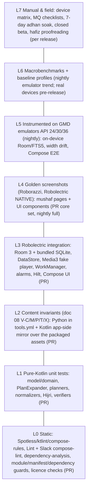

# 10 — Quality, Testing & CI

**Purpose.** This doc says how we prove the app is correct, fast and dependable before it reaches the owner's phone and, later, the public. It covers: quality budgets; the test strategy for each layer and module; the content-invariant suite that guards the Quran text and the Indo-Pak metadata; renderer golden screenshots; audio, download and alarm tests; benchmarks; the device matrix; manual QA checklists; hafiz proofreading and render-regression review; static analysis and licence checks; the GitHub Actions workflows (PR, nightly, data pipeline, upstream drift, release); the beta programme; and production monitoring. The doc is written so the owner or an AI coding agent can build the test infrastructure and CI with no further research.

**Status:** Draft v2 — 2026-10-19 (cross-doc review applied: build variants per doc 04, gate dates per doc 09, text-error SLA per doc 12, v1.0 / v1.0-stretch / v1.1 labels per doc 09)

**Key decisions in this doc**
- Toolchain and test stack follow **D-02**, as verified by the spike (g04). Test libraries:
  - JUnit 4.13.2, Truth 1.4.5, Turbine 1.2.1, kotlinx-coroutines-test 1.11.0
  - Robolectric 4.17, Roborazzi 1.76.0
  - room3-testing 3.0.3, work-testing 2.12.0, media3-test-utils(-robolectric) 1.11.1, mockwebserver3 5.5.0
  - hilt-android-testing 2.60.1, Compose ui-test (BOM 2026.09.00)
  - benchmark-macro-junit4 + androidx.baselineprofile 1.5.0, UiAutomator 2.4.0
  - LeakCanary 2.14 (debug only), Kover 0.9.11

  We use fakes, not mocks (r07 §2.7).
- **Content is tested like code (D-06, D-07, D-10, D-11).** Doc 08's validation invariants (V-C, V-M, V-P, V-T, V-X) run twice: in the Python pipeline and again in Kotlin, through the app's own read path, against the LFS-committed assets exactly as packaged. CI also opens a **no-`room_master_table` copy** of the content DB to force Room's `onValidateSchema` (g04 §2.4).
- **The mushaf renderer is guarded by golden images (D-05).**
  - Roborazzi 1.76.0 on Robolectric NATIVE graphics, with zero pixel tolerance on mushaf pages.
  - A ≈60-page core set runs on every PR. All 548 pages run nightly when the renderer or content changes.
  - Pipeline-version render diffs feed the hafiz re-certification (**D-22, G5**).
- **Robolectric convention plugin `criterion.android.robolectric`** with the g04 fixes:
  - `--add-exports`/`--add-opens` JVM flags;
  - host `libsqliteJni` taken from `sqlite-bundled-jvm`;
  - NATIVE graphics run one SDK per JVM;
  - no classpath folder named `fonts/`.
- **Build variants and content tiers follow doc 04 §11 and D-29.**
  - Flavor dimensions: `distribution` {play, foss} × `tier` {personal, public}. `playPersonal*` is disabled.
  - `BuildConfig.CONTENT_TIER` ∈ {PERSONAL, BETA, PUBLIC}. Personal-tier builds are PERSONAL. Public-tier builds are **BETA** by default (closed test, "proofreading in progress" banner). They become PUBLIC only when built with `-Pcriterion.release=production`, which requires G1 + G5 evidence (`verifyContentEligibility`, `certified_pages.json`).
  - `BuildConfig.MONETIZED` is set by `-Pcriterion.monetized=true` (v1.5+, play only).
  - Tests assert on these two fields only.
- **Privacy and policy are enforced by CI (D-15, D-16, D-17, D-20, D-28, D-29).** CI checks:
  - a merged-manifest permission denylist;
  - a runtime-dependency group allowlist (no GMS, Firebase, ads or analytics in v1);
  - a network-host allowlist;
  - a block on non-commercial (`commercialOk = false`) content in any MONETIZED build;
  - a block on PENDING, PERSONAL_ONLY or REVOKED items in PUBLIC builds;
  - a block on QUL-derived layout data in any public-tier (BETA or PUBLIC) build until G1 is granted.
- **CI/CD runs on GitHub Actions** (checkout v7, setup-java v6 with Temurin 21, gradle/actions v6, upload-artifact v7; r07 §2.7).
  - PRs run the root aggregate task `./gradlew prCheck`, and the required status is `ci/check` (doc 13). Both `quickCheck` and `prCheck` are registered by `criterion.root`.
  - Six workflows: this doc owns `android.yml`, `nightly.yml` and `release.yml`; doc 08 owns `tools.yml`, `upstream-drift.yml` and `verify-live.yml`.
  - The Ed25519 content-signing key never enters CI (doc 08).
  - Releases are signed with the **Play App Signing upload key** held in a protected `release` environment. AAB uploads to Play stay manual through P2.
- **Monitoring = Play Console Android vitals + pre-launch reports only in v1.0 (D-20).** No SDK telemetry. Opt-in ACRA arrives in v1.1 (F-PL-09). It posts to a Cloudflare Worker that stores reports in R2 for 90 days (doc 11 §3.6, D-32).
- **Device QA is weighted to the Pakistani OEM mix** (r08 §2.3.5):
  - Transsion (Infinix/Tecno/itel) 25.5%, Samsung 17.3%, Oppo/realme 14.1%, Vivo 11.9%, Xiaomi 10.6%;
  - API 24 → 37;
  - a **7-day adhan soak** on OEM devices is a release gate for F-CP-02. Adhan is **v1.1 by default**; the soak moves into v1.0 only if lever B1 is pulled at the 2026-11-30 checkpoint (doc 09).
- **Release labels.** Every suite tied to a feature carries that feature's release label from doc 09: v1.0, v1.0-stretch or v1.1. A suite for a v1.1 feature is written when the feature is built, not before.

Related docs: [PRD](01-product-requirements.md) · [UX](02-ux-ui-spec.md) · [Content & licensing](03-content-data-licensing.md) · [Architecture](04-architecture.md) · [Renderer](05-mushaf-rendering-engine.md) · [Audio](06-audio-engine.md) · [Companion](07-companion-engagement-features.md) · [Pipelines](08-data-pipelines.md) · [Roadmap](09-roadmap-backlog.md) · [Release](11-release-compliance-business.md) · [Decisions & risks](12-decisions-risks.md) · [AI playbook](13-ai-assisted-build-playbook.md)

---

## 1. Quality goals and budgets

These budgets are the acceptance thresholds for the release workflow (§12.6) and for closed-test exit (§13). Budgets marked *[inferred]* are our own targets; r07 §2.7 gives the starting points.

Reference devices:
- **Ref-high:** a Pixel 6a-class phone.
- **Ref-mid:** a mid-range phone, e.g. a Samsung Galaxy A-series with 4–6 GB on Android 13+.
- **Ref-low:** a 3 GB low-end phone on the Transsion (Infinix/Tecno) or Redmi tier, Android 12–14, Helio G-class SoC.

Doc 01's NFRs adopt the same three-tier cold-start statement.

| ID | Metric | Budget | Measured by | Enforced |
|---|---|---|---|---|
| QB-01 | User-perceived crash-free users (28-day) | **≥ 99.5%** (stretch 99.8%) | Play vitals | Staged-rollout halt rule (§14) |
| QB-02 | User-perceived ANR rate | **< 0.2%** | Play vitals | Staged-rollout halt rule |
| QB-03 | Cold start to first frame (TTID) | Ref-high **≤ 500 ms** p50; Ref-mid **≤ 1,200 ms** p50; Ref-low (3 GB) **≤ 1,500 ms** p50 | `StartupBenchmark` (`StartupTimingMetric`), Partial(BaselineProfile) | Manual on real devices before every public release; emulator trend nightly |
| QB-04 | Cold start → last-read mushaf page fully drawn (`reportFullyDrawn`) | Ref-high ≤ 800 ms; Ref-low ≤ 2,000 ms | `ReaderOpenBenchmark` | Same as QB-03. The reference app has 80 slow-start/splash complaint reviews with 11,713 helpful votes (r01 §2.9) |
| QB-05 | Page-turn smoothness (swipe 20 pages) | p90 frame ≤ 16 ms; p99 ≤ 32 ms; janky frames < 5% (Ref-low < 10%) | `PageTurnBenchmark` (`FrameTimingMetric`) | Same as QB-03 |
| QB-06 | Index scroll (Surah 114 rows, Para 30 rows, fling ×5) | p95 frame ≤ 16.7 ms | `IndexScrollBenchmark` | Same as QB-03 |
| QB-07 | Search latency (FTS5 query → results state) | p95 ≤ 100 ms Ref-low for 1–3-word Arabic and Urdu queries | `SearchBenchmark` (`TraceSectionMetric("search.query")`) + JVM micro-test ≤ 50 ms | Nightly trend; manual pre-release |
| QB-08 | Memory | Reader PSS ≤ 150 MB after 100 page turns on Ref-low. Java heap growth < 5 MB after 100 more turns. **0 page bitmaps** in the default path (D-05). 0 LeakCanary leaks on the scripted journeys | `dumpsys meminfo`, LeakCanary 2.14 (debug), heap dump in the benchmark | Manual pre-release; LeakCanary in daily dev use |
| QB-09 | Download size (Play, arm64 device) | **≤ 25 MB** target, **30 MB hard ceiling** (r07 rec 17). Warn on > +500 KB vs `main` | `bundletool build-apks --device-spec arm64.json` + `get-size total` | PR workflow (warn), release workflow (fail) |
| QB-10 | Battery, 1 h screen-off recitation | Downloaded file: ≤ 3% of a 5,000 mAh battery. Streaming on Wi-Fi: ≤ 5%. No partial wakelock held > 60 s after pause or stop | `dumpsys batterystats --reset` → 1 h → `dumpsys batterystats` (+ Battery Historian), Ref-low | Manual pre-release (MQ-AU-20) *[inferred targets]* |
| QB-11 | Adhan punctuality | With exact-alarm permission and the vendor guidance applied: **0 missed of 35** over 7 days per matrix device; lateness p95 ≤ 60 s, max ≤ 180 s | In-app lateness log (Adhan health check, F-CP-02) | 7-day soak (MQ-AD), release gate for F-CP-02. Applies from v1.1, or from v1.0 if B1 is pulled in (doc 09) |
| QB-12 | Download integrity | 100% of completed files match the expected MD5/SHA-256. Resume after kill or network drop without re-downloading finished bytes | Unit + MockWebServer tests; MQ-DL | PR (unit), pre-release (manual) |
| QB-13 | Text correctness | **0 known open errors** in shipped Arabic text, marks or layout. Report-text-error SLA (doc 12 D-22, R-38): triage ≤ 24 h; signed notice or kill-switch (`notices.json`, F-PL-11) ≤ 48 h; corrected build submitted ≤ 72 h of confirmation; reporter acknowledged ≤ 72 h. A text fix is always an app update, because the content DB and layout pack are bundled and the remote channel never changes Quran text (D-30) | Content invariants, hafiz certificate, F-PL-05 inbox | Release gate (G5); ops SLA |
| QB-14 | Follow-along accuracy (F-AU-03/F-RD-05) | Highlighted ayah = audible ayah within ±300 ms at ≥ 95% of ayah starts in sampled surahs (1, 36, 67 + 3 random) for every highlight-enabled reciter (g03 §2.5.2 shows 83–87% within ±300 ms *before* onset snapping) | Pipeline onset check + manual listen (MQ-AU-15) | Timing-pack publication gate |
| QB-15 | Accessibility (F-PL-07) | All interactive elements have labels. Touch targets ≥ 48 dp. Text contrast ≥ 4.5:1 (UI chrome). Usable at font scale 2.0. TalkBack can complete the 6 core journeys (MQ-A11Y) | Compose UI tests + Accessibility Scanner + manual | PR (automated subset), pre-release (manual) |
| QB-16 | Build health | PR workflow ≤ 15 min wall-clock (warm cache). 0 lint errors. 0 new baseline entries without review | Actions timing | Ongoing |

Play's own "bad behaviour" thresholds (user-perceived crash rate 1.09%, ANR 0.47%) are far looser than QB-01/QB-02 [unverified: from memory; check in Console in P2]. Our budgets are deliberately tighter because the reference app's reputation rests on reliability as well as ads.

---

## 2. Test strategy

### 2.1 Pyramid



Target counts at v1.0 *[inferred]*:
- L1: ≈ 600 tests, under 30 s in total.
- L2: 23 invariant groups (≈ 150 assertions).
- L3: ≈ 250 tests.
- L4: ≈ 60 PR goldens plus 548 nightly page goldens plus ≈ 80 UI goldens.
- L5: ≈ 25 tests.
- L6: 6 benchmarks.

### 2.2 Conventions

- **Locations:**
  - `src/test` holds JVM and Robolectric tests.
  - `src/androidTest` holds instrumented tests.
  - `:baselineprofile` holds macrobenchmarks and profile generators.
  - `tools/*/tests` holds pytest suites (doc 08).
- **`:core:testing`** (android library) provides:
  - a fake for every repository and service interface in `:core:domain` (doc 04 §6), e.g. `FakeQuranRepository`, `FakeRecitationRepository`;
  - `MainDispatcherRule`, `FakeClock`, `TestDispatchers`;
  - `TestContentDb` (opens the real shipped asset through the bundled driver);
  - `FakePlaybackController` and `FakePlaybackStateHub`, which emit the shared `PlaybackState` / `PlaybackEvent` types (doc 04 §6);
  - `FakeDownloadManager`, `FakeAlarmScheduler`, `FakeLocationProvider`;
  - `TestBuildInfo(tier, monetized)`, so tier-dependent code is tested without rebuilding variants.
- **Fakes over MockK.** MockK 1.14.11 is allowed only for Android framework types that we cannot fake. Every use gets a one-line justification comment.
- **Coroutines:** use `runTest` with injected dispatchers. **Never `runBlocking` around `viewModelScope`.** It deadlocks the Robolectric main looper (g04 §2.3 #5). Collect flows with Turbine `test { }`.
- **Hilt tests:** `@HiltAndroidTest` + `HiltAndroidRule` + `@TestInstallIn` modules that swap real repositories for fakes. The Robolectric application is `HiltTestApplication` via `@Config(application = HiltTestApplication::class)`.
- **Naming:** `methodOrBehaviour_condition_expectedResult`. Golden files are named `<suite>/<id>_<variant>.png`, for example `mushaf/p021_light_w360.png`.
- **Determinism:**
  - Inject the clock and the time zone (`Asia/Karachi` default).
  - Pin `Locale` per test.
  - Robolectric default `sdk=36` lives in `src/test/resources/robolectric.properties`.
  - API-gated logic gets explicit `@Config(sdk = [24, 33, 34])`. Whether the SDK 24 `android-all` jar resolves must be verified in P0, because the g04 sandbox failed to fetch it.

### 2.3 Per-module test matrix

Module names are doc 04 §3.2's list. Doc 04 merges some areas until they grow: `:core:remote` splits into `:core:network` + `:core:download`, and `:core:prayer` splits into `:core:location` + `:core:notifications` (doc 04 split triggers). The suites below move with their code when a split happens.

| Module | L1 unit | L2 | L3 Robolectric | L4 goldens | L5/L6 | Key suites |
|---|---|---|---|---|---|---|
| `:core:model` (JVM) | ✅ | | | | | `VerseKeyTest`, `PageLabelTest`, `ParaTableTest`, `ManzilTest`, `RukuTest`, `SurahMetaTest`, `AppErrorTest` |
| `:core:domain` (JVM) | ✅ | | | | | `PlanExpanderTest`, `AyahTrackerTest`, `SleepTimerTest`, `KhatamPlannerTest`, `ResolvePlayScopeTest`, `NextPrayerTest`, `AppResultTest`, `AppErrorMappingTest` |
| `:core:content` | ✅ normalizers | ✅ **V-C mirror** | ✅ Room/FTS5, no-master, re-copy | | L5 FTS5 on API 24 | `ContentInvariantsTest`, `PrepackagedSchemaTest`, `SearchDaoTest`, `NormalizerParityTest` |
| `:core:database` (user.db + DataStore) | ✅ serializer | | ✅ DAOs, migrations, backup rules, DataStore | | | `UserDbMigrationTest`, `UserDbSchemaFreezeTest`, `BookmarkDaoTest`, `LastReadDaoTest`, `BackupRulesTest`, `UserSettingsSerializerTest` (defaults, unknown-field tolerance, corruption handler) |
| `:core:remote` (→ `:core:network` + `:core:download`) | ✅ verifiers, download state machine | | ✅ MockWebServer, work-testing, JobScheduler shadow | | Manual MQ-DL | `Ed25519VerifierTest` (RFC 8032 + Wycheproof), `SignedFileFetcherTest`, `MirrorFailoverTest`, `CatalogueParserTest`, `RangeResumeTest`, `ChecksumTest`, `ZipInstallTest`, `HostSelectionTest` (UIDT vs Worker) |
| `:core:data` | ✅ with fakes | | ✅ | | | `*RepositoryTest`, `ContentPolicyTest`, `PackRepositoryTest` (licence flags, kill-switch), `NoticesTest` |
| `:core:audio` | ✅ | V-T mirror | ✅ ExoPlayer on Robolectric, MediaSession | | L6 `AudioStartBenchmark` | `PlaybackStateHubTest`, `ResolvingDataSourceTest`, `BasmalaStrategyTest`, `TimingGuardTest`, `AudioFocusPolicyTest`, `PlaybackResumptionTest` |
| `:core:mushaf-render` | ✅ geometry | V-M mirror | ✅ NATIVE graphics | ✅ **mushaf goldens** | L5 `WidthDriftTest`; L6 `PageTurnBenchmark` | `LineGeometryTest`, `HitTestTest`, `GeometryParityTest`, `PageHashTest`, `MushafGoldenTest`, `KashidaNativeGraphicsTest` |
| `:core:prayer` (→ `:core:location` + `:core:notifications`) | ✅ decisions | | ✅ ShadowAlarmManager | | Soak MQ-AD (v1.1) | `PrayerTimesGoldenTest`, `HijriTest`, `RamadanTimetableTest`, `MonthStartFeedTest`, `CityDbTest` (cities15000 Urdu names), `CoarseLocationFlowTest`; v1.1: `QiblaTest`, `PrayerSchedulerTest`, `RescheduleTriggersTest`, `AdhanModeDecisionTest`, `ChannelsTest`, `ReminderPlannerTest` |
| `:core:designsystem` | | | ✅ Compose | ✅ component goldens | | `ThemeGoldenTest` (4 themes × en/ur), `RowsGoldenTest` |
| `:core:navigation` | ✅ | | | | | `NavKeySerializationTest` (every NavKey round-trips, incl. `ReaderKey`), `DeepLinkParserTest`, `ShortcutsTest` (v1.1) |
| `:feature:*` | ✅ ViewModels | | ✅ Compose UI | ✅ screen goldens | L5 E2E | `<Screen>ViewModelTest`, `<Screen>ScreenTest` |
| `:app` | | | ✅ Hilt graph | | L5 smoke, L6 startup | `HiltGraphTest`, `BuildTierTest`, `ManifestGuard` (Gradle), `FlavorDependencyGuard` (Gradle), `ReviewPromptPolicyTest` (play flavor, v1.0-stretch / v1.1) |
| `:lint-rules` | ✅ lint `TestLintTask` | | | | | One positive and one negative fixture per rule in §11.2 |
| `tools/*` (Python) | pytest | ✅ **V-C/M/P/T/X (source of truth)** | | pipeline renders | | doc 08 |

---

## 3. L1 — pure-Kotlin unit tests (what must be covered)

### 3.1 Model and metadata (`:core:model`)

| Suite | Cases (each one a test or a parameter row) |
|---|---|
| `VerseKeyTest` | Parse/format `s:a`. Global id 1..6236 ↔ key (1:1 = 1, 114:6 = 6236). Reject 0:0, 115:1, 2:287. Fatiha 1:1 = basmala (D-06). |
| `PageLabelTest` | For `MushafId.INDOPAK_16_TAJ` (code `indopak16_taj`, id 1): `label = index + pageLabelOffset` with offset 1. Only `PageIndex` is stored; the label conversion lives in one place. Labels 2..549 are valid. Go-to-page rejects 1 and 550 with a typed error. Labels show in Urdu digits in the ur locale and parse back from both digit sets (F-IX-05). |
| `ParaTableTest` | 30 rows. The 7 Indo-Pak starts: P4 3:92, P7 5:83, P11 9:94, P14 15:2, P20 27:60, P21 29:45, P23 36:22. The Madani juz table stays separate and never leaks into `indopak16_taj`. **Para 1 starts at page_index 1 (label 2, the sar-lauh).** For n = 2…28 the start page_index is 18n−16. P29 is at index 508 and P30 at index 528. A test row asserts that Para 1 is **not** at index 2, the value the formula would give. `paraOf(3:92) = 4` and `paraOf(3:91) = 3`. The 30 traditional names match a frozen list (الم، سیقول، تلک الرسل، لن تنالوا …). The by-end ruku counts per Para are the D-07 vector. |
| `ManzilTest` | 7 manzils starting at surahs 1, 5, 10, 17, 26, 37, 50. `footerManzil(page) = manzil(lastAyah(page))`. |
| `RukuTest` | 558 rukus. `paraRuku` is NULL for Fatiha. A ruku that straddles a Para is numbered in the Para where it ends (2:249–253 → para-ruku 1 of P3; 15:1–15 → para-ruku 1 of P14). Marker triple = (surahRuku, ayahCount, paraRuku). |
| `SajdaTest` | 14 numbered (incl. 38:24) plus 22:77 `shafii_only`. The label strings are exact. |
| `QuarterTest` | 90 quarters, 3 per Para, ordered. P7 ¾ = 6:73 after word 10 (mid-ayah; `wordPos = 10`). "Jump to quarter" for a mid-ayah anchor resolves to the ayah start plus a word offset. |

### 3.2 Audio domain (`:core:domain`)

**`PlanExpanderTest`** uses a table-driven fixture over the real metadata tables (D-13; r06 §2.8). Requests use the shared types from doc 04 §5–§6 verbatim: `PlayRequest(scope: PlayScope, recitation, repeat: RepeatSpec, speed, …)`, where `PlayScope` is `Surah | Para | Manzil | Ruku | Page | Range | Ayah | FromHere | Passage | Quran`. `G` = gapped per-ayah items; `L` = gapless clipped surah items.

| # | PlayRequest | Layout | Expected |
|---|---|---|---|
| 1 | Surah 1 | G | 7 items 1:1…1:7. **No extra basmala item** (1:1 is the basmala) |
| 2 | Surah 9 | G | 129 items, no basmala |
| 3 | Surah 2 | G | 1 basmala + 286 = 287 items |
| 4 | Para 30 | G | **601 items** (564 ayahs + 37 basmalas) |
| 5 | Para 30 | L | **37** clipped surah items |
| 6 | Para 4 | G/L | First ayah **3:92**, last 4:23. The gapless clip of surah 3 starts at `timing(3:92).start` |
| 7 | Paras 7, 11, 14, 20, 21, 23 | G/L | Start at 5:83, 9:94, 15:2, 27:60, 29:45, 36:22; end one ayah before the next Para's start |
| 8 | Manzil 7 | G | Surahs 50..114 with basmalas; count = Σ ayahs + 65 basmalas |
| 9 | `Quran` (full mushaf) | G | **6,348 items** (6,236 + 112 basmalas); queue windowing keeps ≤ 500 materialised items |
| 10 | Ruku 2:8–20 | G/L | 13 ayahs. L = one clipped item, 2:8 start → 2:20 end |
| 11 | `Page(INDOPAK_16_TAJ, PageIndex(20))` (label 21) | G | Starts at the first ayah that **starts** on the page (Para 2 start = 2:142) |
| 11b | `Page` whose first line continues an ayah from the previous page | G | Starts that ayah **from its beginning**, then continues to the last ayah that starts on the page (doc 01 F-AU-02) |
| 12 | AyahRange 1:6 → 2:5 | G | 1:6, 1:7, basmala(2), 2:1…2:5 |
| 13 | Ayah 2:255 ×3 | G | 3 items, repeat counter metadata 1/3, 2/3, 3/3 |
| 14 | Range 67:1–5 ×2, pause-after fixed 2 s | G | 10 items plus `pauseAfterMs = 2000` on each |
| 15 | Range ×∞ | G/L | Repeat mode ALL over the range; never expands unbounded |
| 16 | Pause proportional ×1.0 | G | `pauseAfterMs = itemDuration × 1.0` (needs a duration from the catalogue or timing) |
| 17 | `FromHere(18:10, Until.END_OF_SURAH)` | G/L | Starts at 18:10 and ends at 18:110. L: `startPositionMs = timing(18:10).start` |
| 17b | `FromHere(18:10)` (default `Until.CONTINUOUS`) | G/L | Starts at 18:10 and continues past 18:110 into Surah 19 and onwards until stopped ("play from here" runs until stopped) |
| 17c | `Surah(18)` with "Continue to next surah" off (default) | G/L | Ends after 18:110. With the setting on, it continues into Surah 19 |
| 18 | Hifz cumulative chain 1–3 | G | 1; 1,2; 1,2,3 (6 items) |
| 19 | Basmala strategies | L | `EMBEDDED`: no extra item. `USE_FATIHA_1_1`: prepend 1:1 clip. `BISMILLAH_FILE`: prepend file. `NONE` for surah 9 always |
| 20 | Reciter lacks timing for a surah (kill-switch) | L | Item plays; `PlaybackState.highlightAvailable = false` and `highlight = null` for that surah only |
| 21 | `Passage(manzil-dua)` (18 ranges, 79 ayahs) | G | 79 ayah items in passage order across the 18 ranges, with no items between ranges; the plan title comes from `titleRes` |
| 22 | `Range` scope whose timing is kill-switched for the chosen reciter | L | The expander returns a "highlight unavailable — switch to fallback reciter?" decision. It never switches the reciter silently (doc 01) |

| Suite | Cases |
|---|---|
| `AyahTrackerTest` | `ayahAt(positionMs)` by binary search over starts. The boundary belongs to the next ayah. Before the first start → intro (ayah 0). After the last end → last ayah. Seek forward and back re-syncs. Property test: 10k random positions agree with a linear scan. |
| `SleepTimerTest` | Minutes mode. End-of-ayah, end-of-surah and end-of-para are evaluated against the plan, not wall time. The fade-out volume ramp is monotonic over 10 s. Cancel restores volume. |
| `AutoPageTurnPolicyTest` | Auto-turn suspends 8 s after the last pager touch (FakeClock), and the "Follow recitation" chip resumes it. **Page-turn lock (F-RD-07) blocks user swipes but not the audio auto page-turn.** The turn targets the page of the *current* ayah, so ayahs that span pages are handled. |
| `LastReadPolicyTest` (F-BM-01) | `last_read` updates only after a page has been settled for **≥ 4 s** (FakeClock); 3.9 s → no write. A jump (index, search, go-to) shows the "Back to page X" chip and restores the previous page on tap. The listening pointer (`listening_position`) and khatam pointers are separate and never move `last_read`. A bookmark never moves `last_read`. |
| `KhatamPlannerTest` (F-BM-04, v1.0, r08 §2.13) | 30-day preset on `indopak16_taj` → ceil(548/30) = 19 pages for the first days, converging to 18.27/day. "Stop at ruku ع" snaps each daily end to the next ruku end. Rest-day mask. Missed days redistribute (no negative goals). Ramadan 27 and 29 nights. Plan complete → `completedAt` set. Para-unit plan uses the Indo-Pak Para table. |
| `StreakTest` (F-BM-05, v1.1) | Day boundary in the local time zone. 2 freeze days per month. No streak broken by a DST or time-zone change. |

### 3.3 Text, search and copy

| Suite | Cases |
|---|---|
| `ArabicNormalizerTest` | The r05 §2.7.5 spec: (1) ZW* and BOM become a space and PUA is dropped. (2) Harakat and Quranic marks are dropped, with **U+0670 dropped, not mapped**. (3) The letter folds. (4) NFKC, then whitespace collapse. |
| `NormalizerParityTest` | Runs the Kotlin normalizer over `normalization_vectors.json` (generated by the pipeline: ≥ 500 hand-picked vectors plus a SHA-256 of the normalized text of all 6,236 ayahs × 3 columns). Output must be **byte-identical** to the Python normalizer (V-C19). |
| `UrduNormalizerTest` | Folds ي ى → ی, ك → ک, ه ة ۃ → ہ, Urdu digits → ASCII. **ے and ھ stay distinct**: کی ≠ کے, بھ ≠ بہ (D-11). |
| `EnglishNormalizerTest` | Allāh → allah; ʿ and ʾ are removed; lowercase; ASCII fold. |
| `AliasTest` (F-SR-03) | Folding: aa→a, ee→i, oo→u; drop `'`, `-` and spaces. yasin, yaseen, ya-sin, یس → 36. rahman, rehman → 55. mulk, tabarak → 67. ayatul kursi, آیت الکرسی → 2:255. "last 2 of baqarah" → 2:285–286. "manzil dua" → playlist. |
| `QuerySyntaxTest` | User input is escaped for FTS5 (quotes and operators). Explicit AND, prefix `*` and phrase all work. An empty or whitespace query → empty state, no SQL. |
| `CopyShareSanitizerTest` (D-08) | Output has no PUA (U+E000–F8FF, U+F500–F69x medallions) and no bidi controls (U+202A–202E, U+2066–2069). The attribution line is appended. Arabic is always present when a translation is shared; there is no translation-only copy. Copy, share and TTS text comes from the Tanzil text in the content DB, never from pack glyph strings. |

### 3.4 Companion domain

| Suite | Cases |
|---|---|
| `PrayerTimesGoldenTest` (F-CP-01, v1.0) | adhan2 KARACHI + HANAFI, Karachi (24.8607, 67.0011), **2026-10-19 PKT: Fajr 05:16, Sunrise 06:32, Dhuhr 12:18, Asr 16:24, Maghrib 18:02, Isha 19:18** (g04 §1 #9, exact). The cross-check rows for Lahore, Islamabad, Peshawar, Quetta and Manchester (r08 §2.2, from Aladhan) are asserted at **±2 min**. Per-prayer offsets apply. The Asr Standard/Hanafi switch moves Asr later for Hanafi. |
| `QiblaTest` (F-CP-03, v1.1) | Bearing within 0.1° of Karachi 267.7°, Lahore 260.3°, Islamabad 255.9°, Peshawar 254.0°, Quetta 256.7°, Manchester 118.5° (r08). True-north correction uses `GeomagneticField` (Robolectric). |
| `HijriTest` (F-CP-04, v1.0, D-15/D-27) | Runs the same golden table against both `HijriCalendarProvider` implementations: `java.time.HijrahDate` (desugared, primary) and ICU `IslamicCalendar` `ISLAMIC_UMALQURA` (fallback). `effective = feedOverride ?: provider.from(civil + userOffset)` with offset ∈ −2..+2 (out of range is rejected). Golden: 2026-10-12 → 1 Jumada I 1448 (UQ). The PK feed `{"hijri":"1448-05","start":"2026-10-13"}` → 2026-10-13 shows 1 Jumada I 1448. After Maghrib (adhan2 Maghrib via FakeClock) the next date shows, flagged "from Maghrib". Feed precedence > user offset. Stale feed (> 35 days) → falls back to UQ + offset. |
| `MonthStartFeedTest` (v1.0) | `feeds/hijri-pk.json` with a detached `.sig` (Ed25519 over the exact file bytes; doc 04 §7.6). Valid signature under either pinned key → accepted. One flipped byte in the JSON or the `.sig` → rejected, last-known value kept. Unknown `kid` → rejected. `sequence` ≤ the last accepted → rejected (anti-rollback). Past `expiresAt` → ignored; `generatedAt` is shown in the Hijri settings as the feed date. Schema version unknown → ignored. |
| `RamadanTimetableTest` (F-CP-07, v1.0) | 30 rows for Karachi. Sehri end = Fajr − `sehriMarginMin` (0..10, default 0). Iftar = Maghrib + `iftarIhtiyatMin` (0..3, default 0) (doc 07). The Ramadan card is visible iff the effective Hijri month is 9 (feed > user offset > UQ). The countdown switches at Fajr and at Maghrib (FakeClock). The Taraweeh preset creates the khatam plan defined in doc 07. |
| `TasbeehTest` (F-CP-05, v1.0-stretch) | Counter target or loop, haptic event at the target, persisted across process death. |
| `ReminderPlannerTest` (F-CP-09, v1.1) | ≤ 3 reminders per day, in priority order. No reminder fires in quiet hours 22:30–05:00. A tap opens the player through an activity deep link (`criterion://play?…`) and never auto-starts playback. |
| `AzkarSessionTest` (F-CP-06, v1.1; Manzil-dua part v1.0-stretch) | The counter reaches each item's `repeat`. The source reference and the Urdu text are shown. Progress persists across process death. Content comes from the `azkar` pack. |
| `GroupKhatamSheetTest` (F-CP-11 sheet, v1.1) | The 30-line WhatsApp format round-trips through parse and format, including Urdu names. |

### 3.5 Packs, catalogue, licences

| Suite | Cases |
|---|---|
| `Ed25519VerifierTest` (D-10, D-30) | The vendored TweetNaCl verify port in `:core:remote` passes the RFC 8032 §7.1 vectors and the Wycheproof `ed25519_test.json` set on the JVM and on GMD API 24 (doc 04 §7.6). |
| `SignedIndexVerifierTest` (D-10, D-30) | Consumes the pipeline's exported vectors (`tools/catalogue/test_vectors/`, doc 08). `index.json`, `catalogue.json` and `notices.json` each verify through their **detached `.sig`** (Ed25519 over the exact file bytes) under either of the two pinned public keys. A 1-byte tamper of the JSON or the `.sig`, an unknown `kid`, a replayed older `sequence` (anti-rollback) and a past `expiresAt` are all rejected, and the last good copy stays in use. The signed fields are `kid`, `sequence`, `generatedAt` and `expiresAt` (doc 04 §7.6). A tampered sha256, size or licence field fails. The kill-switch entry removes the pack from the UI and blocks its use. |
| `ContentPolicyTest` (D-29) | Truth table for `ContentPolicy.allows(…)` over `licenceStatus` {PERMITTED, HOST_GRANT, PENDING, PERSONAL_ONLY, REVOKED} × `CONTENT_TIER` {PERSONAL, BETA, PUBLIC} × `MONETIZED`. PERSONAL allows everything except REVOKED. BETA allows PERMITTED, HOST_GRANT and PENDING. PUBLIC allows PERMITTED and HOST_GRANT. MONETIZED additionally requires `commercialOk = true`. An item whose `eligibleTiers` lacks the build's tier is refused whatever its status. A kill-switch overrides everything. |
| `PackEligibilityTest` (D-17, D-29) | Uses `TestBuildInfo`. A pack with `commercialOk = false` (e.g. any Tanzil translation file, such as Jalandhari) is hidden when `MONETIZED = true`. A QUL-derived layout pack (`eligibleTiers = [PERSONAL]`) is never offered in BETA or PUBLIC. A pack with `fossOk = false` is hidden in `foss` builds. |
| `CatalogueEligibilityTest` (D-12, D-28, D-29) | A PUBLIC catalogue never lists PENDING or PERSONAL_ONLY recitations. A BETA catalogue may list PENDING recitations (e.g. gapped everyayah sets) but never PERSONAL_ONLY ones (Shamshad Ali Khan, Husary Muallim, Qari Sadaqat Ali). No PUBLIC or BETA item uses a quranicaudio, QF/QDC, Tarteel or archive.org host (D-28). Reads 74 and 53 never carry timing. Timing host = audio host for every recitation. |

### 3.6 Platform features (F-PL-05, F-PL-10, F-PL-11, F-PL-12)

| Suite | Cases |
|---|---|
| `ReportErrorIntentTest` (F-PL-05, v1.0) | Builds an `ACTION_SENDTO mailto:` intent with the structured subject from doc 02 §4.21 (`[TEXT-ERR] indopak16 p{label} l{line} {s:a} w{n} v{contentVersion}`) and the body. Works offline (the email is composed, not sent). No backend call is made. |
| `NoticesTest` (F-PL-11, v1.0) | Signed `notices.json`: accepted or rejected as in `SignedIndexVerifierTest`. Each `target` type (page, surahHighlight, pack, recitation, feature) reaches its consumer (doc 04 §14.3). An expired `until` hides the notice. A page notice appears as a dismissible Home card and an info chip in the reader chrome, **never inside the mushaf canvas or over translation text** (a semantics assertion plus a golden). A `minVersion` notice shows the update nudge. A notice can disable or annotate, but no notice field can change Quran text or layout (D-30). |
| `ReviewPromptPolicyTest` (F-PL-10, v1.0-stretch / v1.1) | `play` flavor only; the `foss` flavor has no review dependency (also guarded by `verifyRuntimeDependenciesFossPublicRelease`). It asks only after a doc 11 §8.4 milestone (a completed Surah of ≥ 10 pages in one session, a completed Para, or a khatam), at most once per 120 days, never at launch and never after an error. |
| `ShortcutsTest` (F-PL-12, v1.1) | Each static launcher shortcut (Continue reading, Play favourite qari, Qibla, Tasbeeh) fires a `criterion://` URI that `DeepLinkParser` resolves to the expected back stack. No shortcut starts playback without an activity. |

---

## 4. L2 — content invariants (app-side mirror of doc 08 §11)

**Two layers.**
1. **Pipeline: the source of truth.** Doc 08 §11 owns the invariant IDs and thresholds; this doc never restates a number differently. `crit validate all` runs them in `tools.yml`:
   - **V-C01–V-C24**: content DB;
   - **V-M01–V-M19**: mushaf pack;
   - **V-P01–V-P06**: translation and tafsir packs;
   - **V-T01–V-T10**: timing packs;
   - **V-X01–V-X08**: catalogue, index, feeds and geo.
2. **App side: the same facts through the app's own read path.** The suites are `ContentInvariantsTest` (`:core:content`), `MushafPackInvariantsTest` + `FontInvariantsTest` (`:core:mushaf-render`), `PackInvariantsTest` (translations) and `TimingPackInvariantsTest` (`:core:audio`). They re-check every invariant that can be checked from the shipped files, through Room + `BundledSQLiteDriver`, our DAOs and repositories, and our font loading. They read the **LFS-committed assets exactly as packaged** (doc 08 §2). This catches what the pipeline cannot see:
   - a stale or wrong asset, or an LFS pointer file instead of the binary;
   - Room schema or identity drift;
   - DAO and query bugs;
   - normalizer divergence;
   - geometry drift between the pack's `word` x-fractions (doc 05 §3) and our renderer.

   Every test name and failure message carries the doc 08 ID, so a red build points at the matching pipeline check.

**Double entry.** The app-side tests read the same curated CSVs the pipeline builds from (`data/curated/paras.csv`, `manzils.csv`, `sajdas.csv`, `para_quarters.csv` …, copied as test resources by a `copyCuratedTestData` Gradle task), so DB = CSV is checked twice. The **L1 tests in §3.1 also hard-code the D-07 facts as Kotlin literals**: the 7 Indo-Pak Para starts, Para 1 at index 1 and 18n−16 for n = 2…28 only, the by-end ruku vector, the manzil surahs, and the sajda set. A mistaken CSV edit therefore fails against the Decision Register, not just against itself.

| Doc 08 IDs | App-side test | What the app side adds |
|---|---|---|
| V-C01, V-C02 | `ContentInvariantsTest.counts`, `.tanzilVerbatim` | Counts through `QuranRepository`. Verbatim: the hash of DAO-returned Uthmani/imla'i text equals the source hash in `content_meta` (CC BY 3.0 "no changes", D-08) |
| V-C03, V-C05, V-C06 | `.ayahMarkers` | 6,354 markers via DAO. `AyahBoundaryProvider` (used by audio, highlight and counting) **never** treats one of the 118 «۵» marks as a boundary |
| V-C07, V-C08, V-C09, V-M03 | — (pipeline only) | Needs QUL inputs that the app repo does not hold |
| V-C10, V-M05 | `.paraStarts` | + `ParaTableTest` (L1 literals). `PageRepository.paraOf(page)` is correct on all 548 pages |
| V-C11, V-M06, V-M07 | `.manzils`, `.pageFurniture` | Footer manzil, header Para/surahs and outer-margin side through `PageRepository` for all 548 pages |
| V-C12, V-M10 | `.rukus` | + `RukuTest` (L1 literal vector 16,16,17,…,39). `RukuNavigator` next/prev visits all 558 in order |
| V-C13 | `.sajdas` | The 22:77 label string as the UI shows it; the F-IX-06 list has 15 entries |
| V-C14, V-C15 | `.quarters` | `verified_source` non-null whenever `BuildConfig.CONTENT_TIER != PERSONAL` (the 53 unverified quarters are a closed-test release blocker, doc 03). 6:73 word 10 anchor resolvable by "jump to quarter" |
| V-C16 | `AliasTest` | Alias resolution through `SearchRepository` (yaseen → 36 first) |
| V-C17 | `.surahHeaders` | Header string as drawn equals the DB row (also covered by goldens) |
| V-C18 | `SearchInvariantsTest` | The r05 query vectors run through the **app's** Kotlin normalizer + FTS5 query builder, not the pipeline's SQL, and must give the same counts. Any re-baseline is a reviewed change in both docs |
| V-C19 | `NormalizerParityTest` (§3.3) | Kotlin side of `normalization_vectors.json`: byte-identical output |
| V-C20, V-C21 | `PrepackagedSchemaTest` (§5.2) | The **no-master open** (forces `onValidateSchema`), bad-hash and tokenizer-mismatch negatives, re-copy on version bump. The same open tests run for every Room pack DB type (`MushafPackDb`, `TranslationPackDb`, `TafsirPackDb`, `AzkarPackDb`). Timing packs are plain SQLite read through androidx.sqlite (doc 06 exception), so `TimingPackSchemaTest` checks `PRAGMA user_version` and the exact doc 06 table and column set instead |
| V-C22 | `.hygiene` + `CopyShareSanitizerTest` | The sanitizer is applied on every copy, share and TTS path (lint rule `NoRawQuranTextShare`, §11.2) |
| V-C24, V-X04 | `CreditsCoverageTest` | Every attribution row and every pack/recitation attribution resolves to an F-PL-04 entry in en and ur |
| V-M01, V-M02, V-M04, V-M08, V-M09, V-M11 | `MushafPackInvariantsTest` | Through `PageLayoutRepository` → geometry engine. Sar-lauh remap of index 1 honoured by hit-testing. Taj Fatiha shows no digits |
| V-M12, V-M15, V-M16 | `FontInvariantsTest` (NATIVE graphics) | The shipped TTF loads through the app's `Typeface` path. الْكِتٰبُ advance is 2060 at cv01=0 and **2847** at cv01=1 (upem 1000), which guards against the cv-less QUL CDN font (g04 §1 #11a) |
| V-M13, V-M14 | `GeometryParityTest` (§7.1) | App geometry equals the pack's `word.x0`/`x1` (doc 05 §3) within 0.5% of line width on all 548 pages |
| V-M17 | `.ayahPage` | `ayahPage(key)` for all 6,236 keys equals the page auto page-turn targets |
| V-M18, V-M19 | `PageHashTest` (doc 05 §3.5) + release gate (§12.6) | Every `page_hash` recomputed from the packaged pack equals the stored one; for PUBLIC every hash is in `certified_pages.json` |
| V-P01–V-P05 | `PackInvariantsTest` | Bundled Junagarhi (+ Ahsan-ul-Bayan footnotes) and Saheeh open through Room. Every translation row has its Arabic ayah (D-22). Attribution strings exact (Saheeh → "Noor International Center") |
| V-T01–V-T08, V-T10 | `TimingPackInvariantsTest` | `AyahTracker` over each bundled timing pack never yields an ayah outside the surah. The guard tuple is present. Disabled surahs surface as `highlight = DISABLED` |
| V-X01–V-X03, V-X05, V-X06 | `SignedIndexVerifierTest`, `CatalogueEligibilityTest` (§3.5) | The bundled signed-file snapshots (`.json` + detached `.sig`) verify with the committed public key (`data/keys/`) |
| V-X07, V-X08 | `CityDbTest`, `MonthStartFeedTest` | — |

**App-only content checks** (no doc 08 equivalent):
- `verifyLfsAssets` (§11.3): every packaged `.db`/`.sqlite`/`.ttf` is a real binary, not a Git LFS pointer.
- `content_meta.build_id` of each packaged asset is printed into the release notes, and must match the `build_id` the G5 sign-off covers (§10.2).
- The owner's 5 checkpoint pages (labels 2, 39, 70, 115, 483; g02 §4) are compared with our **app** render, not only the proof PDF, before the first public release.

**App-side sketch** (`:core:content`, Robolectric):

```kotlin
@RunWith(RobolectricTestRunner::class)
class ContentInvariantsTest {
    private val curated = CuratedData.load()           // data/curated/*.csv copied as test resources
    private val repo = TestContentDb.openShippedAsset() // createFromAsset + BundledSQLiteDriver, read-only, via QuranRepository

    @Test fun `V-C01 counts`() = runTest {
        assertThat(repo.ayahCount()).isEqualTo(6236)
        assertThat(repo.ayahsPerSurah()).containsExactlyElementsIn(curated.ayahsPerSurah).inOrder()
    }
    @Test fun `V-C10 V-M05 para starts`() = runTest {
        curated.paras.forEach { p -> assertWithMessage("V-C10 Para ${p.number}").that(repo.paraStart(p.number)).isEqualTo(p.startKey to p.startPageIndex) }
    }
    @Test fun `V-C12 rukus per para by end`() = runTest { assertThat(repo.rukusPerParaByEnd()).isEqualTo(D07.RUKUS_PER_PARA) }
    // … one test per mirrored ID; failure messages always name the doc 08 ID
}
```

---

## 5. L3 — Room 3 database tests

### 5.1 Robolectric + bundled SQLite setup (convention plugin)

`build-logic/convention/.../AndroidRobolectricConventionPlugin.kt` registers `criterion.android.robolectric`. It moves the spike's per-module block (g04 §2.9) into one place:

```kotlin
class AndroidRobolectricConventionPlugin : Plugin<Project> {
  override fun apply(target: Project) = with(target) {
    extensions.configure<LibraryExtension> { testOptions.unitTests.isIncludeAndroidResources = true } // also ApplicationExtension
    val libs = the<VersionCatalogsExtension>().named("libs")
    dependencies {
      add("testImplementation", libs.findLibrary("robolectric").get())
      add("testImplementation", libs.findLibrary("androidx-test-core").get())
      add("testImplementation", libs.findLibrary("truth").get())
      add("testImplementation", libs.findLibrary("turbine").get())
      add("testImplementation", libs.findLibrary("kotlinx-coroutines-test").get())
      add("testImplementation", project(":core:testing"))
    }
    // Host libsqliteJni for BundledSQLiteDriver (g04 §2.3 #4). sqlite-bundled-jvm 2.7.1 ships
    // linux_x64, linux_arm64, osx_arm64, windows_x64 only (no Intel mac).
    val sqliteNative = configurations.create("sqliteNative") { isTransitive = false }
    dependencies.add("sqliteNative", libs.findLibrary("androidx-sqlite-bundled-jvm").get())
    val os = System.getProperty("os.name").lowercase()
    val arm = System.getProperty("os.arch") in setOf("aarch64", "arm64")
    val dir = when { "mac" in os -> "osx_arm64"; "win" in os -> "windows_x64"; arm -> "linux_arm64"; else -> "linux_x64" }
    val lib = when { dir.startsWith("osx") -> "libsqliteJni.dylib"; dir.startsWith("win") -> "sqliteJni.dll"; else -> "libsqliteJni.so" }
    val extract = tasks.register<Sync>("extractSqliteNative") {
      from({ zipTree(sqliteNative.singleFile) }) { include("natives/$dir/**"); eachFile { path = name }; includeEmptyDirs = false }
      into(layout.buildDirectory.dir("sqlite-native"))
    }
    val roboSdks = providers.gradleProperty("roboSdks")
    tasks.withType<Test>().configureEach {
      dependsOn(extract)
      systemProperty("androidx.sqlite.driver.bundled.path", layout.buildDirectory.dir("sqlite-native").get().asFile.absolutePath)
      systemProperty("androidx.sqlite.driver.bundled.name", lib)
      // SDK 36 ApplicationSharedMemory + JDK 21 strong encapsulation (g04 §2.3 #3)
      jvmArgs("--add-exports=java.base/jdk.internal.access=ALL-UNNAMED", "--add-opens=java.base/java.io=ALL-UNNAMED")
      maxHeapSize = "3g"
      // NATIVE-graphics suites abort the JVM if two SDKs share it → default task excludes them (§7.4)
      if (roboSdks.isPresent) systemProperty("robolectric.enabledSdks", roboSdks.get())
      else filter { excludeTestsMatching("*NativeGraphics*"); excludeTestsMatching("*Golden*") }
    }
  }
}
```

Rules that go with the plugin:
- **No classpath directory named `fonts/` in any test source set.** Robolectric's native runtime copies `fonts/` from the classpath, which shadows the system fonts (g04 §1 #12). Test fonts live in `mushaf-fonts/`, as the spike's `kashida-fonts/` does. `ForbiddenTestResourceDirCheck` (a Gradle task, §11.3) fails the build if a `src/test*/resources/fonts` directory exists.
- **NATIVE graphics need SDK ≥ 26.** SDK 25 silently falls back to fake metrics. Every NATIVE suite starts with `assumeNativeGraphics()`, which **fails** (does not skip) if `Paint().measureText("Hello") == 5.0f`.

### 5.2 Content DB (`PrepackagedSchemaTest`)

| Test | Fixture (built by the pipeline in CI, g04 §2.10 flags) | Expectation |
|---|---|---|
| `shippedAsset_opens_andQueries` | Shipped DB (with master table) | 6,236 rows. FTS5 MATCH and trigram work. `sqlite_version()` = 3.50.1 with `ENABLE_FTS5` |
| `noMasterCopy_passesFullValidation` | `--no-master` copy of the same build | Opens. Room runs `onValidateSchema` and accepts the extra non-entity tables (`content_meta`, `attribution`, …). The same no-master open runs for each Room pack DB type (timing packs are plain SQLite, §4) |
| `noMasterNoTriggers_roomAddsTriggers` | `--no-master --skip-triggers` | Opens. The sync triggers exist afterwards |
| `badHash_rejected` | `--bad-hash` | `IllegalStateException` containing "Room cannot verify the data integrity" |
| `tokenizerMismatch_rejected` | Negative fixture (porter instead of unicode61, no master) | Rejected with "Pre-packaged database has an invalid schema" |
| `versionBump_recopiesContent_keepsUserDb` | Install asset v1 → open → write user.db rows → swap in asset v2 (bumped `@Database(version)`) → reopen | Content shows the v2 marker row in `content_meta`. user.db rows are intact (D-10 destructive re-copy) |
| `readOnly_guard` | Shipped DB | Any write through the content DAO throws, or the content DAO has no write methods (compile-time) |

**Why the no-master test is non-negotiable:** with a matching `room_master_table`, Room checks only the identity hash. A pipeline bug that changes a column would ship and fail only at query time (g04 §4).

### 5.3 user.db migrations (`UserDbMigrationTest`)

- Exported schemas are committed in `core/database/schemas/<db>/<version>.json`. Room 3's Gradle plugin fails without `room3 { schemaDirectory(...) }` (g04 §2.6).
- **Schema versions (doc 04 owns user.db).** user.db **v1 is frozen on 2026-12-21** and already contains every P1 and P2 table, so the Ramadan release needs no migration. P3 tables arrive in v2. `UserDbSchemaFreezeTest` fails if the committed `schemas/.../1.json` changes after the freeze.
- Use `room3-testing` `MigrationTestHelper` with `BundledSQLiteDriver`. For every version N ≥ 2 (the first is 1 → 2 in P3) there are three tests:
  - **N−1 → N** with seeded rows;
  - **1 → N** (all migrations chained);
  - `runMigrationsAndValidate`.
- Seed data covers every doc 04 §7.4 table: `bookmark` (ayah and page), `bookmark_collection` (with colours), `last_read`, `listening_position`, `recent_item`, `page_dwell`, `reading_day`, `note`, `khatam_plan`, `khatam_progress`, `tasbeeh_counter`, `tasbeeh_day`, `reminder`, `adhan_log`, `installed_pack` and `pref_kv`.
- Assertions:
  - **keys stay stable** (Kufan verse key, `mushafId + page_index`);
  - no orphan rows;
  - `last_read` survives;
  - bookmark ordering is preserved.
- **Destructive fallback is forbidden for user.db.** The builder has no `fallbackToDestructiveMigration`, and `UserDbBuilderTest` asserts this by reflection over the builder config or by an explicit wrapper flag.
- `BackupRulesTest` (D-20) parses `res/xml/data_extraction_rules.xml` and `backup_rules.xml`. It asserts:
  - `user.db` and the DataStore file are **included**;
  - audio, packs, caches, `quran_content.db`, `downloads.db` and the playback-resume DataStore are **excluded** (D-20, doc 06).
- `JsonExportImportTest` (F-BM-06, v1.1) round-trips export → wipe → import and compares equal. Import is idempotent. An export from a newer schema version is rejected with a clear message.

---

## 6. L3 — Robolectric integration (other areas)

| Area | Tests |
|---|---|
| DataStore | Typed `DataStore<UserSettings>`: defaults on first read; unknown JSON fields ignored; a corrupt file → `ReplaceFileCorruptionHandler` restores defaults and logs |
| Build tier wiring (D-29) | `BuildTierTest` runs in each variant's unit-test task. `fossPersonal*` → `CONTENT_TIER == PERSONAL`. `playPublic*` / `fossPublic*` → `BETA` by default, and `PUBLIC` only in a build made with `-Pcriterion.release=production`. `MONETIZED` is false unless `-Pcriterion.monetized=true`, which is accepted only for `playPublic`. A Gradle TestKit test in `build-logic` asserts that `verifyContentEligibilityPlayPublicRelease` fails under the production flag when the G1 evidence or the G5 `certified_pages.json` is missing |
| Pre-release banner (D-29) | `ProofreadingBannerTest`: PERSONAL and BETA show the "pre-release — proofreading in progress" banner on Credits and in the reader's info chip until G5; PUBLIC never shows it |
| Hilt graph | `HiltGraphTest` builds the full `SingletonComponent`. A `@HiltViewModel` runs an FTS query; a `@HiltWorker` gets its dependencies through `@AssistedInject`; `PlaybackService` gets the singleton `OkHttpClient` (as in the spike, g04 §1 #3) |
| Per-app language (F-PL-03, D-21) | `AppCompatDelegate.setApplicationLocales("ur")` → layout direction RTL, Nastaliq font family on UI text, Urdu digits in page labels. The mushaf stays RTL in **both** locales. `LocaleConfigTest` asserts that `generateLocaleConfig` yields en + ur |
| Notifications (v1.0 prayer/Ramadan notices; adhan channels v1.1) | Channel ids and importance exactly as specified in doc 07 (r08 §2.3.4: `adhan_full`, `adhan_short_<soundId>`, `prayer_silent`, `pre_prayer`, `quran_reminders`). `POST_NOTIFICATIONS` denied → no crash, in-app banner state |
| Widgets (F-CP-08, v1.1) | Glance `GlanceAppWidgetUnitTest` for the 3 widgets: content per state (no last-read, playing, next prayer) |

---

## 7. L4 — renderer golden screenshots (Roborazzi 1.76.0)

### 7.1 What is compared

1. **`MushafGoldenTest`** renders our real Compose Canvas renderer (`:core:mushaf-render`) under Robolectric NATIVE graphics. It reads the shipped content DB and font and captures with `captureRoboImage()`.
2. **`GeometryParityTest`** is a JVM test with no pixels. Every word box from our geometry engine (page width W → x, width, baseline) must equal the pack's word geometry (`word.x0`/`x1` in fraction units × W, kashida and plain variants; doc 05 §3) **within 0.5% of line width** for all 548 pages. This catches drift between the offline precompute and on-device drawing logic independently of the rasterizer.
3. **`WidthDriftTest`** (L5, instrumented on GMD API 24/26/30/36 and on real devices). It runs `Paint.getRunAdvance` with the shipped TTF plus each word's `cv01` value against the offline HarfBuzz width, with a tolerance of 0.5% (r04 §2.10 step 6). It samples 2,000 words, including every word with cv01 = 3, plus الْكِتٰبُ = 2060 / 2847 / 4384 at cv01 = 0/1/3 (g04 rec 10).
4. **`WordBoxDeviceParityTest`** (L5, GMD API 24/26/36 and real devices; doc 08 §16 acceptance #4). It lays out 30 random pages at **1080 px** width on the device, takes word boxes from the renderer's hit-test geometry (device `Paint` advances), and requires them to differ from the pack's `word` x-fractions by **≤ 1 px**.

Limitation (g04 §4): Robolectric's native runtime is **one** HarfBuzz 2.6.4 / ICU 68 build for every SDK. Goldens catch **our** regressions, not OEM or old-platform shaping differences; those are covered by `WidthDriftTest` and the device matrix.

### 7.2 Golden page set

The test-side `GoldenPageSelector` picks pages by rule from the packaged DBs (sajda, ruku, quarter and header queries), so the set follows the data. Its output is frozen in `src/test/resources/golden_pages.json`, regenerated when `build_id` changes, and reviewed as a diff.

**This set is the project's golden set.** It supersedes doc 01's 9-label list (2, 3, 21, 57, 237, 399, 509, 529, 549 plus every page with two surah headers) and doc 05 §14.3's 23-page list. Both are subsets: the selector force-includes every page on either list, and doc 05's own variant matrix (Sepia/Night/AMOLED, zoom 2.0, plain-variant pages) runs on those pages as part of this suite.

| Group | Pages (label = index + 1) | Why |
|---|---|---|
| Openings | **2, 3** (sar-lauh; index 1 remapped) | Fatiha with 7 empty circles plus «۵» + «لا» after عليهم; ornament panel; 5-line layout |
| Para starts | **21, 39, 57, 75, 93 … 489** (label 18n−15 for n = 2…28), **509, 529** (P29, P30); Para 1 is label 2 under Openings | Para header field, «الجزء» margin label, top-of-page start. The 7 Indo-Pak-specific starts: P4, P7, P11, P14, P20, P21, P23 |
| Manzil starts | **2, 97, 188, 255, 331, 402, 467** | «المنزل …» margin label, footer manzil change |
| Sajda pages | The 15 pages holding sajda ayahs (query), incl. 38:24 and 22:77 (Shafi'i label) | Margin «السجدة» label variants |
| Surah header variants | First page of a three-part header (title · basmala · counts); first page of a two-line header (title + basmala line); the page with 9:1 (title only); the page with the most surah starts (e.g. label 549: 112–114); **label 530** (QUL p.529 misorder fix) | Header line types (g02 §1 #12) |
| Ruku edge cases | Pages with 26:51, 26:68, 28:82, 31:30, 56:38; one page with two rukus ending on one line; 2:253/2:254 (straddling ruku) | Triple numerals, outer margin side by parity |
| Quarters | The page with 6:73 (mid-ayah ثلثة at word 10), the P4 ¾ page (3:198) and the P7 ¼ page (5:113) | Quarter labels, mid-ayah anchor |
| Text edge cases | Pages with 72:16 (QUL merge), 4:112, 18:19, 59:13, 27:21 (hafiz-decided spellings), 2:282 (longest ayah), 1 page containing U+202E handling | Data rules from g01 |
| Dense kashida | Top 5 pages by count of cv01 = 3 words, top 5 by max residual gap, label 51 (r04 prototype page, 3:40–49) | Justification extremes |
| Renderer specifics (doc 05 §14.3) | Labels **5, 8, 160** and the first page with `scale < 1` (pipeline report) | `drawTextRun` left-edge assertion; ruku + «الربع» collision; ruku + «الثلثة» + «السجدة» stacked; overflow handling |
| Last page | **549** | Empty slots, final surahs, closing ornament |

That is ≈ 60 pages, which form the **PR core set**. Nightly runs **all 548 pages** in the light theme at w360 (§12.3).

**Variant axes, applied to a 6-page subset (labels 2, 3, 51, 21, the 22:77 page, 549):**
- **Themes** (F-RD-03): light, sepia, night, AMOLED.
- **Sizes:** `w360dp-h800dp-xxhdpi` (default), `w320dp-h640dp-mdpi` (low-end, roughly 720 px wide per r04), `w411dp-h891dp-xxxhdpi`, landscape `w800dp-h360dp`, `sw600dp` tablet single page. The F-RD-10 spread adds goldens in P3.
- **Locale (D-21):** `en` and `ur`. **Mushaf pixels must be identical across locales.** `LocaleInvarianceTest` diffs them with threshold 0. Only the chrome mirrors.
- **Overlay states (F-RD-05, F-RD-04, F-BM-02):**
  - ayah highlight spanning a line break;
  - ayah highlight continuing onto the next page;
  - long-press selection;
  - bookmark marker;
  - audio-follow highlight with the page-turn lock on.

**UI component goldens** (`:core:designsystem`, `:feature:*`; matrix per doc 02: 4 themes × en/ur × font scale 100/130/200%):
- reader toolbar "Para N · Page L · Surah" in en/ur (F-RD-02);
- Surah/Para/Manzil index rows with Read + Play and Indo-Pak Para names (F-IX-01..03);
- ruku navigator (F-IX-04);
- quick-access cards (F-IX-08);
- mini-player and full player in each repeat state (F-AU-05/06);
- download button states (F-AU-08);
- ayah action sheet (F-RD-04);
- translation view, Arabic + Urdu with footnote marker (F-RD-08);
- onboarding steps (F-PL-01);
- storage manager (F-PL-06);
- Home cards in doc 02 §4.2 order, including the notice card (F-PL-11) and the reader's notice info chip;
- "proofreading in progress" banner (BETA);
- v1.1, added when built: page transitions Slide/Book/Curl at 3 drag offsets in RTL (`PageTransitionTest`, F-RD-12), share card 1080×1350 and 1080×1920 (`ShareCardGoldenTest`, F-CP-10: Arabic always present, translator attribution, no PUA);
- font scale 1.0 / 1.3 / 2.0 on chrome only.

### 7.3 Tolerances and approval

| Golden kind | `changeThreshold` | Re-record rule |
|---|---|---|
| Mushaf pages | **0.0** (exact pixels; deterministic on the pinned runner image + Robolectric native runtime) | PR label `goldens-approved` plus the diff images attached by CI. **If any Arabic text, mark or layout pixel changed, the PR must link the render-diff report (§10.3) and the change goes into the re-certification scope (G5)** |
| UI components | 0.001 (0.1%) | PR label `goldens-approved` |

Settings:
- `RoborazziOptions(compareOptions = CompareOptions(changeThreshold = …))`.
- Output in `src/test/snapshots/` (core set committed, PNG-optimized; ≈ 6–8 MB in total *[inferred]*).
- The **full 548-page baseline** is not committed. The nightly stores it as a release asset `goldens-<build_id>-<rendererVersion>.zip`, regenerated when either version changes and compared on later nightlies.
- Tasks:
  - `./gradlew testGoldens` (PR, inside `quickCheck`/`prCheck`): the NATIVE golden task of each module that applies `criterion.android.screenshot`, in Roborazzi **verify** mode at SDK 36;
  - `./gradlew testGoldens -Proborazzi.test.record=true` (local or `workflow_dispatch` only, never automatic on PR);
  - `compareRoborazziDebug` makes the HTML diff.
- Runner pinning: goldens run in CI on `ubuntu-24.04` (not `ubuntu-latest`). Local macOS/Windows renders are **not** authoritative; developers record via `workflow_dispatch`.

### 7.4 NATIVE-graphics task wiring (one SDK per JVM)

```kotlin
// in criterion.android.screenshot (applies io.github.takahirom.roborazzi + criterion.android.robolectric)
tasks.register<Test>("testGoldens") {                         // PR + nightly
    val base = tasks.named<Test>("testDebugUnitTest").get()
    testClassesDirs = base.testClassesDirs; classpath = base.classpath
    filter { includeTestsMatching("*Golden*") }
    systemProperty("robolectric.enabledSdks", "36"); systemProperty("robolectric.graphicsMode", "NATIVE")
    val record = providers.gradleProperty("roborazzi.test.record").isPresent
    systemProperty(if (record) "roborazzi.test.record" else "roborazzi.test.verify", "true") // verify by default
    maxParallelForks = 1; forkEvery = 0                         // one JVM, one SDK
}
tasks.register<Test>("testKashidaSdk26") {                    // nightly: Java framework path at SDK 26
    val base = tasks.named<Test>("testDebugUnitTest").get()
    testClassesDirs = base.testClassesDirs; classpath = base.classpath
    filter { includeTestsMatching("*KashidaNativeGraphicsTest*") }
    systemProperty("robolectric.enabledSdks", "26")
}
```

```kotlin
@RunWith(RobolectricTestRunner::class) @GraphicsMode(GraphicsMode.Mode.NATIVE)
@Config(sdk = [36], qualifiers = "w360dp-h800dp-xxhdpi")
class MushafGoldenTest(private val page: GoldenPage) { // ParameterizedRobolectricTestRunner over golden_pages.json
    @get:Rule val compose = createComposeRule()
    @Test fun page() {
        assumeNativeGraphics()
        compose.setContent { CriterionTheme(MushafTheme.Light) { MushafPage(TestContentDb.pageLayout(MushafId.INDOPAK_16_TAJ, page.index)) } }
        compose.onRoot().captureRoboImage("src/test/snapshots/mushaf/p%03d_light_w360.png".format(page.label),
            roborazziOptions = RoborazziOptions(compareOptions = RoborazziOptions.CompareOptions(changeThreshold = 0f)))
    }
}
```

---

## 8. L3/L5 — Compose UI, audio, downloads, alarms

### 8.1 Compose UI tests

Robolectric runs these on PR. The E2E subset also runs instrumented on GMD nightly.

| Test | Asserts |
|---|---|
| `ReaderChromeTest` (F-RD-02) | Tap toggles immersive mode. Toolbar text = "Para N · Page L · Surah" using **labels**. Keep-screen-on flag is set while the reader is visible and released after 15 min with no interaction (configurable; doc 02 §4.19) |
| `PagerDirectionTest` (F-RD-01) | Swipe left-to-right goes to the next page (RTL book) in both en and ur locales |
| `RotationLockTest` (F-RD-07, D-23) | Lock icon visible at w360. **Hidden at sw600dp**. Page-turn lock sets `userScrollEnabled = false` and survives recreation |
| `AyahSheetTest` (F-RD-04) | Long-press → sheet with Play from here / Bookmark / Copy / Share / Translation / Tafsir summary / Note. Copy puts sanitized text plus attribution on the clipboard (D-08) |
| `TranslationViewTest` (F-RD-08, D-22) | Every translation row shows its Arabic text. **No control or setting yields translation-only output** |
| `IndexRowsTest` (F-IX-01..03) | Each row has Read and Play actions with content descriptions. Para row shows the Indo-Pak name, start **label** and progress |
| `GoToTest` (F-IX-05) | Accepts labels 2–549 and `s:a`. Shows inline errors for 1, 550, 2:287 |
| `BookmarkUndoTest` (F-BM-02) | Add → snackbar Undo → removed. The last-read pointer is unaffected (F-BM-01) |
| `OnboardingTest` (F-PL-01) | Language → mushaf → favourite qari → optional location. Skip works. Choices persist |
| `SearchScreenTest` (F-SR-01..03) | Arabic query with diacritics, Urdu query, alias "yaseen" → 36 at the top. Empty, loading and error states |
| `PlayerControlsTest` (F-AU-05/06) | Repeat ×N, range ×M/∞, pause-between, speed 0.5–2×, sleep timer modes all reach the `FakePlaybackController` with the right request |
| `A11yLabelsTest` (F-PL-07) | Walks the semantics tree of 8 key screens: no clickable node without `contentDescription` or text; touch target ≥ 48 dp |
| `HomeScreenTest` (F-IX-09, F-BM-01, v1.0) | The app opens to Home by default; with "open straight into reader" on, it opens the reader. Card order is fixed (doc 02 §4.2) and cards with no data are omitted. Continue reading opens `last_read`. Continue listening resumes at (verseKey, offset). A notice card (F-PL-11) is dismissible |
| `TafsirSheetTest` (F-RD-13, v1.0-stretch) | Footnotes are rendered; an ayah with no note shows "No note for this ayah"; next and previous work |
| `NoteEditorTest` + `NoteDaoTest` (F-BM-03, v1.1) | Create, edit and delete a note on an ayah; the note survives process death and is keyed by `VerseKey` |
| `AutoScrollTest` (F-RD-09, v1.1) | Speed 1–10 maps monotonically to scroll speed; a touch pauses; ▶ resumes; disabled while page-turn lock is on |

### 8.2 Audio tests (`:core:audio`, D-13)

- **ExoPlayer under Robolectric.** Use `media3-test-utils-robolectric` (`TestExoPlayerBuilder` + `TestPlayerRunHelper`, fake clock) with local test MP3s. These are 3 short CBR files that we generate ourselves (silence and tone, 64 kbps), committed to `src/test/resources/audio/`. No recitation audio goes in the repo.

| Test | Asserts |
|---|---|
| `PlaybackStateHubTest` | Asserts on the single shared `PlaybackState` (doc 04 §6; `PlaybackController.state` = `hub.state`). Gapless: PlayerMessages at each ayah start → `state.highlight` emits `HighlightTarget.Ayah(VerseKey)` in order (Turbine), with `ayahStartMs`/`ayahEndMs`/`positionMs` consistent and `seq` increasing. Seek → binary-search resync within one emission. Gapped: the current ayah comes from the item `mediaId`. Basmala items emit `HighlightTarget.BasmalaLine(SurahId)`. `status` walks IDLE → PREPARING → BUFFERING → PLAYING → PAUSED → ENDED, and `isPlaying` is true only in PLAYING. Repeat fields (`ayahRep`/`ayahRepOf`, `rangePass`/`rangeOf`, 0 = ∞) and `sleep` follow the request. `events` emits `PlaybackEvent.AyahCompleted(key, recitation, atEpochMs)` once per completed ayah repetition and `PlanEnded` at the end |
| `PlaybackResumptionTest` (F-BM-01, doc 06) | Robolectric MediaSession: `onPlaybackResumption` restores the last `listening_position` (recitation, verseKey, offset) and resumes there after process death; it never resumes from a broadcast without a user action |
| `RepeatAndPauseTest` | Ayah ×3 produces 3 transitions. Pause-after-ayah uses `setPauseAtEndOfMediaItems` / timed resume with FakeClock. Range ×∞ loops |
| `SpeedTest` | 0.5× and 2.0× applied through `PlaybackParameters`. Highlight timing still tracks (positions are media time) |
| `SleepTimerIntegrationTest` | End-of-surah stops exactly at the item transition; the fade-out ramp is applied |
| `BasmalaStrategyTest` | Surah 9: none. Surah 1: no duplicate basmala. EMBEDDED / USE_FATIHA_1_1 / BISMILLAH_FILE produce the right first item |
| `ResolvingDataSourceTest` | `quran-audio://<recitationId>/<s>` (doc 06 recitation ID format) → local file if present and verified, else mirror 1. MockWebServer 500 on mirror 1 → mirror 2. **Range reads** (`DataSpec(position=1000, length=500)` → `Range: bytes=1000-1499`; g04 §2.5). `CacheDataSource` hit on the 2nd play |
| `StreamCacheEvictionTest` (F-AU-09) | `SimpleCache` with `LeastRecentlyUsedCacheEvictor(256 MB)`: writing 300 MB of spans evicts the oldest; downloaded files are never in the cache |
| `TimingGuardTest` | A HEAD response with a changed ETag or Content-Length → `highlightAvailable = false` for that surah, playback continues (g03 §2.6). The signed catalogue's `highlight_disabled_surahs` and a `notices.json` `surahHighlight` target disable highlight per surah and override the timing pack |
| `ExtractorFlagsTest` | `FLAG_ENABLE_CONSTANT_BITRATE_SEEKING` set globally; a seek on the CBR fixture lands within 50 ms of the target |
| `AudioFocusPolicyTest` | `USAGE_MEDIA` + `CONTENT_TYPE_SPEECH`. Transient loss → **pause** (not duck). Opt-in "duck under navigation" → duck |
| `MediaSessionTest` | `MediaController` connects (`ControllerInfo.createTestOnlyControllerInfo`). Custom commands (repeat, sleep) round-trip. The media notification is posted while playing |
| `NoAutoStartTest` | A reminder notification tap starts playback through an activity or user action. No code path starts playback from a broadcast or boot (Android 17 rule; r06 §1 #10) |

### 8.3 Download tests (`:core:remote` download host → `:core:download` after the split, D-14)

These use MockWebServer3 5.5.0.

| Test | Scenario → expected |
|---|---|
| `RangeResumeTest` | Server sends 40% and then disconnects → the worker restarts with `Range: bytes=<partLen>-` and a 206 → the final file is byte-identical and **finished bytes are never re-fetched** |
| `EtagChangedTest` | Resume sees a different `ETag`/`If-Range` → 200 full body → restart from 0, old `.part` deleted |
| `RangeIgnoredTest` | Server ignores Range (200) → truncate and restart |
| `Http416Test` | 416 with `.part` length = total → treat as complete, then verify the checksum |
| `ChecksumTest` | MD5 (everyayah `000_checksum.md5`) or SHA-256 (our packs) mismatch → file deleted, retried once, then error state. Never renamed into place |
| `AtomicRenameTest` | Process "killed" (simulated) between write and rename → no partial file visible under its final name |
| `ZipInstallTest` | Per-surah ZIP extracted with a **zip-slip guard** (`../` entries rejected). Entry count and sizes equal the manifest |
| `StorageFullTest` | `ENOSPC` while writing → error with a "free space needed" figure; `.part` kept for resume |
| `ConstraintsTest` | Wi-Fi-only default: no transfer on a metered network (work-testing `TestDriver` / `NetworkCapabilities` shadow). The override applies to one download |
| `HostSelectionTest` | `DownloadManager` picks the host. `@Config(sdk=[33])` → `DownloadWorker` (WorkManager long-running worker with `dataSync` FGS). `@Config(sdk=[34])` → **UIDT** `AudioDownloadJobService` via JobScheduler (job ID 4201, `setUserInitiated(true)`, `RUN_USER_INITIATED_JOBS`). Cancellation works in both. P1 builds use `DownloadWorker` on all APIs; the UIDT branch and this test's sdk 34 rows land in S5, before any public-tier build (doc 09) |
| `NomediaTest` | Audio dir under `getExternalFilesDirs` contains `.nomedia`. SD-card choice is honoured when present |
| `StorageManagerTest` (F-PL-06) | Totals per reciter, surah and pack match the files on disk. Delete removes files and registry rows atomically |

### 8.4 Alarm and scheduler tests (`:core:prayer` `AlarmScheduler` → `:core:notifications` after the split, D-16)

**Release: v1.1 by default** (F-CP-02 adhan and F-CP-09 reminders). These suites move into v1.0 only if lever B1 is pulled at the 2026-11-30 checkpoint (doc 09). B1 also covers prayer and Sehri/Iftar notifications, so without it v1.0 shows those times in-app only and schedules no alarms. The `ManifestGuard` row applies to every build regardless.

| Test | Asserts |
|---|---|
| `PrayerSchedulerTest` | `rescheduleAll(reason)` is idempotent: run twice → the same `ShadowAlarmManager` set. `requestCode = stableHash(eventType, epochDay)`. Today and tomorrow are scheduled. Audible adhan → `setAlarmClock`. Silent or pre-reminder → `setExactAndAllowWhileIdle`, spaced ≥ 9 min apart. `canScheduleExactAlarms() == false` → `setAndAllowWhileIdle` plus degraded-state flag |
| `RescheduleTriggersTest` | `BOOT_COMPLETED`, `LOCKED_BOOT_COMPLETED` (direct-boot-aware receiver), `MY_PACKAGE_REPLACED`, `TIME_SET`, `TIMEZONE_CHANGED`, `DATE_CHANGED` and `ACTION_SCHEDULE_EXACT_ALARM_PERMISSION_STATE_CHANGED` each re-arm alarms. **No FGS start from boot** (Android 15) |
| `AdhanModeDecisionTest` | Truth table over (mode SILENT/SHORT/FULL) × ringer (NORMAL/VIBRATE/SILENT) × interruption filter × `playInSilent` opt-in. FULL plays only when ringer = NORMAL and filter = ALL, or with opt-in. Otherwise it posts a notification plus vibration |
| `AdhanPlaybackServiceTest` | FULL → `mediaPlayback` FGS with `AudioAttributes.USAGE_ALARM`. Stop action works. Service stops at clip end |
| `SafetyNetWorkerTest` | Daily 00:30 periodic work re-runs `rescheduleAll` (work-testing) |
| `LatenessLogTest` | Each fire records `now − scheduled`. The Adhan health check shows the last 10 and exports a text log |
| `ManifestGuard` (Gradle, §11.3) | The merged manifest **does not** contain `USE_EXACT_ALARM`, `ACCESS_NOTIFICATION_POLICY`, `REQUEST_IGNORE_BATTERY_OPTIMIZATIONS` or `USE_FULL_SCREEN_INTENT`. `SCHEDULE_EXACT_ALARM` and `RECEIVE_BOOT_COMPLETED` are present **only** in a build whose feature manifest enables an alarm feature (v1.1 by default; v1.0 only if B1 is pulled in) and absent otherwise |

Device-level adb scenarios belong to MQ-AD (§9.3); they cannot be emulated on the JVM.

---

## 9. L6/L7 — benchmarks, devices and manual QA

### 9.1 Macrobenchmarks and baseline profiles (`:baselineprofile`)

The module uses `com.android.test` + `androidx.baselineprofile` 1.5.0 and `benchmark-macro-junit4` 1.5.0.

| Benchmark | Metric | Journey |
|---|---|---|
| `StartupBenchmark` | `StartupTimingMetric` (cold, warm, hot) × `CompilationMode.None()` / `Partial(BaselineProfileMode.Require)` | Launcher → home (F-IX-09) |
| `ReaderOpenBenchmark` | `StartupTimingMetric` + `reportFullyDrawn()` | Cold start → "Continue reading" → page drawn |
| `PageTurnBenchmark` | `FrameTimingMetric` | Open label 21 → 20 swipes |
| `IndexScrollBenchmark` | `FrameTimingMetric` | Surah index fling ×5, Para index fling ×5 |
| `SearchBenchmark` | `TraceSectionMetric("search.query")` | Type الرحمن, رحم, "patience", صبر |
| `AudioStartBenchmark` | `TraceSectionMetric("audio.firstAyah")` | Tap Play on Surah 36 (downloaded fixture) → first ayah emitted by `PlaybackStateHub` |

The **baseline profile generator** (r07 §2.7 journey) covers: cold start → home → open last page → swipe 10 pages → open index → play ayah → open search. Its output goes to `app/src/main/generated/baselineProfiles/`. Nightly regenerates it. When the profile changes, a bot PR is opened rather than committing directly to `main`.

```kotlin
@RunWith(AndroidJUnit4::class)
class PageTurnBenchmark {
    @get:Rule val rule = MacrobenchmarkRule()
    @Test fun turn20() = rule.measureRepeated(
        packageName = "com.chughtai.criterion", metrics = listOf(FrameTimingMetric()),
        compilationMode = CompilationMode.Partial(BaselineProfileMode.Require), iterations = 8,
        startupMode = StartupMode.WARM, setupBlock = { startActivityAndWait(readerIntent(label = 21)) }
    ) { val pager = device.findObject(By.res("mushaf_pager")); repeat(20) { pager.swipe(Direction.RIGHT, 0.9f); device.waitForIdle() } }
}
```

**Running them.**
- Nightly on a GMD emulator (KVM): AOSP API 34 image, `-Pandroid.testInstrumentationRunnerArguments.androidx.benchmark.suppressErrors=EMULATOR`. These numbers are a **trend only**: regression alert at > 10% vs the 7-day median.
- **Budget pass/fail (QB-03..07) uses real devices.** Before every closed-test and public release the owner runs `./gradlew :baselineprofile:connectedPlayPublicBenchmarkReleaseAndroidTest` on Ref-high, Ref-mid and Ref-low over USB and attaches the JSON to the release issue. Benchmarks target the `playPublic` variant (exact task names verified in P0, open issue 4).

### 9.2 Device matrix

**API levels** (each one tests something specific):

| API | Android | Why it is in the matrix | Must verify | Source |
|---|---|---|---|---|
| 24 | 7.0 | minSdk. FreeType 2.6.0 (no CFF2, so the glyf TTF is mandatory). Platform SQLite 3.9.2 (irrelevant with bundled 3.50.1). Desugared `java.time`/HijrahDate | `cv01` advances (2060/2847/4384), bundled FTS5 loads, Hijri and prayer times correct, no crash on any screen | Real device (Samsung J-series/QMobile class; g04 open q 4) **+ GMD** |
| 26 | 8.0 | FreeType 2.7.1. Lowest SDK for Robolectric NATIVE graphics. Notification channels | Same as 24 plus channels | GMD + real if available |
| 28 | 9 | HarfBuzz 1.7.4. Old background limits | Kashida render, playback in background | GMD |
| 30 | 11 | HarfBuzz 2.6.4 (= Robolectric runtime). Big low-end Pakistani cohort (11.46%) | Goldens vs device eyeball, Ref-low benchmarks | Real Ref-low candidate + GMD (ATD) |
| 33 | 13 | `POST_NOTIFICATIONS`. `SCHEDULE_EXACT_ALARM` not pre-granted. Last API using the WorkManager download host | Permission flows, Worker downloads | Real (OEM) |
| 34 | 14 | **UIDT downloads**. FGS types mandatory | UIDT host, FGS declarations | Real (OEM) |
| 35 | 15 | `dataSync` 6 h cap. 16 KB pages. Edge-to-edge. No media/dataSync FGS from boot | Insets, boot behaviour, `zipalign -P 16` | Real (OEM) |
| 36 | 16 | **targetSdk**. Orientation locks ignored ≥ sw600dp. Predictive back. Biggest Pakistani share (21.4%) | Rotation lock hidden on tablet/foldable, back gestures, everything | Real (owner) + GMD |
| 37 | 17 | compileSdk. **Background-audio hardening** | `adb shell cmd audio set-enable-hardening throw` → recitation and adhan still audible; no `AudioHardening` errors in logcat | GMD (+ real when available) |

**OEM, form-factor and RAM coverage** (Pakistani shares from r08 §2.3.5):

| Tier | Devices | When |
|---|---|---|
| A — every release candidate | Owner's daily phone (Ref-high or similar). **Ref-low:** Infinix Hot/Smart or Tecno Spark, 3 GB, XOS/HiOS. Samsung Galaxy A-series (One UI; Ref-mid) | P1 internal builds weekly; every RC |
| B — before any public or closed release | Xiaomi/Redmi Note (HyperOS), Vivo Y-series (Funtouch), Oppo A / realme (ColorOS), itel 2 GB (low-RAM; `isLowRamDevice`), API 24/25 device, 10" tablet (≥ 600 dp), foldable (Pixel Fold/Galaxy Z Fold emulator acceptable until P3) | Closed-test RC, public RC |
| C — automated | GMD: `api24` (aosp), `api26` (aosp), `api30` (aosp-atd), `api34` (aosp, benchmarks + baseline profile), `api36` (aosp-atd), `api37` | Nightly |

Procurement (owner, P0 week 1, **by 2026-10-28**, doc 09): buy an **API 24/25 phone** and an **API 26/27 phone**, both needed for the P0 Day 7 device smoke test, plus the **Transsion 3 GB Ref-low** on Android 12–14 by the end of P0 (2026-11-02). An API 34+ device is needed by S5 for UIDT; the owner's daily phone qualifies. Borrow Tier B devices from family and the beta group; at least 5 of the 12+ closed testers must own Tier B brands. Firebase Test Lab is not required. Play's **pre-launch report** gives us a free robo crawl on Google's device pool for every testing-track upload (§14).

### 9.3 Manual QA checklists

Run the checklists for the areas a release touches. **The full set runs on Tier A before every closed or public release; Tier B runs MQ-RD, MQ-AU and, when F-CP-02 ships, MQ-AD.** Results go in `qa/runs/<version>/<device>.md`, copied from `qa/templates/`.

**MQ-RD — Reader (F-RD-*, F-IX-*, F-BM-01/02)**
- [ ] RD-01: first launch → onboarding → **Home** (the default; "open straight into reader" is off). Opening the Quran goes to label 2. Fatiha shows 7 empty circles and «۵ لا» after عليهم
- [ ] RD-02: swipe direction is RTL-book in both en and ur UI. Page labels 2→549 with no gaps (spot-check 21, 39, 529, 549)
- [ ] RD-03: toolbar "Para N · Page L · Surah" is correct at the 7 Indo-Pak Para starts (labels of P4, P7, P11, P14, P20, P21, P23 start pages). The Para changes exactly at the boundary ayah's page
- [ ] RD-04: footer «منزل N» is correct on the 7 manzil start pages and the pages before them
- [ ] RD-05: ruku ع and margin triple are on the outer margin (right on even labels) on 5 sampled pages; sajda labels on 32:15 and 22:77 (Shafi'i text)
- [ ] RD-06: themes light, sepia, night and AMOLED: no unreadable ornaments, highlight visible in each
- [ ] RD-07: pinch zoom stays crisp, with no bitmap blur; double-tap resets
- [ ] RD-08: rotation lock icon shown on phone, hidden on tablet or unfolded foldable. Page-turn lock blocks swipe but not toolbar navigation, and not the audio auto page-turn
- [ ] RD-09: long-press ayah → each sheet action works; copy/share text contains no odd boxes (PUA) and includes attribution
- [ ] RD-10: Surah, Para and Manzil index: **Read** opens the right label; **Play** starts the right scope. Ruku navigation goes next and previous
- [ ] RD-11: Sajda list (F-IX-06) shows 14 numbered + 22:77; tapping opens the page
- [ ] RD-12: go to page (label) / `s:a`; quick access (Yaseen, Rahman, Mulk, Waqiah, Kahf, Ayatul Kursi, Manzil dua, 2:285–286)
- [ ] RD-13: last-read survives process death, reboot and app update. It updates only after ≥ 4 s on a page; a jump shows the "Back to page X" chip. Adding a bookmark does **not** move last-read
- [ ] RD-14: keep-screen-on while reading; the screen turns off after 15 min with no interaction (configurable) and times out normally elsewhere
- [ ] RD-15: Ref-low: 50 fast swipes with no visible jank and no OOM; cold start to page < 2 s

**MQ-AU — Audio scopes and playback (F-AU-*, F-RD-05)**
- [ ] AU-01: favourite qari from onboarding is the default everywhere
- [ ] AU-02: **Play Para 4 starts at 3:92** (not 3:93) and stops after 4:23. The same check at P7 5:83, P11 9:94, P14 15:2, P20 27:60, P21 29:45, P23 36:22, each stopping one ayah before the next Para
- [ ] AU-03: Play Para 30 runs across 37 surahs with basmalas; no basmala before 9:1 (test Para 10, which crosses 8:75 → 9:1); no double basmala at Fatiha
- [ ] AU-04: Play Manzil 2 starts at 5:1 and ends at 9:129
- [ ] AU-05: Play Ruku (2:8–20), Page (label 21), range 1:6→2:5 (crosses a surah, basmala inserted), single ayah, play-from-here mid-surah
- [ ] AU-06: follow-along: highlight moves with the voice; auto page-turn at page ends; touch the pager → auto-turn pauses ~8 s, then resumes
- [ ] AU-07: repeat ayah ×3, range ×2, ∞; pause-between fixed 2 s and proportional ×1
- [ ] AU-08: speed 0.5×, 1.25× and 2× (highlight stays aligned); sleep timer 5 min with fade, end-of-ayah, end-of-surah, end-of-Para
- [ ] AU-09: screen off for 10 min, playback continues; notification and lock-screen controls; headset play/pause/next; Bluetooth disconnect pauses
- [ ] AU-10: incoming call or another app's audio → pause, then resume on our side only when the user acts (transient: auto-resume)
- [ ] AU-11: reciter switch mid-surah keeps the position at the ayah level
- [ ] AU-12: gapped verse-by-verse mode (PERSONAL and BETA builds; PUBLIC is gapless-only until G2) vs gapless: the same scopes work
- [ ] AU-13: Arabic + Urdu interleave (personal build only, F-AU-10)
- [ ] AU-14: streaming with flaky network (toggle Wi-Fi) → buffering UI, mirror failover, no crash
- [ ] AU-15: highlight accuracy listen-test (QB-14): surahs 1, 36, 67 + 3 random for each highlight-enabled reciter; note ayahs off by > 300 ms
- [ ] AU-16: Android 17 device or emulator with `set-enable-hardening throw`: recitation audible in background through the FGS
- [ ] AU-17: "Play from here" keeps playing across the surah end until stopped; an explicit Surah scope stops at its end ("Continue to next surah" off by default)
- [ ] AU-18: Page scope on a page that begins mid-ayah starts that ayah from its beginning
- [ ] AU-20: battery run (QB-10): 1 h screen-off, downloaded Surah 2, `batterystats` before and after

**MQ-DL — Downloads and offline (F-AU-08/09, F-PL-06)**
- [ ] DL-01: download Surah 36, Para 30, Manzil 7 (F-AU-08) and full Quran (Juz 'Amma ≈ 29 MB at 64 kbps; r06); progress notification; sizes shown before start
- [ ] DL-02: kill the app mid-download → reopen → resumes from the partial bytes. Reboot → resumes or restarts per policy
- [ ] DL-03: Wi-Fi-only default: on mobile data the download waits, with a clear explanation; the one-off override works
- [ ] DL-04: **airplane mode**: reader, indexes, search, translations, bookmarks and downloaded audio all work; non-downloaded audio shows a clear offline state
- [ ] DL-05: storage manager totals match Android Settings → Storage within 1%. Delete per surah, reciter or all
- [ ] DL-06: SD card present → choice offered; eject the card → graceful "files unavailable"
- [ ] DL-07: low storage (< 200 MB free) → warning before start; ENOSPC mid-way → resumable error
- [ ] DL-08: API 34+: UIDT notification behaviour; API ≤ 33: dataSync FGS notification. Both cancel cleanly
- [ ] DL-09 (v1.1, F-TR-02): pack download (translation pack) → signature verified → appears in translator choice; kill-switched pack disappears after index refresh

**MQ-AD — Adhan reliability, 7-day soak (F-CP-02, D-16, QB-11) — v1.1 by default; v1.0 only if B1 is pulled in (doc 09)**
Devices: Infinix or Tecno, Samsung A, Redmi, Vivo Y, Oppo A, and the owner's phone. They should cover Android 11, 13, 14, 15, 16 and 17 (r08 §2.3.5).
- [ ] AD-01: Day 0 setup: Karachi or the device's city, all 5 prayers FULL or SHORT mix, exact-alarm permission granted via the explainer, OEM guidance followed from the in-app health check (auto-start, unrestricted battery, lock in Recents)
- [ ] AD-02: for 7 days, normal use (the phone sleeps overnight, the app is not opened). Record from the health-check log: fires, lateness, misses. **Pass = 35/35 fired; p95 lateness ≤ 60 s; max ≤ 180 s**
- [ ] AD-03: during the week, run once each: Doze (`adb shell dumpsys deviceidle force-idle`), reboot **without unlocking** (direct boot), time-zone change, manual time change, app update (`adb install -r`), standby bucket `rare` (`adb shell am set-standby-bucket <pkg> rare`)
- [ ] AD-04: deny exact alarms (`adb shell appops set <pkg> SCHEDULE_EXACT_ALARM deny`) → red degraded banner; inexact fires within the window
- [ ] AD-05: ringer silent / vibrate / DND → FULL adhan does **not** play unless "play in silent" is opted in; SHORT follows the channel rules; the phone is never switched out of silent (no `ACCESS_NOTIFICATION_POLICY`)
- [ ] AD-06: Bluetooth headset connected → adhan plays on the alarm stream per OS routing; Stop works; volume keys stop it
- [ ] AD-07: "Test adhan in 1 minute" works from the health check
- [ ] AD-08: Ramadan notifications (part of B1): Sehri/Iftar notifications on 3 consecutive days (simulated dates on a test build)
- [ ] AD-09: export the lateness log and attach it to the release issue

**MQ-UR — Urdu RTL UI (F-PL-03, D-21)**
- [ ] UR-01: switch to Urdu in Settings without a restart; Android 13+ per-app language page shows en/ur; the setting survives an update
- [ ] UR-02: every screen mirrors (navigation icons, progress, sliders, back arrow); the mushaf is **not** mirrored differently from en
- [ ] UR-03: Noto Nastaliq Urdu renders without clipping (tall ascenders and descenders) in toolbars, chips, dialogs and notifications; line height is OK at font scale 1.3
- [ ] UR-04: Urdu digits in page labels, Para numbers and times (per setting); mixed Urdu + English strings (reciter names) bidi-correct
- [ ] UR-05: Urdu translation footnotes (Ahsan-ul-Bayan) readable; ے/ھ search works (کی vs کے)
- [ ] UR-06: no truncated strings on w320; plurals correct
- [ ] UR-07: notifications and widgets in Urdu

**MQ-A11Y — TalkBack and accessibility (F-PL-07, QB-15)**
- [ ] A11Y-01: with TalkBack on, complete: open the Para index → Read Para 4; Play Surah 36; bookmark the current ayah; search "yaseen"; change the theme; set the sleep timer
- [ ] A11Y-02: every icon button announces its purpose in en and ur; the reader announces "Page L, Para N, Surah X" on page change
- [ ] A11Y-03: mushaf ayah focus: swipe-to-next-ayah speaks the ayah number and offers actions (play, bookmark, translation) via custom actions
- [ ] A11Y-04: font scale 2.0 and display size max: chrome usable, no overlapping controls
- [ ] A11Y-05: Accessibility Scanner on the 8 key screens: no contrast or touch-target errors
- [ ] A11Y-06: Switch Access / keyboard: focus order is logical; the player is reachable

**MQ-CP — Companion (P2; release label per item)**
- [ ] CP-01 (v1.0): prayer times for 5 Pakistani cities vs a published local timetable (±2 min after ihtiyat offsets)
- [ ] CP-02 (v1.1): Qibla: compare the bearing with a known reference at a mosque; calibration prompt on high interference; no-gyro fallback works
- [ ] CP-03 (v1.0): Hijri date equals the Ruet-e-Hilal date with the PK feed; ±offset; Maghrib rollover label
- [ ] CP-04: tasbeeh count survives process death (v1.0-stretch); widgets update at prayer boundaries (v1.1); reminders ≤ 3/day; tap-to-play opens the player (no auto-start) (v1.1)
- [ ] CP-05 (v1.0, F-CP-07): the Ramadan card and timetable appear on a simulated 1 Ramadan 1448 (PK feed) and disappear on 1 Shawwal; Sehri/Iftar times match CP-01 with the margins applied
- [ ] CP-06 (v1.0, F-BM-04): create a 30-day and a Taraweeh khatam plan; daily targets snap to ruku ends; a missed day redistributes

**MQ-REL — Release smoke (every RC, 20 min)**
- [ ] REL-01: clean install from the Play internal track; upgrade install from the previous production version (user.db migrated, last-read kept)
- [ ] REL-02: the R8 release build's reader, audio, search and downloads work (catches keep-rule gaps)
- [ ] REL-03: Sources & Credits (F-PL-04) lists every content source and library licence; privacy-policy link opens
- [ ] REL-04: `adb shell dumpsys package <pkg> | grep permission`: exactly the permission set in doc 11 for this release (no `SCHEDULE_EXACT_ALARM` or `RECEIVE_BOOT_COMPLETED` before the first release with an alarm feature)
- [ ] REL-05 (F-PL-11): a test notice signed for the beta channel shows as a Home card and a reader info chip, never over Quran text, and disappears at `until`
- [ ] REL-06: a BETA build shows the "pre-release — proofreading in progress" banner; the production (PUBLIC) build does not

---

## 10. Content QA: proofreading, certificate, render regression

Doc 08 §5.6 and §14 own the proof tooling (`proof.py`) and the sign-off data:
- `proof/<layout>/<build_id>/para-NN.pdf` plus 1260 px PNGs;
- `page_hash` per page;
- `delta-<build>.pdf` for changed pages;
- `data/curated/errata/<layout>.csv`;
- `data/legal/proofreading/<layout>-<build>.signoff.csv`;
- release gate **V-M19**.

This section defines the **QA process** around that tooling and the app-side regression checks.

### 10.1 Hafiz proofreading process (G5, D-22)

```mermaid
flowchart LR
  P[tools.yml build<br/>build_id B1] --> R[proof PDFs para-01..30<br/>+ special-decision sheet]
  R --> H1[Pass 1: Reviewer A<br/>all 548 pages vs owner's Taj print]
  H1 --> E[(data/curated/errata/indopak16_taj.csv)]
  E --> F[Fix as pipeline rule / override<br/>never hand-edit a DB]
  F --> D[delta PDF: pages whose page_hash changed]
  D --> H2[Pass 2: Reviewer B<br/>delta pages + 10% sample + golden set]
  H2 -->|0 open errata| S[signoff.csv rows OK ×548<br/>+ signed certificate]
  S --> G[V-M19 passes → G5 cleared for build family]
```



- **Reviewers.** Two qualified huffaz or qaris, ideally one with a madrasa sanad; the owner sources them. Fee and turnaround are agreed in writing.
- **Schedule (doc 09).** Hafiz contracted by 2026-11-16. Round 1: 2026-12-01 → 12-21. Round 2: 2027-01-05 → 01-15. **G5 certificate signed by 2027-01-18.**
- **Effort.** Pass 1 takes **30–40 h** for 548 pages (doc 09's estimate; g01 §3 rec 7 gave 15–20 h, which we treat as optimistic). Pass 2 takes 4–6 h. Reviewer B is a second pair of eyes; doc 08's loop needs only one reviewer per round, and this second pass is our added QA requirement for the first public certificate of each layout.
- **Device captures.** Round 2 and the G5 certificate cover **device-rendered captures** of all 548 pages from the release-candidate app (plus the pipeline PDF), not only the pipeline PDF. Final ornaments are integrated by the end of S5 so round 2 sees the shipping look.
- **Special-decision sheet.** Doc 08 §14 lists the known decisions. QA adds:
  - the U+202E handling;
  - the 4:112:3 / 18:19:34 whitelist entries;
  - the 7 Indo-Pak Para-start pages, read as a set.
- **Errata severity** (column added to `errata/indopak16_taj.csv` triage):
  - **S1**: wrong letter, harakat or waqf mark; missing or extra word or ayah marker;
  - **S2**: wrong ruku, sajda, quarter, manzil or Para marker or header;
  - **S3**: layout, ornament or spacing.

  Any S1 or S2 open blocks the sign-off.
- **Owner checkpoint.** Before round 1, the owner's photos of labels 2, 39, 70, 115 and 483 are compared with the proof (doc 08 §14) **and** with the app render (§4).
- The print and scan images are used for QA only. They are never committed, shipped or uploaded as CI artifacts (g02 rec 12).

### 10.2 Certificate and its binding to the app build

- **Certificate content** (doc 08 template; legal wording from doc 11): layout, `build_id`, the `certified_pages.json` hash, page count 548/548, reviewer names and qualifications, a statement mirroring Punjab Act 2011 s.5(3), signature and date. The scan is stored privately; its SHA-256 is committed next to `signoff.csv`.
- **Binding.** The certificate binds to the **text layer** of each page: `page.page_hash` (doc 05 §3.5: lines, word rows with positions and kashida, margin markers, furniture texts, overrides, font hash), listed in `certified_pages.json`. Ornament art is excluded. `PageHashTest` (doc 05 §14.2, run on PR in `:core:mushaf-render`) recomputes every `page_hash` from the packaged pack and fails on any mismatch. **V-M19** requires every page's current `page_hash` to have an `OK` row and a certificate for the build family. For a PUBLIC build (`-Pcriterion.release=production`), `verifyContentEligibilityPlayPublicRelease` (doc 04 §11.3) fails unless every page hash of the bundled layout pack is in `certified_pages.json` and the G1 evidence is present. The app release gate (§12.6) adds one more check: the `build_id` inside the **packaged** layout pack (`mushaf.indopak16_taj.dk`, from `src/public/assets/packs/`) and `quran_content.db` (from `content_meta`) must be one that `crit validate all --tier PUBLIC` just validated. That way the AAB cannot carry an uncertified asset even when the repo's LFS copy is correct.
- **Re-certification scope** = pages whose `page_hash` changed (doc 08 delta PDF). A font change (new `font_sha256`) forces doc 08's 30-page sample re-review. PERSONAL and BETA builds skip the G5 gate but show the "pre-release — proofreading in progress" banner until G5 (D-29).

### 10.3 Render regression between versions (app side)

`page_hash` covers the **data**. The app's **pixels** can also change when we edit the renderer, ornaments, themes or Compose code. That case is covered by:
1. **Mushaf goldens (§7).** Zero tolerance, so any pixel change on a golden page fails PR CI.
2. **Full 548-page nightly** (§12.3). It diffs against the stored baseline for the current (`build_id`, renderer version) and emits `compareRoborazzi` HTML (side-by-side + overlay) as an artifact.
3. **Classification at approval** (PR template checkbox):
   - **DATA**: `page_hash` changed (from `tools.yml`). The hafiz delta re-review is mandatory before a PUBLIC release.
   - **RENDER-ONLY**: `page_hash` unchanged, pixels changed (renderer, ornament, theme). The owner reviews the overlay report. Glyph-shape changes that come from the renderer, e.g. a new font-feature setting, are escalated to the hafiz as a 30-page sample, mirroring doc 08's font rule.
   - **NONE**.
4. **Cross-check with pipeline proofs.** For each golden page, the pipeline's 1260 px proof PNG (doc 08 §5.6) and our app render go into the review report side by side. They are not pixel-compared, because the rasterizers differ; `GeometryParityTest` carries the numeric comparison.

### 10.4 Translation and audio content QA

- **Translations (D-09).**
  - The upstream-drift job (doc 08, §12.4) detects new QuranEnc versions; QuranEnc requires keeping translations updated (r05 risk).
  - An Urdu or English reader spot-checks 30 ayahs per pack (Fatiha, Ayatul Kursi, the 7 Para starts, the last 10 surahs, plus 10 random) before a pack is published.
  - Text is never modified (V-P02). Errors found are reported to the source (QuranEnc's "notify the source" condition).
- **Timing packs (D-12).**
  - Packs are generated only by the pipeline rules (g03 §2.6).
  - The QB-14 listen-test runs before a recitation's highlight flag goes `enabled` in the public catalogue.
  - A failing surah → `highlight: disabled` for that surah.
- **Report-text-error inbox (F-PL-05).** The SLA is doc 12's (D-22, R-38):
  - **triage ≤ 24 h**;
  - S1 (text or marks) is confirmed by a hafiz. Within **≤ 48 h** a **signed notice or kill-switch** goes out in `notices.json` (F-PL-11). It shows as a Home card and a reader info chip for the affected page, ayah or pack, never over the Quran text;
  - a **corrected build is submitted ≤ 72 h** after confirmation. A text fix is always an app update, because the content DB and layout pack are bundled and the remote channel never changes Quran text or layout (D-30);
  - the **reporter is acknowledged ≤ 72 h**.
  - Every report and its resolution is logged in `data/curated/errata/<layout>.csv` (doc 08).

---

## 11. Static analysis, build guards, licence checks

### 11.1 Formatting and lint

| Tool | Version | Config | Gate |
|---|---|---|---|
| Spotless + ktlint + compose-rules (`io.nlopez.compose.rules:ktlint`) | 8.10.4 / 1.8.0 / 0.6.8 | `criterion.spotless` convention plugin: `.editorconfig` (ktlint_official, max line 140, compose-rules enabled); Kotlin, KTS, XML, Markdown trailing whitespace | `spotlessCheck` on PR (fail) |
| Android Lint + Slack compose-lint-checks | AGP 9.4.1 / 1.6.1 | `criterion.android.lint`: `warningsAsErrors = true` on CI, `abortOnError = true`, `checkDependencies = false` (each module lints its own code against its own baseline; with it on, `:app` re-reported library issues already in the library's baseline), `lint-baseline.xml` per module that has pre-existing issues (may only shrink), `disable += GradleDependency, NewerVersionAvailable, AndroidGradlePluginVersion, OldTargetApi` (online version-freshness checks; versions are frozen by D-02 and the target API by D-02/doc 11) | Library `lintDebug` + `:app:lintPlayPublicDebug` + `:app:lintFossPersonalDebug` on PR (inside `prCheck`) |
| dependency-analysis | 3.19.2 | `buildHealth` with `onAny { severity("fail") }` for unused/misdeclared deps; `onIncorrectConfiguration { severity("fail") }` | Nightly fail, PR warn (keeps PRs fast) |
| Kover | 0.9.11 | Aggregate report; no hard gate before v1.0; target ≥ 80% line coverage on `:core:model`, `:core:domain`, `:core:content` normalizers by v1.0 | Nightly report |
| Compose compiler reports | Kotlin 2.4.21 | `-PcomposeReports`; `stabilityConfigurationFiles` lists `:core:model` types (r07 §2.7) | On demand (perf work) |
| StrictMode | — | Debug `Application.onCreate`: `detectAll().penaltyLog()` (thread + VM) | Dev builds |
| detekt | — | Not used until 2.0 is stable (r07) | — |

### 11.2 Custom lint rules (`:lint-rules`, a small Android Lint module)

| Rule id | Flags | Why |
|---|---|---|
| `MushafLetterSpacing` | `letterSpacing`, `Paint.setLetterSpacing`, `TextAlign.Justify`, `StaticLayout`, `Layout.JUSTIFICATION_MODE_*` inside `:core:mushaf-render` | D-05: Minikin disables `liga`/`clig` above 0.03 em; the justification is precomputed |
| `FontFeatureOnlyOnStretched` | `setFontFeatureSettings` called outside `GlyphRunDrawer` | Minikin bypasses its layout cache for any paint with features (g04 §1 #10) |
| `NoRawQuranTextShare` | `ClipData`/`Intent.EXTRA_TEXT` built from content strings without `CopyShareSanitizer` | D-08 |
| `NoAutoStartPlayback` | `MediaController.play()` / `player.play()` reachable from `BroadcastReceiver`/`Worker` classes | Android 17 rule, D-13 |
| `NoTranslationOnly` | Translation composables used without an `ArabicAyah` sibling in the same item | D-22 |

### 11.3 Build guards (Gradle tasks in `build-logic`, wired into `check`)

| Task | What it does | Fails when |
|---|---|---|
| `quickCheck` / `prCheck` (`criterion.root`, doc 13) | Aggregates. `quickCheck` = `spotlessCheck` + the build-logic unit tests + every library's `testDebugUnitTest` (JVM modules: `test`) + the golden verify run (`testGoldens` in Roborazzi verify mode, §7.3; doc 13's "Roborazzi verify") + `:app:testPlayPublicDebugUnitTest` + `:app:testFossPersonalDebugUnitTest` (code paths only; the gitignored personal packs folder is empty in CI). `prCheck` = `quickCheck` + library `lintDebug` + `:app:lintPlayPublicDebug` + `:app:lintFossPersonalDebug` + the guards in this table for the `playPublicRelease` and `fossPublicRelease` variants + `:app:assemblePlayPublicDebug` + `:app:assembleFossPublicDebug`. Assembly and eligibility checks cover the **public tier only**, because personal-tier assets are never in the repository (§12.2). `personalCheck` (owner's machine only) adds `verifyContentEligibilityFossPersonalRelease` and `:app:assembleFossPersonalRelease` | Any member fails. A unit test asserts that the aggregate depends on at least one library test task, so library tests can never silently drop out (doc 13 open issue 1) |
| `verifyKotlinGradlePlugin` (`criterion.root`, doc 04 §16.2) | Runs `buildEnvironment` and greps `kotlin-gradle-plugin:2.2.10 -> 2.4.21` and `symbol-processing-gradle-plugin:… -> 2.3.12` (g04 rec 1) | The KGP lift is lost |
| `checkModuleBoundaries` (`criterion.root`, doc 04 §3.4) | Inspects each module's declared dependencies and applied plugins | Any `:feature:*` depends on another `:feature:*`, on an implementation module or on Room/OkHttp/Media3 (player UI only in `:feature:audio`); `:core:model`/`:core:domain` apply an Android plugin or depend on DI/Room (D-03); a module exposes Room through `api`; a module applies no base convention plugin (doc 04 §3.4) |
| `verifyContentEligibility<Variant>` (`criterion.content.eligibility`, doc 04 §11.3) | Parses the variant's merged `bundled.json` and `catalogue.json` and recomputes each bundled file's sha256 | An item is not allowed for the variant's `CONTENT_TIER` (the D-29 table in §3.5 `ContentPolicyTest`); `MONETIZED` and `commercialOk = false`; an unlisted file in `assets/packs`; a hash mismatch; a public-tier build without an eligible (G1-cleared or clean-room) layout pack; **PUBLIC** without G1 evidence or with a layout page hash missing from `certified_pages.json` (G5) |
| `verifyNoPrivateAssetsCommitted` | `git ls-files` plus `git lfs ls-files` over the repository | Any tracked file under `app/src/personal/assets/packs/` or `data/private/`, or any committed pack whose `eligibleTiers` lacks BETA and PUBLIC (QUL-derived or personal-only content must never enter git or LFS) |
| `verifyNoPersonalAssets` (release only) | `apkanalyzer` / `aapt2 dump` on the `playPublic` AAB and `fossPublic` APK | Any `src/personal` asset path is present (doc 04 §11.3) |
| `verifyMergedManifest<Variant>` | Parses `build/intermediates/merged_manifest/<variant>/AndroidManifest.xml` | It contains `USE_EXACT_ALARM`, `ACCESS_NOTIFICATION_POLICY`, `REQUEST_IGNORE_BATTERY_OPTIMIZATIONS`, `USE_FULL_SCREEN_INTENT`, `ACCESS_FINE_LOCATION`, `ACCESS_BACKGROUND_LOCATION`, `com.google.android.gms.permission.AD_ID`, `READ_MEDIA_*` or storage permissions; or a permission outside the doc 11 allowlist (D-16, D-20). The allowlist is release-aware: `SCHEDULE_EXACT_ALARM` and `RECEIVE_BOOT_COMPLETED` are allowed only when the build's feature manifest enables an alarm feature (F-CP-02/F-CP-09: v1.1 by default), so the v1.0 build fails if they leak in |
| `verifyRuntimeDependencies<Variant>` | Resolves `<variant>RuntimeClasspath` and compares groups with `build-logic/dependency-allowlist.txt` (androidx.*, org.jetbrains.kotlin(x), com.google.dagger, com.squareup.okhttp3, com.squareup.okio, com.batoulapps.adhan, com.mikepenz, com.google.errorprone (annotations), …) | A new group appears. **Always fails** for `com.google.android.gms`, `com.google.firebase`, `com.google.android.play`* (foss), `com.appsflyer`, `com.facebook`, ads and analytics groups (D-15, D-20). (*`play` flavor: Play Core review/update only after an explicit allowlist entry; Billing only at v1.5, D-17) |
| `verifyNoDebugProbes` | Inspects the release APK | `DebugProbesKt.bin` is present (exclude via `packaging`, g04 §2.6) |
| `verify16kAlignment` | `zipalign -c -P 16 -v 4` on the release APKs (r07 §2.8) | Any `.so` is misaligned. Mandatory for updates from 2027-02-01 |
| `verifyAppSize` | `bundletool build-apks --device-spec=ci/arm64-v8a.json` + `get-size total` (bundletool version pinned in P0) | > 30 MB (fail) or > +500 KB vs `main` (warn), QB-09 |
| `ForbiddenTestResourceDirCheck` | Scans test source sets | A `resources/fonts` directory exists (g04) |
| `verifyLfsAssets` | Checks every committed `*.db`/`*.sqlite`/`*.ttf` under `*/src/{main,public}/assets/` and in the built APK/AAB | A file starts with `version https://git-lfs` (an LFS pointer, not the binary), or the SQLite header or font magic is missing |
| `verifyPackagedBuildIds` (release only) | Reads `content_meta.build_id` and the pack `build_id`s from the assets inside the built AAB | They differ from the IDs `crit validate all` validated in the same release run (§12.6) |
| `verifyLanguageSplitsDisabled` | Reads the bundle config | `bundle.language.enableSplit != false` (D-21) |
| `HostAllowlistTest` (unit test + debug OkHttp interceptor, doc 11 §4.2) | Every URL in the bundled catalogue/index snapshots and every host the app's code references | A host outside doc 11's allowlist (`cdn.<domain>`, the mp3quran audio hosts, the everyayah / islamic.network per-ayah hosts in PERSONAL and BETA only, the Play Store). Always fails for quranicaudio, QF/QDC, Tarteel audio hosts and archive.org in public-tier builds (D-28) |
| `listing_claims_audit.py` (release only, doc 11 §3.8) | Maps each bullet of `store/listing-claims.yaml` to feature IDs and checks them against the build's feature manifest | A listing claim names a feature that is not shipped in the build being released (e.g. adhan, Qibla, azkar or widgets in the v1.0 listing) |

### 11.4 Licence checks

- **Libraries.** AboutLibraries plugin 15.3.0 generates the library list for F-PL-04. CI runs the export task in strict mode with an **allowlist**: Apache-2.0, MIT, BSD-2/3-Clause, ISC, OFL-1.1, Unicode-DFS, and EPL-2.0 only if a dependency needs it. Anything else fails, including **GPL/LGPL/AGPL** in the runtime classpath, so both G4 licence options stay open (D-18). The exact 15.3.0 DSL (`strictMode`, `allowedLicenses`) is verified in P0.
- **Clean-room (D-18).**
  - `tools/ci/cleanroom_scan.py` fails CI if any source file contains the GPL projects' package names (`com.quran.labs.androidquran`, QuranApp namespaces) or a copyright header naming them.
  - Ported Apache/MIT files (QuranKit, LinePageGeometryEngine, FSRS-Kotlin) must keep their original header and have an entry in `THIRD_PARTY_NOTICES.md`.
- **Content and audio eligibility (D-09, D-12, D-17, D-29).** Two gates share one rule set (the D-29 table in §3.5 `ContentPolicyTest`): doc 08's pipeline gate (**V-X04–V-X06**) and the app's `verifyContentEligibility<Variant>` (§11.3).
  - The tier comes from the variant, never from a free-form property. `fossPersonal*` is PERSONAL. `playPublic*` and `fossPublic*` are BETA, or PUBLIC with `-Pcriterion.release=production`. `-Pcriterion.monetized=true` adds MONETIZED (v1.5, play only).
  - The release workflow runs `crit validate all --tier <PERSONAL|BETA|PUBLIC> [--monetized]` with the same tier.
  - It fails when:
    - a BETA or PUBLIC build bundles QUL-derived layout data before G1 is `granted` in `data/legal/permissions.yml` (`qul_res_11`); only a G1-cleared or clean-room pack may ship;
    - a PUBLIC build bundles or lists an item whose `licenceStatus` is not PERMITTED or HOST_GRANT (so G2 must have cleared each listed recitation), or lacks G5;
    - a BETA build lists a PERSONAL_ONLY or REVOKED item (PENDING audio is allowed in BETA);
    - a MONETIZED build can reach an item with `commercialOk = false` (e.g. any Tanzil translation file);
    - a personal-only recitation (Shamshad Ali Khan, Husary Muallim, Qari Sadaqat Ali) appears in a BETA or PUBLIC catalogue.
- **Quran-text guard (doc 13 §2.3).** `tools/ci/quran_text_guard.py` fails a PR whose added lines in `*.kt`, `*.kts`, `*.xml` or `*.csv` contain Arabic harakat runs (U+064B–U+0652, U+0670, U+06D6–U+06ED) outside `data/curated/**`, which also needs the `content-review` label. Quran text enters the app only through the pipeline outputs.
- **QF-content guard (r05 risk, D-09).** `tools/ci/no_qf_hosts.py` fails if any URL in `data/pins.lock`, the bundled catalogue/index snapshots or the app's network allowlist matches `quran.com`, `api.quran.com`, `quran.foundation` or `qurancdn.com`. The F-BM-07 sync client (P3) is exempted only by its explicit module path.

---

## 12. CI/CD architecture (GitHub Actions)

There are six workflows. Doc 08 owns `tools.yml`, `upstream-drift.yml` and `verify-live.yml` (pipeline, drift, live-object checks). This doc owns `android.yml`, `nightly.yml` and `release.yml`, plus runner, caching and secrets conventions for all of them (doc 08 §12).

```mermaid
flowchart LR
  subgraph T["tools.yml (doc 08) — PR/push touching tools/**, data/**, core/*/schemas/**"]
    T1[uv sync, ruff, pytest] --> T2[crit fetch (private inputs, read-only)] --> T3[build all stages] --> T4[crit validate all: V-C/M/P/T/X] --> T5[repro + compare with LFS assets, delta PDFs]
  end
  subgraph A["android.yml = workflow ci, status ci/check (doc 10) — every PR + push main, ≤ 15 min"]
    A1[guard: wrapper validation, verifyKotlinGradlePlugin, verifyLfsAssets, checkModuleBoundaries] --> A2[prCheck: spotless, lint, guards, unit + Robolectric + app-side invariants, goldens core set NATIVE sdk36]
    A2 --> A5[assemble playPublicRelease (BETA) + fossPersonalRelease (unsigned), eligibility, size + 16 KB]
    A2 --> A6[licence / clean-room / QF scans]
  end
  subgraph N["nightly.yml (02:00 PKT, skipped if no new commits)"]
    N1[full 548 goldens + kashida sdk26 + buildHealth + Kover]
    N2[GMD instrumented api24/30/36 + api37 audio]
    N3[macrobench + baseline profile api34 (trend)]
  end
  subgraph D["upstream-drift.yml (doc 08, weekly) + verify-live.yml (doc 08, daily)"]
    D1[issues only — never publishes]
  end
  subgraph R["release.yml (tag v*) — env: release, owner approval"]
    R1[release-gate: crit validate all --tier T + app gates] --> R2[signed playPublic AAB (upload key) + fossPersonal APK] --> R3[mapping, checksums, AboutLibraries] --> R4[draft GitHub Release; manual Play upload P1–P2]
  end
```

**Signing boundary** (doc 08 §12):
- **No CI job ever holds the Ed25519 content-signing key or an R2 write token.** Packs, catalogue, index files and the PK month-start feed are signed and published from the owner's machine (`just sign && just publish --go`) after `tools.yml` is green.
- CI does hold the **Play upload key**, but only inside the protected `release` environment (§12.6).

### 12.1 Shared CI conventions

- **Runners.**
  - Use `ubuntu-24.04`, pinned so goldens stay deterministic. Timeouts: PR jobs 30 min, nightly 120 min.
  - Every workflow sets `concurrency: { group: ${{ github.workflow }}-${{ github.ref }}, cancel-in-progress: true }`.
- **Actions** (versions from r07 §2.7):
  - `actions/checkout@v7` (7.0.1) with **`lfs: true`**, because the generated assets are LFS-committed (doc 08 §2);
  - `actions/setup-java@v6` (6.1.0, Temurin 21);
  - `gradle/actions/setup-gradle@v6` (6.4.0);
  - `actions/upload-artifact@v7` (7.0.2).

  Pin each to its commit SHA in P0; Renovate keeps them updated. Python jobs use `setup-uv` and `uv sync --frozen`, as doc 08 specifies.
- **LFS bandwidth.** Cache `.git/lfs` with `actions/cache`, keyed by the hash of `git lfs ls-files -l`, so routine PRs do not re-download the ~20 MB of assets.
- **Gradle caching.** `setup-gradle` with `cache-read-only: ${{ github.ref != 'refs/heads/main' }}`. Configuration cache, build cache and parallel are on (r07 §2.12).
- **Maven Central 429 retries** (g04 §2.3 #1), in `gradle.properties`:

  ```properties
  systemProp.org.gradle.internal.http.connectionTimeout=60000
  systemProp.org.gradle.internal.http.socketTimeout=60000
  systemProp.org.gradle.internal.repository.max.retries=8
  systemProp.org.gradle.internal.repository.initial.backoff=1000
  ```

- **Supply chain.**
  - `gradle/verification-metadata.xml` holds SHA-256 checksums for all artifacts (`--write-verification-metadata sha256`).
  - setup-gradle validates the wrapper.
  - GitHub secret scanning and push protection are on.
- **Secrets.**

  | Secret | Scope |
  |---|---|
  | `R2_PRIVATE_RO` | `tools.yml` only: read-only, private input bucket `criterion-private` (doc 08) |
  | `UPLOAD_KEYSTORE_B64`, `UPLOAD_STORE_PASSWORD`, `UPLOAD_KEY_ALIAS`, `UPLOAD_KEY_PASSWORD` | `release` environment only |

  Nothing else exists. Fork PRs get no secrets, so `tools.yml` skips private-input stages and says so loudly.
- **Minutes budget.** Private-repo GitHub-hosted minutes are limited [unverified quota; check the account plan in P0]. So:
  - PRs target ≤ 15 min;
  - the nightly skips when `main` has not moved;
  - GMD and macrobench run Mon/Wed/Fri;
  - full goldens run only when `:core:mushaf-render`, a packaged asset or the font changed.

  If minutes run short, register the owner's PC as a self-hosted runner for the nightly only.

### 12.2 `android.yml`

The workflow is named `ci` and its job `check`, so the required status is **`ci/check`** (doc 13 AP-03). The heavy lifting is the root aggregate `prCheck` (§11.3), so a developer or agent runs exactly what CI runs.

```yaml
name: ci
on:
  pull_request: {}
  push: { branches: [main] }
concurrency: { group: ci-${{ github.ref }}, cancel-in-progress: true }
permissions: { contents: read, pull-requests: write }
jobs:
  check:                                         # required status: ci/check
    runs-on: ubuntu-24.04
    timeout-minutes: 30
    steps:
      - uses: actions/checkout@v7
        with: { lfs: true }
      - uses: actions/setup-java@v6
        with: { distribution: temurin, java-version: '21' }
      - uses: gradle/actions/setup-gradle@v6
        with: { cache-read-only: "${{ github.ref != 'refs/heads/main' }}" }
      - name: Guards
        run: ./gradlew verifyKotlinGradlePlugin verifyLfsAssets ForbiddenTestResourceDirCheck checkModuleBoundaries
      - name: prCheck (spotless, lint, all library + app unit/Robolectric tests, app-side invariants, goldens, variant guards)
        run: ./gradlew prCheck --continue
      - name: Assemble public-tier release (unsigned, CONTENT_TIER = BETA) + size + 16 KB
        run: >
          ./gradlew :app:bundlePlayPublicRelease :app:assembleFossPublicRelease
          verifyContentEligibilityPlayPublicRelease verifyContentEligibilityFossPublicRelease
          verifyNoPrivateAssetsCommitted verifyNoDebugProbes verify16kAlignment verifyAppSize
      - name: Licence, clean-room, QF-host and Quran-text scans
        run: |
          ./gradlew :app:exportLibraryDefinitions
          python3 -I tools/ci/cleanroom_scan.py
          python3 -I tools/ci/no_qf_hosts.py
          python3 -I tools/ci/quran_text_guard.py --base "${{ github.event.pull_request.base.sha || github.event.before }}"   # doc 13 §2.3
      - uses: actions/upload-artifact@v7
        if: always()
        with:
          name: reports-${{ github.run_id }}
          path: |
            **/build/reports/**
            **/build/outputs/roborazzi/**
            **/build/test-results/**
          retention-days: 7
```

Library modules have no flavors, so their tasks are `testDebugUnitTest` and `lintDebug`; only `:app` has the variant tasks (`playPublic*`, `fossPublic*`, `fossPersonal*`; `playPersonal*` is disabled, doc 04 §11.1). A PR build never passes `-Pcriterion.release=production`, so its `playPublicRelease` is a BETA build and its eligibility check uses the BETA rules.

**CI builds the public tier only.** QUL-derived (G1-pending) packs and all personal-only content are never committed to git or LFS. They live in `~/criterion-data` / `data/private/` and are copied into the gitignored `app/src/personal/assets/packs/` by a Gradle task at build time, on the owner's machine only. So CI runs `fossPersonal*` lint and unit tests on code only, and never assembles or eligibility-checks a personal build. The owner runs `./gradlew personalCheck` (`verifyContentEligibilityFossPersonalRelease`, `:app:assembleFossPersonalRelease`) locally before each sideload build.

**Branch protection on `main`:**
- `ci/check` is always required; `tools / *` is required when it triggers.
- Linear history; no direct pushes.
- The nightly's baseline-profile bot PR also goes through `android.yml`.

### 12.3 `nightly.yml`

```yaml
name: nightly
on:
  schedule: [ { cron: '0 21 * * *' } ]        # 02:00 PKT
  workflow_dispatch: {}
jobs:
  gate:
    runs-on: ubuntu-24.04
    outputs:
      run: ${{ steps.c.outputs.run }}
      devices: ${{ steps.c.outputs.devices }}
    steps:
      - uses: actions/checkout@v7
        with: { fetch-depth: 50 }
      - id: c
        run: |   # skip if no commits since last green nightly (tag nightly-green); devices only Mon/Wed/Fri (PKT) or on dispatch
          git fetch --tags; last=$(git rev-list -n1 nightly-green 2>/dev/null || echo none)
          [ "$last" = "$(git rev-parse HEAD)" ] && echo run=false >> $GITHUB_OUTPUT || echo run=true >> $GITHUB_OUTPUT
          dow=$(TZ=Asia/Karachi date +%u)
          { [ "${{ github.event_name }}" = workflow_dispatch ] || [[ "$dow" =~ ^[135]$ ]]; } && echo devices=true >> $GITHUB_OUTPUT || echo devices=false >> $GITHUB_OUTPUT
  full-goldens:
    needs: gate
    if: needs.gate.outputs.run == 'true'
    runs-on: ubuntu-24.04
    timeout-minutes: 90
    steps:
      - uses: actions/checkout@v7
        with: { lfs: true }
      - uses: actions/setup-java@v6
        with: { distribution: temurin, java-version: '21' }
      - uses: gradle/actions/setup-gradle@v6
      - run: ./gradlew :core:mushaf-render:testGoldens -Pgoldens=full -ProboSdks=36
      - run: ./gradlew :core:mushaf-render:testKashidaSdk26 -ProboSdks=26
      - run: ./gradlew buildHealth koverHtmlReport --continue
  devices:
    needs: gate
    if: needs.gate.outputs.run == 'true' && needs.gate.outputs.devices == 'true'
    runs-on: ubuntu-24.04
    timeout-minutes: 120
    steps:
      - uses: actions/checkout@v7
        with: { lfs: true }
      - name: Enable KVM
        run: |
          echo 'KERNEL=="kvm", GROUP="kvm", MODE="0666", OPTIONS+="static_node=kvm"' | sudo tee /etc/udev/rules.d/99-kvm4all.rules
          sudo udevadm control --reload-rules && sudo udevadm trigger --name-match=kvm
      - uses: actions/setup-java@v6
        with: { distribution: temurin, java-version: '21' }
      - uses: gradle/actions/setup-gradle@v6
      - name: Instrumented tests on Gradle Managed Devices
        run: >   # libraries: <device>DebugAndroidTest; :app: public-tier variant only (personal assets never reach CI)
          ./gradlew nightlyGroupDebugAndroidTest :app:nightlyGroupPlayPublicDebugAndroidTest
          api37DebugAndroidTest :app:api37PlayPublicDebugAndroidTest
          -Pandroid.testoptions.manageddevices.emulator.gpu=swiftshader_indirect
      - name: Baseline profile + macrobenchmarks (emulator = trend only)
        run: >
          ./gradlew :app:generatePlayPublicReleaseBaselineProfile
          :baselineprofile:api34PlayPublicBenchmarkReleaseAndroidTest
          -Pandroid.testInstrumentationRunnerArguments.androidx.benchmark.suppressErrors=EMULATOR
      - run: python3 -I tools/ci/bench_trend.py build/outputs/benchmark --history bench/history.json --alert 0.10
      - uses: actions/upload-artifact@v7
        if: always()
        with: { name: nightly-${{ github.run_id }}, path: '**/build/outputs/**', retention-days: 14 }
  report:
    needs: [full-goldens, devices]
    if: always()
    runs-on: ubuntu-24.04
    permissions: { issues: write, contents: write, pull-requests: write }
    steps:
      - uses: actions/checkout@v7
      - run: tools/ci/nightly_report.sh   # opens/updates "Nightly failing" issue; moves tag nightly-green on success; opens baseline-profile PR if changed
        env: { GH_TOKEN: ${{ github.token }} }
```

The GMD definitions live in `:app` and `:baselineprofile`. The AGP 9.4 DSL names and the flavored GMD/benchmark task names are to be confirmed in P0 (open issue 4):

```kotlin
testOptions.managedDevices {
    localDevices {
        create("api24") { device = "Pixel 2"; apiLevel = 24; systemImageSource = "aosp" }
        create("api26") { device = "Pixel 2"; apiLevel = 26; systemImageSource = "aosp" }
        create("api30") { device = "Pixel 4"; apiLevel = 30; systemImageSource = "aosp-atd" }
        create("api34") { device = "Pixel 6"; apiLevel = 34; systemImageSource = "aosp" }      // benchmarks/profiles
        create("api36") { device = "Pixel 6"; apiLevel = 36; systemImageSource = "aosp-atd" }
        create("api37") { device = "Pixel 6"; apiLevel = 37; systemImageSource = "aosp" }
    }
    groups { create("nightly") { targetDevices.addAll(listOf(localDevices["api24"], localDevices["api30"], localDevices["api36"])) } }
}
```

**Instrumented suite (L5, ≈ 25 tests):**
- `WidthDriftTest`, `WordBoxDeviceParityTest`;
- `BundledFts5OnDeviceTest` (FTS5 + trigram on the API 24 image);
- `DesugarTimeOnDeviceTest` (HijrahDate + adhan2 on API 24);
- `ReaderE2ETest` (open, swipe, toolbar labels);
- `PlaybackE2ETest` (local fixture, notification shown);
- `DownloadE2ETest` (MockWebServer on device);
- `PerAppLanguageE2ETest`;
- `EdgeToEdgeInsetsTest`;
- `PredictiveBackTest`;
- `BackgroundAudioHardeningTest` (api37: runs `cmd audio set-enable-hardening throw` through the UiAutomation shell; recitation must stay audible through the FGS).

The `api26` device is used on demand for kashida checks; it is not in the nightly group.

### 12.4 Pipeline, drift and live-object workflows (owned by doc 08)

- **`tools.yml`** (doc 08 §12). Steps:
  1. uv, ruff, pytest;
  2. `crit fetch all` (private inputs from `criterion-private` with `R2_PRIVATE_RO`);
  3. build all stages;
  4. `crit validate all` (V-C/M/P/T/X);
  5. rebuild twice for reproducibility and compare with the LFS-committed assets (a PR that changes data must include the updated assets);
  6. size report;
  7. artifacts (`delta-*.pdf`, PNG diffs, `normalization_vectors.json`).

  Doc 10 adds two rules: the runner is `ubuntu-24.04`, and `.git/lfs` is cached as above. When `tools.yml` changes a packaged asset in a PR, `android.yml` on the same PR re-runs the app-side invariants (§4) and the goldens, which may fail with a mushaf diff that needs the §10.3 classification.
- **`upstream-drift.yml`** (doc 08 §12; weekly, Monday 02:17 UTC). It covers Tanzil, QuranEnc versions, mp3quran timing JSON and ETag/Content-Length of every catalogue audio file, everyayah checksums, the DK repo HEAD and GeoNames. It opens issues and **never publishes**. On an mp3quran change the app's own guard (§8.2 `TimingGuardTest`) already disables highlight for that surah until a rebuilt timing pack ships. Doc 10 asks doc 08 to add two read-only checks to the same job, both of which also only open issues:
  - **toolchain drift**: latest AGP, Gradle, Kotlin, Compose BOM, Media3 and Room 3 from `maven-metadata.xml` vs `libs.versions.toml`, and the stable Android Studio's AGP ceiling (g04 §1 #8);
  - **DontKillMyApp** vendor JSON hash (`api/v2/<vendor>.json`, CC BY) for the in-app OEM guidance.
- **`verify-live.yml`** (doc 08; daily). It checks the live detached `.sig` signatures and `expiresAt` of every signed JSON and HEADs a sample of URLs. Failures are S2 issues (§13).

### 12.5 Versioning, signing and mapping

**Version codes.**
- Tag `vMAJOR.MINOR.PATCH[-rc.N]`.
- `versionCode = MAJOR*1_000_000 + MINOR*10_000 + PATCH*100 + n`, where `n` = RC number (1–98) and **final = 99**. Examples: `v1.0.0-rc.3` → 1000003; `v1.0.0` → 1000099; `v1.1.0-rc.1` → 1010001.
- P1 internal builds use `v0.MINOR.PATCH-rc.N`.
- All variants share the code. Play enforces monotonicity per package; the personal variant has its own applicationId (`com.chughtai.criterion.personal`) and never goes to Play.

**Variant and content tier per track** (doc 04 §11.1, D-29):

| Track | Variant | `CONTENT_TIER` | Built where / flags | Content rule |
|---|---|---|---|---|
| Owner's daily sideload | `fossPersonalRelease` (`com.chughtai.criterion.personal`) | PERSONAL | Owner's machine only (`personalCheck`); personal packs copied from `data/private/` at build time | Everything except REVOKED, incl. pre-G1 QUL layout and PERSONAL_ONLY audio. Owner's own devices only |
| Play internal testing | `playPublicRelease` (RC tag) | BETA | CI `release.yml`, no extra flag | As the closed test |
| **Closed test** | `playPublicRelease` (RC tag) | **BETA** | CI `release.yml`, no extra flag | PERMITTED, HOST_GRANT and PENDING items. Mushaf layout **only if G1 is granted or the pack is clean-room**. "Pre-release — proofreading in progress" banner until G5. There is never a personal build for testers |
| Production | `playPublicRelease` (final tag, n = 99) | **PUBLIC** | CI `release.yml` with `-Pcriterion.release=production`; needs G1 + G5 evidence (`verifyContentEligibility`, `certified_pages.json`) | PERMITTED and HOST_GRANT only |
| Optional foss APK (after G4) | `fossPublicRelease` | BETA or PUBLIC, same rule | CI | As above; never MONETIZED |
| v1.5 supporter IAP | `playPublicRelease` | PUBLIC + MONETIZED | `-Pcriterion.release=production -Pcriterion.monetized=true` | + `commercialOk = true` for every reachable item |

The production AAB is always a fresh final-tag build (`versionCode` n = 99) made with the production flag. It is never a promoted RC, because an RC is a BETA build. The final build goes to the internal track first for MQ-REL, then to production.

**Signing.**
- **Play App Signing**: Google holds the app signing key; we hold only the **upload key**, so a lost upload key can be reset through Play support.
- The upload keystore is stored as `UPLOAD_KEYSTORE_B64` plus passwords in the `release` environment, which needs owner approval. An offline backup sits in the owner's password manager.
- The `foss` flavor gets its own key only if foss distribution is chosen (doc 11). Its SHA-256 is registered for Android developer verification (r09 §2.6).
- Debug builds use a committed debug keystore so the signature stays stable for sideloads.
- The owner's `fossPersonalRelease` is built and signed on the owner's machine with a personal sideload key kept in the owner's password manager. That key never enters CI, and the build never leaves the owner's devices.

**R8 mapping.**
- AGP embeds the mapping in the AAB's `BUNDLE-METADATA`, and Play uses it to deobfuscate vitals [unverified: confirm on the first internal upload in P1; if it is missing, upload `mapping.txt` in the Console's App bundle explorer].
- Every `mapping.txt` is also archived permanently with the draft release.
- No native symbols are needed: there is no NDK code, and `libsqliteJni.so` is a prebuilt.

**AboutLibraries.** The plugin regenerates the library JSON on every build. The credits screen (F-PL-04) merges it with the content `attribution` rows and the pack/catalogue attributions (V-C24, V-X04); REL-03 verifies the result.

**Play upload.**
- **Manual through P2.** The owner uploads the signed AAB from the draft release to internal, then closed, then production.
- Automate in P3 with the Play Developer Publishing API (service account in the `release` environment), using a tool verified against AGP 9.4 at that time.

### 12.6 `release.yml`

```yaml
name: release
on: { push: { tags: ['v*'] } }
jobs:
  release:
    runs-on: ubuntu-24.04
    timeout-minutes: 75
    environment: release                       # required reviewer: owner
    permissions: { contents: write }
    steps:
      - uses: actions/checkout@v7
        with: { fetch-depth: 0, lfs: true }
      - uses: actions/setup-java@v6
        with: { distribution: temurin, java-version: '21' }
      - uses: gradle/actions/setup-gradle@v6
        with: { cache-read-only: true }
      - uses: astral-sh/setup-uv@v6            # pin by SHA in P0 (doc 08 uses setup-uv)
      - name: Derive version + tier
        id: v
        run: python3 -I tools/ci/version.py "${GITHUB_REF_NAME}" >> "$GITHUB_OUTPUT"
        # outputs: versionName, versionCode, tier (BETA for -rc.N tags, PUBLIC for final tags),
        #          releaseFlag ("-Pcriterion.release=production" for PUBLIC, else empty), monetizedFlag (v1.5+)
      - name: Release gate (doc 08) + app gates (doc 10)
        run: |
          uv sync --frozen
          uv run --frozen python -I -m crit validate all --tier ${{ steps.v.outputs.tier }}   # V-C15, V-M19, V-X04–X06, permissions
          python3 -I tools/ci/release_gates.py --tier ${{ steps.v.outputs.tier }} \
            --permissions data/legal/permissions.yml --evidence qa/runs/${{ steps.v.outputs.versionName }}/
          python3 -I tools/ci/listing_claims_audit.py --tier ${{ steps.v.outputs.tier }}   # doc 11 §3.8; blocks a PUBLIC release
      - name: Decode upload keystore
        run: echo "$UPLOAD_KEYSTORE_B64" | base64 -d > "$RUNNER_TEMP/upload.jks"
        env: { UPLOAD_KEYSTORE_B64: ${{ secrets.UPLOAD_KEYSTORE_B64 }} }
      - name: Build signed public-tier bundle (play) + foss public APK + full checks
        run: >
          ./gradlew prCheck
          :app:bundlePlayPublicRelease :app:assembleFossPublicRelease
          verifyContentEligibilityPlayPublicRelease verifyContentEligibilityFossPublicRelease
          verifyNoPersonalAssets verifyNoPrivateAssetsCommitted
          verifyLfsAssets verifyPackagedBuildIds verify16kAlignment verifyAppSize verifyNoDebugProbes :app:exportLibraryDefinitions
          ${{ steps.v.outputs.releaseFlag }} ${{ steps.v.outputs.monetizedFlag }}
          -Pcriterion.versionCode=${{ steps.v.outputs.versionCode }} -Pcriterion.versionName=${{ steps.v.outputs.versionName }}
          -PcriterionSigningStoreFile=$RUNNER_TEMP/upload.jks
        env:
          ORG_GRADLE_PROJECT_criterionSigningStorePassword: ${{ secrets.UPLOAD_STORE_PASSWORD }}
          ORG_GRADLE_PROJECT_criterionSigningKeyAlias: ${{ secrets.UPLOAD_KEY_ALIAS }}
          ORG_GRADLE_PROJECT_criterionSigningKeyPassword: ${{ secrets.UPLOAD_KEY_PASSWORD }}
      - name: Archive mapping + checksums
        run: |
          mkdir dist && cp app/build/outputs/bundle/playPublicRelease/*.aab dist/
          cp app/build/outputs/apk/fossPublic/release/*.apk dist/ || true
          cp app/build/outputs/mapping/playPublicRelease/mapping.txt dist/mapping-play-${{ steps.v.outputs.versionCode }}.txt
          (cd dist && sha256sum * > SHA256SUMS)
      - name: Draft GitHub Release (private repo)
        run: gh release create "$GITHUB_REF_NAME" dist/* --draft --notes-file docs/release-notes/${{ steps.v.outputs.versionName }}.md
        env: { GH_TOKEN: ${{ github.token }} }
      - run: rm -f "$RUNNER_TEMP/upload.jks"
        if: always()
```

`verifyPackagedBuildIds` reads `content_meta.build_id` and the pack `build_id`s from the assets inside the built AAB. It fails unless they equal the IDs that `crit validate all` just validated. Under PUBLIC that validation includes the V-M19 sign-off and the `certified_pages.json` check.

The personal sideload build is not produced here: it is built on the owner's machine (`personalCheck`, §12.2), because personal-tier assets never reach CI.

**Release gates by tier** (`crit` gate + `verifyContentEligibility` + `release_gates.py`; dates from doc 09):

| Tier | Gates |
|---|---|
| PERSONAL (`fossPersonalRelease`, owner's devices only; built locally) | Tests and guards only (`personalCheck`). Everything except REVOKED allowed. "Pre-release — proofreading in progress" banner until G5 |
| BETA (`playPublicRelease` RC tags: internal and closed test) | + D-29 BETA rules: PERMITTED, HOST_GRANT and PENDING items only; never PERSONAL_ONLY or REVOKED. **Mushaf layout only if G1 is granted (`qul_res_11: granted` in `data/legal/permissions.yml`, decision due 2026-11-19) or the pack is clean-room**; a build with no eligible layout pack fails. **G3** (2026-12-14): app label is not "Criterion" and the brand fields are set, because the closed test has a Play listing. Banner on until G5. Store listing, content rating, Data safety and privacy-policy URL complete before the first closed-test upload (doc 11) |
| PUBLIC (final tag, `-Pcriterion.release=production`) | + D-29 PUBLIC rules: PERMITTED and HOST_GRANT only, so **G2** (2027-01-04) has cleared every listed recitation. **G1** granted or clean-room pack. **G5** (2027-01-18): V-M19 plus every layout page hash in `certified_pages.json`. **G4** (2027-01-18): `LICENSE` decision file present. **G6** (2027-01-11): legal-note reference present in `data/legal/permissions.yml` (doc 11 key). Listing claims audit green. **Evidence attached** in `qa/runs/<version>/`: real-device benchmark JSON (QB-03..07), MQ-REL results, and the MQ-AD soak log (QB-11) when the release contains F-CP-02. Go/No-Go 2027-01-25 |
| PUBLIC + MONETIZED (v1.5) | + no item with `commercialOk = false` reachable (V-X05) + commercial-content audit note (D-17) |

---

## 13. Beta programme and feedback loop

| Track | Who | When | Purpose |
|---|---|---|---|
| Sideload (`fossPersonalRelease`, PERSONAL) | Owner only, on the owner's own devices (D-29: personal-only content never goes to third parties) | From P1, at least weekly | Daily-use dogfooding with personal-only content |
| Play internal testing (`playPublicRelease`, BETA) | Owner + ≤ 5 family members | From the first BETA build that has an eligible layout pack (G1 granted, or the clean-room pack), weekly | Dogfooding the exact public-tier build |
| Closed testing (`playPublicRelease`, BETA) | **≥ 15 testers** (to keep 12 opted in for 14 days if on a personal account, r09 §2.6): family, masjid circle, WhatsApp group; ≥ 5 on Tier B brands; ≥ 3 huffaz or regular daily readers; ≥ 2 elderly users on large-font settings | Opens **2027-01-11** at the latest; **2026-12-28** if G1 is granted and the build is ready (doc 09). RCs every 3–4 days | Device coverage, Urdu UX, text-error reports, Play pre-launch report (and the adhan soak at scale if B1 is in). Content: G1-cleared or clean-room mushaf only; PENDING audio allowed; banner until G5 |
| Production staged rollout (`playPublicRelease`, PUBLIC) | Public | Go/No-Go 2027-01-25; rollout starts 2027-02-01, 100% by 02-05 (doc 09); Ramadan 1448 ≈ 8–9 Feb 2027. If the 2026-11-30 checkpoint triggers doc 09's launch rule, Ramadan runs as a closed-test release and public v1.0 moves to 2027-03-22 | See §14 |

**Feedback channels (no SDKs, D-20):**
- In-app **Send feedback**: an email intent pre-filled with app version, device model, Android version and locale, shown to the user before sending.
- In-app **Report text error** (F-PL-05): page label, line, ayah key, chosen category and free text, sent by an email intent with the structured subject from doc 02 §4.21 (no backend). It goes into `data/curated/errata/<layout>.csv` triage.
- A beta WhatsApp group, with a pinned message on how to report and the weekly known-issues list.
- Play closed-test private feedback and pre-launch report findings.

**Triage cadence.** Twice a week in P2, daily during the closed test's last week and during rollout.

| Severity | Definition | Response | Fix target |
|---|---|---|---|
| S1 | Quran text or mark error; crash or ANR on a core flow; adhan not firing (once F-CP-02 ships); data loss (bookmarks or last-read) | Triage ≤ 24 h; reporter acknowledged ≤ 72 h | Text: signed notice or kill-switch ≤ 48 h, corrected build submitted ≤ 72 h of confirmation (doc 12 D-22). Other S1: hotfix build submitted ≤ 72 h |
| S2 | Wrong index or scope (e.g. Para boundary), audio highlight wrong for a surah, download corruption | ≤ 2 days | Next RC |
| S3 | UI or Urdu layout issue, minor perf | Weekly | Planned |
| S4 | Suggestions | Backlog (doc 09) | — |

**Closed-test exit criteria** (needed before production):
- 0 open S1 and ≤ 3 open S2, each with a workaround;
- in the Play Console closed-track vitals for the last 7 days: no crash cluster affecting > 1 tester, 0 ANRs on core flows;
- MQ-AD soak passed on ≥ 4 OEM brands (only if F-CP-02 is in the release via B1);
- MQ-RD, MQ-AU, MQ-DL, MQ-UR and MQ-A11Y passed on Tier A and Tier B;
- G5 certificate signed (target 2027-01-18) and `certified_pages.json` matching the release candidate's layout pack;
- 14 days elapsed with ≥ 12 opted-in testers (personal account only).

---

## 14. Production monitoring

**v1.0: Play Console only (D-20).** No in-app telemetry. Data safety says "No data collected".

| Signal | Source | Watch | Action threshold |
|---|---|---|---|
| User-perceived crash rate, ANR rate | Android vitals (overall + per device, per Android version) | Daily during rollout, then weekly | > 0.5% crashes or > 0.2% ANR on any rollout stage → **halt** (QB-01/02) |
| Crash clusters | Vitals → Crashes (deobfuscated via mapping) | Daily during rollout | New cluster > 0.1% of users → S1/S2 issue |
| Excessive wake-ups, stuck partial wake locks, excessive background network | Vitals (battery) | Weekly | Any "bad behaviour" flag → S2 (audio service or alarms suspect) |
| Startup time, slow and frozen frames | Vitals (performance) | Weekly | Regression > 20% vs previous release → investigate with benchmarks |
| Pre-launch report | Play (every testing-track upload) | Each RC | Crash or accessibility errors → fix before promoting |
| Ratings and reviews (en/ur) | Play Console | Twice weekly | Text-error or adhan complaints → triage S1/S2 |
| Upstream health | `upstream-drift.yml`, `verify-live.yml` (doc 08) | Weekly / daily | §12.4 |
| Ops feeds | PK month-start feed published? (monthly), R2 objects reachable | Monthly (feed), weekly (R2) | Feed not updated by the 30th evening → ops reminder issue (r08 §2.7) |

**Staged rollout.** Doc 11 owns the stage percentages (10% → 25% → 50% → 100%) and timing; doc 09 schedules it (2027-02-01 → 100% by 02-05). Every stage is gated by the table above. Halt with the Console's "halt rollout". The fix ships as a new versionCode. For content issues, a signed notice or kill-switch can warn or disable within 48 h without a release, but a Quran text or layout fix **always ships as an app update** (D-30; the remote channel never changes text or layout).

**v1.1 — opt-in ACRA (F-PL-09).**
- Apache-2.0 ACRA with `acra-dialog` ("Send crash report?" shows the content) and `acra-http`. On consent, `HttpSender` POSTs to `https://crash.<domain>/r`, a small Cloudflare Worker that drops the client IP and stores the JSON in a private R2 bucket with **90-day retention** (doc 11 §4.2). This Worker is the one recorded exception to "no backend" (D-32, doc 12). An ACRA `ReportField` allowlist enforces the payload rules below; `CrashPayloadAllowlistTest` asserts that no forbidden field can be sent.
- Payload: stack trace, app version, device model, Android version, locale. **No** reading history, location or identifiers.
- Off by default. The toggle lives in Settings → Privacy. The Data safety form is updated to "Crash logs, Diagnostics: collected, optional, not shared" (r09 §2.7).
- Shipped in both flavors: ACRA has no GMS dependency, but it still needs a `dependency-allowlist.txt` entry (`ch.acra`), and `crash.<domain>` joins the host allowlist (`HostAllowlistTest`) in v1.1.

**Local diagnostics (all versions).** The Adhan health check lateness log (§8.4) and "Export diagnostics" (text file through SAF/share: settings snapshot, permissions, last 50 internal log lines) are user-initiated and never automatic.

---

## 15. Delivery plan and estimates

Effort is solo owner + AI agents (D-25). Each item maps to doc 09 epics by feature ID.

| Phase | Item | Est. (h) | Done when |
|---|---|---|---|
| **P0** (→ 2026-11-02) | Toolchain PR with `verifyKotlinGradlePlugin`; `build-logic` conventions incl. `criterion.android.robolectric`, `criterion.spotless`, `criterion.android.lint`, `criterion.content.eligibility`, `criterion.root` (with `quickCheck`/`prCheck`/`personalCheck`); `criterion.android.screenshot` comes with the first page golden in S1 (E-04-S03) | 8 | `ci/check` green on the module skeleton |
| | `android.yml` (workflow `ci`), branch protection, Gradle verification metadata, retries, LFS cache, Renovate | 4 | `ci/check` required on `main` |
| | `:core:testing` skeleton; app-side mirror of V-C01/V-C10/V-C11/V-C18/V-C20 on DB v0; `PrepackagedSchemaTest` incl. **no-master** | 6 | Runs on PR against the LFS asset |
| | FTS5 query-vector counts confirmed through the app's query builder (V-C18 mirror); any deviation from the r05 FTS4 counts reviewed with doc 08 | 1 | `SearchInvariantsTest` green |
| | **Device procurement** (owner, by 2026-10-28, §9.2) and **device smoke test** on P0 Day 7 (g04 rec 10): physical API 24/25 + API 26/27 (plus GMD with KVM): `getRunAdvance` 2060/2847/4384, bundled FTS5 loads, desugared `java.time`/HijrahDate via adhan2 | 2 | Result recorded in doc 12 (closes the kashida device risk; decides the Hijri fallback) |
| | Guards: manifest, dependency allowlist, module boundaries, fonts-dir, 16 KB, DebugProbes, `verifyNoPrivateAssetsCommitted`, `BuildTierTest` | 4 | Guards in `prCheck` |
| **P1** (→ 2026-12-21) | Roborazzi + NATIVE golden infra; core golden set; `GeometryParityTest`; `PageHashTest`; `LocaleInvarianceTest` | 10 | Core set verified on PR (goldens guard the pipeline and font fixes before hafiz round 1, 2026-12-01) |
| | L1 suites: model, PlanExpander (all rows), tracker, sleep, last-read dwell, normalizers + parity, copy sanitizer, verifiers, `ContentPolicyTest` | 12 | Kover ≥ 70% on `:core:domain` |
| | Audio Robolectric suites (§8.2) | 10 | Green |
| | Download MockWebServer suites + host selection (§8.3; UIDT rows in S5) | 8 | Green |
| | user.db schema v1 + freeze test + backup rules test (v1 frozen 2026-12-21, doc 04) | 3 | Green |
| | Compose UI tests (§8.1, P1 features incl. `HomeScreenTest`) + component goldens | 8 | Green |
| | `:baselineprofile`: profile generator + 6 benchmarks; first real-device run on Ref-high/Ref-mid/Ref-low | 8 | Profile shipped in the 12-21 build; QB-03..06 measured |
| | `nightly.yml` (goldens full, GMD, bench trend); `tools.yml` runner/LFS conventions agreed with doc 08 | 6 | Nightly green 3 nights running |
| | Manual: MQ-RD, MQ-AU, MQ-DL, MQ-UR on Tier A before 2026-12-21 | 6 | Run logs in `qa/runs/` |
| **P2 / v1.0** (→ 2027-02-01) | v1.0 companion and platform suites: `PrayerTimesGoldenTest`, `HijriTest`, `MonthStartFeedTest`, `RamadanTimetableTest`, `KhatamPlannerTest`, `NoticesTest`, `ReportErrorIntentTest`, `ProofreadingBannerTest`; MQ-CP CP-01/03/05/06; v1.0-stretch suites (`TasbeehTest`, `TafsirSheetTest`, `ReviewPromptPolicyTest`) only if those items are pulled in | 10 | Green before the closed-test build (2027-01-11; Hijri and Ramadan land in S6) |
| | Alarm and scheduler suites (§8.4) + **MQ-AD 7-day soak** on ≥ 4 OEM devices, start ≤ 2027-01-04, repeated on the RC — **only if B1 is pulled in at the 2026-11-30 checkpoint; otherwise v1.1** | 10 + 6 (+7 calendar days) | QB-11 met |
| | Proofreading: packet, round 1 (2026-12-01 → 12-21, hafiz 30–40 h), fixes, round 2 on device captures (2027-01-05 → 01-15), certificate (G5) — **target signed by 2027-01-18** | 8 owner + hafiz time | V-M19 passes and `certified_pages.json` matches the release layout pack |
| | `release.yml` (tier-aware), release gates, listing claims audit, host allowlist test, licence checks; `upstream-drift.yml` additions agreed with doc 08 | 8 | Dry-run tag `v0.9.0-rc.1` produces a signed BETA draft release |
| | MQ-A11Y, MQ-REL (incl. REL-05/06); closed-test management and triage | 12 | §13 exit criteria |
| **v1.1** (2027-02-02 → 2027-03-22; Ramadan is a hotfix-only freeze until ≈ Eid) | §8.4 alarm suites and the MQ-AD 7-day soak on the v1.1 RC (if not done in v1.0); `QiblaTest`, `ReminderPlannerTest`, `AzkarSessionTest`, `GroupKhatamSheetTest`, `StreakTest`, `NoteEditorTest`/`NoteDaoTest`, `JsonExportImportTest`, `AutoScrollTest`, `PageTransitionTest`, `ShareCardGoldenTest`, `ShortcutsTest`, widget tests, `ReviewPromptPolicyTest`; MQ-CP CP-02/04, DL-09 pack downloads | 16 | QB-11 met before the v1.1 rollout; new suites green |
| **P3** | ACRA opt-in (F-PL-09) with `CrashPayloadAllowlistTest`; golden sets + certificates for 15-line and 13-line (F-RD-11); spread goldens (F-RD-10); reflow goldens (F-RD-06 large text); word-highlight sync test (F-AU-12); PKCE and token-store tests (F-BM-07); Firestore emulator tests, play flavor only (F-CP-11 realtime); pack V-P checks for F-TR-04/05 and F-SR-04; `PackEligibilityTest` monetized run (F-PL-08); Android Auto tests (F-AU-11); hifz suites (F-CP-12); user.db 1 → 2 migration tests; automated Play upload | — | Planned in doc 09 |

**Definition of Done**
- **Per PR:**
  - `ci/check` (and `tools.yml` when triggered) is green;
  - new logic has L1/L3 tests;
  - UI changes have goldens (re-recorded with the `goldens-approved` label);
  - mushaf pixel changes link a render-diff report;
  - no new lint baseline entries;
  - a guard or allowlist change carries a rationale in the PR body.
- **Per feature (F-ID):** acceptance criteria from doc 01 are automated where feasible; the relevant MQ items are added to the checklist; the a11y labels exist.
- **Per release:**
  - the §12.6 gates for the build's `CONTENT_TIER` pass;
  - MQ-REL passes;
  - for PUBLIC releases: real-device QB-03..QB-10 JSON attached, the MQ-AD log attached when the release contains F-CP-02, and the G5 certificate matching the `certified_pages.json` hashes.

---

## 16. Alternatives considered

| Decision | Chosen | Alternatives | Why not |
|---|---|---|---|
| Screenshot tool | Roborazzi 1.76.0 on Robolectric | Paparazzi (layoutlib); Compose Preview Screenshot Testing | Paparazzi uses layoutlib, not Robolectric's HWUI/Minikin/HarfBuzz native path, so it would not exercise `cv01` shaping the way our NATIVE tests do [inferred]. Preview Screenshot Testing is "Experimental" (alpha16) and is moving to AGP test suites from 9.5.0-alpha03 (r07 §2.7) |
| Device farm | Owner devices + GMD + Play pre-launch | Firebase Test Lab paid; BrowserStack | Cost. Pakistani OEMs (Transsion, Vivo) are under-represented in farms [inferred]. Real devices are needed for the adhan soak anyway |
| Crash reporting v1 | Play vitals only | Crashlytics; Sentry | Breaks "no data collected" and needs GMS (Crashlytics is forbidden on F-Droid); r09 §2.7 |
| Mocking | Fakes (`:core:testing`) | MockK everywhere | Fakes are reusable, fast and refactor-safe (NiA pattern, r07) |
| Generated assets | Public-eligible assets (Tanzil-based content DB, clean-room or G1-cleared packs, public timing packs) are Git LFS-committed, rebuilt and reproducibility-checked by `tools.yml` (doc 08). QUL-derived and personal-only packs are never committed; they are copied into the gitignored `app/src/personal/assets/packs/` at build time on the owner's machine | Lock file + download from private R2 at build time for everything | LFS lets Android Studio build the public tier without Python and keeps CI simple. Keeping QUL-derived data out of git means the repo can go public at G4 without a history purge (`verifyNoPrivateAssetsCommitted`) |
| Play upload | Manual through P2 | Gradle Play Publisher / API now | Low release frequency; avoids an unverified plugin on AGP 9.4 and an early service-account key |
| Static analysis | ktlint + Lint + compose rules | detekt 2.0 alpha | Not stable on Kotlin 2.4 (r07) |

---

## 17. Open issues

1. **Device availability.** No API 24/25 or API 26/27 physical device is identified yet (g04 open q 4). The owner buys both by 2026-10-28 (§9.2) for the P0 Day 7 smoke test. Until then the kashida and FreeType-2.6 path on real 7.x images, and HijrahDate under desugaring on API 24–25, are unverified; GMD API 24 covers the platform code but not OEM FreeType/Skia builds.
2. **GitHub Actions minutes and KVM.** The private-repo minute quota and KVM availability on the account's runners are [unverified]. Confirm in P0; the fallback is a self-hosted nightly runner on the owner's PC.
3. **Robolectric SDK 24 jar.** The SDK 24 `android-all` jar fetch failed in the g04 sandbox. Confirm in P0 that `@Config(sdk = [24])` legacy tests resolve. Otherwise API-24-gated logic is tested only on GMD api24.
4. **Exact Gradle and AboutLibraries DSL and task names** are sketched, not compiled. This covers GMD `localDevices`/groups in AGP 9.4; the flavored GMD, baseline-profile and benchmark task names (`nightlyGroupPlayPublicDebugAndroidTest`, `generatePlayPublicReleaseBaselineProfile`, `api34PlayPublicBenchmarkReleaseAndroidTest`); the Roborazzi verify/record properties on a custom `Test` task; the AboutLibraries 15.3.0 strict-mode licence allowlist; and the bundletool version. Verify all of them in P0.
5. **R8 mapping in AAB metadata** for Play deobfuscation is [unverified]. Check on the first internal upload.
6. **Hafiz reviewers.** Not yet sourced; doc 09 needs them contracted by 2026-11-16. G5 by 2027-01-18 is on the critical path for the Ramadan launch. Doc 12 carries this as a risk; doc 09 owns the scope-cut ladder and the launch rule.
7. **FTS5 query-vector counts.** The r05 hit counts were measured under FTS4 over 3 columns; doc 08 V-C18 asserts the same counts under FTS5. If DB v0 deviates, the re-baseline must be reviewed by a human, not just accepted.
8. **Play vitals thresholds** (1.09% / 0.47%) are quoted from memory [unverified]. QB-01/02 stand on their own regardless.
9. **`criterion.android.screenshot` plugin.** §7.4 defines it (Roborazzi + `testGoldens` + `testKashidaSdk26`), but doc 04 §16.2's plugin list does not name it yet. Doc 04 should add it, or fold its tasks into `criterion.android.robolectric`.
10. **Personal builds outside CI.** Under the rule that QUL-derived and personal-only packs never enter git or LFS, CI never assembles `fossPersonalRelease` (§12.2). Doc 13 AP-03 and doc 04's system-context diagram, which show CI producing the personal APK, should follow §12.2.
