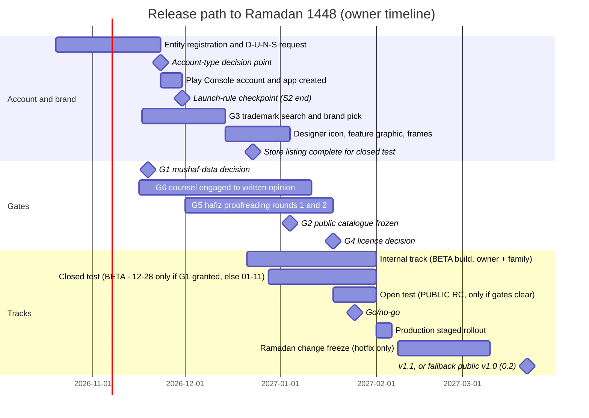

# 11 — Release, Play Compliance & Business

**Purpose.** This doc covers everything needed to get the app from a working build to a trusted public listing on Google Play, keep it there, and keep it funded without ads or tracking. It covers: Play Console readiness (account, verification, signing, versioning); the brand and store listing in English and Urdu, with ASO; the Play policy checklist (Data safety, privacy policy, permission and FGS declarations, Families avoidance); Pakistani legal and religious compliance (gates G5 and G6); the launch plan and checklist; post-launch operations (text-error SLA, kill-switches, reviews, vitals, hotfixes); and the business model, with a cost budget, the G4 open-source licence framework, growth and KPIs that need no tracking. The audience is the owner (decisions, dates, money) and the engineer or AI agent who will implement the release pipeline and the compliance features.

**Status:** Draft v2 — 2026-10-19 (cross-doc review fixes applied)

**Key decisions in this doc**
- **D-17:** v1 is free with no ads, no IAP and no tracking SDKs. v1.5 adds an optional "Support" IAP (PKR 300 / 1,000 / 3,000, `play` flavor only) after a commercial-content audit. v2 makes premium only the features that have running costs, with a financial-aid path. Quran text, recitation, indexes and downloads are never gated.
- **D-19:** "Criterion" stays the codename and package (`com.chughtai.criterion`). The public brand is chosen at **G3**, after a trademark search; the working candidate is "Hamdam" (ہمدم). Title pattern: `<Brand>: Quran 16 Line & Audio`.
- **D-20:** Data safety says "No data collected" for v1. Opt-in ACRA in v1.1 is declared honestly. Reading history never leaves the device.
- **D-22:** Play **Organization** account via a free D-U-N-S, with a personal account plus a closed test (12 testers × 14 days) as the fallback; the account type is decided on **2026-11-23**. Target audience 13+. A proofreading certificate (G5) is required per layout. No translation-only mode. Content governance is written down. Pakistani legal advice is gate G6.
- **D-18:** The code licence decision is gate **G4** (GPL-3.0-or-later or proprietary). §10 gives the decision framework. The recommendation is GPL-3.0-or-later with DCO and `TRADEMARKS.md`, unless the owner commits to B2B white-labelling.
- **D-12 / D-10 / D-24 / D-29:** Every content item carries a 5-value `licenceStatus` {PERMITTED, HOST_GRANT, PENDING, PERSONAL_ONLY, REVOKED} plus `basis`, `eligibleTiers`, `commercialOk`, `fossOk`, `attribution` and `enabled`. Builds carry `BuildConfig.CONTENT_TIER` ∈ {PERSONAL, BETA, PUBLIC} and `BuildConfig.MONETIZED` ([Architecture](04-architecture.md) §11). Per-pack and per-recitation **kill-switches** live in signed files on R2. Release builds are gated on these fields in CI (`verifyContentEligibility<Variant>`).
- **D-25:** Gate dates follow [Roadmap](09-roadmap-backlog.md) §2: G1 2026-11-19, G3 2026-12-14, G2 2027-01-04, G6 2027-01-11, G4 and G5 2027-01-18, **Go/No-Go 2027-01-25**. The closed test opens on **2026-12-28 if G1 was granted and the BETA build is ready**, otherwise on **2027-01-11** at the latest. Production staged rollout runs 2027-02-01 → 100 % by about 2027-02-05, before 1 Ramadan 1448 (≈ 8–9 Feb). A **pre-agreed launch rule** is applied on 2026-11-30 (§0.2): if it trips, Ramadan 1448 is a closed-test/beta release and public v1.0 moves to **2027-03-22**. If any gate is still open at Go/No-Go, the app stays in closed testing through Ramadan and goes public after Eid.
- **D-15 / D-16 / D-14 / D-13:** Permissions are exactly as in §4.4. `SCHEDULE_EXACT_ALARM` (never `USE_EXACT_ALARM`), `RECEIVE_BOOT_COMPLETED` and the adhan use of the `mediaPlayback` FGS are declared **only from the first release with an alarm feature** (adhan F-CP-02, reminders F-CP-09 or the Sehri alarm; v1.1 by default). Also: coarse location only, no full-screen intent, a `mediaPlayback` FGS, UIDT on API 34+ and a `dataSync` worker on API ≤ 33, and `AD_ID` stripped.

---

## 0. Release path at a glance



| Date | Milestone | Owner action | Gate |
|---|---|---|---|
| 2026-10-20 → 26 | Choose entity (§1.1); start SECP SMC-Pvt or sole-proprietor registration; request a D-U-N-S; buy the **brand-neutral** domain (§1.2); set up Cloudflare Email Routing (`support@`, `privacy@`); generate the upload key (§1.4) | Owner | — |
| 2026-10-21 (deadline 2026-10-23) | All permission emails sent (Tarteel/QUL, DK author, Alafasy Berhad, QF, King Fahd Complex); mp3quran statement archived (PDF + SHA-256 + date) | Owner | G1, G2 |
| 2026-11-02 | Follow-up on every unanswered permission email | Owner | G1, G2 |
| 2026-11-16 | Pakistani counsel engaged with the §5.2 brief (latest 2026-11-30, doc 09); hafiz proofreader contracted (§5.4) | Owner | G6, G5 |
| 2026-11-19 | G1 decision: Tarteel permission, or start the clean-room layout on 2026-11-20 (D-06; needs a second person as operator, doc 09) | Owner | G1 |
| 2026-11-23 | **Account-type decision point:** if the D-U-N-S and entity are not both in hand, create a personal account the same day | Owner | — |
| 2026-11-30 | Play Console account verified; app created (package reserved); internal track configured. **Launch-rule checkpoint** (§0.2) and freelancer-lever decision | Owner | — |
| 2026-12-01 | Proof PDF ready; hafiz round 1 starts (→ 2026-12-21) | Owner + Eng | G5 |
| 2026-12-14 | G3 brand chosen; designer briefed | Owner | G3 |
| 2026-12-21 | Internal track live with a BETA build (owner + family); the owner's daily build stays the sideloaded `fossPersonalRelease` (end of P1) | Eng | — |
| 2026-12-23 | **Store listing complete for the closed test** (§0.1): draft EN/UR copy, icon, feature graphic, ≥ 2 screenshots per language, content rating, Data safety, privacy policy URL live; App content declarations complete (§4) | Owner + Eng | — |
| 2026-12-28 | **Closed test opens only if G1 was granted on 2026-11-19 and the BETA build is ready**, with ≥ 20 testers (personal account: the 14-day clock starts) | Owner | G1 |
| 2027-01-04 | G2 public catalogue frozen; final EN/UR listing copy and feature graphic; hafiz round 2 starts 01-05 (→ 01-15) | Owner + designer | G2 |
| 2027-01-11 | G6 written advice received. **Closed test opens at the latest** (G1-cleared or clean-room layout only, §6). Personal account with a 12-28 opening: 14 days reached, apply for production access | Owner | G6 |
| 2027-01-18 | G4 licence decided. G5 certificate signed for the release-candidate content hash. PUBLIC RCs go to the closed track; open test starts if G1, G2, G3, G5 and G6 are clear; production screenshots re-shot from the certified build | Owner | G4, G5 |
| 2027-01-25 | **Go/no-go** (§7.2). Production release submitted (by 01-26) with managed publishing. Personal account with a 01-11 opening: 14 days reached, apply for production access now (§0.1) | Owner | — |
| 2027-02-01 | Production rollout starts (§7.3) | Owner | — |
| ≈ 2027-02-05 | 100 % rollout | Owner | — |
| ≈ 2027-02-08 → ≈ 2027-03-10 | Ramadan 1448 change freeze: hotfixes only (§8.6). Eid ≈ 2027-03-10 [estimate] | — | — |
| 2027-03-22 | v1.1 release; also the **fallback public v1.0 date** (§0.2, §7.2) | Owner | — |

Gate dates follow the integrated schedule in [Roadmap](09-roadmap-backlog.md) §2 (final ruling); [Decision log, gates & risks](12-decisions-risks.md) records the same dates.

### 0.1 Closed-test opening, store listing and the personal-account implication

- **Content rule:** closed testers are third parties, so the closed test is distribution. A BETA build may ship only G1-cleared or clean-room mushaf data (§6). No QUL-derived layout reaches any tester before G1 is granted.
- **Opening date:** **2026-12-28** if G1 was granted on 2026-11-19 and the BETA build is ready; otherwise **2027-01-11** at the latest, with the clean-room layout (doc 09 expects it by about 2027-01-08). If neither layout is ready on 2027-01-11, the closed test cannot open with the mushaf, and §0.2 / §7.2 apply.
- **Store listing first:** Play requires the main store listing before a release can roll out to closed testing [verify in the Console]. That listing includes the app name, short and full description, a 512 px icon, the feature graphic and ≥ 2 phone screenshots. Content rating, Data safety and the privacy policy URL are also needed. So the closed-test listing is complete by **2026-12-23** (S4/S5), or by 2027-01-06 if the opening is 01-11. It needs the G3 brand (2026-12-14) and the designer's first icon and feature graphic. Final copy follows on 2027-01-04, and certified screenshots on 2027-01-18.
- **Personal-account implication:** on a personal account, production access needs 12+ testers opted in for 14 continuous days, then Google's production-access review, then the first app review.
  - With a **2026-12-28** opening, the 14 days end on 01-11. The access review then has two weeks before Go/No-Go (01-25).
  - With a **2027-01-11** opening, the 14 days end on 01-25, and production access is requested that day. If Google's review does not complete by 02-01, the public launch slips (R-41) and Ramadan runs as a closed test.
  - In practice, **a pre-Ramadan public launch on a personal account is possible only with the 2026-12-28 opening**, which needs G1 granted on 2026-11-19.

### 0.2 Pre-agreed launch rule (decided on 2026-11-30)

At the S2 checkpoint (2026-11-30), compute the **overrun ratio** = actual ÷ planned effort for S0–S2 ([Roadmap](09-roadmap-backlog.md)).
- **If the ratio is ≥ 1.3**, or G1 was not granted by 2026-11-19 and the clean-room layout is not on track:
  - Ramadan 1448 becomes a **closed-test/beta release** for the owner, family and testers. The owner uses personal builds; testers get BETA builds.
  - **Public v1.0 moves to 2027-03-22** (post-Eid, merged with the v1.1 scope).
  - The store listing, Data safety and declarations still follow §0.1, because the closed test needs them.
- **If the ratio is < 1.3**, the Ramadan public plan continues.
- The freelancer lever ([Roadmap](09-roadmap-backlog.md)) is decided the same day. The decision is recorded in [Decision log](12-decisions-risks.md) (R-39/R-41).

---

## 1. Play Console readiness

### 1.1 Account type (D-22)

**Decision: Organization account**, owned by a registered legal entity with a free D-U-N-S number (r09 §2.6). Reasons:
- New personal accounts need **12 testers opted in continuously for 14 days** before production access (r09 §2.6). Our pre-Ramadan timeline cannot absorb that comfortably.
- A personal account that monetizes **shows the full home address publicly** (r09 §2.4). That would bite at v1.5 (IAP).
- Organization accounts display legal name, address, email and **phone**. Use a dedicated business number, not a personal one.

| Step | Detail | Done by |
|---|---|---|
| 1 | **Entity:** register an **SMC-Private Limited** with SECP (one-member company; separates the app's liability and payouts from the person). Fallback: a sole proprietorship with an FBR NTN in the business name. Have an accountant confirm before filing (r09 open Q6) | 2026-10-26 (filed) |
| 2 | Request a **D-U-N-S** for the entity (free). Lead time is unknown; assume up to ~30 days [unverified] | 2026-10-26 (requested) |
| 3 | Business bank account (USD receipts later), business email `support@<domain>`, a dedicated phone number | 2026-11-16 |
| 4 | Create the **Play Console Organization account** (US$25 one-time, r09 §2.6), then verify identity, D-U-N-S and website | 2026-11-23 → 30 |
| 5 | **Fallback (triggered 2026-11-23 if steps 1–2 are incomplete):** create a **personal** account. Recruit ≥ 20 closed testers (buffer over 12). Open the closed test on 2026-12-28 if G1 was granted and the build is ready, otherwise on 2027-01-11, and apply for production access on day 15. Only the 12-28 opening leaves room for Google's review before 02-01; with a 01-11 opening the 14-day clock runs 01-11 → 01-25, and the public launch slips if the review is not done by 02-01 (§0.1, R-41). Keep it unmonetized. **Before v1.5**, transfer the app to an Organization account (Play supports app transfers [unverified procedure; check the Console help at the time]) | 2026-11-23 |

**Developer name:** the brand (e.g. "Hamdam Apps") after G3, never anything resembling "9D Muslim Apps", "Quran.com", "Official" or a reciter's name (r09 §2.1). **Contact on the listing:** `support@<domain>`, website `https://<domain>`, and the business phone (Organization only).

### 1.2 Domain, email and web presence (D-24)

| Item | Decision |
|---|---|
| Domain | Two domains. (1) A **brand-neutral domain bought in week 1** (2026-10-20 → 26): it carries `cdn.` (the `CDN_BASE_URL` compiled into every build, so it never changes), the `support@`/`privacy@` email and the website needed for Organization-account verification. (2) The brand's `.com` (or `.app` if `.com` is taken), bought the day G3 clears (2026-12-14); the website and email then move to it, and the neutral domain redirects. Register the matching `.pk` if available [cost unverified] |
| Website | Static site on **Cloudflare Pages** at `https://<domain>/`: landing page, `/privacy`, `/ur/privacy`, `/credits`, `/report` (how to report a text error), `/delete-data` (from v1.x) |
| CDN | R2 bucket on `https://cdn.<domain>/` (the brand-neutral domain): `catalogue.json`, `index.json`, packs, timing packs, the PK month-start feed and `notices.json`, all Ed25519-signed with a detached `.sig` (D-10, D-30). **No request logging, no Logpush, no Web Analytics** on either hostname. The aggregate R2 request counts in the dashboard are fine (§12) |
| Email | Cloudflare Email Routing forwards `support@`, `privacy@`, `permissions@` and `abuse@` to the owner's inbox. The owner's personal Gmail is never shown publicly |

### 1.3 Android developer verification (r09 §2.6)

| Date | What happens | Our action |
|---|---|---|
| 2026-09-30 | Enforcement starts in Brazil, Indonesia, Singapore and Thailand | None for Play installs |
| 2027 (global; exact date unknown) | Apps installed outside Play must come from a verified developer with a registered package and key | If the `foss` flavor is distributed (G4), register `com.chughtai.criterion` plus the **foss signing-key SHA-256** in the Android Developer Console before global enforcement. Check quarterly (§8.7) |
| Ongoing | Play apps are auto-registered (≈ 99 %) | After creating the app: Play Console → Home → confirm that the developer-verification status shows the app as registered. Screenshot this into the release log |

### 1.4 App signing, keys and versioning

**Play App Signing with a Google-generated app signing key** (the default for new apps: it allows key upgrade, and a lost upload key can be reset).

| Key | Spec | Storage | Used by |
|---|---|---|---|
| Upload key `upload.jks` | RSA 4096, validity 30 years, alias `upload` | (1) Password-manager attachment, (2) encrypted USB kept offline, (3) GitHub Actions secrets `UPLOAD_KEYSTORE_B64`, `UPLOAD_KEYSTORE_PASSWORD`, `UPLOAD_KEY_ALIAS`, `UPLOAD_KEY_PASSWORD`, in a protected `release` environment that needs manual approval | CI on `v*` tags → `bundlePlayPublicRelease` |
| App signing key | Google-held | Play | Play delivery |
| Foss key `foss.jks` | RSA 4096, 30 years | Same three places, separate secrets `FOSS_*` | `assembleFossPublicRelease` (only if G4 distributes foss) |
| Content signing key (Ed25519) | For `index.json`, `catalogue.json`, `notices.json`, the PK month-start feed (D-10) | Offline. The private key **never** enters CI; files are signed on the owner's machine by a `tools/` script ([Data pipelines](08-data-pipelines.md)) | Owner |

Consequence: Play and foss builds have different signatures, so a user cannot switch channels in place. They switch by reinstalling and moving their data with JSON export/import (F-BM-06).

**Versioning** (owned by [Quality, testing & CI](10-quality-testing-ci.md) §12.5; summarised here):
- Tags are `vMAJOR.MINOR.PATCH[-rc.N]`; `versionName` = SemVer `MAJOR.MINOR.PATCH`, with an `-rc.N` suffix for release candidates.
- `versionCode = MAJOR*1_000_000 + MINOR*10_000 + PATCH*100 + n`, where `n` = RC number (1–98) and the final build is **99**. So `v1.0.0-rc.3` → 1000003 and `v1.0.0` → 1000099. Each Play upload needs a fresh code.
- The same `versionCode` is used for `play` and `foss` builds of one release.
- R8 mapping files travel inside the AAB, so Play vitals stack traces are deobfuscated.
- Every release tag records: the `quran_content.db` content version and SHA-256, the font SHA-256, and the G5 certificate ID that covers them (§5.4).

**Content tier** is the compile-time `BuildConfig.CONTENT_TIER ∈ {PERSONAL, BETA, PUBLIC}`, plus `BuildConfig.MONETIZED` ([Architecture](04-architecture.md) §11):
- `personal`-tier builds are PERSONAL. They are never uploaded to Play (`playPersonal*` is disabled); the owner sideloads `fossPersonalRelease`.
- `public`-tier builds are BETA by default.
- A build is PUBLIC only when built with `-Pcriterion.release=production`, which requires G1 and G5 evidence.
- `MONETIZED` comes from `-Pcriterion.monetized=true` (v1.5+, `play` only).

**Never promote a BETA AAB to production.** Production candidates are built as PUBLIC and soak on the closed track for at least 3 days first (from 2027-01-18).

### 1.5 App content declarations (Play Console → Policy → App content)

| Declaration | v1.0 answer | Changes at |
|---|---|---|
| Privacy policy URL | `https://<domain>/privacy` (HTML, public, not geofenced, no PDF; r09 §2.6) | — |
| App access | "All functionality is available without special access" (no login) | v1.x sync: still yes (login optional) |
| Ads | **No, my app does not contain ads** | Never changes (D-17) |
| Content rating | IARC questionnaire per §3.7 → expected Everyone / PEGI 3 / "Rated for 3+" | Re-submit at v1.5 (digital purchases) and v1.x (group khatam user interaction) |
| Target audience and content | Age groups **13–15, 16–17, 18+** only; "appeals to children unintentionally": **No** | — |
| News app | No | — |
| Data safety | §4.2 v1 form: **No data collected** | v1.1 (ACRA), v1.x (sync, group khatam) |
| Advertising ID | **No** (and `AD_ID` is stripped in the manifest) | Never |
| Government app | No | — |
| Financial features | None | — |
| Health | None | — |
| Foreground service permissions | `mediaPlayback` (recitation only) + `dataSync`, with videos (§4.4.2) showing only v1.0 features | The first alarm release (v1.1 by default) updates the `mediaPlayback` text and video to include the adhan. Android Auto (P3) adds nothing new |
| Exact alarm | **Not declared in v1.0**: no exact-alarm permission and no exact-alarm justification anywhere (unless the freelancer lever pulls the adhan into v1.0 on 2026-11-30) | From the first alarm release: `SCHEDULE_EXACT_ALARM` only, which needs no declaration form; never the restricted `USE_EXACT_ALARM` (r09 §2.6) |
| Full-screen intent | Not declared or used | — |
| Account deletion | N/A: no accounts in v1 (r09 §2.6) | v1.x (§4.6) |

---

## 2. Brand and gate G3 (D-19)

**Rules** (r09 §2.1–2.2):
- Never use the reference app's name "Al QURAN – القرآن الكريم", its icon, colours or trade dress, screenshots or description text.
- Never put "Official", "#1" or "Best", a reciter's name, Saudi/Haramain/KFGQPC logos or a government emblem in the title or icon.
- Use "Quran" and "القرآن الكريم" only as generic descriptors.
- "Criterion" is not a public brand (collides with Criterion Collection/Games and others; zero search relevance in Pakistan). It may appear as an English tagline ("Al-Furqan · The Criterion") on the About screen.

**G3 process** (starts 2026-11-17, decision **2026-12-14**; owner runs it with a trademark agent):

| # | Step | Pass criterion | Evidence kept |
|---|---|---|---|
| 1 | Shortlist 3 names: **Hamdam (ہمدم)** first, plus 2 alternates. Avoid Furqan, Rafiq, Noor and Tilawah, which are crowded (r09 §2.2) | Easy to say in Urdu and English; no unintended meaning (check with 2 Urdu speakers and 1 alim) | Notes |
| 2 | Play search collision check (country pk, us, gb, sa, ae) for `<name>`, `<name> quran` and the Urdu spelling | No Quran or Islamic app with the same or a confusingly similar name | Screenshots + date |
| 3 | **IPO-Pakistan** trademark search, classes **9** (software) and **41** (education/religious content services); 42 optional | No identical or similar live mark in 9/41 | Agent's search report |
| 4 | **WIPO Global Brand Database** search (Madrid filings covering PK, GCC, UK, US) | No conflicting mark in classes 9/41 | Export |
| 5 | **USPTO** trademark search | No conflicting live mark in 9/41 | Export |
| 6 | Domain (`.com` / `.app` / `.pk`) and social handles (YouTube, Facebook, X, Instagram) available | At least the `.com` or `.app` | Registrar receipt |
| 7 | Record the decision as a new ADR in [Decision log](12-decisions-risks.md) | — | ADR |
| 8 | **File** an IPO-Pakistan application in classes 9 + 41 at launch + 90 days, or at 10k installs, whichever comes first. File immediately if a conflicting app appears | — | Filing receipt |

If Hamdam fails steps 2–5, take the first alternate that passes. The doc set uses `<Brand>` everywhere until G3 clears.

---

## 3. Store listing (EN default + Urdu)

Listing languages: **English (en-US, default)** and **Urdu (`ur`, served to ur-PK users)**. Do not add an Arabic listing in v1. Every claim in the listing must map to a feature ID that is **shipped in the build being released** (§3.8). This is the reverse of the reference app, whose listing claims translation, WBW, tafsir, Qibla and azkar that its APK lacks (r01 §2.1).

### 3.1 Title (≤ 30 characters)

| Option | Text | Chars | Use |
|---|---|---|---|
| **A (decision)** | `Hamdam: Quran 16 Line & Audio` | 29 | en-US title (D-19 pattern) |
| A-ur | `ہمدم – القرآن الكريم 16 سطری` | 28 | Urdu title: bilingual القرآن الكريم + "16 line" |
| B | `ہمدم: قرآن پاک 16 سطری و تلاوت` | 30 | Urdu alternate if "Quran Pak" outperforms in a store-listing experiment |
| C | `Hamdam – القرآن الكريم 16 Line` | 30 | en-US experiment arm (bilingual, as the leaders do; r02 §2.9) |

After launch, run Play **store listing experiments** (no SDK needed): A vs C on en-US, A-ur vs B on Urdu, 50/50, for at least 14 days. Pick the winner on retained first-time installers (or installers, if retention isn't shown). Substitute the G3 brand for "Hamdam" in every option.

### 3.2 Short description (≤ 80 characters)

| Lang | Text | Chars |
|---|---|---|
| EN | `No ads, no tracking. 16-line Quran Pak, Qari audio with highlight, Para & Urdu` | 78 |
| EN alt | `Ad-free 16-line Quran Pak: read page by page, listen by Surah, Para or Ayah` | 75 |
| UR | `بغیر اشتہار: 16 سطری قرآن پاک، قاری کی تلاوت، پارہ و منزل فہرست، اردو ترجمہ` | 75 |

### 3.3 Full description: English (≈ 3,140 chars; limit 4,000)

Replace `<Brand>` and the proofreader placeholder at release. The text claims **only v1.0 features** ([Roadmap](09-roadmap-backlog.md) final v1.0 scope: Quran core + prayer times with Sehri/Iftar F-CP-01, Hijri F-CP-04, Ramadan core F-CP-07, khatam planner F-BM-04). Adhan, Qibla, tasbeeh, azkar, widgets, reminders, share-image and translator choice are added only through the **v1.1 listing delta** below, in the release that ships them. Drop the "DAILY COMPANION" block if the scope-cut ladder removes Tier A from v1.0. Generate the Para-name line from the D-07 Para table (`name_roman`) so spellings match the app.

```text
No ads. No tracking. Free forever.

<Brand> is an Indo-Pak Quran Pak (Quran Majeed / Quran Sharif) for your daily tilawat. Read the 16-line mushaf page by page, just like your printed Quran, and listen to your favourite Qari by Surah, by Para, by Manzil or from any ayah.

READ LIKE YOUR PRINTED QURAN
• 16-line Indo-Pak mushaf, 548 pages, with the same page numbers as the common printed 16-line Quran (pages 2 to 549)
• Typeset in the open-licence DigitalKhatt IndoPak font: sharp at any zoom, no blurry scans
• Ruku (ع), Manzil, Sajda and Para markers where you expect them
• Tap any ayah to play from there, bookmark, copy, share or see its translation
• Light, sepia, night and black themes; screen stays on; rotation lock and page lock

LISTEN TO YOUR FAVOURITE QARI
• Play a whole Surah, a whole Para (Indo-Pak Para boundaries), a Manzil, a Ruku, a page or any range of ayahs
• The ayah being recited is highlighted on the page, and the page turns by itself
• Repeat an ayah or a range for hifz, pause between ayahs, speed 0.5x to 2x, sleep timer
• Plays in the background, with lock-screen and headset controls
• Download a Surah, a Para or the whole Quran for offline listening (Wi-Fi only by default)
• Reciters include Mishary Alafasy, Saad Al-Ghamdi, Abdul Basit Abdus Samad (Mujawwad), Abdur-Rahman As-Sudais, Abu Bakr Ash-Shatri, Hani Ar-Rifai, Muhammad Ayyub and more. Every reciter is free.

FIND ANY PLACE QUICKLY
• Para index with start page and progress: Alif Lam Meem, Sayaqool, Tilkar Rusul, Lan Tanaloo, Wal Muhsanat, La Yuhibbullah, Wa Iza Samiu, Wa Lau Annana, Qalal Malao, Wa'lamu, Ya'tazirun, Wa Ma Min Dabbah, Wa Ma Ubarri'u, Rubama, Subhanallazi, Qal Alam, Iqtaraba, Qad Aflaha, Wa Qalallazina, Amman Khalaq, Utlu Ma Uhiya, Wa Man Yaqnut, Wa Maliya, Faman Azlamu, Ilaihi Yuraddu, Ha Meem, Qala Fama Khatbukum, Qad Sami Allah, Tabarakallazi, Amma (Para 1 to 30)
• Surah index, Manzil index (7 manzils), Ruku and Sajda lists, go to any page or Surah:Ayah
• Quick access: Surah Yaseen, Rahman, Mulk, Waqiah, Kahf, Ayatul Kursi, Manzil dua, last two ayat of Al-Baqarah
• Search in Arabic without harakat, and in Urdu or English

UNDERSTAND
• Urdu translation by Maulana Muhammad Junagarhi with Ahsan-ul-Bayan notes, and English Saheeh International, always shown with the Arabic text
• App in Urdu or English

DAILY COMPANION
• Prayer times (Karachi method, Hanafi Asr by default) and Hijri date
• Sehri and Iftar timetable for Ramadan
• Khatam planner and private reading progress

YOUR PRIVACY
No ads, no analytics, no trackers, no account. Bookmarks and reading history stay on your phone. Works offline.

SOURCES AND ACCURACY
Quran text: Tanzil Project (CC BY 3.0). Font: DigitalKhatt IndoPak (SIL Open Font License). Translations: QuranEnc.com. Full credits are inside the app. The Arabic text was proofread by <Hafiz/Qari name, credentials>. If you find a mistake, tap "Report text error" in the app. We flag a confirmed text error in the app within 48 hours and submit a corrected update within 72 hours.

<Brand> is an independent app and is not affiliated with any other Quran app, publisher or reciter.
```

**v1.1 listing delta** (2027-03-22 by default; apply each bullet only when its feature ID is in the shipped build, per the §3.8 claims audit):

```text
DAILY COMPANION (v1.1 replacement block)
• Prayer times (Karachi method, Hanafi Asr by default) with adhan, Qibla direction and Hijri date        [F-CP-01, F-CP-02, F-CP-03, F-CP-04]
• Sehri and Iftar timetable for Ramadan, tasbeeh, morning and evening azkar                              [F-CP-07, F-CP-05, F-CP-06]
• Khatam planner, private reading progress, continue-reading widget                                     [F-BM-04, F-CP-08]
UNDERSTAND (v1.1 addition)
• Choose your Urdu translator                                                                            [F-TR-02, F-TR-03]
```

The bracketed IDs are for the claims audit only and are not pasted. If the freelancer lever pulls adhan (F-CP-02) or tasbeeh (F-CP-05, v1.0 stretch) into v1.0, their words move into the v1.0 text in that build. The Urdu text (§3.4) gets the same delta.

Listing rules:
- **No publisher names** (e.g. "Taj Company") in the listing; the in-app Credits name the layout source (r09 §2.5 item 7). This avoids implied affiliation (Impersonation).
- **Reciter names** appear only in the description (factual, allowed), only for public-shortlist reciters (D-12), and never in the title or graphics.
- **15- and 13-line editions are not mentioned** until F-RD-11 ships (P3). Then they are added to the title and keywords experiment (§3.5).

### 3.4 Full description: Urdu (≈ 2,830 chars)

```text
کوئی اشتہار نہیں۔ کوئی ٹریکنگ نہیں۔ ہمیشہ مفت۔

<برانڈ> روزانہ تلاوت کے لیے انڈو پاک قرآن پاک (قرآن مجید / قرآن شریف) ہے۔ 16 سطری مصحف کو بالکل اپنے چھپے ہوئے قرآن کی طرح صفحہ بہ صفحہ پڑھیں، اور اپنے پسندیدہ قاری کی تلاوت سورت، پارہ، منزل یا کسی بھی آیت سے سنیں۔

چھپے ہوئے قرآن جیسا مطالعہ
• 16 سطری انڈو پاک مصحف، 548 صفحات، صفحہ نمبر وہی جو عام چھپے ہوئے 16 سطری قرآن میں ہیں (صفحہ 2 تا 549)
• کھلے لائسنس والے DigitalKhatt IndoPak فونٹ میں کمپوز شدہ: ہر زوم پر صاف، دھندلی اسکین تصاویر نہیں
• رکوع (ع)، منزل، سجدہ اور پارہ کی علامات اپنی جگہ پر
• کسی بھی آیت پر ٹیپ کریں: یہاں سے سنیں، بک مارک، کاپی، شیئر یا ترجمہ
• لائٹ، سیپیا، نائٹ اور سیاہ تھیم؛ اسکرین آن رہتی ہے؛ اسکرین گھمانے اور صفحہ پلٹنے کا لاک

اپنے پسندیدہ قاری کی تلاوت
• پوری سورت، پورا پارہ (انڈو پاک پاروں کے مطابق)، منزل، رکوع، صفحہ یا آیات کی کوئی بھی حد
• جو آیت پڑھی جا رہی ہو وہ صفحے پر نمایاں ہوتی ہے اور صفحہ خود بخود پلٹ جاتا ہے
• حفظ کے لیے آیت یا حصہ دہرائیں، آیات کے درمیان وقفہ، رفتار 0.5x سے 2x، سلیپ ٹائمر
• بیک گراؤنڈ میں تلاوت، لاک اسکرین اور ہیڈسیٹ سے کنٹرول
• سورت، پارہ یا پورا قرآن آف لائن سننے کے لیے ڈاؤن لوڈ کریں (ڈیفالٹ: صرف وائی فائی)
• قراء میں مشاری العفاسی، سعد الغامدی، عبدالباسط عبدالصمد (مجوّد)، عبدالرحمٰن السدیس، ابوبکر الشاطری، ہانی الرفاعی، محمد ایوب اور دیگر شامل ہیں۔ تمام قراء مفت ہیں۔

فوری رسائی
• پاروں کی فہرست، ابتدائی صفحہ اور پیش رفت کے ساتھ: الم، سیقول، تلک الرسل، لن تنالوا، والمحصنٰت، لا یحب اللہ، واذا سمعوا، ولو اننا، قال الملا، واعلموا، یعتذرون، وما من دآبۃ، وما ابرئ، ربما، سبحٰن الذی، قال الم، اقترب، قد افلح، وقال الذین، امن خلق، اتل ما اوحی، ومن یقنت، ومالی، فمن اظلم، الیہ یرد، حٰم، قال فما خطبکم، قد سمع اللہ، تبٰرک الذی، عمّ (پارہ 1 تا 30)
• سورتوں کی فہرست، منازل کی فہرست (7 منزلیں)، رکوع اور سجدات، کسی بھی صفحے یا سورت:آیت پر جائیں
• فوری رسائی: سورہ یٰسین، رحمٰن، ملک، واقعہ، کہف، آیت الکرسی، منزل، سورہ بقرہ کی آخری دو آیات
• عربی (اعراب کے بغیر)، اردو اور انگریزی میں تلاش

ترجمہ
• مولانا محمد جوناگڑھی کا اردو ترجمہ مع احسن البیان حواشی، اور انگریزی میں صحیح انٹرنیشنل، ہمیشہ عربی متن کے ساتھ
• ایپ اردو یا انگریزی زبان میں

روزمرہ ساتھی
• نماز کے اوقات (کراچی طریقہ، حنفی عصر بطور ڈیفالٹ) اور ہجری تاریخ
• رمضان کے لیے سحری و افطاری نظام الاوقات
• ختم القرآن منصوبہ اور نجی پیش رفت

آپ کی پرائیویسی
کوئی اشتہار، اینالیٹکس، ٹریکر یا اکاؤنٹ نہیں۔ بک مارکس اور مطالعے کی تاریخ صرف آپ کے فون پر رہتی ہے۔ ایپ آف لائن کام کرتی ہے۔

ماخذ اور درستی
قرآنی متن: Tanzil Project (CC BY 3.0)۔ فونٹ: DigitalKhatt IndoPak (SIL Open Font License)۔ تراجم: QuranEnc.com۔ مکمل حوالہ جات ایپ میں موجود ہیں۔ عربی متن کی تصحیح <حافظ/قاری کا نام، اسناد> نے کی ہے۔ کوئی غلطی نظر آئے تو ایپ میں "متن کی غلطی رپورٹ کریں" پر ٹیپ کریں؛ تصدیق شدہ غلطی کی اطلاع 48 گھنٹوں میں ایپ میں دی جاتی ہے اور درست اپ ڈیٹ 72 گھنٹوں میں جمع کرائی جاتی ہے۔

<برانڈ> ایک آزاد ایپ ہے اور کسی دوسری قرآن ایپ، ناشر یا قاری سے منسلک نہیں۔
```

A native Urdu editor proofreads this text, and every Urdu screenshot caption, before the closed-test listing goes up (2026-12-23) and again for the final copy (2027-01-04). The Para names must match `para.name_ur` in the content DB character for character.

### 3.5 ASO keyword plan (Pakistan)

Play indexes the title, short description and full description; there is no keyword field. Put each target term in naturally, **2–5 times at most** (Play metadata policy forbids repetitive keywords; r09 §2.1). Ranks below are the competitive picture on 2026-10-19 (r02 §2.9).

| Priority | Keyword cluster (EN / Roman Urdu / Urdu) | Intent / competition (r02) | Placement | Honest from |
|---|---|---|---|---|
| P1 | **16 line quran**, 16 lines quran, ۱۶ سطری قرآن | Reference app **absent** from top 15; mid competition | Title (both), short (both), full ×2 | v1.0 |
| P1 | **quran pak**, quran majeed, quran sharif, قرآن پاک، قرآن مجید | Reference #1; high volume | Title (A-ur/B), first line of full | v1.0 |
| P1 | **without ads / no ads / ad free**, بغیر اشتہار | Autocomplete "quran app without ads" (r02 §2.9); our wedge | Short (both), first line of full | v1.0 |
| P1 | **para 1 … para 30**, quran majeed 30 para, پارہ | Single-para apps prove demand; low competition | Full (Para-name list), short ("Para") | v1.0 |
| P1 | **quran pak with urdu translation**, اردو ترجمہ | Autocomplete; mid competition | Short (UR), full | v1.0 |
| P2 | **offline** quran, آف لائن | Autocomplete | Full ×2 | v1.0 |
| P2 | **tilawat**, quran pak ki tilawat, تلاوت | Autocomplete ("tilawat surah rahman/yaseen") | Full, Urdu title B | v1.0 |
| P2 | surah yaseen / rahman / mulk / kahf / waqiah, ayatul kursi | High-volume surah queries | Full (quick-access line) | v1.0 |
| P2 | **manzil** (mostly means the Manzil dua: 1M+ apps), منزل | We honestly offer both the Manzil index and the Manzil dua quick access | Full ×2 | v1.0 |
| P2 | quran mp3 / audio / qari | Single-reciter apps reach 1–5M | Title ("Audio"), full | v1.0 |
| P3 | **15 line quran, 13 line quran, hafizi** | Fragmented, mid-size apps | Title experiment + full | When F-RD-11 ships (P3) |
| P3 | hifz quran | Nakagosoft, Tarteel | Full | When F-CP-12 ships (P3) |
| Never | Reciter names in the title; "official"; competitor names; keyword-stuffed strings | Policy (r09 §2.1) | — | — |

Measure monthly with the Play Console acquisition report: search terms by installers and store-listing conversion [check the report names in the Console]. No SDK is needed.

### 3.6 Graphics

**Specs** (Play; re-check in the Console when uploading):
- App icon: 512×512 PNG, 32-bit.
- Feature graphic: **1024×500**, PNG/JPEG, no alpha.
- Phone screenshots: 2–8 per language. Each side 320–3840 px, and the long side at most twice the short side, so export at **1080×1920 (9:16)**. Do **not** use 1080×2400 (ratio 2.22).

**Icon brief** (designer, original work, provenance logged):
- An abstract geometric or arabesque motif, or the Urdu brand initial, on a deep green or teal field. This is our own palette, chosen to differ from the reference app's trade dress.
- No photos, no Kaaba, no open-book stock art, no text other than the brand initial.
- Adaptive icon (foreground + background) plus a monochrome layer for themed icons.

**Feature graphic** (ASCII layout):

```
+--------------------------------------------------------------------------------+
|  [icon]  <Brand>                         +-------------------------------+     |
|          القرآن الكريم · 16 سطری           |  crop of OUR rendered page   |     |
|          Quran 16 Line & Audio           |  (Surah Yaseen opening,     |     |
|                                          |  ruku ع in margin, one ayah |     |
|          No ads · Offline · Urdu         |  highlighted)                |     |
|                                          +-------------------------------+     |
+--------------------------------------------------------------------------------+
```

**Screenshot storyboard** (8 frames). These are real app renders from a scripted screenshot run: an instrumented test with a demo seed, on an emulator at 1080×1920, light theme except frame 2. Every Arabic page shown must come from the G5-certified content hash. There are no reciter photos and no fake ratings or testimonials. Urdu-listing screenshots use the Urdu UI.

| # | Screen and state | EN caption (headline / sub) | UR caption | Features |
|---|---|---|---|---|
| 1 | Reader, opening page of Surah Yaseen; toolbar "Para 22 · Page L · Yaseen"; ruku ع in margin | Read like your printed Quran / 16-line Indo-Pak · 548 pages · No ads | چھپے ہوئے قرآن جیسا / 16 سطری انڈو پاک · 548 صفحات · بغیر اشتہار | F-RD-01, F-RD-02 |
| 2 | Night theme; ayah highlighted mid-recitation; mini-player "Alafasy · Surah Mulk" (text only) | Your favourite Qari, ayah by ayah / Highlight follows the recitation | پسندیدہ قاری، آیت بہ آیت / تلاوت کے ساتھ آیت نمایاں | F-RD-05, F-AU-03 |
| 3 | Para index with Indo-Pak names, start pages, progress rings, Read + Play buttons | Para 1–30 with names / Read or play any Para | پارہ 1 تا 30 ناموں کے ساتھ / کوئی بھی پارہ پڑھیں یا سنیں | F-IX-02 |
| 4 | Play-scope sheet: Surah / Para / Manzil / Range, repeat ×3, pause between ayahs | Play a Surah, Para or any ayahs / Repeat for hifz · speed · sleep timer | سورت، پارہ یا آیات سنیں / حفظ کے لیے دہرائیں · رفتار · ٹائمر | F-AU-02, F-AU-05, F-AU-06 |
| 5 | Translation view: Arabic + Urdu Junagarhi + English Saheeh | Urdu & English translation / Always with the Arabic text | اردو اور انگریزی ترجمہ / ہمیشہ عربی متن کے ساتھ | F-RD-08, F-TR-01 |
| 6 | Manzil index + quick-access chips (Yaseen, Mulk, Ayatul Kursi, Manzil dua) | Manzil, Ruku, Sajda and quick access / Yaseen · Mulk · Kahf · Ayatul Kursi | منزل، رکوع، سجدہ اور فوری رسائی / یٰسین · ملک · کہف · آیت الکرسی | F-IX-03, F-IX-04, F-IX-06, F-IX-08 |
| 7 | Prayer times card + Sehri/Iftar countdown (Ramadan demo date) + Hijri date; no Qibla in v1.0 | Prayer times, Sehri & Iftar / Karachi method · Hanafi Asr · Hijri date | نماز کے اوقات، سحری و افطاری / کراچی طریقہ · حنفی عصر · ہجری تاریخ | F-CP-01, F-CP-04, F-CP-07 |
| 8 | Downloads/storage screen + "No ads. No tracking." banner + Credits/proofread line | Offline, private, free forever / No ads · No tracking · Proofread text | آف لائن، محفوظ، ہمیشہ مفت / بغیر اشتہار · بغیر ٹریکنگ · مصحح متن | F-AU-08, F-PL-04 |

If companion features are cut from v1.0, frame 7 becomes the bookmarks/khatam planner (F-BM-02/F-BM-04) or search (F-SR-01). The v1.1 listing update re-shoots frame 7 with the Qibla and adhan (F-CP-02, F-CP-03) once they ship.

### 3.7 Category, content rating and target audience

- **Category:** Books & Reference (the same as the reference app and most Quran readers; r01 §2.1). Tags: pick the closest to "Religion" and "Reference" from the Console list.
- **Contains ads:** No. **In-app purchases:** No (v1.0). The IAP label appears automatically at v1.5.
- **IARC content rating questionnaire** (category "Reference, News, or Educational"; question wording from memory, so answer what the Console actually asks):

| Topic | v1.0 answer |
|---|---|
| Violence, blood, fear/horror | No |
| Sexuality, nudity | No |
| Profanity / crude humour | No |
| Controlled substances (drugs, alcohol, tobacco) | No |
| Gambling (real or simulated) | No |
| Hate speech / discrimination | No. Religious scripture and translations only, under a content-governance policy (§5.5) |
| Users can interact or exchange content | **No** (v1.0 has no UGC, chat or social features; sharing goes through the Android share sheet). **Yes** from realtime group khatam (F-CP-11, P3) |
| Shares the user's current location with other users | No (location is used on the device only) |
| Purchase of digital goods | **No** in v1.0; **Yes** at v1.5 (F-PL-08) |
| Unrestricted internet access (web browser) | No |

  Expected result: Everyone / PEGI 3 / USK 0 / "Rated for 3+" in PK (matches the reference app).
- **Target audience:** 13–15, 16–17, 18+. Under-13 groups stay **unticked** so the app is outside the Families programme (D-22; r09 §2.6). See §4.5.

### 3.8 Listing integrity rules (release-blocking)

1. **Claims audit:** CI keeps `store/listing-claims.yaml`, a map from each listing bullet to its feature IDs. A release script checks that every listed feature ID is marked shipped in that build's feature manifest (cross-doc assumption with [Roadmap](09-roadmap-backlog.md) and [CI](10-quality-testing-ci.md)). Any mismatch blocks promotion.
2. Store the listing text in the repo under `store/` (`fastlane/metadata/android/{en-US,ur}/` layout, which F-Droid can reuse), reviewed in PRs.
3. No emojis, ALL CAPS words, rankings, prices, promotions, testimonials or competitor names (r09 §2.1).
4. Write "What's new" text in both languages (≤ 500 chars each) for every production release.

---

## 4. Play policy compliance

### 4.1 Policy checklist

| Policy | Requirement (source) | Our implementation | Evidence / owner |
|---|---|---|---|
| Impersonation | Don't mislead with a similar name, icon or description (r09 §2.1) | G3 brand; original icon; independence statement in the listing | G3 record; designer provenance file |
| Intellectual property | No copyrighted scans, audio or text without rights; no "professional images of public figures" (r09 §2.1) | Typeset mushaf (D-05); content provenance log; **no reciter photos**; mp3quran grant archived; permission emails logged | `content/provenance.csv` (§5.5); permissions log |
| Repetitive content / spam | No "same experience as other apps"; **one app only**, never per-surah clones (r09 §2.1) | Unique value: ayah-aware typeset Indo-Pak mushaf, Para/Manzil/Ruku playback, highlight, no tracking | Review notes field (§7.4) |
| Minimum functionality | Not a static text or PDF viewer | Interactive reader + audio + indexes + search | — |
| Webview spam | No wrapper of quran.com etc. | Native Compose; no WebView for content | — |
| Metadata | ≤ 30-char title; no emojis, caps, rankings or testimonials (r09 §2.1) | §3 | `store/` PR review |
| User Data / privacy policy | Policy URL in the Console **and in the app** (r09 §2.6) | Settings → About → Privacy; onboarding footer link | §4.3 |
| Data safety | Mandatory, accurate, including SDKs (r09 §2.6) | §4.2; SDK inventory + network-host allowlist test (§4.7) | CI |
| Permissions | Minimum scope; contextual requests | §4.4 | Manifest review |
| Foreground services | Declare types + video per type (r09 §2.6) | §4.4.2 | YouTube unlisted links |
| Exact alarms | `USE_EXACT_ALARM` only for core alarm/calendar apps (r09 §2.6) | None in v1.0. From the first alarm release (v1.1 by default): `SCHEDULE_EXACT_ALARM` only, with an inexact fallback | Manifest; [Companion](07-companion-engagement-features.md) |
| Full-screen intent | Only for call/alarm core apps | Not used; `tools:node="remove"` | Manifest |
| Families | If children are targeted: certified SDKs only, no AAID or location | Target 13+; no child-directed copy or art (§4.5) | Target-audience form |
| Ads | Interstitial rules etc. | **No ads ever** (D-17) | Ads declaration "No" |
| Payments | Digital goods via Play Billing; no tax-exempt donation via Billing; no external payment links (r09 §2.6) | v1: none. v1.5: Play Billing "Support" consumables. **No donation links** unless the recipient is an FBR-approved NPO pre-cleared with Play | §9.2 |
| Account deletion | Only if accounts can be created (r09 §2.6) | N/A in v1; §4.6 for v1.x | — |
| Target API | API 36 since 2026-08-31 (r07 §2.8) | targetSdk 36; plan 37 in P3/P4 | Gradle |
| 16 KB page size | From **2027-02-01**, updates must support 16 KB pages if they have native code (r07 §2.8) | Only `libsqliteJni.so`, already aligned `0x4000`; CI `zipalign -c -P 16` | CI (release-blocking, falls in our launch week) |
| Location button policy, contacts, geofencing FGS removal | Effective 2027-01-27 (r09 §2.6) | Not affected (coarse one-shot, no contacts, no geofencing). Re-read the final texts on 2027-01-27 | §8.7 |

### 4.2 Data safety form

**v1.0 (P2; no SDKs, no accounts).** Play Console → Data safety:

| Question | Answer | Why it is true |
|---|---|---|
| Does your app collect or share any of the required user data types? | **No** | No analytics, ads, attribution, crash or Firebase SDKs (D-20). Location, bookmarks, reading history, tasbeeh and khatam data are processed **on device only**, and on-device processing is not disclosed (r09 §2.6). Content downloads send no identifiers (see below). |
| Result shown on listing | "No data collected · No data shared" | — |

Engineering conditions that keep the v1 answer true. They are release-blocking and tested in [CI](10-quality-testing-ci.md):
1. **No third-party SDK** that transmits data. The `play` flavor's only Play library is in-app review (F-PL-10), which runs through the Play Store app; the update nudge simply opens the store listing.
2. **Requests carry no identifiers:**
   - no installation ID, advertising ID or device ID;
   - no account or user-specific query parameters;
   - the User-Agent is `<Brand>/<versionName> (Android <sdk>)` only.
3. **A host allowlist test** (debug OkHttp interceptor + unit test) fails if the app contacts any host outside this list: `cdn.<domain>`, mp3quran audio hosts, the everyayah / islamic.network per-ayah hosts (`PENDING`, so BETA and PERSONAL builds only, until G2 clears them), and the Play Store (via the Play libraries). Public builds never contact quranicaudio, QF/QDC or Tarteel audio hosts, or archive.org (D-28). The privacy policy lists exactly these hosts.
4. **No server-side logs:** R2 and Pages have no access logging, Logpush or Web Analytics. Cloudflare's own security processing is disclosed in the policy as an infrastructure provider.
5. **Text-error reports and support** use `ACTION_SENDTO` (the user's own email app) or the Android share sheet, so the user sends them; our app transmits nothing (F-PL-05). The privacy policy says that if you email us, we receive what you send.
6. **Android Auto Backup** covers only `user.db` + settings (D-20). This is the platform backup, not collection by us; it is disclosed in the policy. [Re-verify the Play guidance for Auto Backup when filling the form.]

**v1.1 (P3; opt-in ACRA, F-PL-09).** ACRA shows a "Send crash report?" dialog on each crash. On consent, it POSTs via `HttpSender` to `https://crash.<domain>/r`, a Cloudflare Worker that drops the client IP and stores the JSON in a private R2 bucket with **90-day retention**. The dialog shows a report ID that the user can quote to request deletion.

| Data type | Collected | Shared | Optional | Purpose | Encrypted in transit | Deletion |
|---|---|---|---|---|---|---|
| App info & performance → **Crash logs** | Yes | No | **Yes** (per-crash consent) | Analytics (crash diagnosis) | Yes | By email with the report ID; auto-deleted after 90 days |
| App info & performance → **Diagnostics** (device model, OS, app version, content version) | Yes | No | Yes | Analytics | Yes | Same |

Fields that must never appear in a crash payload are enforced by an ACRA `ReportField` allowlist: reading position, bookmarks, location, account data, logcat (unless filtered of all of these).

**v1.x / v2 (forward look; final answers belong to [Companion](07-companion-engagement-features.md)):**

| Feature | Data types to declare | Notes |
|---|---|---|
| F-BM-07 QF sync (PKCE, data stored by Quran Foundation) | App activity (bookmarks, notes, reading sessions); User IDs | Optional, app functionality. Explicit separate consent for "religious practice data" (r09 §2.7). QF privacy requirements apply |
| F-CP-11 realtime group khatam (`play` flavor, Firestore) | Name (display name only); User IDs (Firebase anonymous UID); App activity (khatam progress) | Optional. Firebase acts as a service provider (not "shared"). Auto-expiry; report/leave |
| v2 premium (subscription) | Purchase history (via Play) | Play Billing handles payment data |

### 4.3 Privacy policy (outline; publish at `/privacy` and `/ur/privacy` by 2026-12-23)

1. **Who we are:** the legal entity name, address (Organization account), `privacy@<domain>`, and the effective date.
2. **Summary:** "We don't collect, sell or share your personal data. No ads, no analytics, no trackers, no accounts."
3. **Data on your device:**
   - bookmarks, notes, last-read pointer, khatam plans, tasbeeh counts, settings;
   - a rounded city coordinate for prayer times (and the Qibla from v1.1), computed on device (adhan2, offline GeoNames city list).
   - None of it leaves the device, except through Android backup (item 6) or a file you export yourself.
4. **Network requests:** content and audio come from:
   - our CDN `cdn.<domain>` (Cloudflare R2);
   - mp3quran.net audio servers;
   - (closed-test builds only) everyayah.com and cdn.islamic.network.

   These servers see your IP address and the file requested, as any web server does. Link each host's privacy policy. We keep no request logs. Requests carry no identifiers.
5. **Permissions and why:**
   - approximate location: once, when you tap "Use my location" (or pick a city instead);
   - notifications: download progress (and adhan and reminders from the release that ships them);
   - alarms and reminders: exact adhan times (only from the release that ships the adhan, F-CP-02);
   - foreground services: recitation playback and downloads;
   - user-initiated data transfer jobs: downloads on Android 14+;
   - boot completed: re-arming alarms (with the adhan).
6. **Backups:** Android Auto Backup of `user.db` and settings to your Google account, controlled by your device settings; exclusions; JSON export/import (F-BM-06).
7. **Contacting us:** if you email a text-error report or a support request, we receive your email address and what you send. We use it only to reply and fix the issue, and delete it on request.
8. **Optional crash reports (v1.1):** what is sent, consent per crash, 90-day retention, deletion by report ID.
9. **Children:** the app is not directed to children under 13.
10. **Your rights:** access and deletion on request (we hold nothing by default). We follow GDPR-style principles for EU, UK and Gulf users (r09 §2.4).
11. **Changes:** versioned; changes are announced in "What's new".

Update triggers: any new host, SDK, permission or data type. The policy is updated **before** the build that introduces the change is released.

### 4.4 Permissions and declarations

#### 4.4.1 Manifest (full list from the first alarm release; v1.0 omits the alarm-only entries, see below; the canonical manifest is [Architecture](04-architecture.md) §10.2; extends r09 §2.6 / r07 §2.8)

```xml
<manifest xmlns:tools="http://schemas.android.com/tools">
  <uses-permission android:name="android.permission.INTERNET"/>
  <uses-permission android:name="android.permission.ACCESS_NETWORK_STATE"/>
  <uses-permission android:name="android.permission.WAKE_LOCK"/>                       <!-- Media3 playback -->
  <uses-permission android:name="android.permission.POST_NOTIFICATIONS"/>              <!-- runtime, API 33+, contextual -->
  <uses-permission android:name="android.permission.FOREGROUND_SERVICE"/>
  <uses-permission android:name="android.permission.FOREGROUND_SERVICE_MEDIA_PLAYBACK"/><!-- recitation (v1.0); + full adhan from the first alarm release (D-13, D-16) -->
  <uses-permission android:name="android.permission.FOREGROUND_SERVICE_DATA_SYNC"/>    <!-- WorkManager download worker, API <= 33 only (D-14) -->
  <uses-permission android:name="android.permission.RUN_USER_INITIATED_JOBS"/>         <!-- UIDT downloads, API 34+ -->
  <uses-permission android:name="android.permission.SCHEDULE_EXACT_ALARM"/>            <!-- first alarm release only; user-granted; NOT USE_EXACT_ALARM -->
  <uses-permission android:name="android.permission.RECEIVE_BOOT_COMPLETED"/>          <!-- first alarm release only; re-arm adhan/reminders -->
  <uses-permission android:name="android.permission.ACCESS_COARSE_LOCATION"/>          <!-- one-shot, foreground -->
  <uses-permission android:name="android.permission.VIBRATE"/>                         <!-- optional haptics (off by default), tasbeeh, silent-adhan vibration -->
  <!-- defensive removals: fail CI if any of these reappear in the merged manifest -->
  <uses-permission android:name="com.google.android.gms.permission.AD_ID" tools:node="remove"/>
  <uses-permission android:name="android.permission.ACCESS_ADSERVICES_AD_ID" tools:node="remove"/>
  <uses-permission android:name="android.permission.ACCESS_ADSERVICES_ATTRIBUTION" tools:node="remove"/>
  <uses-permission android:name="android.permission.ACCESS_FINE_LOCATION" tools:node="remove"/>
  <uses-permission android:name="android.permission.ACCESS_BACKGROUND_LOCATION" tools:node="remove"/>
  <uses-permission android:name="android.permission.USE_EXACT_ALARM" tools:node="remove"/>
  <uses-permission android:name="android.permission.USE_FULL_SCREEN_INTENT" tools:node="remove"/>
  <uses-permission android:name="android.permission.ACCESS_NOTIFICATION_POLICY" tools:node="remove"/>
  <uses-permission android:name="android.permission.REQUEST_IGNORE_BATTERY_OPTIMIZATIONS" tools:node="remove"/>
  <uses-permission android:name="android.permission.READ_EXTERNAL_STORAGE" tools:node="remove"/>
  <uses-permission android:name="android.permission.WRITE_EXTERNAL_STORAGE" tools:node="remove"/>
  <uses-permission android:name="android.permission.READ_MEDIA_IMAGES" tools:node="remove"/>
  <uses-permission android:name="android.permission.READ_MEDIA_VIDEO" tools:node="remove"/>
  <uses-permission android:name="android.permission.READ_MEDIA_AUDIO" tools:node="remove"/>
  <uses-permission android:name="android.permission.READ_MEDIA_VISUAL_USER_SELECTED" tools:node="remove"/>
  <uses-permission android:name="android.permission.MANAGE_EXTERNAL_STORAGE" tools:node="remove"/>
  <uses-permission android:name="android.permission.QUERY_ALL_PACKAGES" tools:node="remove"/>
  <application>
    <!-- WorkManager's FGS host only ever runs dataSync on API <= 33 -->
    <service android:name="androidx.work.impl.foreground.SystemForegroundService"
             android:foregroundServiceType="dataSync" tools:node="merge"/>
  </application>
</manifest>
```

**Per-release scope.** The alarm-only entries enter the merged manifest, the Play declarations and the demo videos only in the **first release with an alarm feature**: adhan F-CP-02, reminders F-CP-09 or the Sehri alarm. The entries are `SCHEDULE_EXACT_ALARM`, `RECEIVE_BOOT_COMPLETED` and the adhan use of `mediaPlayback`. That release is v1.1 by default, or v1.0 if the freelancer lever pulls the adhan in on 2026-11-30 ([Roadmap](09-roadmap-backlog.md)). The v1.0 declarations and videos contain no exact-alarm or adhan justification. Play policy does not allow requesting permissions that the shipped features don't use.

CI check `verifyMergedManifest` (assumption for doc 10):
- Parse `build/intermediates/merged_manifest/*/AndroidManifest.xml` for `playPublicRelease`, `fossPublicRelease` and `fossPersonalRelease`.
- Use the allowlist for the release being built: v1.0 without the alarm-only entries, and the full list from the first alarm release.
- Fail on any permission outside the allowlist above, or on any removed permission reappearing.

| Permission | When it is requested | User-facing explainer (EN; Urdu in the UI spec) | If denied |
|---|---|---|---|
| `POST_NOTIFICATIONS` | At the first download (v1.0). From the release that ships them, also when the user turns on an adhan (F-CP-02) or a reminder (F-CP-09). **Not** at first launch, and not for playback (media-session notifications are exempt) | "Allow notifications so we can play the adhan and show download progress." | Adhan and reminders are off, with a banner; downloads still run |
| `SCHEDULE_EXACT_ALARM` (from the first alarm release) | After the user enables an adhan; deep-link `ACTION_REQUEST_SCHEDULE_EXACT_ALARM` | "To call the adhan at the exact minute, allow 'Alarms & reminders'. Without it, Android may delay it by several minutes." | Inexact `setWindow` fallback plus a persistent "Adhan may be late" banner (D-16) |
| `ACCESS_COARSE_LOCATION` | Tap "Use my location" in onboarding or prayer settings. A city picker is always offered first or alongside | "Your approximate location is used once, on this phone, to calculate prayer times. It is never sent anywhere." (v1.1 adds "and the Qibla") | City picker |
| `RUN_USER_INITIATED_JOBS` | Install-time (normal permission) | — | — |
| FGS types | Install-time | — | — |

#### 4.4.2 Foreground-service declarations (Play Console → App content → Foreground service permissions)

| Type | Feature description (paste) | Impact if deferred or interrupted (paste) | Video |
|---|---|---|---|
| `mediaPlayback` | "Plays Quran recitation that the user starts from the mushaf page, the Surah/Para/Manzil indexes or the player (Surah, Para, ayah range, repeat). Playback continues with the screen off and is controlled from the media notification, lock screen and headset." *(v1.1 declaration update adds: "The same service plays the full adhan at the prayer time the user enabled; the user can stop it from the notification.")* | "Recitation would stop when the screen turns off or the user switches apps, breaking listening and memorisation sessions." *(v1.1 adds: "…; the adhan the user configured would not play at prayer time.")* | Script A (v1.0); Script A + adhan (v1.1) |
| `dataSync` | "Downloads Quran recitation audio that the user explicitly requests (a Surah, a Para or the whole Quran) for offline listening, on Android 13 and lower only. A progress notification with Cancel is shown. On Android 14+ the app uses user-initiated data transfer jobs instead of this service." | "A user-requested download of tens to hundreds of MB would stall when the app goes to the background, wasting the user's mobile data and leaving incomplete files." | Script B |

**Demo video scripts.** Each is 30–45 s, recorded on a real device or emulator with screen-record and touches visible, using the release-candidate build. Videos show **only features in the build being declared**: the v1.0 videos show recitation and downloads only. Upload to YouTube as **unlisted**. No commentary is needed; captions are burned in English.

*Script A — mediaPlayback (Android 15/16 device):*
1. (0–5 s) Open the app → Surah index.
2. (5–10 s) Tap ▶ on Surah Al-Mulk. The caption reads "User starts recitation".
3. (10–15 s) The page shows the ayah highlight. Press Home and the media notification appears.
4. (15–22 s) Lock the screen, show lock-screen controls, pause and resume.
5. (22–30 s) Unlock; tap Stop in the media notification. The caption reads "Playback stopped by user".

*Script A + adhan (re-recorded for the v1.1 declaration update, when F-CP-02 ships):* steps 1–4 as above, then:
5. (22–30 s) Unlock → Settings → Prayer times → enable adhan for a test prayer time set 1 minute ahead. The caption reads "User enables adhan".
6. (30–42 s) At the set time the adhan notification appears and the adhan plays. Tap Stop. The caption reads "Adhan stopped by user".

*Script B — dataSync (Android 13 device, API 33):*
1. (0–6 s) Open Para index → Para 30 → "Download".
2. (6–10 s) The caption reads "User starts download". Choose reciter → Download.
3. (10–20 s) Press Home. The progress notification shows % and a Cancel action.
4. (20–28 s) Reopen the app → Storage manager shows the download in progress.
5. (28–35 s) The download completes. The notification is dismissed and the Para shows "Downloaded".

Re-record when the flow changes visibly, and at minimum once per major version.

### 4.5 Families policy avoidance

- Target audience 13+ only. No "ideal for kids" copy (the reference app has it; r09 §2.6).
- No cartoon characters, mascots or child-focused imagery in the icon, screenshots or UI.
- No under-13 testimonials.
- Ages are never asked for or inferred.
- **Noorani Qaida (F-CP-13, P4):** design it for "learners of all ages" with adult-neutral visuals. If the product wants child-directed design, ship it as a **separate Families-compliant app** (r09 §2.6). This is decided in P4 planning.
- Hifz record-yourself (F-CP-12, P3) keeps audio on the device. Any AI spike with children's voices needs guardian consent (r08 open Q10) and stays out of the shipped app until reviewed.

### 4.6 Account deletion (from v1.x)

v1 has no accounts, so this is N/A. When F-BM-07 (QF sign-in) or F-CP-11 (Firebase anonymous auth) ships:
- (a) in-app Settings → Account → "Disconnect and delete synced data" (QF: revoke tokens + link to QF account deletion; Firebase: delete the UID's documents + `deleteUser()`);
- (b) a web page `https://<domain>/delete-data` explaining both paths, with an email request option. Both links are entered in the Console (r09 §2.6).

### 4.7 SDK and dependency inventory

`compliance/sdk-inventory.yaml` lists every runtime dependency with: licence, whether it does network I/O, whether it handles identifiers, and flavors. CI diffs it against `./gradlew :app:dependencies` for `playPublicRelease`, `fossPublicRelease` and `fossPersonalRelease`. Any new artifact fails the build until the inventory (and, where needed, the Data safety answers and privacy policy) are updated in the same PR. **Banned outright:**
- ad SDKs, AppsFlyer/Adjust and other attribution SDKs, Firebase Analytics/Crashlytics/Performance, Facebook SDK (all flavors);
- any GMS/Firebase artifact in `foss`;
- play-services-location (D-15).

---

## 5. Pakistan legal and religious compliance

> Not legal advice. Gate **G6** obtains a written opinion from Pakistani counsel before public launch.

### 5.1 Punjab Holy Quran (Printing and Recording) Act 2011: what we do

| Provision (r09 §2.4) | Our action | Where |
|---|---|---|
| s.2(h): a "record of the Holy Quran" includes recorded recitation, so **audio is in scope** | Use only recordings from recognised reciters via documented sources (D-12). Keep provenance. Ask counsel whether streaming makes us a "recording company" (§5.2 Q4) | [Audio engine](06-audio-engine.md), provenance log |
| s.5(3): comparison with the standard copy by a qualified person (Moulvi Fazil, or a qualified Qari who is a Hafiz), with a certificate of no error | **G5 proofreading certificate per layout** (§5.4), shown in Credits and the listing | §5.4 |
| s.5(6): no translation without its Arabic text | **No translation-only mode** anywhere (D-09). Translation view, copy and share (F-RD-08, F-RD-04, F-CP-10) always include the Arabic. Translation audio (F-AU-10) interleaves with the Arabic recitation | [UX spec](02-ux-ui-spec.md); release test |
| s.6: literal distortion; s.7: translation or interpretation by a non-Muslim contrary to Muslim belief (applies "whether or not registered") | Content-governance policy (§5.5): recognised Muslim scholars only; **no Ahmadi translations or tafsir**; sect-balanced Urdu set; Shia options labelled and opt-in | [Content & licensing](03-content-data-licensing.md) |
| s.9: up to 3 years' imprisonment and/or a fine of at least Rs 20,000 | Treat the app as in scope. Quran Board approval is a counsel question (§5.2 Q2) | G6 |
| Quran Board mandate covers "electronic digital devices"; a reported 2019 LHC order required approval before "uploading onto the internet" (r09 §2.4, r02 §2.10) | Ask counsel whether to seek a **voluntary Punjab Quran Board review** before or soon after launch | G6 |

### 5.2 G6: counsel brief (engage by 2026-11-16, latest 2026-11-30; written opinion by 2027-01-11)

Send counsel: this section, the content provenance log, the Credits screen draft, the content-governance policy, the privacy policy and the listing text. Questions:

1. Does the Punjab Act 2011 apply to a free mobile app published on Google Play by an entity registered in `<owner's province>`, and used by people in Punjab? Do **publisher or recording-company registration** duties apply?
2. Is **Quran Board approval** required before publishing a digital mushaf (the 2019 LHC order)? What are the process, fee, timeline and required specimen (APK, page PDFs, audio)? Is a voluntary review advisable, and is it possible after launch?
3. Does our certificate (§5.4) satisfy s.5(3)? What qualifications must the proofreader hold (Moulvi Fazil, Hafiz-Qari, institution)? Is a madrasa or Board stamp needed?
4. Audio: does streaming or offering downloads of third-party recordings make us a "recording company" under s.2? Do the recordings need certification?
5. Translations: does always showing the Arabic satisfy s.5(6) in the translation view, copy, share-as-image and translation-audio features?
6. Do equivalent laws exist in Sindh, KP, Balochistan or ICT, or federally?
7. **PECA 2016 / Removal and Blocking of Unlawful Online Content Rules:**
   - our exposure if a complaint alleges an "unauthentic" text (PTA's 2020 removal precedent, r09 §2.4);
   - the correct response procedure to a PTA or Google notice.
8. Exposure for **unintentional textual errors** under the Pakistan Penal Code's Quran-related offences [section numbers unverified; counsel to confirm]. Do the certificate, the text-error SLA (§8.1: signed notice ≤ 48 h, corrected build submitted ≤ 72 h) and the kill-switch amount to adequate diligence?
9. Copyright:
   - public-domain status in Pakistan (life + 50, Copyright Ordinance 1962 s.18) of the Junagarhi, Kanz-ul-Iman, Jalandhari and Mahmud-ul-Hasan editions (death and publication dates per r05);
   - the risk from foreign terms, given that Play distributes globally;
   - the evidentiary weight of mp3quran's written host grant.
10. Entity and money:
    - SMC-Pvt vs sole proprietor for liability;
    - tax treatment of Play USD payouts (from v1.5);
    - PSEB registration;
    - whether a "Support / Sadqa-e-Jaria" IAP raises any charity or donation regulation.
11. Trademark: registrability of the G3 name in classes 9/41.
12. Data protection: any enacted Pakistani data-protection law at launch time, and the obligations of a "no data collected" app.
13. A terms-of-use and disclaimer review: prayer-time accuracy, Qibla, and "translations are human interpretations".

**G6 passes** when there is a written opinion with no "must not launch" finding, or with findings that we have implemented. If counsel says Quran Board approval is mandatory before launch, the public launch waits for approval (§7.2 fallback).

### 5.3 PTA risk and response playbook

| Trigger | Response | SLA |
|---|---|---|
| Google Play policy or legal-removal notice citing PTA or "unauthentic Quran" | (1) Acknowledge; (2) send counsel the notice; (3) if the claim names specific text, apply an errata banner or layout kill-switch (§8.2) and fix; (4) reply to Google with the G5 certificate, provenance log and governance policy | Acknowledge 24 h; substantive reply 72 h |
| Public complaint (social media, review) alleging sectarian bias or wrong text | Treat as a text-error report (§8.1) if specific; otherwise reply with the governance policy and the translator-choice explanation (templates §8.4) | 48 h |
| App blocked in Pakistan | Counsel-led response; keep the website up with the certificate and provenance; no circumvention advice to users | — |

Preventive measures:
- Neutral defaults (Junagarhi + Saheeh in v1.0; translator choice F-TR-03 and the first Urdu packs F-TR-02 ship in v1.1 on 2027-03-22, the mitigation for R-37).
- No sectarian content in notifications or events.
- Hijri observances follow the neutrality list in [Companion](07-companion-engagement-features.md).
- Keep a design-provenance log (our own sketches, fonts, data) as evidence against impersonation claims (r09 risk 10).

### 5.4 G5: proofreading certificate (per layout)

**Who:** a Hafiz who is also a qualified Qari, or a Moulvi Fazil (s.5(3) practice), with a sanad or institutional affiliation. The owner recruits locally (madrasa or masjid network) and has the proofreader contracted by **2026-11-16**. An **honorarium** is paid (§9.6); the proofreader is credited by name in Credits with their consent.

**What is proofread:** the exact pages the app renders:
- Round 1: the pipeline exports all 548 pages from our renderer at 2× (PNG + PDF booklet, ready 2026-12-01), stamped with the page label, content-DB SHA-256 and font SHA-256 ([Mushaf renderer](05-mushaf-rendering-engine.md), [Data pipelines](08-data-pipelines.md)).
- Round 2: **device-rendered page captures** from the release-candidate build, with the final ornaments integrated (by the end of S5), so the hafiz sees the shipping look.
- The reference copy is a purchased printed 16-line Taj Company mushaf (2 copies).

| Pass | Dates | Scope | Output |
|---|---|---|---|
| 1 | 2026-12-01 → 2026-12-21 | All 548 pages, line by line: every word, harakat, waqf mark, ayah marker (incl. «۵» marks), ruku triples, sajda labels, Para/Manzil/quarter markers, surah headers, basmala, page labels | `proofreading/errata-taj16.csv` (page_label, line, word_pos, found, expected, severity) |
| Fix | rolling | Engineering fixes; re-export affected pages | New content hash |
| 2 | 2027-01-05 → 2027-01-15 | (a) every page changed since pass 1; (b) a random 10 % of unchanged pages; (c) Fatiha, p.529 (QUL misorder fix), the 72:16 and whitelisted words (D-06) | Signed certificate on **2027-01-18** (G5) |

Effort estimate: 548 pages at ~5–8 min/page ≈ 45–75 h for pass 1, and 10–20 h for pass 2 [estimate]. The proofreader commits about 15–25 h/week in round 1 (three weeks) and less in round 2.

**Certificate template** (bilingual, signed and stamped, scanned to PDF; the SHA-256 is recorded in the release log):

> **Certificate of Proofreading / تصدیق نامۂ تصحیح**
> I, <name>, <Hafiz / Qari / Moulvi Fazil>, <institution, sanad>, certify that I have compared the Arabic text of the **Indo-Pak 16-line mushaf (548 pages, labels 2–549)** as rendered by <Brand> version <x.y.z> (content `<sha256-12>`, font `<sha256-12>`) against the printed 16-line Taj Company edition, and that, after the corrections listed in the attached errata, the text, ayah markers, ruku, sajda, Para and Manzil references do not contain any error known to me.
> Date / Signature / Stamp / Contact.

**Validity rule (release-blocking CI check):**
- The pipeline and renderer emit a per-page **text-layer hash**: word positions plus glyph runs. The ornament layer is not hashed, so the certificate binds to the text, not the frame art.
- `certified_pages.json` lists the hashes covered by the current certificate.
- Any page whose hash differs blocks a PUBLIC build (`-Pcriterion.release=production`) until it is re-proofread and covered by a **certificate addendum**.
- Font, layout or DB changes that touch no page hash need no addendum.

Each further layout (15-line, 13-line in P3; Madani in P4) needs its own certificate before public release (D-04, D-22).

### 5.5 Content governance (summary; full policy in [Content & licensing](03-content-data-licensing.md))

- Translations and tafsir come only from recognised Muslim scholars.
- The Urdu set is sect-balanced:
  - Ahl-e-Hadith: Junagarhi (default);
  - Barelvi: Kanz-ul-Iman;
  - Deobandi: Mahmud-ul-Hasan/Usmani;
  - neutral: Jalandhari.
- Shia translations are labelled and opt-in, never the default. No Ahmadi translations or tafsir.
- No AI-generated tafsir or fatwa.
- No hasanat counters, shaming streaks or manipulative countdowns (r09 §2.7, QF connected-apps ethics).
- **Provenance log** `content/provenance.csv` (assumption for doc 03/08), one row per shipped content file:
  `file, source_url, licence, version, retrieved_at, sha256, licenceStatus, basis, eligibleTiers, commercialOk, fossOk, attribution, reviewer, notes`.
- **A named content reviewer (an alim)** signs off new translation, tafsir and azkar packs before they become PUBLIC-eligible. The hafiz (G5) covers the Arabic mushaf.

---

## 6. Content eligibility and tier gating (D-10, D-12, D-17, D-29)

Every pack, recitation and bundled content file carries the D-29 fields. They are set in the content pipeline, listed in `bundled.json`, and repeated in the signed `index.json` / `catalogue.json`. The names are owned by [Architecture](04-architecture.md) §11 and [Audio engine](06-audio-engine.md), and are produced by [Data pipelines](08-data-pipelines.md):

```kotlin
enum class ContentTier { PERSONAL, BETA, PUBLIC }   // BuildConfig.CONTENT_TIER
enum class LicenceStatus { PERMITTED, HOST_GRANT, PENDING, PERSONAL_ONLY, REVOKED }  // D-29

data class ContentFlags(
    val licenceStatus: LicenceStatus,
    val basis: String,                    // free text: the evidence (permission email id, host-grant URL, licence id, ...)
    val eligibleTiers: Set<ContentTier>,  // derived from licenceStatus and gate evidence (table below)
    val commercialOk: Boolean,            // usable when BuildConfig.MONETIZED (v1.5+ play flavor)
    val fossOk: Boolean,                  // allowed in the foss flavor (no GMS-bound delivery)
    val attribution: String,              // exact credit line (Credits screen, player info)
    val enabled: Boolean = true,          // kill-switch (signed index/catalogue/notices)
)

fun ContentFlags.allowedIn(tier: ContentTier, monetized: Boolean, foss: Boolean): Boolean =
    enabled && licenceStatus != LicenceStatus.REVOKED && tier in eligibleTiers &&
        (!monetized || commercialOk) && (!foss || fossOk)
```

The same predicate runs in two places:
- at build time, in CI's `verifyContentEligibility<Variant>` (doc 04 §11), over bundled assets and the default catalogue;
- at runtime, on the device, over the remote `index.json` / `catalogue.json`, so a PUBLIC build never lists BETA-only items.

| `licenceStatus` | Default `eligibleTiers` |
|---|---|
| PERMITTED, HOST_GRANT | PERSONAL, BETA, PUBLIC |
| PENDING | PERSONAL, BETA (audio). Never PUBLIC (D-28/D-29) |
| PERSONAL_ONLY | PERSONAL |
| REVOKED | none |

**Mushaf-layout exception (stricter):** a QUL-derived layout is PERSONAL only until G1 is granted, whatever its status. BETA and PUBLIC builds may ship **only G1-cleared or clean-room** mushaf data, because closed testers are third parties. PUBLIC also needs the G5 `certified_pages.json` match (§5.4).

| Tier | Distribution | May include | Examples (from D-06/D-09/D-12) |
|---|---|---|---|
| `PERSONAL` | `fossPersonalRelease`, sideloaded to the owner's own devices only. Never uploaded to Play (`playPersonal*` is disabled) or to R2 | Everything with a provenance row | Shamshad Ali Khan Urdu voice, Husary Muallim, Qari Sadaqat Ali; QUL layout before G1 |
| `BETA` | `public`-tier builds by default: internal and closed tracks (invited testers) | PERMITTED / HOST_GRANT items, plus `PENDING` recitations. Mushaf layout **only if G1 is granted or clean-room**. A "pre-release — proofreading in progress" notice in the app chrome (never over the Quran text) until G5 | Gapped everyayah / islamic.network per-ayah sets (`PENDING`); the G1-cleared QUL layout or the clean-room layout |
| `PUBLIC` | `public`-tier builds made with `-Pcriterion.release=production` (G1 + G5 evidence required): open testing, production, foss distribution | PERMITTED / HOST_GRANT only | mp3quran gapless shortlist (D-12), Tanzil text, QuranEnc Junagarhi + Saheeh, DK font, our metadata tables, QUL layout **after G1 permission** (or clean-room) |

Rules:
1. CI's `verifyContentEligibility<Variant>` fails if bundled assets or the default catalogue contain an item whose `eligibleTiers` excludes the build's `CONTENT_TIER`. It also fails on `commercialOk=false` content in a `MONETIZED` build (D-17), and on a PUBLIC build without G1 and G5 evidence.
2. If G1 is **declined or unanswered on 2026-11-19**, the QUL layout stays PERSONAL and the clean-room layout path starts on 2026-11-20 (D-06). Closed testers then get the clean-room layout, or the closed test waits for it (§0.1).
3. Promotion rule: only PUBLIC artifacts go to open testing or production. A BETA AAB is never promoted.

---

## 7. Launch plan

### 7.1 Tracks

| Track | Tier | Testers | Dates | Purpose / exit criteria |
|---|---|---|---|---|
| Internal testing | `BETA` (PERSONAL builds are never uploaded; the owner sideloads `fossPersonalRelease`) | Owner + family | From 2026-12-21, with a G1-cleared or clean-room layout only | Daily use; no blocker for 7 consecutive days |
| Closed testing "Ramadan beta" | `BETA`, then `PUBLIC` RCs from 2027-01-18 (after G5) | **≥ 20** (family, masjid contacts, a WhatsApp group; a Google Group as the tester list). At least 3 low-end devices (API 24–28) and 2 Transsion/Xiaomi/Vivo devices (background playback, downloads; adhan once it ships) | Opens **2026-12-28 only if G1 was granted** and the build is ready, otherwise **2027-01-11** at the latest (§0.1); runs until production | Personal account: 12+ testers opted in for 14 continuous days. Pre-launch report clean (no crashes, accessibility issues triaged). Prayer-time and Sehri/Iftar feedback from 5+ PK cities; adhan health-check feedback from 5+ OEMs only if F-CP-02 is in the build |
| Open testing | `PUBLIC` RC | Public opt-in, capped at 1,000 | 2027-01-18 → 2027-02-01, **only if G1, G2, G3, G5 and G6 are clear** (and production access exists for a personal account) | Device diversity; crash rate ≤ 0.5 % |
| Production | `PUBLIC` | Everyone (countries: all where Play is available, except any that counsel advises against) | 2027-02-01 → ≈ 02-05 | §7.3 |

### 7.2 Go/no-go (2027-01-25) and fallback

**Go to production only if all hold:**
- G1 permission received (or the clean-room layout is complete and certified).
- G2: the public catalogue is frozen with only `PUBLIC` items (mp3quran grant archived; `PENDING` items excluded).
- G3: brand cleared.
- G4: licence decided.
- G5: certificate signed for the RC content hash.
- G6: opinion received with no blocking finding.
- The launch checklist (§7.4) is complete.
- No open S0/S1 defect.
- The closed test shows crash rate ≤ 0.5 % and ANR ≤ 0.2 %.

**Fallback (D-25):** if any gate is open on 2027-01-25, or the 2026-11-30 launch rule (§0.2) has already moved public v1.0:
1. Stay in **closed testing through Ramadan**. Grow the tester list via Google Groups (closed tracks allow large lists). The store listing exists (closed tracks need it) but there is no production release.
2. Closed builds follow the Ramadan freeze: hotfixes only. The Ramadan features (F-CP-07) must already be in the closed-test build.
3. Clear the gates.
4. Go public after Eid, using the same staged plan. The default date is **2027-03-22**, merged with the v1.1 scope ([Roadmap](09-roadmap-backlog.md)). An earlier post-Eid date is allowed only if every gate and the build are ready.
5. Even if G3 is the only open gate, do **not** launch under a temporary title: renaming after reviews accumulate costs ASO and trust. Wait for G3.

The scope-cut ladder (which features drop to hold the date) belongs to [Roadmap](09-roadmap-backlog.md). This doc only requires the listing to follow the cuts (§3.8).

### 7.3 Production staged rollout

| Step | Date (target) | % | Hold for | Advance if |
|---|---|---|---|---|
| Submit | 2027-01-25 → 26 | — | Review (new apps can take several days [unverified]); **managed publishing** on | Approved |
| 1 | 2027-02-01 | 10 % | ≥ 48 h | User-perceived crash ≤ 0.5 %, ANR ≤ 0.2 %, no S0, no prayer-time or (if shipped) adhan-failure cluster |
| 2 | 2027-02-03 | 25 % | ≥ 24 h | Same |
| 3 | 2027-02-04 | 50 % | ≥ 24 h | Same, and the 1★ share of new reviews ≤ 5 % |
| 4 | 2027-02-05 | 100 % | — | — |

- If the Console does not offer a percentage rollout for the **very first** production release [unverified], release 1.0.0 at 100 % as the RC already soaked in closed and open testing, and use 10/25/50/100 from 1.0.1 onwards.
- **Halt rollout** (Console "Halt") on any of: crash > 0.5 %, ANR > 0.2 % ([CI](10-quality-testing-ci.md) §14; well below Play's bad-behaviour thresholds, believed to be 1.09 % / 0.47 % [unverified]); a confirmed S0 text error; a prayer-time or adhan regression; a data-loss bug. Then follow the hotfix process (§8.6).

### 7.4 Launch checklist (release-blocking unless marked *)

**Gates and legal**
- [ ] G1 permission email archived (or clean-room certified); DK author confirmation archived
- [ ] G2 catalogue frozen; mp3quran statement PDF + SHA-256 + date archived; permission-email log current
- [ ] G3 brand decision record; domain live
- [ ] G4 licence decided; if GPL: public repo prepared (§10.4)
- [ ] G5 certificate PDF for the RC content hash; `certified_pages.json` matches
- [ ] G6 written opinion; blocking items implemented

**Content and app**
- [ ] `verifyContentEligibilityPlayPublicRelease` passes with `-Pcriterion.release=production` (G1 + G5 evidence, `certified_pages.json`)
- [ ] Credits screen (F-PL-04) lists every item from r09 §2.5: Tanzil text notice + link; Tanzil metadata; QuranEnc publisher + version; DK font © + OFL text; QUL layout credit per permission wording; each reciter + source (text only); GeoNames CC BY 4.0; AboutLibraries; proofreading line; disclaimers
- [ ] Report-text-error flow (F-PL-05) works offline (composes the email); a signed `notices.json` page notice shows as the Home card and the reader-chrome info chip, never over the Quran text (F-PL-11)
- [ ] Kill-switch drill done on closed track: disable one recitation and one pack remotely, then restore (§8.2)
- [ ] No translation-only path: UI test asserts Arabic is present in translation view, copy and share output
- [ ] Prayer times (F-CP-01), Sehri/Iftar (F-CP-07) and Hijri date (F-CP-04) verified against golden vectors for 5 PK cities
- [ ] *Only if F-CP-02 ships in this build:* adhan health check verified on 5 OEMs; inexact fallback banner verified with the permission denied
- [ ] Merged-manifest allowlist, SDK inventory and host-allowlist tests green; 16 KB alignment check green
- [ ] Baseline profile included; cold start ≤ target in [CI](10-quality-testing-ci.md) *
- [ ] Accessibility baseline (F-PL-07) passed; pre-launch report triaged

**Play Console**
- [ ] App content declarations (§1.5) complete; FGS videos uploaded (§4.4.2), showing only this build's features
- [ ] Data safety "No data collected" submitted; privacy policy URL live (EN + UR)
- [ ] Listing EN + UR final, claiming v1.0 features only (§3.3); claims audit (§3.8) green; screenshots from the certified build; feature graphic; icon
- [ ] Content rating certificate received; target audience 13+
- [ ] Contact email/website/phone; developer page text
- [ ] Review notes for the Play reviewer: unique-value statement (r09 §2.1), "no login required", mp3quran grant URL, and (only if F-CP-02 ships in this build) how to trigger the adhan for review
- [ ] Release notes EN + UR; managed publishing on; rollout plan set

**Ops readiness**
- [ ] `support@` monitored; review-reply templates loaded (§8.4)
- [ ] On-call calendar for Ramadan (owner + backup reviewer for text errors)
- [ ] Hotfix branch procedure rehearsed once (§8.6)
- [ ] KPI sheet set up (§12) *

---

## 8. Post-launch operations

### 8.1 Text-error SLA (D-22, F-PL-05)

The S0 clock follows the [Decision log](12-decisions-risks.md) SLA. A Quran-text fix is always an **app update**: the content DB and mushaf pack are bundled, and the signed control plane can disable or annotate but never change Quran text or layout (D-30).

| Severity | Definition | Triage | Mitigate (signed notice / kill-switch) | Fix shipped |
|---|---|---|---|---|
| **S0** | Arabic Quran text wrong: missing, extra or wrong word or harakat; wrong ayah marker or numbering; missing or duplicated page content; wrong Surah/Para boundary in the mushaf | **≤ 24 h** | **≤ 48 h:** a signed `notices.json` notice (F-PL-11) with `target.type = page` and `action = warn` ("A possible text issue on this page is under review"). It shows as the reader-chrome info chip and a Home card, never over the Quran text (doc 02). If several pages are affected, add a `page`/`pack` `disable` notice; the reader then falls back to the translation-view Arabic text (Tanzil) for that range | **Corrected build submitted ≤ 72 h**, released at 100 % on approval, with a G5 certificate addendum for the changed pages (the proofreader is on call) |
| **S1** | **Not Arabic Quran text:** translation or tafsir text error or wrong attribution; wrong ruku/quarter/sajda marker; audio highlight misaligned; reciter or surah mislabelled | ≤ 48 h | ≤ 72 h: `surahHighlight` / `recitation` / `pack` notice or kill-switch | Next release, ≤ 14 days. QuranEnc errors are also forwarded to QuranEnc (its condition 5) |
| **S2** | Cosmetic: ornament, spacing, kashida, typography | ≤ 7 d | — | Next scheduled release |

Every reporter gets a personal acknowledgement within **72 h**, whatever the severity.

Intake:
- in-app email (prefilled `mushafId`, `page_label`, line, ayah key, word position, app version, content hash, optional screenshot chosen by the user);
- Play reviews;
- `support@`;
- the GitHub issue template (if the repo is public).

Every report is logged in `ops/text-errors.csv`. A report is "confirmed" only after the hafiz or alim reviewer checks it against the print. Reporters are thanked by reply.

### 8.2 Kill-switches and takedown

| What | Mechanism (signed, on R2) | Effect on device | Time to effect |
|---|---|---|---|
| A recitation (reciter × host) | `catalogue.json` → `recitations[].enabled=false` ([Audio engine](06-audio-engine.md)), or a `notices.json` notice `{target.type: recitation, action: disable}` | Hidden from pickers; streaming blocked; downloaded files kept but unplayable with a notice; the user may delete them | Next catalogue refresh (on app start + every 24 h) |
| Highlight for one surah of a recitation | `catalogue.json` → `recitations[].highlightDisabledSurahs[]` (D-12, doc 06), or a notice `{target.type: surahHighlight, action: disable}` | Audio plays; no highlight or auto page-turn | Same |
| A pack (translation, tafsir, layout, timing, font) | `index.json` → `packs[].enabled=false`, or a notice `{target.type: pack, action: disable}` | Pack disabled; the user is shown why; the bundled default is used instead | Same |
| Text-error and takedown notices | `notices.json` → `notices[] {id, target{type = page \| surahHighlight \| pack \| recitation \| feature, …}, action = warn \| disable, message{en,ur}, until}` per [Architecture](04-architecture.md) §14.3, plus a top-level `minVersion` update nudge (F-PL-11; doc 04 to add the field) | Reader-chrome info chip and a Home card (doc 02), never over the Quran text; an "update available" nudge (the play flavor opens the store listing; foss opens the release page) | Same |

**Takedown policy:** on a rights-holder request (reciter, label, publisher, translator):
1. Flip the kill-switch within **24 h**.
2. Confirm in writing within **48 h** (our permission-email promise, g03 §2.7).
3. Remove the content from R2 and the next app release.
4. Log it in `ops/takedowns.csv`.
5. Never argue before complying. Resolve afterwards via the permission process.

**Drill:** once before launch and quarterly afterwards.

### 8.3 Content and release cadence

| Item | Cadence | Owner / tooling |
|---|---|---|
| App releases | Weekly closed builds during P2; production every 2–4 weeks after launch; **Ramadan freeze** ≈ 2027-02-08 → Eid (hotfixes only) | Eng |
| mp3quran timing / ETag validation | **Weekly** CI run; rebuild any timing pack whose guard changed (g03 rec 10; files were re-uploaded on 2026-09-27) | Pipeline |
| QuranEnc translation versions | Monthly check; update packs to the latest version (QuranEnc condition 6) | Pipeline |
| PK month-start Hijri feed | Monthly, on the evening of the 29th of each Hijri month after the Ruet-e-Hilal announcement (D-15) | Owner (5-minute task); backup person named |
| Catalogue changes | When a permission reply arrives: update `licenceStatus`, `basis`, `eligibleTiers` and `attribution` | Owner |
| Policy watch | Quarterly + on announced dates (§8.7) | Owner |
| Privacy policy | On any data-handling change, before the release | Owner |

### 8.4 Reviews and support

Rules:
- Reply to every 1–3★ review with text, and to 4–5★ reviews that ask a question. Reply in the language of the review (Urdu, Roman Urdu or English).
- Never argue. Never offer incentives for ratings.
- Pakistani users often give 1★ with positive text (r02 §2.6). Reply kindly and explain the stars.
- **In-app review prompt (F-PL-10, play flavor; v1.0 stretch, else v1.1):** the Play In-App Review API, triggered only after a positive milestone: a completed Surah of ≥ 10 pages read in one session, a completed Para, or a khatam. At most once per 120 days. Never at launch, never after an error, never with an "exit rate us" dialog (r01 §2.8, r02 §2.6).

Templates (EN / UR):

| Case | EN | UR |
|---|---|---|
| Ads question / praise | "JazakAllah khair. <Brand> has no ads and never will, and every reciter is free. Please tell family and friends." | "جزاک اللہ خیر۔ <برانڈ> میں کوئی اشتہار نہیں اور نہ کبھی ہوگا، تمام قراء مفت ہیں۔ براہِ کرم اپنے عزیزوں کو بھی بتائیں۔" |
| Text error reported | "JazakAllah khair for telling us. Please use Menu > Report text error on that page so we get the exact place. We flag a confirmed error in the app within 48 hours and submit the corrected update within 72 hours." | "اطلاع کا شکریہ، جزاک اللہ۔ براہِ کرم اسی صفحے پر مینو > متن کی غلطی رپورٹ کریں استعمال کریں تاکہ درست جگہ معلوم ہو سکے۔ تصدیق شدہ غلطی کی اطلاع 48 گھنٹوں میں ایپ میں دی جاتی ہے اور درست اپ ڈیٹ 72 گھنٹوں میں جمع کرائی جاتی ہے۔" |
| Feature request (e.g. 15-line, WBW) | "Thank you. <Feature> is on our plan; we'll announce it in What's new. We only add content whose licence allows it." | "شکریہ۔ <فیچر> ہمارے منصوبے میں شامل ہے، آنے پر 'نیا کیا ہے' میں بتائیں گے۔ ہم صرف وہ مواد شامل کرتے ہیں جس کی اجازت موجود ہو۔" |
| Adhan didn't play (from the release that ships F-CP-02) | "Sorry about this. Please open Prayer times > Adhan health check; it shows the phone settings (battery, alarms) that block the adhan on your model." | "معذرت۔ براہِ کرم نماز کے اوقات > اذان ہیلتھ چیک کھولیں؛ یہ آپ کے فون کی وہ سیٹنگز دکھاتا ہے جو اذان روکتی ہیں۔" |
| 1★ with positive text | "JazakAllah khair for your kind words! If you're happy with the app, you can change the rating to more stars. If something is wrong, please tell us at support@<domain>." | "آپ کے اچھے الفاظ کا شکریہ! اگر ایپ پسند ہے تو آپ ریٹنگ بدل سکتے ہیں۔ اگر کوئی مسئلہ ہے تو support@<domain> پر بتائیں۔" |
| Translator / sect concern (from v1.1, when F-TR-02/F-TR-03 ship; in v1.0 reply with the governance policy and say that more translators are coming in the next update) | "We offer translations from several recognised scholars and you can choose yours in Settings > Translation. The Arabic text is always shown." | "ہم کئی مستند علماء کے تراجم پیش کرتے ہیں؛ سیٹنگز > ترجمہ میں اپنا پسندیدہ منتخب کریں۔ عربی متن ہمیشہ ساتھ دکھایا جاتا ہے۔" |

Support email SLA: first reply ≤ 72 h (≤ 24 h during Ramadan).

### 8.5 Vitals monitoring (Play Console Android vitals; no SDK)

| Metric | Internal target | Alert (halt or hotfix) | Cadence |
|---|---|---|---|
| User-perceived crash rate | ≤ 0.5 % | > 0.5 % (doc 10 §14) | Daily during rollout and Ramadan; weekly afterwards |
| User-perceived ANR rate | < 0.2 % | > 0.2 % (doc 10 §14) | Same |
| Per-device crash/ANR outliers | — | Any top-10 PK device > 3× average | Weekly |
| Excessive wake-ups / stuck partial wake locks | 0 flags | Any flag | Weekly |
| Slow cold start | ≤ 5 % sessions | > 10 % | Weekly |
| Store listing → installers | §12 | — | Monthly |

Crash clusters are triaged with deobfuscated stack traces (mapping in the AAB). v1.1 adds opt-in ACRA reports for detail.

### 8.6 Hotfix process

1. Branch `hotfix/x.y.z+1` from tag `vx.y.z`.
2. Fix, add a regression test, and bump PATCH/versionCode.
3. If content changed, re-proof the changed pages (certificate addendum) before the `PUBLIC` build.
4. CI (full suite) → sign → upload to internal for a 1-hour smoke test on 2 devices.
5. Production: 100 % for S0 text fixes, crash loops and adhan regressions; 20 % → 100 % within 24 h for other fixes.
6. Merge back to `main`, write "What's new" EN/UR, and close the incident note in `ops/incidents/`.
7. During the Ramadan freeze, only hotfixes are allowed.

### 8.7 Policy watch

- Check the Play "Policy deadlines" page and Android developer verification status quarterly: Jan, Apr, Jul and Oct.
- Known dates:
  - 2027-01-27: location button, contacts and geofencing-FGS policies (r09 §2.6);
  - 2027-02-01: 16 KB pages (r07 §2.8);
  - global developer verification in 2027;
  - target API 37 expected around Aug 2027 [unverified forecast].
- Record every finding in the [Decision log](12-decisions-risks.md).

---

## 9. Business

### 9.1 Positioning

**One-liner:** "The ad-free Indo-Pak Quran: read like your printed Quran, listen to your Qari." (r02 rec. 1)

**Pillars** (in this order, everywhere: listing, website, replies):

| # | Pillar | Proof |
|---|---|---|
| 1 | **Like your printed Quran:** typeset, ayah-aware 16-line Indo-Pak, the same page numbers as print | F-RD-01, F-RD-04, G5 certificate |
| 2 | **Your Qari, your way:** Surah, Para, Manzil, Ruku, any ayah; highlight; repeat for hifz | F-AU-02, F-AU-03, F-AU-05 |
| 3 | **No ads. No tracking. Free forever.** | Data safety "No data collected"; §9.4 |
| 4 | **Trustworthy:** proofread, sourced, corrected fast | Credits; text-error SLA (§8.1: notice ≤ 48 h, corrected build ≤ 72 h) |

**Why the wedge holds** (r01 §1.7, r02 §1.5):
- About 52–53 % of the reference app's recent negative reviews cite ads.
- The best-rated apps (Greentech 4.82★, 2.0 % 1★) are free with no ads.
- Nobody combines an Indo-Pak page mushaf, ayah-highlighted audio and no ads.

The listing never disparages competitors.

### 9.2 Monetization roadmap (D-17)

| Phase | Model | Details | Preconditions |
|---|---|---|---|
| **v1.0 (P2)** | Free, no ads, no IAP, no accounts | "Sadqa-e-Jaria" framing: the *intention* is the user's own; we make no reward claims | — |
| **v1.5 (P3, earliest Apr 2027)** | **Optional "Support" IAP**, `play` flavor only (F-PL-08) | Three **consumable** in-app products: `support_300` = **PKR 300**, `support_1000` = **PKR 1,000**, `support_3000` = **PKR 3,000**. Set PKR prices explicitly; other countries use USD $0.99 / $2.99 / $9.99. **No perks, no badges that need restoring, nothing gated**: a thank-you screen only, so there is nothing to restore or break (r02 §2.7 "premium lost after update"). Entry point: Settings → Support, plus once in "What's new". Never a launch nag, never a pop-up mid-reading. Model revenue net of Play's 15 % fee (r09 §2.6) | (1) Commercial-content audit (§9.3) passed; (2) Organization account (address privacy); (3) Play merchant profile (PK supported, paid in USD; r09 §2.4); (4) accountant's tax advice; (5) content rating and Data safety re-checked |
| **v2 (P4, H2 2027)** | **Premium only for features with running costs** | Candidates: AI recitation follow-along / mistake checking (F-CP-14), our own hosted cloud backup if added, teacher/madrasa hifz dashboards. QF sync (F-BM-07) stays free because QF bears its cost. Subscription via Play Billing; **financial-aid path**: a pay-what-you-can / free request form reviewed within 48 h (the Tarteel Alim pattern, r02 §2.7); madrasas free on request. No auto-enrolled trials. Clear cancellation. Prices set from Play price experiments in P4 planning | Running cost is real and measured; reading, listening, indexes and downloads remain free |
| Donations | **No in-app donation links** | Only via an FBR-approved NPO partner, with documents pre-cleared with Play support (the AnkiDroid refusal, Sep 2026; r09 §2.6) | Optional, v2+ |
| Sponsorship | §9.5 | | v2 opportunistic |

### 9.3 Commercial-content audit (gate before v1.5; also before any sponsorship)

Rule: a monetized build is treated as **commercial** for every licence (r09 risk 5). The audit sets `commercialOk` for each provenance row; then `verifyContentEligibilityPlayPublicRelease` with `-Pcriterion.monetized=true` must pass.

| Content | Expected status | Action |
|---|---|---|
| Tanzil Quran text + metadata (CC BY 3.0, verbatim) | ✅ commercialOk | — |
| QuranEnc Junagarhi, Saheeh, Hilali-Khan, others ("no inappropriate ads") | ✅ | Keep versions current |
| DigitalKhatt IndoPak font (OFL) | ✅ | Never sold separately |
| QUL 16-line layout | Depends on the G1 permission wording | The G1 email asks for both free and monetized use; if only free, the `play` flavor cannot monetize until re-permissioned or clean-room |
| Our curated tables (Para, ruku, quarters, sajda, aliases) | ✅ (own) | — |
| Tanzil translation files (Jalandhari, and any PD text taken from Tanzil files) | ❌ NC ("non-commercial purposes only", r05 §1.3) | Hide in monetized builds, or replace with our own digitisation of a PD print edition, or get permission |
| mp3quran gapless audio (host grant, no NC clause) | ✅ by host terms; reciter rights caveat | Keep credits and the kill-switch |
| everyayah / islamic.network per-ayah audio ("free, non-commercial redistribution") | ❌ | Monetized builds use King Fahd Complex self-hosted gapped sets (D-12) or permissions |
| GeoNames cities (CC BY 4.0) | ✅ | Credit |
| Commissioned adhan recordings (work-for-hire assignment) | ✅ | Keep the written assignment |
| Azkar/dua texts | Per [Companion](07-companion-engagement-features.md) | Audit each source |

### 9.4 What we never do

- Ads of any kind, including in-house ads, ad networks and rewarded ads.
- Tracking, analytics or attribution SDKs; selling or sharing data; fingerprinting; an advertising ID.
- Gating Quran text, recitations, reciters, downloads, indexes or search behind payment or ads.
- Reciter photos; "Official"; impersonating any app, publisher, reciter or institution.
- Dark patterns:
  - hasanat or reward counters;
  - shaming streaks;
  - manipulative countdowns or scarcity claims;
  - promotional push notifications;
  - surprise auto-renewals or auto-enrolled trials;
  - guilt copy (r09 §2.7).
- Translation-only mode; unlabelled sectarian defaults; Ahmadi translations or tafsir; AI-generated tafsir or fatwas.
- Multiple near-identical apps (per-surah or per-edition clones); keyword stuffing; incentivised or fake reviews.
- External payment links (outside Play Billing) or donation links to unverified organisations.

### 9.5 Sponsorship credits (v2, opportunistic)

- **Eligible sponsors:** masjids, trusts, madrasas and halal businesses. Not riba-based finance, gambling, music/entertainment, tobacco or political parties. The owner and the content reviewer vet each one.
- **What a sponsor can fund:** hosting of a named reciter pack (after permission), a translation-permission fee, the proofreading of a new layout, or adhan recordings.
- **Display:** "Sponsored by <Name>" in Credits and on the sponsored item's info sheet only. Never in the reader, player, notifications or listing graphics. No sponsor links with tracking parameters.
- **Sponsors cannot influence** defaults, translation choice, content or features. A written sponsorship note states this.
- Sponsorship makes the build **commercial** (r09 §2.8). Run the §9.3 audit first.

### 9.6 Cost budget

Planning exchange rate **PKR 280 = US$1** (derived from Play's own PKR ladder for the reference app's IAP: $0.99–$24.99 = Rs 280–6,900; r01 §2.1). Items marked *[estimate]* are planning figures, not quotes. The owner gets quotes in P0/P1.

| Item | Type | PKR | USD | Basis |
|---|---|---|---|---|
| Google Play developer registration | One-time | 7,000 | 25 | Verified (r09 §2.6) |
| D-U-N-S number | One-time | 0 | 0 | Verified (r09 §2.6) |
| SECP SMC-Pvt incorporation + NTN (incl. professional help) | One-time | 15,000–40,000 | 54–143 | *[estimate]* |
| Domain (`.com`/`.app`) | Yearly | 2,800–4,200 | 10–15 | r09 §2.8 [unverified] |
| Cloudflare Pages, Email Routing, Workers (free plans) | Monthly | 0 | 0 | Free tiers |
| Cloudflare R2: packs + self-hosted permitted audio | Monthly | 0–1,400 | 0–5 | $0.015/GB-month after 10 GB free, $0 egress (r09 §2.8); ≈ 70 GB ≈ $1/month (r06 §1.12); D-24 |
| Designer: icon (adaptive + monochrome), feature graphic, screenshot frames, website hero | One-time | 60,000–150,000 | 215–535 | *[estimate]* |
| Mushaf ornament vector set (frame, surah cartouche, ruku/manzil/quarter/sajda markers; D-05; spec in doc 05) | One-time | 40,000–120,000 | 145–430 | *[estimate]* |
| Hafiz/Qari proofreading honorarium (G5), Taj 16-line, ≈ 55–95 h | One-time per layout | 40,000–100,000 | 145–360 | *[estimate]* |
| Printed 16-line Taj mushaf × 2 (proofreading reference; clean-room fallback) | One-time | 3,000–6,000 | 11–21 | *[estimate]* |
| Commissioned adhan (standard, Fajr, short takbeer ≤ 30 s, post-adhan dua) + studio, with written assignment (D-16, r08 §2.4); needed by the adhan release (v1.1 by default), budgeted here conservatively | One-time | 25,000–60,000 | 90–215 | *[estimate]* |
| Pakistani legal opinion (G6) | One-time | 50,000–150,000 | 180–535 | *[estimate]* |
| Trademark search + IPO-Pakistan filing, classes 9 + 41, via agent (G3) | One-time | 30,000–80,000 | 107–285 | *[estimate; check the IPO fee schedule]* |
| Low-end test phones × 2 (API 24–28 class, used; shared with doc 10) | One-time | 20,000–40,000 | 71–143 | *[estimate]* |
| Native Urdu copy editor (listing, UI strings) | One-time | 10,000–25,000 | 36–89 | *[estimate]* |
| **Subtotal, one-time to v1.0** | | **≈ 300,000–780,000** | **≈ 1,075–2,795** | |
| **Contingency 15 %** | | ≈ 45,000–117,000 | ≈ 160–420 | |
| **Running cost, v1.0** | Monthly | **≈ 250–1,750** | **≈ 1–6** | Domain amortised + R2 |
| P3 additions: proofreading 15-line (610 pp) and 13-line (847 pp) | One-time | 45,000–110,000 and 65,000–160,000 | 160–390 and 230–570 | *[estimate]*, scaled by pages |
| v1.1 crash Worker + R2 bucket | Monthly | 0 | 0 | Free tiers |
| v1.x group khatam (Firebase Spark) | Monthly | 0 (Blaze only if exceeded) | 0 | r09 §2.8 |
| v1.5 accountant / tax setup | One-time | 15,000–40,000 | 54–143 | *[estimate]* |
| v1.5+ Play service fee | % of IAP | 15 % | 15 % | Verified (r09 §2.6) |

**Budget owner rule:** a single item above its range by > 25 % needs the owner's explicit OK. Spending on permissions (translation fees) is decided case by case at the reply.

### 9.7 Entity, payouts, tax

- The entity (§1.1) owns the Play account, domain, trademarks, the adhan assignment and the designer's IP assignment. **All commissioned work uses a written work-for-hire or assignment agreement** (designer, ornaments, adhan, Urdu copy). The proofreader signs a credit-consent note.
- Payouts (v1.5+): Play pays Pakistani merchants in USD/EUR (r09 §2.4). Tax treatment and PSEB registration go to the accountant [unverified].

---

## 10. Open-source licence decision framework (gate G4: starts 2027-01-05, decide by 2027-01-18)

### 10.1 Options and criteria

| Criterion (weight) | **GPL-3.0-or-later** | Apache-2.0 | Proprietary (closed) |
|---|---|---|---|
| Trust: "no ads, no tracking" is verifiable (25 %) | ✅ High | ✅ High | ⚠️ Claims only |
| Protection against ad-stuffed reskins (20 %) | ✅ Copyleft + DMCA leverage; trademark covers name and icon (r09 §2.9) | ⚠️ Trademark only; closed forks are legal | ✅ Copyright only, but code is not public anyway |
| Monetization flexibility (IAP, subscriptions) (15 %) | ✅ Legal | ✅ | ✅ |
| B2B white-label / proprietary licensing (10 %) | ⚠️ Only with a CLA (relicensing rights) | ✅ | ✅ |
| F-Droid / IzzyOnDroid distribution (10 %) | ✅ (foss flavor) | ✅ | ❌ |
| Community contributions and credibility in the Quran-app ecosystem (10 %) | ✅ Strongest | ✅ | ❌ |
| Effort and risk at launch (10 %) | ⚠️ History scrub, licence headers, CI checks | ⚠️ Same | ✅ None |

Clean-room (D-18) keeps all options open: there is no GPL code inside, and Apache/MIT ports carry headers.

**Recommendation:** **GPL-3.0-or-later** for the Android client, with **DCO** sign-off, `TRADEMARKS.md` and REUSE-style licence files. Choose **proprietary** only if, by 2027-01-18, the owner has a concrete B2B or white-label plan. **Default if the owner has not decided by 2027-01-18:** v1.0 launches proprietary (all rights reserved); GPL stays open for later because the code is clean-room (doc 12). (Apache-2.0 offers no advantage over proprietary for that plan and weakens reskin protection.) If GPL is chosen but the owner wants to keep a relicensing option, use a short **CLA** instead of DCO and accept fewer outside contributions.

### 10.2 Implications by choice

| Topic | GPL chosen | Proprietary chosen |
|---|---|---|
| Repo | Public repo at launch (§10.4) | Stays private; "all rights reserved" |
| `foss` flavor | Distributed: IzzyOnDroid first (accepts our signed APK), then F-Droid main repo (builds from source; reproducible builds keep our signature) | Not distributed (it stays as a build-hygiene flavor, D-15) |
| F-Droid anti-features | Expect **NonFreeAssets** (Tanzil "verbatim only" text, QuranEnc "no modification" translations) and possibly **NonFreeNet** (third-party audio hosts). This is acceptable and disclosed (r09 §2.9) | — |
| Developer verification | Register the foss key (§1.3) | — |
| Content | Content is **not** under the code licence. Each file keeps its own licence (`LICENSES/`, provenance log). Our curated metadata tables are published under **CC BY 4.0**. QUL-derived (G1-pending) packs, personal-only content and raw exports are **never committed to git or Git LFS in any repo**, public or private. They live in `~/criterion-data` / `data/private/` (gitignored) and are copied into the gitignored `app/src/personal/assets/packs/` by a Gradle task at build time ([Data pipelines](08-data-pipelines.md)). Only public-eligible generated assets may go in via Git LFS: the Tanzil-based content DB, clean-room or G1-cleared packs and public timing packs | Same rule: never in git; all repos private |
| Play listing | Add "Open source (GPL-3.0)" to the privacy section of the listing and website | — |

### 10.3 `TRADEMARKS.md` (outline)

1. The code is GPL-3.0-or-later. The **name "<Brand>", the logo, the icon, store listing text and screenshots are not licensed** under it.
2. Forks must change the app name, icon and `applicationId` and must not imply endorsement.
3. Unmodified redistribution of official APKs is allowed with the name.
4. Report misuse to `abuse@<domain>`.
5. The Play listing and assets are © the entity.

### 10.4 Going public (if GPL)

1. Create a **fresh public repo from a squashed snapshot**. Do not make the private repo public, because its history contains research teardowns of the reference app, restricted data paths and personal-build catalogue details.
2. Exclude `docs/research/` and all restricted data. Restricted data is never in git in the first place (§10.2), so nothing has to be scrubbed from LFS.
3. Run gitleaks or another secret scan, add SPDX headers, add `NOTICE` entries for Apache/MIT ports (quran-ios QuranKit, LinePageGeometryEngine, FSRS-Kotlin; D-18), and add the AboutLibraries config.
4. Add `CONTRIBUTING.md` (DCO 1.1 `Signed-off-by:`, enforced by a DCO check action), `SECURITY.md` and issue templates (including "Text error").
5. Mirror the `store/` metadata in the F-Droid fastlane layout.
6. Development continues in the public repo after launch. Embargoed work (permissions-pending content) lives only in private data storage, not in code.

---

## 11. Growth (no tracking, no ads)

| Lever | Mechanism | Feature | Phase |
|---|---|---|---|
| Word of mouth | A product people recommend: ad-free, no gated reciters, "matches my printed Quran". Reply to every review | — | P2 |
| WhatsApp khatam sheet | Para-distribution text: "1. Alif Lam Meem — Ahmed ✓ / 2. Sayaqool — ____ …". Shared via the share sheet with an optional "via <Brand>" footer and Play link (user can toggle it off) (r08 §2.18) | F-CP-11 | v1.1 (P3) |
| Share ayah image/text | Text share (always with the Arabic) in v1.0 via F-RD-04; image card with Arabic + translation + reference + attribution + small brand mark, WhatsApp-first (r08 §2.15) | F-RD-04, F-CP-10 | v1.0 (text), v1.1 (image) |
| Ramadan | Sehri/Iftar timetable per city, Taraweeh khatam plan, "Para a day" plan (v1.0); a shareable timetable image arrives with F-CP-10 | F-CP-07, F-BM-04 | v1.0 (P2) |
| Masjid partnerships | A printable A4 Ramadan timetable for a masjid's own city (generated by the app) with a QR code to the Play listing. Offered free to 10–20 local masjids before Ramadan; imam announcement optional. No endorsements quoted in the listing (metadata policy) | F-CP-07 | P2 (Jan 2027) |
| Madrasa partnerships | Hifz mode is free for madrasas; ustad weekly report as an image/text for WhatsApp. Interview 2–3 ustads in P3 to validate sabaq/sabqi/manzil (r08 open Q2) | F-CP-12 | P3 |
| Quick-access ASO surfaces | Manzil dua, Yaseen, Mulk, Kahf on Fridays: listing keywords plus home chips | F-IX-08 | P1/P2 |
| In-app review | Milestone-triggered only (§8.4) | F-PL-10 | v1.0 stretch / v1.1 |
| Store listing experiments | Title/short-description A/B (§3.1) | — | Post-launch |
| Open source (if G4 = GPL) | IzzyOnDroid/F-Droid listings; trust posts in Muslim developer communities | — | P2/P3 |
| Diaspora (UK/Gulf) | English listing quality; regional prayer presets (r08 open Q7) | F-CP-01 | P3 |

No referral codes, install-referrer SDK, UTM-tracked deep links or push campaigns.

---

## 12. KPIs without tracking

Sources: the Play Console (installs, uninstalls, listing conversion, search terms, ratings, vitals, pre-launch reports); Cloudflare's aggregate R2/Pages request counts (counts, not users); our own ops logs. Nothing is measured on the device or sent from the app.

| KPI | Source | Target (first 90 days) | Cadence |
|---|---|---|---|
| Store listing visitors → installers (PK) | Play Console acquisition | ≥ 30 % *[target, unvalidated]* | Monthly |
| Top search terms bringing installers | Play Console acquisition [check report name] | 16 line / para / quran pak present in the top 10 | Monthly |
| Average rating / rating count | Play Console | ≥ 4.7 after 500 ratings | Weekly |
| Share of new reviews that are 1★ | Play Console reviews | ≤ 4 % (ad-free peers 2–4 %, r02 §2.2) | Weekly |
| Review theme mix | Manual monthly coding of ≤ 3★ reviews (themes: text, audio, adhan, UI, missing feature) | Ads-complaint share ≈ 0; no theme > 30 % | Monthly |
| User-perceived crash / ANR | Android vitals | ≤ 0.5 % / < 0.2 % | Weekly |
| Installs and uninstall ratio | Play Console | Aspirational: 10,000 installs by Eid ul-Fitr 1448; uninstalls/installs ≤ 35 % *[targets, not forecasts]* | Weekly in Ramadan |
| Retained installers (D30) | Play Console [if offered] | Trend only | Monthly |
| Downloads per reciter / pack | R2 aggregate object request counts | Informs which reciters to self-host | Monthly |
| Text-error reports per 10k installs; S0 SLA compliance | `ops/text-errors.csv` | S0 SLA 100 % | Monthly |
| Support first-reply time | Inbox | ≤ 72 h (≤ 24 h in Ramadan) | Monthly |
| Permission replies received / pending | Permissions log | G1 answered by 2026-11-19; all G2 core emails answered by 2027-01-04 (catalogue freeze) | Weekly until done |
| Adhan health-check guidance effectiveness | Review/support mentions of "adhan didn't play" | Falling trend | Monthly |

An optional opt-in feedback survey (an external form link in "What's new", at most twice a year) is allowed. It is disclosed in the privacy policy as an external service.

---

## 13. Acceptance criteria for this doc's deliverables

| Deliverable | Done when |
|---|---|
| Play account | Organization (or personal fallback) verified; app created; developer-verification status screenshot logged |
| Signing | Upload key in 3 locations; CI signs only on tags in the protected environment; a test AAB uploaded to internal |
| Listing | EN + UR text in `store/`, each ≤ limits (title ≤ 30, short ≤ 80, full ≤ 4,000), claims audit green, 8 screenshots × 2 languages from the certified build, feature graphic, icon |
| Privacy | `/privacy` and `/ur/privacy` live; in-app links; host allowlist test green; Data safety submitted |
| Declarations | §1.5 all submitted; FGS videos linked; content rating certificate issued |
| Compliance | G5 certificate + `certified_pages.json` CI check; G6 opinion; governance policy published; provenance log complete |
| Eligibility | `verifyContentEligibility<Variant>` runs for every artifact; the kill-switch drill is logged |
| Launch | §7.4 checklist complete; staged rollout executed or fallback invoked per §7.2 |
| Ops | SLA tables, templates and the hotfix procedure in `ops/`; first quarterly policy check scheduled |

---

## 14. Cross-doc dependencies and open issues

**Assumptions other docs must match:**
1. **Eligibility fields (D-29)**: `licenceStatus` ∈ {PERMITTED, HOST_GRANT, PENDING, PERSONAL_ONLY, REVOKED}, `basis`, `eligibleTiers`, `commercialOk`, `fossOk`, `attribution` and `enabled`, on every pack and recitation in `bundled.json`, `index.json` and `catalogue.json`. Builds carry `BuildConfig.CONTENT_TIER` ∈ {PERSONAL, BETA, PUBLIC} and `BuildConfig.MONETIZED`.
   - These are owned by [Architecture](04-architecture.md) §11, [Data pipelines](08-data-pipelines.md) and [Audio engine](06-audio-engine.md).
   - CI tasks: `verifyContentEligibility<Variant>` (doc 04); `verifyMergedManifest`, the SDK inventory diff, the host-allowlist test, `zipalign -c -P 16` and the listing claims audit ([CI](10-quality-testing-ci.md)).
2. **`notices.json`** (F-PL-11, v1.0 floor) is a signed static file with a detached `.sig`. Its schema is [Architecture](04-architecture.md) §14.3: `notices[] {id, target{type = page|surahHighlight|pack|recitation|feature}, action = warn|disable, message{en,ur}, until}`, plus a top-level `minVersion` that doc 04 must add. Doc 08 builds it. Doc 02 specifies the notice UI: a dismissible Home card and a reader-chrome info chip, never over the Quran text.
3. **Per-page text-layer hashes** (word positions and glyph runs) and `certified_pages.json` come from the pipeline and renderer (doc 05/08). The G5 validity check (§5.4) uses them.
4. **Copy and share always include Arabic** (doc 02/07). There is no "copy translation only" action.
5. **Report-text-error (F-PL-05)** composes an email via `ACTION_SENDTO` with prefilled location fields. There is no network call from the app.
6. **v1.1 crash reports** go to a Cloudflare Worker endpoint that stores to R2 for 90 days, not to an email sender. This is a small exception to "no backend". Doc 12 records it as **D-32**, and doc 04 shows it in the system context.
7. **Versioning scheme** is owned by doc 10 §12.5 (§1.4 summarises it). Never promote a BETA AAB to production.
8. **Gate dates** follow doc 09 §2 (final ruling): G1 2026-11-19; G3 2026-12-14; G2 2027-01-04; G6 2027-01-11; G4 and G5 2027-01-18; Go/No-Go 2027-01-25. The closed test opens on 2026-12-28 only if G1 was granted, otherwise on 2027-01-11. The launch-rule checkpoint is 2026-11-30 (§0.2), and the account decision is 2026-11-23. Doc 12 R-41 must state the personal-account consequence (§0.1).
9. **Listing claims** cover only v1.0 features (§3.3). The v1.1 listing delta and the adhan FGS video follow the roadmap's release labels (doc 09). Frame 7 and the "DAILY COMPANION" block follow the scope-cut ladder.

**Open issues:**
- **First production release and staged rollout:** whether Play allows a % rollout on an app's first production release is unverified. §7.3 covers both cases: with managed publishing, go to 100 % on 02-01, and halt by pausing the release.
- **Store listing before closed testing:** §0.1 assumes Play needs the full main listing before a closed-test rollout. Verify this in the Console when creating the app (2026-11-30).
- **Data safety edge cases:** confirm when filling the form that (a) Android Auto Backup and (b) user-initiated emails/shares are not "collection" by us. If Play's current help text says otherwise, declare them as optional. **D-20's "No data collected" may then need a qualifier.**
- **v2 "AI hifz checker" as premium:** D-17 lists it as a running-cost feature. If F-CP-14 ends up fully on-device (sherpa-onnx), its marginal cost is near zero. Putting it behind premium then needs re-justification (model hosting and updates) or a revised D-17.
- **Noorani Qaida (F-CP-13):** in-app vs a separate Families-compliant app is undecided (P4).
- **All PKR cost figures except the Play fee, D-U-N-S and R2 pricing are estimates.** Quotes are needed in P0/P1. The trademark (IPO) and SECP fee schedules are unverified.
- **Personal-account fallback timing (§0.1):** a pre-Ramadan public launch on a personal account works only with the 2026-12-28 opening, which needs G1 on 2026-11-19. With a 2027-01-11 opening, production access is requested on 01-25. If Google's review is not done by 02-01, Ramadan runs as a closed test (R-41).
- **Shamshad Ali Khan Urdu audio (F-AU-10):** stays `PERSONAL` until Hi-Tech Music replies (D-12). The public Urdu option is text translation only, plus the King Fahd Complex Urdu meanings for al-Fatiha and Juz 'Amma if permission is confirmed (g03 rec. 8).
- **r09 used "Quran 13 Line" in its sample title.** This doc follows D-19 ("16 Line"), and 13/15-line wording waits for F-RD-11.

**New IDs introduced in this doc**
- **F-PL-10** Gentle in-app review prompt, milestone-triggered, `play` flavor only [P2, Could; v1.0 stretch, else v1.1].
- **F-PL-11** Signed remote notices (`notices.json`: text-error notices, takedown notices, `minVersion` update nudge) [P2; v1.0 floor].
- **F-PL-12** Launcher app shortcuts (Continue reading, Play favourite qari, Qibla, Tasbeeh) [P2, Could; v1.1].
