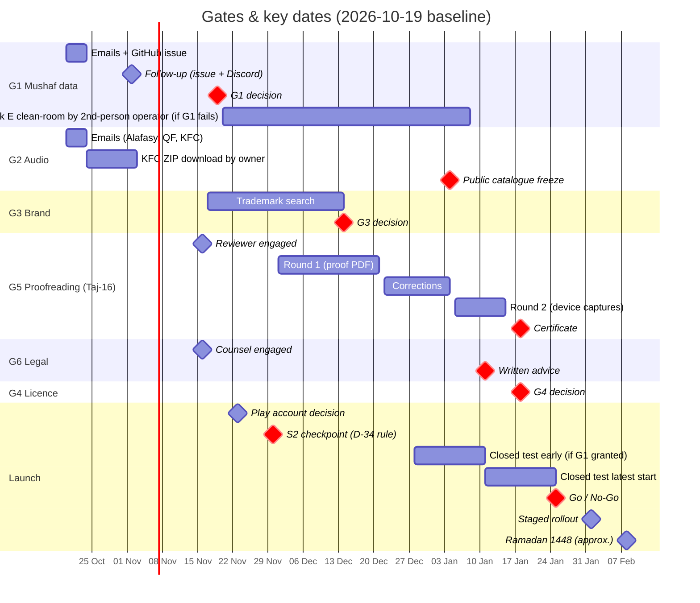

# 12 — Decision Log (ADRs), Gates & Risk Register

**Purpose.** This is the single authoritative record of *why* the Quran app ("Criterion", public brand pending G3) is built the way it is. It holds: one Architecture/Product Decision Record (ADR) per register entry D-01…D-25, plus new ADRs D-26…D-35; the explicit resolution of every contradiction between the 13 research reports; the six launch gates G1–G6 (definition, owner, deadline, evidence, fallback, roadmap impact); the risk register R-01…R-50; and the ranked open questions for the owner, each with the default we apply if no answer comes. Other plan docs reference decisions as D-xx, gates as G1–G6 and risks as R-xx; this doc owns those numbers.

**Status:** Draft v2 — 2026-10-19 (review fixes applied; gate dates aligned to doc 09)

**Key decisions in this doc**
- Confirms D-01…D-25 exactly as in the Decision Register. Statuses, evidence and revisit triggers are recorded per ADR (§2).
- Adds **D-26** OkHttp 5.5.0 everywhere, no Ktor in v1. **D-27** Hijri via `java.time.chrono.HijrahDate` behind doc 04's `HijriCalendar` interface, with ICU `IslamicCalendar` as the runtime fallback. **D-28** audio hosting and hotlinking policy. **D-29** content-eligibility tiers and licence enforcement. **D-30** signed static control plane and key management (Quran text is never changed remotely). **D-31** no generative religious content. **D-32** opt-in crash reports through a small Cloudflare Worker (v1.1; the one exception to "no backend"). **D-33** the shared domain types that doc 04 publishes. **D-34** v1.0 scope and the pre-agreed 2026-11-30 launch rule. **D-35** the G5 certificate binds the text layer.
- Refines D-05 (Fallback 1 measures with `Paint.getRunAdvance`) and corrects the D-07 Para-start wording (Para 1 starts at index 1).
- Records 34 resolved research contradictions (§3).
- Gate calendar (§4; these are doc 09's integrated dates): G1 decision **2026-11-19**; G3 **2026-12-14**; G2 catalogue freeze **2027-01-04**; G6 advice **2027-01-11**; G4 and G5 (Taj-16) **2027-01-18**; closed test opens **2026-12-28** if G1 is granted and the build is ready, otherwise **2027-01-11** at the latest; public **Go/No-Go 2027-01-25**.
- Top risks (score ≥ 15): OEM alarm killing (R-24), v1.0 scope versus a solo developer (R-39), Punjab Act applicability (R-06), gates not cleared before Ramadan (R-41).

---

## 0. Conventions

| Item | Convention |
|---|---|
| Citations | `(r05 §1.4)` means report r05, section 1 (Executive summary), item 4. `§3.n` is Recommendation n. `§4` is Risks/Open questions. Report keys: r01–r09, g01–g04 (paths in shared context). |
| ADR status | **Accepted**: in force. **Accepted — public use pending Gx**: in force for personal/beta builds; public release blocked until gate Gx clears. **Proposed — pending Gx**: our recommendation, not yet binding; Gx decides. **Superseded by D-yy**: kept for history. |
| Changing an ADR | Never edit the Decision text in place. Add a new ADR with `Supersedes D-xx`, set the old one to *Superseded*, and update every doc that cites it in the same PR. Small factual corrections (a version bump inside the same line, a typo) are edited in place with a dated note. |
| Risk scoring | Likelihood L 1–5 (1 = rare, 5 = near-certain) × Impact I 1–5 (1 = cosmetic, 5 = launch-blocking/legal/text-integrity) = Score S. **S ≥ 15 red**: reviewed weekly, a named contingency must be ready. **8–14 amber**: reviewed at each phase gate. **≤ 7 green**: reviewed monthly. |
| Roles | **OWN** = product owner (business, legal, outreach). **DEV** = engineering, i.e. the owner wearing the dev hat plus AI agents (doc 13). **REV** = qualified hafiz/qari reviewer. **LAW** = Pakistani counsel. |
| Review cadence | A 15-minute weekly risk review every Monday (red risks plus gate status), then a full register review at each phase boundary (2026-11-02, 2026-12-21, 2027-01-25, then monthly). |

---

## 1. Decision index

| ID | Decision (short) | Status | Phase | Gate |
|---|---|---|---|---|
| D-01 | Native Android (Kotlin + Compose); pure-Kotlin core, "KMP-ready, Android-only" | Accepted | P0 | — |
| D-02 | Toolchain: AGP 9.4.1 / Gradle 9.8.1 / Kotlin 2.4.21 (lifted) / KSP 2.3.12 / SDK 37-36-24 + library set | Accepted (verified, g04) | P0 | — |
| D-03 | NiA-style modular MVVM/UDF, offline-first, convention plugins | Accepted | P0 | — |
| D-04 | Default mushaf = Indo-Pak 16-line Taj (548 pp, labels 2–549) | Accepted — public use pending G1, G5 | P1 | G1, G5 |
| D-05 | Typeset Compose Canvas renderer, DK IndoPak glyf-TTF, offline-precomputed justification + `cv01` kashida; Fallback 1 measures with `Paint.getRunAdvance` | Accepted (Fallback 1 refined 2026-10-19) | P1 | — |
| D-06 | Mushaf data = QUL resource 11 export + DK MIT token stream, Kufan keys | Accepted — public use pending G1 | P0–P1 | G1 |
| D-07 | Own print-verified Para/Manzil/Ruku/Sajda/Quarter tables | Accepted | P0–P2 | G5 |
| D-08 | Tanzil Uthmani + Simple-Clean for search/copy/share | Accepted | P1 | — |
| D-09 | Bundled Urdu Junagarhi + English Saheeh (QuranEnc); packs; no WBW v1 | Accepted (permission packs pending replies) | P1–P3 | — |
| D-10 | Three storage roles: bundled `quran_content.db`, migrated `user.db`, Ed25519-signed packs | Accepted | P0 | — |
| D-11 | FTS5 unicode61 + trigram over normalized columns; FTS4 fallback | Accepted | P1 | — |
| D-12 | Audio: gapless mp3quran + own validated timing packs; gapped = PENDING; KFC self-hosted | Accepted — public catalogue pending G2 | P1–P2 | G2 |
| D-13 | Media3 `MediaLibraryService` + PlanExpander + PlaybackStateHub | Accepted | P1 | — |
| D-14 | Own OkHttp downloader in UIDT (API 34+) / WorkManager dataSync (≤ 33) | Accepted | P1 | — |
| D-15 | No GMS in core; `play`/`foss` flavors; coarse location; offline cities; Qibla; Hijri | Accepted | P2 | — |
| D-16 | adhan2 prayer times; exact-alarm + `setAlarmClock`; full adhan via mediaPlayback FGS + USAGE_ALARM | Accepted | P2 | — |
| D-17 | Free, no ads ever, no tracking; v1.5 supporter IAP; v2 cost-bearing premium | Accepted | P2–P4 | — |
| D-18 | Clean-room code; repo "all rights reserved"; public licence at G4 | Accepted (licence choice Proposed — pending G4) | P0 → G4 | G4 |
| D-19 | Codename Criterion; public brand at G3 (candidate "Hamdam") | Proposed — pending G3 | P2 | G3 |
| D-20 | Zero third-party SDKs v1; Android vitals; opt-in ACRA v1.1; honest Data safety | Accepted | P1 | — |
| D-21 | English + Urdu UI from MVP; per-app language; mushaf always RTL | Accepted | P1 | — |
| D-22 | Proofreading certificate per layout; report-error SLA; governance policy; legal advice | Accepted | P2 | G5, G6 |
| D-23 | Rotation lock on phones only + page-turn lock; spreads ≥ 600 dp in v1.x | Accepted | P1/P3 | — |
| D-24 | No backend v1; signed static files on Cloudflare R2 + own domain | Accepted | P0–P2 | — |
| D-25 | Phases P0–P4 and Ramadan-1448 launch rule | Accepted — refined by D-34 | all | G1–G6 |
| **D-26** | OkHttp 5.5.0 everywhere; no Ktor in v1 | Accepted (new) | P0 | — |
| **D-27** | Hijri = `java.time.chrono.HijrahDate` (desugared) behind an interface | Accepted (new) | P2 | — |
| **D-28** | Audio hosting & hotlinking policy | Accepted (new) | P1 | G2 |
| **D-29** | Content-eligibility tiers (PERSONAL / BETA / PUBLIC [+MONETIZED]) enforced in CI and at runtime | Accepted (new) | P0 | G1, G2 |
| **D-30** | Signed static control plane; offline Ed25519 key; remote may disable, never rewrite, Quran text | Accepted (new) | P1 | — |
| **D-31** | No generative religious content; AI only for retrieval/recitation, with notices | Accepted (new) | all | — |
| **D-32** | Opt-in crash reports (v1.1) via a Cloudflare Worker → private R2, 90-day retention; the only exception to "no backend" | Accepted (new) | P3 (v1.1) | — |
| **D-33** | Shared domain types (identity types, `PlayScope`, `PlayRequest`, `PlaybackStateHub`/`PlaybackState`, `ReaderKey`) are published by doc 04 and used verbatim | Accepted (new) | P0 | — |
| **D-34** | v1.0 scope (Quran core + compliance floor + Tier A) and the pre-agreed 2026-11-30 launch rule (overrun ≥ 1.3 → Ramadan beta; public v1.0 2027-03-22) | Accepted (new; refines D-25) | P1–P2 | G1 |
| **D-35** | The G5 proofreading certificate binds the text layer (per-page word-position + glyph-run hashes in `certified_pages.json`), not the ornament layer | Accepted (new) | P2 | G5 |

---

## 2. ADR log

### D-01 — Platform: native Android, pure-Kotlin core

- **Status:** Accepted.
- **Context:**
  - The owner wants the app for their own daily use, and the reference app and its 50M+ installs are Android (r01 §1.1).
  - The features that matter most depend on Android platform APIs:
    - Minikin font-feature pass-through for kashida, verified on the 7.0–11 source path (g04 §1.10);
    - Media3 `MediaLibraryService`;
    - UIDT jobs;
    - `setAlarmClock`;
    - Glance.
  - The only permissive Indo-Pak renderers are Flutter apps (Waqar144, MIT), and their data is QUL-derived (g01 §1.2). No permissive Kotlin/Compose Indo-Pak app exists, so we are building the first (r03 §1.9).
- **Decision:**
  - Kotlin + Jetpack Compose, Android only.
  - `:core:model` and `:core:domain` are pure Kotlin with no Android or DI annotations (r07 §3.5).
  - Libraries in core must be KMP-capable where a choice exists (Room 3, kotlinx.*). D-27's `java.time` is a deliberate JVM-only exception, kept behind an interface.
- **Alternatives considered:**
  - **Flutter:** the reuse value is idea-only, because its data is unusable (g01). Platform-specific audio and alarm work would still be needed, and Dart is a second ecosystem.
  - **KMP + Compose Multiplatform for iOS now:** pays the KMP build tax with no iOS demand (r07 §1.10).
  - **React Native:** no advantage for Canvas text shaping.
- **Consequences:**
  - The iOS port, if it ever comes, reuses the model, domain and pipeline outputs. Precomputed glyph positions keep the renderer portable (r07 §3.15).
  - The Android-only APIs live in `:core:audio`, `:core:download`, `:core:prayer`, `:core:notifications` and similar modules (module list: doc 04).
- **Revisit trigger:** the owner decides to fund iOS, or iOS requests become a top-3 theme in reviews or feedback after v1.0.

### D-02 — Toolchain (verified in spike)

- **Status:** Accepted. Verified end-to-end in `spikes/toolchain-spike`: assembleDebug/Release and 12/12 JVM tests pass (g04 §1.1).
- **Context:**
  - The project shipped with AGP 9.2.1 / Kotlin 2.2.10.
  - adhan2 0.0.7 pulls stdlib 2.4.0 (metadata 2.4.0), which Kotlin 2.2 cannot read (g04 §1.2; r08 §1.1).
  - Android Studio Rabbit 1 (2026.2.1) syncs AGP 7.1–9.4 (g04 §1.8).
  - targetSdk 36 has been mandatory on Play since 2026-08-31 (r09 §1.8).
- **Decision:**
  - **Build toolchain:** AGP 9.4.1 · Gradle 9.8.1 · Kotlin 2.4.21 (KGP lifted by the root `alias(libs.plugins.kotlin.jvm) apply false`; fallback 2.3.21; never 2.2.10 while adhan2 0.0.7 is in the graph) · KSP 2.3.12.
  - **SDK levels:** compileSdk 37 · targetSdk 36 · minSdk 24.
  - **Compiler settings:** desugar_jdk_libs 2.1.5 · Java 17 bytecode · R8 on.
  - **UI:** Compose BOM 2026.09.00 (M3 1.4.0; M3 Expressive 1.5 only when stable) · Navigation 3 1.2.0.
  - **DI:** Hilt 2.60.1 + androidx.hilt 1.4.0 (KSP; no kapt).
  - **Persistence:** Room 3.0.3 + sqlite-bundled 2.7.1 (FTS5) · DataStore 1.2.1.
  - **Media and background work:** Media3 1.11.1 · WorkManager 2.12.0 · Glance 1.2.0.
  - **Networking and serialization:** OkHttp 5.5.0 · kotlinx.serialization 1.11.0 · coroutines 1.11.0 (network stack: D-26).
  - **Other:** adhan2 0.0.7 · AboutLibraries.
- **Alternatives considered:**
  - **Pin adhan2 0.0.6** (stdlib 2.2.20) to stay on Kotlin 2.2.10 (r08 §3.1): rejected, because the lift works and 2.2.10 blocks future libraries.
  - **AGP 9.5 alpha:** needs a preview IDE (g04 §1.8).
  - **kapt, Koin, Metro:** Metro is tied to compiler versions (r07 §1.3).
  - **Navigation-Compose 2.x:** Nav3 is stable and its serialisable back stack fits.
  - **minSdk 26:** loses about 0.6% of PK traffic, and desugaring covers `java.time` (r07 §3.13).
- **Consequences:**
  - CI guard: `./gradlew buildEnvironment | grep 'kotlin-gradle-plugin:2.2.10 -> 2.4.21'` (g04 §3.1).
  - A `criterion.android.robolectric` convention plugin carries the JDK flags and the host `libsqliteJni` (g04 §3.8). Never name a test-resource folder `fonts/` (g04 §1.12).
  - Exclude `DebugProbesKt.bin` from release packaging.
  - Ship AABs, not universal APKs (g04 §3.11).
- **Revisit trigger:**
  - Stable Studio supports AGP 9.5.
  - A Kotlin 2.4 metadata failure appears with Hilt or KSP.
  - M3 1.5 goes stable.
  - Play announces the targetSdk 37 deadline (about Aug 2027, unverified; r09 §3.14).

### D-03 — Architecture

- **Status:** Accepted.
- **Context:**
  - The developer is solo and works with AI agents (D-25), so module boundaries must be machine-checkable.
  - The NiA blueprint fits: about 22 modules is the upper bound (r07 §1.10–11, §4).
  - Room types leaked through `api(room3-runtime)` in the spike (g04 §3.7).
- **Decision:**
  - MVVM/UDF: one immutable `UiState` per ViewModel as a `StateFlow` (`WhileSubscribed(5_000)`).
  - Offline-first repositories, a typed `AppError`, and injected dispatchers.
  - Features never depend on features. `NavKey`s live in `:core:navigation`.
  - `QuranContentDb` is `internal` to `:core:content` and is exposed only as `ContentRepository`.
  - Start lean (about 10–12 modules), split as code grows, and target about 15–22 by v1.0. Exact module list: doc 04.
- **Alternatives considered:**
  - **Single module:** fast to start, but boundaries erode under agent-written code.
  - **MVI frameworks (Orbit, Mavericks):** an extra dependency for little gain.
  - **Full Clean with use-case-per-call:** ceremony without benefit at this size.
- **Consequences:** a build check fails on feature→feature dependencies. Convention plugins in `build-logic`.
- **Revisit trigger:**
  - Clean build exceeds about 4 min, or incremental builds exceed 30 s on the dev machine.
  - The module count passes 25.
  - An iOS decision is taken (D-01).

### D-04 — Default mushaf: Indo-Pak 16-line Taj Company

- **Status:** Accepted. Public use is pending **G1** (data permission) and **G5** (proofreading certificate).
- **Context:**
  - The owner described "~13 lines", but the screenshot they referenced, the developer's website and the reviews all show a **16-line** scan (r01 §1.2, §4; r02 §1.2).
  - QUL "Indopak 16 lines – Taj company" has 548 pages (r04 §1.1).
  - g02 settled pagination on the archive.org Taj print: printed label = QUL index + 1 on every page. Verified on about 25 headers, all 114 surah-index entries and all 15 sajda-table entries. Labels run 2–549, and printed p.1 is the title page (g02 §1.2).
  - The reference app's Juz index uses printed labels: 2, 21, 39, 57, … (g02 §1.3).
  - Huffaz ask for 15-line, and large-print readers want 13-line (r02 §1.2, §1.7).
- **Decision:**
  - Default = 16-line Taj, `MushafId.INDOPAK_16_TAJ` (code `indopak16_taj`, numeric id 1; doc 04 §5). Store `page_index` 1–548 and derive `page_label = page_index + 1` per mushaf via `page_label_offset` (Taj-16 = +1). **Every user-facing number is a label**: toolbar, Go-to, bookmarks, indexes, share text.
  - 15-line Hafizi (610 pp) and 13-line Taj (847 pp) come in v1.x (F-RD-11, P3); Madani 604 pp in v2.
  - Each layout needs its own data permission, offset verification and G5 certificate before public release.
- **Alternatives considered:**
  - **13-line default:** contradicts the owner's own screenshot.
  - **Ship 16 + 15 + 13 + Madani in the v1 APK** (r04 §3.2): rejected for v1. Each layout costs only about 0.1 MB, but each needs permission plus a full hafiz proofreading pass (G5), which v1.0's schedule cannot absorb. The 15- and 13-line offsets are also unverified (g02 §3.1).
- **Consequences:**
  - The renderer, indexes, khatam and audio "play Page" all key on `(mushafId, page_index)`.
  - The onboarding mushaf picker (F-PL-01) shows one option in v1.0.
- **Revisit trigger:**
  - The owner's checkpoint photos (p.2, 39, 70, 115, 483; g02 §4) show a different printing.
  - Hifz users in beta overwhelmingly request 15-line, which would pull F-RD-11 earlier.

### D-05 — Rendering: typeset, never scans

- **Status:** Accepted.
- **Context:**
  - Scans have no ayah coordinates. That is the root cause of the reference app's missing tap, highlight and sync features, its blurry zoom and its poor night mode (r01 §1.3; r04 §1.6).
  - No openly licensed Indo-Pak scan set exists, and the Taj print asserts copyright (g02 §1.1).
  - The font-based prototype of p.50 is hard to tell apart from a Taj print, at 1–3 MB versus 48–81 MB for images (r04 §1.3).
  - Minikin disables `liga`/`clig` above 0.03 em letter-spacing. `StaticLayout`/`Justify` never justify a paragraph's last line (r04 §1.7).
  - `cv01=N` kashida passes verbatim through Paint → Minikin → HarfBuzz on API 24–37 at source level. Measured: الْكِتٰبُ 2060 → 2847/3615/4384/6691 at cv01 = 1/2/3/6 (g04 §1.10).
  - Two traps (g04 §1.11):
    - QUL's CDN `DigitalKhattIndoPak.otf` has **no** cv features;
    - Android 7.0/8.0 ship FreeType 2.6.0/2.7.1, and CFF2 needs ≥ 2.8.
- **Decision:**
  - **Font:** DK IndoPak (OFL 1.1) from the digitalkhatt.org repo `ClientApp/src/assets/fonts/hb/indopak.otf` @ `4213fab`, shipped as a pipeline-regenerated glyf TTF (about 1.63 MB, identical widths).
  - **Layout:** the pipeline precomputes per-word x-fractions plus `cv01` values ≤ 3 steps. The device draws `Canvas.drawTextRun` per word and calls `Paint.setFontFeatureSettings("'cv01' N")` only on stretched words, because any feature string bypasses Minikin's cache.
  - **Layers:** furniture/ornaments; text (own `graphicsLayer`); highlight/selection.
  - **Fallback order:**
    1. Runtime inter-word fitting, measured with `Paint.getRunAdvance` on the same Paint that draws, so there is a single shaping path. *(Refined 2026-10-19: this ADR originally named `TextMeasurer`; doc 05 §O-1 measures with the drawing Paint instead.)*
    2. Self-generated page images plus a word-box DB from our own pipeline.
  - **Ornaments:** commissioned original vector art.
- **Alternatives considered:**
  - **Third-party scans:** no licence, no mapping.
  - **QuranWBW "AlQuran IndoPak" font:** the most familiar look, but "NOT FOR … DISTRIBUTION … WITHOUT WRITTEN NOTICE". It is a permission request only (r04 §1.5).
  - **KFGQPC Nastaleeq:** "cannot be Modified", so no subsetting or conversion. Kept out of v1 (r03 §4.8).
  - **NDK HarfBuzz:** unnecessary given the verified feature path.
  - **Runtime shrink-to-fit per line** (QuranApp style): non-deterministic and slower on low-end phones.
- **Consequences:**
  - The P0 device smoke test is mandatory: one API 24/25 device and one API 26/27 device, checking `getRunAdvance` 2060/2847/4384 at cv01 0/1/3 (g04 §3.10).
  - Roborazzi page goldens. A runtime re-measure per line when drift exceeds 0.5% (r04 §4).
- **Revisit trigger:**
  - The smoke test fails on API 24–27. That moves those API levels to Fallback 1.
  - Field misrender reports concentrate on one OEM or API level.
  - The DK upstream changes lookup order or alternate counts (pinned hash diff).
  - QuranWBW grants its font (then add it as an optional style).

### D-06 — Mushaf data source and canonical word table

- **Status:** Accepted. Public use is pending **G1**.
- **Context:**
  - No openly licensed 16-line layout exists. Every candidate traces to QUL mushaf 7 / resource 11, whose copyright page reads "We don't have copyright information for this resource" (g01 §1.1).
  - Waqar144's "MIT" layout matches QUL on 547/548 pages and its author credits QUL. QuranApp is the same data under GPL (g01 §1.2–3).
  - DK's MIT text is a transform of QUL's Indo-Pak Nastaleeq (QuranWBW/Ayman Siddiqui) encoding (g01 §1.4).
  - DK has 83,669 tokens and QUL has 83,668. They map 1:1 except 72:16 (QUL w1 = DK t1–2). Only 3 skeleton differences exist, and line fit is 99.99% (g01 §1.5–6).
  - Fatiha: the Taj print has 7 empty circles including the basmala, and the «۵» after عليهم is a non-Kufan end. DK's numbering differs (g02 §1.4).
  - QUL p.529 lists the basmala before the S79 header (g01 §1.8).
  - Self-derivation matched only 42.9% of line starts. A clean-room build needs about 4,500 corrections, 40–60 h plus 15–20 h hafiz QA (g01 §1.9).
- **Decision:**
  - **Data sources:**
    - Layout from the QUL resource 11 SQLite export, downloaded with the owner's free account and shipped publicly only after Tarteel/QUL's written permission (G1).
    - Canonical word table = the DK token stream keyed to Kufan verse keys 1..6236 (1:1 = basmala), with the 72:16 merge rule.
    - Whitelist {4:112:3, 18:19:34, 59:13:1}; 59:13 and 27:21 go to hafiz review.
  - **Markers and pipeline fixes:**
    - `ayah_marker`: 6,236 ends + 118 «۵» glyph-only marks, never boundaries. It is layout-independent and lives in `quran_content.db` with the `word` table (doc 04). The mushaf pack holds only layout-specific data: marker and word positions, plus the Taj Fatiha `ayah_display_override`.
    - Taj-faithful Fatiha override.
    - p.529 fix and index-1 sar-lauh remap in the pipeline (g02 §3.9).
  - **QA-only data:** Waqar144, QuranApp and any preview-scraped data are QA oracles only, kept on the dev machine and never in the repo, assets or CI artefacts. Delete them once G1 resolves (g01 §3.2).
  - **Credits:** QUL/Tarteel, DigitalKhatt (Amine Anane) and QuranWBW/Ayman Siddiqui in Credits (F-PL-04).
- **Alternatives considered:**
  - **QUL Indo-Pak Nastaleeq text with its own font** (r05 §3.7): the font is QuranWBW-licensed (❌), and the PUA encoding is font-bound.
  - **Waqar144 MIT data** (r03 §4.1): the licence cannot cover QUL-derived data.
  - **Scraping QUL previews:** conflicts with Tarteel ToS "shall not copy the Services".
  - **Clean-room from day 1:** 55–80 h that permission would save. It stays the G1 fallback.
- **Consequences:**
  - Audio (everyayah `SSSAAA`, mp3quran timings), translations and Tanzil metadata stay exact on Kufan keys. Only display labels differ, in Fatiha.
  - Every new QUL export is diffed with `align.py` and SHA-pinned (g01 §3.9).
- **Revisit trigger:**
  - Tarteel replies.
  - The 2026-11-19 deadline passes (→ fallback E, §4 G1).
  - Upstream QUL edits a page.
  - The hafiz rules on 59:13.

### D-07 — Indexing metadata (own curated tables)

- **Status:** Accepted. The 53 unverified quarter marks must be hand-checked before G5.
- **Context:**
  - **Paras:** QF/Tanzil `juz_number` is Madani. The Indo-Pak Paras differ at 7 boundaries, verified on the 16-line layout and against GTAF (r05 §1.4).
  - **Ruku:** 556 (Tanzil) versus 558 (QF/QUL). The Taj print confirms 558: ع at 26:51/26:68, plus separate rukus ending 28:82 and 31:30. The ruku triple decodes as surah-ruku / ayah-count / para-ruku: numbered in the Para where the ruku ends, with Fatiha excluded; 29/29 sampled marks match (g02 §1.5–6). r05's rukus-per-Para column is wrong for 18/30 Paras (g02 §1.7).
  - **Quarters:** quarter marks do **not** follow Madani rub; only 28/90 coincide. Waqar's list was 34/37 correct (g02 §1.9).
  - **Sajda:** 14 numbered sajdas (including 38:24) plus 22:77 Shafi'i-only (g02 §1.10).
  - **Manzil:** the footer «منزل N» gives the manzil of the page's last ayah (g02 §1.11).
- **Decision:**
  - **Para:** Indo-Pak Para table (P4 3:92, P7 5:83, P11 9:94, P14 15:2, P20 27:60, P21 29:45, P23 36:22). Para 1 starts at page_index 1 (label 2); Para n (2–28) starts at page_index 18n−16 (label 18n−15); P29 at 508, P30 at 528; traditional names. *(Corrected 2026-10-19: the earlier wording "Para n (1–28) at 18n−16" gave index 2 for Para 1; g01 §2.8.)*
  - **Manzil:** 7 Manzils starting at surahs 1, 5, 10, 17, 26, 37, 50.
  - **Ruku:** 558 rukus with `para_ruku` NULL for Fatiha. By-end counts per Para: 16,16,17,14,17,14,19,17,18,17,16,16,19,22,21,17,17,17,19,16,19,18,17,19,20,18,20,20,22,39.
  - **Sajda:** `sajda(print_no, kind)` with 22:77 labelled «السجدة عند الامام الشافعی رح».
  - **Quarters:** 90 `para_quarter` rows seeded from Waqar with corrections: P4 ¾ = 3:198; P7 ¼ = 5:113; P7 ¾ = 6:73 after word 10. Includes `word_pos` and `verified_source`. Fix Waqar's ruku 56:40 → 56:38.
  - **Madani:** juz/hizb/rub only in Madani mode (v2).
  - This one Para table drives indexes, headers, khatam progress and "Play Para" audio ranges.
- **Alternatives considered:**
  - **Tanzil `quran-data.js` juz/ruku:** Madani juz, 556 rukus.
  - **Deriving quarters from Madani rub:** falsified (g02).
  - **Tanzil's 15 sajdas with obligatory/recommended labels:** non-Hanafi classification (r05 §1.6).
- **Consequences:**
  - Invariant tests: 30 Para starts; rukus sum to 558 and match the per-Para counts; 7 Manzil starts; 15 sajda rows.
  - "Jump to quarter" for P7 ¾ starts at 6:73 (word 11 if word-seek exists; otherwise the ayah start with a note).
- **Revisit trigger:**
  - The owner's own copy disagrees at a checkpoint page.
  - A verified user error report.
  - Adding a new layout (re-verify markers against that print).

### D-08 — Text for search, copy and share

- **Status:** Accepted.
- **Context:**
  - The Indo-Pak display text is font-bound: PUA medallions, U+202E in 1:7, waqf marks. It is not interoperable (r05 §1.7; g01 §4).
  - Tanzil Uthmani and Simple-Clean are CC BY 3.0, verbatim only (r05 §1.2).
- **Decision:**
  - Copy/share emits **Tanzil Uthmani**, verbatim, with reference "Surah:Ayah" and attribution.
  - Search normalizes **Simple-Clean**, Uthmani and Indo-Pak columns (D-11).
  - One defensive sanitizer strips private-use and bidi/control characters from every outgoing string (copy, share, search query, TTS, accessibility labels), whatever the source.
  - Share-as-image (F-CP-10) renders our Indo-Pak glyphs to a bitmap.
- **Alternatives considered:**
  - **Copy the DK Indo-Pak text:** garbles without the font, and DK is not a citation standard.
  - **QF/quran.com text:** QF terms ban prepackaging (r05 §1.1).
- **Consequences:**
  - The Tanzil SHA-256 is pinned. The pipeline never edits Tanzil strings: the verbatim rule is checked by a hash test.
- **Revisit trigger:** users request "copy as Indo-Pak", in which case add it as an opt-in with a sanitized DK string and a font note.

### D-09 — Translations

- **Status:** Accepted. Permission-dependent packs ship as replies arrive.
- **Context:**
  - QuranEnc allows republishing under 7 conditions (verbatim, attribution, version, keep updated, no inappropriate ads) with **no** non-commercial clause (r05 §1.2).
  - Tanzil translation files are "non-commercial only", even for public-domain works. That is contract risk, not copyright risk (r05 §1.3, §4).
  - QuranEnc's Junagarhi edition includes the Ahsan-ul-Bayan footnotes, 4.35 MB (r05 §1.12).
  - Word-by-word (WBW) has no clean licence: QuranWBW prohibits copying (r05 §1.9).
  - The Clear Quran requires prior written consent. Maududi is © until 2029 in PK (r09 §1.5).
- **Decision:**
  - **Bundled:** Urdu Junagarhi with Ahsan-ul-Bayan footnotes (the "tafsir summary", F-RD-13) and English Saheeh International credited "Noor International Center". Both from QuranEnc, verbatim. "(n)" prefixes are not stripped without QuranEnc consent.
  - **Downloadable packs (P2):**
    - Jalandhari (Tanzil file, flagged non-commercial);
    - Kanz-ul-Iman (PD work; its Tanzil file is flagged non-commercial too, see D-29);
    - Pickthall (PD);
    - Hilali-Khan;
    - Hindi, Indonesian and Turkish (QuranEnc);
    - Bangla: QuranEnc if an edition is available at build time; otherwise Tanzil `bn.bengali`, which is non-commercial (`commercialOk = false`, D-29). r05 found no QuranEnc Bangla edition.
  - **Permission requests:** Maududi, Taqi Usmani, Tahir-ul-Qadri, Israr Ahmad, The Clear Quran, QuranWBW, and the Ibn Kathir / Ma'ariful Qur'an publishers.
  - **Never shipped:** no WBW in v1, and no QF API content in bundled data.
  - **Display rule:** Arabic is always shown with any translation.
- **Alternatives considered:**
  - **Bundle Jalandhari as the default Urdu** (r05 §3.2): rejected as the *bundled* default. Its Tanzil source is NC, which would contaminate the base APK for the v1.5 IAP. Junagarhi is commercially safe and adds the tafsir summary.
  - **QF Content Sync via a backend:** violates D-24 (no backend v1).
  - **WBW in personal builds** (r05 §1.9): rejected to keep a single code path; F-RD-14 stays P4.
- **Consequences:**
  - Junagarhi is associated with an Ahl-e-Hadith readership (r05 §3.2), which creates sectarian-perception risk (R-37). v1.0 keeps this bundle only. The translator picker (F-TR-03) and the first packs (F-TR-02: Kanz-ul-Iman, Jalandhari) ship in **v1.1 (2027-03-22)** (D-34). The residual risk window 2027-02-01 → 03-22 is recorded in R-37.
  - A monthly CI job checks QuranEnc versions (the "keep updated" condition).
- **Revisit trigger:**
  - Any permission reply.
  - A QuranEnc version bump.
  - Tanzil grants commercial use.
  - The commercial-content audit before v1.5 (D-17).

### D-10 — Content storage: three roles

- **Status:** Accepted.
- **Context:**
  - Room re-copies a prepackaged asset destructively when the version is bumped (r07 §1.5).
  - With a matching `room_master_table`, Room checks **only the identity hash** and skips schema validation (g04 §1.5).
  - Packs isolate licences and let downloads survive content upgrades (r05 §3.9).
- **Decision:**
  1. **`quran_content.db`**, read-only and bundled via `createFromAsset`.
     - Built by the Python pipeline, which executes Room's exported `createSql`, `contentSyncTriggers` and `setupQueries` verbatim, then runs `rebuild`/`optimize`, sets `user_version`, and runs `VACUUM`.
     - Replaced destructively when the content version is bumped.
     - CI also opens a no-master-table copy, to force `onValidateSchema`.
  2. **`user.db`**, with tested migrations. It references content only by stable keys: Kufan verse key, `(mushafId, page_index)`, para number. Schema v1 is frozen on 2026-12-21 and already holds every P1 and P2 table, so the Ramadan release needs no migration; P3 tables arrive as the v2 migration (doc 04 owns the schema).
  3. **Packs** (translation, tafsir, layout, timing, fonts) as separate SQLite or files, listed in an `index.json` with a detached Ed25519 `.sig` (D-30). Each entry carries sha256, size, licence, attribution, eligibility flags (D-29) and a kill-switch. Every SQLite pack has a `pack_info` table and is built from its Room-exported schema. The one exception is timing packs: plain SQLite read with androidx.sqlite and no Room identity table (doc 06).
- **Alternatives considered:**
  - **One DB with migrations:** every content fix becomes a migration, and licences mix.
  - **Play Asset Delivery:** Play-only, which locks out `foss` (r07 §3.17).
  - **Downloading the content DB on first run:** breaks offline first launch.
- **Consequences:**
  - A Quran-text fix means a content-version bump and therefore an **app update**; it never comes through a remote patch (D-30).
  - Bookmarks survive because they hold no content row IDs.
- **Revisit trigger:**
  - The base AAB exceeds 30 MB download size.
  - A need for out-of-band text fixes (which is rejected by D-30; it would need a new ADR).

### D-11 — Search

- **Status:** Accepted.
- **Context:**
  - The spike measured FTS5: الرحمن returns 45 hits; trigram رحم returns 201; prefix and explicit `AND` work; SQLite 3.50.1 on every API level (g04 §1.4).
  - API 24 ships SQLite 3.9.2 without FTS5. FTS4 also lacks explicit `AND` and trigram (g04 §1.6).
  - Normalization across 3 Arabic columns hit all 13 test queries (r05 §1.11).
  - unicode61 strips diacritics only for Latin (r07 §3.7).
- **Decision:**
  - FTS5 external-content tables: **unicode61** (words) + **trigram** (substrings).
  - Columns: Arabic in three normalized forms (imla'i/simple-clean, Uthmani, Indo-Pak); Urdu (keeps ے/ھ distinct); English (ASCII-folded).
  - The same normalizer runs on queries. An alias table covers names such as "Yaseen", "Ayatul Kursi" and "Manzil dua". Raw tashkeel is never indexed.
- **Alternatives considered:**
  - **FTS4 on framework SQLite** (r05 §3.10): no native lib and a 4.4 MB versus 10.2 MB universal APK, but per-device SQLite variance, no AND and no trigram. It is the named fallback with Room 2.8.5.
  - **Our own LIKE scans:** too slow on low-end devices.
- **Consequences:**
  - About 1.25–1.3 MB of `.so` per ABI, plus about 1.2 MB of trigram index (g04 §1.6). Re-evaluate trigram after search UX testing; dropping it keeps FTS5.
- **Revisit trigger:**
  - A Room 3 regression (→ fallback).
  - The trigram index exceeds 2 MB, or users never use substring results.

### D-12 — Audio sources

- **Status:** Accepted. The public catalogue is pending **G2**.
- **Context:**
  - **mp3quran.net:** the only host with a written grant ("we allow any visitor or developer to copy any material or use any link"), written to serve as app-store evidence (g03 §1.1).
  - **islamic.network:** downgraded. Its terms "are not evidence of any explicit authorization" (g03 §1.2).
  - **QUL audio:** 130/130 resources have no licence (g03 §1.3).
  - **King Fahd Complex (KFC):** offers recordings "for free general use", but the site is geo-blocked from our egress (g03 §1.4).
  - **Alafasy Berhad:** asserts rights (g03 §1.5).
  - **Shamshad Ali Khan Urdu:** © Hi-Tech Music 1998 (g03 §1.6).
  - **Timing validation:**
    - 342/342 files pass for the priority reads;
    - read 51 has a surah-9 off-by-one;
    - read 74 fails everywhere;
    - read 53 is 32 kbps / 11 kHz (g03 §1.7, §1.10).
  - **Edits differ between hosts:** QUL and mp3quran serve different edits for Alafasy and Abdul Basit Mujawwad (g03 §1.9).
- **Decision:**
  - **Default public layout:** gapless per-surah mp3quran MP3s plus our offline-validated timing packs (ETag/size-checked, per-surah highlight kill-switch). Archive the host statement with date and SHA-256.
  - **v1 shortlist with highlighting:**
    - Alafasy (123, default)
    - Ghamdi (30)
    - Abdul Basit Mujawwad (51, s9 relabel)
    - Sudais (54)
    - Shatri (4)
    - Hani Ar-Rifai (89)
    - Muhammad Ayyub (109)
    - Khalid Al-Muhanna (159)
  - **Highlighting off in faulty surahs:** Husary (118), Minshawi (112), Shuraim (31), Yasser Ad-Dosari (92).
  - **Never** use reads 74 or 53 for timing. **Never** pair timing and audio from different hosts.
  - **Gapped** everyayah/islamic.network = `PENDING` → personal/beta only.
  - **KFC recordings** (Huthaify, Maher, Ayyub, Muhanna, Akhdar) are self-hosted on R2 after the owner downloads them and the permission email is sent.
  - **Personal only:** Shamshad Ali Khan Urdu, Husary Muallim, Qari Sadaqat Ali.
  - **No reciter photos.**
- **Alternatives considered:**
  - **Gapped everyayah Alafasy as the default** (r06 §3.5): no rights evidence.
  - **quranicaudio:** "personal use only".
  - **QDC/QF audio:** 1-week storage cap; client secret must stay server-side.
  - **QUL Ghamdi at 128 kbps:** same recording, but awaiting Tarteel.
- **Consequences:**
  - Downloads are per surah; verse-by-verse public mode waits for G2.
  - The weekly CI re-validation (about 1,400 requests per read) diffs ETags (g03 §3.10).
  - Ghamdi via mp3quran is 96 kbps / 22.05 kHz, 1.07 GB (g03 §3.4).
- **Revisit trigger:**
  - Any rights-holder reply or objection.
  - An ETag/size change.
  - The KFC licence text is obtained.
  - Forced-alignment timings for Pakistani qaris (v1.x).

### D-13 — Playback engine

- **Status:** Accepted.
- **Context:**
  - Media3 1.11.1 (2026-09-10) has every primitive we need: `ClippingConfiguration`, `PlayerMessage`, `setPauseAtEndOfMediaItems`, session resumption (r06 §1.7).
  - Plan sizes: a gapped Para is ≤ 601 items, a gapless Para ≤ 37 clipped items, and a gapped full Quran 6,348 items (r06 §1.8, §4).
  - Android 17 silences background audio without a visible activity or a non-shortService FGS (r06 §1.10).
  - Para audio was the reference app's most-requested missing audio feature (r01 §1.4).
- **Decision:** as in the register.
  - **Engine:** `MediaLibraryService` + ExoPlayer. `PlanExpander(PlayRequest)` covers every `PlayScope` (D-33): Surah, Para (**Indo-Pak table**), Manzil, Ruku, Page, Range, Ayah, FromHere ("play from here"), Passage (multi-range) and Quran.
  - **Layouts:** gapless via clipping; gapped via per-ayah items.
  - **Follow-along:** PlayerMessages plus binary search after seeks feed a process-wide `PlaybackStateHub` StateFlow, which drives the highlight and the auto page-turn. Auto page-turn is suspended for 8 s after the user touches the pager.
  - **Repeat and timers:**
    - ayah ×N;
    - range ×M/∞;
    - pause-after-ayah, fixed or proportional;
    - speed 0.5–2×;
    - sleep timer with fade-out, by minutes or at the end of the ayah, surah or para.
  - **Audio settings:** `FLAG_ENABLE_CONSTANT_BITRATE_SEEKING`; `USAGE_MEDIA` + `CONTENT_TYPE_SPEECH`; pause, don't duck (duck is opt-in).
  - **User-initiated only:** playback starts only from user actions.
  - **Basmala strategy per surah:** none for S9; Fatiha's 1:1 *is* the basmala.
  - **Later:** Android Auto and word-level highlighting in v1.x.
- **Alternatives considered:**
  - **Position polling** (quran_android): less precise and costlier than PlayerMessages.
  - **Madani juz for "Play Para":** wrong at 7 boundaries (D-07).
  - **MediaPlayer:** no gapless clipping.
- **Consequences:**
  - The plan is built in a lazy window for very long gapped plans (R-27).
  - Highlighting maps through Kufan keys, so Fatiha's display numbering never desynchronizes it (g03 §4).
- **Revisit trigger:**
  - Media3 2.x API changes.
  - A Media3 release pins OkHttp 4 strictly (D-26).
  - targetSdk 37 adoption (WIU FGS rules).

### D-14 — Downloads host

- **Status:** Accepted.
- **Context:**
  - Android 15 caps `dataSync` FGS at 6 h per 24 h in the background.
  - Android 16 lets long-running workers exhaust the job quota and recommends **UIDT** for user-triggered transfers (r06 §1.9).
  - Play reviewers prefer UIDT over a `dataSync` FGS where possible (r09 §1.8).
  - r07 proposed WorkManager-only (r07 §1.6).
  - UIDT has no Jetpack wrapper, which adds about 3 days (r06 §3.8).
- **Decision:**
  - **Our own OkHttp downloader:** HTTP Range resume, `.part` file plus atomic rename, MD5/SHA-256 verification, per-surah ZIP support.
  - **Hosts:** a UIDT job on API 34+, and a WorkManager long-running `dataSync` foreground worker on API ≤ 33.
  - **Defaults:** Wi-Fi only, with a storage manager.
  - **Storage:** files under `getExternalFilesDirs` plus `.nomedia`.
  - **Streaming:** Media3 `SimpleCache` (LRU 256 MB) is for streaming only.
- **Alternatives considered:**
  - **WorkManager-only** (r07): quota and timeout exposure on API 34+.
  - **Media3 `DownloadManager`:** no per-surah ZIPs, MD5 manifests or exportable plain files.
  - **System `DownloadManager`:** poor resume and verification control.
- **Consequences:**
  - Two host adapters around one `DownloadEngine` interface, tested on API 33 and 34+ emulators.
  - Sequencing (doc 09): the P1 personal build uses the WorkManager worker on every API level. The UIDT host lands in S5, before any build leaves the owner's device.
  - Play Console FGS declarations: `dataSync` (≤ 33 path) and `mediaPlayback`.
- **Revisit trigger:** Jetpack ships a UIDT wrapper, or Play changes the UIDT/FGS policy.

### D-15 — No Google Play Services in core; location, Qibla, Hijri

- **Status:** Accepted.
- **Context:**
  - **Location:** coarse location changes Qibla by < 0.07° and prayer times by seconds for a 3 km error. Coarse-only also avoids Play's location-button rule from 2027-01-27 (r08 §1.4).
  - **City list:** GeoNames cities15000 (CC BY 4.0) has 34,173 cities, 372 of them in PK, with Urdu names; about 1.5 MB zipped (r08 §1.4).
  - **Hijri:** PK runs about UQ −1 at present (r08 §1.6).
  - **Distribution:** a no-GMS core keeps F-Droid and Huawei viable (r07 §1.7).
- **Decision:**
  - **Flavors:** dimension `distribution` = `play` | `foss` (crossed with the `tier` dimension of D-29; wiring in doc 04). Play-only extras (in-app review and update; later Billing and Firebase) live only in `play`.
  - **Location:** `ACCESS_COARSE_LOCATION`, one-shot, via `LocationManagerCompat`, plus an offline city picker.
  - **Qibla:** adhan2 bearing + `TYPE_ROTATION_VECTOR` (with fallbacks) + `GeomagneticField` declination.
  - **Hijri:** see D-27.
- **Alternatives considered:**
  - **Fused Location Provider:** GMS dependency.
  - **Fine location:** no accuracy benefit; policy exposure.
  - **Online geocoding:** privacy and offline failures.
- **Consequences:**
  - CI builds both flavors and fails if a GMS artifact appears in `foss`.
  - The WMM-2020 table in AOSP is ≤ 0.14° off in PK, which is acceptable (r08 §1.5).
- **Revisit trigger:** a Play policy change for coarse location, or a decision to ship on F-Droid (G4).

### D-16 — Prayer times and adhan

- **Status:** Accepted.
- **Context:**
  - **The reference app:** missed adhans and silent mode being overridden are its top prayer complaints (r01 §1.10).
  - **Pakistan's device mix:** about 62% of PK devices come from aggressive-killing OEMs (Transsion 25.5%, Vivo, Xiaomi, Oppo, realme) (r08 §1.2).
  - **Play policy:** restricts `USE_EXACT_ALARM` to alarm and calendar apps (r09 §1.8).
  - **Android 17:** requires an FGS for background audio; for API 37, WIU applies unless the app has exact-alarm permission and plays `USAGE_ALARM` (r08 §1.3).
  - **Reports disagree on the playback path:**
    - r07 §1.8 offered "USAGE_ALARM with exact-alarm permission **or** a WIU FGS";
    - r08 §3.3 specified a mediaPlayback FGS with `USAGE_ALARM`.
- **Decision:** adopt r08's path.
  - **Calculation:** adhan2 0.0.7. PK defaults: Karachi + Hanafi, with an onboarding Asr choice. Per-prayer offsets and region presets.
  - **Scheduling:**
    - `SCHEDULE_EXACT_ALARM` with an explainer, plus an inexact fallback (the UI states that adhan may be late);
    - `setAlarmClock()` for audible adhans;
    - reschedule on boot, time, timezone and permission changes, plus a daily WorkManager safety net.
  - **Playback:**
    - the full adhan plays from a `mediaPlayback` FGS with `USAGE_ALARM`, and the **app** enforces silent/DND respect;
    - the short adhan plays as a channel sound.
  - **Never:** `USE_EXACT_ALARM`, `ACCESS_NOTIFICATION_POLICY`, `REQUEST_IGNORE_BATTERY_OPTIMIZATIONS`, or full-screen intents in v1.
  - **Health check:** an in-app Adhan health check with DontKillMyApp guidance (CC-BY).
  - **Recordings:** commission a Pakistani muezzin's recordings, plus 1–2 CC0 fallbacks.
- **Alternatives considered:**
  - **A battery-optimization exemption request** (r07 §4): policy-review risk.
  - **`USE_EXACT_ALARM`:** policy violation.
  - **A notification sound for the full adhan:** truncated, and not controllable.
- **Consequences:**
  - A launch-blocking device matrix that includes Infinix/Tecno (R-24).
  - Release: the adhan (F-CP-02, including full adhan and the health check) ships in **v1.1** by default. It enters v1.0 only if the freelancer lever is pulled at the 2026-11-30 checkpoint (D-34).
  - Golden tests for times (the spike verified 2026-10-19 Karachi: Fajr 05:16 … Isha 19:18; g04 §1.9).
- **Revisit trigger:**
  - Play narrows `SCHEDULE_EXACT_ALARM`.
  - targetSdk 37 adoption.
  - Health-check telemetry (local only) or beta reports show more than 5% missed adhans on one OEM.

### D-17 — Business model

- **Status:** Accepted.
- **Context:**
  - **Ads drive the complaints:** 53% of recent 1–2★ reviews of the reference app cite ads (r01 §1.7). Ad complaints run 50–53% for ad-based PK competitors, versus 2–6% for ad-free ones (r02 §1.5).
  - **What users accept:** optional one-time "support" purchases and Sadqa-e-Jaria framing (r02 §1.6).
  - **Licences:**
    - Tanzil translations and quranicaudio are NC;
    - QuranEnc forbids "inappropriate advertisements" (r09 §1.3);
    - the Muaalem QML licence bans ads app-wide (r08 §1.9).
  - **Donations:** in-app donation links are risky; AnkiDroid was blocked in Sep 2026 (r09 §1.11).
- **Decision:**
  - **Free forever:** no ads ever and no tracking SDKs. Reading, listening, indexes and downloads are free forever.
  - **v1.5:** an optional "Support / Sadqa-e-Jaria" one-time IAP (`play` flavor only), only after a commercial-content audit.
  - **v2:** premium only for features with running costs (sync, AI hifz), with a financial-aid path.
  - **Enforcement:** every pack carries licence flags, and CI blocks NC content in any monetized build (D-29).
- **Alternatives considered:**
  - **Ads**, even "halal-filtered": AdMob category blocking is best-effort only (r02 §1.5).
  - **Subscriptions for core reading:** resented.
  - **In-app donation links:** policy-opaque.
- **Consequences:**
  - Running costs must stay about $1–5/month (D-24).
  - Before the v1.5 IAP, every NC item must be removed or relicensed in the monetized build.
- **Revisit trigger:**
  - Monthly costs exceed $25.
  - Supporter revenue covers costs, which would allow AI or sync investment.
  - A content licensor asks for terms that are incompatible with this model.

### D-18 — Code licensing: clean-room

- **Status:** Accepted for clean-room and "all rights reserved". The public licence is **Proposed — pending G4**.
- **Context:**
  - quran_android is GPL-3 and asks for non-profit use. QuranApp is GPL (r03 §1.1, §1.5).
  - quran-ios QuranKit and LinePageGeometryEngine are Apache-2.0 and portable with attribution (r03 §1.3). FSRS-Kotlin is MIT (r08 §1.8).
  - r09 recommends GPL-3.0-or-later for trust, F-Droid and DMCA leverage (r09 §1.12). r03 recommends clean-room in any case.
- **Decision:**
  - Never copy or transliterate GPL code. Read it for ideas only, and record any idea source in the PR description.
  - Apache/MIT ports keep their headers and a NOTICE.
  - The repo stays "all rights reserved".
  - The public licence is chosen at G4. **Our recommendation:** GPL-3.0-or-later for the client, plus `TRADEMARKS.md` and DCO, unless the owner wants B2B or white-label deals. **Default if the owner is silent:** remain proprietary for v1.0, because GPL cannot be withdrawn from versions already released.
- **Alternatives considered:**
  - **Fork quran_android:** Madani-only public modules; a 2,029-line View/RxJava `PagerActivity`; GPL (r03 §1.1).
  - **Use GPL QuranApp code under GPL:** saves a few weeks, but forecloses the proprietary option early.
- **Consequences:**
  - AI agents get a standing instruction never to fetch or paste from GPL repos (doc 13).
  - AboutLibraries plus NOTICE files.
  - GPL-compatible dependency set: Apache-2.0, MIT and OFL fonts as separate works.
- **Revisit trigger:** G4 (2027-01-18), or an F-Droid distribution request.

### D-19 — Brand

- **Status:** Proposed — pending **G3**.
- **Context:**
  - "Criterion" has zero search relevance in PK and collides with existing marks (r09 §1.2).
  - Play's Impersonation, IP and Repetitive Content policies forbid reusing the reference app's name or assets (r09 §1.1).
  - r09 drafted the title "Hamdam: Quran **13** Line & Audio". That is corrected to **16 Line** to match D-04 and the PK search term "16 line quran" (r02 §1.11).
- **Decision:**
  - "Criterion" is the codename, and the package `com.chughtai.criterion` is permanent.
  - The public brand is set at G3 after IPO-Pakistan, WIPO and USPTO searches. Working candidate: "Hamdam" (ہمدم).
  - Title pattern: `<Brand>: Quran 16 Line & Audio` plus the bilingual القرآن الكريم.
  - Never reuse the reference app's name, icon, screenshots, description or assets. Never use "Official", reciter names or KFGQPC/Saudi logos.
- **Alternatives considered:**
  - **Criterion as the public brand:** no relevance, plus collisions.
  - **Generic "Quran Pak":** not protectable, and crowded.
- **Consequences:**
  - All brand strings sit in one resource file (`brand_name`), so a late rename costs strings and assets only.
  - Keep a design-provenance log as evidence against copying claims (r09 §4.10).
- **Revisit trigger:** a G3 search conflict, or an objection after filing.

### D-20 — Privacy

- **Status:** Accepted.
- **Context:**
  - The reference app declares "No data collected" while bundling AdMob, AppsFlyer and Firebase (r01 §1.8).
  - Reading history is religious, special-category data (r09 §1.10).
  - Android vitals needs no SDK (r09 §1.10).
  - Auto Backup allows 25 MB and is E2E-encrypted on Android 9+ (r08 §1.11).
- **Decision:**
  - Zero third-party SDKs in v1. Play Android vitals covers crashes and ANRs.
  - Opt-in ACRA crash reports in v1.1 (F-PL-09), sent to our own Cloudflare Worker (D-32).
  - Data safety: "No data collected".
  - Auto Backup covers only `user.db` and settings, excluding audio and packs. JSON export/import goes through SAF.
  - Optional "Sign in with Quran.com" (QF User APIs, public PKCE client) in v1.x.
  - Reading history never leaves the device otherwise.
  - CI blocks the `com.google.android.gms.permission.AD_ID` permission and any analytics artifact in the merged manifest.
- **Alternatives considered:**
  - **Firebase Crashlytics or Analytics:** contradicts the Data safety form and adds GMS.
  - **Sentry:** a third-party processor.
  - **Self-hosted analytics:** needs a backend (D-24).
- **Consequences:**
  - No product analytics. Decisions rely on reviews, beta feedback, and opt-in surveys outside the app.
  - The privacy policy on our domain lists every network host (r09 §3.10).
- **Revisit trigger:** v1.1 ACRA, the v1.x QF sync launch, or Firebase group khatam (Data safety must be updated before any of these ship).

### D-21 — Localization

- **Status:** Accepted.
- **Context:** the audience is Urdu-first, including elderly users. App Bundle language splits would break the in-app language picker (r07 §1.9). The approach uses AppCompat per-app locales (r07 §3.14).
- **Decision:**
  - English and Urdu UI from the MVP, using Noto Nastaliq Urdu (OFL).
  - Per-app language via `AppCompatDelegate.setApplicationLocales`, `generateLocaleConfig`, and language splits disabled.
  - The mushaf is always RTL, whatever the UI locale.
  - Roman Urdu in v1.x.
- **Alternatives considered:**
  - **English-first, Urdu later:** retrofit cost.
  - **System locale only:** many PK phones run an English system locale.
- **Consequences:**
  - Every string in `values/` and `values-ur/` from day 1, with a lint check for missing Urdu strings.
  - Nastaliq line-height tokens in the design system (doc 02).
- **Revisit trigger:** Arabic, Hindi or Bangla UI demand in beta.

### D-22 — Compliance and content governance

- **Status:** Accepted.
- **Context:**
  - **Punjab Holy Quran (Printing & Recording) Act 2011:**
    - s.5(3): error-free text certified by a qualified person;
    - s.5(6): translations shown with the Arabic text;
    - penalties of up to 3 years (r09 §1.7).
  - **Enforcement precedent:**
    - PTA had Google remove an "unauthentic" Quran app (r09 §1.7);
    - a Lahore High Court order required Quran Board approval for internet publishing (r02 §1.10).
  - **Text-error reviews:** 26–36% of negative reviews of low-quality clones concern zer/zabar or missing words (r02 §1.10).
  - **Families policy:** child-directed visuals pull an app into the Families policy (r08 §1.12).
- **Decision:**
  - **Before public release (G5):** a qualified hafiz/qari proofreads every page of each layout and signs a dated certificate, shown in Credits.
  - **Report text error (F-PL-05), with an SLA:**
    - triage ≤ 24 h;
    - a signed notice or kill-switch flag for the affected page or ayah within ≤ 48 h (D-30);
    - a corrected build submitted within ≤ 72 h of confirmation;
    - the reporter acknowledged within ≤ 72 h.
  - **Translations:** no translation-only mode.
  - **Written content-governance policy:**
    - recognized scholars only;
    - a sect-balanced Urdu set;
    - Shia options labelled and opt-in;
    - no Ahmadi translations or tafsir;
    - a provenance log.
  - **Legal:** Pakistani legal advice (G6).
  - **Audience:** 13+, with age-neutral visuals.
  - **Play account:** prefer an Organization account (free D-U-N-S), decided by **2026-11-23**; otherwise a personal account plus a closed test of 12 testers × 14 days.
- **Alternatives considered:**
  - **Rely on source quality alone:** not acceptable, given the legal and reputational stakes.
  - **Seek Quran Board approval proactively for v1:** timeline unknown. G6 decides whether it is required.
- **Consequences:**
  - The release checklist (doc 11) blocks without the certificate, the content-DB SHA-256 and the `certified_pages.json` hash named on it (D-35).
  - Any Arabic or layout change after certification needs a delta proof plus a certificate addendum.
- **Revisit trigger:** a G6 opinion, a PTA or Quran Board notice, or the first confirmed text error.

### D-23 — Orientation

- **Status:** Accepted.
- **Context:**
  - At targetSdk 36, Android 16 ignores orientation locks on sw ≥ 600dp, and the opt-out ends at API 37 (r04 §1.12; r07 §1.8).
  - Orientation lock is one of the reference app's top asks (about 5k votes) (r01 §1.10).
- **Decision:**
  - Rotation lock on phones only; the control is hidden at ≥ 600 dp.
  - A page-turn lock everywhere.
  - Two-page RTL spread on ≥ 600 dp and foldables in v1.x (F-RD-10).
  - No resizability opt-out.
- **Alternatives considered:** `android:resizeableActivity=false` or `screenOrientation` on all devices, which the platform ignores or which will be removed.
- **Consequences:** single-page layouts must look acceptable on tablets in v1.0 (letterboxed page, centred).
- **Revisit trigger:** targetSdk 37 adoption, or tablet share above 5% in vitals.

### D-24 — Hosting

- **Status:** Accepted.
- **Context:**
  - R2 costs $0.015/GB-month after 10 GB free, with $0 egress. About 70 GB costs about $1/month (r06 §1.12; r09 §1.11).
  - The Supabase free tier pauses after one week of inactivity (r08 §1.11).
  - Firebase Spark is enough for group features.
  - Cloudflare's CDN terms on audio name "Paid Services". Whether R2 is covered is inferred (r06 §3.11).
- **Decision:**
  - No app backend in v1.
  - Static, signed files on **Cloudflare R2 + custom domain**: `catalogue.json`, pack `index.json`, packs, timing packs, the PK month-start feed.
  - Permitted audio is self-hosted on R2, with original hosts as fallback mirrors where the permission covers them.
  - Firebase (`play` only) solely for realtime Group Khatam in v1.x.
  - No Supabase free tier.
- **Alternatives considered:**
  - **GitHub Pages or Releases:** bandwidth terms and no custom cache control for audio.
  - **Our own VPS:** ops burden.
  - **Cloudflare Workers backend for QF Content Sync:** deferred (D-09).
- **Consequences:**
  - The domain must be registered in P0, since it is needed for the privacy policy and file hosting.
  - R2 bucket layout and cache headers: doc 04/06.
  - **Exception:** the v1.1 opt-in crash-report Worker (D-32) is the only server-side code. It stores nothing but consented crash reports.
- **Revisit trigger:**
  - A Cloudflare terms clarification on audio.
  - Monthly egress-related cost above $10.
  - Group khatam goes realtime.

### D-25 — Phases and dates

- **Status:** Accepted. Refined by **D-34** (v1.0 scope, closed-test opening and the 2026-11-30 launch rule).
- **Context:**
  - Solo developer with AI agents, at about 30–35 productive hours a week.
  - Ramadan 1448 (≈ 8–9 Feb 2027) is the peak install season in PK (r08 §3.10).
  - A personal account needs a closed test of 12 testers × 14 days (r09 §1.9).
- **Decision:**
  - **P0 Foundations:** 2026-10-20 → 11-02.
  - **P1 Personal MVP:** 11-03 → 12-21. The owner uses it daily from 12-21.
  - **P2 v1.0 Public:** 12-22 → ~2027-02-01. The closed test starts ≤ 2027-01-11. Staged rollout before Ramadan, **only if G1–G6 have cleared**; otherwise closed testers through Ramadan and public after.
  - **P3 v1.x:** Feb–Jun 2027.
  - **P4 v2:** H2 2027.
  - The scope-cut ladder lives in doc 09.
- **Alternatives considered:**
  - **Public launch at P1:** gates cannot clear by December.
  - **Skip companion features for Ramadan:** loses the daily-habit pull and the Sehri/Iftar demand (r01 §1.6).
- **Consequences:** the gate calendar in §4. **Go/No-Go review on 2027-01-25.**
- **Revisit trigger:**
  - Any red-risk realisation (§5).
  - Two consecutive weeks below 25 productive hours.
  - The G1 fallback is triggered.

### D-26 — HTTP and JSON stack: OkHttp 5.5.0 everywhere, no Ktor in v1 (new)

- **Status:** Accepted.
- **Context:**
  - r06 §3.1 said to pin OkHttp 4.12.x, because Media3's OkHttp module compiles against it.
  - The spike proved that Media3's `OkHttpDataSource` performs full and **Range** reads on OkHttp 5.5.0 at runtime. Gradle upgrades Media3's 4.12 dependency automatically. Forcing 4.12 breaks source, because `Response.body` is nullable in 4.x (g04 §1.7).
  - Ktor 3.6.0 builds and runs, but it is optional at about 5 JSON endpoints and adds dex weight (g04 §3.6; r07 §3.9 "Medium").
- **Decision:**
  - One Hilt-singleton `OkHttpClient` (OkHttp 5.5.0) shared by Media3, the downloader and the JSON fetchers.
  - JSON = kotlinx.serialization over plain OkHttp calls inside small typed clients in `:core:network`.
  - Tests use `mockwebserver3`.
  - Network calls carry a descriptive User-Agent `<Brand>/<version> (Android; +https://<domain>/about)`.
- **Alternatives considered:**
  - **OkHttp 4.12** (r06): forced downgrade plus source churn.
  - **Ktor 3.6.0 on the OkHttp engine** (r07, g04): works, but it is unneeded weight for v1's handful of static JSON files.
  - **Retrofit:** annotations and reflection without benefit for static files.
- **Consequences:**
  - Watch the Media3 release notes for a `strictly 4.x` constraint (g04 §4).
  - The JSON surface: `catalogue.json`, `index.json`, timing manifests, the PK month-start feed, `killswitch`/notice documents (D-30).
- **Revisit trigger:**
  - The JSON or API surface exceeds about 10 endpoints, or authenticated APIs arrive: QF User API sync (F-BM-07) may justify Ktor or AppAuth.
  - KMP networking becomes necessary (D-01).

### D-27 — Hijri API: `java.time.chrono.HijrahDate` (new)

- **Status:** Accepted.
- **Context:**
  - r07 §1.7 chose `android.icu.util.IslamicCalendar` with `ISLAMIC_UMALQURA` (API 24).
  - r08 §1.6 chose `HijrahDate`, which is "Fully implemented" through desugaring on minSdk 24. Its Umm al-Qura validity is about 1300–1600 AH (unverified).
  - The spike confirmed desugaring is live: 12,243 `j$/time` references and 0 `java/time` (g04 §1.9).
- **Decision:**
  - `HijriCalendar` interface in `:core:domain` (doc 04 owns the name). Default implementation = `HijrahDate.from(LocalDate)` (Umm al-Qura).
  - Runtime fallback to ICU `android.icu.util.IslamicCalendar` (`ISLAMIC_UMALQURA`) if `HijrahDate` throws or fails the device check. The P0 device check runs on a physical API 24/25 phone (R-49).
  - `effectiveHijri = signedPkOverride ?: HijrahDate.from(civilDate + userOffset)`, with `userOffset ∈ {−2..+2}` and the day rolling over at Maghrib (computed with adhan2).
  - The signed PK month-start feed (D-30) overrides individual month starts.
- **Alternatives considered:** ICU `IslamicCalendar`. Equally available on API 24, but it is an Android framework class: plain-JVM unit tests would need Robolectric, and it does not compose with the `java.time`/kotlinx-datetime types adhan2 already uses. We keep it as a drop-in alternative behind the interface.
- **Consequences:**
  - Pure-JVM golden tests for 1447–1449 month starts (UQ) and the offset and Maghrib-rollover rules.
  - CI asserts that desugaring remains enabled.
- **Revisit trigger:** a golden-test disagreement between HijrahDate and the published UQ tables, or a desugaring regression.

### D-28 — Audio hosting and hotlinking policy (new)

- **Status:** Accepted. It defines what G2 must evidence.
- **Context:**
  - r03 §1.10: never hotlink quran.com, quran.app or quranicaudio from a monetised app. quran_android calls it "stealing" bandwidth.
  - r06 §3.2: stream from the hosts now, and email before a public release.
  - g03: mp3quran is the only host whose written grant explicitly covers developers linking. islamic.network declines to confirm rights.
  - The reference app hotlinks quranicaudio and mp3quran while paywalling reciters (r06 §1.2).
- **Decision:**
  1. **Public builds** may stream or download directly only from:
     - (a) hosts with an archived written grant: mp3quran.net (statement archived with date and SHA-256);
     - (b) our own R2, for rows with written producer or rights-holder permission (KFC, or any later grant).
  2. **Never in public builds:**
     - `quranicaudio.com` / `download.quranicaudio.com` ("personal use only");
     - QF/QDC audio hosts (1-week storage cap);
     - `audio-cdn.tarteel.ai` (no licence);
     - archive.org rips.
  3. **PENDING hosts** (everyayah, islamic.network mirrors) are allowed in **PERSONAL and BETA** tiers only (D-29), until permission arrives.
  4. **Every catalogue row carries:**
     - `licenceStatus` (D-29);
     - `basis`: the evidence reference (provenance log);
     - attribution text plus a link-back;
     - ordered mirrors (only those the permission covers);
     - a per-row kill-switch;
     - a per-surah highlight kill-switch.
  5. **Timings** always come from the same host and file as the audio, verified by ETag/size guard. A mismatch disables the highlight for that surah, never playback.
  6. **Good-citizen behaviour:** user-initiated fetches only; no bulk prefetch beyond what the user requested; honour HTTP caching; descriptive User-Agent (D-26); obey any host's removal request within 48 h via the kill-switch.
  7. **Reciter photos are never used.**
- **Alternatives considered:**
  - **Self-host everything immediately** (r03): only lawful where we hold permission.
  - **Hotlink everything like the reference app:** violates the host terms and takedown hygiene.
- **Consequences:** a public build can always fall back to the mp3quran-only catalogue. This is the G2 floor.
- **Revisit trigger:** any permission reply, any host terms change, or a host outage longer than 72 h (R-31).

### D-29 — Content-eligibility tiers and licence enforcement (new)

- **Status:** Accepted.
- **Context:**
  - The research consistently splits content into personal-OK, free-public-OK and commercial-OK (r05 §1.3; r06 §1.1; r09 §1.3; g03).
  - D-10 requires "build-eligibility flags".
  - D-17 requires CI to block NC content in monetized builds.
  - Tanzil-sourced files of PD works (Jalandhari, Kanz-ul-Iman) are **contractually NC** even though the works are PD. r09 treated them as "PD classics" without that caveat (r05 §4 versus r09 §1.5).
- **Decision:**
  - **Tiers:** every build has `BuildConfig.CONTENT_TIER ∈ {PERSONAL, BETA, PUBLIC}` and `BuildConfig.MONETIZED: Boolean` (true only for `play` builds that carry Billing, from v1.5). Wiring (doc 04 §11):
    - personal-tier flavor → PERSONAL;
    - public-tier flavor → BETA by default (closed testing);
    - public-tier flavor built with `-Pcriterion.release=production` → PUBLIC, which requires G1 and G5 evidence;
    - `-Pcriterion.monetized=true` → MONETIZED (`play` only, v1.5+).
    - Pipeline profiles and remote channels use the same names: `personal` (never uploaded to R2), `beta`, `public`.
  - **Licence status:** every content item (bundled asset, pack, catalogue row, timing pack, font) declares `licenceStatus` (5 values, below), a free-text `basis` (the evidence, e.g. "mp3quran host statement archived 2026-10-20, SHA-256 …") and the tiers it is eligible for (field names: doc 04 for packs, doc 06 for catalogue rows).
    - **PERMITTED:** written rights-holder or producer permission, or a licence that clearly allows our use (CC BY, OFL, MIT, PD with a clean source).
    - **HOST_GRANT:** an archived written host statement (mp3quran).
    - **PENDING:** host terms allow free-app use, there is no rights evidence, and a request has been sent.
    - **PERSONAL_ONLY:** owner's device only.
    - **REVOKED.**
  - **`commercialOk: Boolean`** is false for anything with an NC clause, including every Tanzil translation file (Jalandhari, Kanz-ul-Iman, `bn.bengali`) whatever the PD status of the work.

| Tier | Allowed `licenceStatus` | Extra rule |
|---|---|---|
| PERSONAL (owner's device, internal sideload) | all except REVOKED | Pre-G1 QUL export allowed (private use, g01 §3.7). |
| BETA (closed testing track) | PERMITTED, HOST_GRANT, PENDING | Mushaf data must be G1-cleared **or** clean-room; a "pre-release — proofreading in progress" banner until G5. |
| PUBLIC (production) | PERMITTED, HOST_GRANT | G1 and G5 for each shipped layout. |
| PUBLIC + MONETIZED | PERMITTED, HOST_GRANT **and** `commercialOk = true` | Commercial-content audit signed before the first monetized release. |

  - **Enforcement:**
    - (1) `verifyContentEligibility` (Gradle; the pipeline runs the same check) fails the build if any bundled asset is ineligible for the build's tier, and, for PUBLIC, if G1 evidence or the G5 `certified_pages.json` hashes (D-35) are missing.
    - (2) The app filters remote `catalogue.json` and `index.json` entries by tier and flags at runtime.
    - (3) CI fails if any item lacks `licence`, `attribution`, `licenceStatus` or `basis` (r09 §3.13).
- **Alternatives considered:** separate "personal" source branches, which drift; manual release checklists only, which are error-prone with agents writing code.
- **Consequences:**
  - The owner's daily build legitimately includes Shamshad Ali Khan Urdu, Sadaqat Ali and gapped everyayah.
  - Public builds automatically exclude them.
  - The v1.5 IAP cannot ship while any default-enabled item has `commercialOk = false`.
- **Revisit trigger:** a new licence category appears, or the v1.5 audit.

### D-30 — Signed static control plane and key management (new)

- **Status:** Accepted.
- **Context:**
  - D-10, D-12, D-15 and D-22 rely on remotely updated, signed documents: the pack index, the audio catalogue with kill-switches, timing guards, the PK month-start feed and text-error notices.
  - Losing or leaking the signing key would either freeze operations or let an attacker push content changes.
  - Quran text integrity is legally and religiously critical (D-22).
- **Decision:**
  - **Signing and keys:**
    - Ed25519 detached signatures: each `X.json` has a sibling `X.json.sig` (base64 of the signature over the exact file bytes; no canonicalization; doc 04 §7.6). They are made with an **offline** private key held by OWN: password manager plus an encrypted offline backup.
    - CI never holds the private key. CI produces artefacts and a validation report; the owner signs and uploads them with a `tools/publish` script (doc 08).
    - The app embeds **two** public keys (primary plus pre-generated backup) and accepts a document signed by either. Rotation = sign a `keyset.json` with the old key, then ship the new backup key in the next app release.
  - **Document safety rules:**
    - Each document carries a schema version, `sequence` (monotonic; reject rollback), a generation time and an expiry (exact field names: doc 04 §7.6).
    - Unsigned, invalid or older documents are ignored, and the app keeps the last good copy or the bundled defaults.
  - **What the control plane may do:** disable or hide catalogue rows and packs; disable highlighting per surah; add new packs and timing packs (these still need hash-verified files); publish Hijri month starts; show a scoped notice on a page or ayah through `notices.json` (F-PL-11; e.g. "an error has been reported here; correction coming").
  - **What it may never do:** modify or insert Quran text, change layout data, or enable content that is ineligible for the build's tier (D-29).
- **Alternatives considered:**
  - **HTTPS only, no signatures:** domain or CDN compromise would equal content compromise.
  - **A CI-held key:** a larger attack surface.
  - **Remote text patching:** rejected. Text changes go through the full G5 delta proof plus an app update.
- **Consequences:**
  - The text-error SLA (D-22) is met with a signed notice (≤ 48 h) plus a corrected build submitted (≤ 72 h). Any errata table in a mushaf pack (e.g. `word_override`) is applied only at build time from the pack bundled in the APK, never by a remote update.
  - The owner commits to a monthly Hijri feed publication of about 5 minutes (R-33).
- **Revisit trigger:** key compromise or loss (R-32), or a move to a backend in v1.x/v2.

### D-31 — No generative religious content; AI policy (new)

- **Status:** Accepted.
- **Context:**
  - r08 §3.13 bans generative religious content: retrieval only, with citations.
  - AI recitation checking is a gated v2 bet. Wrongly flagging correct recitation is a religious-UX harm; models and licences are messy, and Muaalem's QML bans ads app-wide (r08 §1.9, §3.12).
  - The build itself uses AI coding agents (D-25, doc 13).
- **Decision:**
  1. The app never generates tafsir, rulings, translations or summaries with an LLM.
  2. Topic and semantic search (F-SR-04, P3) is **retrieval-only** over QUL topics or on-device embeddings, and always cites its source.
  3. AI recitation follow-along (F-CP-14, v2) ships only after the P3 sherpa-onnx spike passes: ≤ 0.5 false alarms/min and acceptable recall on Pakistani learners. It always shows an AI-advisory notice, never claims tajweed grading unless validated, and keeps audio on-device.
  4. **Content provenance for agents:**
     - AI agents may write code and tests;
     - they must never author, transliterate, "fix" or generate Quran text, translations, Para, ruku or quarter positions, or any religious content;
     - all content enters only through the pipeline from pinned, hashed sources, or via REV-verified manual tables with `verified_source`.
- **Alternatives considered:** an LLM "ask about this ayah" chat, rejected for accuracy and sectarian risk; and Muaalem server models, considered only if the app is permanently ad-free and the QML terms are accepted.
- **Consequences:** doc 13 carries this as a hard rule. Code review checks that diffs to content tables come from the pipeline.
- **Revisit trigger:** scholar-reviewed, licensed AI content with a provenance chain becomes available, or the AI spike results arrive (P3).

### D-32 — Opt-in crash reports through our own Cloudflare Worker (new)

- **Status:** Accepted for v1.1 (F-PL-09). It is the only exception to D-24's "no app backend".
- **Context:**
  - D-20 promises opt-in ACRA crash reports in v1.1, but ACRA needs somewhere to send them.
  - Android vitals covers Play installs only. It sees nothing from `foss` or sideloaded personal builds, and it gives aggregate stack traces without the app's own context (content version, tier).
  - `acra-mail` depends on the user's mail app, exposes the user's email address, and gives us no retention control.
  - Third-party processors (Sentry, Crashlytics) contradict D-20 and the Data safety answers.
  - Doc 11 §7 already drafts the v1.1 Data safety disclosure on this basis: crash logs and diagnostics, optional, 90-day deletion.
- **Decision:**
  - ACRA shows a consent dialog on each crash. Only on consent does `HttpSender` POST the report to `https://crash.<domain>/r`.
  - The endpoint is a small Cloudflare Worker. It drops the client IP, enforces a size and schema limit, and writes the JSON to a **private R2 bucket** with a **90-day** lifecycle rule. It does nothing else: no accounts, no analytics, no other routes.
  - The dialog shows a report ID that the user can quote to have the report deleted.
  - An ACRA `ReportField` allowlist keeps reading position, bookmarks, location, account data and unfiltered logcat out of every payload.
  - Off by default, in both flavors. The Data safety form and the privacy policy are updated before the v1.1 release.
- **Alternatives considered:**
  - **`acra-mail`:** user friction, address exposure, no retention control.
  - **Sentry or Firebase Crashlytics:** third-party processor and GMS (D-20).
  - **Vitals only:** blind to `foss` builds and to content-version context.
- **Consequences:**
  - The repo gains its first server-side code (the Worker plus its deploy script). OWN deploys it with the same offline discipline as D-30, and no CI job holds deploy credentials.
  - Expected cost is within Cloudflare's free tier (verify at deploy time).
  - D-20 and D-24 cite this ADR. Doc 04 shows the Worker in its system context; doc 10 tests the consent gate and the field allowlist; doc 11 owns the disclosure text.
- **Revisit trigger:** report volume beyond the free tier; any request to add analytics or other routes to the Worker, which needs a new ADR.

### D-33 — Shared domain types are published by doc 04 (new)

- **Status:** Accepted.
- **Context:**
  - The first drafts of docs 02, 05, 06 and 07 each invented their own names for the same concepts: `AyahKey` versus `VerseKey`, `NowPlaying` versus a hub state, three different `ReaderKey` shapes, and a separate `:core:audio-api` module.
  - AI agents (doc 13) copy whatever name the spec in front of them uses, so diverging names become diverging code.
- **Decision:** doc 04 §5 is the single source for these types, and every other doc uses them verbatim.
  - **Identity types:**
    - `VerseKey` (Kufan; `id()` 1..6236), `SurahId`, `ParaId` (Indo-Pak), `ManzilId`, `RukuId` (1..558);
    - `MushafId` enum with code plus numeric id: `INDOPAK_16_TAJ("indopak16_taj", 1)`, `INDOPAK_15_HAFIZI("indopak15_hafizi", 2)`, `INDOPAK_13_TAJ("indopak13_taj", 3)`, `MADANI_15("madani15", 4)`;
    - `PageIndex` versus `PageLabel` (label = index + the mushaf's offset, converted in one place);
    - `AyahRange(from, to)` and `RecitationId` (string; ID format owned by doc 06).
    - There is no `AyahKey` and no raw `Int` id in a public API.
  - **Playback:** `PlayScope` = Surah | Para | Manzil | Ruku | Page | Range | Ayah | FromHere(start, until) | Passage(ranges, title) | Quran, with `Until` defaulting to CONTINUOUS. `PlayRequest`, `RepeatSpec` and `PauseRule` as in doc 04.
  - **State:** `PlaybackStateHub` exposes one `state: StateFlow<PlaybackState>` and `events: SharedFlow<PlaybackEvent>` (`AyahCompleted`, `PlanEnded`, `Error`). `PlaybackController.state` is the hub's state.
  - **Navigation:** `ReaderKey(mushaf, page, focus, mode, autoplay)`. All fields are optional, and all null means "resume".
  - Interfaces live in `:core:domain` and implementations in the doc 04 modules. There is no `:core:audio-api`.
- **Alternatives considered:** each spec owning its own slice of the types. Rejected, because it is exactly what produced the drift.
- **Consequences:**
  - Docs 02, 05, 06, 07, 10 and 13 cite doc 04 §5 rather than restating signatures.
  - A type change is made first in doc 04 and then propagated in the same PR (§0 rule).
  - `VerseKey` keys user data, audio timing and the highlight alike, so Fatiha's display numbering can never desynchronize them (D-06).
- **Revisit trigger:** a feature needs a type that doc 04 lacks; a KMP move (D-01).

### D-34 — v1.0 scope and the pre-agreed 2026-11-30 launch rule (new; refines D-25)

- **Status:** Accepted. Refines D-25; D-25's phase dates and gate rule stand.
- **Context:**
  - The full D-25 scope is about 100 ideal days (id) against about 80 id of capacity to v1.0 (doc 09 §4).
  - By the spec docs' own estimates (02, 04, 05, 06, 07, 08, 10), the Quran core alone is about 90–110 id. The plan of record has about 54 id for it, which holds only if an AI-assistance factor of about 0.6× is real. That factor is unproven (R-39).
  - Ramadan 1448 starts around 2027-02-08. A public launch needs G1–G6 cleared and, on a personal Play account, 12 testers × 14 days plus Google's review before 2027-02-01.
  - A late scope decision costs the most. A rule agreed in advance avoids an emotional call in January.
- **Decision:**
  - **v1.0 (public, staged rollout from 2027-02-01):**
    - the Quran core: every P1 feature;
    - the compliance floor: report-error (F-PL-05), signed notices (F-PL-11), signed catalogue override and kill-switches (D-30), the PK month-start feed, credits and certificates;
    - Tier A companion: prayer times with Sehri/Iftar (F-CP-01), Hijri plus the PK feed (F-CP-04), Ramadan core (F-CP-07), the khatam planner with a Taraweeh preset (F-BM-04).
  - **v1.0 stretch** (cut first; ladder rungs L1–L4): F-RD-13, F-IX-07, tasbeeh (F-CP-05), the Manzil-dua part of F-CP-06, and the rating prompt (F-PL-10, otherwise v1.1).
  - **v1.1 (2027-03-22) by default:**
    - adhan, including the full adhan and health check (F-CP-02), unless the freelancer lever is pulled;
    - Qibla (F-CP-03), azkar (F-CP-06), widgets (F-CP-08), reminders (F-CP-09), share-image (F-CP-10), the group-khatam sheet (F-CP-11);
    - notes (F-BM-03), streaks (F-BM-05), JSON export (F-BM-06);
    - translation packs and the translator picker (F-TR-02/03);
    - auto-scroll (F-RD-09), page curl (F-RD-12), public Urdu interleave (F-AU-10), launcher shortcuts (F-PL-12), the pack half of F-PL-06.
  - **P1 daily-use build (2026-12-21)** need not include search (F-SR-01..03), gapped mode and repeat (F-AU-04/05) or the full Urdu strings. Those land in S5–S7, before the closed test.
  - **Closed test:** opens **2026-12-28** if G1 is granted and the build is ready, otherwise **2027-01-11** at the latest. It carries only G1-cleared or clean-room mushaf data (D-29). The store listing (EN/UR text, content rating, Data safety, privacy-policy URL) is complete before the first closed-test release.
  - **Launch rule, applied at the S2 checkpoint on 2026-11-30:**
    - Compute the overrun ratio = actual ÷ planned effort for S0–S2.
    - If the ratio is **≥ 1.3**, or G1 was not granted on 2026-11-19 and the clean-room track is not on schedule: Ramadan 1448 becomes a **closed-test/beta release** (owner, family and testers; personal and beta builds). The **public v1.0 moves to 2027-03-22**, merged with the v1.1 scope.
    - If the ratio is **< 1.3**: continue with the Ramadan public plan.
    - The freelancer lever (doc 09) is decided the same day.
  - The Go/No-Go on 2027-01-25 still applies the gate rule of D-25 and §4.2.
- **Alternatives considered:**
  - **Keep the full P2 companion set for Ramadan:** does not fit capacity (R-39).
  - **Decide at Go/No-Go only:** too late to re-plan or hire.
  - **Ship adhan in v1.0 without the device matrix:** a missed adhan in Ramadan does more harm than no adhan (R-24).
- **Consequences:**
  - Docs 01, 02, 07 and 11 label features "v1.0 / v1.0 stretch / v1.1" to match. Doc 11's v1.0 store listing claims only v1.0 features.
  - Doc 09 keeps the estimate-reconciliation table and the checkpoint arithmetic. README states the rule.
  - The sectarian-default risk window (R-37) runs 2027-02-01 → 03-22.
- **Revisit trigger:** the 2026-11-16 or 2026-11-30 checkpoints; G1 outcome on 2026-11-19; the freelancer decision.

### D-35 — The G5 certificate binds the text layer (new)

- **Status:** Accepted.
- **Context:**
  - D-22 binds the certificate to the content-DB SHA-256. But what the reader sees also depends on the mushaf pack, the font and the renderer. A pack or font change can move words without touching the content DB.
  - The commissioned ornaments arrive late (designer final by 2026-12-31). If the certificate bound the whole rendered page, every ornament tweak would void it.
  - Doc 09 plans hafiz round 2 on device-rendered page captures, not only on the pipeline PDF.
- **Decision:**
  - The certificate names the content-DB version and SHA-256, the mushaf pack id, version and SHA-256, the font SHA-256, and the SHA-256 of **`certified_pages.json`**.
  - `certified_pages.json` lists, for every page, a hash of the **text layer**: word positions and glyph runs. Docs 05 and 08 define the exact hash inputs. The furniture and ornament layer is excluded.
  - Any change to a page's text-layer hash needs a delta re-review and a certificate addendum. An ornament-only change needs a visual check only.
  - CI refuses a PUBLIC build if any packaged page's text-layer hash is missing from `certified_pages.json` (doc 10 release gate; D-29 `verifyContentEligibility`).
  - Final ornaments are integrated by the end of S5 (2027-01-04), so that hafiz round 2 (2027-01-05 → 01-15) sees the shipping look on device captures.
- **Alternatives considered:**
  - **Bind to the content-DB SHA-256 only:** misses layout, font and renderer changes.
  - **Bind to whole-page bitmap hashes:** fragile across devices and anti-aliasing, and voided by any ornament tweak.
- **Consequences:** docs 05 and 08 emit per-page text-layer hashes; doc 10 enforces them; doc 11's release checklist names the `certified_pages.json` hash.
- **Revisit trigger:** a font or renderer upgrade that changes glyph runs on every page (full re-proof); G6 advice requiring a different certificate form.

---

## 3. Resolved research contradictions

Each row records which source we followed and why. Reports are not edited; this table is the correction of record.

| # | Topic | Conflict | Resolution (ADR) | Basis |
|---|---|---|---|---|
| C-01 | Default line count | The owner said "~13 lines"; the referenced screenshot, the dev site and the reviews show 16-line. | **16-line Taj** (D-04) | r01 §1.2, r02 §1.2, r04 §1.1 |
| C-02 | Page numbering | r01 had "Juz 2 = p.21" versus QUL p.20; r01 §2.5 said "app numbers ≠ printed". | **label = QUL index + 1** (2–549); r01 §2.5 withdrawn (D-04) | g02 §1.2–3 |
| C-03 | Indo-Pak text and font | r05 §3.7: QUL Indo-Pak Nastaleeq text with its own font. r04: DK font + DK MIT text. | **DK MIT token stream + DK font**; QuranWBW font not shipped; upstream credited (D-05, D-06) | g01 §1.4–5, r04 §1.5 |
| C-04 | DK font file | QUL CDN `DigitalKhattIndoPak.otf` versus the digitalkhatt.org repo `hb/indopak.otf` | **Repo build @ 4213fab** (the CDN file has no cv features), converted CFF2 → glyf | g04 §1.11 |
| C-05 | Fatiha numbering | DK numbers الحمد = ١, with ٦ at عليهم; the Taj print has 7 empty circles including the basmala. | **Taj-faithful override**; Kufan keys (D-06) | g02 §1.4, g01 §1.7 |
| C-06 | Para boundaries for index and audio | QF/Tanzil `juz_number` (Madani) versus Indo-Pak Paras | **Indo-Pak table everywhere, including "Play Para"** (D-07, D-13) | r05 §1.4, g01 §1.8 |
| C-07 | Ruku count | Tanzil 556 versus QF/QUL 558 versus the traditional "540" | **558** (D-07) | g02 §1.5 |
| C-08 | Rukus per Para | r05's column (by start, Fatiha included) versus the print (by end, Fatiha excluded) | **By-end counts** (D-07); r05 column wrong for 18/30 Paras | g02 §1.7 |
| C-09 | Para quarters | r05 hypothesis: quarters = Madani rub 2/4/6 | **Falsified** (28/90); Waqar seed + 3 corrections + hand check (D-07) | g02 §1.9 |
| C-10 | Sajda | Tanzil 15 with obligatory/recommended labels versus QF 14 | **14 + 22:77 Shafi'i-only label**; no Tanzil labels (D-07) | r05 §1.6, g02 §1.10 |
| C-11 | Waqar144 data | r03: usable MIT fallback | **QA oracle only**: MIT cannot cover QUL-derived data (D-06) | g01 §1.2 |
| C-12 | 15-line DK layout "safe" | r04 §4: 15-line is safe because the DK text is MIT | The DK 15-line breaks match QUL layout 6 (369/370), so they are QUL-derived too and need G1-type permission (D-04) | g01 §1.4 |
| C-13 | Layouts in v1 APK | r04 §3.2: ship 16, 15, 13 and Madani in v1 | **16 only in v1.0**; 15/13 in v1.x; Madani v2 (D-04) | G5 cost, D-25 |
| C-14 | Database / FTS | r05 §3.10: FTS4 on framework SQLite; r07/g04: Room 3 + FTS5 | **Room 3.0.3 + bundled SQLite + FTS5**; Room 2.8.5 + FTS4 as fallback (D-10, D-11) | g04 §1.4–6 |
| C-15 | Downloads host | r07: WorkManager-only; r06/r09: UIDT | **UIDT on 34+, WorkManager dataSync ≤ 33** (D-14) | r06 §1.9, r09 §1.8 |
| C-16 | OkHttp version | r06: pin 4.12 | **5.5.0 everywhere** (D-26) | g04 §1.7 |
| C-17 | Ktor | r07/g04: Ktor 3.6.0 | **No Ktor in v1** (D-26) | g04 §3.6 |
| C-18 | Hijri API | r07: ICU `IslamicCalendar`; r08: `HijrahDate` | **HijrahDate behind an interface** (D-27) | r08 §1.6, g04 §1.9 |
| C-19 | Kotlin vs adhan2 | r08: pin adhan2 0.0.6, or bump Kotlin | **Kotlin 2.4.21 lift** (fallback 2.3.21) (D-02) | g04 §1.2 |
| C-20 | Default audio layout | r06: gapped everyayah Alafasy as default | **Gapless mp3quran + own timing packs**; gapped = PENDING (D-12) | g03 §3.1 |
| C-21 | islamic.network rights | r06: "may bundle in commercial product" | **Downgraded** to "free-app-OK, no rights evidence" (D-12, D-28) | g03 §1.2 |
| C-22 | Ghamdi quality | r06: 128 kbps | **mp3quran 96 kbps / 22.05 kHz**; the QUL 128 kbps edition only after Tarteel answers | g03 §3.4 |
| C-23 | Urdu translation voice | r06 §3.5: public toggle "Arabic + Urdu (Shamshad Ali Khan)" | **Personal only** (© Hi-Tech Music) (D-12, D-29) | g03 §1.6 |
| C-24 | Hotlinking | r03: never hotlink, self-host all; r06/r09: stream now; g03: mp3quran grant | **D-28 policy** | r03 §1.10, g03 §1.1 |
| C-25 | Bundled Urdu translation | r05 §3.2: bundle Jalandhari (Tanzil) + Junagarhi | **Bundle Junagarhi (QuranEnc) only**; Jalandhari as an NC pack (D-09) | r05 §1.3, D-17 |
| C-26 | PD translations under monetization | r09: PD classics are safe defaults; r05: Tanzil files are NC by contract | **Tanzil files `commercialOk = false` whatever the PD status**; monetized builds need Tanzil permission or our own PD transcription (D-29) | r05 §4 |
| C-27 | Word-by-word | r05: allowed in personal builds | **No WBW in v1 at all** (single code path) (D-09) | Register |
| C-28 | Monetization vs content | Several NC sources and QuranEnc's "no inappropriate ads" | **Free v1, no ads ever; IAP only after audit; CI tier enforcement** (D-17, D-29) | r09 §1.3 |
| C-29 | Adhan playback path | r07: USAGE_ALARM with exact-alarm permission **or** a WIU FGS; r08: mediaPlayback FGS + USAGE_ALARM | **r08 path**, with app-enforced silent/DND checks (D-16) | r08 §1.3 |
| C-30 | Battery-optimization exemption | r07 §4: onboarding "disable battery optimisation" helper | **Never request `REQUEST_IGNORE_BATTERY_OPTIMIZATIONS`**; DKMA guidance instead (D-16) | r08 §3.3 |
| C-31 | Code licence | r09: GPL-3.0-or-later; r03: clean-room, avoid GPL | **Clean-room now, licence at G4**; proprietary default if the owner is silent (D-18) | r03 §1.1, r09 §1.12 |
| C-32 | Store title | r09: "Hamdam: Quran **13** Line & Audio" | **"<Brand>: Quran 16 Line & Audio"** (D-19) | D-04 |
| C-33 | Reciter photos / Coil | r07: Coil for reciter photos | **No photos, no Coil** (D-12) | r09 §1.6 |
| C-34 | Content DB filename | r07 `quran-content.db` versus r05 `quran_content.db` | **`quran_content.db`** (D-10) | Register |

---

## 4. Gates G1–G6

### 4.1 Gate calendar

### 4.2 Gate summary

| Gate | Definition (pass condition) | Owner | Deadline | Fallback | Roadmap impact if failed |
|---|---|---|---|---|---|
| **G1** | Written permission to bundle the QUL resource 11 export (and the metadata used) in a free app, plus DK author confirmation of the MIT text and OFL glyf conversion | OWN | Decision **2026-11-19** | Fallback E: clean-room Taj-16 from a purchased print, with a second-person operator (not the owner) | About 7 weeks elapsed (to ~2027-01-08); the closed test waits for clean-room data, because a closed test is distribution; the public launch most likely moves after Eid (D-34, R-46) |
| **G2** | Every row in the public catalogue is PERMITTED or HOST_GRANT with archived evidence; no unresolved objection | OWN | Freeze **2027-01-04** | mp3quran HOST_GRANT gapless-only catalogue; Ghamdi default if Alafasy objects | F-AU-04/F-AU-10 stay personal/beta; no schedule slip |
| **G3** | Brand clears IPO-Pakistan, WIPO and USPTO searches; owner approves | OWN | **2026-12-14** | Next shortlisted name | Store assets slip by 1 week per rename iteration |
| **G4** | Owner records the public code licence decision | OWN | **2027-01-18** | Proprietary (all rights reserved) for v1.0 | None for Play; F-Droid deferred |
| **G5** | Signed, dated proofreading certificate for each shipped layout, bound to the content-DB SHA-256 and the per-page text-layer hashes in `certified_pages.json` (D-35) | REV (OWN arranges) | Taj-16: **2027-01-18** | No public release of that layout; BETA only | Public launch slips; closed test continues |
| **G6** | Written Pakistani legal advice on the Punjab Act 2011 / Quran Board, Taj layout rights, entity and privacy policy | LAW (OWN engages) | **2027-01-11** | No public PK launch until advice arrives, or approval obtained | Public launch slips; closed test through Ramadan |

**Go/No-Go (2027-01-25):** all six gates green → production staged rollout (details in doc 11). Any gate red → keep the closed track through Ramadan, publish when the gate clears (not during the last 10 nights; otherwise after Eid, target 2027-03-22), and record the decision as an ADR addendum to D-25. The earlier 2026-11-30 launch rule (D-34) may already have moved the public launch to 2027-03-22.

### 4.3 Gate details

#### G1 — Mushaf-data permission
- **Scope:**
  - (a) Tarteel/QUL: bundling of resource 11 (16-line Taj layout) plus any QUL metadata we ship (ruku 558 positions if taken from QUL), in a free app; ideally also commercial.
  - (b) DigitalKhatt (Amine Anane): that MIT covers the DK text token stream; that the CFF2 → glyf conversion may be redistributed under OFL; Reserved Font Name status (rename the family if required).
  - (c) A courtesy consent request to QuranWBW/Ayman Siddiqui for the upstream text encoding. Non-blocking unless they object.
- **Actions:**
  - Send by **2026-10-21** (deadline 2026-10-23): email support@tarteel.ai cc naveed.ahmad@tarteel.ai, open a GitHub issue on TarteelAI/quranic-universal-library, and email ananeamine@gmail.com. Drafts are in g01 §2.9.
  - Follow up on **2026-11-02** via the issue and the QUL Discord.
- **Evidence required:**
  - The reply text or PDF, archived with date and SHA-256 in the provenance log (doc 03), naming the resource IDs and permitted uses.
  - If permission is NC-only, set `commercialOk = false` on the layout, which blocks D-17 v1.5 until it is extended.
- **Fallback E** (re-plan on **2026-11-20** if refused, or silent after the follow-ups):
  - Purchase a Taj 16-line print.
  - **Operator:** a second person who has never opened the QUL, Waqar or QuranApp 16-line data. The owner has seen it, so the owner cannot be the operator (R-47). Shortlist a contractor before 2026-11-19 so that the work can start at once.
  - Run the pipeline's pre-break plus correction tool (doc 08; story E-03-S11, 2.5 id of DEV tooling) against print anchors: about 4,500 corrections, 40–60 h of operator time plus 15–20 h of REV QA (g01 §1.9).
  - Timeline (doc 09 §5.3): the operator works 2026-11-30 → ~12-27; double entry and hafiz QA run ~12-28 → 2027-01-08.
  - Personal builds keep using the private QUL export meanwhile.
  - A closed test is distribution, so no QUL-derived layout goes to testers. The closed test starts only once the clean-room data is in.
- **Roadmap impact:** about **7 weeks elapsed**. E-03-S11 is funded by ladder rungs L5–L7 (doc 09). The public launch most likely moves after Eid (D-34 launch rule; R-46).

#### G2 — Audio permissions for the public catalogue
- **Actions:**
  - **mp3quran:** archive the statement pages (privacy and contact) with date and SHA-256 in P0, and send a courtesy notice via the contact form.
  - **Permission emails by 2026-10-21** (deadline 2026-10-23):
    - Alafasy Berhad (ai@alafasy.co);
    - Quran Foundation (developers@quran.com), covering everyayah, quranicaudio and QDC;
    - King Fahd Complex (info@qurancomplex.gov.sa, unverified address).
  - **KFC files:** the owner downloads the per-ayah and per-surah ZIPs from Pakistan and saves the licence page as PDF (g03 §3.6).
  - **Conditional emails:** Hi-Tech Music and Qari Sadaqat Ali only if F-AU-10 or Sadaqat Ali is to go public.
- **Pass condition (catalogue freeze 2027-01-04):**
  - Every row enabled in PUBLIC tier is PERMITTED or HOST_GRANT.
  - The shortlist timing packs pass the pipeline, including the decode check on 3 surahs for each of reads 54, 4, 89, 109 and 159, plus one listening pass (g03 §3.2).
  - No rights-holder objection is unresolved.
- **Fallback:**
  - The G2 floor (D-28) is the mp3quran-only catalogue.
  - If Alafasy Berhad objects: disable the Alafasy rows (kill-switch) and make **Saad Al-Ghamdi (30)** the default, since it is audio-validated (g03 §3.2).
  - KFC rows stay off until the email is sent and the licence page is archived.
- **Impact:** gapped verse-by-verse (F-AU-04) and Urdu interleave (F-AU-10) stay personal/beta. Hifz in P3 uses gapless clipping, so there is no schedule slip.

#### G3 — Brand and trademark
- **Actions:**
  - OWN supplies three candidates by 2026-11-16, with Hamdam first; searches run 2026-11-17 → 12-14 (doc 09).
  - Search IPO-Pakistan, the WIPO Global Brand Database, USPTO, and Play/App Store names.
  - Optionally file at IPO-Pakistan; the cost is to be confirmed by LAW.
- **Evidence:** saved search results plus the owner's sign-off.
- **Fallback:** the next candidate, with a 1-week cycle each.
- **Impact:** the store listing, icon and screenshots (doc 11) are produced after G3, and the in-app `brand_name` changes.

#### G4 — Public code licence
- **Decision inputs:**
  - **GPL-3.0-or-later** (r09 §3.12): trust, F-Droid, DMCA leverage, community.
  - **Proprietary:** keeps B2B and white-label options open; reversible later.
- **Evidence:** a `LICENSE` file, `TRADEMARKS.md` (if GPL), DCO configuration, and the dependency-compatibility report (AboutLibraries).
- **Default on silence:** proprietary for v1.0; revisit at v1.x.
- **Impact:** Play launch is unaffected. A `foss` F-Droid release requires GPL or another OSI licence.

#### G5 — Proofreading certificate (per layout)
- **Reviewer:** a qualified hafiz/qari, identified and engaged by **2026-11-16** (sourcing risk: R-48). Fee is the owner's budget item.
- **Process:**
  1. The pipeline renders a proof PDF of all 548 pages from the frozen content DB (handed over 2026-11-30).
  2. Round 1 (2026-12-01 → 12-21): REV reviews page by page against a Taj 16-line print. The estimate is about 30–40 h, at roughly 4 min per page [estimate].
  3. Corrections (2026-12-22 → 2027-01-04) go through the pipeline, never by hand-editing the DB.
  4. Round 2 (2027-01-05 → 01-15): REV reviews **device-rendered page captures** from the shipping renderer, with final ornaments, plus a delta check of every changed page.
  5. Certificate signed by **2027-01-18**, bound to the text layer (D-35).
- **Certificate contents:**
  - reviewer name and qualification;
  - layout ID;
  - content-DB version and SHA-256;
  - mushaf pack and font SHA-256, and the `certified_pages.json` SHA-256 (D-35);
  - pages covered;
  - list of corrections;
  - date and signature.
  - It is shown in Credits (F-PL-04).
- **Also in scope for REV:**
  - hafiz rulings on 59:13 and 27:21;
  - the 53 unverified quarter marks;
  - the 114 surah-header strings;
  - the Fatiha presentation.
- **Fallback:** the layout stays BETA-only with a "proofreading in progress" banner (D-29). There is no public release without G5.

#### G6 — Pakistani legal advice
- **Questions for counsel** (aim to engage by 2026-11-16; 2026-11-30 at the latest, doc 09; written advice by 2027-01-11):
  1. Does the Punjab Holy Quran (Printing & Recording) Act 2011, or any other provincial act, apply to a free app distributed via Play? This covers registration, Quran Board approval and the certificate form.
  2. The status of the Lahore High Court internet-publishing order (2019/2021).
  3. Taj Company's typographical-arrangement rights over pagination and line breaks, re-typeset in another font. The title page asserts rights over «عکس وطباعت» (reproduction and printing), with registration 11818-Copr. (g02 §1.1; g01 §3.10).
  4. Business entity (sole proprietorship versus SMC) for D-U-N-S, an Organization account and USD payouts.
  5. Review of the privacy policy and the content-governance policy.
- **Evidence:** a written opinion.
- **Fallback:**
  - If approval is required: apply (Auqaf Punjab / Quran Board). The public PK launch waits; the closed test continues.
  - If no opinion arrives by the deadline: no public launch at Go/No-Go.

---

## 5. Risk register

Scale and roles: §0. Sorted by category. **Red (S ≥ 15)** rows are bold.

### 5.1 Legal and content

| ID | Risk | L | I | S | Mitigation | Contingency | Owner | Early-warning trigger |
|---|---|---|---|---|---|---|---|---|
| R-01 | Tarteel/QUL refuses or never answers G1 | 3 | 4 | 12 | Emails plus issue in week 1; follow-up on day 14; offer prominent attribution | Fallback E clean-room (G1): about 7 weeks elapsed with a second-person operator; the closed test waits for clean-room data; public launch likely after Eid (R-46, R-47) | OWN | No reply by 2026-11-02; any NC-only or conditional reply |
| R-02 | Taj Company claims rights over pagination or line breaks | 2 | 5 | 10 | G6 question 3; attribution; no scans in repo; approach Taj for permission or partnership | Negotiate a licence; else a non-Taj pagination (loses "matches my print"; new ADR) | OWN/LAW | Counsel flags risk; contact from Taj; Play IP complaint |
| R-03 | Objection to the DK text chain (QuranWBW "DO NOT … MANIPULATE") | 2 | 4 | 8 | Credits; consent requests (G1c) | Ingest QUL resource 565/59 under Tarteel permission (g01 §3.8) | OWN | Negative reply from QuranWBW or DK |
| R-04 | Rights-holder takedown of a recitation (DMCA or Play IP) | 3 | 4 | 12 | Free, ad-free; credits; permission emails; 48-h removal promise; per-row kill-switch (D-28) | Kill-switch the row within 24 h; swap default; reply to Play | OWN | Email, DMCA or Play policy notice |
| R-05 | Alafasy Berhad refuses third-party use of the default reciter | 3 | 3 | 9 | Ask first; favourite-qari onboarding lowers dependence on the default | Ghamdi default (G2 fallback) | OWN | Refusal, or a request for paid terms |
| **R-06** | **Punjab Act / Quran Board approval found to apply to apps** | 3 | 5 | **15** | G6 early; G5 certificate; no translation-only mode; governance policy | Apply for approval; delay the public PK launch; closed test continues | OWN/LAW | Counsel opinion; Auqaf contact; PTA notice |
| R-07 | PTA or Play removal after a complaint ("unauthentic Quran") | 2 | 5 | 10 | Certificate in Credits; provenance log; report-error SLA; honest listing | Respond with certificate and evidence; hotfix; appeal | OWN | Complaint email; spike of 1★ reviews on text; PTA letter |
| R-08 | NC content leaks into a monetized build | 2 | 4 | 8 | D-29 CI tier check; commercial-content audit | Halt the IAP release; hotfix removing the pack; notify the licensor | DEV | CI tier-check failure; audit finding |
| R-09 | Breach of QuranEnc conditions (no modification, keep updated, notify errors) | 2 | 3 | 6 | Verbatim import; stored version; monthly version CI job; forward reported errors | Update the pack via the signed index | DEV | QuranEnc version bump; user report on a translation |
| R-10 | QF/quran.com content enters the pipeline (QF terms) | 2 | 3 | 6 | CI lint: pipeline inputs never include QF/quran.com hosts | Purge and rebuild; content-version bump | DEV | Lint hit; diff shows a QF-sourced field |
| R-11 | Copyrighted-translation permissions never arrive (Maududi, Usmani, Qadri, Israr, Clear Quran) | 4 | 2 | 8 | PD and QuranEnc set covers the main maslaks; send requests early | Launch without them; add when granted | OWN | No reply after 8 weeks |
| R-12 | Wrong PD status for a translation (e.g. Jalandhari's death date unknown) | 2 | 3 | 6 | Verify dates per edition; keep NC flag on Tanzil files | Kill-switch the pack | OWN | Licensor or heir contact; research finding |
| R-13 | Adhan or azkar-translation rights unclear (CC0 uploads not the uploader's own) | 2 | 3 | 6 | Commission muezzin with a written rights assignment; commission scholar-reviewed Urdu duas | Ship Arabic + English azkar first; drop the doubtful file | OWN | Provenance gaps found in review |
| R-14 | Brand trademark conflict | 3 | 3 | 9 | G3 before assets; `brand_name` in one resource | Rename pre-launch | OWN | Search hit; opposition notice |
| R-15 | Play flags impersonation or repetitive content versus the reference app | 2 | 4 | 8 | No reused name, icon, screenshots or copy; distinct feature set; design-provenance log | Appeal with the provenance log; adjust the listing | OWN | Review rejection citing policy |
| R-50 | QUL-derived data (the private export or the personal-tier layout pack) ends up in git or Git LFS history, then leaks through contractor access, the G4 public-repo step or a breach. LFS objects survive history rewrites | 2 | 4 | 8 | QUL exports only in gitignored `data/private/` and the private store; a pre-commit hook plus CI guard rejects files under `data/private/` and blobs whose hash is on the pinned QUL-export list; keep the personal-tier pack out of git (doc 08 to confirm); contractors and the clean-room operator get no access to restricted paths; the G4 public repo is a fresh squashed snapshot (doc 11) | `git filter-repo` and force-push; delete and recreate the GitHub repo to purge LFS objects; revoke and audit access | DEV/OWN | Guard hit; `git lfs ls-files` lists a QUL-derived file; repo access requested for an outside contributor |

### 5.2 Technical

| ID | Risk | L | I | S | Mitigation | Contingency | Owner | Early-warning trigger |
|---|---|---|---|---|---|---|---|---|
| R-16 | `cv01` kashida fails on real API 24–27 devices (verified only at source level and on Robolectric) | 2 | 3 | 6 | P0 device smoke test (g04 §3.10) | Inter-word-only on affected API levels (Fallback 1) | DEV | Smoke-test advance values ≠ 2060/2847/4384 |
| R-17 | Offline-versus-device width drift (hinting, font scale, OEM fonts), so lines overflow | 3 | 3 | 9 | `isSubpixelText`; instrumentation drift test; per-line runtime re-measure when drift > 0.5% | Fallback 2 page images for affected devices | DEV | Drift test > 0.5% on any matrix device; clipped-glyph reports |
| R-18 | DK IndoPak v0.1 glyph or mark bugs | 3 | 4 | 12 | Pinned commit and hash; full G5 review; upstream bug channel; golden tests | Pipeline-level glyph substitution workaround; Fallback 2 images; request QuranWBW font permission | DEV/REV | REV finds systematic shaping errors; user reports cluster on a word |
| R-19 | Renderer jank on low-end phones (16 lines × ~20 runs, highlight invalidation) | 2 | 3 | 6 | Precomputed layout; separate highlight layer; ±2–3 page LRU; baseline profile; macrobenchmark budget (doc 10) | Drop ornaments to a cached bitmap; reduce the LRU | DEV | Page-turn frame time above budget in nightly macrobenchmarks |
| R-20 | Room 3 regression (stable since 2026-07-01) | 2 | 3 | 6 | Thin DAOs; tests; pinned 3.0.3 | Room 2.8.5 + FTS4 fallback (proven 6/6) | DEV | Release-note regression; crash in vitals from Room |
| R-21 | Prepackaged-DB schema drift hidden by Room's hash-only path | 2 | 4 | 8 | CI opens a no-master-table copy to force `onValidateSchema` (g04 §3.4) | Hotfix the content DB | DEV | The CI no-master test is missing or skipped |
| R-22 | APK size creep (SQLite natives about 1.25 MB/ABI, trigram index, fonts, translations) | 2 | 2 | 4 | AAB only; size budget in CI; trigram re-evaluation | Move the English translation or trigram to a pack | DEV | Base download > 30 MB |
| R-23 | Search relevance poor for Urdu or Arabic variants | 2 | 3 | 6 | 13-query test set plus aliases; same normalizer on queries; beta feedback | Tune the normalizer; extend the aliases | DEV | Zero-result rate in beta feedback |
| **R-24** | **OEM background killing (≈62% of PK devices) causes missed or late adhans** | 4 | 4 | **16** | `setAlarmClock`; full reschedule set plus daily net; Adhan health check; DKMA guidance; device matrix including Infinix/Tecno (D-16) | Local lateness log; per-OEM guidance updates; honest in-app messaging | DEV | Beta reports; health-check failures on a brand |
| R-25 | Exact-alarm permission denied or revoked, or Play narrows `SCHEDULE_EXACT_ALARM` | 3 | 3 | 9 | Explainer; `canScheduleExactAlarms()` on every schedule; inexact fallback with a visible warning | Inexact mode only; re-request flow | DEV | Permission-state change broadcast; policy-deadline page |
| R-26 | Bug in the app-enforced silent/DND check makes adhan ring in silent mode (USAGE_ALARM bypasses silent) | 2 | 4 | 8 | Unit tests over the ringer-mode × DND × setting matrix; safe defaults | Hotfix; signed notice | DEV | Any beta report of "rang in silent" |
| R-27 | Media3 edge cases: 6,348-item gapped plans, clipping boundaries, PlayerMessage after seeks, session resumption | 3 | 3 | 9 | Lazy plan window; binary search after seek; plan unit tests; Para/Manzil golden plans | Cap the queue window; gapless fallback | DEV | Notification or Auto queue lag; highlight lag > 300 ms |
| R-28 | Android 17 background-audio hardening (and targetSdk 37 WIU rules) silences recitation or adhan | 3 | 4 | 12 | mediaPlayback FGS; user-initiated playback only; test with `adb shell cmd audio set-enable-hardening enable` | Visible-activity fallback for adhan; adjust the FGS path | DEV | Hardening test fails; Android 17 beta reports |
| R-29 | Download host limits: Android 15 dataSync 6 h/24 h, Android 16 quotas, UIDT without a Jetpack wrapper | 2 | 3 | 6 | UIDT on 34+; resumable chunks; +3 days budgeted | Split the job per surah; resume on next user action | DEV | Jobs stopped by the system in testing |
| R-30 | Timing drift after silent host re-uploads (mp3quran re-uploaded 3 reads on 2026-09-27) | 4 | 3 | 12 | Weekly CI re-validation; on-device ETag/size guard; per-surah highlight kill-switch (D-12) | Disable highlight remotely; rebuild the timing pack | DEV | CI ETag diff; guard mismatch on device |
| R-31 | CDN outage or host move (e.g. mp3quran `server8` → `cdn` 301), or an R2 outage | 3 | 3 | 9 | Ordered mirrors; follow redirects; offline downloads; signed catalogue override | Repoint mirrors in a signed catalogue | DEV | Error-rate spike in the local fetch log; user reports |
| R-32 | Ed25519 signing key lost or compromised | 1 | 5 | 5 | Offline key plus encrypted backup; two embedded public keys; monotonic sequence (D-30) | Rotate via the backup key; app update | OWN | Lost device or password-manager breach |
| R-33 | Hijri date wrong versus Ruet-e-Hilal around Ramadan or Eid; the monthly feed lapses | 3 | 4 | 12 | ±2 offset; signed PK month-start feed; owner calendar reminder on each 29th; Maghrib rollover | Push the feed within hours of the announcement; banner explaining the offset | OWN | Announcement differs from UQ; feed > 35 days old |
| R-34 | Prayer times differ from local mosque timetables | 3 | 2 | 6 | Karachi + Hanafi defaults; onboarding Asr choice; per-prayer offsets; region presets | Add city-specific presets | DEV | Beta complaints from one city |
| R-35 | Toolchain friction: Kotlin 2.4 versus Hilt/KSP metadata, Studio AGP ceiling, Gradle-11 deprecations | 1 | 3 | 3 | Verified spike; CI `buildEnvironment` guard (D-02) | Kotlin 2.3.21 fallback | DEV | KSP metadata error; IDE sync failure |
| R-49 | No physical API 24/25 (and API 26/27) phone in time for the P0 checks: `cv01` advances (D-05), `HijrahDate` through desugaring (D-27), FreeType/glyf font loading, bundled SQLite | 3 | 3 | 9 | Owner buys two used phones (Infinix/Tecno class) by 2026-10-28; checks scripted so that they run in under an hour | Treat API 24–25 as unverified: Fallback 1 and the ICU Hijri path on those levels until a device run passes; borrow a phone or use a remote device lab | OWN/DEV | No device in hand by 2026-10-28 |

### 5.3 Product, schedule and reputational

| ID | Risk | L | I | S | Mitigation | Contingency | Owner | Early-warning trigger |
|---|---|---|---|---|---|---|---|---|
| R-36 | Users reject the typeset look versus the scans they know ("doesn't match my printed Quran") | 3 | 3 | 9 | Taj-faithful furniture and margins, Fatiha and markers; side-by-side review with REV; beta with PK users | Tune ornaments and stroke weight; QuranWBW font if granted; Fallback 2 | OWN | Beta survey: < 70% "looks like my mushaf" |
| R-37 | Sectarian complaints: default Urdu translator (Junagarhi), event naming, Shia/Barelvi options. **Residual window 2027-02-01 → 03-22:** v1.0 bundles Junagarhi as the only Urdu translation | 3 | 4 | 12 | v1.0: neutral naming, governance policy (D-22) and a "more translations coming" note in translation settings. v1.1 (2027-03-22): translator picker (F-TR-03) plus Kanz-ul-Iman and Jalandhari packs (F-TR-02) (D-34) | Reply with the governance policy; v1.1 makes the onboarding choice mandatory, with no preselected Urdu translator | OWN | Cluster of 1★ reviews or emails on a maslak theme |
| R-38 | Quran text error discovered after launch | 2 | 5 | 10 | Pinned hashes; skeleton check against Tanzil; G5; report-error flow | Triage ≤ 24 h; signed notice ≤ 48 h; corrected build submitted ≤ 72 h; reporter acknowledged ≤ 72 h; delta proof (D-22, D-30) | DEV/REV | Any report-text-error submission confirmed by REV |
| **R-39** | **v1.0 scope is too much for one developer. By the spec docs' own estimates the Quran core alone is ≈ 90–110 ideal days, against ≈ 54 id in the plan of record, which assumes an AI-assistance factor of ≈ 0.6×. The full D-25 scope is ≈ 100 id against ≈ 80 id available; the plan of record is 76.5 id with a 3.7 id buffer (doc 09 §4)** | 4 | 4 | **16** | Pre-cut scope (adhan, Qibla, widgets, reminders, azkar, translator choice → v1.1; D-34); scope-cut ladder L1–L9 and the estimate-reconciliation table (doc 09); AI agents with a playbook (doc 13); velocity checkpoints 2026-11-16 and 11-30 | **D-34 launch rule:** overrun ratio ≥ 1.3 at 2026-11-30 → Ramadan becomes a closed-test/beta release and public v1.0 moves to 2027-03-22; freelancer lever decided the same day | OWN | Cumulative done < 90% of plan at the S1 checkpoint (2026-11-16); overrun ratio ≥ 1.3 on 2026-11-30 |
| R-40 | Solo-dev capacity falls (illness, day job; fewer than 30 h/week) | 3 | 4 | 12 | Buffer in P2; weekly hours tracking; agent-parallelizable tasks | Apply the scope-cut ladder; slip public launch after Ramadan | OWN | Two consecutive weeks below 25 h |
| **R-41** | **Gates not cleared by Go/No-Go (2027-01-25), so the public Ramadan launch is missed** | 4 | 4 | **16** | Gate calendar (§4); start outreach in week 1; weekly gate review; open the closed test on 2026-12-28 when G1 is granted | Closed testers through Ramadan; public v1.0 on 2027-03-22 (D-25, D-34). A silent or failed G1 (R-46) or a personal account whose production-access review is not done by 2027-02-01 (R-42) has the same outcome | OWN | G1 not granted on 2026-11-19; overrun ratio ≥ 1.3 on 2026-11-30; any gate still open on 2027-01-11 |
| R-42 | Closed-test or account delays (D-U-N-S lead time; 12 testers × 14 days; Play review; FGS declaration video). On a personal account with the closed test opening 2027-01-11, the 14-day clock ends 01-25 and production access plus the first review can run past 02-01, into Ramadan | 3 | 4 | 12 | Apply for D-U-N-S in P0; account decision 2026-11-23; open the closed test 2026-12-28 if G1 is granted; recruit ≥ 20 testers by 2026-12-21; complete the store listing (EN/UR, content rating, Data safety, privacy-policy URL) before the first closed-test release; prepare the FGS demo video early | Keep the closed test through Ramadan; public launch after Eid (D-34) | OWN | No D-U-N-S by 2026-11-23; fewer than 12 opted-in testers by 2026-12-21; production-access review not done by 2027-01-29 |
| R-43 | Hafiz reviewer unavailable or slow (G5 needs about 30–40 h before mid-January) | 3 | 4 | 12 | Engage by 2026-11-16; round 1 starts 2026-12-01; round 2 on device captures 2027-01-05; split pages across two reviewers if needed | G5 slips, so BETA only | OWN | Reviewer below 15 pages/day after week 1 |
| R-44 | AI-agent errors in religious data or logic (e.g. Para table, ruku numbering), or GPL code contamination | 3 | 4 | 12 | D-31 content-provenance rule; invariant tests; golden data; clean-room instructions; human review of content diffs (doc 13) | Revert; re-run the pipeline; audit similar code | DEV | Invariant-test failure; content diff without a pipeline commit; GPL-similar code flagged |
| R-45 | Policy drift: developer verification goes global in 2027; location button 2027-01-27; target API 37 around Aug 2027 (unverified); Data-safety mismatch through a manifest merge (e.g. AD_ID) | 3 | 3 | 9 | Quarterly check of the policy-deadlines page; CI merged-manifest guard (D-20); register the F-Droid key | Policy-driven hotfix release | OWN/DEV | Policy email; CI manifest-guard hit |
| R-46 | A silent or failed G1 moves the public launch after Eid. A closed test is distribution, so testers get no QUL-derived layout, and the clean-room track takes about 7 weeks elapsed (to ~2027-01-08) | 3 | 4 | 12 | Emails by 2026-10-21; follow-ups 11-02; operator shortlisted before 11-19 (R-47); E-03-S11 tooling ready to start | D-34: Ramadan as a closed-test/beta release on clean-room data once it is in; public v1.0 2027-03-22 | OWN | No substantive Tarteel reply by 2026-11-02; G1 not granted on 2026-11-19 |
| R-47 | No eligible clean-room operator. The owner has seen the QUL data and cannot do the work; a contaminated operator would undermine the clean-room claim | 2 | 4 | 8 | Recruit a contractor who has never opened QUL/Waqar/QuranApp 16-line data; signed clean-room declaration; no access to restricted paths (R-50); 10% double-entry diff; provenance log | Two part-time operators; slip the closed test until the data is in | OWN | No operator shortlisted by 2026-11-16 while G1 is still silent |
| R-48 | No qualified hafiz/qari is contracted by 2026-11-16, or the reviewer's qualification would not satisfy G6 advice (Punjab Act s.5(3)) | 3 | 4 | 12 | Owner's own network plus two local madrasas asked in P0; budget agreed early (open question 3); ask counsel (G6) what qualification the certificate needs | Split pages across two reviewers; G5 slips, so BETA only | OWN | No named reviewer by 2026-11-09 |

**Additional watch items (green, not scored separately):**
- Families-policy exposure from kids or Qaida visuals (keep visuals age-neutral; a kids product would be a separate app).
- Notification fatigue (≤ 3 reminders/day cap).
- Incumbent response: the reference app drops ads or adds layouts; Quran.com Naskh adds Urdu.
- R2 terms on audio (inferred coverage).
- Weekly CI timing-validation load on mp3quran (about 1,400 requests per read).

### 5.4 Red and top-amber summary

| Score | Risks |
|---|---|
| 16 | R-24 OEM adhan killing · R-39 v1.0 scope vs capacity · R-41 gates before Ramadan |
| 15 | R-06 Punjab Act applicability |
| 12 | R-01 G1 · R-04 takedown · R-18 DK font bugs · R-28 Android 17 audio · R-30 timing drift · R-33 Hijri · R-37 sectarian · R-40 capacity · R-42 Play account timing · R-43 reviewer speed · R-44 AI-agent errors · R-46 G1 → after Eid · R-48 reviewer sourcing |

---

## 6. Open questions for the owner (ranked)

If no answer arrives by the date shown, we proceed with the default.

| # | Question | Why it matters | Default if no answer (by) |
|---|---|---|---|
| 1 | Please photograph 5 checkpoint pages of the mushaf you read daily (printed p.2, 39, 70, 115, 483) and count its lines. | Freezes the D-04/D-07 data against *your* printing (g02 §4) | Use the archive.org Taj 16-line scan as the reference (2026-10-30) |
| 2 | May we send the G1/G2 permission emails in your name, from your address, this week? | Every gate clock starts here | Drafts sent from the owner's address by 2026-10-21 (deadline 2026-10-23) |
| 3 | Do you have, or can you engage, a qualified hafiz/qari for about 30–40 h of proofreading (G5) in Dec–Jan? What is the budget? | G5 is the longest external dependency | Recruit via a local madrasa by 2026-11-16 |
| 4 | Developer account: register a sole proprietorship or SMC for a free D-U-N-S and an Organization account, or use a personal account (12 testers × 14 days; address shown if monetized)? | Launch timing and privacy | Apply for D-U-N-S in P0; decide on 2026-11-23; if no D-U-N-S by then, use a personal account and recruit 20 testers |
| 5 | Can you name 12–20 closed testers (family, friends, masjid)? | Needed by 2026-12-28 if G1 is granted, otherwise 2027-01-11 | We draft an invitation message; testers recruited by 2026-12-21 |
| 6 | Approve the budget items: Taj print purchase; adhan muezzin commission; about 150 Urdu dua translations plus scholar review; Pakistani counsel; domain + R2 (about $1–5/month); optional ornament artwork commission. | Several gates and P2 features depend on them | Minimal set: print, counsel, domain/R2, muezzin; azkar ship Arabic + English first (2026-11-02) |
| 7 | Is "Hamdam" acceptable as the lead brand? Please give 2 alternates. | G3 | Hamdam plus 2 names we propose (2026-11-16) |
| 8 | Do you accept the pre-agreed launch rule: if the overrun ratio is ≥ 1.3 on 2026-11-30, or the gates aren't green by 2027-01-25, Ramadan runs as a closed-test/beta release and the public v1.0 ships on 2027-03-22? | D-25, D-34 | Yes |
| 9 | Code licence (G4): GPL-3.0-or-later (our recommendation, unless you want B2B or white-label) or proprietary? | Irreversible once released under GPL | Proprietary for v1.0; revisit at v1.x (2027-01-18) |
| 10 | Is Junagarhi (with the Ahsan-ul-Bayan footnotes) acceptable as the only bundled Urdu translation in v1.0, with the translator picker plus Kanz-ul-Iman and Jalandhari packs arriving in v1.1 (2027-03-22)? | Sectarian perception (R-37) | Yes; v1.0 shows a "more translations coming" note, and v1.1 adds the picker at onboarding |
| 11 | Will you publish the monthly "PK month-start" Hijri feed after each Ruet-e-Hilal announcement (about 5 minutes a month)? | R-33 | The owner publishes; if the feed lapses, users see UQ ± their offset |
| 12 | Is it OK for your personal build to include personal-only content (Shamshad Ali Khan Urdu, Qari Sadaqat Ali, gapped everyayah)? | D-29 PERSONAL tier | Yes |
| 13 | Fatiha display: Taj-faithful empty circles (default) or numbered Kufan circles? | Matches your print | Taj-faithful, with a numbered-Kufan option in settings |
| 14 | Distribution beyond Play (F-Droid, APK on our site) in v1.0? | `foss` flavor, G4, key registration | Play only for v1.0; `foss` builds in CI but is not distributed |
| 15 | Which Pakistani qaris do you want after v1, and can you reach them or their publishers directly? | Licensed local reciters (r06 §3.12) | None in v1; revisit in P3 |
| 16 | Is the UK/Gulf diaspora a target for v1.0? | Prayer presets and high-latitude rules | PK-first; UK and Gulf presets included, not marketed |
| 17 | Group khatam: is Firebase (`play` flavor only) acceptable for realtime in v1.x? | D-24, Data safety | WhatsApp text sheet first; Firebase in P3 if demand shows |
| 18 | Should we apply for a Quran Foundation OAuth client now for "Sign in with Quran.com" (lead time)? | F-BM-07 | Apply in P2 (January 2027) |
| 19 | Is an iOS version expected within 12–18 months? | D-01 KMP depth | No; stay KMP-ready, Android-only |
| 20 | Which Islamic observances should be on by default in the calendar? | Neutrality (R-37) | Ramadan start, last-10 nights, Eid al-Fitr, Day of Arafah, Eid al-Adha, Islamic New Year on; others opt-in |
| 21 | Can you buy two used test phones (one API 24/25, one API 26/27, Infinix/Tecno class) by 2026-10-28? | P0 device checks (R-49) | We send a shortlist of models; API 24–25 treated as unverified until a device run passes |
| 22 | If G1 fails, who could be the clean-room operator (someone who has never seen the QUL data), and what is the budget? | Fallback E (R-47) | We draft a contractor brief by 2026-11-16 |

---

## 7. Cross-doc contract (what other docs must match)

- **IDs:** D-26…D-35, C-01…C-34, R-01…R-50 and G1–G6 are defined here. Doc 09 owns E-xx epics.
- **Gate dates** (these are doc 09's dates; docs 03, 10 and 11 match them):
  - G1 emails by 2026-10-21 (deadline 10-23), follow-up 11-02, decision 2026-11-19, clean-room re-plan 11-20;
  - G3 2026-12-14;
  - G2 catalogue freeze 2027-01-04;
  - G6 2027-01-11;
  - G4 and G5 (Taj-16) 2027-01-18;
  - closed test opens 2026-12-28 if G1 is granted, otherwise 2027-01-11 at the latest;
  - **Go/No-Go 2027-01-25**; staged rollout from 2027-02-01.
- **D-29 tiers:**
  - `CONTENT_TIER {PERSONAL, BETA, PUBLIC}` + `MONETIZED`;
  - `licenceStatus {PERMITTED, HOST_GRANT, PENDING, PERSONAL_ONLY, REVOKED}` plus free-text `basis`;
  - `commercialOk`;
  - PENDING recitations are allowed in PERSONAL and BETA, never PUBLIC; BETA mushaf data must be G1-cleared or clean-room.
  - Docs 03, 04, 06, 08, 10 and 11 implement these fields.
- **D-30 rules:**
  - The control plane may disable, hide, notify and add hash-verified packs, but **never changes Quran text or layout**;
  - text fixes ship as app updates.
  - The offline key is never in CI. Docs 04, 08 and 11.
- **D-26:** no Ktor; one shared OkHttp 5.5.0 client. Docs 04 and 06.
- **D-27:** `HijriCalendar` (doc 04's interface) with HijrahDate and a runtime ICU `IslamicCalendar` fallback. Docs 04 and 07.
- **D-28:** public builds never hit quranicaudio, QF/QDC or Tarteel audio hosts. Docs 06 and 10 (lint/CI).
- **D-31:** agents never author content. Doc 13.
- **Text-error SLA:** triage ≤ 24 h; signed notice or kill-switch ≤ 48 h; corrected build submitted ≤ 72 h; reporter acknowledged ≤ 72 h. Docs 01, 02, 03, 07, 10 and 11 (F-PL-05 flow).
- **D-32:** opt-in crash reports go only to our Worker (`crash.<domain>`), 90-day retention. Docs 04, 10 and 11.
- **D-33:** shared types come from doc 04 §5 verbatim. Docs 02, 05, 06, 07, 10 and 13.
- **D-34:** v1.0 / v1.0 stretch / v1.1 labels and the 2026-11-30 launch rule. Docs 01, 02, 07, 09, 11 and README.
- **D-35:** per-page text-layer hashes in `certified_pages.json`. Docs 05, 08, 10 and 11.
