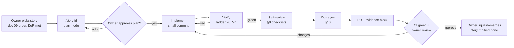
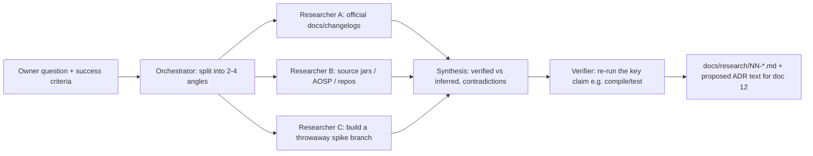

# 13 — AI-Assisted Build Playbook

**Purpose.** This playbook explains how the owner, a solo developer, carries out the 13-doc plan with Claude Code and similar coding agents. It contains:
- the root `CLAUDE.md` the agents load in every session;
- the session loop that takes one story from plan to merged PR;
- copy-paste prompts for every roadmap epic;
- when to fan out to several agents, and how to run that;
- what "done" means and how to prove it;
- review checklists, and how to keep `docs/plan/` in step with the code.

It is a process document. Product scope lives in [PRD](01-product-requirements.md), sequencing and estimates in [Roadmap](09-roadmap-backlog.md), test gates in [Quality & CI](10-quality-testing-ci.md), and decisions in [Decision Log](12-decisions-risks.md).

**Status: Draft v1 — 2026-10-19**

**Key decisions in this doc**
- **Agents implement; the owner decides, reviews and tests on devices.** Agents never send email, sign anything, publish, merge to `main`, bump a pinned version, or vouch for Quran text. The owner keeps the gates (G1–G6) and the device checks. (D-22, D-25)
- **One story per session, on one branch, as one PR.** Each session runs plan → implement → verify → commit. A PR merges only with CI green and an evidence block. (D-03, D-25)
- **The toolchain is frozen to D-02.** The first PR ports the verified spike. Ktor is removed (D-02 "No Ktor in v1"). Any version change needs an ADR in doc 12. (D-02)
- **Quran text is pipeline-only.** No agent or person retypes, pastes, "fixes" or reformats Arabic Quran text in source, tests or data. Every correction is a reviewed pipeline transform, and the hafiz confirms it in the proofreading packet. (D-05, D-06, D-08, D-22)
- **Fifteen non-negotiable rules are enforced three ways: in `CLAUDE.md`, by a pre-edit hook and by CI checks.** They cover:
  - clean-room code (D-18);
  - no QF/quran.com content in shipped data (D-09);
  - no hotlinking outside the eligible catalogue (D-12, D-24);
  - a licence manifest for every pack (D-10, D-17);
  - goldens stay green (D-05);
  - Kufan verse keys everywhere (D-06);
  - Para = the Indo-Pak table (D-07);
  - no tracking SDKs and no GMS in core (D-15, D-17, D-20).
- **The verification ladder V0–V5 must be climbed to the level each story type requires.** A green build alone is never "done". Renderer work needs reviewed goldens; audio and alarm work needs on-device checks. (doc 10)

---

## 1. Operating model

### 1.1 Who does what

| Actor | Does | Never does |
|---|---|---|
| **Owner** (product owner, reviewer, device tester) | Picks the next story (doc 09 order). Approves the plan. Reviews diffs, goldens and screenshots. Runs physical-device checks (API 24/26 phones, OEM adhan tests). Merges PRs. Handles every external contact: QUL account and export, permission emails, hafiz, designer, Play Console, D-U-N-S, lawyer. Owns gates G1–G6 | Merges red CI. Re-records goldens without looking at the diff |
| **Main coding agent** (Claude Code session) | Reads the spec. Writes a plan. Implements one story. Writes tests. Runs the verification ladder. Views its own screenshots. Opens the PR with evidence. Updates docs/plan | Sends email. Pushes to `main`. Force-pushes. Changes pinned versions. Edits Quran text. Downloads or commits licence-restricted data. Claims done without evidence |
| **Subagents** (spawned by the main agent, §8) | Read-only research, reviews, triage and audits that run in parallel and return findings | Edit files, unless the workflow explicitly gives a subagent a separate worktree |
| **Parallel sessions** (git worktrees) | Independent stories with no shared files (e.g. pipeline work and UI work) | Touch the same module at the same time |

### 1.2 Where to run the agent

| Work | Run it in | Why |
|---|---|---|
| Pure Kotlin, Room/Robolectric, pipelines, CI YAML, docs | Claude Code locally **or** in a cloud session | No emulator needed. The cloud sandbox has no `/dev/kvm` (g04 §2.1) |
| Anything that needs `adb`/emulator screenshots: reader, audio, notifications, alarms, widgets, onboarding | **Claude Code on the owner's machine** (CLI or desktop) with an AVD running | V4 verification (§5) needs `adb` |
| Physical-device checks (API 24/25, API 26–27, Infinix/Tecno/Xiaomi adhan) | The owner, with the checklist the agent produces | V5 is owner-only |

**Models.** Use the strongest available model, with plan mode on, for the renderer, the justification solver, PlanExpander and follow-along, the download engine, the alarm scheduler, and data-pipeline alignment. Routine UI, strings and boilerplate can use a faster model. Effort scales with the blast radius, not with line count.

### 1.3 Repository map the agents work in

```
/                       root Gradle build (Criterion), CLAUDE.md, .claude/
app/                    :app — Application, MainActivity (AppCompatActivity), NavDisplay host, flavors
                        distribution {play, foss} × tier {personal, public}; src/personal|public/assets/packs/
core/<name>/            :core:* modules (doc 04 §3.2 owns the list; start lean, split later — D-03)
feature/<name>/         :feature:* modules (never depend on each other)
build-logic/convention/ convention plugins (criterion.*)
baselineprofile/        :baselineprofile (P1 end / P2)
tools/                  Python pipelines (doc 08; `crit` CLI via uv, `just` aliases): content DB, mushaf pack,
                        timing packs, catalogue/index/notices builders (signing + publish = owner machine only)
data/curated/           hand-curated CSVs (Para, Manzil, Ruku, Sajda, quarters, aliases, headers) — owner-reviewed
data/pins.lock          upstream input pins (URL, sha256, licence)
out/                    gitignored pipeline outputs, reports and proof renders (doc 08 §2)
~/criterion-data/       OUTSIDE the repo: private inputs (QUL exports, KFC ZIPs, oracles, evidence) — never committed
docs/plan/              THE PLAN (source of truth) — this file is 13
docs/research/          evidence reports (read-only)
spikes/toolchain-spike/ verified reference build (read-only; not included in the root build)
```

---

## 2. Agent configuration files

### 2.1 Proposed root `CLAUDE.md`

Commit this as `/CLAUDE.md` in the first PR (AP-01) and keep it under about 200 lines. It must change whenever commands or the module list change; §10 covers keeping it in sync.

~~~markdown
# Criterion — Quran app for Android (codename)

Ad-free, no-tracking Quran app for Pakistan. Must-haves: a **typeset Indo-Pak 16-line Taj mushaf**
(548 pages; page_index 1–548, printed labels 2–549) drawn by OUR Compose Canvas renderer from the
DigitalKhatt IndoPak font + precomputed line/word layout; recitation by a favourite qari for
Surah / Para / Manzil / Ruku / page / ayah range, with ayah follow-along highlight; Para / Surah /
Manzil / Ruku indexes with Read + Play on every row; Urdu + English UI and translations.
Package/namespace `com.chughtai.criterion`. "Criterion" is a codename — the public brand is undecided
(gate G3): put no brand name in code; only the `app_name` string resource.
Solo owner + AI agents. The owner approves plans, reviews diffs/goldens, tests on devices, merges.

## Where the plan lives (read the relevant doc BEFORE coding)
docs/plan/README.md master plan · 01 PRD (feature IDs F-xx-nn) · 02 UX/UI · 03 content & licences ·
04 architecture (modules, interfaces, DDL, NavKeys, manifest) · 05 mushaf renderer · 06 audio engine &
downloads · 07 companion/hifz · 08 data pipelines (tools/) · 09 roadmap & backlog (epics/stories, DoR/DoD) ·
10 quality, testing & CI · 11 release & Play compliance · 12 ADRs (D-xx), gates (G1–G6), risks (R-xx) ·
13 this playbook. docs/research/* = evidence (read-only). spikes/toolchain-spike/ = verified reference
build (read-only, not part of the root build).
If code and plan disagree: stop, tell the owner, and propose a plan edit in the same PR. Never silently diverge.

## Commands
```bash
./gradlew quickCheck        # spotlessCheck + build-logic tests + every module's unit tests (library testDebugUnitTest,
                            # JVM test, :app testPlayPublicDebugUnitTest testFossPersonalDebugUnitTest) + testGoldens
./gradlew prCheck           # quickCheck + library lintDebug + :app lintPlayPublicDebug lintFossPersonalDebug + guards
                            # (verifyKotlinGradlePlugin checkModuleBoundaries verifyContentEligibility{PlayPublic,FossPublic}Release)
                            # + assemblePlayPublicDebug assembleFossPublicDebug: what CI's `ci/check` runs (doc 10 §11.3).
./gradlew personalCheck     # owner's machine only: verifyContentEligibilityFossPersonalRelease + assembleFossPersonalRelease
# explicit equivalents. Library modules have no flavors; :app has distribution {play, foss} × tier
# {personal, public}; playPersonal* is disabled (doc 04 §11):
./gradlew spotlessCheck testDebugUnitTest :app:testFossPersonalDebugUnitTest :app:testPlayPublicDebugUnitTest testGoldens :app:lintFossPersonalDebug :app:lintPlayPublicDebug
./gradlew spotlessApply                                  # format before committing
./gradlew :core:content:testDebugUnitTest                # content-DB invariants + schema-validation tests
./gradlew :app:assembleFossPersonalRelease               # R8 release build; the owner's daily sideloaded build
./gradlew :app:bundlePlayPublicRelease                   # closed-test build (CONTENT_TIER = BETA); PUBLIC only with
                                                         # -Pcriterion.release=production (owner + release workflow only)
./gradlew verifyKotlinGradlePlugin                       # Kotlin lift guard (asserts 2.2.10 -> 2.4.21)
./gradlew :app:installFossPersonalDebug && adb shell monkey -p com.chughtai.criterion.personal.debug -c android.intent.category.LAUNCHER 1
adb exec-out screencap -p > build/shots/<name>.png       # then OPEN the PNG and describe what you see
```
Goldens: `./gradlew testGoldens -Proborazzi.test.record=true` ONLY when the story intends a visual change; see "Goldens" below.
Robolectric NATIVE-graphics tests run one SDK per JVM (`-ProboSdks=N`, spike pattern).
Python pipelines (tools/, doc 08): `cd tools && uv run --frozen python -I -m crit <stage> <cmd>`, or the
`just` aliases (`just content`, `just mushaf`, `just proof`, `just timing`, `just validate`, `just assets`,
`just ci`). Pipelines read only pinned inputs (data/pins.lock); never fetch upstream ad hoc.
`crit sign` / `crit publish` (`just sign`, `just publish`) are OWNER-ONLY: never run them.

## Toolchain (frozen — D-02; changing any version needs an ADR in doc 12 and owner approval)
AGP 9.4.1 · Gradle 9.8.1 · Kotlin 2.4.21 lifted via root `alias(libs.plugins.kotlin.jvm) apply false`
(fallback 2.3.21; NEVER 2.2.10 — adhan2 0.0.7 metadata) · KSP 2.3.12 (no kapt) · compileSdk 37 ·
targetSdk 36 · minSdk 24 + desugaring 2.1.5 · Java 17 · R8 on · Compose BOM 2026.09.00 · Nav3 1.2.0 ·
Hilt 2.60.1 · Room 3.0.3 (androidx.room3) + sqlite-bundled 2.7.1 · DataStore 1.2.1 · Media3 1.11.1 ·
WorkManager 2.12.0 · Glance 1.2.0 · OkHttp 5.5.0 · kotlinx.serialization 1.11.0 · coroutines 1.11.0 ·
adhan2 0.0.7. NO Ktor. AGP > 9.4 does not sync in stable Android Studio (Rabbit 1) — do not try.

## Module conventions (doc 04 is authoritative)
- `:app` → `:feature:*` → `:core:*`. Features NEVER depend on features (`criterion.root`'s `checkModuleBoundaries` fails the build; rules in doc 04 §3.4).
- All `NavKey`s live in `:core:navigation`. Cross-feature navigation = NavKeys only.
- `:core:model` and `:core:domain` are pure Kotlin (`criterion.jvm.library`), no Android, no DI annotations.
  Interfaces (repositories, `PlaybackController`, `PlaybackStateHub`, `HijriCalendarProvider`) live in `:core:domain`;
  implementations live in `:core:data`, `:core:audio`, `:core:prayer`, …
- Each core module exposes interfaces; implementations are `internal`, bound in that module's Hilt module.
  `QuranContentDb` and all Room types stay `internal` to their module (no `api(room3-runtime)` leaks).
- New module = a convention plugin from build-logic only; no copy-pasted android {} blocks.
- Lint baselines only record pre-existing issues and only shrink (doc 10 §11.1). To baseline a module: create an
  empty `<module>/lint-baseline.xml`, run `./gradlew :<module>:updateLintBaseline`, commit the file.
- Add the new module to this file's module list (below) in the same PR.
Modules today (doc 04 §3.2 P0 set): :app :core:model :core:domain :core:content :core:database :core:data
:core:designsystem :core:navigation :core:testing
(All 9 exist since E-01-S03. Clock/dispatchers go in :core:domain, DataStore<UserSettings> in :core:database,
model-bound rows in :core:designsystem. P1 adds :core:remote :core:mushaf-render :core:audio, the six
features and :baselineprofile; P2 adds :core:prayer :feature:prayer :feature:companion. Never invent a module
name that is not in doc 04 §3; the PR that adds/removes a module updates this list.)

## Coding standards
- Kotlin official style, enforced by Spotless + ktlint 1.8.0 + compose-rules 0.6.8; Android Lint + Slack
  compose-lint 1.6.1, warnings as errors on CI.
- MVVM/UDF: one immutable `UiState` per screen as `StateFlow` (`stateIn(viewModelScope,
  WhileSubscribed(5_000), …)`), intents via `onAction(Action)`, immutable collections, stateless
  `XxxScreen` composables with previews, `XxxRoute` wires the ViewModel.
- Errors: sealed `AppError`; one-shot repository calls return `Outcome<T>`; observables return `Flow<T>`.
- Inject `AppDispatchers` (doc 04 §4.4; bound only in `:core:data`'s `DispatchersModule`); never hard-code `Dispatchers.IO` in classes. Media3 calls on main looper only.
- Offline-first: reading, indexes and search never touch the network.
- All user-visible strings in `strings.xml` (en + ur). No string concatenation for sentences; use
  placeholders. Wrap verse keys/numbers inside RTL text with bidi isolation.
- Tests: fakes over mocks (`:core:testing`); `runTest` + `MainDispatcherRule`, never `runBlocking`
  around `viewModelScope`; Turbine for flows; Truth assertions.
- Robolectric: the `criterion.android.robolectric` plugin sets `--add-exports java.base/jdk.internal.access`
  + `--add-opens java.base/java.io` and the host `libsqliteJni`; NEVER name a test-resource folder `fonts/`.
- No `TODO` without a doc 09 story ID. No commented-out code. No new dependency without updating
  libs.versions.toml AND the licence list (AboutLibraries) AND saying why in the PR.

## NON-NEGOTIABLE RULES (violations block the PR)
1. CLEAN-ROOM. Never copy, paste, translate or closely paraphrase code from GPL/AGPL projects
   (quran_android, QuranApp, Noor-Ul-Huda, …). Read for ideas only, close the file, write from the spec.
   Apache/MIT ports (quran-ios QuranKit, LinePageGeometryEngine; FSRS-Kotlin) keep the original
   licence header + a NOTICE entry + "Ported from <repo>@<commit>" comment.
2. NO QF/QURAN.COM CONTENT IN SHIPPED DATA. Never bundle or cache-as-database anything from api.quran.com /
   Quran Foundation content APIs. No client secret in the app, ever.
3. NO HOTLINKING OUTSIDE THE CATALOGUE. Audio/pack URLs come only from the signed catalogue.json /
   index.json entry (detached `.sig`, Ed25519 over the exact file bytes) whose buildEligibility includes
   BuildConfig.CONTENT_TIER (PERSONAL | BETA | PUBLIC) and whose kill-switch is enabled.
   No hard-coded third-party media URLs in Kotlin. Never pair a timing file and audio from different hosts.
4. LICENCE MANIFEST FOR EVERY PACK/ASSET. Every pack, font, dataset and audio source has licence,
   licenceStatus (PERMITTED | HOST_GRANT | PENDING | PERSONAL_ONLY | REVOKED) + free-text basis,
   attribution, sha256, size and eligibility flags (personal/beta/public/monetized) in the manifest;
   `verifyContentEligibility<Variant>` fails a build that contains content ineligible for its tier.
   QUL-derived layout data lives only in `src/personal/assets/` until G1; never in `src/main/assets/`.
5. QURAN TEXT IS PIPELINE-ONLY. Never type, paste, "fix", normalize or reformat Arabic Quran text
   (ayah text, tokens, layout lines) in any source, test, fixture or data file. Do not output Quran text
   from memory. Refer to text by verse key / token key and read it from the content DB or the pipeline.
   Corrections = reviewed pipeline transforms (doc 08) confirmed in the hafiz packet. Short
   tashkeel-free search-query literals in tests are the only exception.
6. GENERATED FILES ARE NEVER HAND-EDITED: *.db assets, packs, Room schema JSON, fonts, proofs.
   Regenerate via the pipeline/KSP.
7. KEEP GOLDENS GREEN. Never re-record a golden to make a failing test pass. Re-record only when the story
   intends the visual change; attach the diff images to the PR and explain each one.
8. KUFAN VERSE KEYS EVERYWHERE. `VerseKey(surah, ayah)` in Kufan numbering (id() 1..6236; 1:1 = basmala).
   Use doc 04 §5's identity types verbatim (VerseKey, SurahId, ParaId, ManzilId, RukuId, MushafId, PageIndex,
   PageLabel, AyahRange, RecitationId); no `AyahKey`, no raw Int ids in public APIs. Never DK/QUL display
   numbering, never database row ids in user.db or in the API between modules. Page references =
   (MushafId, PageIndex), e.g. INDOPAK_16_TAJ (code `indopak16_taj`); show page_label (= index + 1 for
   taj16) in all UI.
9. PARA = THE INDO-PAK TABLE (content DB `para`). Never derive Para from Madani juz (QuranKit Juz,
   quran.com juz, any API). 7 boundaries differ: P4 3:92, P7 5:83, P11 9:94, P14 15:2, P20 27:60,
   P21 29:45, P23 36:22. Madani juz/hizb/rub exist only for Madani mode (v2).
10. TYPESET, NEVER SCANS. No mushaf page images, no letter-spacing, no StaticLayout/TextAlign.Justify for
    mushaf lines; font = pinned DigitalKhatt IndoPak glyf TTF (never the QUL CDN DigitalKhattIndoPak.otf —
    it has no cv01). `setFontFeatureSettings("'cv01' N")` only on stretched words.
11. PRIVACY. Zero third-party SDKs (no analytics, ads, attribution, crash SDKs) in v1; no Google Play
    Services in core (play-only extras live in the `play` flavor). No reciter photos.
12. PERMISSIONS. Never add USE_EXACT_ALARM, ACCESS_NOTIFICATION_POLICY, REQUEST_IGNORE_BATTERY_OPTIMIZATIONS,
    USE_FULL_SCREEN_INTENT, fine location, storage/media permissions. Playback starts only from user actions.
13. SECRETS. No keys, keystores, tokens or private signing keys in the repo, logs or prompts. The Ed25519
    private key is offline (owner); only the public key is in the app.
14. ARABIC IS ALWAYS SHOWN WITH A TRANSLATION. No translation-only mode anywhere (Punjab Act s.5(6)).
15. FROZEN TOOLCHAIN. No version bumps, no new Gradle plugins, no kapt, no Ktor without an ADR.

## Workflow (doc 13 §4)
One story per session. Start in plan mode: restate goal, list files, list tests, list verification.
Wait for approval. Implement in small commits. Then run the verification ladder required for the story
type (doc 13 §5) and paste the evidence block. Never say "done" without the commands' actual output.
Branch `<story-slug>-<slug>` from `main` (doc 09 ID lower-cased, e.g. E-05-S03 → `e05-s03-page-golden`);
Conventional Commits `type(scope): summary [<story-id>]` (ID verbatim, e.g. [E-05-S03]);
PR uses .github/pull_request_template.md. Never push to `main`, never force-push, never merge.

## Ask the owner (stop and ask) when
the spec is silent or contradictory · a dependency/version/permission would change · a licence is unclear ·
Quran text or curated Arabic metadata looks wrong · a golden changes unexpectedly · a test is flaky ·
you would need network data that is not pinned · you are about to delete or rewrite > 300 lines.
~~~

### 2.2 Nested `CLAUDE.md` files (loaded when the agent works in that directory)

| Path | Content (short) |
|---|---|
| `tools/CLAUDE.md` | Python 3.12 via uv. Run everything as `uv run --frozen python -I -m crit <stage> <cmd>` or its `just` alias (doc 08 §3.1); no other entry points. Inputs come only from `data/pins.lock`; `crit fetch` checks sha256 before use. Outputs go to `out/` and reach module asset dirs only through `crit install-assets` (Git LFS-committed, doc 08 §2); they are never hand-edited. Every stage ends with its invariant checks (`crit validate all`, doc 08 V-* checks) and exits non-zero on failure. **Never print Quran text into logs or diffs.** Log keys and counts instead. Private inputs (QUL exports, KFC ZIPs, oracles) live in `~/criterion-data/`, outside the repo, and never go in git or CI artefacts. Taj scans never enter the repo. Proofs go to `out/proof/indopak16_taj/<build_id>/`. `crit sign` and `crit publish` are owner-only. |
| `core/mushaf-render/CLAUDE.md` | Draw only from precomputed `PageLayout`: no runtime justification except Fallback 1, and that only behind a flag. Keep three separate layers: furniture/ornaments, text, highlight/selection. Draw with `drawTextRun` per word, with `cv01` only on stretched words. Margin side = `page_label % 2 == 0 ? RIGHT : LEFT`. Every visual change ships with Roborazzi goldens for the page set in doc 10, and the agent opens and inspects the PNGs. Performance budgets are in doc 05. |
| `core/audio/CLAUDE.md` | Media3 runs on the main looper. Player state goes out only through `PlaybackStateHub.state: StateFlow<PlaybackState>` (+ `events`); the interfaces and `PlaybackState` shape are doc 04's, in `:core:domain` (no `:core:audio-api` module), and `PlaybackController.state` = `hub.state`. Para scope uses the Indo-Pak table. Basmala strategy is per surah (none for surah 9; Fatiha 1:1 is the basmala). `AudioAttributes` are USAGE_MEDIA + CONTENT_TYPE_SPEECH (pause on focus loss, no ducking). Enable `FLAG_ENABLE_CONSTANT_BITRATE_SEEKING`. Never pair timing and audio from different hosts, and never use mp3quran reads 74 or 53 for timing. |
| `data/curated/CLAUDE.md` | These CSVs are print-verified. Agents may add or modify rows **only by script, from a cited source, with a `verified_source` value**. Never retype Arabic names or labels. Any PR that changes these files gets the `content-review` label and is listed in the next hafiz packet. |

### 2.3 `.claude/settings.json` (permissions and guard hook)

```json
{
  "permissions": {
    "allow": [
      "Bash(./gradlew:*)", "Bash(python3 -I:*)", "Bash(uv run --frozen python -I -m crit:*)", "Bash(just:*)",
      "Bash(adb:*)", "Bash(git status)", "Bash(git diff:*)",
      "Bash(git log:*)", "Bash(git add:*)", "Bash(git commit:*)", "Bash(git switch:*)", "Bash(git worktree:*)",
      "Bash(gh pr create:*)", "Bash(gh pr view:*)", "Bash(gh run view:*)"
    ],
    "deny": [
      "Bash(git push --force:*)", "Bash(git push -f:*)", "Bash(git push origin main:*)", "Bash(gh pr merge:*)",
      "Bash(just sign:*)", "Bash(just publish:*)", "Bash(uv run --frozen python -I -m crit sign:*)",
      "Bash(uv run --frozen python -I -m crit publish:*)", "Bash(uv run --frozen python -I -m crit keys:*)",
      "Read(./**/*.jks)", "Read(./**/*.keystore)", "Read(./**/signing/**)", "Read(./**/*ed25519*private*)"
    ]
  },
  "hooks": {
    "PreToolUse": [
      { "matcher": "Edit|Write|MultiEdit",
        "hooks": [ { "type": "command", "command": "python3 -I tools/agent-hooks/guard_paths.py" } ] }
    ]
  }
}
```

`tools/agent-hooks/guard_paths.py` reads the hook JSON from stdin and takes `tool_input.file_path`. It exits with **code 2**, which blocks the edit and returns the reason to the agent, when the path matches any of these:
- `spikes/**`, `docs/research/**`;
- `**/*.db`, `**/*.sqlite`, `**/*.ttf`, `**/*.otf`, `**/schemas/**/*.json`;
- `data/pins.lock`, `data/keys/**`, `out/**`, and anything that resolves outside the repo (e.g. `~/criterion-data/**`).

`data/curated/**` is allowed, but the hook prints a warning that the PR needs the `content-review` label.

**Second guard: CI's `quran_text_guard`** (`tools/ci/quran_text_guard.py`, run in the scan step of doc 10's `android.yml` next to `cleanroom_scan.py` and `no_qf_hosts.py`).
- It scans **added lines** in `*.kt`, `*.kts`, `*.xml` and `*.csv` for runs that contain Arabic harakat. The ranges are U+064B–U+0652, U+0670 and U+06D6–U+06ED.
- It fails the build if such a run appears outside the allowlist `data/curated/**` (and then only with the `content-review` label).
- Urdu UI strings normally carry no tashkeel, so they pass.

### 2.4 Custom slash commands (`.claude/commands/*.md`)

| Command | Body (summary) |
|---|---|
| `/story <id>` | Loads the doc 09 story `<id>`, its feature IDs and its spec sections. Fills the §6.1 template. Enters plan mode. Lists open questions before writing any code. |
| `/verify <level>` | Runs the §5 ladder up to `<level>`. Captures the outputs. Opens the screenshots and golden diffs, and prints the evidence block. |
| `/golden-triage` | Runs MA-3 (§8.4) on the current Roborazzi failures. |
| `/licence-audit` | Runs MA-4 (§8.5). |
| `/play-review` | Runs MA-5 (§8.6). |
| `/doc-sync` | Runs the §10.3 doc-sync prompt for the current branch. |

---

## 3. Before the first session (owner, ~2 h, 2026-10-20)

1. **Create the GitHub repo**, private, "all rights reserved" (D-18; the licence decision is gate G4). Protect `main`:
   - require PRs, the `ci/check` status (the `check` job of doc 10's `android.yml`; `tools.yml` checks too when they trigger) and a linear history;
   - no force-push;
   - disable merge commits (squash only).
2. **Install the tools:** Android Studio Rabbit 1 (2026.2.1), JDK 21 and SDK `platforms;android-37.0` + `build-tools;37.0.0`. Create these AVDs:
   - **API 36 Pixel-class** (main);
   - **API 24** and **API 26** (smoke tests, if the host has KVM);
   - **a sw600dp tablet**.
3. **Tools:** `uv` (version per `tools/.uv-version`; it installs the pinned Python 3.12, doc 08 §3.1), `just`, Git LFS (generated assets are LFS-committed, doc 08 §2) and `gh` (authenticated).
4. **Physical devices:** at least one API 24/25 phone and one API 26–27 phone (g04 rec 10), procured by 2026-10-28 for the AP-06 smoke test. Later (v1.1 adhan work, or earlier if the freelancer lever pulls adhan into v1.0), add at least one Infinix, Tecno or Xiaomi phone for adhan testing.
5. **Owner-only P0 tasks, started on day 1 because they have lead times** (doc 03 has the tracker and templates; doc 09 §7 has the day-by-day list):
   - create the QUL account and export resource 11 into `~/criterion-data/qul/<date>/`, outside the repo, recording SHA-256s;
   - send the G1 email (support@tarteel.ai cc naveed.ahmad@tarteel.ai) and open the GitHub issue;
   - email DigitalKhatt (ananeamine@gmail.com);
   - email for audio rights (G2): Alafasy Berhad (ai@alafasy.co), Quran Foundation (developers@quran.com) and King Fahd Complex;
   - buy the brand-neutral domain in week 1 (needed for the Organization-account verification email and the CDN);
   - send the translation permission requests listed in D-09 (doc 09 schedules them in S1).

   The G1 emails go out on 2026-10-20 and the G2 emails on 2026-10-21; both groups must be out by 2026-10-23 at the latest. First follow-up 2026-11-02. G1 decision date: 2026-11-19 (clean-room fallback starts 2026-11-20). G2 catalogue freeze: 2027-01-04.

---

## 4. Session workflow

### 4.1 The loop (one story per session)



| Step | What happens | Output |
|---|---|---|
| 0. Pick | The owner picks the next story from doc 09 and confirms the Definition of Ready. That means the spec section exists, the dependencies are merged, and no gate blocks it (or the story is personal-tier). | Story ID |
| 1. Load context | `/clear`, then `/story <id>`. The agent reads `CLAUDE.md`, the story, the linked spec sections, and the existing code it will touch. It reads **only** the research it needs (grep, not whole reports). | — |
| 2. Plan (plan mode) | The plan covers: goal; files to create or change; public interfaces with signatures; tests to add; the verification level and commands; risks; open questions. It stays within one screen. | Plan the owner approves |
| 3. Implement | Work goes on branch `<story-slug>-<slug>` (§4.2), in commits small enough to revert. Run `spotlessApply` before each commit. No drive-by refactors outside the story. Note any you find for the PR's "follow-ups" list. | Commits |
| 4. Verify | Run the §5 ladder to the story's required level. On a failure, fix the root cause; never weaken a test to make it pass. | Evidence block |
| 5. Self-review | Apply the §9 checklists that fit. For large PRs, run MA-2 (§8.3). | Checklist in the PR |
| 6. Doc sync | Update the story's row in `docs/plan/PROGRESS.md` and any spec that changed. Propose an ADR if a decision moved (§10). | Doc diffs in the same PR |
| 7. PR | `gh pr create` with the template (§4.3). Never merge. | PR URL |
| 8. Handoff | The PR's "Next steps" section is the handoff. The next session starts from `main` after the merge. | — |

**Context hygiene.**
- Start each story with `/clear`.
- `/compact` when the context fills mid-story, after writing the plan and progress into the PR draft or a scratch note.
- Never carry one story's assumptions into the next.

**Session size.** A story should fit in **1–3 sessions, about 2–6 hours** of agent time. If the plan lists more than about 15 files or more than 2 modules of new code, split the story and tell the owner, who updates doc 09.

**Parallel work.**
- Use at most **two concurrent sessions**, in separate worktrees (`git worktree add ../criterion-<story> -b <branch>`).
- They may only touch disjoint modules. Typical pairings: a `tools/` pipeline with a `:feature:*` UI story, or a docs story with any code story.
- Rebase onto `main` before opening the PR.

### 4.2 Branch, commit and PR conventions

| Item | Convention |
|---|---|
| Branch | `<story-slug>-<short-slug>`: doc 09's `E-xx-Syy` story ID, lower-cased with the first hyphen dropped (`E-05-S03` → `e05-s03-page-golden`). Spikes: `spike/<topic>`. Docs only: `docs/<topic>` |
| Commit | Conventional Commits: `feat(reader): draw ayah markers [<story-id>]`. Types: feat, fix, test, refactor, build, ci, docs, chore, data (pipeline/curated data). The agent's attribution trailer is added automatically by Claude Code. |
| PR size | Aim for ≤ 600 changed lines excluding generated files and goldens; hard ceiling about 1,200. Above that, split. |
| Labels | `content-review` (touches curated data, the pipeline text path, or the renderer output), `licence` (new dependency, asset or pack), `policy` (manifest, permissions, FGS, Data safety), `golden-update` |
| Merge | The owner squash-merges after CI is green and the evidence is reviewed. Delete the branch. |
| Releases | Tags `v<major>.<minor>.<patch>` cut from `main` by the owner. The release workflow is in doc 10. |

### 4.3 `.github/pull_request_template.md`

```markdown
## Story
<story-id> — <title>   · Features: F-…   · Spec: docs/plan/0x-…md §…
## What changed
- …
## Verification evidence (paste real output; required)
Level reached: V? (see doc 13 §5)
- `./gradlew prCheck` → …
- Goldens: N verified / M re-recorded (each re-record explained below with diff image)
- Emulator/device: AVD/API, screenshots in this PR, what I checked in each
- NOT verified (owner to do): …
## Content / licence / policy impact
- [ ] none  - [ ] new dependency/asset/pack (licence + manifest updated)  - [ ] manifest/permission change  - [ ] curated data or text path touched (content-review)
## Docs updated
- [ ] PROGRESS.md row updated  - [ ] spec doc(s) updated  - [ ] ADR proposed (doc 12)  - [ ] CLAUDE.md (commands/modules)
## Follow-ups / next steps
- …
```

---

## 5. Verification discipline

### 5.1 The verification ladder

| Level | Name | Commands / actions | Who |
|---|---|---|---|
| **V0** | Compiles and is formatted | `./gradlew spotlessCheck :app:assembleFossPersonalDebug` | Agent |
| **V1** | Unit tests | `./gradlew quickCheck`, or the module's `testDebugUnitTest` / JVM `test` task (`:app:testFossPersonalDebugUnitTest` for app code). New logic has new tests, and the agent shows they fail without the change where practical (red → green). | Agent |
| **V2** | Integration (Robolectric/Room/Media3/Work) | Room open/validation tests (with **and** without `room_master_table`), migration tests, service tests, MockWebServer tests | Agent |
| **V3** | Goldens | `verifyRoborazziDebug` (library modules; the PR set of ~60 rule-selected pages for the renderer). Any re-record follows §5.3. | Agent, then the owner reviews the images |
| **V4** | Emulator run | Install, launch and exercise the story's flow on API 36, plus API 24/26 AVDs if available. `adb exec-out screencap`, plus `adb logcat -d` checked for crashes and StrictMode violations. The agent **opens every screenshot** and writes one line per shot on what it verified. | Agent (local session) |
| **V5** | Physical device / long-running | The checklist the agent produces, run by the owner. Examples: API 24/25 kashida widths, background audio with the screen off for 30 min, airplane-mode downloads, the 7-day adhan run on OEM phones, a TalkBack pass. | Owner |

**Required level by story type**

| Story type | Minimum before PR | Before the story is marked done |
|---|---|---|
| Pure Kotlin domain (PlanExpander, normalizer, khatam planner, Hijri offset) | V1 | V1 |
| Data pipeline (tools/) | V1, plus invariants green, plus output sha256 recorded | V2 (the app opens the artefact) |
| Room / repository / DataStore | V2 | V2 |
| Renderer | V3 | V4, then V5 on API 24/26 once per renderer milestone |
| UI screen / navigation | V3 (screen goldens EN + UR) | V4 |
| Audio, downloads, notifications, alarms, widgets | V2 | V4, then V5 |
| Build / CI | V0, plus a CI run on the PR | CI green on `main` after the merge |
| Release prep | Everything above | V5 plus doc 11's checklist |

### 5.2 What "done" means (Definition of Done; doc 09 owns the canonical DoD)

A story is done only when **all** of these hold:
1. Acceptance criteria are met, each shown by a test or by evidence.
2. `prCheck` is green locally and in CI. No new lint baseline entries without a reason.
3. The required verification level (§5.1) is reached, and the evidence block is in the PR.
4. Goldens are green, and any re-records are justified and approved.
5. No rule in `CLAUDE.md` is violated. The §9 checklists that apply are ticked.
6. Docs are synced (§10), and the doc 09 story is marked done in the same PR.
7. The owner has reviewed and merged it.

**"Done" never means:**
- "should work";
- "builds";
- "tests pass" without the agent having actually run them in this session;
- "verified" based on reading the code.

If a level cannot be reached (no emulator, no device), the agent says so under **"NOT verified"** and the story stays open until the owner closes that gap.

**Evidence block format** (the end of every implementation session):

```
VERIFICATION — <story-id> — level reached: V4
- ./gradlew prCheck → BUILD SUCCESSFUL in 4m12s; 231 tests, 0 failures; 46 goldens verified
- ./gradlew :core:content:testDebugUnitTest → 19 tests, 0 failures (incl. NoMasterTableValidationTest)
- Emulator API 36 (Pixel_8_API_36): build/shots/reader-p4.png — RTL order correct, header "Para 1 · Page 4 · Al-Baqarah", no clipping; build/shots/reader-night.png — night palette, highlight layer visible
- logcat: no crashes, 0 StrictMode violations
- NOT verified: API 24 physical device (owner: run checklist in PR)
```

### 5.3 Golden-image protocol (renderer and UI)

1. Goldens live next to their tests and are committed. Roborazzi 1.76.0 runs on Robolectric 4.17 with `@GraphicsMode(NATIVE)` for mushaf pages, one SDK per JVM. The page set is in doc 10: about 60 rule-selected pages on every PR (zero tolerance) and all 548 pages nightly.
2. **A failing verify is a bug until proven otherwise.** The agent opens the `*_compare.png` and `*_actual.png` files Roborazzi produces and classifies each diff as one of:
   - **intended**: the story changed this;
   - **regression**: fix the code;
   - **environment**: a library or Robolectric bump. This should not happen under a frozen toolchain, so stop and ask.
3. Re-recording is allowed only for "intended". The PR lists each re-recorded golden with a one-line reason and embeds the compare image. The owner approves by eye.
4. **When the pipeline output changes** (new mushaf-pack version), the PR also carries the pipeline's page-diff output: `crit mushaf proof taj16 --changed-since <build_id>` lists the pages whose `page_hash` changed and renders them as `delta-<build>.pdf` (doc 08 §5.6; `tools.yml` uploads it). Any page whose **text** changed goes into the next hafiz packet (AP-25). Text or layout fixes always ship as an app update with a new bundled pack, never as a remote change (D-30).
5. The agent reviews **layout**: alignment, overlaps, clipping, the margin side, header and footer furniture, tofu boxes (☐), line widths, and highlight placement. **The agent never certifies Arabic correctness.** Only the hafiz certificate (G5) does.

### 5.4 On-device check recipes (V4/V5)

| Area | Steps (agent drafts the checklist into the PR; owner runs V5) |
|---|---|
| Kashida on old Android | On the API 24/25 and API 26–27 devices, run the smoke screen from AP-06. Advances for the probe tokens at cv01 = 0/1/3 must match the pipeline's expected widths (g04 reference for الْكِتٰبُ at textSize 1000: 2060 / 2847 / 4384). Then view 5 dense pages next to the proof PNGs. |
| Reader | Cold start into the last page. Swipe 20 pages both ways. Rotation lock (phone) and page-turn lock. Night/AMOLED themes. Pinch zoom with pan. Immersive toggle. Keep-screen-on. A tablet AVD with sw ≥ 600dp hides the rotation lock (D-23). |
| Audio | Play Para 4: the first ayah must be 3:92. Play a Manzil. Play an ayah range with repeat ×3. Lock the screen for 30 min. Headset button. Notification controls. Speed 0.5×/2×. Sleep timer at end of surah. An incoming-call focus loss pauses playback. Highlight follows and the page auto-turns; touching the pager suspends auto-turn for 8 s. |
| Downloads | Download a Para over Wi-Fi. Kill the app mid-download and confirm it resumes (Range). Airplane mode: play the downloaded audio. The storage manager shows sizes, and deleting frees space. Wi-Fi-only blocks downloads on cellular. |
| Adhan (v1.1 by default; v1.0 only if the 2026-11-30 freelancer lever pulls it in, then starting by 2027-01-04) | Run 7 consecutive days on each OEM phone: alarms fire on time with the screen off, after a reboot, after a timezone change, after revoking and re-granting the exact-alarm permission. The health check reports OEM guidance. |
| Accessibility / RTL | Do a TalkBack pass on home, index, reader (ayah semantics read the reference and translation) and player. Font scale 200%. Switch the UI to Urdu: the UI mirrors and the mushaf stays RTL; check numerals and bidi isolation. Run the pseudo-locales `en-XA` and `ar-XB` in debug. |

---

## 6. Prompt templates

### 6.1 Master template (every implementation story)

```text
CONTEXT
- Repo: Criterion (see CLAUDE.md). Story <story-id> "<title>" from docs/plan/09-roadmap-backlog.md.
- Features: <F-…>. Spec: docs/plan/<doc>.md §<sections>. Decisions: <D-…>.
- Already merged: <prior stories / modules this builds on>. Relevant code: <paths>.
GOAL
- <one or two sentences: the user-visible or developer-visible outcome>.
CONSTRAINTS
- Follow CLAUDE.md non-negotiables (especially #<n>, #<n>).
- Stay inside modules: <list>. Public API per doc 04 §<x> (signatures must match or propose a doc edit).
- No new dependencies / versions. No network data except pinned inputs.
ACCEPTANCE CRITERIA
1. <observable, testable>  2. …  (copy from doc 09; add the tests that prove each)
VERIFICATION
- Required level: V<n>. Commands: <…>. Screens/flows to capture: <…>. Owner device checklist: <…>.
OUT OF SCOPE
- <explicitly excluded neighbours>
DELIVERABLES
- Plan first (plan mode) → wait for approval → implement → evidence block → PROGRESS.md row updated → PR.
```

### 6.2 Variants

| Variant | Differences from §6.1 |
|---|---|
| **Bug fix** | CONTEXT includes the repro steps, the `adb logcat -d -b crash` output, and the device/API. ACCEPTANCE adds "a failing regression test exists first, then passes". Root cause is stated in the PR. |
| **Spike** | GOAL is a question. DELIVERABLES are a throwaway branch `spike/<topic>`, a findings section (verified/inferred tags as in docs/research), and a proposed ADR or plan edit. No merge to `main` unless the owner asks. Time box: ≤ 1 day. |
| **Review** | "Do not edit files. Review <PR/diff> against CLAUDE.md, the doc 13 §9 checklists and <spec>. Output findings as `[blocker/major/minor] file:line — issue — fix`." |
| **Pipeline** | Inputs come only from `data/pins.lock`. ACCEPTANCE lists the doc 08 invariants verbatim. DELIVERABLES include the output sha256 and a size table. Never print Quran text. |
| **Doc sync** | §10.3. |

---

## 7. Ready-to-use prompts per epic

Doc 09 owns the epic numbers (E-xx) and story IDs (`E-xx-Syy`). The table maps each prompt to its doc 09 epic and stories (doc 09 is authoritative if they drift), and the owner pastes the story ID into `<story-id>`. The **Release** column applies the final v1.0 scope: `v1.0` = Quran core + compliance floor + Tier A (prayer times with Sehri/Iftar, Hijri + PK feed, Ramadan core, khatam planner); `stretch` = v1.0-stretch (ladder L1–L4, pre-cut); `v1.1` = Tier B by default (2027-03-22). Run a stretch or v1.1 part only when doc 09 schedules it. Each prompt is the CONTEXT/GOAL/CONSTRAINTS/ACCEPTANCE/VERIFICATION body. Run it after `/clear`, and answer the plan before any code is written. Larger epics take several sessions, one story each; split as doc 09 does.

| # | Prompt | Doc 09 epic · stories | Features | Phase · sprint | Release | Spec |
|---|---|---|---|---|---|---|
| AP-01 | Toolchain upgrade from spike | E-01 · S01 | — | P0 · S0 | v1.0 | 04, g04 |
| AP-02 | Module skeleton, build-logic & variants | E-01 · S02–S04, S08 | — | P0 · S0 | v1.0 | 04 |
| AP-03 | CI on GitHub Actions | E-02 · S01 (S04 gates wired as stubs) | — | P0 · S0 | v1.0 | 10 |
| AP-04 | Content-DB pipeline | E-03 · S01, S02, S05, S08, S09; E-02-S02 | F-IX-*, F-SR-01, F-TR-01 | P0 → P1 | v1.0 | 08, 03, 04 |
| AP-05 | Mushaf-pack pipeline | E-03 · S03, S04, S06, S07 (S11 only if G1 fails) | F-RD-01 | P0 → P1 | v1.0 | 08, 05 |
| AP-06 | Device smoke test (kashida + FTS5 + desugaring) | E-01 · S05 | F-RD-01 | P0 · S0 | v1.0 | 05, g04 |
| AP-07 | Renderer v0 — single-page golden | E-04 · S02, S03 (+ HitTester from S05) | F-RD-01 | P1 · S1 | v1.0 | 05 |
| AP-08 | Renderer templates & furniture | E-04 · S04, S06, S09; E-02-S03 | F-RD-01, F-IX-06/07 (markers) | P1 → P2 (ornaments by end of S5) | v1.0 | 05 |
| AP-09 | Pager & reader chrome | E-05 · S01, S02, S05, S06 | F-RD-01…03, 06, 07 | P1 | v1.0 (pinch zoom is floor) | 02, 05 |
| AP-10 | Indexes & navigation | E-06 · S01–S08 (S09 stretch); E-01-S06 | F-IX-01…06, 08, 09 (F-IX-07 list: stretch) | P1 | v1.0 | 02, 04 |
| AP-11 | Bookmarks & last-read | E-07 · S01–S05 (S06, S07 v1.1) | F-BM-01, 02, 06 (Auto Backup) | P1 | v1.0 (notes, JSON export: v1.1) | 04 |
| AP-12 | Catalogue + PlanExpander | E-09-S01, E-08-S03, E-08-S08 | F-AU-01, 02, 05 | P1 | v1.0 | 06 |
| AP-13 | Media3 service & player UI | E-08 · S01, S02, S05–S07, S09; E-09-S03 | F-AU-03, 04, 06, 07, 09 | P1 | v1.0 (F-AU-10 interleave: v1.1) | 06 |
| AP-14 | Timing-pack pipeline | E-09 · S02, S04, S05 (S06 v1.1) | F-AU-03 | P1 | v1.0 | 08, 06 |
| AP-15 | Follow-along highlight & auto page-turn | E-08-S04, E-05-S04 | F-RD-05, F-AU-03 | P1 | v1.0 | 06, 05 |
| AP-16 | Downloads engine, signed remote files & notices | E-10 · S01–S05 (S06 v1.1); E-23 · S01–S02 | F-AU-08, F-PL-06 (storage half), F-PL-11 | P1 → P2 (UIDT + signed files in S5) | v1.0 (pack installer: v1.1) | 06, 04 |
| AP-17 | Translation view | E-11 · S01, S02 (S03 v1.1); E-05-S03 (S07 stretch) | F-RD-08, F-TR-01, F-RD-04 (F-RD-13: stretch) | P1 | v1.0 (F-TR-02/03: v1.1) | 02, 03 |
| AP-18 | Search | E-12 · S01–S03 | F-SR-01…03 | P2 · S5 | v1.0 | 04, 08 |
| AP-19 | Onboarding, settings, Urdu UI | E-13 · S01–S05; E-14 · S01, S03 | F-PL-01…03, 07 | P1 → P2 | v1.0 | 02 |
| AP-20 | Prayer times (+ adhan when scheduled) | E-15 · S01–S03 (S04–S07 v1.1) | F-CP-01 (F-CP-02: v1.1) | P2 · S6 | v1.0 Tier A; adhan v1.1 unless the 2026-11-30 freelancer lever pulls it in | 07 |
| AP-21 | Hijri, Ramadan core (+ tasbeeh, Manzil dua, azkar, Qibla) | E-16 · S01, S03 (S02, S05 stretch; S04, S06, S07 v1.1) | F-CP-04, F-CP-07 (F-CP-05, F-CP-06 Manzil dua: stretch; F-CP-03, azkar: v1.1) | P2 · S6 | v1.0 Tier A + stretch + v1.1 | 07 |
| AP-22 | Widgets & reminders | E-17 · S01–S03 | F-CP-08, 09 | after v1.0 | v1.1 | 07 |
| AP-23 | Khatam planner, credits, report-error | E-18-S01 (S02 v1.1); E-19 · S01–S03 | F-BM-04, F-PL-04, F-PL-05 | P2 · S6 | v1.0 (khatam = Tier A; credits/report = floor) | 07, 03, 11 |
| AP-24 | Release prep | E-22 · S02–S05; E-24-S02; E-02 · S05, S06 | — | P2 · S5–S7 | v1.0 | 11, 10 |
| AP-25 | Hafiz proofreading packet (non-code) | E-20 · S02, S03 | — | P1 → P2 | v1.0 (G5) | 03, 08, 10 |
| AP-26 | Permission-email follow-ups (non-code) | E-21 · S01–S07 | — | P0 → P2 | v1.0 (G1, G2) | 03 |

Stories with no dedicated prompt (for example F-PL-10 rating prompt, v1.0-stretch/v1.1; F-PL-12 launcher shortcuts, v1.1; E-14-S04 icon; other Tier B pull-ins) use the §6.1 master template with their doc 09 story.

### AP-01 — Toolchain upgrade from the spike (first PR, 2026-10-20)

```text
CONTEXT: The root project is the Android Studio template (AGP 9.2.1, Kotlin 2.2.10, BOM 2026.02.01,
compileSdk 36.1, Java 11, ComponentActivity, R8 off). spikes/toolchain-spike/ is a verified build of the
D-02 stack (docs/research/10-gap-04-agp9-toolchain-build-spike.md §2.8–2.9). Spec: doc 04 (versions
catalog), D-02.
GOAL: Upgrade the ROOT project to the D-02 toolchain in one PR, with no features.
CONSTRAINTS:
- Copy spike gradle/libs.versions.toml, then REMOVE all Ktor entries (D-02: no Ktor in v1); add DataStore
  1.2.1 and AppCompat as in doc 04. Do not change any other version. Do not modify spikes/.
- Gradle wrapper 9.8.1 with distributionSha256Sum pinned. Root build.gradle.kts loads every plugin
  `apply false` incl. `alias(libs.plugins.kotlin.jvm) apply false` (the KGP lift).
- compileSdk { version = release(37) }, targetSdk 36, minSdk 24, Java 17, isCoreLibraryDesugaringEnabled
  + desugar_jdk_libs 2.1.5, release `optimization { enable = true }`; exclude DebugProbesKt.bin from release.
- MainActivity extends AppCompatActivity with a DayNight NoActionBar AppCompat theme parent + enableEdgeToEdge().
- `androidResources { generateLocaleConfig = true }` + res/resources.properties `unqualifiedResLocale=en-US`;
  `bundle { language { enableSplit = false } }` (D-21).
- gradle.properties: jvmargs -Xmx4g, parallel, caching, configuration-cache on.
- Add CLAUDE.md (doc 13 §2.1), .claude/settings.json + tools/agent-hooks/guard_paths.py (§2.3),
  .github/pull_request_template.md (§4.3). Add `out/` and the pipeline cache dir to .gitignore (private
  inputs stay in ~/criterion-data/, outside the repo — doc 08 §2).
ACCEPTANCE:
1. `./gradlew buildEnvironment` shows `kotlin-gradle-plugin:2.2.10 -> 2.4.21` and KSP 2.3.12 (AP-02 turns
   this into the `verifyKotlinGradlePlugin` task).
2. assembleDebug and assembleRelease (R8) pass (no flavors yet); existing template tests pass.
3. `./gradlew :app:dependencies --configuration releaseRuntimeClasspath | grep -ci ktor` prints 0.
4. App launches on an API 36 AVD (and API 24 AVD if available) and shows the template screen; switching
   the app language to Urdu via system per-app language settings works without crash.
5. The guard hook blocks a test edit to spikes/README.md (show the refusal), then is left in place.
VERIFICATION: V0 + V1 + V4 (screenshot of launch). If Hilt/KSP later fails with a Kotlin metadata
error, the documented fallback is Kotlin 2.3.21 — report it, do not switch silently; never 2.2.10.
OUT OF SCOPE: modules, flavors, Hilt, Room (AP-02).
```

### AP-02 — Module skeleton, build-logic convention plugins and variants

```text
CONTEXT: AP-01 merged. Spec: doc 04 §3 (module graph, P0 set), §11 (variants, content eligibility), §16.2
(convention plugins), r07 §2.10, g04 rec 7–8. Spike core/model, core/content, app show working
Room3/Hilt/Nav3 wiring.
GOAL: A buildable lean module skeleton with convention plugins, the doc 04 variant matrix, Hilt, a Nav3
host, and the module-boundary guard.
CONSTRAINTS:
- build-logic/convention plugins exactly as doc 04 §16.2 lists them: criterion.android.application(.compose),
  criterion.android.application.flavors, criterion.android.library(.compose), criterion.android.feature,
  criterion.jvm.library, criterion.hilt, criterion.room3 (schemaDirectory set — the Room3 plugin fails
  without it), criterion.android.lint, criterion.spotless, criterion.content.eligibility,
  criterion.android.robolectric (g04 rec 8: --add-exports/--add-opens flags, host libsqliteJni from
  sqlite-bundled-jvm, isIncludeAndroidResources, -ProboSdks=N), criterion.android.test (later, for
  :baselineprofile), and criterion.root: `checkModuleBoundaries` (doc 04 §3.4, incl. feature→feature),
  [doc 09 splits these across E-01-S02, S08, S04 and S06, E-02-S05 and E-04-S03; follow doc 09],
  `verifyKotlinGradlePlugin`, and the aggregate tasks `quickCheck` and `prCheck` exactly as CLAUDE.md
  lists them. If doc 04 adds a plugin (e.g. criterion.android.screenshot for Roborazzi), follow doc 04.
- Modules: exactly doc 04 §3.2's P0 set — :app :core:model :core:domain :core:content :core:database
  :core:data :core:designsystem :core:navigation :core:testing. :core:model and :core:domain use
  criterion.jvm.library and carry no DI annotations. No other module names.
- Variants (doc 04 §11.1): flavor dimensions `distribution` {play, foss} × `tier` {personal, public};
  playPersonal* disabled via androidComponents.beforeVariants; personal applicationIdSuffix ".personal".
  BuildConfig.CONTENT_TIER ∈ {PERSONAL, BETA, PUBLIC}: personal tier → PERSONAL; public tier → BETA, and
  PUBLIC only with -Pcriterion.release=production. BuildConfig.MONETIZED from -Pcriterion.monetized=true
  (false until v1.5, play only). Asset source sets src/personal/assets/ and src/public/assets/ with an
  empty bundled.json; verifyContentEligibility<Variant> wired (passes on empty manifests). play-only deps
  go in the play source set (playImplementation).
- :app: @HiltAndroidApp, AppCompatActivity, NavDisplay with saveable-state + ViewModelStore decorators,
  HomeKey in :core:navigation, a placeholder Home screen in :app with hiltViewModel() (moves to
  :feature:home when AP-10 creates it in P1).
- Debug: StrictMode thread+VM policies (penaltyLog), LeakCanary 2.14 debugImplementation.
ACCEPTANCE:
1. `./gradlew prCheck` passes (playPublic assembles; personal-variant lint/unit tests run on code only; all module
   tests run — prove library tests ran). `assemblePlayPersonalDebug` does not exist. `./gradlew personalCheck`
   (owner machine only, needs `~/criterion-data`) assembles `fossPersonalRelease`.
2. On a throwaway commit, two throwaway :feature:* modules where one depends on the other fail
   `checkModuleBoundaries` with a clear message; the commit is then dropped.
3. `:core:model:test` runs as a plain JVM test task.
4. A variant-aware :app unit test asserts BuildConfig.CONTENT_TIER: PERSONAL under
   testFossPersonalDebugUnitTest, BETA under testPlayPublicDebugUnitTest, and PUBLIC when the latter runs
   with -Pcriterion.release=production.
5. CLAUDE.md "Modules today" list updated.
VERIFICATION: V1 + V4 (app launches, Home placeholder screenshot, logcat clean).
```

### AP-03 — CI on GitHub Actions

```text
CONTEXT: AP-02 merged. Spec: doc 10 §12 (android.yml, conventions, budgets), r07 §2.7 (action versions:
checkout v7, setup-java v6 Temurin 21, gradle/actions v6, upload-artifact v7), g04 rec 1, 11.
Doc 10 owns android.yml / nightly.yml / release.yml; doc 08 owns tools.yml (pipeline CI, later story).
GOAL: `.github/workflows/android.yml` for PRs + pushes to main that enforces the gates from day 1.
CONSTRAINTS:
- Job `check` (required status `ci/check`): checkout with `lfs: true` (generated assets are LFS-committed,
  doc 08 §2); `./gradlew verifyKotlinGradlePlugin prCheck --continue`; `:app:bundlePlayPublicRelease` (unsigned; CI never
  builds a personal release because personal packs are never in git — doc 10 §12.2); `zipalign -c -P 16` on the release APK (16 KB pages); the
  `quran_text_guard`, clean-room and no-QF-host scans; `verifyContentEligibilityPlayPublicRelease`
  (stubs that pass until packs exist, but wired). Use doc 10's task names where it defines one.
- Gradle cache read-only on PRs; Maven Central 429 resilience (retry settings as used in g04).
- Upload build/reports/** and Roborazzi compare images on failure (7-day retention).
- Concurrency: cancel superseded runs. Nightly/release workflows are separate stories (doc 10).
- No secrets used in PR workflows.
ACCEPTANCE:
1. This PR shows `ci/check` green.
2. A throwaway commit with a ktlint violation fails `ci/check` (link the failed run), then is reverted.
3. Branch protection documented in the PR description for the owner to enable.
VERIFICATION: V0 + CI run links.
```

### AP-04 — Content-DB pipeline (`quran_content.db`)

```text
CONTEXT: Spec: doc 08 (stage 1 pseudocode, invariants, pins), doc 04 (content DB DDL, Room entities),
doc 03 (curated tables, licences), D-06, D-07, D-08, D-10, D-11. Seed script:
spikes/toolchain-spike/scripts/build_content_db.py (executes Room's exported schema SQL verbatim); it
becomes tools/common/criterion_common/roomdb.py + tools/data-pipeline/criterion_data/ (doc 08 §2).
GOAL: tools/ content pipeline (`crit content build` / `just content`, `crit validate all`,
`crit install-assets`) + :core:content Room 3 entities/DAOs so the app opens a reproducible,
invariant-checked quran_content.db via createFromAsset.
CONSTRAINTS:
- CLAUDE.md #5/#6/#8/#9. Inputs only from data/pins.lock (Tanzil Uthmani + Simple-Clean XML, CC BY 3.0,
  verbatim; DigitalKhatt MIT token stream at the pinned commit; data/curated/*.csv). Never print text.
- Room entities in :core:content with exportSchema; QuranContentDb internal behind the ContentDataSource
  façade; ContentRepository / IndexRepository interfaces in :core:domain, implementations in :core:data
  (doc 04 §3.2, §6). Asset name quran_content.db (D-10; the spike used quran-content.db), committed via
  Git LFS at the doc 08 §2 destination (.gitattributes LFS rules added in this PR).
- Pipeline: execute createSql + index SQL + contentSyncTriggers + setupQueries verbatim from the exported
  schema JSON → load → FTS rebuild/optimize → PRAGMA user_version = @Database.version → VACUUM.
- Tokens: 83,669 DK tokens keyed to Kufan verse keys; QUL word-key mapping with the 72:16 exception
  (QUL w1 = DK t1–2); skeleton whitelist exactly {4:112:3, 18:19:34, 59:13:1}.
- `word` (token stream) and `ayah_marker` (6,236 Kufan ends + 118 «۵» disputed-end marks, glyph only,
  never a boundary) are layout-independent and live in quran_content.db (doc 04 §7.2), not in the pack.
- FTS5: unicode61 + trigram external-content tables over normalized columns (doc 04/08 normalizer;
  the same normalizer is used for queries — TextNormalizer in :core:model, pure Kotlin, unit-tested
  against `crit content vectors` → out/normalization_vectors.json).
ACCEPTANCE (all as automated checks; the pipeline exits non-zero on failure):
1. 6,236 ayahs; 114 surahs; Tanzil text columns byte-identical to the pinned files.
2. 30 Paras with Indo-Pak starts (P1 1:1, P4 3:92, P7 5:83, P11 9:94, P14 15:2, P20 27:60, P21 29:45, P23 36:22)
   and traditional names; 7 Manzils at surahs 1,5,10,17,26,37,50; 558 rukus with per-Para by-end counts
   16,16,17,14,17,14,19,17,18,17,16,16,19,22,21,17,17,17,19,16,19,18,17,19,20,18,20,20,22,39 (Fatiha
   excluded from Para-1 numbering); 14 numbered sajdas + 22:77 shafii_only; 90 Para quarters incl. the
   3 corrections (P4 ¾ 3:198; P7 ¼ 5:113; P7 ¾ 6:73 after word 10) with verified_source populated.
3. Every token exactly once, in order; 6,354 ayah_marker rows.
4. Robolectric: createFromAsset opens the shipped file (master-table hash path) AND a copy without
   room_master_table (forces onValidateSchema); a tokenizer-mismatch fixture is rejected.
5. FTS: a normalized query for the word at 1:1 position 3 (read from the DB, not typed) returns hits
   starting at 1:1; trigram substring query returns ≥ unicode61 hits.
6. Two pipeline runs on the same inputs produce the same sha256 (or the PR explains the nondeterminism
   and fixes it). Size table in PR.
VERIFICATION: V1 (pipeline checks) + V2 (Robolectric open/validate/FTS).
OUT OF SCOPE: mushaf layout tables (AP-05), translations beyond the two bundled ones (AP-17).
```

### AP-05 — Mushaf-pack pipeline (Taj 16-line)

```text
CONTEXT: Spec: doc 08 (stage 2), doc 05 (pack data model, templates, furniture), D-04, D-05, D-06,
g01 §2.8, g02 §3. The QUL resource-11 SQLite export is in ~/criterion-data/qul/<date>/ (owner download,
outside the repo; CI reads it from the private R2 bucket; the pack is PERSONAL-tier until gate G1 clears).
Seed scripts: spikes/toolchain-spike/scripts/cff2_to_glyf.py, hb_widths.py, font_features.py → move into
tools/mushaf-pipeline/criterion_mushaf/ (fontconv.py, fontcheck.py, shape.py; doc 08 §2).
GOAL: A reproducible pipeline (`crit mushaf build taj16`, `crit mushaf proof taj16`; `just mushaf`,
`just proof`) that emits the Taj 16-line pack for MushafId INDOPAK_16_TAJ (code `indopak16_taj`) + the
glyf TTF + proof renders.
CONSTRAINTS:
- Font: DigitalKhatt digitalkhatt.org `ClientApp/src/assets/fonts/hb/indopak.otf` @4213fab, sha256 pinned
  in data/pins.lock (g04 records prefix 8110e0c3); convert CFF2→glyf (API 24–25 FreeType has no CFF2).
  Assert the output font has cv01 (fail if the QUL CDN DigitalKhattIndoPak.otf sneaks in — it has none).
- Shape each line with uharfbuzz using the shipped TTF; justification solver = inter-word spacing +
  cv01 kashida ≤ 3 steps; emit per-word x_start/x_end fractions, cv01 value, baseline, hit boxes.
- page_index 1–548, page_label = index + 1; sarlauh template for indices 1–2 with the index-1 remap;
  QUL index 529 basmala/header order fix; Taj-faithful Fatiha (7 empty circles incl. basmala);
  furniture per page (header Para/page/surahs, footer «منزل N» = manzil of last ayah, outer margin side).
- Pack schema = doc 05's MushafPackDb tables (pack_info, page, line, word positions, furniture_run,
  ornament_item, calibration, …); the pack carries only layout-specific data (marker-token positions,
  `ayah_display_override` for the Taj Fatiha) and references quran_content.db for `ayah_marker`.
- Pack manifest entry (licence, licenceStatus + basis, attribution, sha256, size, eligibility = personal
  until G1). `crit install-assets` copies a QUL-derived pack ONLY to app/src/personal/assets/packs/;
  src/public/assets/packs/ gets a G1-cleared or clean-room pack, or nothing (doc 04 §11.3).
ACCEPTANCE:
1. 548 pages × 16 slots; every ayah line maps to a contiguous token range; every token exactly once,
   in order; zero .notdef glyphs; Para 1 starts at page_index 1 (sarlauh), Para n at 18n−16 for
   n = 2…28 only, Para 29 at 508, Para 30 at 528; Manzil start pages [1, 96, 187, 254, 330, 401, 466]
   (g01 §2.8; doc 08 V-M05).
2. Every justified line's computed width equals the target line width within the doc 05 tolerance.
3. Proof output per doc 08 §5.6 in out/proof/indopak16_taj/<build_id>/: para-NN.pdf ×30 + one 1260 px PNG per
   page + proof-manifest.json (page_index, page_label, page_hash, pdf_sha256); page label, build_id and
   page_hash watermark in the proof margin only.
4. Page diff vs the previous pack build: `--changed-since <build_id>` lists pages whose page_hash
   changed and renders delta-<build>.pdf.
5. Deterministic: same inputs → same pack sha256.
VERIFICATION: V1 + the agent opens proofs for indices 1, 2, 3, 529 and one dense page and describes
layout (not text correctness). Owner compares 5 pages against the printed Taj copy.
```

### AP-06 — Device smoke test (P0 exit criterion)

```text
CONTEXT: g04 rec 10: nothing ran on a real device; API 24/25 shaping is source-verified only.
Spec: doc 05 (testing), doc 10 (device matrix). Needs AP-04 and the AP-05 font.
GOAL: A debug-only "Diagnostics" screen + an instrumented test that prove, on API 24/25 and 26/27:
cv01 kashida widths, BundledSQLiteDriver + FTS5, desugared java.time via adhan2, and desugared
java.time.chrono.HijrahDate (the one D-27 check no report has run on a device).
CONSTRAINTS:
- Probe tokens are read by key from the content DB (e.g. 2:2 word 2 and 1:1 word 1), never typed.
- Expected widths come from the pipeline's hb_widths output for the same token string + same TTF
  (g04 reference for الْكِتٰبُ at textSize 1000, cv01 0/1/2/3/6: 2060/2847/3615/4384/6691).
- adhan2 check: Karachi (24.8607, 67.0011), 2026-10-19, KARACHI + HANAFI → Fajr 05:16, Sunrise 06:32,
  Dhuhr 12:18, Asr 16:24, Maghrib 18:02, Isha 19:18 PKT (g04 §1 item 9).
- HijrahDate check: HijrahDate.from(LocalDate) for a fixed set of 2026–2027 dates (incl. 1448 Ramadan
  start/end) must equal the same calls on the JVM (host java.time Umm al-Qura data); record the result for
  D-27. A failure is a STOP-and-report (the ICU IslamicCalendar fallback behind HijriCalendarProvider is the
  owner's call), not a silent switch.
- Screen is only in the debug build type; no release code path.
ACCEPTANCE: Instrumented test passes on the API 24/26 AVDs (if host has KVM); diagnostics screen
shows PASS rows; owner runs it on the two physical phones and posts screenshots in the PR.
VERIFICATION: V4 + V5 (owner). If any width mismatches: STOP — this triggers the D-05 fallback review.
```

### AP-07 — Renderer v0: single-page golden

```text
CONTEXT: Spec: doc 05 (runtime algorithm, Kotlin skeletons MushafPage / PageRenderer / HitTester, layers,
budgets), D-05. AP-05 pack (personal tier) available as a test fixture via the pipeline (test fixtures
derived from the QUL-based pack stay in test resources or the personal source set, never src/main).
GOAL: :core:mushaf-render draws one regular page (page_index 3, label 4) from PageLayout and matches a golden.
CONSTRAINTS:
- CLAUDE.md #5, #7, #10. Draw with Canvas `drawTextRun` per word at precomputed x; cv01 feature string
  only on stretched words; Paint objects cached; separate text and highlight layers (drawWithCache).
- Page scale from viewport width; line grid from pack metrics; no runtime justification.
- HitTester: point → (verseKey, wordIndex) from word boxes; pure function with unit tests.
- Roborazzi @GraphicsMode(NATIVE), one SDK per JVM, fixed device qualifier from doc 10; test resource dir
  must not be named fonts/.
ACCEPTANCE:
1. Golden for page_index 3 recorded; the agent opens it next to the pipeline's proof PNG for page_index 3
   (out/proof/indopak16_taj/<build_id>/) and lists any visible differences (expected: none beyond anti-aliasing).
2. HitTester tests: centre of each word box on the page returns that word's key; gaps return null/nearest
   per doc 05.
3. Draw time for the page measured in a JVM micro-benchmark or debug overlay and reported vs doc 05 budget.
VERIFICATION: V3 + V4 (render on API 36 AVD, screenshot opened and described).
```

### AP-08 — Renderer templates, furniture and markers

```text
CONTEXT: AP-07 merged. Spec: doc 05 (page templates, ornaments spec, margin markers, themes), doc 03
(curated strings), g02 §3 (furniture rules). Designer ornaments may not be delivered yet.
GOAL: All page templates and furniture render correctly across the golden page set.
CONSTRAINTS:
- Templates: sarlauh (indices 1–2), regular; surah header variants per doc 05; basmala lines; header
  (Para right · page centre · surah(s) left, non-mirrored); footer «منزل N»; outer-margin markers
  (ruku triple surah_ruku/ayah_count/para_ruku + in-text «ع», Para quarters, sajda incl. 22:77 label,
  manzil start labels) on side = page_label even ? RIGHT : LEFT.
- Ornaments: ImageVector placeholders with the exact sizes/colour roles from doc 05; real assets
  replace them later without code changes (asset swap only).
- Themes light/sepia/night/AMOLED via colour roles; no bitmap inversion.
ACCEPTANCE: Goldens for the doc 10 page set (openings, each surah-header variant, a sajda page, Para-start
pages, Manzil-change pages, dense kashida lines, every theme) green; agent posts a contact sheet of all
goldens and a per-image one-line check; owner reviews against the printed copy for 10 pages.
VERIFICATION: V3 + V4. Changes to rendered text positions → page list added to the next hafiz packet.
```

### AP-09 — Pager & reader chrome

```text
CONTEXT: Spec: doc 02 (reader wireframes, gestures), doc 04 §8 (ReaderKey), doc 05 (pager, zoom,
caching), D-23, F-RD-01…03, 06, 07, F-BM-01. AP-08 merged.
GOAL: A daily-usable reader: RTL page pager over 548 pages with the toolbar and controls.
CONSTRAINTS:
- :feature:reader entry for doc 04's ReaderKey(mushaf: MushafId? = null, page: PageIndex? = null,
  focus: VerseKey? = null, mode: ReaderMode = MUSHAF, autoplay: Boolean = false); all-null = resume.
- HorizontalPager in mushaf order (next page to the left, as in print; doc 02 is authoritative),
  beyondViewportPageCount = 1, PageLayout LRU ±3, state restoration, predictive back, edge-to-edge.
- Toolbar "Para N · Page L · Surah" (labels, never indices); immersive tap-to-toggle; keep-screen-on;
  themes; pinch zoom with pan (persisted); rotation lock on phones only (hidden at sw ≥ 600dp) +
  page-turn lock everywhere (userScrollEnabled = false).
- Last-read pointer saved after a 4 s dwell on a page (doc 01) to user.db via the AP-11
  ReadingProgressRepository (or the :core:testing fake until merged).
ACCEPTANCE: UI tests for toolbar text on pages 1, 4, Para-4 start; last-read written only after the 4 s
dwell (fake clock); rotation-lock hidden on a 600dp
config; goldens for chrome EN + UR; swipe/zoom/lock flows captured on emulator; no jank warnings in
logcat while swiping 20 pages.
VERIFICATION: V3 + V4; V5 owner reader checklist (§5.4).
```

### AP-10 — Indexes & navigation

```text
CONTEXT: Spec: doc 02 (index screens), doc 04 (IndexRepository, NavKeys, ReaderKey, PlayScope),
F-IX-01…06, 08, 09 (F-IX-07 quarter list is v1.0-stretch). This story creates :feature:home (doc 04 §3.2)
and moves the AP-02 placeholder Home into it.
GOAL: Surah, Para, Manzil, Ruku and Sajda indexes, quick access, go-to page/ayah, home continue-reading.
CONSTRAINTS:
- CLAUDE.md #8, #9. Every Surah/Para/Manzil/Ruku row has Read + Play. Read opens ReaderKey(focus = the
  row's first VerseKey, resolved via IndexRepository); Play builds PlayRequest(PlayScope.Surah/Para/
  Manzil/Ruku(...)) and calls PlaybackController (the :core:testing fake until AP-13). Para rows:
  Indo-Pak names, start page label, progress.
- Go-to page accepts labels 2–549 (maps to index); surah:ayah validated against ayah counts.
- Quick access list per F-IX-08 resolved by verse keys from the alias/passage tables, not hard-coded
  text; multi-range entries (Manzil dua) play as PlayScope.Passage(ranges, titleRes).
- Strings EN + UR; numbers via locale formatter.
ACCEPTANCE: ViewModel tests (Para 4 Read opens the page containing 3:92; Manzil 3 opens surah 10 start;
go-to label 2 → index 1); row goldens EN + UR; emulator capture of each tab.
VERIFICATION: V3 + V4.
```

### AP-11 — Bookmarks & last-read (user.db)

```text
CONTEXT: Spec: doc 04 §7.4 (user.db DDL, BookmarkRepository, ReadingProgressRepository, migration
policy, Auto Backup), F-BM-01, F-BM-02, F-BM-06 (Auto Backup part; JSON export is v1.1), D-10, D-20.
user.db lives in :core:database behind the UserDataSource façade.
GOAL: user.db with tested migrations; last-read pointer separate from bookmarks; ayah/page bookmarks
with collections, colours and undo.
CONSTRAINTS:
- Keys: VerseKey (Kufan) and (mushafId, page_index) only; no content row ids.
- user.db v1 is the schema doc 04 §7.4 defines: it already contains every P1 + P2 table (bookmark,
  collection, last_read, history, note, khatam, khatam_progress, streak_day, tasbeeh_*, reminder,
  adhan_log, prayer_location, hijri_override, …) and is frozen on 2026-12-21; P3 tables arrive as the v2
  migration. Create all v1 tables now, using doc 04's names; implement DAOs only for this story's features.
- Room 3 migration tests from schema JSON v1 (exportSchema; migration test harness set up now even with one version).
- Auto Backup: include only user.db + settings DataStore; exclude audio, packs, caches
  (dataExtractionRules for API 31+, fullBackupContent for ≤ 30).
ACCEPTANCE: DAO + repository tests; a v1→v2 sample migration test (then removed or kept per doc 10
policy); bookmark undo UI test; backup rules unit-checked by parsing the XML; reader ↔ bookmarks flow
on emulator.
VERIFICATION: V2 + V4.
```

### AP-12 — Reciter catalogue + PlanExpander

```text
CONTEXT: Spec: doc 06 (catalogue.json schema, v1 catalogue table, PlanExpander pseudocode), D-12, D-13,
F-AU-01, F-AU-02, F-AU-05.
GOAL: Signed catalogue loading + a pure-Kotlin PlanExpander that turns PlayRequest into media items.
CONSTRAINTS:
- CLAUDE.md #3, #9. Bundled catalogue.json verified through its detached catalogue.json.sig (base64
  Ed25519 over the exact file bytes) against either pinned key in BuildConfig.TRUSTED_KEYS, with kid,
  sequence and expires checked; tests use a keypair generated in the test, never a real key.
- PlayRequest / PlayScope / RepeatSpec / PauseRule exactly as doc 04 §5.4 publishes them. Scopes:
  Surah, Para (Indo-Pak table; crosses surah boundaries), Manzil, Ruku, Page(mushaf, page) (verse range
  from the mushaf pack), Range(AyahRange), Ayah, FromHere(start, until = CONTINUOUS by default),
  Passage(ranges, titleRes) (multi-range, e.g. Manzil dua), Quran (whole mushaf, windowed). Recitation
  ids use doc 06's format (e.g. `alafasy.murattal.gapless`). Basmala strategy per surah (none for 9;
  Fatiha 1:1 is the basmala). Gapless → ClippingConfiguration from timings; gapped → per-ayah items;
  repeat ayah×N (1..20), range×M (1..20 | 0 = ∞), pause-after-ayah (None/Fixed/Proportional).
- Eligibility filter: entries hidden unless buildEligibility includes BuildConfig.CONTENT_TIER, the
  licenceStatus allows the tier (PENDING: PERSONAL + BETA only; PERSONAL_ONLY: PERSONAL only; REVOKED:
  never) and enabled = true.
- PlanExpander is pure Kotlin with no Media3 types (doc 06 §7 places it in :core:domain); the
  MediaItem mapping lives in :core:audio.
ACCEPTANCE: Unit tests incl. "Para 4 starts at 3:92", Para 20 starts 27:60, surah 9 has no basmala,
Manzil 7 = surah 50 → 114, a Passage of non-contiguous ranges, repeat expansions, play-from-here
mid-surah runs on past the surah end (CONTINUOUS); tampered catalogue, wrong key and replayed older
sequence all rejected.
VERIFICATION: V1.
```

### AP-13 — Media3 service & player UI

```text
CONTEXT: Spec: doc 06 (Media3 architecture, data-source chain, notification, Android 14–17 constraints),
D-13, F-AU-03, 04, 05, 06, 07, 09. AP-12 merged.
GOAL: Background recitation with notification, lock screen, headset controls, mini + full player.
CONSTRAINTS:
- MediaLibraryService + ExoPlayer; AudioAttributes USAGE_MEDIA + CONTENT_TYPE_SPEECH, handleAudioFocus
  (pause, don't duck; opt-in duck setting); FLAG_ENABLE_CONSTANT_BITRATE_SEEKING; FGS type mediaPlayback.
- ResolvingDataSource: local file → SimpleCache (LRU 256 MB, streaming only) → catalogue URL → mirror.
- Playback starts only from user actions. Speed 0.5–2×; sleep timer (minutes / end of ayah, surah,
  para; fade-out); repeat per AP-12; resume position.
- PlaybackController / PlaybackStateHub interfaces from :core:domain (doc 04); implementations in
  :core:audio; PlaybackController.state = hub.state (one PlaybackState shape, no separate NowPlaying).
- Compose mini/full player via media3-ui-compose-material3, in :feature:audio.
- Gapped per-ayah mode (F-AU-04): PENDING recitations appear in PERSONAL and BETA builds only.
ACCEPTANCE: Robolectric service test (session built, controller connects); MockWebServer: 404 on primary
→ mirror succeeds; offline with cached file plays; emulator: notification + lock-screen controls captured,
30 s screen-off playback continues.
VERIFICATION: V2 + V4; V5 owner audio checklist (§5.4).
```

### AP-14 — Timing-pack pipeline

```text
CONTEXT: Spec: doc 08 (stage 4), doc 06 (timing pack format, runtime validation), D-12, g03 §2.5–2.6.
GOAL: Validated timing packs (`crit timing build <recitationId>` / `just timing`; tools/audio-timing)
for the v1 shortlist recitations from the same host as their audio.
CONSTRAINTS:
- mp3quran ayat_timing for the read IDs in D-12 (Alafasy 123, Ghamdi 30, Abdul Basit Mujawwad 51 with the
  surah-9 relabel fix, Sudais 54, Shatri 4, Rifai 89, Ayyub 109, Muhanna 159; Husary 118, Minshawi 112,
  Shuraim 31, Dosari 92 with highlightDisabledSurahs). Never reads 74 or 53. Never mix hosts.
- Normalize ayah 0 (intro/basmala); label-shift detection; record ETag + size per surah file; per-surah
  highlight kill-switch values (highlightDisabledSurahs) emitted into the catalogue. Onset snapping
  (±1.5 s) is v1.1 (E-09-S06).
- Output `timing.<recitationId>.sqlite` in doc 06 §5.1's exact layout. Timing packs are plain SQLite read
  through androidx.sqlite (no Room identity table) — the one exception to "every pack from a Room schema".
  v1.0 bundles the highlight timings in the APK (doc 06/09); downloadable timing packs arrive with the
  v1.1 pack system.
ACCEPTANCE: Invariants per surah: monotonic, contiguous, ayah count = surah ayah count, last_end ≤
duration + 100 ms; known-defect fixtures from g03 detected; pack manifest entries with licence status.
VERIFICATION: V1; agent spot-plays 3 surahs per reciter on emulator with highlight on (after AP-15).
```

### AP-15 — Follow-along highlight & auto page-turn

```text
CONTEXT: Spec: doc 04 §6 (PlaybackStateHub / PlaybackState shape), doc 06 (hub contract, PlayerMessages,
binary search), doc 05 (highlight layer,
auto page-turn rules), F-RD-05. AP-13, AP-14 merged.
GOAL: The ayah being recited is highlighted and the pager follows.
CONSTRAINTS:
- PlayerMessage at each ayah start; binary search after seek; the reader observes
  PlaybackStateHub.state (PlaybackState.highlight: HighlightTarget? = Ayah(VerseKey) | BasmalaLine(SurahId),
  gated by highlightAvailable); reader highlight layer only (text layer untouched); auto page-turn suspended 8 s after user touches the
  pager; respect highlightDisabledSurahs; timing pack validated at load (ETag/size match) else highlight off.
ACCEPTANCE: Unit tests for ayah lookup (boundaries, seek back/forward, repeat); golden of a highlighted
page; emulator video/screenshots show highlight crossing a page boundary and auto-turn; touch suspends.
VERIFICATION: V3 + V4; owner listens to 2 surahs end-to-end per default reciter.
```

### AP-16 — Downloads engine, signed remote files & notices

```text
CONTEXT: Spec: doc 06 (download engine), doc 04 §7.6 (index.json, detached .sig verification), §7.7
(file-system layout), §14.3 (notices.json, kill-switches), doc 02 (notice UI), doc 08 (signed outputs),
D-10, D-14, D-30, F-AU-08, F-PL-06 (storage-manager half), F-PL-11. Module :core:remote (doc 04 §3.2).
Run as separate sessions per doc 09 story: E-10-S01..S03 (P1), E-10-S04/S05 + E-23-S01/S02 (S5).
GOAL: Resumable, verified audio downloads (surah/para/full) with a storage manager, plus the app-side
signed fetcher for index/catalogue/notices/hijri-pk and the F-PL-11 notice UI.
CONSTRAINTS:
- Own OkHttp downloader: HTTP Range resume, .part + atomic rename, MD5/SHA-256 verification, per-surah ZIP
  with zip-slip protection. Host: the WorkManager long-running dataSync foreground worker on ALL APIs in
  P1; the UIDT job on API 34+ (E-10-S05) lands in S5, before any public build. Wi-Fi-only default with
  per-download override.
- Files under getExternalFilesDirs (+ .nomedia); no storage permissions.
- SignedFileFetcher: `${CDN}/v1/{index,catalogue,notices}.json` and `feeds/hijri-pk.json`, each with a
  detached `.sig` (base64 Ed25519 over the exact bytes), either of the two pinned keys, kid + sequence +
  expires checked, older sequence rejected, last verified copy kept; vendored Ed25519 verify port tested
  with RFC 8032 + Wycheproof vectors. Kill-switches honoured. Never reads or writes a `personal/` remote
  channel (personal-only items are never uploaded to R2).
- F-PL-11 notices: text-error banners, takedown notices and a min-version nudge, shown as a dismissible
  card on Home plus an info chip in reader chrome — never a banner over Quran text. Remote files never
  change Quran text or layout (D-30).
- Pack installer (index-driven pack downloads, F-PL-06 pack half, E-10-S06) is v1.1: out of scope here.
ACCEPTANCE: MockWebServer tests: resume after disconnect, checksum mismatch → discard + error, ZIP with
"../" entry rejected, tampered/expired/replayed signed file rejected and the last good copy kept;
WorkManager test (work-testing); notice card + reader chip goldens EN + UR; emulator: kill app
mid-download → resumes; airplane mode playback of downloaded Para; storage manager deletes and frees
space; (S5) a UIDT download on an API 34+ AVD.
VERIFICATION: V2 + V4; V5 owner downloads checklist.
```

### AP-17 — Translation view

```text
CONTEXT: Spec: doc 02 (translation view), doc 03 (bundled translations, attribution strings), D-08, D-09,
F-RD-08, F-TR-01, F-RD-04. v1.0 keeps the D-09 bundle; translator choice and packs (F-TR-02/03) are v1.1.
GOAL: Ayah list (ReaderKey mode = TRANSLATION) with Arabic + Urdu (Junagarhi) and/or English (Saheeh
International, credited "Noor International Center"), plus the ayah action sheet. The Ahsan-ul-Bayan
footnote / tafsir-summary sheet (F-RD-13) is v1.0-stretch (ladder L1): build it only when doc 09 says so.
CONSTRAINTS:
- CLAUDE.md #14: Arabic always shown; no translation-only mode. Translations ingested by the pipeline from
  pinned QuranEnc files; attribution shown per doc 03.
- Copy/share use Tanzil text with private-use/control characters stripped (D-08) + attribution.
- Urdu in Noto Nastaliq Urdu; line height tuned so Nastaliq does not clip; synchronized position with the
  mushaf (same VerseKey).
ACCEPTANCE: Goldens EN + UR (long ayah; long footnote once F-RD-13 is in); copy/share text test (no
PUA/control chars, has attribution); action sheet: play from here (PlayScope.FromHere), bookmark,
copy/share, translation (+ tafsir summary when F-RD-13 is scheduled; notes are v1.1).
VERIFICATION: V3 + V4.
```

### AP-18 — Search

```text
CONTEXT: Spec: doc 04 (FTS tables, SearchRepository), doc 08 (normalizers), D-11, F-SR-01…03.
GOAL: Diacritic-insensitive Arabic, Urdu and English search with aliases.
CONSTRAINTS:
- FTS5 unicode61 for words + trigram for substrings over normalized columns (imla'i/simple-clean,
  Uthmani, Indo-Pak; Urdu keeps ے/ھ distinct; English ASCII-folded); the SAME normalizer for queries
  (shared pure-Kotlin implementation, golden-tested against the pipeline's Python normalizer outputs).
- Alias table (Yaseen, Ayatul Kursi, Manzil dua…) ranked first. Results show verse key + page label.
ACCEPTANCE: Parity test: Kotlin normalizer == pipeline normalizer on out/normalization_vectors.json
(`crit content vectors`, copied into test resources by `crit install-assets`); queries with/without tashkeel return identical results; alias hits; empty/garbage queries
safe; p95 query time reported on emulator.
VERIFICATION: V2 + V4.
```

### AP-19 — Onboarding, settings, Urdu UI

```text
CONTEXT: Spec: doc 02 (onboarding, settings), doc 04 (UserSettings DataStore), D-21, F-PL-01…03, F-PL-07.
GOAL: First-run onboarding (UI language, mushaf, favourite qari, optional location) and settings; full
Urdu UI.
CONSTRAINTS:
- Per-app language via AppCompatDelegate.setApplicationLocales; mushaf always RTL regardless of locale.
- Typed DataStore<UserSettings> (kotlinx.serialization) in :core:database behind SettingsDataSource;
  no SharedPreferences. The onboarding location step lands with AP-20 (S6).
- Urdu strings: agent drafts, owner (native speaker) reviews every string; glossary of religious terms
  in doc 02 is authoritative. Pseudo-locales enabled in debug.
- Accessibility baseline: 48 dp targets, content descriptions EN + UR, font scaling to 200%.
ACCEPTANCE: Onboarding UI tests; settings persistence tests; goldens of every onboarding step EN + UR;
emulator: switch language at runtime without restart glitches; TalkBack labels present (lint +
semantics tests).
VERIFICATION: V3 + V4; owner reviews Urdu copy on device.
```

### AP-20 — Prayer times (v1.0) and adhan (v1.1 by default)

```text
CONTEXT: Spec: doc 07 (prayer & adhan), doc 04 (:core:prayer, :feature:prayer, background work map,
permissions), D-15, D-16, F-CP-01 (v1.0 Tier A, S6), F-CP-02 (v1.1 by default; pulled into v1.0 only if
the owner pulls the freelancer lever at the 2026-11-30 checkpoint — then the 7-day adhan run starts by
2027-01-04). Run part A now; run part B only when doc 09 schedules E-15-S04..S07.
GOAL (A, v1.0): Accurate prayer times with Sehri/Iftar labels, location, and the prayer screen
(E-15-S01..S03).
GOAL (B, v1.1): Prayer/Sehri/Iftar notifications, reliable adhan alarms, full adhan and a health check
(E-15-S04..S07).
CONSTRAINTS:
- CLAUDE.md #12. adhan2 0.0.7; defaults KARACHI + HANAFI (Asr choice in onboarding), per-prayer offsets,
  region presets. Location: ACCESS_COARSE_LOCATION one-shot via LocationManagerCompat + offline GeoNames
  cities15000 picker (CC BY 4.0, Urdu names). Part A adds no alarm, exact-alarm or FGS permission.
- (B) SCHEDULE_EXACT_ALARM with explainer + inexact fallback; setAlarmClock() for audible adhan; full adhan
  via mediaPlayback FGS with USAGE_ALARM and app-enforced silent/DND respect; short adhan via channel sound;
  reschedule on BOOT_COMPLETED, TIME_SET, TIMEZONE_CHANGED, exact-alarm permission change + daily
  WorkManager safety net. No FGS start from BOOT_COMPLETED (only reschedule).
- (B) Adhan health check screen with OEM guidance (DontKillMyApp, CC-BY attribution).
ACCEPTANCE (A): Fixed-clock tests (g04 Karachi values for 2026-10-19: 05:16 / 06:32 / 12:18 / 16:24 /
18:02 / 19:18); location picker tests; prayer-screen goldens EN + UR; merged manifest diff shows only
allowed permissions.
ACCEPTANCE (B): scheduler tests with fake AlarmManager (permission granted/denied paths, reschedule
triggers); emulator: alarm fires with screen off; merged manifest diff shows only allowed permissions.
VERIFICATION: (A) V2 + V4. (B) V2 + V4; V5 owner 7-day OEM run (§5.4).
```

### AP-21 — Hijri and Ramadan core (v1.0); tasbeeh, Manzil dua, azkar, Qibla (later)

```text
CONTEXT: Spec: doc 07, doc 04 (HijriCalendarProvider interface, :core:prayer, :feature:companion), D-15, D-27,
F-CP-04 + F-CP-07 core (v1.0 Tier A, S6), F-CP-05 tasbeeh + F-CP-06 Manzil-dua playlist (v1.0-stretch,
ladder L3/L4), F-CP-03 Qibla + F-CP-06 azkar + Ramadan extras (v1.1). Run one story per session, and only
the parts doc 09 schedules.
GOAL (v1.0): Hijri date with the PK month-start feed, and Ramadan core (30-day Sehri/Iftar timetable,
home countdown, Taraweeh khatam preset) for the Ramadan launch.
CONSTRAINTS:
- Hijri = java.time HijrahDate (Umm al-Qura) via desugaring behind doc 04's HijriCalendarProvider interface
  (D-27) + user ±2-day offset + Maghrib rollover + the signed `feeds/hijri-pk.json` (detached .sig,
  fetched by AP-16's SignedFileFetcher). r08 §1.6 verified that the desugaring table lists HijrahDate as
  "Fully implemented"; what is missing is an on-device run on API 24–25 (AP-06 does it). If AP-06 or this
  story shows a failure on API 24–25, STOP and report: the ICU IslamicCalendar (ISLAMIC_UMALQURA)
  implementation behind the same interface is D-27's pre-agreed alternative, but switching is the
  owner's call (D-27 revisit) — never silent. Out-of-range dates (UQ validity ~1300–1600 AH, unverified)
  fail loudly.
- Ramadan Sehri/Iftar timetable from the prayer engine (AP-20 part A); Taraweeh preset from AP-23's
  ComputeKhatamPlan.
- (stretch) Tasbeeh state in user.db (tasbeeh_preset, tasbeeh_session — doc 04 v1 tables). Manzil dua
  plays as PlayScope.Passage.
- (v1.1) Qibla = adhan2 bearing + TYPE_ROTATION_VECTOR (+ fallbacks) + GeomagneticField declination;
  calibration UX. Azkar/duas content comes from the bundled/downloadable `azkar` pack (doc 04 pack type),
  sourced and attributed per doc 07/03 — never typed.
ACCEPTANCE: Hijri offset/rollover unit tests; HijrahDate-vs-JVM device check result attached; signed-feed
tamper/replay test; Ramadan timetable test for Karachi; goldens EN + UR; emulator captures. (v1.1) Qibla
bearing test for Karachi/Lahore/Islamabad vs adhan2.
VERIFICATION: V2 + V4; (v1.1) owner Qibla check on a physical phone outdoors.
```

### AP-22 — Glance widgets & smart reminders (v1.1)

```text
CONTEXT: Spec: doc 07 (widgets, reminders), F-CP-08, F-CP-09 (both v1.1, Tier B pull-ins B2/B3/B7).
Glance 1.2.0. Needs AP-20 part B for the reminder scheduler.
GOAL: Continue-reading, next-prayer and ayah-of-the-day widgets; reminders (Kahf Friday, Mulk night,
daily ayah; ≤ 3/day; tap-to-play).
CONSTRAINTS: Widgets read repositories only (no network); update via WorkManager/alarms per doc 07;
tap-to-play opens the app/player from the user's tap (user action); POST_NOTIFICATIONS requested in
context; reminder cap enforced in the scheduler.
ACCEPTANCE: Glance unit/preview tests; reminder cap test; emulator: widgets placed and captured (light/
dark, EN/UR); tapping a reminder starts playback.
VERIFICATION: V2 + V4.
```

### AP-23 — Khatam planner, credits screen, report-text-error

```text
CONTEXT: Spec: doc 07 (khatam), doc 04 (ComputeKhatamPlan in :core:domain; user.db khatam,
khatam_progress), doc 03 (attribution strings), doc 11 (compliance, error SLA), F-BM-04 (v1.0 Tier A),
F-PL-04, F-PL-05 (v1.0 floor). Streaks (F-BM-05) are v1.1.
GOAL: Khatam planner/tracker (multiple khatams, Para checklist), Sources & Credits screen, and
"Report text error" flow.
CONSTRAINTS:
- Khatam math in :core:domain (ComputeKhatamPlan; Indo-Pak Para table!), unit-tested for 30-day /
  Ramadan / Taraweeh / custom plans.
- Credits screen driven by content_meta sources + pack manifests + AboutLibraries (no hand-maintained
  lists that can drift); includes the proofreading certificate line once G5 clears.
- Report-text-error: composes an email/share intent with verse key, page label, mushaf + pack version +
  sha256 and the user's note; no backend, no data collection. The response path is doc 11's error SLA:
  a signed advisory notice / kill-switch within 48 h, a corrected build submitted within 72 h (text and
  layout are never changed remotely, D-30).
ACCEPTANCE: Planner tests; a test that every manifest entry has a visible credit; report payload test;
goldens EN + UR.
VERIFICATION: V3 + V4; run /licence-audit (MA-4) and attach the result.
```

### AP-24 — Release prep (v1.0)

```text
CONTEXT: Spec: doc 11 (store listing, Data safety, permission declarations, launch plan), doc 10
(release workflow, version codes, budgets), D-17, D-19, D-20, D-22, D-29. Gates G1–G6 status from doc 12
(G1 2026-11-19; G3 2026-12-14; G2 2027-01-04; G6 2027-01-11; G4 + G5 2027-01-18; Go/No-Go 2027-01-25).
Run in two passes: (1) the closed-test build (BETA) — store listing draft EN/UR, content rating, Data
safety and privacy-policy URL must be complete BEFORE the first closed-test release (S4/S5); closed test
opens 2027-01-11 at the latest (2026-12-28 if G1 is granted early and the build is ready); (2) the
production RC (PUBLIC) for Go/No-Go on 2027-01-25 and staged rollout from 2027-02-01.
GOAL: Signed, policy-compliant playPublicRelease AABs (BETA, then PUBLIC) and everything Play Console needs.
CONSTRAINTS:
- Release workflow on tag v*: AAB signed with the upload key from GitHub secrets (Play App Signing),
  R8 mapping archived, AboutLibraries generated. The agent never sees or prints key material.
- verifyContentEligibilityPlayPublicRelease passes. BETA: only G1-cleared or clean-room layout data;
  PENDING audio allowed, PERSONAL_ONLY/REVOKED not. PUBLIC (-Pcriterion.release=production): G1 + G5
  evidence (certified_pages.json page hashes match the bundled pack's text layer), no PENDING,
  PERSONAL_ONLY or REVOKED content; no non-commercial content if MONETIZED (false in v1.0). Brand strings
  come from the G3 outcome; nothing from the reference app.
- versionCode = MAJOR·10⁶ + MINOR·10⁴ + PATCH·100 + n (n = rc number; final = 99). Staged rollout
  10% → 50% → 100%; halt on crash rate > 0.5% or ANR rate > 0.2% (doc 10).
- Produce: Data safety answers draft, FGS declaration text + demo-video shot lists (mediaPlayback,
  dataSync), SCHEDULE_EXACT_ALARM justification only if adhan was pulled into v1.0, permission list vs
  merged manifest, store-listing drafts EN + ur-PK that claim only v1.0 features (no adhan, Qibla, azkar
  or widget claims until the v1.1 listing update), screenshot storyboard captures from the emulator (no
  reference-app assets).
ACCEPTANCE: Release workflow green on a release-candidate tag; MA-5 Play policy review has no blockers;
MA-4 licence audit has no blockers; budgets in doc 10 met (report numbers); gate table up to date.
VERIFICATION: V5 + doc 11 launch checklist. The owner uploads to Play Console.
```

### AP-25 — Hafiz proofreading packet (non-code; repeat per pack version)

```text
CONTEXT: D-22 / gate G5: a qualified hafiz/qari proofreads every page of each shipped layout and signs a
certificate (Punjab Act 2011 s.5(3) practice: compare against the standard copy and certify "that the text
and references do not contain any error"). Spec: doc 03 (certificate template, governance), doc 08 §5.6
(proof renders, proof-manifest.json, signoff.csv + certificate-template.pdf, `--changed-since` deltas),
doc 10 (content QA). Schedule (doc 09): hafiz contracted by 2026-11-16; round 1 2026-12-01 → 12-21;
round 2 2027-01-05 → 01-15 on DEVICE-RENDERED captures of all 548 pages; G5 decision 2027-01-18.
GOAL: Generate the proofreading packet for mushaf pack <taj16 build_id / sha256>.
CONSTRAINTS: Build it by script from pipeline outputs and app captures only (no Quran text typed by the
agent). Output to out/proof/indopak16_taj/<build_id>/packet/ (git-ignored; owner shares it).
DELIVERABLES:
1. Cover letter (EN + Urdu draft for the owner to edit): scope, timeline, honorarium placeholder,
   how to mark errors.
2. Page PDFs (all 548 pages, print-like size, page label + build_id + page_hash in the proof margin),
   grouped by Para (para-NN.pdf). Round 2 adds the device-rendered captures of every page (Roborazzi/
   emulator at a fixed qualifier), so the certificate covers what the app actually draws.
3. Focus list (separate pages): 59:13:1 and 27:21 spellings (QUL vs DK — reviewer decides against the Taj
   print); Fatiha (7 empty circles incl. basmala, «۵» + «لا» marks); QUL index 529 basmala/header order;
   sarlauh pages; all 118 «۵» disputed-end marks; 14 sajda + 22:77 label; ruku margin triples (all 558);
   90 Para quarters (flag the unverified ones); 7 manzil labels; 114 surah header strings; Para names.
4. Errata sheet (printable table + CSV): page label, line, word position, observed, expected, category
   (missing/extra word, harakat, ayah-end sign, marker, header/furniture, other), severity.
5. Certificate template bound to layout id + pack version + sha256 + `certified_pages.json` (per-page
   word-position and glyph-run hashes of the TEXT layer; ornaments are not bound), reviewer name,
   qualification (Hafiz/Qari/Moulvi Fazil), date, signature.
6. Re-proof mode: when a later pack changes, a diff-only packet (pages from `--changed-since`,
   delta-<build>.pdf) + the focus list + 20 random unchanged pages.
AFTER REVIEW: Agent converts the returned errata CSV into pipeline transform tickets (doc 09 stories),
never into direct text edits; each fix re-enters the next packet.
```

### AP-26 — Permission-email follow-ups (non-code; run weekly from P0)

```text
CONTEXT: doc 03 permission tracker + templates (g01 §2.9, g03 §2.7). Recipients: Tarteel/QUL
(support@tarteel.ai cc naveed.ahmad@tarteel.ai + GitHub issue on TarteelAI/quranic-universal-library) —
gate G1, decision 2026-11-19; DigitalKhatt (ananeamine@gmail.com); Alafasy Berhad (ai@alafasy.co); Quran
Foundation (developers@quran.com); King Fahd Complex (info@qurancomplex.gov.sa — address unverified, also
send in Arabic); mp3quran courtesy notice via its contact form + archive of its terms pages (PDF + SHA-256
+ date); translation rights holders per D-09; Hi-Tech Music / Qari Sadaqat Ali only if going public.
The owner pastes: tracker rows (sent date, status) and any replies.
GOAL: Draft the next follow-ups and update the tracker; the OWNER sends them.
RULES: Never send anything yourself. Follow-up cadence: +7 days polite nudge; +14 days nudge + alternate
channel (GitHub issue comment / contact form / phone number listed in doc 03); G1 at 30 days (decision
2026-11-19) → write the owner a decision memo (continue waiting vs start the clean-room Taj-16 layout per
D-06 on 2026-11-20, run by a second-person operator who has never opened QUL/Waqar/QuranApp 16-line data —
not the owner). G2 catalogue freeze 2027-01-04.
DELIVERABLES per recipient: a ≤ 120-word follow-up (same subject line, quote the original date, restate
the exact ask: scope, free app, possible optional donations later, attribution wording, offline caching /
CDN mirroring where relevant, 48-hour takedown promise), the next follow-up date, and tracker diff.
ON A REPLY: extract a grant record — who, date, exactly what is permitted (bundle? public? monetized?
mirroring? attribution text?), conditions, and what is still unclear; propose catalogue/manifest
eligibility changes (doc 03/06) and the archive steps (save as PDF, sha256, date). Flag any ambiguity
for the owner instead of interpreting it generously.
```

---

## 8. Multi-agent workflows

### 8.1 When to fan out and when not to

| Use several agents when… | Stay single-agent when… |
|---|---|
| The work splits into **independent read-only** questions: research, audits, reviews by lens | The work is one coherent change to shared code: renderer internals, PlanExpander, DB schema |
| Coverage matters more than depth: hundreds of golden diffs, many packs, every permission | The context is small, or the agents would mostly re-read the same files |
| An independent second opinion lowers risk: licence, Play policy, content parity | A decision is needed. Agents gather evidence; the owner decides |

**Rules for every multi-agent run:**
1. The orchestrator writes a one-paragraph brief per agent: scope, inputs, output format, and "do not edit".
2. Subagents return **findings with evidence** (file:line, URL, command output), not prose.
3. The orchestrator dedupes, ranks the findings as blocker/major/minor, and applies fixes itself, in one session, with tests.
4. Never run two editing agents on the same module.

Proposed subagent definitions live in `.claude/agents/`, as in this sample:

```markdown
---
name: licence-auditor
description: Read-only audit of code, assets, packs and catalogue entries against doc 03's licence matrix and CLAUDE.md rules 1–4. Use for /licence-audit and before any release.
tools: Read, Grep, Glob, Bash
---
You audit; you never edit. For each finding output: [severity] path:line or manifest id — rule violated —
evidence — exact fix. Check: GPL-derived code signals (missing port headers, "ported from" GPL repos),
every asset/pack has licence+attribution+sha256+eligibility, tier eligibility vs build flavor/tier,
fonts' name-table licence strings, AboutLibraries output vs libs.versions.toml, credits screen coverage.
```

Define the others the same way: `arch-boundary-reviewer`, `rtl-a11y-reviewer`, `perf-reviewer`, `golden-triager`, `play-policy-reviewer` and `content-parity-checker`. Each one's checklist comes from §9.

### 8.2 MA-1 — Research spike

Use it for: targetSdk 37 migration (H1 2027), adopting M3 Expressive 1.5 when it is stable, the HijrahDate-on-API-24/25 question (if AP-06 or AP-21 stops), the sherpa-onnx recitation spike (P3), and QF User API sync (P3).



**Researcher outputs:**
- Every claim is tagged `[verified: url/log]`, `[inferred]` or `[unverified]`, as the existing reports do.
- The spike branch never merges.
- The owner accepts or rejects the ADR.

### 8.3 MA-2 — Cross-module review (large PRs)

**Trigger:** the PR is over about 800 changed lines, touches 3 or more modules, or touches `:core:audio`, `:core:mushaf-render`, the scheduler, or the DB schema.

| Reviewer (parallel, read-only) | Looks for |
|---|---|
| arch-boundary-reviewer | feature→feature dependencies, Room types leaking out of modules, interfaces vs doc 04 signatures, DI scopes, NavKeys outside `:core:navigation` |
| concurrency reviewer | dispatcher injection, Media3 main-looper rule, `runBlocking`, flows collected without lifecycle, cancellation, races in download/resume |
| domain-correctness reviewer | Kufan keys, page_index vs label, the Para table, basmala rules, ruku/manzil semantics, timing-host pairing |
| rtl-a11y-reviewer | §9.4 and §9.5 |
| perf-reviewer | allocations in `draw`, unstable Compose params, missing `remember`/`drawWithCache`, main-thread I/O, LRU sizes |
| licence/security reviewer | §9.1 and §9.2 |

The orchestrator merges the findings into a single list. Blockers are fixed before the PR is reviewed. Majors are fixed or ticketed with a doc 09 ID.

### 8.4 MA-3 — Golden regression triage

**Trigger:** `verifyRoborazzi*` fails on more than 3 images, or a mushaf-pack version changes.
1. **Collect.** List the failing goldens and the commits since the last green `main`. When the pack changed, also collect the pipeline's `--changed-since` page list and `delta-<build>.pdf` (doc 08 §5.6).
2. **Group.** Bucket by component: page template, furniture, markers, text layer, highlight, chrome, theme.
3. **Fan out**, one triager per bucket. Each opens the `*_compare.png` images and classifies each diff as intended, regression or environment. For each, it names the likely cause (file or commit) and assigns a confidence.
4. **Bisect** (orchestrator, only for regressions). Run `git bisect run ./gradlew :core:mushaf-render:verifyRoborazziDebug` over the suspect range.
5. **Report.** A table of golden, class, cause and action. Intended diffs go into one re-record commit, with the compare images embedded in the PR for owner approval. Pages with text changes go into the next AP-25 packet.

### 8.5 MA-4 — Licence audit (before every beta and release, and on any `licence`-labelled PR)

| Agent | Input | Output |
|---|---|---|
| Code provenance | repo source, NOTICE, file headers | missing Apache/MIT port headers; any file mentioning GPL repos as a source |
| Content eligibility | `index.json`, `catalogue.json`, `bundled.json` per tier source set, `data/pins.lock`, `data/legal/permissions.yml`, assets listing, doc 03 matrix | an item × tier (PERSONAL / BETA / PUBLIC [+MONETIZED]) matrix with licenceStatus + basis. Every shipped item for the target tier must be eligible; non-commercial items must be absent from any monetized build (D-17) |
| Fonts & assets | `*.ttf/otf` name tables (fontTools), ornament provenance | licence strings: OFL for DK and Noto Nastaliq; no KFGQPC modifications; no QuranWBW/quran.com fonts |
| Libraries | AboutLibraries report vs `libs.versions.toml` | unknown or copyleft libraries flagged |
| Attribution | credits screen strings vs doc 03 required strings | missing or incorrect credits (Tanzil CC BY 3.0, QuranEnc, Noor International Center, GeoNames CC BY 4.0, DontKillMyApp CC-BY, QUL/DigitalKhatt) |

The pass criterion is zero blockers. The report is attached to the release PR and summarised in doc 11's checklist.

### 8.6 MA-5 — Play policy review (before closed test and before production)

| Agent | Checks |
|---|---|
| Manifest | The merged manifest for `playPublicRelease`, `fossPublicRelease` and `fossPersonalRelease` matches doc 04's allowed list exactly. None of the CLAUDE.md #12 never-list. FGS types declared. Exported components justified. `targetSdk` 36. |
| Data safety | No SDK that collects data (dependency tree scan). Answers match doc 11's v1 draft ("No data collected"). Backup rules exclude audio and packs. |
| Behaviour | Playback starts only from user actions. The exact-alarm explainer and inexact fallback exist. No full-screen intents. POST_NOTIFICATIONS is requested in context. |
| Listing | No reference-app name, icon, screenshots or text (D-19). Content rating answers. Target audience 13+. No Families-policy triggers. |
| Packaging | AAB with no language splits. 16 KB alignment. Size under the doc 10 budget. R8 mapping uploaded. |

### 8.7 MA-6 — Content parity check (after any change to the pipeline or curated data)

Three read-only agents compare the content DB and pack against each other:
- **Agent 1:** the pipeline invariants (doc 08) are rerun and their outputs diffed against the last release.
- **Agent 2:** the curated tables are compared with D-07 and g02's print-verified lists: Para starts, by-end ruku counts, quarters and their corrections, sajda kinds.
- **Agent 3:** the QA oracles (Waqar144, QuranApp data) are compared **locally, read-only, never shipped** (D-06). Disagreements are listed for owner and hafiz review.

The output feeds AP-25's focus list.

### 8.8 MA-7 — Parallel implementation (sparingly)

Two sessions in separate worktrees work on disjoint modules. The orchestrator (the owner) merges the first PR and rebases the second. Good pairings are AP-04 with AP-03, AP-14 with AP-13, AP-17 with AP-18, and AP-20 (part A) with AP-23. Never run two renderer or two audio stories at once.

---

## 9. Guardrails & review checklists

Tick the boxes that apply in the PR. Reviewers (the owner or MA-2) use the same lists.

### 9.1 Licence & content (CL-LIC)
- [ ] No code copied, translated or closely paraphrased from GPL/AGPL projects. Ported Apache/MIT code keeps its header, a NOTICE entry and a `Ported from <repo>@<commit>` comment.
- [ ] Every new asset, pack, font or dataset has a manifest entry: licence, attribution, sha256, size and eligibility. Credits screen updated.
- [ ] No QF/quran.com API content in bundled or cached data. No client secret.
- [ ] Audio URLs only come from eligible, enabled catalogue entries. Timing and audio come from the same host. No mp3quran read 74 or 53 timings.
- [ ] Tier rules hold (D-29; `verifyContentEligibility<Variant>` covers them): QUL-derived layout data stays PERSONAL until G1 (BETA/closed-test builds ship only G1-cleared or clean-room layout data); `PENDING` audio may reach PERSONAL and BETA builds but never PUBLIC; `PERSONAL_ONLY` items (Shamshad Ali Khan voice, Husary Muallim, Qari Sadaqat Ali) stay in personal builds; `REVOKED` ships nowhere.
- [ ] No reciter photos, and no reference-app names or assets.

### 9.2 Security (CL-SEC)
- [ ] No secrets in code, logs, tests or the PR. Keystores and the Ed25519 private key stay outside the repo.
- [ ] Signatures are verified before using catalogue, index, notices, PK month-start feed and packs: detached `X.json.sig` (base64 Ed25519 over the exact file bytes), either of the two pinned keys in `BuildConfig.TRUSTED_KEYS`, `kid` + `sequence` + `expires` checked (older `sequence` rejected), vendored verify port tested with RFC 8032 + Wycheproof vectors (doc 04 §7.6). sha256 is verified before install. Downloads are installed atomically.
- [ ] ZIP extraction rejects path traversal. File paths come from IDs, never from server strings.
- [ ] Network calls are HTTPS only, with no cleartext exceptions. Server JSON is parsed defensively (unknown keys ignored, size limits).
- [ ] Exported components are minimal. PendingIntents are `FLAG_IMMUTABLE` unless mutability is required. Receivers are protected.
- [ ] SQL is parameterised (Room). No raw string-built queries from user input. FTS queries are escaped through the normalizer.
- [ ] No WebView with JavaScript enabled for remote content.

### 9.3 Performance (CL-PERF)
- [ ] No allocation, I/O or font loading inside `draw` lambdas. Paint and text runs are cached per page. LRU ±3 is respected.
- [ ] Compose parameters are stable or immutable (`kotlinx.collections.immutable`, stability config for `:core:model`).
- [ ] No main-thread disk or DB work (StrictMode clean in logcat).
- [ ] Budgets from doc 05 and doc 10 are reported when touched: cold start ≤ 500 ms on a Pixel 6a-class device, ≤ 1.2 s on a mid-range phone and ≤ 1.5 s on a 3 GB low-end phone (API 24-class, Infinix/Tecno tier); page-turn p90 frame < 16 ms; renderer budgets are in doc 05.
- [ ] Release R8 build still green. APK/AAB size delta stated if it is over 200 KB.

### 9.4 Accessibility (CL-A11Y)
- [ ] Touch targets ≥ 48 dp. Content descriptions in EN and UR. Nothing important is conveyed by colour alone.
- [ ] Reader ayah semantics expose the verse reference and translation, and do not ask Arabic TTS to read the mushaf (doc 05). Custom actions (play from here, bookmark) exist.
- [ ] Works at font scale 200% and display size large. Contrast ≥ WCAG AA in every theme, including night and AMOLED.
- [ ] TalkBack focus order is checked on the changed screens (V4 note).

### 9.5 RTL & localisation (CL-RTL)
- [ ] The mushaf is always RTL regardless of UI locale. Pager order is as printed.
- [ ] Screens are mirrored correctly in Urdu. Directional icons are auto-mirrored; non-directional ones (play, the logo) are not.
- [ ] Mixed-direction strings use placeholders with bidi isolation (verse keys like `2:255`, page numbers, Latin names in Urdu).
- [ ] Strings exist in EN and UR, with no hard-coded text. Plurals use `plurals`. Urdu reviewed by the owner.
- [ ] The Nastaliq line height does not clip ascenders or descenders (goldens in UR).
- [ ] Language switching at runtime works without leaking the old locale (AppCompat per-app locales).

### 9.6 Quran-text integrity (CL-TEXT)
- [ ] No Arabic Quran text typed, pasted or reformatted anywhere. `quran_text_guard` is green.
- [ ] Verse keys are Kufan, the Para table is Indo-Pak, and the UI shows page labels.
- [ ] Pipeline changes ship with invariants green, a page-diff report, and changed pages queued for the hafiz packet.
- [ ] Copy and share use Tanzil text with PUA and control characters stripped, plus attribution.

### 9.7 Privacy & Play policy (CL-POL)
- [ ] No new third-party SDK. No GMS in `foss` or core. The Data safety answers stay true.
- [ ] Permissions unchanged, or doc 04 and doc 11 updated with a justification. Never-list respected.
- [ ] Playback starts only from user actions. FGS types correct. Alarms follow D-16.

---

## 10. Keeping `docs/plan/` in sync

### 10.1 Rules

1. **The plan is the source of truth for intent; the code is the source of truth for behaviour.** When they diverge, the PR that causes the divergence also fixes the doc, or it does not merge.
2. **The Decision Register (D-xx) changes only through an ADR in doc 12**, which owns the numbering (D-26+). The agent drafts the ADR (Context, Decision, Alternatives, Consequences, Revisit trigger) with status "Proposed". The owner accepts it, and only then do downstream docs change.
3. **Feature IDs are never renumbered.** A new feature takes the next free number in its group and is added to doc 01 first.
4. **`docs/plan/PROGRESS.md` is the progress ledger** (one row per doc 09 story). Each story PR updates its own row (status, branch, PR link) in the same PR. Doc 09 keeps scope: split or added stories are written there with IDs, and get a PROGRESS.md row in the same PR. Estimates and actuals are recorded as doc 09 specifies.
5. **Gates and risks** (doc 12) are updated by the owner when a status changes: an email reply, a G1 decision, the certificate. The agent may draft the update from AP-26 or AP-25 outputs.
6. **CLAUDE.md** is updated in the same PR whenever commands, modules or rules change. Any change to the non-negotiable rules needs owner approval and is echoed in §2.1 of this doc.
7. **Research reports are immutable.** New evidence goes in a new report (`docs/research/NN-*.md`), and the plan cites it.

### 10.2 When an implementation deviates

| Situation | Action in the same PR |
|---|---|
| A signature or schema differs from doc 04/05/06 for a good reason | Update the spec section. Note "changed in PR #n" in the PR, not in the doc body. |
| A spec is silent | Write the decision into the spec (one short paragraph). Flag it in the PR as "spec addition". |
| A D-xx decision would be contradicted | Stop. Propose an ADR. Implement only after the owner accepts it. |
| Scope cut or moved (e.g. the Ramadan scope-cut ladder) | Update doc 09 (and the doc 01 phase tag) and tell the owner. |

### 10.3 Doc-sync prompt (run before opening every PR, or via `/doc-sync`)

```text
Compare this branch's diff (git diff main...HEAD) with docs/plan/. Do not change code.
1. List every place where the code now differs from docs 01–12 (file:section → what differs).
2. For each: propose the exact doc edit (replacement text), or say "needs ADR" if it touches a D-xx decision.
3. Update story <story-id>'s row in docs/plan/PROGRESS.md (status, branch, this PR's link); add any split/new
   stories with the next IDs.
4. Update CLAUDE.md if commands, modules or rules changed.
5. Output a checklist of doc edits made, for the PR description.
```

---

## 11. Common failure modes and recovery

| Symptom | Likely cause | Recovery |
|---|---|---|
| Agent invents an API (Room 3, Media3 1.11, Nav3, Glance) | Training data is Room 2 / older Media3 | Check against the sources jar in the Gradle cache or the official docs. Prompt: "show me the declaration you are calling". Add the verified snippet to the spec. |
| Agent "upgrades" a dependency to fix a build error | Version drift | Revert. Rule #15. Find the root cause. g04 §2.3 lists every error the spike hit and its fix. |
| Robolectric tests crash with `jdk.internal.access` / FileDescriptor errors | Missing JVM flags | Apply the `criterion.android.robolectric` plugin (g04 §2.3 #3). |
| `BundledSQLiteDriver` fails in unit tests | Host `.so` missing | The convention plugin extracts it from `sqlite-bundled-jvm` (g04 §2.3 #4). |
| NATIVE graphics test aborts the JVM, or text has fake metrics | Two SDKs in one JVM; SDK < 26; a resource folder named `fonts/` | Use `-ProboSdks=N`, SDK ≥ 26 for goldens, and rename the folder (g04 §1 item 12). |
| Test hangs at `runBlocking` | `viewModelScope` on the Robolectric main looper | Use `runTest` + `MainDispatcherRule` (g04 §2.3 #5). |
| Maven Central HTTP 429 | Rate limiting | Retry. CI cache. Not a code problem. |
| Kashida does nothing | The QUL CDN font slipped in (no cv01) | The pipeline font assertion (AP-05). Repin. |
| Golden diffs after an "unrelated" change | Shared theme or typography edit | Run MA-3. Never blanket re-record. |
| Agent edits Arabic in a fixture "to fix a test" | Rule #5 violation | Revert, and derive the fixture from the DB. The CI guard catches it. |
| Context exhausted mid-story | Story too big | Write progress to the PR draft, `/compact`, or split the story in doc 09. |
| Agent says "done" without output | Process drift | Reject. Re-run `/verify`. Evidence is mandatory (§5.2). |

---

## 12. Phase alignment (what to run when)

Doc 09 §6 owns the sprint-by-sprint list and doc 12 records the gates; this table only places the prompts. Dates follow the final gate and v1.0-scope rulings.

| Phase (D-25) · sprints | Prompts | Owner-only work and gates in parallel |
|---|---|---|
| **P0** 2026-10-20 → 11-02 · S0 | AP-01, AP-02, AP-03, AP-04 (start), AP-05 (font + start), AP-06 | QUL export to `~/criterion-data/`. **G1 emails + GitHub issue 10-20, G2 emails 10-21 (all out by 10-23)**; first follow-up 11-02; AP-26 weekly. Domain bought in week 1. Test phones (API 24/25 + API 26/27) by 10-28. D-U-N-S request. Designer brief (doc 05 ornament spec). |
| **P1** 2026-11-03 → 12-21 · S1–S4 | AP-04/AP-05 (finish), then AP-07 → AP-17 and AP-19 in doc 09 order (renderer and audio first, per risk ordering) | **G1 decision 11-19** (AP-26 memo; clean-room fallback from 11-20 with a second-person operator). Hafiz contracted by 11-16. Play account type decided 11-23. **S2 checkpoint 11-30:** overrun ratio = actual/planned for S0–S2; if ≥ 1.3, or G1 failed and clean-room is not on track, Ramadan 1448 becomes a closed-test/beta release and public v1.0 moves to 2027-03-22; the freelancer lever (which could pull adhan into v1.0) is decided the same day. Lawyer engaged by 11-30. Hafiz round 1 12-01 → 12-21. **G3 brand 12-14.** **Daily use from 12-21 (M4)**; user.db v1 frozen 12-21. |
| **P2** 2026-12-22 → 2027-02-01 · S5–S7 | S5: AP-18, AP-16 (UIDT + signed files + notices), AP-08 final ornaments (by end of S5), AP-24 pass 1 (listing, Data safety, privacy policy before the first closed-test release). S6: AP-19 (onboarding, a11y), AP-23, AP-20 part A, AP-21 v1.0 part (Hijri + Ramadan core). S7: stabilisation + AP-24 pass 2 only. MA-4 and MA-5 before the first closed-test release and before production. | **G2 catalogue freeze 01-04.** Closed test opens **01-11** at the latest (12-28 if G1 was granted early and the build is ready). Hafiz round 2 01-05 → 01-15 on device captures. **G6 01-11. G4 + G5 01-18.** Code-complete 01-22. **RC + Go/No-Go 01-25.** Staged rollout from **02-01** (100% by 02-05), then the Ramadan hotfix-only freeze until Eid (~03-10). |
| **v1.1** 2027-03-22 | AP-20 part B (adhan, unless pulled into v1.0), AP-21 v1.1 parts (Qibla, azkar, Ramadan extras), AP-22, and the Tier B pull-ins (pack system + translator choice, notes, JSON export, streaks, share image, auto-scroll, page curl, interleave) via §6.1 | v1.1 store-listing update for the new features; opt-in crash reports (F-PL-09). |
| **P3/P4** 2027 | MA-1 spikes (targetSdk 37, M3 Expressive, sherpa-onnx, QF sync). New layouts reuse AP-05/AP-08/AP-25 for each layout. | Permission and certificate per new layout (D-04). |

The **first ten working days** run as doc 09's day-by-day checklist (§7), with this playbook's AP-01 → AP-06 as the agent sessions inside it.

---

## 13. Open issues raised by this doc

1. **Variant-task naming in CI (affects docs 10 and 04).** Library modules have no flavors, so `testFossDebugUnitTest` / `verifyRoborazziFossDebug`, as written in r07's CI sketch, run **only `:app`'s tests**, and with doc 04's two flavor dimensions the app tasks are `…FossPersonal…` / `…PlayPublic…` (`playPersonal*` is disabled).
   - Ruling applied here: `criterion.root` registers `quickCheck` and `prCheck` (§2.1), which include the libraries' `testDebugUnitTest` and `verifyRoborazziDebug` plus the app's `FossPersonal`/`PlayPublic` tasks, and the required status is `ci/check`.
   - Doc 10's `android.yml` must call `prCheck` and use the two-dimension task names; doc 04 §16.2 must list `quickCheck`/`prCheck` under `criterion.root`. Doc 10's guard names (`verifyToolchain`, `verifyModuleGraph`) and doc 04's (`verifyKotlinGradlePlugin`, `checkModuleBoundaries`) must converge; this doc uses doc 04's.
2. **D-07 Para-page formula.** The register said Para n (1–28) starts at page_index 18n−16, which gives index 2 for Para 1. Ruling (g01 §2.8): Para 1 starts at index 1 (the sarlauh), and 18n−16 holds only for n = 2…28; P29 = 508, P30 = 528. AP-05 follows this; doc 12's register wording is being corrected.
3. **Hijri API (D-15/D-27 vs r07).** r07 recommended ICU `IslamicCalendar` (`ISLAMIC_UMALQURA`, native from API 24); the register picks `java.time.HijrahDate` via desugaring, behind an interface. r08 §1.6 verified that the desugaring support table lists `HijrahChronology`/`HijrahDate` as "Fully implemented", but no report has run it on an API 24–25 device, and the Umm al-Qura validity range (~1300–1600 AH) is unverified. AP-06 runs the device check in P0 and AP-21 repeats it as a stop-and-report check; switching to the ICU implementation behind the same interface is the owner's call under D-27's revisit trigger. Doc 04 calls the interface `HijriCalendarProvider` and doc 12 calls it `HijriCalendarProvider`; this doc uses doc 04's name.
4. **Committing the generated content DB.** Resolved by doc 08 §2: generated assets (`*.db`, `*.sqlite`, `*.ttf` under module asset dirs) are committed through Git LFS so Android Studio builds need no Python, and `tools.yml` rebuilds them and checks reproducibility. AP-03 checks out with `lfs: true`; AP-04 adds the `.gitattributes` rules.
5. **The spike still contains Ktor** (spike TOML lines 30 and 79–82). AP-01 removes it per D-02/D-26. Doc 04's catalog must not reintroduce it.
6. **Story-ID format.** Doc 09's story IDs are `E-xx-Syy`. Commits and prompts use them verbatim; branch names lower-case them and drop the first hyphen (`E-05-S03` → `e05-s03-<slug>`).
7. **Private input store and proof paths.** This doc follows doc 08 §2 and docs 03/09: private inputs live in `~/criterion-data/` outside the repo (not a gitignored `data/private/`), and proofs go to `out/proof/indopak16_taj/<build_id>/`. Doc 08's asset-destination table still names `core/mushaf/…` and `src/main/assets` for the QUL-derived pack; the tier ruling (QUL-derived data only in `app/src/personal/assets/packs/` until G1) and doc 04's module names win.
