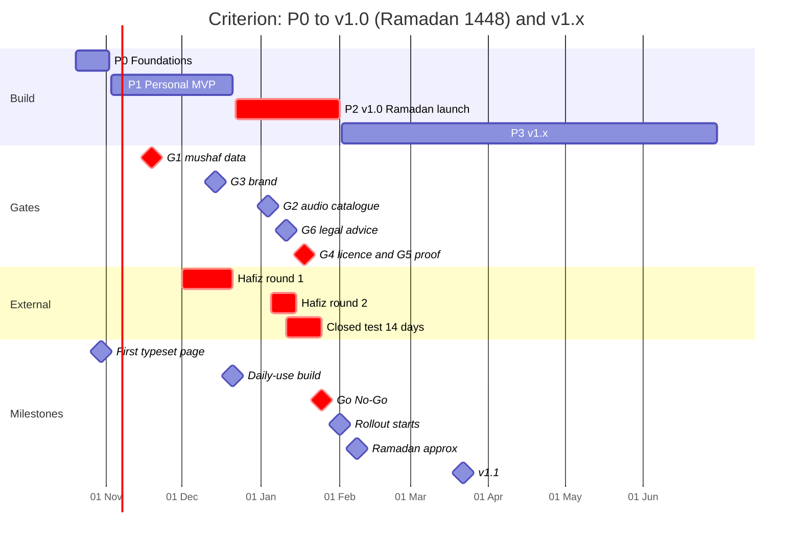
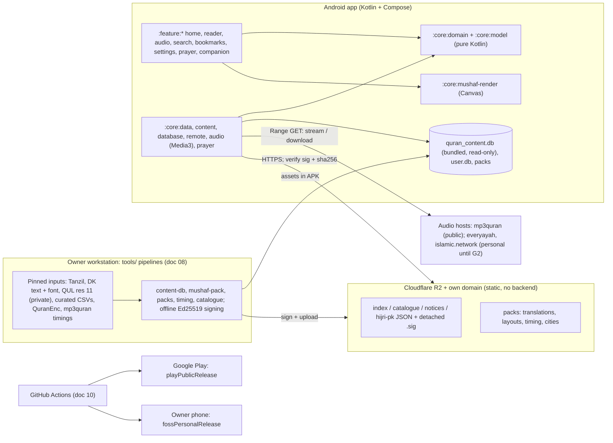

# Criterion: Master Plan (read this first)

**An ad-free, tracking-free Quran app for Android. It shows the printed 16-line Indo-Pak (Taj) page, typeset and ayah-aware, and plays your favourite Qari for any Surah, Para, Manzil or verse range, highlighting each ayah on the page as it is recited.**

**Status: Draft v1 — 2026-10-19** · Codename *Criterion* (package `com.chughtai.criterion`). The public brand is picked at gate G3; "Hamdam" (ہمدم) is the working candidate. · Owner: hafizchughtai09@gmail.com

This README is the executive end-to-end plan and the index to the 13 plan docs, the 13 research reports and the toolchain spike. If a detail here differs from a doc, the **cross-doc rulings in §13** take precedence. Doc 09 owns dates and scope. Doc 12 owns decisions (D-xx), gates (G1–G6) and risks (R-xx). Doc 01 owns feature IDs (F-xx-nn).

---

## 1. TL;DR

1. **What we build.** A native Android app (Kotlin + Compose) built around a **typeset 16-line Taj Indo-Pak mushaf**: 548 pages, showing the printed labels 2–549, with every ayah tappable. It comes with a **favourite-Qari player** that can play a Surah, Para, Manzil, Ruku, Page, verse range, single ayah or "play from here", highlights the ayah being recited and turns the page automatically. It has Para/Surah/Manzil/Ruku indexes with **Read + Play on every row**, bundled Urdu and English translation, search, and bookmarks. It works fully offline.
2. **How it beats the reference app** ("Al Quran – القرآن الكريم", 50M+ installs):
   - **No ads, paywalls or gated reciters, ever.** These cause about 53% of its recent 1–2★ reviews.
   - **Ayah highlight and play-from-ayah.** Its most-upvoted review (+4,399) asks for highlighting.
   - **Para-wise and Manzil-wise listening** that follows the real Indo-Pak Para boundaries.
   - **Manzil and Ruku indexes**, which it lacks.
   - **Translation that really ships.** Its listing claims translation, but the app doesn't have it.
   - **Crisp vector zoom and true night themes**, not inverted scans.
   - **Honest privacy:** zero tracking SDKs, against its AdMob, AppsFlyer and Firebase.
   - **A hafiz-certified text** with a public report-error SLA.
3. **Decision 1: typeset, never scans** ([D-05](12-decisions-risks.md)). We use the DigitalKhatt IndoPak font (SIL OFL). The offline pipeline precomputes line justification and kashida, and our own Compose Canvas renderer only draws. This gives ayah awareness, vector zoom, themes and highlight, and avoids the copyright problem with Taj scans.
4. **Decision 2: data provenance** ([D-06/D-07](12-decisions-risks.md)). The 16-line layout comes from QUL resource 11, which needs Tarteel's written permission (**G1, decision 2026-11-19**; otherwise we build a clean-room layout from a purchased print). The word stream is DigitalKhatt's MIT-licensed text, keyed to Kufan verse keys. The Indo-Pak Para, Manzil, Ruku, Sajda and quarter tables are **our own, checked against the print**; we never use the Madani juz.
5. **Decision 3: audio** ([D-12/D-13](12-decisions-risks.md)). The public default is gapless per-surah MP3s from mp3quran.net, whose site grants use to anyone. We pair them with **our own validated timing packs**, a Media3 `PlanExpander` and a `PlaybackStateHub` that drives the highlight. The public shortlist has 12 reciters; **Alafasy** is the default and Saad Al-Ghamdi is the fallback. Verse-by-verse (gapped) audio and the Urdu translation voice stay in your personal build until their owners give permission (G2).
6. **Decision 4: stack** ([D-01…D-03, D-24](12-decisions-risks.md)). Native Android on a **spike-verified 2026 toolchain**: AGP 9.4.1, Kotlin 2.4.21, Room 3 with FTS5, Media3 1.11.1, Hilt and Navigation 3. The architecture is modular and offline-first. There is **no app backend**: only static, Ed25519-signed files on Cloudflare R2.
7. **Decision 5: business and trust** ([D-17, D-20, D-29](12-decisions-risks.md)). The app is **free forever, with no ads ever and no third-party SDKs**. Data safety says "No data collected". A **content-eligibility system** (PERSONAL / BETA / PUBLIC tiers) is enforced in CI, so personal-only content can never reach a public build. An optional "Support / Sadqa-e-Jaria" in-app purchase comes in v1.5.
8. **Launch target.**
   - **Your daily-use build: 2026-12-21.**
   - **v1.0 public: staged rollout from 2027-02-01, at 100% by about 02-05, before Ramadan 1448 (about 8–9 Feb).** This happens only if all six gates clear by Go/No-Go on 2027-01-25. If not, v1.0 runs as a closed test through Ramadan and goes public after Eid.
   - **v1.0 contents:** the Quran core, plus prayer times with Sehri/Iftar, Hijri date, Ramadan core and the khatam planner.
   - **Moved to v1.1 (2027-03-22):** adhan alarms, Qibla, widgets, reminders, azkar, translation packs and share-image.
9. **Capacity reality** ([09 §4](09-roadmap-backlog.md)). The full scope is about 100 ideal days; about 80 are available before Ramadan. The plan of record is **76.5 ideal days**, with a 9-rung scope-cut ladder. Velocity checkpoints fall on 11-16, 11-30 and 12-14. At the **11-30 checkpoint** we decide whether to hire a freelancer to bring adhan back into v1.0.
10. **What only you can do this week** (§8):
    - Create the **QUL account and export** resource 11, and send the **G1 emails**: Tue 10-20.
    - Send the **G2 audio emails** and **order 2 Taj 16-line prints**: Wed 10-21.
    - Start the **entity + D-U-N-S** registration and **photograph 5 checkpoint pages** of your own mushaf: Thu 10-22.
    - Have an **API 24/25 phone and an API 26/27 phone** in hand by 10-28.
    - **Approve the budget**: about PKR 300k–780k one-time, plus about $1–6 a month.

---

## 2. Important correction: your mushaf is the 16-line one, not 13-line

You described the reference app as roughly "13 lines". It is not. The reference app, and the screenshot you sent ("Juz Index · Page #2, Juz #1"), show the **16-line Taj Company Indo-Pak mushaf**: 548 pages, with Juz 1 on printed page 2 and Juz 2 on page 21. The developer's own site says "16 lines", and the screenshot has 16 ruled lines ([r01 §1.2, rec. 1](../research/01-reference-app-teardown.md); [g02](../research/10-gap-02-taj16-print-fidelity-verification.md)). The 16-line edition is the Pakistan standard.

- **Our default is the 16-line Taj layout** (D-04). Its page numbers match the print (labels 2–549).
- **The 15-line Hafizi (610 pp, for huffaz) and the 13-line Taj (847 pp) follow in v1.x** (F-RD-11; 15-line in v1.2, 13-line in v1.3). Each needs its own data permission and hafiz certificate. Madani 15-line comes in v2.
- If you really wanted 13-line as the default, tell us before 2026-10-30 ([12 §6 Q1](12-decisions-risks.md)). Please also photograph printed pp. 2, 39, 70, 115 and 483 of the mushaf you read daily, so we can lock the data to *your* printing.

---

## 3. What you asked for → how the plan delivers it

| Your must-have | Feature IDs (release) | Specified in |
|---|---|---|
| **Read page-by-page like the printed mushaf** (Indo-Pak page) | F-RD-01 typeset 16-line pager, RTL swipe, printed labels · F-RD-03 light/sepia/night/AMOLED · F-RD-06 vector pinch zoom (v1.0) | [05 Renderer](05-mushaf-rendering-engine.md), [02 UX §4.4](02-ux-ui-spec.md) |
| Screenshot toolbar "Juz Index · Page #2, Juz #1" with bookmark / night / lock | F-RD-02 toolbar "Para 1 · Page 2 · Al-Fātiḥa" + index button, immersive tap-to-toggle · F-BM-02 bookmarks · F-RD-03 night · F-RD-07 rotation + page-turn lock · F-BM-01 auto last-read (v1.0) | [02 §4.4](02-ux-ui-spec.md), [01 §7.1](01-product-requirements.md) |
| **Listen to a favourite Qari** | F-AU-01 catalogue + favourite Qari at onboarding (F-PL-01) · F-AU-07 background play, notification, lock screen · F-AU-08/09 downloads + cache (v1.0) | [06 Audio](06-audio-engine.md) |
| …for a **Surah, Parah (Juz), verse or verse range** | F-AU-02 scopes Surah / Para (Indo-Pak boundaries) / Manzil / Ruku / Page / AyahRange / Ayah / play-from-here · F-AU-05 repeat ayah×N, range×M, pauses · F-AU-06 speed + sleep timer · F-RD-04 ayah long-press "play from here" (v1.0) | [06 §6–7](06-audio-engine.md) |
| …and see where the Qari is | F-RD-05 + F-AU-03 ayah highlight + auto page-turn (v1.0); F-AU-12 word-level highlight (v1.3) | [05 §8.6](05-mushaf-rendering-engine.md), [06 §9](06-audio-engine.md) |
| **Indexing by Parah, Surah and Manzil** | F-IX-01 Surah · F-IX-02 Para (Indo-Pak names, start page, progress) · F-IX-03 Manzil, each row with Read + Play · F-IX-04 Ruku · F-IX-05 go to page / surah:ayah · F-IX-06 Sajda (v1.0) · F-IX-07 quarter navigation (v1.0 stretch) | [02 §4.3](02-ux-ui-spec.md), [03 §7 curated tables](03-content-data-licensing.md) |
| **In-demand extras** | v1.0: F-TR-01 Urdu Junagarhi + English Saheeh · F-RD-08 translation view · F-SR-01..03 Arabic / translation / alias search · F-IX-08 quick access (Yaseen, Mulk, Kahf, Ayatul Kursi, Manzil dua…) · F-IX-09 home "continue reading" · F-CP-01 prayer times + Sehri/Iftar · F-CP-04 Hijri · F-CP-07 Ramadan · F-BM-04 khatam planner · F-PL-11 signed remote notices. v1.1: F-CP-02 adhan + health check, F-CP-03 Qibla, F-CP-05 tasbeeh (v1.0 stretch), F-CP-06 azkar, F-CP-08 widgets, F-CP-09 reminders, F-CP-10 share image, F-TR-02/03 translation packs + translator choice, F-PL-10 rating prompt, F-PL-12 launcher shortcuts. v1.2+: F-CP-12 Hifz mode, extra layouts, Android Auto | [01 §6](01-product-requirements.md), [07 Companion](07-companion-engagement-features.md), [09 §5](09-roadmap-backlog.md) |
| **Prefer open-source / openly licensed** | DigitalKhatt font (OFL 1.1) and text (MIT), Tanzil text (CC BY 3.0), QuranEnc translations, GeoNames (CC BY 4.0), adhan2 (MIT), AndroidX/Apache libraries. GPL apps are read for ideas only and never copied (D-18). Every source is credited on the Sources & Credits screen (F-PL-04) | [03 Licensing](03-content-data-licensing.md), [12 D-18](12-decisions-risks.md) |
| "Make the necessary decisions yourself" | 31 recorded decisions (D-01…D-31), 34 resolved research contradictions, 6 gates | [12 Decisions](12-decisions-risks.md) |

---

## 4. Product snapshot

**Positioning** ([01 §1.2](01-product-requirements.md)): for Pakistani and South-Asian Muslims, at home and abroad, who read the 16-line mushaf and listen to recitation daily. *"Read like your printed Quran. Listen to your Qari. Nothing else in the way."* It is not a super-app, not a scan viewer, not translation-only, and not an AI-answers app (D-31).

**Principles** (PP-1…PP-8):
- Quran-first and respectful: no promos, no reciter photos, no generated religious text.
- No ads, tracking or paywall on the Quran.
- Offline-first.
- Faithful to the Taj print; when in doubt, the print wins.
- Urdu as a first-class UI language, accessible, with no maslak bias in defaults.
- Fast and light: download ≤ 25 MB; Home in ≤ 0.5 s on mid-range phones.
- Honest: a truthful Data safety form and full credits.
- Calm engagement: private streaks only, and at most 3 reminders a day.

### 4.1 Phases

| Phase | Dates | Scope | Ships to |
|---|---|---|---|
| **P0 Foundations** | 2026-10-20 → 11-02 (S0) | <ul><li>Toolchain from the spike, module skeleton and CI</li><li>Content DB v0</li><li>Device smoke test (kashida + FTS5 on API 24/26)</li><li>Renderer spike: **M1, first typeset page on a device, 10-30**</li><li>All G1/G2 emails sent</li></ul> | — |
| **P1 Personal MVP** | 11-03 → 12-21 (S1–S4) | <ul><li>Reader with furniture</li><li>Indexes</li><li>Bookmarks and last-read</li><li>Audio with all scopes, highlight and auto-turn</li><li>Downloads</li><li>Translation view</li><li>Urdu UI infrastructure</li></ul> Milestones: M2 reader alpha 11-30 (proof PDF goes to the hafiz), M3 audio alpha 12-14 | **Your phone, 12-21** (`fossPersonalRelease`, sideloaded) |
| **P2 v1.0 "Ramadan launch"** | 12-22 → 2027-02-01 (S5–S7) | <ul><li>P1 carry-over: search, Urdu strings, repeat, zoom, ruku/sajda lists, accessibility, onboarding</li><li>**Compliance floor:** credits, report-error flow, signed kill-switches, privacy, UIDT downloads, proofreading</li><li>**Tier A:** prayer times + Sehri/Iftar, Hijri + PK month-start feed, Ramadan core, khatam planner</li><li>Store listing</li></ul> | Closed test **01-11** → Go/No-Go **01-25** → production **02-01**, at 100% by 02-05 |
| **P3 v1.x** | 2027-02-02 → 06-30 | <ul><li>**v1.1, 03-22:** adhan + health check, Qibla, tasbeeh, azkar, widgets, reminders, share image, translation packs + translator picker, notes/export, opt-in crash reports</li><li>**v1.2, 05-03:** Hifz mode, 15-line layout, Android Auto</li><li>**v1.3, 06-07:** 13-line layout, tablet two-page spread, word highlight, Quran.com sync, realtime group khatam</li><li>**v1.5, 06-28:** supporter in-app purchase</li></ul> | Public (Ramadan freeze 02-05 → Eid ≈ 03-10: hotfixes only) |
| **P4 v2** | H2 2027 (≈ 2027-10) | AI recitation follow-along (if the P3 spike passes), tajweed colours, Madani mode, word-by-word (if licensed), Noorani Qaida, Wear OS, topic search | Public |

**Critical path, with zero slack** ([09 §8](09-roadmap-backlog.md)): QUL data → pipeline → renderer → proof PDF (11-30) → hafiz round 1 → fixes → hafiz round 2 on device renders → G5 (01-18) → Go/No-Go (01-25) → rollout. A one-week slip of the proof PDF uses up the whole margin before Ramadan.

---

## 5. Architecture at a glance

| Layer | Choice | Version (D-02, spike-verified) |
|---|---|---|
| Build | AGP · Gradle · Kotlin (raised above AGP's bundled 2.2.10) · KSP | 9.4.1 · 9.8.1 · **2.4.21** (fallback 2.3.21) · 2.3.12 |
| SDK | compileSdk / targetSdk / minSdk; desugaring; Java 17 bytecode; R8 on | 37 / 36 / 24; desugar_jdk_libs 2.1.5 |
| UI | Compose BOM (Material3 1.4.0) · Navigation 3 | 2026.09.00 · 1.2.0 |
| DI | Hilt + androidx.hilt (KSP, no kapt) | 2.60.1 + 1.4.0 |
| Data | Room 3 (`androidx.room3`) + sqlite-bundled (FTS5) · typed DataStore | 3.0.3 + 2.7.1 (fallback Room 2.8.5 + FTS4) · 1.2.1 |
| Audio | Media3 ExoPlayer + `MediaLibraryService` + OkHttp data source | 1.11.1 |
| Background / widgets | WorkManager (dataSync on API ≤ 33) + UIDT jobs (API 34+) · Glance | 2.12.0 · 1.2.0 |
| Network / JSON | OkHttp everywhere (**no Ktor**, D-26) · kotlinx.serialization · coroutines | 5.5.0 · 1.11.0 · 1.11.0 |
| Prayer | adhan2 (Karachi + Hanafi defaults) · Hijri via `HijrahDate`, ICU fallback (D-27) | 0.0.7 |
| Quality | Robolectric, Roborazzi golden pages, Macrobenchmark + baseline profile · AboutLibraries | Roborazzi 1.76.0 · 15.3.0 |
| IDE | Android Studio Rabbit 1 (2026.2.1) + JDK 21 | supports AGP ≤ 9.4 |
| Pipelines | Python 3.12 + uv workspace · uharfbuzz · fontTools | 0.56.3 · 4.67.* |
| Hosting / CI | Cloudflare R2 + custom domain · GitHub Actions | ≈ $1–6 a month |

**Key architectural facts** ([04](04-architecture.md)):
- **Modules.** The graph grows from 9 modules (P0) to 19 (P1) and 22 (v1.0). Features never depend on features. Interfaces live in pure-Kotlin `:core:domain`.
- **Three storage roles** (D-10):
  - a bundled read-only `quran_content.db`;
  - a migrated `user.db`, whose schema v1 is frozen on 12-21 and already includes the P2 tables;
  - signed packs.
- **User data is keyed by stable keys:** the Kufan `VerseKey`, or (`mushafId`, `pageIndex`). The UI shows `pageLabel` = index + 1.
- **Build variants** are `distribution` {play, foss} × `tier` {personal, public}. `BuildConfig.CONTENT_TIER` is one of {PERSONAL, BETA, PUBLIC}, plus a `MONETIZED` flag. A public-tier build counts as BETA until it is built with `-Pcriterion.release=production`, which requires G1 + G5 evidence.
- **The remote control plane** (`notices.json`, the catalogue) can disable, hide or annotate content. It **never changes Quran text or layout** (D-30); text fixes ship as app updates.

---

## 6. Data & licensing at a glance

| Content | Source | Licence / status | Ships |
|---|---|---|---|
| Arabic text for search, copy and share | Tanzil Uthmani + Simple-Clean v1.1 | CC BY 3.0, verbatim, with attribution | Bundled |
| Canonical word stream (83,669 tokens) | DigitalKhatt `quran_text_indopak_15.ts` @ `4213fab` | MIT | Bundled |
| Mushaf font | DigitalKhatt IndoPak `hb/indopak.otf` @ `4213fab`, converted to glyf TTF | SIL OFL 1.1 (renamed "Criterion IndoPak") | Bundled |
| 16-line Taj layout (548 pp) | QUL resource 11 (your free account) | **Written permission needed: G1**; otherwise clean-room | Bundled (personal now; public after G1) |
| Para / Manzil / Ruku (558) / Sajda (14 + 1) / quarters (90) / surah headers | Our own curated CSVs, checked against the print | Own work. **Before the closed test: 53 quarters and 39 headers still to verify** | Bundled |
| Translations, bundled | QuranEnc Urdu Junagarhi v1.1.3 (+ Ahsan-ul-Bayan notes), English Saheeh v1.1.2 | QuranEnc terms (verbatim, version, credit) | Bundled |
| Translation packs (v1.1) | Jalandhari, Kanz-ul-Iman, Pickthall (Tanzil files: **non-commercial**), Hilali-Khan, Hindi, Indonesian, Turkish (QuranEnc) | Per-pack `commercialOk` flag | Download |
| Recitation, public | mp3quran.net gapless per-surah (12-reciter shortlist) | `HOST_GRANT`; host statement archived with SHA-256 | Stream / download |
| Highlight timings | Our timing packs from mp3quran `ayat_timing`, ETag/size-guarded | Derived → `PERMITTED`; per-surah kill-switch | 12 bundled + R2 |
| Gapped per-ayah audio, KFC recordings | everyayah / islamic.network; King Fahd Complex (self-hosted on R2 after permission) | `PENDING` → personal/beta until G2 | Stream / download |
| Personal-only audio | Shamshad Ali Khan Urdu voice, Husary Muallim, Qari Sadaqat Ali | `PERSONAL_ONLY` | Your build only |
| Companion data | GeoNames cities15000 (CC BY 4.0), azkar corpora (PD / MIT), DontKillMyApp (CC BY), PK Hijri feed (ours) | Open | Bundled / signed feed |
| Ornaments, icon, adhan | Commissioned work-for-hire, plus 2 CC0 adhan fallbacks | Assignment contracts | Bundled |

**Never shipped:**
- QF / quran.com API content.
- quranicaudio, Tarteel or QDC audio.
- Scans.
- Waqar144 and QuranApp data (QA oracles only).
- GPL code.
- Anything not eligible for the build's tier (CI-enforced; [03 §1.3](03-content-data-licensing.md)).

### 6.1 Gates (doc 09 dates are final)

| Gate | Cleared when | Decision date | If not cleared |
|---|---|---|---|
| **G1** Mushaf data | Tarteel/QUL gives written permission for resource 11 (+ 565/59), and the DigitalKhatt author confirms the MIT scope. Emails go out 10-20 (deadline 10-23); follow-ups 11-02/03 and 11-12 | **2026-11-19** | A clean-room Taj-16 layout starts 11-20: 40–60 h plus 15–20 h of hafiz QA, done by a **second person** (you have seen the QUL data). No QUL-derived layout goes to *any* tester. **The public launch probably moves after Eid** |
| **G2** Public audio catalogue | Every public entry is `PERMITTED` or `HOST_GRANT` with archived evidence, and no rights-holder has objected | **2027-01-04** (freeze) | Ship the mp3quran shortlist minus any reciter whose rights holder refuses. If Alafasy refuses, Ghamdi becomes the default. Gapped audio stays personal/beta |
| **G3** Brand | Self-searches on IPO-Pakistan, WIPO and USPTO, plus a Play search, come back clean | **2026-12-14** | Next shortlisted name. Never the reference app's name or assets |
| **G4** Code licence | Your decision memo | **2027-01-18** | Proprietary for v1.0 (our recommendation is GPL-3.0-or-later) |
| **G5** Proofreading | A hafiz signs a certificate covering all 548 **device-rendered** pages, bound to the content hash | **2027-01-18** | No public release; the closed test continues |
| **G6** Pakistani legal advice | Written opinion on the Punjab Holy Quran Act 2011 / Quran Board, Taj pagination rights and the entity | **2027-01-11** | Closed test until the advice arrives |

**Go/No-Go is 2027-01-25.** If all gates are green, rollout starts 02-01. If G1, G3, G5 or G6 is red, there is no production release: Ramadan runs as a widened closed test, and we go public within a week of the gate clearing (never in the last 10 nights), or merge the launch with v1.1 on 03-22 ([09 §5.3](09-roadmap-backlog.md)).

---

## 7. Product scope for v1.0 vs v1.1 (the scope-cut ladder)

**v1.0 floor, never cut:**
- every P1 feature: reader, indexes, audio + highlight, downloads (with UIDT), translation view, search, Urdu UI, onboarding, a11y baseline;
- credits (F-PL-04);
- report text error (F-PL-05);
- signed notices and kill-switches (F-PL-11);
- privacy, proofreading, store listing and closed test.

**Tier A, committed:**
- prayer times + Sehri/Iftar (F-CP-01);
- Hijri + PK feed (F-CP-04);
- Ramadan core (F-CP-07);
- khatam planner (F-BM-04).

If we fall behind, these are cut in this order: L5 Ramadan → L6 Hijri → L7 prayer → L8 khatam → L9 P1 polish.

**v1.0 stretch, pre-cut:** tafsir-summary sheet (F-RD-13), quarter navigation (F-IX-07), tasbeeh (F-CP-05) and the Manzil-dua playlist.

**v1.1 by default (pull-ins B1–B17):**
- Each item may enter v1.0 only if it is in the closed-test build by **2027-01-18**.
- Adhan (B1, B5) is deliberately not in Tier A. About 62% of Pakistani phones come from OEMs that kill background apps aggressively, and a missed adhan in Ramadan does more harm than having no adhan.

---

## 8. Owner's action list (only you can do these)

Templates for every email are in [03 §6](03-content-data-licensing.md) (T1–T13). The tracker is `docs/legal/permissions.yml`. Agents never send email, sign anything or publish ([13 §1.1](13-ai-assisted-build-playbook.md)).

| By | Action | Why / gate |
|---|---|---|
| **Tue 10-20** | Create a private GitHub repo with a protected `main`. Install Android Studio Rabbit 1, JDK 21 and SDK 37 (about 2 h, [13 §3](13-ai-assisted-build-playbook.md)) | Day 1 of S0 |
| **Tue 10-20** | Create the **QUL account**. Export resource 11 (16-line Taj) and 565 (or 59) as SQLite to `~/criterion-data/qul/2026-10-20/`, outside the repo, and record their SHA-256s | D-06 |
| **Tue 10-20** (deadline 10-23) | Send the **G1 emails**: support@tarteel.ai cc naveed.ahmad@tarteel.ai (T1), and the DigitalKhatt author at ananeamine@gmail.com (T2). Open the GitHub issue on TarteelAI/quranic-universal-library | **G1** |
| **Wed 10-21** | Send the **G2 emails**: ai@alafasy.co (T4), developers@quran.com (T5), info@qurancomplex.gov.sa (T6, EN + AR). Archive the mp3quran privacy/contact pages as PDF with SHA-256 and date, and send the courtesy note (T7) | **G2** |
| **Wed 10-21** | Order **2 Taj Company 16-line prints** (548 pp) | Proofreading reference; clean-room fallback |
| **Thu 10-22** | **Photograph printed pp. 2, 39, 70, 115 and 483** of your daily mushaf and count its lines | Locks the data to your printing (default: archive.org scan, 10-30) |
| **Thu 10-22** | Start the **entity** (SECP SMC-Pvt or sole proprietorship) and request a **D-U-N-S** for a Play **Organization** account | D-22; avoids the 12-tester rule |
| **10-20 → 10-26** | Buy a **brand-neutral domain** for `CDN_BASE_URL`. Open Cloudflare (R2 + email routing). Generate the **offline Ed25519 signing key** plus an encrypted backup, and the Play upload key | D-24, D-30 |
| **Wed 10-28** | Have **one API 24/25 phone and one API 26/27 phone** for the device smoke test. By P2, add an Infinix, Tecno or Xiaomi phone | P0 exit; R-16 |
| **Fri 10-30** | Publish the **designer brief** (ornaments, icon) and get 2–3 quotes. Shortlist **hafiz/qari** candidates and a **lawyer** | G5, G6 |
| **Mon 11-02** | **Approve the budget** ([11 §9.6](11-release-compliance-business.md)): about PKR 300k–780k one-time plus 15% contingency, about $1–6 a month running. Send all **translation permission requests** (Maududi, Taqi Usmani, Tahir-ul-Qadri, Israr Ahmad, Clear Quran, QuranWBW, Ibn Kathir / Ma'ariful Qur'an, T11). Send the first **G1 follow-up** (also 11-12) | P0 exit |
| **11-09** | **Hire the designer**: ornaments round 1 by 12-04, final by 12-31; icon by 01-08 | F-RD-01 furniture; listing |
| **11-16** | Contract the **hafiz/qari** for about 30–40 h in round 1 (12-01 → 12-21) and 8–10 h in round 2 (01-05 → 01-15). Engage **Pakistani counsel** with the [11 §5.2](11-release-compliance-business.md) brief (latest 11-30) | **G5**, **G6** |
| **11-17 → 12-14** | **Trademark self-search** on IPO-Pakistan, WIPO and USPTO, plus a Play search. Pick the brand ("Hamdam" + 2 alternates) | **G3** |
| **11-19** | **G1 decision.** If there is no grant, line up the clean-room operator to start 11-20 | **G1** |
| **11-23** (hard limit 12-14) | Account-type checkpoint: if you don't have the D-U-N-S and entity in hand, create a **personal** Play account | Closed test ≤ 01-11 |
| **11-30** | Velocity checkpoint: decide whether to **hire a freelance Android developer** for companion work (8–12 ideal days, clean-room + IP assignment). Proof PDF goes to the hafiz | Brings adhan back into v1.0 |
| **12-01 → 01-04** | Recruit **15–20 closed testers** (family, masjid, WhatsApp) | 12 opted in by 01-11 |
| **S5 (by 01-04)** | Record the FGS declaration videos (mediaPlayback, dataSync). Publish the privacy policy, EN + UR, by 12-23 | Play review |
| **01-15** | Commission a Pakistani **muezzin's adhan** with a written assignment | v1.1 adhan (B5) |
| **01-18** | Sign the **G4** licence memo. The hafiz signs the **G5** certificate | G4, G5 |
| **01-25** | **Go/No-Go** | Launch |
| Monthly, from P2 | Publish the signed **PK month-start Hijri feed** after each Ruet-e-Hilal announcement (about 5 min) | R-33 |

---

## 9. Top-10 risks

The full register (R-01…R-45) with scoring, contingencies and triggers is in [12 §5](12-decisions-risks.md#5-risk-register).

| # | Risk | Score | Mitigation / contingency |
|---|---|---|---|
| R-24 | OEM background killing (≈ 62% of Pakistani devices) causes missed or late adhans | 16 | `setAlarmClock`, reschedule set, Adhan health check, OEM matrix; **adhan moved to v1.1** |
| R-39 | P2 scope is too much for one developer | 16 | 76.5-ideal-day plan of record, ladder L1–L9, freelancer lever at 11-30 |
| R-41 | Gates not cleared by 01-25, so the public Ramadan launch is missed | 16 | Outreach in week 1; weekly gate review. Contingency: closed test through Ramadan |
| R-06 | The Punjab Act / Quran Board approval applies to apps | 15 | Early counsel (G6), G5 certificate, no translation-only mode |
| R-01 | Tarteel/QUL refuses or stays silent on G1 | 12 | Day-1 emails and follow-ups. Contingency: clean-room layout (second person) |
| R-43 | The hafiz reviewer is unavailable or slow | 12 | Contract by 11-16; standby second reviewer; split pages |
| R-18 | Glyph or mark bugs in DK IndoPak v0.1 | 12 | Pinned hash, goldens, full G5 review; pipeline substitution; Fallback 2 page images |
| R-37 | Sectarian complaints about the Junagarhi Urdu default | 12 | Neutral labels and governance policy. **The picker and Kanz-ul-Iman / Jalandhari packs arrive in v1.1** (residual risk accepted for v1.0) |
| R-30 | Timing drift after silent re-uploads on mp3quran | 12 | ETag/size guard, weekly CI re-validation, per-surah highlight kill-switch |
| R-44 | AI agents make errors in religious data, or GPL code gets in | 12 | Quran text only from the pipeline (D-31), invariant tests, human review of content diffs |

Also scored 12: R-04 takedown, R-28 Android 17 background-audio hardening, R-33 Hijri vs Ruet-e-Hilal, R-40 capacity.

### 9.1 Decisions you may want to revisit

If you say nothing, our default stands. Change any of these by telling us; each change is recorded as a new ADR in doc 12.

| Decision | Our default | Revisit if… |
|---|---|---|
| Default mushaf | 16-line Taj; 15-line in v1.2, 13-line in v1.3 | You want 13-line first (each layout needs a permission + a certificate) |
| Adhan alarms in v1.0 | **v1.1**; prayer *times* + Sehri/Iftar are in v1.0 | You fund the freelancer at 11-30 (B1 + B5 ≈ 4.25 ideal days) |
| Bundled Urdu translation | Junagarhi + Ahsan-ul-Bayan; picker in v1.1 | You prefer pulling B8 (packs + picker, 3.25 ideal days) into v1.0, or a different default |
| Default reciter | Alafasy (read 123); Ghamdi if Alafasy objects | You have a strong personal favourite (the onboarding picker covers it anyway) |
| Code licence (G4) | Proprietary for v1.0; recommend GPL-3.0-or-later | You plan B2B or white-label work (then stay proprietary) |
| Play account | Organization via a free D-U-N-S | No entity by 11-23 → personal account (12 testers × 14 days) |
| Brand (G3) | "Hamdam" (ہمدم), store title "<Brand>: Quran 16 Line & Audio" | You have a name you love; give 2 alternates |
| Gates missed | Closed test through Ramadan, public after | You would rather launch publicly without a gate. **We advise against it, especially G1/G5/G6** |
| Fatiha display | Taj-faithful empty circles; numbered option in settings | Your print differs |
| Distribution | Play only for v1.0 (`foss` builds but isn't distributed) | You want F-Droid or a website APK |
| Group khatam | WhatsApp text sheet first; Firebase (play flavor) in v1.3 | You object to any Google backend |
| Word-by-word | Not before a licence (P4) | QuranWBW grants permission early |

The full ranked list of 20 questions is in [12 §6](12-decisions-risks.md).

---

## 10. How to read the plan set

| Doc | What it gives you |
|---|---|
| [01 Product Requirements](01-product-requirements.md) | Vision, personas, principles, **full feature catalogue (F-IDs)**, acceptance criteria for P1/P2, the 52-row parity matrix against the reference app, NFRs, privacy, success metrics |
| [02 UX / UI Spec](02-ux-ui-spec.md) | Navigation (Home · Quran · Listen · More), NavKeys and deep links, wireframes for every screen and their states, design tokens, RTL/numerals, bilingual copy, a11y, large screens |
| [03 Content, Data & Licensing](03-content-data-licensing.md) | 51 datasets with licences and eligibility, the build-tier matrix, the permission tracker and **ready-to-send emails**, curated Para/Manzil/Ruku/Sajda/quarter specs, governance policy, credits |
| [04 Architecture](04-architecture.md) | Modules, UDF, domain model, interfaces, **full DDL** for `quran_content.db` and `user.db`, signed pack index, Nav3, DI, manifest, variants and eligibility, version catalogue |
| [05 Mushaf Rendering Engine](05-mushaf-rendering-engine.md) | Pack schema, justification precompute contract, Canvas drawing, furniture, ornament brief, hit-testing, highlight and follow-along, themes, zoom, pager, fallbacks, Kotlin skeletons |
| [06 Audio Engine](06-audio-engine.md) | Catalogue schema and the v1 reciter list, timing packs, PlayRequest/**PlanExpander**, Media3 service, follow-along hub, timers, the download engine (UIDT/WorkManager) |
| [07 Companion & Hifz](07-companion-engagement-features.md) | Prayer times, adhan + health check, Qibla, Hijri + PK feed, tasbeeh, azkar, Ramadan, reminders, widgets, share, khatam, streaks, notes, group khatam, Hifz, Qaida, AI spike |
| [08 Data Pipelines](08-data-pipelines.md) | `tools/` uv workspace: content DB, mushaf pack (shaping + justification), translation and timing packs, catalogue signing, geo DB, Hijri feed, R2 publish, validation invariants |
| [09 Roadmap & Backlog](09-roadmap-backlog.md) | **Dates, gates, sprints S0–S7, capacity math, scope-cut ladder**, critical path, first 10 days, lead times, epics E-01…E-24 with stories, DoR/DoD |
| [10 Quality, Testing & CI](10-quality-testing-ci.md) | Budgets, test pyramid, content invariants, Roborazzi golden pages, audio/download/alarm tests, device matrix, hafiz QA binding, GitHub Actions workflows, versioning |
| [11 Release, Compliance & Business](11-release-compliance-business.md) | Play Console setup, brand + store listing (EN/UR), Data safety, permissions, Punjab Act / G6, launch plan, post-launch SLA, costs, monetization, the G4 framework |
| [12 Decisions, Gates & Risks](12-decisions-risks.md) | ADRs **D-01…D-31**, 34 resolved research contradictions, gate details, **risk register R-01…R-45**, owner questions |
| [13 AI-Assisted Build Playbook](13-ai-assisted-build-playbook.md) | Root `CLAUDE.md`, the guard hook, the session loop, the verification ladder V0–V5, **copy-paste prompts AP-01…AP-26**, multi-agent workflows |

### 10.1 Research reports (the evidence base, read-only)

| Report | One line |
|---|---|
| [r01 Reference-app teardown](../research/01-reference-app-teardown.md) | APK + store teardown of "Al Quran" (9D Tech), with 2,991 reviews mined; establishes 16-line scans, no ayah mapping and ads as the #1 complaint |
| [r02 Competitor landscape](../research/02-competitor-landscape.md) | Pakistani/South-Asian Quran apps compared; market white space (Indo-Pak + highlight + Para audio + Urdu + no ads) |
| [r03 Open-source codebases](../research/03-open-source-codebases.md) | quran_android, quran-ios, QuranApp and others: what we can reuse and what the licences allow (GPL = ideas only) |
| [r04 Mushaf rendering](../research/04-mushaf-rendering.md) | Scans vs fonts vs layout data; DigitalKhatt; kashida justification; the renderer prototype |
| [r05 Text, metadata, translations](../research/05-text-metadata-translations.md) | Tanzil, QUL, QuranEnc and Tanzil translation terms; Para/ruku metadata; Urdu/English translation choices |
| [r06 Audio sources & playback](../research/06-audio-sources-and-playback.md) | Reciter hosts and terms, gapless vs gapped audio, timing data, Media3 design |
| [r07 Android tech stack](../research/07-android-tech-stack.md) | October 2026 library and toolchain survey, architecture recommendations |
| [r08 Companion & differentiators](../research/08-features-companion-and-differentiators.md) | Prayer/adhan reliability on Pakistani OEMs, Qibla, Hijri, azkar, Ramadan, Hifz, AI follow-along, khatam |
| [r09 Legal, compliance, business](../research/09-legal-compliance-business.md) | Copyright, Play policy, Data safety, the Punjab Act, account types, monetization, costs |
| [g01 16-line data provenance](../research/10-gap-01-indopak16-data-provenance-alignment.md) | QUL resource 11 + DK token alignment (83,669 tokens), licensing chain, G1 email drafts, clean-room fallback |
| [g02 Taj-16 print fidelity](../research/10-gap-02-taj16-print-fidelity-verification.md) | Page labels (index + 1), Fatiha numbering, ruku triples, quarters, sajda, manzil, page furniture checked against the print |
| [g03 Audio rights & gapless timing](../research/10-gap-03-audio-rights-and-gapless-timing.md) | Per-reciter rights, mp3quran host grant, timing validation and re-upload guard, permission emails |
| [g04 AGP 9 toolchain spike](../research/10-gap-04-agp9-toolchain-build-spike.md) | Write-up of the verified build (D-02) and the old-Android kashida probe |

### 10.2 The toolchain spike

[`spikes/toolchain-spike/`](../../spikes/toolchain-spike/README.md) is a separate, throwaway Gradle build. On 2026-10-19 it proved that the full D-02 stack compiles and passes 12/12 JVM tests together:
- AGP 9.4.1 / Gradle 9.8.1 / Kotlin 2.4.21;
- Room 3 + FTS5 with a prepackaged `createFromAsset` DB;
- Hilt on a `MediaLibraryService`;
- Media3 on OkHttp 5.5.0;
- WorkManager, Glance, adhan2 and Navigation 3;
- the `cv01` kashida probe.

Its `gradle/libs.versions.toml`, build files and `scripts/` (`build_content_db.py`, `cff2_to_glyf.py`, `hb_widths.py`, `font_features.py`) seed the real app and `tools/`. Treat it as read-only. The first PR ports it and **removes Ktor**.

---

## 11. How to start building tomorrow (Tue 2026-10-20)

1. **Set up (owner, about 2 h):** follow [13 §3](13-ai-assisted-build-playbook.md): repo, branch protection (`ci/check`, squash-only), Studio + SDK 37, AVDs (API 36, 24, 26, sw600dp). Then add the root `CLAUDE.md` from [13 §2.1](13-ai-assisted-build-playbook.md), plus `.claude/settings.json` and the guard hook.
2. **Run the first agent prompt, [AP-01: toolchain upgrade from the spike](13-ai-assisted-build-playbook.md).** It ports the spike's catalogue and build files and drops Ktor. It renames the content asset to `quran_content.db` and adds the CI guard `kotlin-gradle-plugin:2.2.10 -> 2.4.21`.
3. **Follow the first 10 working days** ([09 §7](09-roadmap-backlog.md)), one story per agent session ([13 §4](13-ai-assisted-build-playbook.md)):

| Day | Date | Engineering (with agents) | Owner-only |
|---|---|---|---|
| 1 | Tue 10-20 | Branch `p0/toolchain`: port the spike, remove Ktor | QUL export + hashes; G1 emails + GitHub issue; `permissions.yml` |
| 2 | Wed 10-21 | Toolchain PR green (`assembleRelease`, tests, Kotlin-lift guard); merge | G2 emails; archive mp3quran evidence; order prints |
| 3 | Thu 10-22 | `build-logic/convention` plugins, including `criterion.root` (feature→feature check) and `criterion.android.robolectric` | Entity + D-U-N-S; checkpoint photos |
| 4 | Fri 10-23 | Lean module skeleton; `play`/`foss` flavors; manifest removal list; CI workflow (AP-02/03) | — |
| 5 | Mon 10-26 | `tools/` pipeline skeleton from `build_content_db.py`; pinned inputs (Tanzil, QuranEnc); pin DK @ `4213fab` (AP-04) | Domain + R2 + signing key |
| 6 | Tue 10-27 | DK tokenizer with g01 asserts (83,669 / 77,433 / 6,236 / 118 / 558 / 15); `ayah_marker` (6,354 rows); glyf TTF conversion | — |
| 7 | Wed 10-28 | **Device smoke test (AP-06).** `getRunAdvance(الْكِتٰبُ)` = 2060 / 2847 / 4384 at cv01 0/1/3; FTS5 hits; adhan2 times; content DB opens via `createFromAsset` | Old phones in hand |
| 8 | Thu 10-29 | Renderer spike part 1: labels 2, 3, 20 drawn with `drawTextRun` per word (AP-07) | — |
| 9 | Fri 10-30 | Renderer spike part 2 on old and modern devices; frame times. **M1** | Designer brief; shortlist hafiz + lawyer |
| 10 | Mon 11-02 | **S0 review (M0):** P0 exit checklist ([09 §3](09-roadmap-backlog.md)), kashida go/no-go recorded in doc 12, plan S1 | Every permission email sent; budget approved |

After that, take stories in doc 09 order (E-01…E-24), using prompts AP-04…AP-26. Merge only with green CI and a pasted evidence block.

---

## 12. Glossary

- **Para** = Juz (Indo-Pak boundaries).
- **Manzil** = one of 7 weekly portions.
- **Ruku** = section marker ع.
- **page_index / page_label**: the QUL index 1–548 / the printed number 2–549.
- **Kufan verse key**: `surah:ayah`, 6,236 ayahs, with 1:1 = the basmala.
- **id**: one ideal day = 6 focused hours with AI agents.
- **POR**: plan of record.
- **QUL**: Tarteel's Quranic Universal Library.
- **DK**: DigitalKhatt.
- **KFC**: King Fahd Complex.
- **UIDT**: user-initiated data transfer job.
- **FGS**: foreground service.

---

## 13. Cross-doc rulings (precedence over individual docs)

The 13 docs were written in parallel. Where they disagree, these rulings apply. They will be folded back into each doc in its next revision.

| Topic | Ruling | Docs that still show the older value |
|---|---|---|
| Gate dates | G1 11-19 · G3 **12-14** · G2 01-04 · G6 **01-11** · G4 + G5 **01-18** · Go/No-Go 01-25 · closed test opens **01-11** (earlier only if G1 clears early) | 12 §4 (G3 12-15, G6 01-08, G4/G5 01-15); 11 §0 (closed test 12-28; G2/G6 01-18) |
| v1.0 scope | Floor + Tier A = F-CP-01, F-CP-04, F-CP-07, F-BM-04. F-CP-02 adhan, F-CP-03, F-CP-06, F-CP-08…11, F-BM-03/05/06-JSON, F-TR-02/03, F-RD-09/12 and public F-AU-10 → **v1.1**. Stretch: F-RD-13, F-IX-07, F-CP-05, Manzil-dua playlist | 01 §5 ("never cut F-CP-02"); 07 §1.3 Tier A (adhan, tasbeeh); 12 R-37 (picker "in v1.0") |
| New feature IDs | **F-PL-10** gentle rating prompt (play flavor, Could) · **F-PL-11** signed remote notices (`notices.json`; in the v1.0 floor) · **F-PL-12** launcher app shortcuts (Could, v1.1) | 02 (shortcuts as F-PL-10/11) |
| Para formula (D-07) | Para 1 starts at index 1 (label 2). Para n = 2…28 starts at index 18n−16 (label 18n−15). P29 starts at index 508, P30 at 528 | D-07 text in the shared register |
| Content tiers | `BuildConfig.CONTENT_TIER` {PERSONAL, BETA, PUBLIC} + `MONETIZED`. Gradle uses `-Pcriterion.release=production` / `-Pcriterion.monetized=true`. `licenceStatus` {PERMITTED, HOST_GRANT, PENDING, PERSONAL_ONLY, REVOKED} + a free-text `basis` | 03 (`buildClass`), 06 (`CONTENT_CHANNEL`), 08/10 (profiles) |
| Closed-test content | BETA builds ship only G1-cleared or clean-room mushaf data, and only HOST_GRANT/PERMITTED audio. PENDING content is personal-only | 11 (looser reading) |
| Remote JSON signing | Detached Ed25519 `.sig` over the exact file bytes; `kid`, `sequence` and `expires` inside the JSON; two pinned public keys | 08 (single-object envelope) |
| Data placement | `word` and `ayah_marker` live in `quran_content.db`. Mushaf packs hold layout only (doc 05 schema names). Timing packs may be plain SQLite | 05 draft (`ayah_marker` in the pack), 08 (pack table names) |
| `user.db` versions | v1 (frozen 12-21) includes the P1 + P2 tables; the P3 tables are the v2 migration | 07 (v2/v3) |
| Text-error SLA | Triage ≤ 24 h · signed notice / kill-switch ≤ 48 h · corrected build submitted ≤ 72 h · reporter acknowledged ≤ 72 h | 01, 03 (other numbers) |
| Cold start | ≤ 500 ms Pixel 6a class · ≤ 1.2 s mid-range · ≤ 1.5 s on a 3 GB API-24-class low-end phone | 01, 02 |
| Defaults | Keep-screen-on while the reader is visible, off after 15 min idle · streaming on mobile data = "Ask once" · haptics off · app opens to Home | 01, 02 |
| Module names | Doc 04's list rules (e.g. `:core:mushaf-render`, `:feature:prayer` hosts Qibla/Hijri, `:feature:companion` hosts tasbeeh/azkar/Ramadan) | 05, 06, 07 (module names they assumed) |
| P1 downloads | WorkManager worker on all APIs in P1; the UIDT host (API 34+) lands in S5, before any public build | — |
